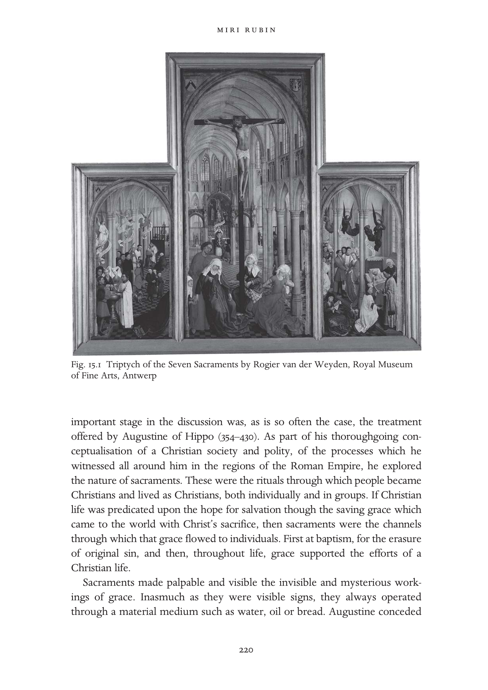

# 圣事生活：英文转换底稿

<!-- PDF page 239; original page 219 -->

### 15

### Sacramental life

### mirirubin

Some time between 1445 and 1450 the Flemish artist Rogier van der Weyden (b. 1400, Tournai, d. 1464, Brussels) painted three oak panels which have come to be known as the Seven Sacraments Altarpiece.[^p239-1] The artist had made a pilgrimage to Rome in the Jubilee year of 1450, and his subsequent work – including this panel – displays a new-found vibrancy and colour. The trip to Rome may have also inspired a state of mind which is evident in the work: for Rogier offers a summa, a visual summary, of the Christian life as a sacramental journey from cradle to grave. This was a vision conceptualised and promoted by popes since the twelfth century, one which had become, by van der Weyden’s time, the elementary framework for Christian lives.

The history of the sacraments begins, of course, much earlier. Already the second-century Tertullian (c. 160–c. 225) attempted to use the Roman legal term sacramentum – oath – to describe religious commitment.[^p239-2] He also developed sacramentum to mean ‘symbol, figure, allegory, symbolic virtue or power, a symbolic order or person’.[^p239-3] Sacraments were those gestures or practices which denoted a commitment, or signified events of great importance.[^p239-4] The next

[^p239-1]: This panel measures 200 × 97 cm (central panel), 119 × 63 cm (side panel, each) and is on display at the Royal Museum of Fine Arts (Koninklijk Museum voor Schone Kunsten) in Antwerp. Dirk De Vos, Rogier van der Weyden: The Complete Works (New York: Harry N. Abrams, 1999), 217–25 offers an authoritative discussion of the altarpiece. De Vos suggests an earlier date of 1440–5 and that the commission was made by Jean Chevrot, Bishop of Tournai, who intended the altarpiece for the chapel of the Collegiate church of Poligny in the Franche–Comté, Chevrot’s home town. See also Pierre Quarré, ‘Le triptyque des Sept Sacraments de Rogier van der Weyden, en Bourgogne’, Publication du centre européen d’études burgundo-médianes 17 (1976), 85–94. I am grateful to James H. Marrow and Walter Simons for advising me on the literature about the altarpiece.

[^p239-2]: Peter Cramer, Baptism and Change in the Early Middle Ages, c. 200–c. 1150 (Cambridge: Cambridge University Press, 1993), 63–4.

[^p239-3]: Brian Stock, The Implications of Literacy: Written Language and Models of Interpretation in the Eleventh and Twelfth Centuries (Princeton: Princeton University Press, 1983), 256–8.

[^p239-4]: See also Elizabeth Saxon, The Eucharist in Romanesque France: Iconography and Theology (Woodbridge: Boydell Press, 2006), 14–15.

<!-- PDF page 240; original page 220 -->

Fig. 15.1 Triptych of the Seven Sacraments by Rogier van der Weyden, Royal Museum of Fine Arts, Antwerp

important stage in the discussion was, as is so often the case, the treatment offered by Augustine of Hippo (354–430). As part of his thoroughgoing conceptualisation of a Christian society and polity, of the processes which he witnessed all around him in the regions of the Roman Empire, he explored the nature of sacraments. These were the rituals through which people became Christians and lived as Christians, both individually and in groups. If Christian life was predicated upon the hope for salvation though the saving grace which came to the world with Christ’s sacrifice, then sacraments were the channels through which that grace flowed to individuals. First at baptism, for the erasure of original sin, and then, throughout life, grace supported the efforts of a Christian life.

Sacraments made palpable and visible the invisible and mysterious workings of grace. Inasmuch as they were visible signs, they always operated through a material medium such as water, oil or bread. Augustine conceded

<!-- PDF page 241; original page 221 -->

that some people may be sanctified and touched by grace in other ways too, but for most believers sacraments were utterly necessary. As bishop of Hippo he confronted the Donatist tendency which argued that sacraments were only effective if they were celebrated by a pure priest. This position was rejected by Augustine and was persecuted as a heresy by the Empire. Augustine’s position on the sacraments and those who administered them was best suited to the turbulent period of mass conversions in which he lived: how were pagans to be drawn to Christianity if they could not trust that the baptism and the eucharist at the heart of their new lives as Christians were indeed valid, and thus saving?

Sacraments were not only rituals of incorporation which made and sustained Christian lives, they were also links in a chain of succession, reenactments of the fundamental structure of an evolving, historic church. From Christ’s life, through apostles who founded churches, and later through the pope of Rome, Peter’s successor, a chain of sacramental action was created. Augustine’s understanding of the sacraments was thus linked to his vision of the church as an edifice which contained the legacy of grace and the heritage of teaching and example which emanated from Christ’s own life. Thus discussions of the sacraments were always bound to touch upon the status and powers of the clergy, their unique privileges. Additionally, the material aspect of sacraments – their appeal to sense experience – was a bolster against those tendencies within Christianity, to which Augustine had been attracted for much of his life, which espoused a dualist rejection of matter in the conduct of Christian life.

It is important to bear in mind this early Christian legacy when we discuss sacramental life in Western Europe in our period. The early medieval centuries saw relatively little discussion of sacramental theory, although individual sacraments did receive some attention and elaboration.[^p241-5] The most striking re-engagement with the subject happened in those centres of theological work and pastoral provision, the schools of Paris in the twelfth century. In his treatise on the sacraments the Augustinian scholar Hugh of St Victor (1096– 1141) distinguished between the type of sacrament that prevailed in each phase

[^p241-5]: Arnold Angenendt, Geschichte der Religiosität im Mittelalter (Darmstadt: Wissenschaftliche Buchgesellschaft, 1997), 387–404; Philip Lyndon Reynolds, Marriage in the Western Church: The Christianization of Marriage during the Patristic and Early Medieval Periods (Supplements to Vigiliae Christianae 24; Leiden: Brill, 1994); Frederick S. Paxton, Christianizing Death: The Creation of a Ritual Process in Early Medieval Europe, (Ithaca, N.Y.: Cornell University Press, 1990); Stock, The Implications of Literacy, 255–8. I am grateful to Yitzhak Hen for his advice on the early medieval period.

<!-- PDF page 242; original page 222 -->

of history: under natural law, under written law and under grace. He also refined the relationship between the external facets of the sacrament and its internal working:

> sacramentum est corporale vel materiale elementum foris sensibiliter propositum ex simili repraesentans, et ex institutione significans, et ex sanctificatione continens aliquam invisibilem et spiritualem gratiam. A sacrament is a physical or material element, which represents externally according to the senses by similarity, and which signifies by the fact of its institution, and as to the sacred, contains a certain invisible and spiritual grace.[^p242-6]

In the emergent sacramental theology and its pastoral application the issue of appearance was to be enhanced.

Hugh of St Victor’s rethinking of the sacraments influenced the great systematiser of sacramental theology, his pupil Peter Lombard. Turning to this most important theological commentary, Peter Lombard’s (d. 1160) Sentences, we find Augustine’s word re-expressed:

> Sacramentum proprie dicitur quod ita signum est gratiae Dei, ei invisibilis gratiae forma, ut ipsius imaginem gerat et causa existat. It is proper to name a sacrament that which is a sign of God’s grace; in the form of his invisible grace, so that it bears the image of that grace, and is also its cause.[^p242-7]

Unlike the rituals of the Old Law, Christian sacraments not only symbolised, but conferred grace (haec conferunt gratiam).[^p242-8] Lombard also settled the question of the number of sacraments: Augustine had already differentiated between types of sacraments, but Lombard was definitive about their number, not three or four or twelve, as some would have had it,[^p242-9] but seven: baptism, confirmation, ordination, marriage, confession, eucharist, extreme unction.[^p242-10]

[^p242-6]: Hugh of St Victor, ‘De Sacramentis’, Book 1, Part IX, c.2; PL 176, col. 317 D.

[^p242-7]: Peter Lombard, Sententiae in IV libris distinctae (Grottaferrata: Collegium S. Bonaventurae, 1981), IV Sent. D.1, c.2; vol. 2, 232.

[^p242-8]: Ibid., III Sent D.40, c.3; vol.2, 229.

[^p242-9]: N. Häring, ‘The Interaction between Canon Law and Sacramental Theology in the Twelfth Century’, in S. Kuttner, ed., Proceedings of the Fourth International Congress of Medieval Canon Law (Monumenta iuris canonici ser. C, Subsidia 5; Vatican: Apostolic Library of the Vatican Press, 1976), 483–93.

[^p242-10]: Marcia Colish, Peter Lombard, 2 vols. (Brill Studies in Intellectual History 41; Leiden: Brill, 1994), 528. For discussion in Paris, see John W. Baldwin, Masters, Princes, and Merchants: The Social Views of Peter the Chanter and his Circle, 2 vols., (Princeton: Princeton University Press, 1970).

<!-- PDF page 243; original page 223 -->

Van der Weyden’s panel shows the sacraments as social events, with all the variety and animation that family celebrations involve. Its composition cleverly conveys the fundamental meaning of sacraments: at the front, above each and all of the sacramental scenes, is the crucifixion – the source of all grace and hope for salvation. Christ’s body soars above, even as on the ground John, Mary and the holy women lament his death. Along the same axis, deep within the church, at its east end, there is an altar, with the celebration of the sacrament of the altar. The priest is shown at the moment of the elevation – right after the consecration of the bread and wine and the operation of transubstantiation, by which these were turned into Christ’s body and blood – his chasuble facing the viewer with the sign of the cross. The central panel evokes the space of history and its remaking at the altar through the arch-sacrament, the eucharist. A lay person kneels behind the priest awaiting his participation through communion?

The two side panels each contain three sacraments, beginning with baptism at the bottom left and ending with death at the bottom right. Three brightly coloured angels hover over the sacramental scenes of this panel. The baptism is that of an infant – a far cry from the multitude of adult baptisms Augustine had to confront – who is surrounded by godparents as it is dipped in the font. Baptism incorporated the infant into the Christian community, but it was also the sign of the commitment of adults: the biological parents and the baptismal parents promised that they would guide the child towards a Christian life. This was, of course, a serious commitment, animated not only by the hope for salvation, but by hope that the child would survive the dangers of infancy and grow into adulthood.[^p243-11]  The moment around the font was full of meaning. It is not surprising, therefore, that fonts were often carved with a summary of the faith which those attending promised to secure: in late medieval East Anglia most fonts were octagonal in shape. The panels offered eight surfaces for the depiction of seven sacraments, and of the crucifixion from which the grace they conveyed originated.[^p243-12]

Parents feared greatly the possibility that their children would die without baptism, and the church relaxed the condition of baptism so that in the absence of a priest any lay person could pronounce the formula. Midwives, who were often present when a sickly newborn came into the world, were

[^p243-11]: Cramer, Baptism and Change in the Early Middle Ages, c. 200–c. 1150, 136–55; Shulamith Shahar, Childhood in the Middle Ages (London and New York: Routledge, 1991), 45–52.

[^p243-12]: Ann Eljenholm Nichols, Seeable Signs: The Iconography of the Seven Sacraments, 1350–1544 (Woodbridge: Boydell, 1994). I am grateful to Ann Nichols for an edifying conversation on octagonal fonts.

<!-- PDF page 244; original page 224 -->

tested in some dioceses for their knowledge of the baptismal formula. Forced baptism of Jews and Muslims under the threat of violence challenged the sacramental understanding that sacraments were to be freely received. The relative ease with which baptism could be enacted set it apart from most other sacraments. Bishop Bertram of Metz wrote to Pope Innocent III in 1206 with the question about a Jew who, ‘Being close to death, had personally recited the baptismal formula and plunged himself into some water in the presence of just other Jews.’[^p244-13]  The pope required that he be baptised again in a proper manner.

Next follows confirmation, that additional boost of grace which was given to youngsters at the outset of the testing age of adolescence and sexual awakening. The bishop administered confirmation as parents looked on. The child being confirmed is part of a group of youngsters, at the liminal stage between childhood and adulthood. This was also the age of first communion; those deemed able to appreciate its complex truths were ready to receive it.

After confirmation young people were considered responsible for their actions, and able to make moral choices. They now required the guidance and balm of confession, the next sacrament on the left. In the early church, confession was a public ritual, but by the fifteenth century it was a somewhat more private one, though confession boxes were not introduced into Catholic practice until the Counter-Reformation. Confession was guided by the questions of the priest, himself aided by the guidelines of the Liber poenitentialis, the penance handbook, a genre which proliferated from the late twelfth century.[^p244-14] Confession was elicited through a process of probing, which produced selfknowledge and true confrontation with sin. Priests were instructed to discern the many circumstances of sin – prompted by the alliterative – where? when? how? with whom? how often? Consequently transgression was examined in its full context, leading to a more nuanced meting out of appropriate penance. Penance could take the form of fasts of varying degrees of severity, almsgiving, pilgrimages to shrines near or even very far. The bishop of Cambrai required in his synodal statutes of 1260 that the confessed be exhorted to visit the ‘mother church of the diocese, the Cathedral of Cambrai’, and attached an

[^p244-13]: Paul B. Pixton, The German Episcopacy and the Implementation of the Decrees of the Fourth Lateran Council 1216–1245 (Watchmen on the Tower; Leiden: Brill, 1995), 141.

[^p244-14]: Robert of Flamborough, Liber poenitentialis, ed. J. J. Francis Firth (Pontifical Institute of Mediaeval Studies and Texts 18; Toronto: Pontifical Institute of Mediaeval Studies, 1971). See also Alexander Murray, ‘Confession before 1215’, Transactions of the Royal Historical Society, 6th series 3 (1993), 51–81.

<!-- PDF page 245; original page 225 -->

indulgence as a reward.[^p245-15]  An ethos of responsibility developed around confession: anything heard during confession was to be kept secret, never divulged or even insinuated. A whole new dimension was added to the persona of the priest, as indicated in the statutes of Guiard de Laon, Bishop of Cambrai (1238–48):

> Item nullus sacerdos ira vel odio vel etiam metu mortis in aliquo audeat revelare confessionem confitentis signo vel verbo, vel generaliter et specialiter insinuando ut sic dicendo: ‘Ego scio te esse talem qualis es’. Et si revelavit, debet degredare absque miserciordia.[^p245-16] And no priest should dare, out of anger, hatred or the fear of death, reveal anything of the confessed person’s confession, in sign or in word, in general or by insinuation, as in saying ‘I know you are such and such’. And if he does reveal, he should be degraded [from priestly status] without mercy.

After confession and contrition, a change of heart and a separation from sin, Christians were allowed to partake in communion. Indeed, the whole thrust of the sacramental package offered and required from Christians by the Fourth Lateran Council (1215) and its national offshoots was to combine the two into a solemn and meaningful annual event. For lay people that would suffice:

> Omnis utriusque sexus fidelis, postquam ad annos discretionis pervenerit, omnia sua solus peccata confietatur fideliter, saltem semel in anno proprio sacerdoti, et iniunctam sibi poenitentiam studeat pro viribus adimplere, suscipiens reverenter ad minus in pascha eucharistiae sacramentum, nisi forte de consilio proprii sacerdotis ob aliquam rationabilem causam ad tempus ab eius perceptione duxerit abstinendum; alioquin et vivens ab ingressu ecclesiae arceatur et moriens Christiana careat sepultura.[^p245-17] Let [all the faithful of either sex, after they have reached the age of discernment] reverently receive the sacrament of the Eucharist at least at Easter unless they think, for a good reason and on advice of their own priest, that they should abstain from receiving it for a time. Otherwise they shall be barred from entering a church during their lifetime and they shall be denied a Christian burial at death.

The central panel shows the expectant communicant. Everything that had formed the Christian person from baptism, through instruction, confirmation and in the exchanges prompted by confession, should have prepared for the

[^p245-15]: Les statuts synodaux de l’ancienne province de Reims, ed. Joseph Avril (Collection de documents inédits sur l’historie de France 23; Paris: Comité des travaux historiques et scientifiques, 1997), no. 5, 73.

[^p245-16]: Ibid. no.44, 36.

[^p245-17]: Canon 21, The Decrees of the Ecumenical Councils I, ed. Norman P. Tanner (London: Sheed & Ward; Washington, D.C.: Georgetown University Press, 1990), 245–245*.

<!-- PDF page 246; original page 226 -->

reception of communion, Christ’s flesh and blood, confected at the altar by the priest. The centrality of the eucharist in van der Weyden’s panel reflects its position in contemporary discussion and debate. Most guide-books and all collections of edifying tales for instruction of the laity contained a particularly long section about the sacrament of the altar.[^p246-18]  In the eucharist were enfolded so many basic truths, getting it right should lead to a positive disposition and a willing trust in the operation of the other sacraments. Additionally, the theology of the eucharist had developed by the year 1200 into a testing edifice: its keystone was the belief in transubstantiation – a term coined in the 1180s – in the transformation of the bread and wine at the altar into Christ’s flesh and blood through the operation of the words of consecration, Christ’s words of the Last Supper (Matt. 26.26–8), by a priest. The first clause of the Fourth Lateran Council made belief in transubstantiation – in that particular form of Christ’s presence in the sacrament of the altar and no other – a requirement of faith.

Moving to the right panel of van der Weyden’s altarpiece, we encounter three sacraments which were not experienced by all, and not utterly necessary for salvation. First ordination, the privilege of the few who chose the priestly vocation. Access to this sacrament was highly restricted, for it was open only to men, of free legal status, born in wedlock, whose body was without blemish, of right age, and who were celibate. In the desire to recruit priests, canon law offered some avenues that allowed those who fell short of these requirements to apply for dispensations, and these were left to the discretion of bishops. Ordination was the end of a long process: a young person began by receipt of the tonsure as a boy, and then could progress through the minor orders, playing various auxiliary roles alongside a priest. These ranged from acolyte (acolyta), to reader (lector), to helper in exorcism (exorcista), or carrier of holy water (aquabaiulus). The major orders, which could lead to the pinnacle of ordination, were entered at the age of 25, as subdeacon (subdiaconus), then deacon (diaconus) and on to priest (presbiter). While all clerics below the rank of priest were able to contribute to sacramental celebration, and indeed to administer some sacraments, the sacrament of the altar was to be celebrated by priests alone.

Ordination was a marriage of sorts, a marriage with Christ, and van der Weyden shows the kneeling ordinand dressed in white, like a bride. Ordination conferred a great deal of privilege: proof of a living and suitable income had to be secured in advance, and once ordained the priest enjoyed the

[^p246-18]: On the hierarchy of the sacraments, see Saxon, The Eucharist in Romanesque France, 45–6.

<!-- PDF page 247; original page 227 -->

authority to teach and offer leadership; he answered to ecclesiastical courts and their laws. Be they of dubious character, of little learning, feeble in body or dull in oratory, the ordained were nonetheless effective agents of sacramental action – they made Christ’s body at the altar every day of the year and twice on Christmas Day.

Administration of the sacraments was the priestly privilege that represented the church’s power to loose and to bind, to manage the treasury of grace, and to offer the unique and sole means for salvation. Since the eleventh century, the church promoted and battled for its freedom – libertas ecclesiae.[^p247-19]  This freedom had to be earned in each polity through struggles with secular rulers, but the struggle was also an internal one: if the church claimed freedoms and privileges, then its members had to undertake the trials of celibacy, and comport themselves in a dignified manner. The exclusive power to mediate grace and to teach the faith was bought at the price of personal sacrifice and endeavour. It was thus important that priests handle themselves well, and appropriately. A twelfthcentury bishop of the Norman diocese of Coutances reminded his priests:

> And we advise, that while outside, at home or when visiting your parishioners, you maintain a suitable appearance, be it regarding your tonsure, or your clothes… They should be fastened and should not draw attention for being too long or too short; if that were the case you would resemble archers or prize-fighters.[^p247-20]

Like ordination the sacrament of marriage was not taken up by all, but by most people, and it helped order society into Christian units of nurture, work and mutual support. Marriage was a ground for continuous contention between the church and the state; its rules were laid down by both. Inasmuch as marriage was the institution through which property and status were conveyed, it was embedded in regional traditions of great antiquity, ranging from the Roman law which affected marriage customs in southern Europe, to the Germanic codes that informed those of Germany, northern France, England and Scandinavia. By 1100 the church had developed a theology of marriage which defined degrees of consanguinity allowed or prohibited between partners, and which understood marriage as a moral choice, freely taken by individuals.[^p247-21]  This idea of marriage

[^p247-19]: G. Cushing, Reform and Papacy in the Eleventh Century: Spirituality and Social Change (Manchester: Manchester University Press, 2005).

[^p247-20]: Edmond Martène, Thesauram novum anecdotorum IV (Paris, 1717; repr. Farnborough: Gregg, 1969), c. 18, col. 806.

[^p247-21]: Constance B. Bouchard, ‘Consanguinity and Noble Marriages in the Tenth and Eleventh Centuries’, Speculum 56 (1981), 268–87; Christopher N. L. Brooke, The Medieval Idea of Marriage (Oxford: Oxford University Press, 1989), 126–43.

<!-- PDF page 248; original page 228 -->

flew in the face of family customs in patriarchal societies in which marriage was an arrangement brokered by heads of families, who determined the future lives of their sons and daughters.

The development of Christian marriage was a lengthy process, all the more complex because of the sometimes conflicting positions which the church maintained towards sexuality.[^p248-22]  Augustine is again a good example of a seminal thinker who moved from the abhorrence of concupiscence (which he had experienced mightily as a young man) and towards the acceptance of marriage as a framework for the containment of sexual life and the production of Christian progeny.[^p248-23]  The twelfth century saw intensive discussion and ground-breaking legal formulations particularly on the issue of how marriage was made. If marriage was to be seen as a sacrament, then it had to follow from a moral act, freely made. There was in marriage a mutuality which corresponded to the ideal quality of all souls, the equality of all creatures, so often denied and distorted in practice.

Sacramental marriage gave equal weight to the role of male and female in making the marriage. Twelfth-century theology increasingly insisted that acts were to be judged by the underlying intention that caused them to be; and so an expression of the intention to marry was taken to be binding too.[^p248-24]  Thus church law recognised marriage contracted by two people even without witnesses, without a public ceremony. At the same time the church also provided a sacramental occasion for the solemnisation of the marriage and encouraged people to use it. Over the centuries, and beyond the Middle Ages, church ceremonies gradually became necessary parts of the age-old traditional celebrations of a marriage within families and communities.[^p248-25]  As a sacrament, marriage was indissoluble – note the stole with which the priest is shown binding the couple in the Altarpiece. Marriage could be annulled or dissolved, for grounds that rendered the underlying ‘freedom’ of the marriage choice invalid. Marriage litigation provided much of the business in church courts in the later Middle Ages. Making marriage a sacrament created many complex

[^p248-22]: Pierre J. Payer, The Bridling of Desire: Views of Sex in the Later Middle Ages (Toronto: University of Toronto Press, 1993).

[^p248-23]: Elizabeth A. Clark, ‘“Adam’s Only Companion”: Augustine and the Early Christian Debate on Marriage’, in Robert R. Edwards and Stephen Spector, eds., The Olde Daunce: Love, Friendship, Sex, and Marriage in the Medieval World (Albany: State University of New York Press, 1991), 15–31; Brooke, The Medieval Idea, 54–6. For early medieval discussion, see Reynolds, Marriage in the Western Church.

[^p248-24]: Colish, Peter Lombard, 473–80.

[^p248-25]: Judith M. Bennett, ‘Conviviality and Charity in Medieval and Early Modern England’, Past and Present 134 (1992), 19–41.

<!-- PDF page 249; original page 229 -->

challenges, but it also linked the elementary forms of social life to the liturgical and administrative provision of the church. Marriage, love and sexuality preoccupied all great poets and artists: Dante, Chaucer, Christine de Pizan, and lesser ones too.[^p249-26]

The sacraments punctuated the lifecycle and provided the ritual frame for the enactment of rites of passage.[^p249-27]  The greatest passage of all was, of course, that from this world to the next. The sacrament of extreme unction, the deathbed ritual, aimed to offer a final boost of grace to the Christian about to embark on that most terrifying journey. Death attracted a number of rituals: the bringing of the consecrated Host to the sickand deathbed became a widespread and regulated ritual in the course of the twelfth century.[^p249-28]  The Fourth Lateran Council obliged physicians to advise their patients on calling the priest in time for reception of the sacrament.[^p249-29]  The pastoral provision to the dying was often also linked to the making of a last will.[^p249-30]  The sacrament of the altar was absorbed into the treatment of the dead: the burial liturgy incorporated a requiem mass; and masses for the benefit of souls in purgatory became the main provision whereby the living could lessen the suffering of dead loved ones, and provide into the future for the alleviation of their own torments. A vision of a Christian Europe in which lives were guided towards salvation by the clergy within parishes and through the administration of sacraments was becoming a reality in the twelfth and thirteenth centuries. The universal system was finally proclaimed in the Fourth Lateran Council. Faith was grounded and tested in sacramental life, as we have seen above.[^p249-31]

[^p249-26]: The appearance of these themes in visual imagery merits investigation. See, for example, Jonathan J. G. Alexander, ‘Chastity, Love and Marriage in the Margins of the Wharncliffe Hours’, in Bernard J. Muir, ed., Reading Texts and Images: Essays on Medieval and Renaissance Art and Patronage in Honour of Margaret M. Manion (Exeter: Exeter University Press, 2002), 201–20. See also Christine Peters, ‘Gender, Sacrament, and Ritual: The Making and Meaning of Marriage in Late Medieval and Early Modern England’, Past and Present 169 (2000), 63–96.

[^p249-27]: On rites of passage in the later Middle Ages, see Nicola F. McDonald and W. M. Ormrod, Rites of Passage: Cultures of Transition in the Fourteenth Century (Woodbridge: York Medieval Press with Boydell and Brewer, 2004).

[^p249-28]: Rubin, Corpus Christi, 77–82.

[^p249-29]: Decrees of the Ecumenical Councils, 245–6.

[^p249-30]: Michael M. Sheehan, The Will in Medieval England from the Conversion of the Anglo-Saxons to the End of the Thirteenth Century (Toronto: Pontifical Institute of Mediaeval Studies, 1963), chs. IV–VI.

[^p249-31]: Tanner, ed., Decrees of the Ecumenical Councils I, 245–*245.

<!-- PDF page 250; original page 230 -->

The Council’s decrees informed and reinforced the initiatives which bishops were clearly already enforcing within their dioceses.[^p250-32]  A plethora of statutes emanated all over Europe from diocesan and provincial councils: through them the sacramental system was made real and palpable. The shape of sacramental provision depended not only on theological debate and decrees of councils, but on the continuous dissemination and explication of the ideas and practices involved to the clergy. Several theologians turned their hands to the writing of summaries and handbooks about the sacraments; indeed, a whole genre developed, of summae de sacramentis. These were to aid the edification and work of the clergy as they spread knowledge about the sacraments and also performed them. Other tools developed in the thirteenth century for the edification of lay people: handbooks for use in parish teaching.

A long and continuous process of instruction and coexistence between clergy and the religious on the one hand, and the laity on the other, led to the penetration of understanding of the sacraments into the life-worlds of lay people. Alongside the professional handbooks for the use of priests, a world of narratives was also composed and compiled, stories which were aimed at compelling and convincing Christians of the efficacy, necessity and uniqueness of sacraments and their powers. The exemplum, a type of short illustrative tale which preachers inserted into their sermons or told as admonitory tales in the course of instruction, often dealt with the sacraments. Certain topics, those probably most puzzling and challenging to believers, seem to have inspired the largest number of exempla: transubstantiation, confession and penance, the force of marriage vows, the effect of masses for the dead.

A collection of edifying miracle tales compiled by the Cistercian monk Caesarius of Heisterbach (1170–1240) was much used, copied and translated in the later medieval centuries. Cast as a dialogue between an experienced monk and a novice, the didactic power of the tales is stark. He tells, for example, of a clerk who killed a silversmith and then involved his sister in hiding the crime. Both were caught and condemned to death. On their way to execution, the sister recommended that the clerk confess, but he answered in despair: ‘I will not do it; how could so late a confession be of any use to me?’ The sister called a priest and confessed with true contrition. When they were tied to a stake, surrounded by piles of fuel,

[^p250-32]: For a guide to synodal statutes, see Odette Pontal, Les statuts synodaux (Typologie des sources du Moyen Âge occidental 11; Turnhout: Brepols, 1975).

<!-- PDF page 251; original page 231 -->

> [w]onderful power of confession wonderful mercy of the Saviour! The flames at once devoured the despairing clerk, but the fire neither touched nor injured nor gave any pain to the girl. Only her chains were burnt.

Witnessing the miracle, the judge decided to set her free.[^p251-33]

Such stories were compiled and then translated into the vernacular from the thirteenth century on. They were used by friars – Franciscans and Dominicans – in sermons delivered in cities and towns all over Europe. And where there is narrative, visual representations often followed. The Chapel of the Sacrament in Orvieto Cathedral (which houses the cathedral relic) was adorned with miracle tales about the eucharist.[^p251-34]

Specialised texts in the vernacular were made first for the more privileged and then for instruction of wider audiences too. Around 1250 Jean de Joinville composed a treatise on the sacraments before he embarked on Louis IX’s crusade. The most important events were illustrated: baptism and the eucharist.[^p251-35]  That multi-tasker, the parish priest, was provided with specialised workbooks aimed at filling in gaps and providing guidelines and answers to the many questions that the sacraments undoubtedly prompted. By the late thirteenth century it was commonly agreed that teaching the sacraments was at the core of instruction to young and old by their parish priests.[^p251-36]  The curriculum devised by Archbishop Peckham of Canterbury, and disseminated throughout that province in 1281, offered a short summary on the material for instruction: the articles of the faith, the ten commandments, the six works of mercy, seven vices and virtues and the seven sacraments.

> Septem etiam sunt gratie sacramenta, quorum dispensatores sunt prelati ecclesie; quorum quinque ab omnibus debent recipi christianis: utpote baptismus, confirmatio, penitentia, eukaristia suo tempore, et extrema unctio, que tantum illis dari debet qui gravis infirmitatis indiciis videntur mortis appropinquare periculo… Sunt et duo alia sacramenta, ordo et matrimonium.[^p251-37]

[^p251-33]: Caesarius of Heisterbach, The Dialogue of Miracles I, trans. H. von Scott and C. C. Swinton Bland (London: Routledge, 1929), c. 15, 147–8; at 147.

[^p251-34]: Catherine Harding, ‘The Miracle of Bolsena and the Relic of the Corporal at Orvieto Cathedral’, in H. Weston and D. Davies, eds., Essays in Honour of John White (London: University of London Press, 1990), 82–8.

[^p251-35]: Text and Iconography for Joinville’s Credo, ed. Lionel J. Friedman (Medieval Academy of America Publications 68; Cambridge, Mass.: Medieval Academy of America Publications, 1958), 45.

[^p251-36]: Leonard E. Boyle, ‘The Fourth Lateran Council and Manuals of Popular Theology’, in Thomas J. Heffernan, ed., The Popular Literature of Medieval England (Knoxville: University of Tennessee, 1985), 30–43.

[^p251-37]: F. M. Powicke and C. R. Cheney, eds., Councils and Synods and other Documents Relating to the English Church II/2 (Oxford: Clarendon Press, 1964), 905.

<!-- PDF page 252; original page 232 -->

> There are seven sacraments of grace, dispensed by priests of the church; five of them are to be received by all Christians: that is baptism, confirmation, penance, eucharist at the appropriate time, and extreme unction, which is to be given to those who appear to be in danger of approaching death according to signs of grave illness… There are two other sacraments, ordination and marriage.

This system was largely untouched, repeated and reinforced throughout the later medieval centuries, and with some gusto in areas of recent Christianisation, as in some dioceses in Iberia, Pomerania and Lithuania, and by the fifteenth century in north-west Africa too. Since the sacraments were so fundamental to Christian life and belief, on occasion they were repromulgated on special occasions. At the Second Council of Lyon in 1274 the Byzantine Emperor Michael Palaeologus was converted to the Catholic faith with the following formula:

> The same Holy Roman Church also holds and teaches that there are seven sacraments of the Church: one is baptism, which has been mentioned above; another is the sacrament of confirmation which bishops confer by the laying on of hands while they anoint the reborn; then penance, the Eucharist, the sacrament of order, matrimony and extreme unction which, according to the doctrine of the Blessed James [James 5.14–15], is administered to the sick. The same Roman Church performs the sacrament of the Eucharist with unleavened bread; she holds and teaches that in this sacrament the bread is truly transubstantiated into the body of our Lord Jesus Christ, and the wine into His blood. As regards matrimony, she holds that neither is a man allowed to have several wives at the same time nor a woman several husbands.[^p252-38]

The eucharist receives particular elaboration here as this was a ritual understood and performed very differently in the Greek Church. Similarly, in the fifteenth century attempts to unite eastern churches with Rome resulted in other such statements on the sacramental system. In 1439 the Council of Florence published a statement for the benefit of the Armenians on the nature of each sacrament, to facilitate the union which indeed followed. So far we have traced the development of the sacramental system hand in hand with the implantation throughout the Christian world of a network of parishes and dioceses, which ensured that every Christian belonged to a sacramental unit. Sacraments were understood to be efficacious as and when the priest celebrated them in proper form, but scrutiny of the

[^p252-38]: J. Neusner and J. Dupuis, eds., The Christian Faith in the Doctrinal Documents of the Catholic Church, rev. edn (New York: Alba House, 1982), no. 28 (p. 19).

<!-- PDF page 253; original page 233 -->

beneficiary was also part of the sacramental exchange. We have already noted the coupling of penance and communion. There were other preconditions too. The offering of sacramental comfort to those who made mockery of fundamental beliefs could undermine the balance of faith and trust in the sacraments. For that reason the Fourth Lateran Council required that priests inquire in cases of people suspected of heresy and debar them from participation unless they had made amends.[^p253-39]  The synod of Liege of 1287 further distanced from the communion – excommunicated – those who breached the social codes of work and cooperation, those who entered into and seized common lands, marsh or forest; they were to be denounced every Sunday and treated as common thieves, since they were thieves of the common good.[^p253-40]

A sacramental net of salvation was thus laid upon the Christian continent, and in it was caught every Christian of birth and converts too. Even those who repudiated and rejected it were still caught in its grip. Yet Europeans were often on the move, far removed from their village or town of origin, and their needs challenged the system. Pilgrims received dispensations from parochial participation, soldiers were cared for by their lords’ chaplains, royal and aristocratic courts offered private services in sumptuous chapels, and religious houses formed autonomous sacramental units. Merchants en route were another vulnerable group. Those who enjoyed a long-standing association with another mercantile community often left in their wills bequests to it too, and instruction on the preferred burial site. Canon law engaged continuously with the many dilemmas raised by parishioners who were in reality often on the move, yet who were still thought of as members of cohesive and intimate parish groups.

Those charged with caring for the sacramental edifice of Christian Europe were constantly alerted to movement and change, to doubt and failure. The sacraments were after all performances, involving thousands of people every single day. There was constant effort to make the sacraments appear as the powerful and reliable saving channels that they were claimed to be. A specialised liturgical literature on the management of the sacraments and other rituals developed hand in hand with the enhancement of sacramental life. More corrective than analytical is the theologian Henry of Langenstein’s (c. 1325–97) short practical treatise on celebration of the mass, Secreta

[^p253-39]: Tanner, ed., Decrees of the Ecumenical Councils I, 233–*234.

[^p253-40]: E. Schoolmeesters, ed., Les statuts synodaux de Jean de Flandre, évèque de Liège (Liège: Cormaux, 1908).

<!-- PDF page 254; original page 234 -->

sacerdotum que in Missa teneri debent multum utilia.[^p254-41]  Flamboyant movements at the altar could cause embarrassing accidents:

> And those things whose effect is evidently good, are not always safe, because at the extension of the arms, the hanging of the alb-sleeve might easily cause the chalice to be overturned.

Visual evidence shows that several practical adjustments were made to the world of sacramental action. The altar was cordoned off to keep parishioners away from the place where the greatest mystery took place. Fonts acquired covers to keep them clean; curtains were erected around the altar lest a draught blow out the candles and torches lit at the moment of the elevation; sweet-smelling herbs were strewn or hung in bunches to ward noxious smells that could be distracting and displeasing. The sacraments appealed to the senses, and were enhanced by them too.[^p254-42]

Rogier van der Weyden’s altarpiece thus presents a highly evolved, ubiquitous system, one which aimed to reach every Christian. This system was subject to myriad variation dependent on weather and region, taste and enthusiasm, wealth and size of communities. Yet, however varied, the claims resounded similarly throughout Europe: no salvation without the sacraments, no access to grace without the clergy, no amount of virtue or self-help would suffice. There was a great deal of enterprise in seeking religious experiences outside the parish, supplements and adornments to a routine. The arrival of the friars in early thirteenth-century cities marked real competition between the new professional preachers, bound to no parish, nor weighed down by parish duties, and parish priests. People sought to make confession after an engaging sermon, or to be buried in a friary church, all to the detriment of the parish. Canon law protected the parish, but there was significant diversion of resources – benefactions, testamentary bequests – from the parish of sacramental belonging, to the new and exciting houses of friars. A whole network of confraternities was in place by 1350 which offered membership in religious clubs devoted to a particular saint, or associated with a specific craft, or oriented towards a particular devotion (flagellation, the Passion, Corpus Christi).[^p254-43]  New devotions attracted people into further activities outside the parish: the Rosary fraternities which swept through Europe from 1476

[^p254-41]: Augsburg, 1503.

[^p254-42]: In thinking about the senses and liturgical action, I have benefited greatly from reading the unpublished doctoral thesis of Matthew Milner, ‘A Sensible Reformation: the Senses and Liturgical Life in Tudor England’, University of Warwick, September 2006.

[^p254-43]: Rubin, Corpus Christi, 232–43.

<!-- PDF page 255; original page 235 -->

onwards were guided and promoted by friars, towards a practice which could be undertaken at home, at work, on the road.[^p255-44]

Beyond these enthusiasms of ordinary people there were the attachments of the specialists in religious devotion, among them many women all over Europe, who lived in or in attachment to nunneries. They often rebelled against the deficiency imputed to them by a system handled by men alone. Julianna of Cornillon (1193–1258) was frustrated by the limited access to the sacraments allowed by her confessor. She thus developed practices of savouring meditation during and following each communion:

> After receiving the Body of Christ our virgin liked to remain silent for at least a week. During this period she was upset at the approach of anyone whatsoever… She felt certain there was such strength in the eating of that sacred bread that she did not doubt she could survive for so long, even physically, on the strength of such food… Whenever she received the Body of Christ (and she craved to do so often because of her boundless love), he revealed to her some new secret from his heavenly mysteries.[^p255-45]

The northern French beguine Marguerite Porète (d. 1310) developed a contemplative life and theological understanding which dispensed with virtues and other attachments to the practices of Christian life. She expressed her experiences in an allegorical poem composed in the French dialect of Picardie in The Mirror of Simple Souls (Le mirouer des âmes simples):

> Virtues, I take my leave of you for evermore And so my heart will have more joy and be more free; Your service is a lifelong yoke as well you see.[^p255-46]

Margery Kempe, a laywoman from King’s Lynn in Norfolk (1373–1438) left her marital home (in which she had borne fourteen children) because she was no longer fulfilled or consoled by her parish church. She put aside the routines of sacraments and lifecycle and reinvented herself as a pilgrim and as an author. She travelled widely, often a woman alone, and fell foul of preachers and priests. The settled sacramental system held few attractions for her, though

[^p255-44]: Anne Winston-Allen, Stories of the Rose: The Making of the Rosary in the Middle Ages (University Park: Pennsylvania State University Press, 1997).

[^p255-45]: Barbara Newman, trans., The Life of Juliana of Mont-Cornillon (Peregrina Translation Series 13; Toronto: Peregrina, 1988), c.12, 40.

[^p255-46]: Marguerite Porète, The Mirror of Simple Souls, trans. Edmund Colledge, J. C. Marler and Judith Grant (Notre Dame Texts in Medieval Culture 6; Notre Dame: University of Notre Dame Press, 1996), 17. See the original in Marguerite Porète, Le mirouer des âmes simples, ed. Romana Guarnieri (CCCM 69; Turnhout: Brepols, 1986), 24.

<!-- PDF page 256; original page 236 -->

she participated enthusiastically in processions and masses at shrines and pilgrimage centres.

And there were those who found the sacraments to be lacking in justice. The rich seemed to benefit from them more than the poor. The Master General of the Dominicans, Humbert of Romans (d. 1277) was not a disinterested onlooker. In his ‘De modo prompte cudendi sermones’ (How to sew a sermon quickly) he guided the preacher towards the problems of the poor, to tailor their teachings to the life experiences of the least privileged.[^p256-47]

Just a few years later the Statutes of the Synod of Bayeux of 1300 considered it useful to affirm that extreme unction was not reserved for rich people only, who may consider receiving it as frequently as they fell ill, and then return to a normal life.[^p256-48]  Those who came to be called Lollards in England voiced similar views when interrogated by their bishops: they denied transubstantiation and the pains of purgatory, they rejected the notion that Christians needed sacraments delivered by priests. Margery Baxter was reported in 1429 to have said to her neighbour Joanna Clyfland that

> nullus puer sive infans natus habens parentes Christianos debet baptizari in aqua secundum usum communem quia talis infans sufficienter baptizatur in utero matris.[^p256-49] No child or infant born to Christian parents need be baptized in water according to common usage, because such an infant is sufficiently baptized in its mother’s womb.

She further added that the dipping in fonts, within churches, is simply an idolatrous act devised by priests in order to extort money from people for the maintenance of their own incontinent lifestyles. John Eldon, a glover from Beccles, was similarly interrogated for having expressed the view that no priest had the power to bind or loosen the sins of men and women, and so people were not bound to do penance.[^p256-50]

The sacramental system was the basic provision of a vast and ambitious project for the incorporation of a whole continent with all its variety into a single vision of the sacred. It aimed to make routine and accessible the

[^p256-47]: Alexander Murray, ‘Religion among the Poor in Thirteenth-Century France: the Testimony of Humbert of Romans’, Traditio 30 (1974), 285–324.

[^p256-48]: Johannes Dominicus Mansi, ed., Sacrorum conciliorum nova, et amplissima collectio (Venice: A. Zatta, 1782), ch. lxxiv, col. 73.

[^p256-49]: Norman P. Tanner, ed., Heresy Trials in the Diocese of Norwich 1428–31 (Camden Society fourth series 20; London: Royal Historical Society, 1977), 46.

[^p256-50]: Ibid., 135.

<!-- PDF page 257; original page 237 -->

charisma of grace, the enthusiasm of faith and the desire for transcendence. In the trenchant rethinking of the terms of the enchanted sacramental world, Martin Luther preserved only two sacraments: baptism and the sacrament of the altar.[^p257-51]  By unmaking the sacraments, Protestants were not only refiguring the rituals of a church, but remaking the rhythms of life, the rituals by which lives and communities had lived for some 300 years.

[^p257-51]: Lee Palmer Wandel, The Eucharist in the Reformation: Incarnation and Liturgy (Cambridge: Cambridge University Press, 2006), 94–114.
