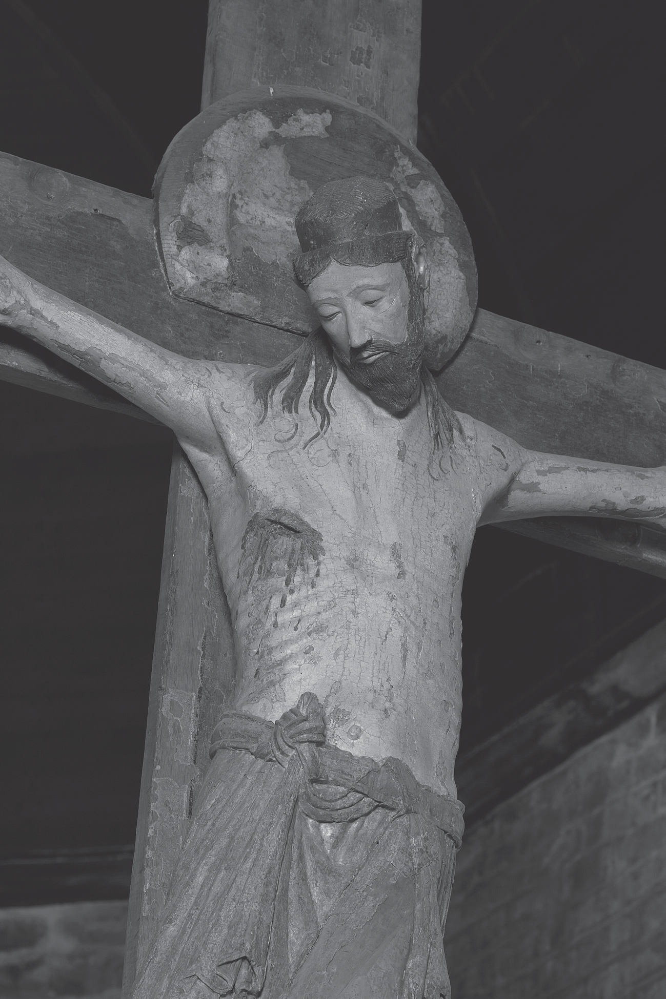
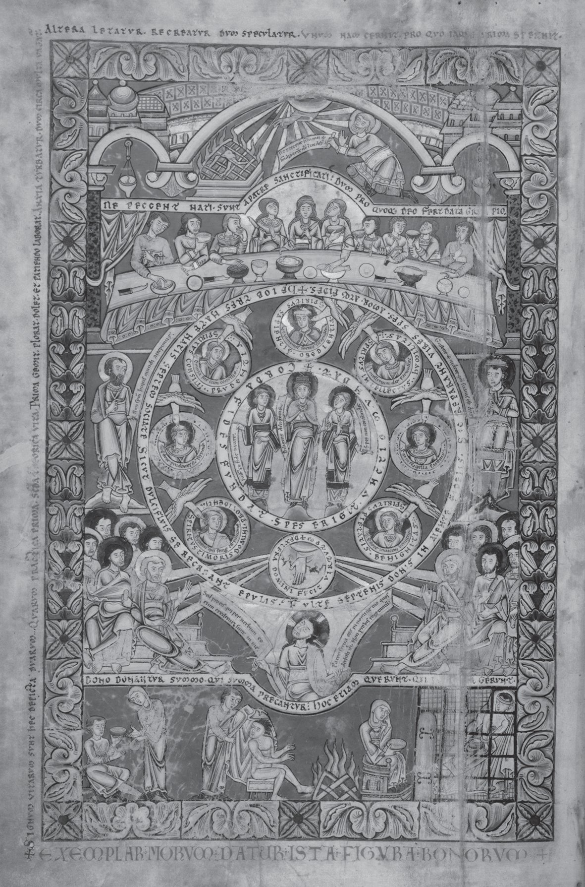
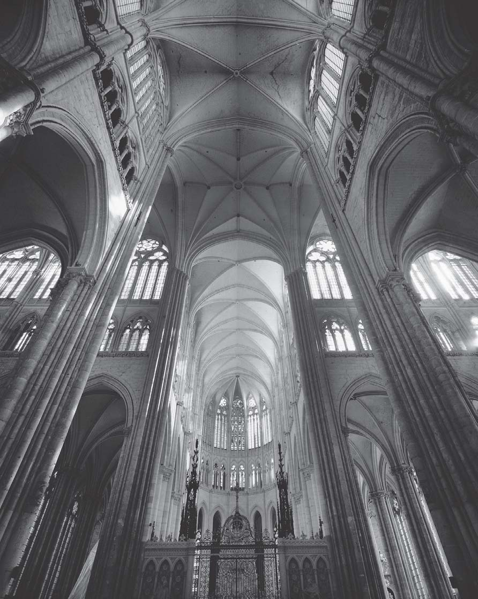
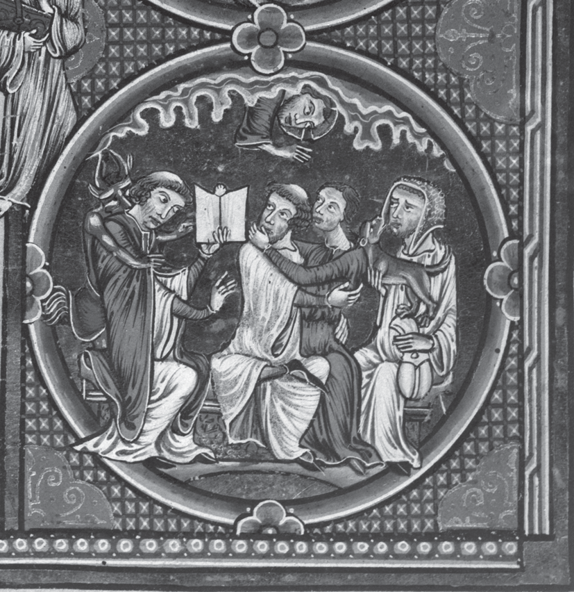
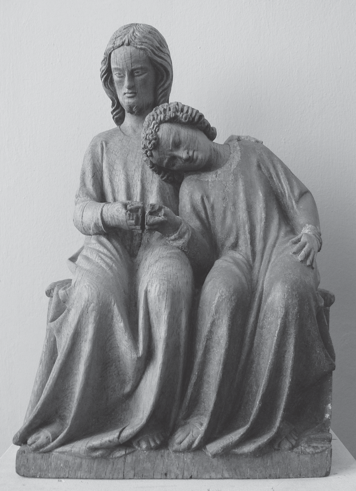
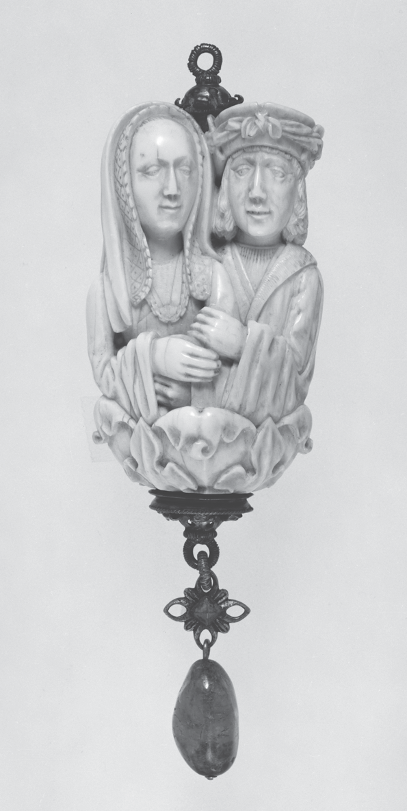
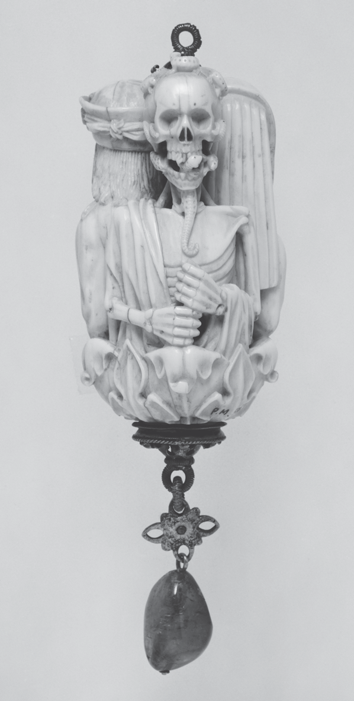

# 第17章 图像及其用途

萨拉·利普顿（Sara Lipton）

<!-- PDF page 274; original page 254 -->

十二世纪上半，三名本笃修士写下基督教艺术辩护。第一篇见约1120—1139年《诗篇集》，用法语改述一封归于教宗大格列高利的书信：

> 敬拜图画，与从图画故事学习什么应受敬拜，是两回事。文字给能读者的，图画展示给不识字者……正因如此，图画如同给民众的一课。[^p274-1]

这部称《圣奥尔本诗篇集》的祈祷书，是英格兰近两百年来首部含全页绘画场景的手稿，抄写者显然认为，华丽装饰需解释。第二篇，多伊茨院长鲁佩特（卒于1129年）所作，反驳犹太人指责基督徒崇敬图像等同偶像崇拜。他强调情感影响、虔敬效力：“当我们藉十字架形象，外在呈现〔基督〕之死，内心便〔燃起〕对他的爱……”[^p274-2] 第三篇，圣但尼院长叙热，详颂新重建院堂的美、属灵力量（约1144年），隐然回应视艺术为“使人分心的物质主义”者。[^p274-3] 他写，艺术不仅不使分心，反把“迟钝心灵”引向神圣，“促其<!-- PDF page 275; original page 255 -->从物质事物，向上升至非物质”。[^p275-4] 基督教艺术远非新事；西方基督徒早以尽可能美的形式，供奉上帝之言，以华丽建筑、金属器、象牙雕，彰显神威。但这些文本仍证明重要事实：十二世纪，图像在拉丁基督教实践中，比从前更核心。

图像用途，如其形式、观看者一样多样。三位作者引的教导、感发、引升功能，是中世纪神学家最常说的，但只是多种用途描述的起点。以下，大体依年代，概述图像在中世纪盛期基督教作用。虽涉及赞助委托、风格、图像学等传统艺术史问题，重点是人们如何看、用周围图像。多数用途起于十一、十二世纪，故较深入讨论此期，随后数世纪，仅述重要新变化。

## 十一世纪后期与十二世纪

盛期艺术繁荣，必要前提若是经济复苏、至少一定政治稳定，推动力则宗教更新。教士改革者谋提高教会教士地位、深化敬拜意义、肯定圣事效能、引平信徒入宗教生活，视觉层面因而更重要。圣物崇敬日盛，或为盛期欧洲信仰拓广深化最显著征象，吸引愈多人、金钱，投向物质对象；观看触摸，被许诺可接触神圣。[^p275-5] 1059—1079年，一系列会议解决圣餐争论，支持后来称<!-- PDF page 276; original page 256 -->实体转变的教义，强力宣告每座教堂，均有可见基督身体。教会、帝国争最高地位，视觉辉煌，也几乎与言辞论战、军事力量同受青睐为武器。

艺术史家通常以创新、壮观罗曼式教堂，开始盛期艺术史，其内华饰器物激增，同样显著。更大、更宏丽圣物匣之外，礼仪日繁，需更多、更美器皿、祭衣、用具：圣爵、圣盘、鸽形圣体容器、圣体盒、牧杖、礼仪梳、扇、香炉，以及水晶、金、银、铜、象牙、珐琅烛台、水壶，挤满祭坛，或悬其上。器物如容纳它们的机构，同时多层运作，兼礼仪、属灵、实用功能，经形式、媒材、题材传义。圣物匣、龛，以对称等级形态，呈属灵领域秩序，贵重材料代表复活身体荣耀。[^p276-6] 外部图像述圣徒生平、经文，强调新旧约对应，或将内藏特定圣徒，与普世天上大军相连。身体部位形圣物匣，宣传所容圣物，但学者近来发现，也能遮掩：弗勒里院长戈兹兰（卒于1030年）所购手臂匣，藏的非臂骨，而裹尸布；比利时埃诺班什的彼得手臂匣，藏腿骨。[^p276-7] 这时图像作隐喻，“手臂”意力量、行动。许多也有仪式作用：圣安德烈足形圣物匣，兼便携祭坛；臂匣则祝福信徒、宣誓、治病。[^p276-8] 祭坛、游行所用十字架、苦像，无论如卡斯蒂利亚、莱昂国王费尔南多、王后桑查1063年象牙、黄金、蓝宝石十字苦像般豪华，或如现藏修道院博物馆（The Cloisters）的奥地利木苦像般朴素，都象征基督教核心、每日弥撒重演的牺牲，容纳圣物，作为教会年最神圣时刻的焦点：耶稣受难日<!-- PDF page 277; original page 257 -->礼仪，高潮为揭开苦像帷幕、向其致敬。[^p277-9] 圣爵、圣盘、水壶、主教冠，分别盛酒、饼、水，装饰抬高主教；也都捕捉反射光，把色彩辉光带入教堂，以自身美丽奢华，体现神圣不可估量的珍贵。

这最后、最基本功能，当然由来已久。基督徒始终认为，圣所、庆典物质辉煌，均使上帝、制度教会、资助者得荣耀。虽有影响力的熙笃院长克莱尔沃的伯尔纳（卒于1153年），讥修道炫耀，劝减敬拜外饰，多数基督徒，包括修士，仍视装饰支出为可赞虔行。阿尔巴诺枢机马太（卒于1132年），斥责追随伯尔纳、投票采俭朴的本笃修士：“亲爱的弟兄，这些尊荣、敬意……若非属于至高、不可言喻的神圣威严，又属谁？谁曾从〔华丽祭衣、器物〕求荣耀，除了上帝、神圣母亲教会？”虽意图排除一切非纯然无私的奢华动机，他随即补充：

> 最虔诚的皇帝、国王、其他君主……以各样装饰美化〔上帝教会〕；圣徒、宗座教宗、可敬院长，同样如此……正因这样，人们相信他们已获天国许诺。[^p277-10]

捐赠者，也从捐赠获属灵利益。

神圣器物也有我们会称较平凡的功能——原主人可能不如此区分，对他们，大体无意义——充当游览吸引物、战利品、外交礼物、引更多捐赠的“种子”资金，声明捐赠者社会政治抱负。费尔南多、桑查苦像脚部铭文，宣扬王室夫妇虔敬；贵重材料，宣布财富地位。约1120年、称“圣柜”（Arca Santa）的豪华包银箱，藏大量<!-- PDF page 278; original page 258 -->圣物，助奥维耶多成为通往孔波斯特拉朝圣路热门停驻地，提升教会特权声望。伯尔纳写，修院贪求“精致玩物”“包金圣物”，为抓游人目光、松钱袋，只是对普遍认可实践，施格外尖锐批评。[^p278-11]

同期，成熟视觉装饰，又添新图像。罗曼式建筑延续、扩展壁画，也首次在基督教西方，把广泛连贯雕塑方案融建筑结构；意大利，沉寂马赛克复兴，如十一世纪七十年代蒙特卡西诺、1128年前罗马圣克莱门特。祭坛开始加木、金属、珐琅、灰泥前饰板（antependia），雕画基督、使徒、各圣徒。十字架、苦像，长用于游行、弥撒，如今永久固定祭坛。十一世纪末，近真人大木苦像，开始置唱诗席屏障，或悬圣所拱门，给平信徒骤然放大的救主像。十世纪已出现的内藏圣物雕像，十一世纪末广布；十二世纪，添不容圣物崇敬像，继而大体取代，如“智慧之座”（Sedes sapientiae，圣母子宝座像）、圣徒雕像。[^p278-12]

各类同时代文本，显示新图像引忧虑。昂热教士伯尔纳（约1020年），初遇孔克圣福瓦雕像崇敬，所受震撼，广为人知。[^p278-13] 某种抵抗，显然激发开篇每种辩护。最鲜明的是，图像自身，有时一边警告不得误用，一边声称独特价值。威尼斯圣马可大教堂，一幅约1100年“主之威仪”（Maiestas Domini）马赛克上方题铭，<!-- PDF page 279; original page 259 -->断言：“图像教人认识上帝，但本身非上帝。应尊敬这〔像〕，但用心敬拜在其中认出的对象。”[^p279-14] 十二世纪初，埃斯特利亚圣米格尔教堂北门铭文，告诫：“你见的图像，既非上帝，也非人；但圣像所表现者，既是上帝，又是人。”[^p279-15] 图像内含领会神圣的许诺，也含偶像崇拜危险。

希望忧虑，均有充分理由。十一、十二世纪，雕画似吸收传统归圣物的神圣力量，激发全新以图像为基础的崇敬。[^p279-16] 朝圣者远行，在其前屈膝、点烛、祈祷；或图像离原处，随游行远行，让城乡居民，在本地感到玛利亚、圣徒，及拥有它们的机构临在。虽有警告，许多信徒显然把像与原型等同，相信图像自身能“说话、哭泣、飞出窗，旱时降雨，战时退敌，或只打顽童耳光”。[^p279-17] 礼仪实践更添混淆：“智慧之座”像，已知在神秘剧扮玛利亚；意大利弗鲁图阿里亚修院棕枝主日礼仪，称ossana的塑像，扮基督本人。[^p279-18] 图像行奇迹的例证日盛，如犹太人嘲弄、击打苦像而像流血的传说，必既鼓励、也引导图像崇敬和敬礼。[^p279-19]

<!-- PDF page 280; original page 260 -->

而且，把强烈回应视觉刺激，视为专属、甚至主要属平信徒，是错误；“精英”“民众”用途鸿沟，可能比长期假定更窄。诚然，十二世纪圣维克多的理查等神学家，随奥古斯丁、伪狄奥尼修，把身体感知排低，设想上升等级，从肉眼视觉，经想象，至无图像的智性、理解。[^p280-20] 但少人追求，更遑论达到最终阶段。许多男女修道敬礼，围绕视觉刺激，尤其呼应加洛林先例的钉十字架基督像。鲁佩特凝视苦像，求实现效法基督（imitatio Christi）的修道理想；费康的约翰（卒于1079年）、坎特伯雷的安瑟伦（卒于1109年）、里沃的埃尔雷德（卒于1166年）等，有影响人物，写动人、亲密默想文，促进引导苦像视觉默观，供修士、修女、虔诚信徒使用。[^p280-21] 敬礼变化，反映于图像变化；十二世纪，是被钉者形象过渡期。许多仍给基督以加洛林、更早艺术熟悉的得胜、活着样貌；其他，如布鲁塞尔近郊福雷圣但尼教堂橡木苦像（约1160年），动人表现垂首、肋骨绷紧的垂死基督，开始以形式，反映新情感取向、强调基督人性（图17.1）。[^p280-22] 但外形与敬礼功能关系，并非简单；视觉保守，不必排除创造回应。如鲁佩特，一件似遵传统图像模式的器物，使其生极“现代”的爱，与基督神秘结合。[^p280-23] 同期，对圣母慈悲、哀恸母职格外温柔的赞颂，却意外鲜少反映于艺术。

<!-- PDF page 281; original page 261 -->

图17.1 橡木十字苦像，比利时布鲁塞尔近郊福雷圣但尼教堂，约1160—1180年。版权所有：IRPA-KIK，布鲁塞尔（摄影：IRPA-KIK，布鲁塞尔）。

<!-- PDF page 282; original page 262 -->

除寥寥图像，直到十二世纪末，玛利亚仍被表现为尊贵的天上母后。[^p282-24]

彩饰手稿虽早已见于西方，1080—1140年，图绘书籍——主要《圣经》、礼仪书——生产，量质均跃进。[^p282-25] 华丽图像，高调宣布修院拥抱改革，也实现以辉煌光彩荣耀上帝的普遍目标。[^p282-26] 手稿因而更大、更昂贵，十一世纪德国、约1100年法国书艺开始用金。叙事图像大增；十一世纪，彩绘圣徒传已显著增多；十二世纪，出现《圣奥尔本诗篇集》那样庞大经文图绘组。虽抄写者如此宣称，“未受教者”似不太可能是主要受众。有些组图，或确作《圣经》手册，教努力学拉丁文的学生、只读俗语的贵族男女神圣历史；但大多数由修士制作、供修士使用，不需图像作基本教导。且许多过于密集深奥，不能履此功能。如《弗洛雷夫圣经》（约1150年），复杂寓意图像混学问艺术，至今未全理解（图17.2）。[^p282-27] 这些手稿，极可能为图文共同组织的默观练习基础，显示即使本世纪最博学者，也借图像丰富宗教经验。

那么，抄写者推崇、学者长期视为宏伟教堂艺术主要功能的教学，即教不识字者基本信仰，如何？证据显示，也比过去所想复杂。一些最广叙事组，被置于平信徒无法进入之处，例如莫瓦萨克克吕尼派圣彼得修院（约1100年），回廊柱头优美缠绕的《圣经》、圣徒生平雕刻。

<!-- PDF page 283; original page 263 -->

图17.2 《弗洛雷夫圣经》卷首画：阐释《约伯记》开篇经文。比利时默兹河谷，普雷蒙特雷会弗洛雷夫修院，约1150年。伦敦，大英图书馆，add. ms. 17738，书叶3背面（摄影：大英图书馆）。

<!-- PDF page 284; original page 264 -->

法国多数罗曼式壁画组，也位于平信徒无法进入区域。即使较易接近者，如加泰罗尼亚里波尔圣玛利亚修院西门（约1150年），满布经文图像；克吕尼派圣萨万—叙尔—加尔唐普附属修院中殿拱顶壁画（约1100年），生动展从创造至西奈颁法的《圣经》历史；瑞士齐利斯圣马丁堂天花（约1140—1160年），近一百五十块经文场景画板，也似不适作“给单纯者的课程”。劳伦斯·达根指出，参观者也可证实，多数难看清、解读，常需解释铭文补充。[^p284-28] 叙热明确承认，他的艺术只有有学识者能理解，他们也仍须借助文字说明。[^p284-29] 是否真有“不言自明”图像，可争论；但中世纪，显然不是替代文字，而是补充。

因此，艺术主要教导功能，与其教新事，不如使既有教导活起来，唤回以别形式、或别时间呈现的教训。[^p284-30] 布永的戈弗雷公爵（卒于1100年）故事，似即此义。被问主人虔敬例证，仆人报：“一旦入教堂，即使日课毕，也诱不出来；反求司祭、似懂这些的人，解释每一图像、绘画。”[^p284-31] 受赞的不是看像学习，而是求助理解。这位主教所写故事，暗示图像若为单纯者《圣经》，至少教士看来，也如《圣经》，需注释。

现存少量涉及艺术的讲道，确把图画叙事如《圣经》，视为属灵、道德寓意化跳板。十二世纪圣维克多一院长，<!-- PDF page 285; original page 265 -->不断在讲道提倡隐喻看艺术，告咏祷教士，应效法圣徒：“他们理当称非未经雕琢、而是雕成之石，因为言语所宣，行动明示；正行在其身可辨，正如……雕刻解释所行。”[^p285-32] 显非期待“字面”读像；奥古斯丁咏祷教士，通常不被期望复活死者、医跛盲、逐魔，或行雕圣徒常见多数事。他要人看表面以下，如效使徒和睦共居，或如安东尼抗魔，勤拒诱惑恶习。彼得·科梅斯托尔（卒于1178年），明斥字面读艺术，警告主显圣容壁画，可能使人误以为基督身体未受变化：“通常把一些光辉射线，画在主身体四周，却与身体分离……”[^p285-33] 许多图像难见，并不奇怪；如戈弗雷故事暗示，最大价值可能非传信息，而是激发须求权威方能解的问题。

当然，有些信息相当直接。林肯主教雨果告诉英王约翰，教堂门口最后审判雕画，旨让礼拜者“真正知道地狱恐怖”；孔克圣福瓦生动最后审判半圆饰区，边沿刻文末警：“罪人，若不改行，须知可怕命运等待。”[^p285-34] 位置如内容，有针对性：堂门审判像，提醒朝圣者，唯教士掌释放捆绑之权，也唯他们能为平信徒观者译拉丁文。但艺术常可超创作者意图，请看约翰如何回应<!-- PDF page 286; original page 266 -->雨果这番依艺术讲道。编年史说，毫无畏缩的约翰，走到对墙，指出戴华冠、由天使喜悦引至天上君王的国王：“主教大人，您该给我们看这些！”

最终，内容或次于感官效果。常饰罗曼式墙面的威仪基督绘画、马赛克，赋阿尔法、俄梅戛、书、球等古老智慧权力符号；但色彩、强度、规模，或与象征同样动人。让艺术史家沮丧，当时描述更常谈“明亮”“生动”，而非形式、题材。[^p286-35] 视觉欢悦，虽远不及叙热对神圣的引升领会，仍可有牧灵目的。富伊瓦的咏祷教士雨果（卒于1172年），承认艺术能“留住”那些较单纯、不能悦于经文精妙却能悦于图画的人。[^p286-36] 伯尔纳也略不耐烦地承认，许多人“越鲜艳的，越被认为神圣”。[^p286-37]

## 十三世纪与十四世纪早期

十三世纪，改革领导权，转至大学训练、居城市的教士、托钵修士；关注扩及全体信徒、更广行为，强调外在敬拜须伴内在奉献。背景重点变化，进一步削弱教士／平信徒、修院／世界区分，关联图像三大发展：题材增多分化，风格趋情感、自然主义，宗教艺术进入城市市民家庭空间。虽教导、感动、激励、抬高、增显威势等基本目标未改，合而观之，见功能新路。十一世纪，艺术求以材质色形捕捉天国荣耀，把“彼处”带至“此处”；十三世纪，转而发现、突出<!-- PDF page 287; original page 267 -->自然世界天上美，模糊彼此边界。属灵事件获现实迫近感，日常生活遂理想地浸润属灵意义。

这些趋势，最清楚见约1220年始建的亚眠圣母大教堂。高拱顶、尖拱，引视线向东向上，唱诗席薄墙、精细窗格、大窗，似融光海，内外区分消失（图17.3）。[^p287-38] 柱头、中殿拱上，生动雕花植物带，更强此效。外部大量雕塑，把无数基督教图像带城市中心。城市更看得见图像，图像也更看得见城市：人物当代衣着、精细场景、人性动作表情。西立面中央门最下、最易见层，恶习非抽象拟人，而是持日常物件的熟悉人物；不服从，是侮辱主教青年；贪婪，是往箱堆钱袋的吝啬者。似呼应讲道者、告解神师，劝羊群看自己，以基督教价值读行为。较高处，中央门中柱“美丽的上帝”（Beau-Dieu）基督像，踏古老邪恶符号，持象征智慧的书，外貌却全异罗曼式半圆饰区得胜审判者。他温柔可近，形体饱满、解剖可信，却比活人更完美。[^p287-39] 南门同样美的玛利亚，伸臂热迎信徒。哥特雕塑自然主义加强，有时释为亚里士多德式物质主义，或文艺复兴人文主义先声；但如保罗·宾斯基论证，或最好视为当时宗教精神的视觉表达，尤其日益崇敬有血肉人性的基督。[^p287-40]

<!-- PDF page 288; original page 268 -->

图17.3 亚眠圣母大教堂：中殿与半圆后殿交接处。法国北部，十三世纪（摄影：akg-images／Erich Lessing）。

亚眠如许多哥特座堂、教堂，奉献玛利亚：完全为人的形象，可亲、养育的母亲，上帝与人之间最终极代求者，却升为天上母后，亚眠教堂立面圣母门便刻其加冕。

亚眠彩色玻璃已失，但许多同时代窗饰留存，使可想其形貌效果。如宝石般浓烈的<!-- PDF page 289; original page 269 -->色彩，以及该世纪早期流行、严密分格的叙事，约1250年，开始让位更浅、更透光、单块更大的玻璃。细致生动故事、丰富人物器物、常饰边缘的职业行会徽志，突出惯称“神圣”“世俗”领域相连；一座既为教会中枢、又为市民城镇中央集会点的建筑，正可期待如此。[^p289-41] 十三世纪少数讲道提及彩绘玻璃的一例，也显示把神圣历史视觉地投射当世的风险：沙托鲁的厄德回忆，童年旁一平信徒解释，好撒玛利亚人窗饰中，撒玛利亚人穿俗人衣，利未人穿教士装，因为“教士不怜穷人、受苦者，平信徒却十分怜悯”。[^p289-42]

意大利气候，使薄墙大窗不理想，便以别法达许多同目标。契马布埃首先，乔托后来更著名，以个性化表情面貌、更丰富色彩、透视，使壁画更自然、更具情感迫近感。连圣马太这般传统人物，也获新感性：阿西西圣方济各圣殿上堂约1280年像中，手扶胸，似思其福音叙述的悲伤事件。帕多瓦阿雷纳小堂（1305—1310年）基督、圣母生平壁画，乔托造幻觉，使窗光似真照在表情丰富人物身体，连其手执器物也似可触、完全在场。[^p289-43] 基督徒观者、自然世界、天国，藉图像相聚。

<!-- PDF page 290; original page 270 -->

哥特空间、图像，也使城市居民相聚，有时和谐，有时混乱。全城资助、建座堂的故事——据说沙特尔市民热情，把自己套车，运石到工地——可能大多为神话，但展示艺术建筑象征市民团结自豪，以及等级权力的重要，至少对讲述者如此。贵族、市民、工人、农民，在建筑图像触发、参与的仪式，各有精心安排角色，如为杜乔所作锡耶纳新祭坛画（1308—1311年）组织的游行：

> 〔画〕抬往座堂那天，店铺关闭，主教率大群虔诚司祭、托钵修士，庄严行进，九位执政官、全体市政官、所有民众陪同。最受敬重者，依次持燃烛，站在画旁；妇女孩子，怀极虔敬，跟后。[^p290-44]

教会、政治权威较不受居民接受处，座堂成为分裂指标；内部撕裂的城市，常以它为暴力目标。[^p290-45]

哥特座堂、教堂内，礼仪与艺术，更趋场面化，伴随控制引导目光的欲望。约1200年，司祭弥撒开始背平信徒，遮祭坛台面，使最终举扬圣体，供所有人看时，更具戏剧性。祭坛后立画、雕浮雕，即祭坛背屏（retables），成为仪式真正背景，加强此效。[^p290-46] 这些<!-- PDF page 291; original page 271 -->鲜艳、细致、常拥挤场景，把经文、寓意事，画如当代事件，助会众忆神圣历史关键时刻，甚至想象重历。如精美《威斯敏斯特祭坛背屏》（约1270—1280年），原立威斯敏斯特修院主祭坛后，一目击基督奇迹妇女，戴最新流行圆筒小帽；既悦宫廷观者精雅趣味，也邀想自己在基督身旁。[^p291-47] 中殿、唱诗席间屏障更高，但有开口，容有限、受控观看另一侧；华丽雕塑场景，助理解另一侧奥秘，实际上把它框起来。[^p291-48] 圣物匣也更“可读”，主动求目光；虽仍有以形式图像识别内藏圣物者，却愈经透明水晶窗展示圣物本身。约1311年，克雷芒五世下令正式采用基督圣体节后，展示祝圣圣体的显供器，愈常见。[^p291-49]

但各类图像虽增，讲道者直接用视觉叙事仍少，继续提倡寓意、非字面阅读。如十三世纪许多讲道，要求在被钉基督像，“看见”写朱字的羊皮纸、满病灶的麻风者、张臂欲拥人的恋人、鲜红军旗。[^p291-50] 常零碎处理图像，不是叙事，而是偶然细节，成为视觉教学跳板。约1225年巴黎讲道，乔布姆的托马斯，非从圣徒行迹，而从光环形状读义：“灵魂须自制，如国王须自统……因此，教会习惯，凡画一位善于自制圣徒，<!-- PDF page 292; original page 272 -->就在头周，画如盾的圆冠，称为冕冠。”[^p292-51] 如此，外在美教内在反省，不用肉眼，而用“心的眼睛”看。[^p292-52]

图像牧灵潜能，在手稿彩饰最充分发挥。图绘道德劝善文本，如带注《圣经》评注、十三世纪晚期《国王大全》（Somme le roi）、圣母奇迹，流行于富教士、平信徒精英；美丽奢华、创新图文并置、论战力量，同样显著。如为法王路易八世制作的《道德诠释圣经》（Bible moralisée，约1225年），注释图绘，将古老《圣经》、图像符号——钱袋、硬币、书卷、蛙、乌鸦、猫——用于新观念背景，构造城市常见罪恶全面目录（图17.4）。主要意图，可能引悔罪、教美德，但也造视觉语汇，把异端、犹太人、放贷者，标为改革基督教世界理想的对立面。可以说，图像也影响王室对这些群体政策。[^p292-53]

但世俗统治者非只被动接受，也调动哥特美与力量，服务政治宗教同时、或说不可分的目的。匈牙利埃斯泰尔戈姆十二世纪晚期座堂、宫殿，惊人早现法国哥特形式，被联系贝拉三世（卒于1196年）亲法王朝外交、受巴黎影响的教会改革议程。[^p292-54]

<!-- PDF page 293; original page 273 -->

图17.4 《启示录》16:4评注插图细部。《道德诠释圣经》，巴黎，约1225年。维也纳奥地利国家图书馆图像档案，cod. 1179，fol. 236d（摄影：奥地利国家图书馆）。

关联路易九世（卒于1270年）的“宫廷风格”，首次、最著名体现，是圣礼拜堂，精巧如珠宝盒，为容纳基督两大圣物而造。[^p293-55] 十四世纪，波希米亚查理四世，也大量投入精力金钱，把布拉格圣维特座堂变王权圣殿，把宫廷变宗教图像中心。[^p293-56] 墓葬艺术，也成为王朝、属灵抱负共同表达的重要场域。[^p293-57]

对于以图像为基础的崇敬敬礼，官方谨慎立场未改，但增更积极承认合法、力量、重要。[^p293-58] 托马斯·阿奎那呼应前人，称不借图像的默想为<!-- PDF page 294; original page 274 -->最高默观形式；但也认为，基督像而非圣徒像，配受与基督本人相同敬拜（latria），部分因承认已为教会传统。他说，“有些教堂保存为圣物的血，并非从基督肋旁流出，而据说从某受虐基督像流出”，似也承认一些像行奇迹的能力。[^p294-59] 拉丁、俗语牧灵文本，如《基督徒之镜》（Speculum Christiani）、海因里希·苏索（卒于1366年）《范本》（Exemplar），指导正确崇敬圣像。两大托钵修会成员，都实践视觉敬礼，并助在修女、平信徒男女间普及；方济各会尤其积极推动受难想象默想，赞助创新图像。[^p294-60]

教堂常为其场所，也愈进入亲密家庭空间，伴随个人拥有图像数量种类扩大，惯称“虔敬像”（Andachtsbilder），虽有时误导。[^p294-61] 通常为象牙、金属、木像，雕画福音场景，或从大叙事抽出个别圣洁人物的画板，或见于小型彩绘祈祷书。许多题材熟悉；十字架、圣母子，整个中世纪始终最常见。但优先强调人间温柔的新像也出现：基督—约翰群像，约翰头靠耶稣胸；维罗妮卡圣容像，基督面部特写，被视为真容（vera icon）；圣殇像（Pietà），玛利亚哀悼死去儿子。十三世纪后期、十四世纪早期日盛（图17.5）。用途多样，既崇敬、虔修，既情感、智性：助取得适合祈祷心态，赋非教会空间圣洁气氛，使敬拜者在小室、家中、旅途，近似司祭动作态度，方便与圣徒交流，为高阶默想提供记忆辅助。

<!-- PDF page 295; original page 275 -->

图17.5 基督—约翰群像（圣约翰头靠耶稣胸前）。施瓦本／博登湖地区，十四世纪早期。慕尼黑，巴伐利亚国立博物馆，藏品号65/38（摄影：Andreas Praefcke；公有领域）。

<!-- PDF page 296; original page 276 -->

这些图像也助神秘主义者，与神圣达到出神共融。[^p296-62] 有些平信徒似不只视为正式礼仪补充，而是充分替代；有人相信，死亡当天看圣克里斯托弗、圣芭芭拉像，即使未领临终礼，也助入天堂。[^p296-63] 反之，也有替官方立场说话的报告：据说圣母像，打过一名过度禁欲的普雷蒙特雷会修女耳光。[^p296-64]

中世纪、现代讨论，常假定视觉敏感尤属女性虔敬。杰弗里·汉堡格等，确无疑证明，视觉敬礼在修女、贝居安女子属灵生活重要。但许多文本也显示，教士、俗人男性，同受艺术吸引：雷蒙·卢尔经历苦像激发、充满激情的异象，与许多女性所述无别。[^p296-65] 回应艺术，可能反映属灵准备、个人情境需求差异，非简单性别差异。[^p296-66]

基督、圣母、圣徒虔敬像增加同时，教会建筑、文本较边缘处，生较轻佻图像：幻想怪物、拼合异兽、龇牙滴水兽，装柱头、檐口、水嘴；猿猴、驴、无名幻想生物，在书页边缘嬉戏。支撑拱廊、导水等主要功能之外，也有用途。至少引目光至座堂远角，以幽默调剂教义、悦眼，或增对教会好感。也可能见证<!-- PDF page 297; original page 277 -->上帝创造的丰饶。迈克尔·卡米耶论，手稿边饰、哥特怪诞，放大、评论、讽刺主流图像概念，体现本被抹除思想，构成反官方话语；有些例子令人信服，有些较不然。[^p297-67] 不论意义，少有图像，比栖上帝殿堂顶端、生动“真实”却全然幻想的生物，更能概括盛期哥特图像的观念复杂、视觉精巧。

## 中世纪晚期（约1330—1500年）

十四、十五世纪，宗教图像全盛。图像敬礼、由像激发神秘异象，渗各社会层；每重要庆节关联特定图像；大陆各地教堂添台座、壁龛、圣龛、托架；大量生产图像，宣传、商业意义空前。[^p297-68] 但如玛格丽特·阿斯顿所说，“即使这充满图像的时期，态度仍暧昧”。[^p297-69] 教士、制度教会虽推动并求获益，如写像前祷文、以版画宣传朝圣、为崇敬特定雕画颁大赦，也不安于激发的情感过度，疑艺术创新。[^p297-70] 平信徒既拥抱，也以罗拉德运动率先反对。[^p297-71] 到十四世纪末，<!-- PDF page 298; original page 278 -->图像太多的抱怨，愈常出现。[^p298-72]

如晚期虔敬文学，图像特征是强烈悲情，常藉视觉“丑陋”实现。[^p298-73] 匈牙利加拉姆圣贝内德克十五世纪末“基督棺”，不只饰精雕、极戏剧化受难场景，也在复活节游行，安放可移动、真人大基督遗体像。最流行虔敬像，为“忧患之人”（Man of Sorrows，受伤基督半身像）；不同于所据拜占庭圣像将死身连上帝荣耀，西方强调其人间痛苦。脆弱痛苦，也见晚期苦像；圣殇像中，遗体愈可怖，玛利亚愈悲恸。细察身体、情感受苦的表现，或助观者本能认同圣洁人物。[^p298-74] 另些映其他焦虑：“三个生者与三个死者”、“死亡之舞”（1423年首见记载）、腐朽骸骨，生动提醒肉身易坏，隐含灵魂不朽。[^p298-75] 奢华装饰也有阴沉意味：十六世纪象牙珠，正面拥抱情人，背藏狰狞骷髅（图17.6）。

焦虑痛苦视觉化，旨灌虔敬悔罪，却也有阴暗面：邪恶描绘随之锐化，艺术成为宗教热情与社会仇恨混合的有力媒介。

<!-- PDF page 299; original page 279 -->

 

图17.6 象牙念珠末端坠珠，正面拥抱情人，背面爬满蠕虫的狰狞骷髅。德国，十六世纪。纽约，大都会艺术博物馆，J.皮尔庞特·摩根赠，1917年，17.190.305（摄影：©大都会艺术博物馆）。

受难图中，折磨基督者愈丑陋残酷；殉道图中，行刑者数量、凶猛，也增加。[^p299-76] 许多被画成衣饰夸张的无赖、面相粗陋农民、缠头巾穆斯林、漫画化犹太人——肤暗、鹰鼻、面扭曲。[^p299-77] 同期，诬告犹太人亵渎圣体、杀基督徒儿童，也成绘画、版画、小册子流行题材。

<!-- PDF page 300; original page 280 -->

这些图像不只反映反犹情绪增长，几乎肯定也加强、引导它。[^p300-78]

此期宗教艺术绝非全阴沉。十五世纪尼德兰、意大利绘画，结合复杂象征、最新透视油画技术，创极逼真、灿烂神圣场景。扬·范·艾克1436年布鲁日《圣母与咏祷教士范德帕勒》，华锦、毛皮、丝绸、捐赠者本人，与极美圣母、优雅骑士式圣乔治、华服主教圣多纳提安，共居中心；织物可触，似证捐者神秘异象真实。许多也为豪华家饰，神圣题材体现最新优雅风格，生动叙事兼娱乐教化。如修道院博物馆约1500年《独角兽挂毯》，可欣赏其活泼呈现晚期狩猎、作受难寓言、颂求爱生育。许多精美至此，让·热尔松不得不教基督徒，勿只因美而敬拜图像。[^p300-79]

图像敬礼，始终强触觉；晚期艺术，更方便身体表达感情。婴儿床含感伤幼年耶稣像，使修女如待亲子。玛杰里·肯普朝圣，每重要停驻处，虔敬为基督像穿衣；许多人遗嘱留钱，购珠宝衣物，饰圣徒像。[^p300-80] 拥抱亲吻雕像苦像的古老实践，对有些人成每日习惯。[^p300-81] 像前屈膝，成重要正统表现；不如此，致疑。身体互动也非单向，图像愈会动。晚期北方祭坛画，有可动翼板，在<!-- PDF page 301; original page 281 -->礼仪年关键时刻开合；苦像、其他雕像，有可动肢体。[^p301-82] 至中世纪末，人不必是天赋异禀的神秘主义者，也能见宗教艺术“活起来”。

盛期宗教图物，用途令人目眩：荣耀自己、家庭、政治共同体、机构；示美德、体现恶习；赋权威、真实性；保护城、人；强群体团结、团体身份，或显示其崩解；造气氛、行奇迹、宣传纲领朝圣、筹款、滋仇恨、激想象，或束缚想象。也作礼物、容器、代表像、记号、标志。许多全期普遍，另些随社会宗教需求、流行形式媒材，盛衰。但几个基本观察，贯穿大陆、盛期数世纪。

首先，不能按地位、性别、属灵身份，简单分用途；平信徒、教士、修士、男女，均可从像学习、被感动。其次，“单纯者之书”陈说暗含文字图像对立，细查即破：图像极少、甚至从不“替代”文字，许多突出文字，也如文字作寓意阅读；到末期，几无完全脱离视觉联想的礼仪、《圣经》用语。第三，艺术、神学、社会变化，似按细腻摆动节奏展开。盛期基督像，常视为公教慈爱、怜悯的神人观，最完美视觉表达；但鲁佩特，早在这些情感主导钉十字架形象前，就从苦像见爱、怜悯。十三世纪重耶稣疤伤的敬礼，先于晚期更极端图像，后者又激敬礼更过度。有时，观者尚未准备接受，就遇艺术变化。历史提示，思想、图像、教义、艺术、社会，关系复杂，<!-- PDF page 302; original page 282 -->创新有时出现一域，有时另一域。最后、最根本，此处多重、交叠、冲突用途，证明图像在盛期生活核心。中世纪末，《善终术之书》（The Boke of the Crafte of Dying）所载探病礼仪，承认这地位。[^p302-83] 书指示，临终者（moriens）可能不能听、说、理解，司祭应展示苦像，助其从上帝之爱得安慰。最后，文本暗示，灵魂若失其他一切通神途径，所剩是视觉。还有艺术。

## 注释

[^p274-1]: 原注古法语：‘Altra cóse est aurier la painture/e altra cose est par le historie de la painture ap[re]ndre/ quela cóse seit ad aurier, kar ico que la scripture aprestet/ as lisanz, icó aprestet la painture as ignoranz, kar an icele veient/ les ignoranz quet il deivent sivre.’（意为：敬拜图画，与通过画的故事学习应敬拜什么，是两回事。文字给予能读者的，图画给予不识字者，因为他们在其中看见应该追随什么。） Hildesheim, St Godehard Library, St Albans Psalter, fol. 68v. 同叶也含书信拉丁版本：‘Aliud est picturam adorare, aliud ratione[m] de pict[ur]is int[er] roganti/per picture historia[m] quid sit adorandu[m] addiscere, Nam quod legentib[us]/ scriptura hoc ignotis prestat pictura, q[u]a in ipsa ignorantes vident quid/ sequi debeant.’（意为：敬拜图画是一事；探问图画之义、通过其中故事学习应敬拜什么，是另一事。文字给予读者的，图画给予不识字者，因为他们在其中看见应该追随什么。）

[^p274-2]: Rupert of Deutz, Anulus sive dialogus inter Christianum et Iudaeum, ed. Rhabanus Haacke, in Maria Lodovica Arduini, Ruperto di Deutz e la controversia tra cristiani ed ebrei nel secolo XII (Rome: Istituto storico italiano per il Medio Evo, 1979), 232–5.

[^p274-3]: 参见 Conrad Rudolph, Artistic Change at St.-Denis: Abbot Suger’s Program and the Early Twelfth-Century Controversy over Art (Princeton: Princeton University Press, 1990).

[^p275-4]: Suger of Saint Denis, De Administratione 27, in Erwin Panofsky, ed. and trans., Abbot Suger on the Abbey Church of St. Denis and its Art Treasures, 2nd edn, ed. Gerda Panofsky-Soergel (Princeton: Princeton University Press, 1979), 48.

[^p275-5]: 圣物崇敬，见 Arnold Angenendt, Heilige und Reliquien: Die Geschichte ihres Kultes vom fruhen Christentum bis sur Gegenwart (Munich: Verlag C. H. Beck, 1994); Patrick J. Geary, Furta sacra: Thefts of Relics in the Central Middle Ages (Princeton: Princeton University Press, 1978); and Barbara Abou-el-Haj, The Medieval Cult of Saints: Formations and Transformations (Cambridge: Cambridge University Press, 1994).

[^p276-6]: Caroline Walker Bynum, The Resurrection of the Body in Western Christianity, 200–1336 (New York: Columbia University Press, 1995), 209–12.

[^p276-7]: Barbara Boehm, ‘Body-Part Reliquaries: The State of Research’, Gesta 36 (1997), 8–19.

[^p276-8]: Cynthia Hahn, ‘The Voices of the Saints: Speaking Reliquaries’, Gesta 36 (1997), 20–31.

[^p277-9]: The Art of Medieval Spain, a.d. 500–1200 (New York: Metropolitan Museum of Art, 1993), 244.

[^p277-10]: Stanislaus Ceglar, ‘Guillaume de Saint-Thierry et son rôle directeur aux premiers chapitres des abbés bénédictins, Reims 1131 et Soissons 1132’, in M. Bur, ed., Saint Thierry: Une abbaye du VIe au XXe siècle. Actes du Colloque international d’Histoire monastique, Reims-Saint-Thierry, 11 au 14 octobre 1976 (Saint-Thierry: Association des Amis de l’Abbaye de Saint-Thierry, 1979), 331.

[^p278-11]: Conrad Rudolph, The ‘Things of Greater Importance’: Bernard of Clairvaux’s Apologia and the Medieval Attitude toward Art (Philadelphia: University of Pennsylvania Press, 1990).

[^p278-12]: Signe Horn Fuglesang, ‘Christian Reliquaries and Pagan Idols’, in Soren Kaspersen, ed., Images of Cult and Devotion: Function and Reception of Christian Images in Medieval and Post- Medieval Europe (Copenhagen: Museum Tusculanum Press, 2004), 7–32; Irene H. Forsyth, Throne of Wisdom: Wood Sculptures of the Madonna in Romanesque France (Princeton: Princeton University Press, 1972).

[^p278-13]: Bernard of Angers, The Book of Sainte Foy, trans. Pamela Sheingorn (Philadelphia: University of Pennsylvania Press, 1995).

[^p279-14]: Ragne Bugge, ‘Effigiem Christi, qui transis, semper honoria: Verses Condemning the Cult of Sacred Images in Art and Literature’, Acta archaeologiam et artium historiam pertinentia 6 (1975), 127–39.

[^p279-15]: Calvin B. Kendall, The Allegory of the Church: Romanesque Portals and their Verse Inscriptions (Toronto: University of Toronto Press, 1998), no. 47. 几乎相同的诗句也见约1150年手稿，讨论见 Jeffrey F. Hamburger, The Visual and the Visionary: Art and Female Spirituality in Late Medieval Germany (New York: Zone Books, 1998), 186.

[^p279-16]: 参见 André Vauchez, ‘L’image vivante: Quelques réflexions sur les fonctions des représentations iconographiques dans le domaine religieux en Occident aux derniers siècles du Moyen Âge’, in Maurice Aymard et al., eds., Pauvres et riches: Société et culture du Moyen Âge aux temps modernes. Mélanges offerts à Bronislaw Gesemek à l’occasion de son soixantième anniversaire (Warsaw: Wydawnictwo Naukowe PWN, 1992), 231–41.

[^p279-17]: Forsyth, Throne of Wisdom, p. 3; David Freedberg, The Power of Images: Studies in the History and Theory of Response (Chicago: University of Chicago Press, 1989).

[^p279-18]: Forsyth, Throne of Wisdom; Elizabeth Lipsmeyer, ‘Devotion and Decorum: Intention and Quality in Medieval German Sculpture’, Gesta 34 (1995), 20–7.

[^p279-19]: Sixten Ringbom, ‘Devotional Images and Imaginative Devotions: Notes on the Place of Art in Late Medieval Private Piety’, Gazette des Beaux-Arts ser. 6.73, alt. no. 1202 (1969), 160. 787年在尼西亚举行、支持圣像的第七次大公会议，一篇讲道提及这奇迹故事；十一世纪才传入西欧，以《圣像受难》（Passio ymaginis）日课纪念。参见 Michele Bacci, ‘The Berardenga Antependium and the passio ymaginis Office’, Journal of the Warburg and Courtauld Institutes 61 (1998), 1–16.

[^p280-20]: Richard de St Victor, Liber exceptionum, ed. J. Chatillon (Paris: J. Vrin, 1958).

[^p280-21]: 参见 Rachel Fulton, From Judgment to Passion: Devotion to Christ and the Virgin Mary, 800– 1200 (New York: Columbia University Press, 2002), 336–41; Sara Lipton, ‘Sweet Lean of his Head: Writing about Looking at the Crucifix’, Speculum 80 (2005), 1172–1208.

[^p280-22]: Rhein und Maas: Kunst und Kultur 800–1400 (Cologne: Schnütgen-Museum, 1973), vol. 2, 412–13, fig. 10.

[^p280-23]: Lipton, ‘Sweet Lean of his Head’.

[^p282-24]: Fulton, From Judgment to Passion, 348.

[^p282-25]: Walter Cahn, Romanesque Bible Illumination (Ithaca, N.Y.: Cornell University Press, 1982), 121.

[^p282-26]: Cahn, Romanesque Bible, 104.

[^p282-27]: Anne Marie Bouché, ‘The Floreffe Bible Frontispiece, London, B.L. add. ms. 17738, fol. 3v-4r, and Twelfth-Century Contemplative Theory’ (PhD dissertation, Columbia University, 1997).

[^p284-28]: Lawrence Duggan, ‘Was Art Really the “Book of the Illiterate”?’, Word and Image 5 (1989), 227–51.

[^p284-29]: Suger of Saint Denis, De Administratione 33.

[^p284-30]: 助记功能，隐含于伪托格列高利致塞昆迪努斯的书信，赞艺术可助回忆教训；但多数改述遮蔽此义，强调“图像之于平信徒，犹文字之于教士”的类比。

[^p284-31]: William of Tyre, History of Deeds Done beyond the Sea, trans. Emily Atwater Babcock and A. C. Krey (New York: Columbia University Press, 1943).

[^p285-32]: ‘Qui recte non puri sed sculpti lapides esse dicuntur, quia quod verbis asserunt, operibus evidenter ostendunt, et dum in eis recta operatio cernitur, quodammodo velut in sculptura quod egerunt explanatur.’（意为：他们理当称为非未经雕琢、而是雕成的石，因为口头宣称，以行为明示；当其正确行为被辨认，某种程度如同雕刻，把所行解释出来。） Paris, Bibliothèque nationale, ms. lat. 14, 525, fol. 95v.

[^p285-33]: ‘Ideoque tradunt splendorem illum non fuisse in corpore dominico, sed in aere circum se… Cui opinioni consonant picture in parietibus ecclesiarum, ubi depingitur transfiguratio. Solent depingi quidam radioli splendoris circa corpus dominicum seorsum a corpore dominico…’（意为：因此，他们教导，那光辉不在主身体中，而在周围空气中……教堂墙面变容图画，吻合此见。通常有些光辉射线画在主身体四周，却与主身体分离……） Paris, Bibliothèque nationale, ms. lat. 15,269, fol. 106v.

[^p285-34]: Adam of Eynsham, Magna vita sancti Hugonis: The Life of St. Hugh of Lincoln, 2 vols., ed. Decima L. Douie and David Hugh Farmer (Oxford: Clarendon Press, 1985), vol. 1, 138–42.

[^p286-35]: C. R. Dodwell, Painting in Europe, 800 to 1200 (New Haven, Conn.: Yale University Press, 1992), 126.

[^p286-36]: De claustro animae, 1b. II, c. 4, PL 176, col. 1053.

[^p286-37]: Rudolph, ‘Things of Greater Importance’, 280–1.

[^p287-38]: Stephen Murray, Notre-Dame, Cathedral of Amiens: The Power of Change in Gothic (Cambridge: Cambridge University Press, 1996).

[^p287-39]: Wilhelm Schlink, Der Beau-Dieu von Amiens: Das Christusbild der gotischen Kathedrale (Frankfurt: Insel Verlag, 1991).

[^p287-40]: Paul Binski, Becket’s Crown: Art and Imagination in Gothic England, 1170–1300 (New Haven, Conn.: Yale University Press, 2004), and ‘The Angel Choir at Lincoln and the Poetics of the Gothic Smile’, Art History 20 (1997), 350–74.

[^p289-41]: Wolfgang Kemp, The Narratives of Gothic Stained Glass, trans. Caroline Dobson Saltzwedel (Cambridge: Cambridge University Press, 1997); Jane W. Williams, Bread, Wine, and Money: Windows of Trades at Chartres Cathedral (Chicago: University of Chicago Press, 1993). 这些行会纹章是否表示赞助关系，尚有争论。

[^p289-42]: 转引自 Kemp, Narratives of Gothic Stained Glass, 71.

[^p289-43]: Michael Camille, Gothic Art: Glorious Visions (New York: Harry N. Abrams, 1996), 48.

[^p290-44]: B. Kempers, ‘Icons, Altarpieces and Civic Ritual in Siena Cathedral 1100–1530’, in Barbara Hanawalt and Katherine L. Reyerson, eds., City and Spectacle in Medieval Europe (Minneapolis: University of Minnesota Press, 1994)；另见Joanna Cannon and André Vauchez, Margherita of Cortona and the Lorenzetti: Sienese Art and the Cult of the Holy Woman in Medieval Tuscany (University Park: Pennsylvania State University Press, 1999).

[^p290-45]: 抵抗也可只表现为不加理会：图卢兹主教，未能筹资支持雄心勃勃的哥特式座堂重建。参见 Michael T. Davis, ‘“Sic et Non”: Recent Trends in the Study of Gothic Ecclesiastical Architecture’, The Journal of the Society of Architectural Historians 58 (1999), 414–23.

[^p290-46]: 1310年特里尔会议，将此实践成文，宣布每一祭坛后方或上方，须有形像、雕像、绘画，乃至铭文，说明祭坛为尊谁而建。 Donald L. Ehresmann, ‘Some Observations on the Role of Liturgy in the Early Winged Altarpiece’, Art Bulletin 64 (1982), 368.

[^p291-47]: Paul Binski, ‘The Earliest Photographs of the Westminster Retable’, The Burlington Magazine 130 (1988), 128–32.

[^p291-48]: Jacqueline E. Jung, ‘Beyond the Barrier: The Unifying Role of the Choir Screen in Gothic Churches’, Art Bulletin 82 (2000), 622–57.

[^p291-49]: Miri Rubin, Corpus Christi: The Eucharist in Late Medieval Culture (Cambridge: Cambridge University Press, 1991), 181–5 and 290–1.

[^p291-50]: 参见 Nicole Bériou, L’avènement des maîtres de la parole: La prédication à Paris au XIIIe siècle, 2 vols. (Paris: Institut d’Études Augustiniennes, 1998).

[^p292-51]: ‘Et ideo habet ecclesia in consuetudine quod ubicumque ymago alicuius sancti qui bene se rexit depingitur, describitur circa capud eius corona rotunda in modum scuti quod dicitur diadema.’（意为：因此，教会习惯，凡画一位善于自我治理的圣徒，就在头周画如盾的圆冠，称为冕冠。） Thomas of Chobham, Sermones, ed. Franco Morenzoni (CCCM 82A; Turnhout: Brepols, 1993), sermo 20, lines 209–13, 214–15.

[^p292-52]: 例如，切里顿的厄德（卒于1247年），从一则关于魔鬼画的例证故事，得出以下道德教训： ‘Utinam quilibet faciem eius oculis cordis diligenter inspiceret, in qua cauterium et signum dampnationis comprehenderet… ’（意为：但愿每人用心的眼睛细察其脸，在其中认出烙痕、永罚标记……） Cambridge, Gonville and Caius College, ms. 362/441, fol. 103v.

[^p292-53]: Sara Lipton, Images of Intolerance: The Representation of Jews and Judaism in the Bibles moralisées (Los Angeles and Berkeley: University of California Press, 1999).

[^p292-54]: Ernö Marosi, Die Anfänge der Gotik in Ungarn: Esztergom in der Kunst des 12. – 13. Jahrhunderts (Budapest: Akademiai Kiado, 1984).

[^p293-55]: Robert Branner, Court Style and Sainte Chapelle: St. Louis and the Court Style in Gothic Architecture (London: A. Zwemmer, 1965).

[^p293-56]: Iva Rosario, Art and Propaganda: Charles IV of Bohemia, 1346–1378 (Woodbridge: Boydell and Brewer, 2000); Paul Crossley, ‘The Politics of Presentation: The Architecture of Charles IV of Bohemia’, in Sarah Rees-Jones, Richard Marks and A. J. Minnis, eds., Courts and Regions in Medieval Europe (Woodbridge: Boydell and Brewer, 2000), 99–172.

[^p293-57]: Anne McGee Morganstern, Gothic Tombs of Kinship in France, the Low Countries, and England (University Park: Pennsylvania State University Press, 2000); Paul Binski, Westminster Abbey and the Plantagenets (New Haven, Conn.: Yale University Press, 1995).

[^p293-58]: Hamburger, Visual and the Visionary, 112.

[^p294-59]: Thomas Aquinas, Summa Theologica II.2.174, III.25.3 and III.54.3.

[^p294-60]: Anne Derbes, Picturing the Passion in Late Medieval Italy: Narrative Painting, Franciscan Ideologies, and the Levant (New York: Cambridge University Press, 1996).

[^p294-61]: “虔敬像”（Andachtsbilder）术语的起源、问题，以及试图区分崇敬用像与虔修用像的徒劳，见 Kaspersen, ed., Images of Cult and Devotion, iv–v.

[^p296-62]: 参见Peter Dinzelbacher, ‘Religiöses Erleben vor bildender Kunst in autobiographischen und biographischen Zeugnissen des Hoch- und Spätmittelalters’, in Kaspersen, ed., Images of Cult and Devotion, 61–88. 助记功能、默想引导，见 Hamburger, Visual and the Visionary, 78–9 and 184.

[^p296-63]: Henk van Os, Art of Devotion in the Late Middle Ages in Europe, 1300–1500, trans. Michael Hoyle (Princeton: Princeton University Press, 1994), 32.

[^p296-64]: Dinzelbacher, ‘Religiöses Erleben’, 67. 图像若未能令人满意地“表现”，自身反过来也可能挨打，或受其他惩罚。

[^p296-65]: Ramon Llull, Livro do amigo e do Amado, ed. Mark D. Johnston (Warminster: Aris & Phillips, 1995), 36 (no. 91).

[^p296-66]: 参见Hamburger, Visual and the Visionary, 111ff. Lipton, ‘Sweet Lean of his Head’另提供补充文本、讨论。

[^p297-67]: Michael Camille, Image on the Edge: The Margins of Medieval Art (Cambridge, Mass.: Harvard University Press, 1992).

[^p297-68]: Alison G. Stewart, ‘Early Woodcut Workshops’, Art Journal 39 (1980), 189–94.

[^p297-69]: Margaret Aston, ‘The Use of Images’, in Richard Marks and Paul Williamson, eds., Gothic: Art for England 1400–1547 (London: Victoria and Albert Museum, 2003).

[^p297-70]: Ingalill Pegelow, ‘Pictures of Cult and Letters of Indulgence’, in Kaspersen, ed., Images of Cult and Devotion, 33–46; Hamburger, Visual and the Visionary, 348. Hamburger (p. 315) 指出，一幅十四世纪被认为适合女修院的圣像，十五世纪移至男修院，也就是被没收。 抵抗创新，见 Paul Binski, ‘The Crucifixion and the Censorship of Art Around 1300’, in P. Linehan and J. Nelson, eds., The Medieval World (London and New York: Routledge, 2001), 342–60.

[^p297-71]: Margaret Aston, England’s Iconoclasts (Oxford: Oxford University Press, 1988).

[^p298-72]: Eustache Deschamps, 转引自 Michael Camille, The Gothic Idol: Ideology and Image- Making in Medieval Art (Cambridge: Cambridge University Press, 1989), 219.

[^p298-73]: 参见 Jeffrey F. Hamburger, ‘To Make Women Weep: Ugly Art as “Feminine” and the Origins of Modern Aesthetics’, Res 31 (1997), 9–33.

[^p298-74]: Joanna E. Ziegler, Sculpture of Compassion: The Pieta and the Beguines in the Southern Low Countries, c. 1300–1600 (Brussels and Rome: Institut historique belge de Rome, 1992).

[^p298-75]: Paul Binski, Medieval Death: Ritual and Representation (London: British Museum, 1996).

[^p299-76]: James H. Marrow, Passion Iconography in Northern European Art of the Late Middle Ages and Early Renaissance: A Study of the Transformation of Sacred Metaphor into Descriptive Narrative (Kortrijk: Van Ghemmert, 1979).

[^p299-77]: Ruth Mellinkoff, Outcasts: Signs of Otherness in Northern European Art of the Late Middle Ages (Berkeley: University of California Press, 1993).

[^p300-78]: Miri Rubin, Gentile Tales: The Narrative Assault on Late Medieval Jews (New Haven, Conn.: Yale University Press, 1999), and Sara Lipton, Dark Mirror: Jews, Vision, and Witness in Medieval Christian Art (New York: Metropolitan Books, 待出版).

[^p300-79]: 转引自 Ringbom, ‘Devotional images’, 169 n. 50.

[^p300-80]: Kathleen Kamerick, Popular Piety and Art in the Late Middle Ages: Image Worship and Idolatry in England, 1350–1500 (New York: Palgrave, 2002), 102.

[^p300-81]: Dinzelbacher, ‘Religöses Erleben’.

[^p301-82]: Ehresmann, ‘Some Observations’.

[^p302-83]: Carl Horstmann, ed., Yorkshire Writers: Richard Rolle of Hampole, an English Father of the Church, and his Followers, 2 vols. (New York: Macmillan, 1895–96), vol. 2, 409–10.
