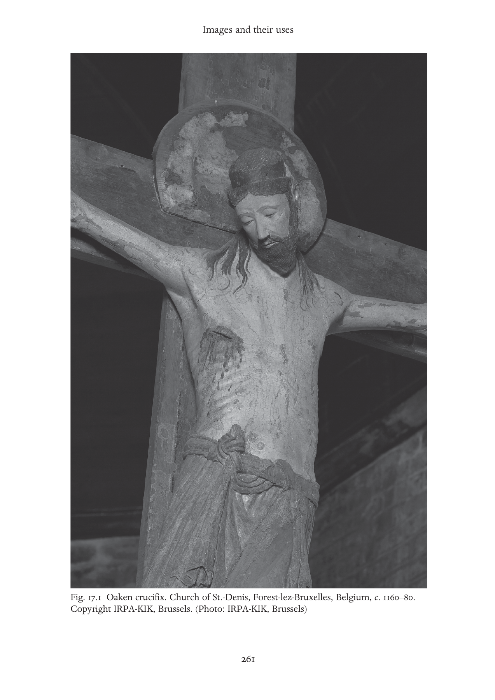
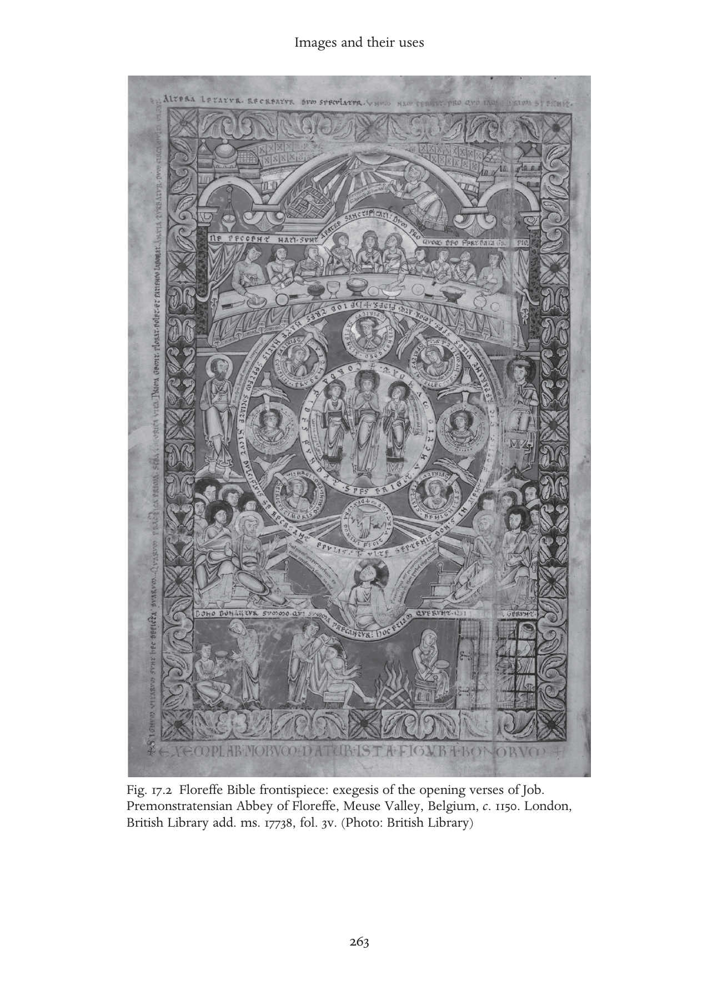
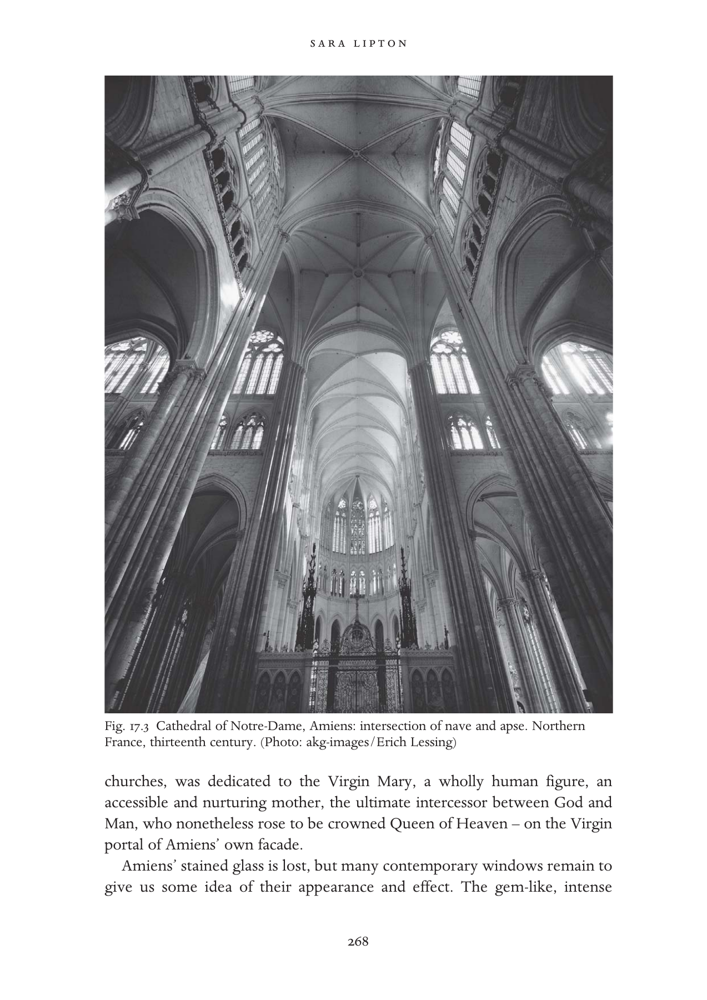
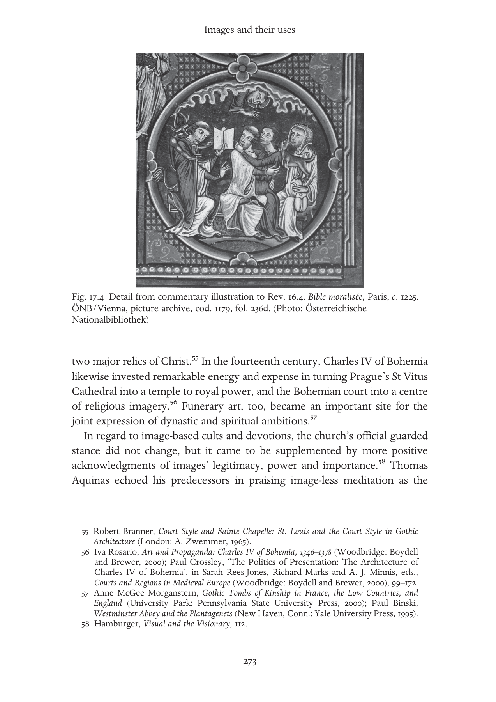
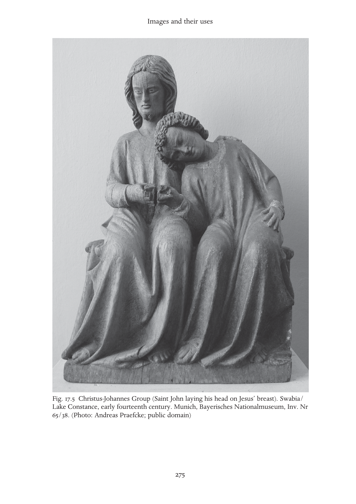
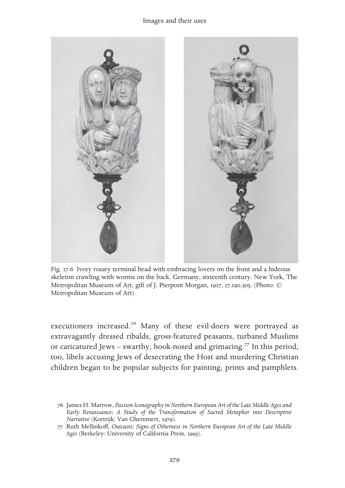

# 图像及其用途：英文转换底稿

<!-- PDF page 274; original page 254 -->

### 17

### Images and their uses

### saralipton

In the first half of the twelfth century, three men, all Benedictine monks, penned defences of Christian art. The first appears in a psalter dated c. 1120–39 and is a French paraphrase of a letter attributed to Pope Gregory the Great:

> It is one thing to worship a picture and another to learn from the story of a picture what is to be worshiped. For what writing conveys to those who can read, a picture shows to the ignorant…and for that very reason a picture is like a lesson for the people.[^p274-1]

This prayer book, known as the Saint Albans Psalter, was the first English manuscript in almost two hundred years to contain full-page painted scenes, and its scribe apparently felt that some justification for the lavish decoration was necessary. The second, by Rupert, abbot of Deutz (d. 1129), is a refutation of Jewish charges that Christian veneration of images amounted to idolatry. Rupert’s response was to emphasise the emotional impact and devotional efficacy of images: ‘While we externally image forth [Christ’s] death through the likeness of the cross, we [are kindled] inwardly to love of him…’[^p274-2] The third, an elaborate paean by Abbot Suger of Saint-Denis to the beauty and spiritual power of his newly rebuilt abbey church (c. 1144), implicitly counters those who saw art as a form of ‘distracting materialism’.[^p274-3] Far from distracting us, Suger wrote, art draws our ‘dull minds’ to the sacred, ‘urging [them]

[^p274-1]: ‘Altra cóse est aurier la painture/e altra cose est par le historie de la painture ap[re]ndre/ quela cóse seit ad aurier, kar ico que la scripture aprestet/ as lisanz, icó aprestet la painture as ignoranz, kar an icele veient/ les ignoranz quet il deivent sivre.’ Hildesheim, St Godehard Library, St Albans Psalter, fol. 68v. The same folio also contains a Latin version of the letter: ‘Aliud est picturam adorare, aliud ratione[m] de pict[ur]is int[er] roganti/per picture historia[m] quid sit adorandu[m] addiscere, Nam quod legentib[us]/ scriptura hoc ignotis prestat pictura, q[u]a in ipsa ignorantes vident quid/ sequi debeant.’

[^p274-2]: Rupert of Deutz, Anulus sive dialogus inter Christianum et Iudaeum, ed. Rhabanus Haacke, in Maria Lodovica Arduini, Ruperto di Deutz e la controversia tra cristiani ed ebrei nel secolo XII (Rome: Istituto storico italiano per il Medio Evo, 1979), 232–5.

[^p274-3]: See Conrad Rudolph, Artistic Change at St.-Denis: Abbot Suger’s Program and the Early Twelfth-Century Controversy over Art (Princeton: Princeton University Press, 1990).

<!-- PDF page 275; original page 255 -->

upward from material things to the immaterial’.[^p275-4] Christian art was far from new at the time; western Christians had long enshrined the Word of God in the most beautiful possible form, and made God’s majesty manifest in sumptuously decorated architecture, metalwork and ivories. But these texts nevertheless testify to an important fact: in the twelfth century, images became more central to the practice of Latin Christianity than they had ever been before.

How the images were used was as diverse as the forms they took and the people who viewed them. The three functions cited by our authors – didactic, affective, anagogic – were those most frequently evoked by medieval theologians. Yet these approaches barely begin to describe the manifold uses to which images were put. In the pages that follow, I offer a broadly chronological overview of the role of images in high medieval Christianity. Although I touch upon such traditional art-historical considerations as patronage and commission, style and iconography, my primary focus is how people viewed and used the images around them. Because most forms of image use had their origins in the eleventh and twelfth centuries, I discuss this period in some depth, and treat only significant new developments in subsequent centuries.

### Later eleventh and twelfth centuries

If the necessary preconditions for the artistic flowering of the High Middle Ages were economic revival and at least a degree of political stability, the driving impetus was religious renewal. As clerical reformers sought to elevate the status of the church and its clergy, deepen the meaning of worship, affirm the virtue of the sacraments, and draw the laity into religious life, the visual aspects of Christianity took on greater significance. The growing popularity of the cult of relics – perhaps the most noticeable symptom of the broadening and deepening of Christian faith in high medieval Europe – drew more and more people money to material objects whose sight and touch promised to provide contact with the holy.[^p275-5] When a series of church synods between 1059 and 1079 resolved the Eucharistic Controversy in favour of the doctrine

[^p275-4]: Suger of Saint Denis, De Administratione 27, in Erwin Panofsky, ed. and trans., Abbot Suger on the Abbey Church of St. Denis and its Art Treasures, 2nd edn, ed. Gerda Panofsky-Soergel (Princeton: Princeton University Press, 1979), 48.

[^p275-5]: On the cult of relics, see Arnold Angenendt, Heilige und Reliquien: Die Geschichte ihres Kultes vom fruhen Christentum bis sur Gegenwart (Munich: Verlag C. H. Beck, 1994); Patrick J. Geary, Furta sacra: Thefts of Relics in the Central Middle Ages (Princeton: Princeton University Press, 1978); and Barbara Abou-el-Haj, The Medieval Cult of Saints: Formations and Transformations (Cambridge: Cambridge University Press, 1994).

<!-- PDF page 276; original page 256 -->

eventually known as transubstantiation, the presence in every church of the visible body of Christ was forcibly declared. And in the battle for supremacy waged between church and empire, visual splendour was almost as favoured a weapon as verbal polemic and military might.

The innovative and impressive Romanesque churches with which art historians generally begin the story of high medieval art were equally notable for the burgeoning number of ornate objects sheltered within. In addition to larger and more magnificent reliquaries, the ever-growing elaboration of the liturgy called for more, and more beautiful, liturgical vessels, vestments and utensils: chalices and patens, eucharistic doves and pyxes, croziers and combs, fans and censers, candlesticks and ewers of crystal, gold, silver, bronze, ivory and enamel crowded upon or were suspended above altar-tops. These objects, like the institutions that housed them, worked on several registers at once, simultaneously fulfilling liturgical, spiritual and practical functions, and conveying meaning through form and medium as well as subject matter. Reliquary caskets and shrines manifested the order of the spiritual realm in their symmetrical and hierarchical forms, while their precious materials represented the glory of the resurrected body.[^p276-6] Imagery on their exteriors told tales from saints’ lives or Scripture, highlighted correspondences between the Old and the New Testaments, or connected the particular saint inside with the universal heavenly host. Reliquaries in the shape of body parts advertised the holy items contained within; though they could also, as scholars have recently realised, mask their contents: the arm reliquary purchased by Abbot Gauzlin of Fleury (d. 1030) contained not an arm bone but a shroud, and the arm reliquary of Peter in Binche (Hainault, Belgium) contains a leg bone.[^p276-7] In such cases, the image worked metaphorically, ‘arm’ signifying power and action. Many reliquaries also had ceremonial functions: the reliquary foot of St Andrew doubled as a portable altar, while arm reliquaries were used for blessing the faithful, for the swearing of oaths and to heal the sick.[^p276-8] Altar and processional crosses and crucifixes, whether gorgeous luxury items like the ivory, gold and sapphire crucifix of King Ferdinand and Queen Sancha of Castile and Leon (1063) or more modest objects like the wooden crucifix from Austria now in The Cloisters, symbolised the sacrifice at the heart of the Christian faith and recreated daily in the mass, sheltered holy relics and served as focal points for the holiest moment of the Christian year – the Good Friday

[^p276-6]: Caroline Walker Bynum, The Resurrection of the Body in Western Christianity, 200–1336 (New York: Columbia University Press, 1995), 209–12.

[^p276-7]: Barbara Boehm, ‘Body-Part Reliquaries: The State of Research’, Gesta 36 (1997), 8–19.

[^p276-8]: Cynthia Hahn, ‘The Voices of the Saints: Speaking Reliquaries’, Gesta 36 (1997), 20–31.

<!-- PDF page 277; original page 257 -->

liturgy culminated in the unveiling and veneration of the crucifix.[^p277-9] Chalice, paten, ewer and mitre served respectively to hold wine, wafer and water, and to adorn and exalt a bishop; but each also served more generally to catch and reflect light, to bring colour and luminescence into the church, to embody in its own beauty and luxury the inestimable preciousness of the divine.

This last, most basic function, was of course a time-honoured one – Christians had ever considered the material splendour of their sanctuaries and ceremonies to redound equally to the glory of God, the institutional church and their financial supporters. And although the influential Cistercian Abbot Bernard of Clairvaux (d. 1153) mocked monastic ostentation and urged his brothers to reduce the outward trappings of worship, most Christians, monks included, continued to regard expenditure on decoration praiseworthy acts of piety. As Cardinal Matthew of Albano (d. 1132) exclaimed in his reproach to Benedictine followers of Bernard who voted to embrace austerity, ‘Beloved brothers, to whom do those honors, that reverence belong…if not to the highest and most ineffable divine majesty? Whoever sought glory from [elaborate vestments and objects], except God and the Holy Mother Church?’ And although Cardinal Matthew thus sought to discount any but the most disinterested motives for such luxury, he went on to add:

> Most Christian emperors and kings and other princes…ornamented and decorated [the Church of God] with various ornaments; saints and apostolic popes and venerable abbots also did the same…and because of this they are believed to have been promised the heavenly realm.[^p277-10]

Donors too drew spiritual gain from their donations.

Sacred objects also performed what we (but probably not their original owners, to whom such distinctions were largely without meaning) might label more prosaic functions, serving as tourist attractions, spoils of war, diplomatic gifts, ‘seed’ money for additional donations, and as declarations of their donors’ social and political aspirations. An inscription at the foot of the Ferdinand and Sancha crucifix trumpets the royal couple’s piety, while the precious materials proclaim the donors’ wealth and status. The sumptuous, silver-clad chest known as the Arca Santa (c. 1120), which contained a sizeable

[^p277-9]: The Art of Medieval Spain, a.d. 500–1200 (New York: Metropolitan Museum of Art, 1993), 244.

[^p277-10]: Stanislaus Ceglar, ‘Guillaume de Saint-Thierry et son rôle directeur aux premiers chapitres des abbés bénédictins, Reims 1131 et Soissons 1132’, in M. Bur, ed., Saint Thierry: Une abbaye du VIe au XXe siècle. Actes du Colloque international d’Histoire monastique, Reims-Saint-Thierry, 11 au 14 octobre 1976 (Saint-Thierry: Association des Amis de l’Abbaye de Saint-Thierry, 1979), 331.

<!-- PDF page 278; original page 258 -->

relic collection, was instrumental in making Oviedo a popular stop on the pilgrimage road to Compostela, helping to elevate Oviedo’s ecclesiastical privilege and prestige. When Bernard of Clairvaux wrote that monasteries coveted ‘exquisite baubles’ and ‘gold-cased relics’ in order to catch sightseers’ gazes and loosen their purse strings, he was merely putting an unusually critical spin on a widely accepted practice.[^p278-11]

In the same period, such well-established forms of visual embellishment were supplemented by new kinds of images. Romanesque buildings continued and extended earlier traditions of wall painting, but they also, for the first time in the Christian West, incorporated into their architectural fabric extensive and coherent sculptural programmes; in Italy the dormant art of mosaic was revived (for example, at Montecassino in the 1070s and San Clemente, Rome, before 1128). Altars began to be faced with frontals (antependia) of wood, metal, enamel or stucco carved or painted with images, usually of Christ, the apostles or various saints. Crosses and crucifixes, long used in processions and displayed during mass, now came to be permanently fixed on altars. Towards the end of the eleventh century near-life-size wooden crucifixes began to be erected on the choir screen or hung from the chancel arch, according the laity a dramatically enlarged image of the saviour. Reliquary statues, which had begun to appear in the tenth century, were widespread by the end of the eleventh; in the twelfth century they were supplemented and then largely superseded by non-reliquary cult images such as the Sedes sapientiae (statues of the enthroned Virgin with Child) and sculpted images of saints.[^p278-12]

A variety of contemporary texts bear witness to the fact that such new kinds of images inspired some concern. The initial shock of the cleric Bernard of Angers (c. 1020) at his first encounter with the cult of the statue of Ste Foi at Conques is well known.[^p278-13]  Some form of resistance apparently spurred each of the defences of art with which I opened. But most strikingly, various images themselves voice warning regarding their own misuse, while at the same time laying claim to singular merit. A titulus above a mosaic of the Maiestas Domini

[^p278-11]: Conrad Rudolph, The ‘Things of Greater Importance’: Bernard of Clairvaux’s Apologia and the Medieval Attitude toward Art (Philadelphia: University of Pennsylvania Press, 1990).

[^p278-12]: Signe Horn Fuglesang, ‘Christian Reliquaries and Pagan Idols’, in Soren Kaspersen, ed., Images of Cult and Devotion: Function and Reception of Christian Images in Medieval and Post- Medieval Europe (Copenhagen: Museum Tusculanum Press, 2004), 7–32; Irene H. Forsyth, Throne of Wisdom: Wood Sculptures of the Madonna in Romanesque France (Princeton: Princeton University Press, 1972).

[^p278-13]: Bernard of Angers, The Book of Sainte Foy, trans. Pamela Sheingorn (Philadelphia: University of Pennsylvania Press, 1995).

<!-- PDF page 279; original page 259 -->

in San Marco, Venice (c. 1100) asserts: ‘The image teaches God, but it is not itself God. You should revere this [image], but worship with your mind that which you recognise in it.’[^p279-14]  And an inscription on the north portal of the early twelfth-century Church of San Miguel, Estella cautions: ‘The image that you see, is neither God nor man. But he whom the sacred image figures, is both God and man.’[^p279-15]  The promise of apprehension was inherent in the image, but so was the danger of idolatry.

There was ample cause for both hope and concern. In the eleventh and twelfth centuries, sculptures and paintings seemed to absorb the holy powers traditionally attributed to relics, inspiring quite new kinds of image-based venerations.[^p279-16]  Pilgrims travelled great distances to genuflect, light candles or say prayers in their presence; alternatively, images might be carried far from their homes in procession, allowing townspeople and country-dwellers to feel the presence of Mary or the saint – and also of the institution that owned them – in their own localities. In spite of the warnings, many of the faithful apparently identified the images with their prototypes, believing that the images themselves had the power ‘to speak, to weep, to fly out of windows, to bring rain in time of drought, to deter invaders in time of war, or simply to box the ears of the naughty’.[^p279-17]  Such confusion could only have been exacerbated by liturgical practices: the Sedes sapientiae are known to have played the part of Mary in mystery plays, and in the Palm Sunday liturgy of the Italian monastery of Fruttuaria a figure called the ossana was cast as Christ himself.[^p279-18] Exempla relating miracles worked by images, such as the crucifix that bled when mocked and struck by Jews, became increasingly popular, and must have both encouraged and guided image-based cults and devotions.[^p279-19]

[^p279-14]: Ragne Bugge, ‘Effigiem Christi, qui transis, semper honoria: Verses Condemning the Cult of Sacred Images in Art and Literature’, Acta archaeologiam et artium historiam pertinentia 6 (1975), 127–39.

[^p279-15]: Calvin B. Kendall, The Allegory of the Church: Romanesque Portals and their Verse Inscriptions (Toronto: University of Toronto Press, 1998), no. 47. Nearly identical verses also appear in a manuscript of c. 1150 discussed in Jeffrey F. Hamburger, The Visual and the Visionary: Art and Female Spirituality in Late Medieval Germany (New York: Zone Books, 1998), 186.

[^p279-16]: See André Vauchez, ‘L’image vivante: Quelques réflexions sur les fonctions des représentations iconographiques dans le domaine religieux en Occident aux derniers siècles du Moyen Âge’, in Maurice Aymard et al., eds., Pauvres et riches: Société et culture du Moyen Âge aux temps modernes. Mélanges offerts à Bronislaw Gesemek à l’occasion de son soixantième anniversaire (Warsaw: Wydawnictwo Naukowe PWN, 1992), 231–41.

[^p279-17]: Forsyth, Throne of Wisdom, p. 3; David Freedberg, The Power of Images: Studies in the History and Theory of Response (Chicago: University of Chicago Press, 1989).

[^p279-18]: Forsyth, Throne of Wisdom; Elizabeth Lipsmeyer, ‘Devotion and Decorum: Intention and Quality in Medieval German Sculpture’, Gesta 34 (1995), 20–7.

[^p279-19]: Sixten Ringbom, ‘Devotional Images and Imaginative Devotions: Notes on the Place of Art in Late Medieval Private Piety’, Gazette des Beaux-Arts ser. 6.73, alt. no. 1202 (1969), 160. The miracle was mentioned in a sermon at the pro-image Seventh Council of Nicaea in 787, but only arrived in western Europe in the eleventh century, when it was commemorated in the Passio ymaginis office; see Michele Bacci, ‘The Berardenga Antependium and the passio ymaginis Office’, Journal of the Warburg and Courtauld Institutes 61 (1998), 1–16.

<!-- PDF page 280; original page 260 -->

It would be a mistake, moreover, to view intense response to visual cues as an exclusively or even primarily lay phenomenon; the gap between ‘elite’ and ‘popular’ image use was probably narrower than long assumed. Certainly twelfth-century theologians such as Richard of Saint-Victor, following Augustine and Pseudo-Dionysius, ranked physical perception quite low, envisioning an ascending hierarchy that passed from corporeal sight through imagination, to image-less intellect or understanding.[^p280-20]  But few aspired to, much less reached, the ultimate stage. Many monastic devotions, both male and female, revolved around visual stimuli, especially, echoing Carolingian precedent, the image of the crucified Christ. Rupert of Deutz sought to realise the monastic ideal of imitatio Christi through focused gazing at a crucifix, and moving and intimate Meditations promoting and guiding visual contemplation of the crucifix were penned by such influential figures as John of Fécamp (d. 1079), Anselm of Canterbury (d. 1109) and Aelred of Rivaulx (d. 1166) for use by monks, nuns and devout laypersons.[^p280-21]  Changing devotional patterns were reflected in changing imagery: the twelfth century was a transitional period in the depiction of the Crucified. Although many crucifixes continued to accord Christ the triumphal, living aspect familiar from Carolingian and earlier art, others, such as the oaken crucifix from the church of St-Denis, Forest-lez- Bruxelles (c. 1160), which movingly depicts the sagging head and strained ribs of the dying Christ, began to reflect the new emotionalism and emphasis on Christ’s humanity in their form (Figure 17.1).[^p280-22]  But the relationship between outward form and devotional function is not a simple one; visual conservatism did not necessarily preclude creative responses. Rupert of Deutz, for example, was moved to a very ‘modern’ kind of love for and mystical union with Christ by an object that apparently adhered to traditional iconographical modes.[^p280-23] And the remarkably tender tributes to the compassionate and mournful motherhood of the Virgin composed in the period found surprisingly little

[^p280-20]: Richard de St Victor, Liber exceptionum, ed. J. Chatillon (Paris: J. Vrin, 1958).

[^p280-21]: See Rachel Fulton, From Judgment to Passion: Devotion to Christ and the Virgin Mary, 800– 1200 (New York: Columbia University Press, 2002), 336–41; Sara Lipton, ‘Sweet Lean of his Head: Writing about Looking at the Crucifix’, Speculum 80 (2005), 1172–1208.

[^p280-22]: Rhein und Maas: Kunst und Kultur 800–1400 (Cologne: Schnütgen-Museum, 1973), vol. 2, 412–13, fig. 10.

[^p280-23]: Lipton, ‘Sweet Lean of his Head’.

<!-- PDF page 281; original page 261 -->

Fig. 17.1 Oaken crucifix. Church of St.-Denis, Forest-lez-Bruxelles, Belgium, c. 1160–80. Copyright IRPA-KIK, Brussels. (Photo: IRPA-KIK, Brussels)

<!-- PDF page 282; original page 262 -->

expression in art: with the exception of a handful of images, Mary continued to be depicted as the regal Queen of Heaven to the end of the twelfth century.[^p282-24]

Although illuminated manuscripts had long been known in the medieval West, the production of illustrated books – mostly Bibles and liturgical works – took a quantitative and qualitative leap forward in the years 1080– 1140.[^p282-25]  Sumptuous images ostentatiously announced a monastery’s embrace of reform, as well as fulfilling the widespread goal of glorifying God with splendour and shine.[^p282-26]  Manuscripts accordingly increased in size and expense; gold was introduced in German book art in the eleventh century and in France around the year 1100. Narrative imagery greatly expanded; illuminated saints’ lives began to appear in significant numbers in the eleventh century, and extensive cycles of biblical illustration, such as that in the St Albans Psalter, in the twelfth. Despite the assertion of the St Albans scribe, it seems unlikely that the ‘unlearned’ were the primary audience for book art. Though some of these picture cycles may well have served as biblical handbooks, teaching sacred history to students struggling to learn Latin, or to noblemen or women who read only the vernacular, the vast majority of manuscripts were made by and for monks, who would not have resorted to images for basic instruction. Moreover, many illuminated manuscripts were far too dense and recondite to fulfill this function. The Floreffe Bible (c. 1150), for example, mingles scholarship and art in elaborate allegorical imagery that is still not fully understood (Figure 17.2).[^p282-27]  Such manuscripts, which most likely formed the basis for contemplative exercises structured by both illustration and text, demonstrate the extent to which even the most learned figures of the century used images to enrich religious experience.

What, then, of that pedagogical service – teaching the unlettered the basics of their faith – so vaunted by the St Albans scribe, and long assumed by scholars to be the primary function of monumental church art? Evidence suggests that here, too, the subject is more complicated than once thought. Some of the most extensive narrative cycles, such as the biblical and hagiographical carvings that gracefully entwine the cloister capitals at the Cluniac Abbey of St Pierre in Moissac (c. 1100), as well as the majority of French

[^p282-24]: Fulton, From Judgment to Passion, 348.

[^p282-25]: Walter Cahn, Romanesque Bible Illumination (Ithaca, N.Y.: Cornell University Press, 1982), 121.

[^p282-26]: Cahn, Romanesque Bible, 104.

[^p282-27]: Anne Marie Bouché, ‘The Floreffe Bible Frontispiece, London, B.L. add. ms. 17738, fol. 3v-4r, and Twelfth-Century Contemplative Theory’ (PhD dissertation, Columbia University, 1997).

<!-- PDF page 283; original page 263 -->

Fig. 17.2 Floreffe Bible frontispiece: exegesis of the opening verses of Job. Premonstratensian Abbey of Floreffe, Meuse Valley, Belgium, c. 1150. London, British Library add. ms. 17738, fol. 3v. (Photo: British Library)

<!-- PDF page 284; original page 264 -->

Romanesque fresco cycles, appear in areas to which lay people had no access. Even more approachable scriptural cycles, such as the west portal of the Abbey of Santa Maria, Ripoll, Catalonia (c. 1150), which is awash in biblical imagery, or the frescoes on the nave vaults of the Cluniac priory of Saint- Savin-sur-Gartemps (c. 1100), which present a vivid pageant of biblical history from the Creation through the giving of the Law at Sinai, or the ceiling in the parish church of St Martin in Zillis, Switzerland (c. 1140–60), which boasts almost 150 panels painted with biblical scenes, seem ill-suited to serve as ‘lessons for the simple’. As Laurence Duggan has pointed out, and as any visitor can attest, most such images are difficult to see and decipher, and often have to be supplemented by explanatory inscriptions.[^p284-28]  Abbot Suger explicitly acknowledged that his art was accessible only to the learned, and even for them, only with the help of written descriptions.[^p284-29]  Whether there has ever been such a thing as a picture that ‘speaks for itself’ is debatable; but it seems clear that in the Middle Ages images were not supposed to replace words, but to complement them.

The main didactic function of art, then, was not so much to teach new things, as to bring life to existing teaching, to recall lessons presented in another format, perhaps at another time.[^p284-30]  This seems to be the moral of a story told about Duke Godfrey of Bouillon (d. 1100). When asked to provide examples of their master’s piety, the Duke’s servants reported that ‘once he entered a church, he could not be lured out, even after the celebration of divine office had been completed. Rather, he demanded an explanation of every single image and picture from the priests and those who seemed to have some knowledge of such things.’[^p284-31]  The duke is praised not because he looked at and learned from the images, but because he asked for help in understanding them. This account, penned by a bishop, implies that if images were the Bible of the simple, they were in the eyes of the clergy at least, like the Bible, texts in need of glossing.

Indeed, the relatively few sermons we have that refer to art approach pictorial narratives much as they approach the Bible itself – as springboards for spiritual and moralistic allegorising. A twelfth-century abbot of St Victor

[^p284-28]: Lawrence Duggan, ‘Was Art Really the “Book of the Illiterate”?’, Word and Image 5 (1989), 227–51.

[^p284-29]: Suger of Saint Denis, De Administratione 33.

[^p284-30]: This mnemonic function is implicit in the Pseudo-Gregorian letter to Secundinus, which praises art’s ability to help people recall lessons, but it is obscured in most paraphrases of the letter, which insist on the analogy ‘picture: laity::word: clergy’.

[^p284-31]: William of Tyre, History of Deeds Done beyond the Sea, trans. Emily Atwater Babcock and A. C. Krey (New York: Columbia University Press, 1943).

<!-- PDF page 285; original page 265 -->

consistently promoted a metaphorical approach to art in his sermons, telling his canons that they should strive to imitate the saints, who ‘are rightly said to be not rough but sculpted stones, because what they assert with words, they show openly with deeds, and so correct behaviour is discerned in them, just as…what they did is explained in sculpture’.[^p285-32]  He is clearly not imagining a ‘literal’ reading of the image; Augustinian canons generally were not expected to raise the dead, cure the halt and blind, ward off demons, or perform most of the other deeds typically depicted in carvings of saints. Rather, he expected his canons to look beneath the surface of the image: to emulate the apostles in living together harmoniously, for example, or to shun temptation and vice as assiduously as Saint Anthony repulsed demons. Peter Comestor (d. 1178) explicitly condemned the literal reading of art, cautioning that, if taken literally, wall paintings of the Transfiguration could promote the mistaken opinion that Christ’s body was not affected: ‘for certain rays of splendour are usually painted around, but separate from, the body of the Lord …’[^p285-33]  No wonder, then, that so many church images were difficult to see – as the account about Godfrey de Bouillon suggests, images may have had greatest value when they served not to convey information but to provoke questions, which could only be answered by recourse to authority.

Of course, some images did deliver fairly straightforward messages. Bishop Hugh of Lincoln told King John of England that sculptures and pictures of the Last Judgement were placed at church doorways so that worshippers ‘could truly know the terror of Hell’, and a text carved along the border of the vivid Last Judgement tympanum at Ste-Foi, Conques ends with the warning: ‘Sinners, if you do not reform your ways, know that you will have a dreadful fate.’[^p285-34]  The location of this lesson is as pointed as its content: the portrayal of the Last Judgement on the door of a church reminds pilgrims that the clergy alone held the power to loose and to bind (as they alone could translate this Latin text for lay spectators). As a reminder, however, that art could often be used in ways unintended by its makers, let us consider King John’s response to

[^p285-32]: ‘Qui recte non puri sed sculpti lapides esse dicuntur, quia quod verbis asserunt, operibus evidenter ostendunt, et dum in eis recta operatio cernitur, quodammodo velut in sculptura quod egerunt explanatur.’ Paris, Bibliothèque nationale, ms. lat. 14, 525, fol. 95v.

[^p285-33]: ‘Ideoque tradunt splendorem illum non fuisse in corpore dominico, sed in aere circum se… Cui opinioni consonant picture in parietibus ecclesiarum, ubi depingitur transfiguratio. Solent depingi quidam radioli splendoris circa corpus dominicum seorsum a corpore dominico…’ Paris, Bibliothèque nationale, ms. lat. 15,269, fol. 106v.

[^p285-34]: Adam of Eynsham, Magna vita sancti Hugonis: The Life of St. Hugh of Lincoln, 2 vols., ed. Decima L. Douie and David Hugh Farmer (Oxford: Clarendon Press, 1985), vol. 1, 138–42.

<!-- PDF page 286; original page 266 -->

Bishop Hugh’s art-based homily. Utterly uncowed, the chronicler tells us, ‘John crossed over to the wall opposite and pointed out kings distinguished by splendid crowns, being joyously conducted by angels to the heavenly king. “My lord bishop,” he said, “you should have shown us these!”’

Ultimately, the content of church art may well have been secondary to its sensory effect. The paintings and mosaics of Christ in Majesty that so frequently adorned Romanesque walls endowed Christ with such venerable signs of wisdom and might as alpha and omega, book and orb, but they probably impressed as much with their colour, intensity and size as with their symbolism. Much to art historians’ frustration, contemporary accounts of church paintings refer more frequently to their ‘brightness’ and ‘liveliness’ than to their form or subject matter.[^p286-35]  Though such visual pleasure might fall well short of Abbot Suger’s anagogical apprehension of the divine, it nevertheless could serve pastoral ends: Canon Hugh of Fouilloi (d. 1172) acknowledged that art was useful in ‘holding’ those too simple to be delighted by subtleties of Scripture, but yet able to be delighted by pictures.[^p286-36]  Even Bernard of Clairvaux conceded (with some irritation) that for many people ‘that which is more colorful, is believed to be more holy’.[^p286-37]

### Thirteenth and early fourteenth centuries

In the thirteenth century leadership of religious reform passed to universitytrained and city-based clerics and mendicants, who expanded their attention to encompass the entire body of the Christian faithful, addressed a broader range of human behaviour, and stressed that outward worship must be accompanied by internal dedication. These changing contexts and emphases, which led to the further erosion of clerical/lay, cloister/world contrasts, were linked to three main developments in religious imagery: a multiplication and diversification of subject matter, a trend towards emotionalism and naturalism in style, and the introduction of religious art into urban and bourgeois domestic spaces. In their aggregate, and although the basic goals of art to teach, move, inspire, exalt and/ or aggrandise did not change, these developments point to a new approach towards image function. Whereas eleventh-century art sought to capture the glory of the heavenly realm in substance, colour and form – to bring the ‘elsewhere’ down to the ‘here’ – thirteenth-century art found and highlighted

[^p286-35]: C. R. Dodwell, Painting in Europe, 800 to 1200 (New Haven, Conn.: Yale University Press, 1992), 126.

[^p286-36]: De claustro animae, 1b. II, c. 4, PL 176, col. 1053.

[^p286-37]: Rudolph, ‘Things of Greater Importance’, 280–1.

<!-- PDF page 287; original page 267 -->

the heavenly beauty in the natural world, blurring the boundaries between ‘elsewhere’ and ‘here’. As art endowed spiritual events with the immediacy of reality, everyday life (ideally) became infused with spiritual meaning.

Nowhere are these various trends more apparent than in the great Gothic cathedral of Notre Dame in Amiens, begun c. 1220. Its soaring vaults and pointed arches draw the eye eastward and upward, where the thin walls, delicate tracery and vast windows of the choir seem to dissolve in a sea of light, and all distinction between outside and inside is effaced (see Figure 17.3).[^p287-38] This effect is furthered by the lifelike bands of carved flora blossoming on the column capitals and above the nave arches. The profusion of sculpture on the cathedral’s exterior brought a myriad of Christian images to the heart of the city. And just as the images were more visible to the city, the city was more visible in the images – in the figures’ contemporary clothing and detailed settings, and in their very human gestures and expressions. Representations of the vices appear in the lowest and most visible level of the central portal of the west facade, where they are portrayed not as abstract personifications, but as familiar figures wielding commonplace objects – disobedience is a young man insulting a bishop, for example, and avarice is a miser heaping bags of money into a chest. Such images seem to echo preachers’ and confessors’ exhortations that their flocks train their gazes on themselves, and read their own behaviour in the light of Christian values. Higher up, the so-called Beau-Dieu sculpture of Christ on the trumeau of the central portal treads upon venerable symbols of evil and carries a book of wisdom, but in appearance he is utterly unlike the conquering Christ-Judges of Romanesque tympana. He is gentle and approachable, and also fully rounded and anatomically convincing, though more perfect than any living man.[^p287-39]  The equally beautiful figure of Mary on the southern portal stretches her arm out towards the faithful in warm welcome. This increased naturalism of Gothic sculpture is sometimes explained as an expression of Aristotelian materialism or proto-Renaissance humanism, but as Paul Binski has argued, it is probably best seen as a visual articulation of the religious ethos of the period, especially the growing devotion to the human Christ.[^p287-40]  Amiens, like many Gothic cathedrals and

[^p287-38]: Stephen Murray, Notre-Dame, Cathedral of Amiens: The Power of Change in Gothic (Cambridge: Cambridge University Press, 1996).

[^p287-39]: Wilhelm Schlink, Der Beau-Dieu von Amiens: Das Christusbild der gotischen Kathedrale (Frankfurt: Insel Verlag, 1991).

[^p287-40]: Paul Binski, Becket’s Crown: Art and Imagination in Gothic England, 1170–1300 (New Haven, Conn.: Yale University Press, 2004), and ‘The Angel Choir at Lincoln and the Poetics of the Gothic Smile’, Art History 20 (1997), 350–74.

<!-- PDF page 288; original page 268 -->

Fig. 17.3 Cathedral of Notre-Dame, Amiens: intersection of nave and apse. Northern France, thirteenth century. (Photo: akg-images/Erich Lessing)

churches, was dedicated to the Virgin Mary, a wholly human figure, an accessible and nurturing mother, the ultimate intercessor between God and Man, who nonetheless rose to be crowned Queen of Heaven – on the Virgin portal of Amiens’ own facade.

Amiens’ stained glass is lost, but many contemporary windows remain to give us some idea of their appearance and effect. The gem-like, intense

<!-- PDF page 289; original page 269 -->

colours and tightly compartmentalised narratives popular earlier in the century began to give way around 1250 to lighter, more translucent glass with larger individual panels. Their detailed and vivid storytelling, the variety and profusion of characters and objects depicted, and the professional and guild insignia that so often border them highlight the interconnectedness of realms conventionally labelled ‘sacred’ and ‘secular’ – as one might expect from a building that served simultaneously as ecclesiastical headquarters and as the central meeting point of a bourgeois town.[^p289-41]  (One of the few surviving thirteenth-century sermon references to stained glass demonstrates the potential risks involved in thus visually mapping sacred history onto the contemporary world: the preacher Odo of Chateauroux recalled that when he was a boy, the layman standing next to him explained that the Good Samaritan window showed the Samaritan in lay clothing and the Levite in clerical dress because ‘priests have no pity for the poor and the suffering, whereas the laity have a great deal’.[^p289-42]  )

In Italy, where for climatic reasons thin walls and large windows were undesirable, many of the same goals were achieved through different methods. As practised first by Cimabue, and then more famously by Giotto, wall painting acquired greater naturalism and emotional immediacy through the use of individualised expressions and features, more varied colours, and the introduction of perspective. Even so traditional a figure as St Matthew is endowed with a fresh sensibility: in Cimabue’s portrait of the Evangelist in the upper basilica of St Francis at Assisi (c. 1280) he rests a hand on his chest as if contemplating the sorrow of the events he narrates in his Gospel. And in frescoes depicting the lives of Christ and his mother in Padua’s Arena Chapel (1305–10), Giotto created the illusion that the light pouring through the chapel’s windows was actually striking the bodies of his remarkably expressive painted figures, making them and the objects they grasped seem tangible and fully present.[^p289-43]  Through such images the Christian viewer, the natural world and the heavenly realm come together.

[^p289-41]: Wolfgang Kemp, The Narratives of Gothic Stained Glass, trans. Caroline Dobson Saltzwedel (Cambridge: Cambridge University Press, 1997); Jane W. Williams, Bread, Wine, and Money: Windows of Trades at Chartres Cathedral (Chicago: University of Chicago Press, 1993). There is some debate concerning whether these guild arms are indications of patronage.

[^p289-42]: Quoted in Kemp, Narratives of Gothic Stained Glass, 71.

[^p289-43]: Michael Camille, Gothic Art: Glorious Visions (New York: Harry N. Abrams, 1996), 48.

<!-- PDF page 290; original page 270 -->

Gothic spaces and images likewise brought the inhabitants of the Christian city together, sometimes in harmony and sometimes in disorder. Stories of entire cities uniting to fund and construct their cathedrals (at Chartres enthusiastic townspeople were said to have hitched themselves to carts to help haul the stones to the site) may have been largely mythical, but they demonstrate the importance of art and architecture in symbolising civic unity and pride, but also hierarchy and power – at least for the people telling them. Nobles, burghers, workers and peasants each had their carefully orchestrated role in religious rituals activated by or involving structures and images, as in the procession organised to honour the new altarpiece painted by Duccio for the cathedral of Siena (1308–11):

> And on the day that [the painting] was carried to the Duomo the shops were shut, and the bishop conducted a great and devout company of priests and friars in solemn procession, accompanied by the nine signiors, and all the officers of the commune, and all the people, and one after another the worthiest with lighted candles in their hands took places near the picture, and behind came the women and children with great devotion.[^p290-44]

Where ecclesiastical and/or political authority was less accepted by the population, the cathedral became an index of division: in internally riven cities, it was often the target of violence.[^p290-45]

Within Gothic cathedrals and churches, there was a greater trend towards spectacle in the liturgy and liturgical art, and a concomitant desire to control and direct the gaze. Around the year 1200 the priest began to turn his back to the laity during mass, shielding the altar top from their view and heightening the drama when the Host was finally lifted for all to see. This theatricality was enhanced by images in the form of paintings or carved reliefs erected behind the altar (retables), which constituted literal backdrops to the ritual.[^p290-46]  These

[^p290-44]: B. Kempers, ‘Icons, Altarpieces and Civic Ritual in Siena Cathedral 1100–1530’, in Barbara Hanawalt and Katherine L. Reyerson, eds., City and Spectacle in Medieval Europe (Minneapolis: University of Minnesota Press, 1994); see also Joanna Cannon and André Vauchez, Margherita of Cortona and the Lorenzetti: Sienese Art and the Cult of the Holy Woman in Medieval Tuscany (University Park: Pennsylvania State University Press, 1999).

[^p290-45]: Resistance could also be expressed through simple neglect: in Toulouse, the bishop failed to raise money to fund an ambitious Gothic reconstruction of the cathedral. See Michael T. Davis, ‘“Sic et Non”: Recent Trends in the Study of Gothic Ecclesiastical Architecture’, The Journal of the Society of Architectural Historians 58 (1999), 414–23.

[^p290-46]: In 1310 the Synod of Trier, codifying this practice, proclaimed that behind or above every altar there should be an image, sculpture, picture or even inscription showing in whose honour the altar had been constructed. Donald L. Ehresmann, ‘Some Observations on the Role of Liturgy in the Early Winged Altarpiece’, Art Bulletin 64 (1982), 368.

<!-- PDF page 291; original page 271 -->

colourful, detailed and often crowded tableaux depicted biblical or allegorical scenes as if they were contemporary events, helping the congregation to recall, even imaginatively to relive, the key moments of sacred history. In the exquisite Westminster retable (c. 1270–80), for example, which once stood behind the high altar at Westminster Abbey, a woman witnessing one of Christ’s miracles wears a pill-box hat of the very latest fashion; such an image would please the refined tastes of courtly viewers while inviting them to imagine themselves at Christ’s side.[^p291-47]  Screens separating the nave from the choir became higher, though they were pierced to allow for limited and controlled viewing of the space beyond, and were adorned with elaborate sculptural scenes that helped contextualise – literally framed – the mystery taking place on the other side.[^p291-48]  Reliquaries, too, became more ‘readable’ and solicitous of the gaze: although they still sometimes used form or iconography to identify the relics within, they also increasingly displayed the relic itself through windows made of transparent crystal. Starting around 1311, when Pope Clement V ordered official adoption of the Feast of Corpus Christi, monstrances displaying the consecrated Host became increasingly common.[^p291-49]

But although images of all kinds proliferated in Gothic churches, straightforward invocations of visual narratives by preachers remained scarce, and sermons continued to promote figurative over literal readings of art. Many thirteenth-century sermons, for example, asked the faithful to ‘see’ in the image of the crucified Christ a rubricated parchment, a leper covered with lesions, a lover extending his arms to embrace, and a bright red military banner.[^p291-50]  Preachers tended to treat the Gothic image in fragmented and piecemeal form: often it is not the narrative itself but an incidental iconographical detail that forms the springboard for a visual lesson. In a sermon delivered in Paris around 1225, Thomas of Chobham reads a message not in the deeds of the saints, but in the shape of their haloes: ‘A soul ought to control itself, just as a king ought to rule himself… Therefore, it is the habit in a church, that wherever an image of any saint who ruled himself well is painted,

[^p291-47]: Paul Binski, ‘The Earliest Photographs of the Westminster Retable’, The Burlington Magazine 130 (1988), 128–32.

[^p291-48]: Jacqueline E. Jung, ‘Beyond the Barrier: The Unifying Role of the Choir Screen in Gothic Churches’, Art Bulletin 82 (2000), 622–57.

[^p291-49]: Miri Rubin, Corpus Christi: The Eucharist in Late Medieval Culture (Cambridge: Cambridge University Press, 1991), 181–5 and 290–1.

[^p291-50]: See Nicole Bériou, L’avènement des maîtres de la parole: La prédication à Paris au XIIIe siècle, 2 vols. (Paris: Institut d’Études Augustiniennes, 1998).

<!-- PDF page 292; original page 272 -->

a round corona is drawn around his head in the form of a shield, and is called a diadem.’[^p292-51]  Through such examples preachers could use external beauty to teach internal reflection – to look not with the eyes of the body, but with ‘the eyes of the heart’.[^p292-52]

The pastoral potential of the image was most fully exploited in the area of manuscript illumination. Illustrated moralistic and edifying texts, such as glossed Bible commentaries, the late thirteenth-century Somme le roi, and illustrated miracles of the Virgin, became popular among wealthy clerics and lay elites, and were remarkable equally for their beauty and luxury, for their innovative juxtaposition of word and image, and for their polemical force. The commentary texts and illustrations of the Bible moralisée made for King Louis VIII of France (c. 1225), for example, apply venerable biblical and iconographic signs (including moneybags, coins, scrolls, frogs, crows and cats) to new concepts and contexts so as to construct a comprehensive catalogue of the sins and vices common to urban society (see Figure 17.4). It may have been intended primarily to induce penitence and provide instruction in Christian virtue, but it also created a visual vocabulary to mark heretics, Jews and moneylenders as antithetical to the ideal of a reformed Christendom. In doing so, the images arguably influenced royal policy towards those groups.[^p292-53]

Secular rulers were not just passive recipients of religious images, however; they too harnessed the power and beauty of Gothic art and architecture for ends simultaneously, or rather inextricably, political and religious. The surprisingly precocious appearance of French Gothic forms in the late twelfthcentury cathedral and palace in Esztergom (Hungary) has been related to both the pro-French dynastic foreign policy and the Parisian-influenced reformist ecclesiastical agenda of King Bela III (d. 1196).[^p292-54]  The so-called Court Style associated with King Louis IX of France (d. 1270) was first and most famously realised in the Sainte Chapelle, a delicate jewel-box of a structure made to hold

[^p292-51]: ‘Et ideo habet ecclesia in consuetudine quod ubicumque ymago alicuius sancti qui bene se rexit depingitur, describitur circa capud eius corona rotunda in modum scuti quod dicitur diadema.’ Thomas of Chobham, Sermones, ed. Franco Morenzoni (CCCM 82A; Turnhout: Brepols, 1993), sermo 20, lines 209–13, 214–15.

[^p292-52]: For example, the preacher Odo of Cheriton (d. 1247) draws the following moral from an exemplum about a painting of the devil: ‘Utinam quilibet faciem eius oculis cordis diligenter inspiceret, in qua cauterium et signum dampnationis comprehenderet… ’ Cambridge, Gonville and Caius College, ms. 362/441, fol. 103v.

[^p292-53]: Sara Lipton, Images of Intolerance: The Representation of Jews and Judaism in the Bibles moralisées (Los Angeles and Berkeley: University of California Press, 1999).

[^p292-54]: Ernö Marosi, Die Anfänge der Gotik in Ungarn: Esztergom in der Kunst des 12. – 13. Jahrhunderts (Budapest: Akademiai Kiado, 1984).

<!-- PDF page 293; original page 273 -->

Fig. 17.4 Detail from commentary illustration to Rev. 16.4. Bible moralisée, Paris, c. 1225. ÖNB/Vienna, picture archive, cod. 1179, fol. 236d. (Photo: Österreichische Nationalbibliothek)

two major relics of Christ.[^p293-55]  In the fourteenth century, Charles IV of Bohemia likewise invested remarkable energy and expense in turning Prague’s St Vitus Cathedral into a temple to royal power, and the Bohemian court into a centre of religious imagery.[^p293-56]  Funerary art, too, became an important site for the joint expression of dynastic and spiritual ambitions.[^p293-57]

In regard to image-based cults and devotions, the church’s official guarded stance did not change, but it came to be supplemented by more positive acknowledgments of images’ legitimacy, power and importance.[^p293-58]  Thomas Aquinas echoed his predecessors in praising image-less meditation as the

[^p293-55]: Robert Branner, Court Style and Sainte Chapelle: St. Louis and the Court Style in Gothic Architecture (London: A. Zwemmer, 1965).

[^p293-56]: Iva Rosario, Art and Propaganda: Charles IV of Bohemia, 1346–1378 (Woodbridge: Boydell and Brewer, 2000); Paul Crossley, ‘The Politics of Presentation: The Architecture of Charles IV of Bohemia’, in Sarah Rees-Jones, Richard Marks and A. J. Minnis, eds., Courts and Regions in Medieval Europe (Woodbridge: Boydell and Brewer, 2000), 99–172.

[^p293-57]: Anne McGee Morganstern, Gothic Tombs of Kinship in France, the Low Countries, and England (University Park: Pennsylvania State University Press, 2000); Paul Binski, Westminster Abbey and the Plantagenets (New Haven, Conn.: Yale University Press, 1995).

[^p293-58]: Hamburger, Visual and the Visionary, 112.

<!-- PDF page 294; original page 274 -->

highest form of contemplation, but he also held that images of Christ (though not of saints) merited the same form of veneration (latria) as Christ himself (in part because he recognised that it had long since become church tradition) and seemed to confirm the miraculous abilities of some images in noting that ‘the blood preserved as relics in some churches did not flow from Christ’s side, but is said to have flowed from some maltreated image of Christ’.[^p294-59]  Pastoral texts in both Latin and the vernacular, such as the Speculum Christiani and the Exemplar of Henry Suso (d. 1366), provided instruction concerning the proper veneration of holy images. Members of both mendicant orders practised visual devotions, and helped popularise them among nuns and lay men and women; Franciscans, especially, were active promoters of imaginative meditations on the Passion and patrons of innovative passion imagery.[^p294-60]

Churches were often the setting for visual devotions, but they also increasingly came to be practised in more intimate and domestic spaces, in conjunction with an expanding number and variety of individually owned images (conventionally, though sometimes misleadingly, called Andachstbilder).[^p294-61] Such images generally took the form of ivory, metal or wooden statues; carved or painted panels with scenes from the Gospels or select holy figures isolated from larger narratives; or appeared in the pages of small illuminated prayer books. Many of these works depicted familiar figures and scenes – the crucifixion and the Virgin with Child remained the most common devotional images throughout the Middle Ages. But newer images privileging human tenderness also began to appear: the Christus-Johannus Group (Saint John laying his head on Jesus’ breast), the Veronica (a close up of Christ’s face, thought to be a true likeness or vera icon) and the Pietà (Mary grieving over the body of her dead son), became increasingly popular in the later thirteenth and early fourteenth centuries (see Figure 17.5). Such objects and images had a variety of uses, cultic and devotional, emotional and intellectual. They helped the faithful achieve the proper state of mind for prayer; they accorded nonecclesiastical spaces the aura of sanctity; they allowed worshippers to approximate the actions and attitudes of a priest in their own cells or homes or during their travels; they facilitated communication with the saints; they served as mnemonic devices for advanced meditations; they assisted mystics in

[^p294-59]: Thomas Aquinas, Summa Theologica II.2.174, III.25.3 and III.54.3.

[^p294-60]: Anne Derbes, Picturing the Passion in Late Medieval Italy: Narrative Painting, Franciscan Ideologies, and the Levant (New York: Cambridge University Press, 1996).

[^p294-61]: On the origins and problematics of the term Andachtsbilder, and the futility of attempts to distinguish cultic from devotional images, see Kaspersen, ed., Images of Cult and Devotion, iv–v.

<!-- PDF page 295; original page 275 -->

Fig. 17.5 Christus-Johannes Group (Saint John laying his head on Jesus’ breast). Swabia/ Lake Constance, early fourteenth century. Munich, Bayerisches Nationalmuseum, Inv. Nr 65/38. (Photo: Andreas Praefcke; public domain)

<!-- PDF page 296; original page 276 -->

achieving ecstatic communion with the divine.[^p296-62]  Some lay people apparently considered them not just complements to but adequate substitutes for official ritual: it was believed that looking at an image of St Christopher or St Barbara on the day of your death could help you get to heaven even without last rites.[^p296-63]  On the other hand, there are also reports of images acting as mouthpieces for official positions: a statue of the Virgin Mary is said to have slapped a Premonstratensian nun who indulged in excessively ascetic practices.[^p296-64]

Discussions of such images and episodes, both medieval and modern, often assume visual sensitivity to be particularly characteristic of female piety. And Jeffrey Hamburger and others have demonstrated without question the prominent role played by visual devotions in the spiritual lives of nuns and beguines. But many medieval texts indicate that clerics and lay males, too, were sensitive to art’s allure: Ramon Llull experienced a passionate crucifixinspired vision indistinguishable from those attributed to many women.[^p296-65] Responses to art probably reflected variations in spiritual preparation as well as differences in the situations and needs of the individuals concerned, rather than any simple gender differentiation.[^p296-66]

While devotional images of Christ, the Virgin and the saints proliferated, more frivolous images sprung up in less central locations of ecclesiastical structures and texts: imaginary monsters, composite beasts and grinning gargoyles decorated column capitals, cornices and water spouts; and apes, donkeys and fantasies without names frolicked in the margins of manuscript pages. These images, too, had their uses, above and beyond their primary functions of supporting arcades, channeling water and so on. At the very least, they served to draw the gaze to the far corners of the cathedral, and perhaps increased goodwill towards the church, in leavening doctrine with humour, and delighting the eye. Perhaps, too, they bore witness to the fecundity of

[^p296-62]: See Peter Dinzelbacher, ‘Religiöses Erleben vor bildender Kunst in autobiographischen und biographischen Zeugnissen des Hoch- und Spätmittelalters’, in Kaspersen, ed., Images of Cult and Devotion, 61–88. On mnemonic function and meditative guidance, see Hamburger, Visual and the Visionary, 78–9 and 184.

[^p296-63]: Henk van Os, Art of Devotion in the Late Middle Ages in Europe, 1300–1500, trans. Michael Hoyle (Princeton: Princeton University Press, 1994), 32.

[^p296-64]: Dinzelbacher, ‘Religiöses Erleben’, 67. Images that did not perform satisfactorily might themselves be struck or otherwise chastised in turn.

[^p296-65]: Ramon Llull, Livro do amigo e do Amado, ed. Mark D. Johnston (Warminster: Aris & Phillips, 1995), 36 (no. 91).

[^p296-66]: See Hamburger, Visual and the Visionary, 111ff. Lipton, ‘Sweet Lean of his Head’ provides additional texts and discussion.

<!-- PDF page 297; original page 277 -->

God’s creation. Michael Camille has argued, convincingly in some cases and less so in others, that manuscript marginalia and Gothic grotesqueries amplified, commented upon or satirised mainstream images and concepts, embodying otherwise effaced ideas and amounting to a counter-official discourse.[^p297-67]  Whatever their meaning, few images better encapsulate the conceptual complexity and visual sophistication of high Gothic religious imagery than these vividly ‘real’ but utterly fanciful creatures perched on the peaks of the house of God.

### Later Middle Ages (c. 1330–1500)

The fourteenth and fifteenth centuries were the heyday of the religious image. Image-based devotional practices and image-inspired mystical visions penetrated all sectors of Christian society; specific images came to be associated with every important liturgical feast; pedestals, niches, tabernacles and brackets for the display of images were added to churches around the Continent; and mass-produced religious images assumed unprecedented propagandistic and commercial significance.[^p297-68]  Nonetheless, as Margaret Aston has noted, ‘even in this image-filled period, attitudes toward images remained ambivalent’.[^p297-69]  Although clerics and the institutional church promoted and sought to profit from these trends (for example, by writing prayers to recite before images, by using prints to propagate pilgrimages and by issuing indulgences for veneration of specific sculptures and paintings), they also expressed discomfort with the emotional excesses such images often inspired, and could be suspicious of artistic innovation.[^p297-70]  The laity both embraced image devotion and, in the form of the Lollard movement, spearheaded resistance to it.[^p297-71]  By the late fourteenth

[^p297-67]: Michael Camille, Image on the Edge: The Margins of Medieval Art (Cambridge, Mass.: Harvard University Press, 1992).

[^p297-68]: Alison G. Stewart, ‘Early Woodcut Workshops’, Art Journal 39 (1980), 189–94.

[^p297-69]: Margaret Aston, ‘The Use of Images’, in Richard Marks and Paul Williamson, eds., Gothic: Art for England 1400–1547 (London: Victoria and Albert Museum, 2003).

[^p297-70]: Ingalill Pegelow, ‘Pictures of Cult and Letters of Indulgence’, in Kaspersen, ed., Images of Cult and Devotion, 33–46; Hamburger, Visual and the Visionary, 348. Hamburger (p. 315) notes that an icon that had been considered appropriate for a female convent in the fourteenth century was transferred to a male convent (that is, confiscated) in the fifteenth. On resistance to innovation, see Paul Binski, ‘The Crucifixion and the Censorship of Art Around 1300’, in P. Linehan and J. Nelson, eds., The Medieval World (London and New York: Routledge, 2001), 342–60.

[^p297-71]: Margaret Aston, England’s Iconoclasts (Oxford: Oxford University Press, 1988).

<!-- PDF page 298; original page 278 -->

century, complaints that there were too many images began to be more frequently voiced.[^p298-72]

Like late medieval devotional literature, the devotional imagery of the period was characterised by intense pathos, often achieved through visual ‘ugliness’.[^p298-73]  A late fifteenth-century ‘Coffin of Christ’ from Garamszentbenedik (Hungary) not only features elaborately carved and highly dramatic scenes of the Passion, but also became the resting place for a life-sized movable corpse of Christ during Easter processions. The Man of Sorrows (a half-length figure of the wounded Christ) became the most popular of all devotional images; in contrast to the Byzantine icons on which they were based, which connected the dead body of Christ to the Glory of God, western versions emphasised Christ’s very human suffering. Vulnerability and pain likewise characterised late medieval crucifixes, and in pietàs Christ’s body became ever more gruesome, and Mary more deeply grief-stricken. The closely observed representation of physical and emotional suffering in such images may have helped their viewers to identify viscerally with their saintly subjects.[^p298-74]  Other images mirrored other forms of late medieval anxiety: themes such as the Three Living and Three Dead, the Dance of Death (first recorded in 1423) and decomposing skeletons served as vivid reminders of the perishability of the flesh (and, by implication, the immortality of the soul).[^p298-75]  Even luxurious decorative objects could have sombre undertones: a sixteenth-century ivory bead with entwined lovers on its front conceals a hideous skeleton on the back (see Figure 17.6).

The visualisation of anxiety and pain was designed to instill piety and penitence, but it also had its dark side in a concomitantly sharpened rendering of evil: late medieval art became a powerful vehicle for the conflation of religious fervour with social hatred. In representations of the Passion the tormenters of Christ became ever more hideous and cruel, and in illustrations of martyrdoms the number and ferocity of the

[^p298-72]: Eustache Deschamps, quoted in Michael Camille, The Gothic Idol: Ideology and Image- Making in Medieval Art (Cambridge: Cambridge University Press, 1989), 219.

[^p298-73]: See Jeffrey F. Hamburger, ‘To Make Women Weep: Ugly Art as “Feminine” and the Origins of Modern Aesthetics’, Res 31 (1997), 9–33.

[^p298-74]: Joanna E. Ziegler, Sculpture of Compassion: The Pieta and the Beguines in the Southern Low Countries, c. 1300–1600 (Brussels and Rome: Institut historique belge de Rome, 1992).

[^p298-75]: Paul Binski, Medieval Death: Ritual and Representation (London: British Museum, 1996).

<!-- PDF page 299; original page 279 -->

Fig. 17.6 Ivory rosary terminal bead with embracing lovers on the front and a hideous skeleton crawling with worms on the back. Germany, sixteenth century. New York, The Metropolitan Museum of Art, gift of J. Pierpont Morgan, 1917, 17.190.305. (Photo: © Metropolitan Museum of Art)

executioners increased.[^p299-76]  Many of these evil-doers were portrayed as extravagantly dressed ribalds, gross-featured peasants, turbaned Muslims or caricatured Jews – swarthy, hook-nosed and grimacing.[^p299-77]  In this period, too, libels accusing Jews of desecrating the Host and murdering Christian children began to be popular subjects for painting, prints and pamphlets.

[^p299-76]: James H. Marrow, Passion Iconography in Northern European Art of the Late Middle Ages and Early Renaissance: A Study of the Transformation of Sacred Metaphor into Descriptive Narrative (Kortrijk: Van Ghemmert, 1979).

[^p299-77]: Ruth Mellinkoff, Outcasts: Signs of Otherness in Northern European Art of the Late Middle Ages (Berkeley: University of California Press, 1993).

<!-- PDF page 300; original page 280 -->

Such images did more than merely reflect growing anti-Jewish sentiment – they almost certainly worked to intensify and channel it.[^p300-78]

By no means was all religious art of the period grim. Fifteenth-century Netherlandish and Italian painting combined complex symbolism with the latest developments in perspective and oil painting technique to create remarkably lifelike and brilliant holy tableaux. In Jan van Eyck’s painting of the Madonna with Canon van der Paele in Bruges (1436), rich brocades, furs and silks, and the donor himself, share centre stage with an exquisitely lovely Madonna, an elegantly chivalrous Saint George and a luxuriously accoutred bishop-saint Donatian; the reality of the donor’s mystical vision seems to be confirmed by the tangibility of the textiles. And many religious images doubled as luxurious household decorations, their holy subjects embodying the latest in elegance and style, while their vivid narratives simultaneously entertained and edified. The remarkable Unicorn Tapestries of c. 1500 at The Cloisters, for example, can be enjoyed as a spirited rendering of a late medieval hunt, as an allegory of Christ’s Passion, and as a paean to courtship and fertility. So exquisite were many late medieval religious artworks that Jean Gerson felt compelled to instruct Christians not to worship an image just for its beauty.[^p300-79]

Image-based devotions had always had a strong tactile element, and in the later Middle Ages art more than ever facilitated the physical expression of religious feeling. Cribs containing sentimental images of the baby Jesus allowed nuns to treat the figure like their own child. While on pilgrimage, Margery Kempe would mark each important stop by reverently clothing an image of Christ; many people left money in their wills to pay for jewellery or clothing with which to adorn images of saints.[^p300-80]  The venerable devotional practice of embracing and kissing statues and crucifixes grew for some people into a daily habit.[^p300-81]  Genuflecting before a statue became an important demonstration of orthodoxy, and the failure to do so, cause for suspicion. Nor was physical interaction merely one-sided: increasingly images moved too. Late medieval northern altarpieces were furnished with moveable wings to be

[^p300-78]: Miri Rubin, Gentile Tales: The Narrative Assault on Late Medieval Jews (New Haven, Conn.: Yale University Press, 1999), and Sara Lipton, Dark Mirror: Jews, Vision, and Witness in Medieval Christian Art (New York: Metropolitan Books, forthcoming).

[^p300-79]: Quoted in Ringbom, ‘Devotional images’, 169 n. 50.

[^p300-80]: Kathleen Kamerick, Popular Piety and Art in the Late Middle Ages: Image Worship and Idolatry in England, 1350–1500 (New York: Palgrave, 2002), 102.

[^p300-81]: Dinzelbacher, ‘Religöses Erleben’.

<!-- PDF page 301; original page 281 -->

opened and closed during strategic moments of the liturgical year, and crucifixes and other sculpted figures were endowed with moveable limbs.[^p301-82] By the end of the Middle Ages, one no longer had to be a gifted mystic to see religious art ‘come to life’. In the High Middle Ages religious pictures and objects served a dizzying array of purposes. They were used to glorify self, family, polity or institution, to exemplify virtue and/or embody vice, to bestow authority or authenticity, to protect a city or individual, to reinforce communal cohesiveness or corporate identity or to demonstrate their breakdown, to create a mood, to work miracles, to publicise a programme or pilgrimage, to raise funds, to spawn hatred, to stimulate the imagination or to trammel it. They could serve as gifts, containers, figureheads, signs or markers. Many of these functions remained common during the entire period in question; others waxed and waned according to social and religious needs and/or the prevalent artistic forms and media. But a few basic observations hold true across the Continent and throughout the centuries of the High Middle Ages. First, there is no simple categorisation of image use according to rank, gender or spiritual status: lay people, clerics and monks, men and women were all able to learn from and be moved by images. Second, the word–image opposition implicit in the cliché ‘Book of the Simple’ breaks down under scrutiny: images rarely if ever ‘replaced’ words, many images prominently featured words, images could be ‘read’ allegorically, just as words were, and by the end of the Middle Ages few if any liturgical or biblical words would have been totally free of visual associations. Third, artistic, theological and social change seem to have unfolded according to a delicate oscillating rhythm. High medieval images of Christ are often regarded as the most perfect visual expressions of the Catholic conception of a loving and compassionate God-Man. But Rupert of Deutz managed to see love and compassion in a crucifix well before such feelings came to dominate artistic renderings of Christ Crucified. Thirteenthcentury devotional emphases on Jesus’ scars and wounds anticipated more extreme later medieval images, which then in turn inspired further devotional excesses. And sometimes viewers encountered artistic change before they were fully ready to accept it. The history of Christian imagery suggests that ideas and images, doctrine, art and society existed in a complex relationship,

[^p301-82]: Ehresmann, ‘Some Observations’.

<!-- PDF page 302; original page 282 -->

with innovation appearing in sometimes one and sometimes the other realm. Finally and most basically, the manifold, overlapping and conflicting uses of images surveyed here confirm the centrality of the religious image in the lives of high medieval Christians. This centrality was acknowledged at the close of the Middle Ages in the ritual for visiting the infirm known as The Boke of the Crafte of Dying.[^p302-83]  Because moriens may be unable to hear, speak or understand, the Boke instructs, the priest should help him or her take solace in God’s love by displaying an image of the crucifix. In the end, this text suggests, what is left to a soul deprived of all other means of access to the divine is sight. And art.

[^p302-83]: Carl Horstmann, ed., Yorkshire Writers: Richard Rolle of Hampole, an English Father of the Church, and his Followers, 2 vols. (New York: Macmillan, 1895–96), vol. 2, 409–10.
