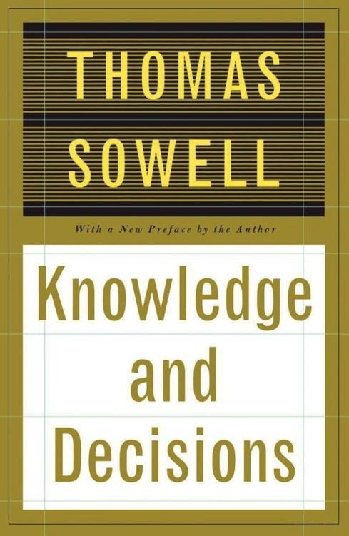
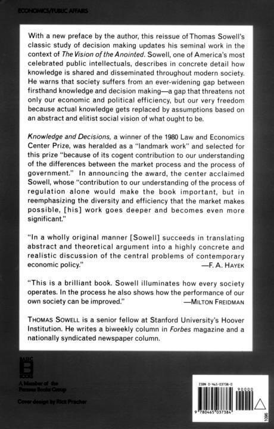

# 知识与决策

托马斯·索维尔

*Knowledge and Decisions*

中文校订版

# 阅读说明

本译本依据所附英文电子底本，收入十章正文、1996年版序言、致谢、原书版权与目录、全部1001条原注、索引、封底及电子版导航。原书正文初版于1980年，序言写于1996年；文中“今天”“目前”、统计和机构情况均保留原有历史时点。

本译稿由AI翻译并复核，逐段对照原文，另行通读全部中文，并完成术语对齐及重点复核；未经独立专业译者逐句精校。作者的论断保留原有归属与语气。底本的损坏、疑误及据可见文字重建之处，以译校说明标出。

原注集中排在书后，保留原编号；正文注号与原注编号可往返跳转。书目中的作者、外文题名及出版定位保留原文，解释性文字译为中文。索引沿用原书字母顺序，词目附英文，数字指原书纸本页码；底本未保留纸本逐页边界，故可按中英文词目全文检索。

# 版权及原书目录

<!-- PDF physical page 1 -->

<!-- source-image: assets/source-p001-01.jpg; original cover lettering translated -->

托马斯·索维尔

**知识与决策**

附作者新序

<!-- PDF physical page 2 -->

<!-- source-id: p002-01 -->
## 知识与决策

<!-- PDF physical page 3 -->

<!-- source-id: p003-01 -->
## 知识<!-- source-id: p003-02 -->与<!-- source-id: p003-03 -->决策

<!-- source-id: p003-04 -->
托马斯·索维尔

<!-- source-id: p003-05 -->
珀尔修斯图书集团成员

<!-- source-id: p003-06 -->
原版版权 © 1980 Basic Books, Inc.；序言版权 © 1996 托马斯·索维尔。由珀尔修斯图书集团成员BasicBooks出版。保留所有权利。原书印于美国。未经书面许可，本书任何部分均不得以任何方式使用或复制，但评论文章与书评中的简短引文除外。联系地址：BasicBooks, 10 East 53rd Street, New York, NY 10022-5299。

<!-- source-id: p003-07 -->
BasicBooks初版于1980年出版，1996年再版。设计：文森特·托雷。美国国会图书馆在版编目资料：Sowell, Thomas, 1930—；《知识与决策》（原电子版题名拼作Knowlege and decisions）。含参考文献与索引。主题：1.决策；2.现实；3.知识论；4.现代文明。I.题名。分类及控制号：FIM 73.S69；301'54；79-7347。ISBN 0-465-03738-3。印次标记：030201 EB 111098。〔译校说明：上述分类号及标记按原电子版照录，未猜补疑似OCR文字。〕

<!-- source-id: p003-08 -->
> 人不是亚里士多德式的神，不能一眼观照全部存在。

<!-- source-id: p003-09 -->
——沃尔特·李普曼

<!-- PDF physical page 4 -->

<!-- source-id: p004-01 -->
## 原书目录

以下数字为原书纸本页码，保留原有定位；它们不是本中文重排版的页码。

<!-- source-id: p004-02 -->
1996年版序言　ix

<!-- source-id: p004-03 -->
致谢　xxv

<!-- source-id: p004-04 -->
第一部分

<!-- source-id: p004-05 -->
社会制度

<!-- source-id: p004-06 -->
第1章　知识的作用　3

<!-- source-id: p004-07 -->
第2章　决策过程　21

<!-- source-id: p004-08 -->
第3章　经济权衡　45

<!-- source-id: p004-09 -->
第4章　社会权衡　81

<!-- source-id: p004-10 -->
第5章　政治权衡　114

<!-- source-id: p004-11 -->
第6章　总览　150

<!-- source-id: p004-12 -->
第二部分

<!-- source-id: p004-13 -->
趋势与问题

<!-- source-id: p004-14 -->
第7章　历史趋势　163

<!-- source-id: p004-15 -->
第8章　经济领域的趋势　167

<!-- source-id: p004-16 -->
第9章　法律领域的趋势　229

<!-- source-id: p004-17 -->
第10章　政治领域的趋势　305

<!-- source-id: p004-18 -->
原注　384

<!-- PDF physical page 5 -->

<!-- source-id: p005-01 -->
索引　412

# 1996年版序言

<!-- PDF physical page 6 -->

<!-- source-id: p006-01 -->
<!-- 本页两个英文标题分块合并为本节标题：1996年版序言。 -->

<!-- source-id: p006-02 -->
<!-- 1996年版序言，标题续行。 -->

<!-- source-id: p006-03 -->
《知识与决策》1980年初版时，无疑是我最重要、也最全面的著作。此后没有哪一本超越它，尽管1987年的《图景的冲突》与1994年的《种族与文化》，在论述范围上足以与它并列。初次问世十六年后，《知识与决策》如今重新出版，表明书中提出的问题依然重要，也提供一个机会：更新某些结论，同时重申其他结论。

<!-- source-id: p006-04 -->
《知识与决策》分析所依据的社会图景，与我在别处所说的《受膏者的图景》相反。[^pre-1] 后者关注一群人，以及他们如何看待自己在世上的角色；在他们看来，世界的问题源于他人的不足。本书关注的则不是特定人物或信念，而是社会过程，以及这些过程运作所受的约束。分析从人类在一切社会、整个历史中面临的最严峻约束之一开始：知识不足。可是，为了完成生活带来的任务、实现作为人所具有的目标，每个人、每个组织仍必须作出所有那些决定。

<!-- source-id: p006-05 -->
各种社会制度与过程如何协调无数分散的知识碎片，让复杂社会得以运作，是《知识与决策》前半部的中心主题。这种研究办法，着眼于特定制度与过程在调动某类决策所需知识方面的优劣。家庭、市场、军队、教会、公司、运动队，只是众多正式与非正式社会机制中的几种；它们调动、协调许多人的知识与经验，引导或影响其他人的个别决定。

<!-- source-id: p006-06 -->
《知识与决策》前半部也许最重要的特点，<!-- PDF physical page 7 --><!-- source-id: p007-01 -->就在于依照决策过程与制度本身的特征及后果，而不论其目标，来分析它们。如第六章所说，这种办法拒绝一种常见做法：“用人们希望得到的结果，而非实际运作机制，来描述过程。”“营利”企业、“公共利益”律师事务所、“毒品预防”计划，只是许多常依照预期结果来定义的事物中的几种；定义并不依据有关决策过程的特征及其产生的激励。例如，所谓“营利”企业常赚不到利润，而且大多数在成立后十年内就不复存在。《知识与决策》把这些企业的所有者定义为企业收入的剩余索取者，而非利润制造者：也就是在雇员、供应商及其他人得到支付后，对剩余部分享有索取权的人。这样说，一开始就清楚：剩余可能是正数、负数或零。我们并没有更多理由相信“毒品预防”计划会防止吸毒、“公共利益”律师事务所会服务公共利益，正如没有理由相信大多数“营利”企业实际上都会盈利。这些组织能否符合人们的期待或自身宣称，是个经验事实问题。在拿出证据以前，可以依据它们实际做什么，而非希望或宣称实现什么，来分析它们。在德国，1933年的《消除人民与国家苦难法》赋予总理独裁权力，[^pre-2] 从而让阿道夫·希特勒发动战争，给德国人民与国家带来空前苦难，事实上是毁灭。

<!-- source-id: p007-02 -->
这里的要点，不只是法律、政策、计划可能适得其反。要点在于，用预期结果描述社会过程，会遮蔽更根本的问题：它们究竟实际做什么；也绕过另一个问题：做这些事是否可能产生预期或宣称的结果。更具体说，我们需要知道这些社会过程创造了什么激励与约束。因此，本书不以平等、保障、经济计划或“社会公正”等目标，定义社会主义；而把它定义为一种制度：农业、商业、工业的财产权，只能由政治当局分配、重新分配，不能通过市场交易转移。

<!-- PDF physical page 8 -->

<!-- source-id: p008-01 -->
当然，对社会主义者而言，生产资料由政府所有，只是实现各种社会目标的手段；但那些预期结果，无法告诉我们由此启动的制度过程是什么、过程中内含什么激励，更不用说实际后果。事实上，崇高目标长期以来分散了人们对实际后果的注意。最突出的例子，是许多西方知识分子坚决拒绝承认共产主义在苏联造成的毁灭性后果，尽管共产党人自己最终也在戈尔巴乔夫公开性政策时期承认了这些后果。共产主义的崇高目标，总像地平线一样，在他们前进时不断后退，让西方许多苏联同情者痴迷数十年；而在此期间，斯大林治下被屠杀者以百万计，比希特勒死亡营中的受害者还多。

<!-- source-id: p008-02 -->
一般而言，变革运动，无论宗教、政治还是学术运动，从各自目标来看，与从激励及约束来看，面貌大不相同。运动目标可能是在罗马帝国时代确立基督教，可能是在十九世纪美国设立州际商务委员会，也可能是在二十世纪促进少数群体的公民权利。不论目标是什么，从制度或过程角度看，一场成功运动所做的，就是改变他人面临的激励与约束，同时改变自己及继承者面临的激励与约束。在这一背景下，变革运动具有某些共同模式，就不足为奇，无论它们推进宗教、政治意识形态、少数群体利益，还是无数其他事业。

<!-- source-id: p008-03 -->
许多变革运动的历史中，有一种模式：人们对胜利后运动的方向失望，声称革命被“背叛”，后来领袖与追随者，没有达到前辈在运动中树立的高标准。若从运动的过程，包括起作用的激励与约束来考察，这一切都不令人意外。

<!-- source-id: p008-04 -->
首先，在最初的激励与约束下，被原初运动吸引的人，往往与运动成功、实现大部分目标后逐渐靠拢的人，大不相同。按照定义，变革运动<!-- PDF physical page 9 --><!-- source-id: p009-01 -->是在一套与它试图创造的安排十分不同的激励与约束下形成的。成员常受到周围人，或当时从现状获益的精英某种程度的敌视，甚至迫害。最初的参与者，事业乃至生命都可能受威胁。这些条件通常不会吸引胆怯的钻营者或单纯的机会主义者，除非后者预计，运动极有可能在与其个人野心有关的时间内成功。

<!-- source-id: p009-02 -->
运动成功后，成功本身却创造了截然不同的激励与约束。例如，罗马帝国许多基督徒，从贫穷且受迫害的少数群体，变成国教中掌权的执行者，能够致富、迫害他人。许多世纪后，俄国共产党人的历史，也呈现类似模式。规模较小的例子，是美国监管机构的生命周期；人们常看到，它们沿着某种模式发展，最后由与最初推动设立机构者十分不同的人物和政策主导。[^pre-3] 近年来，也广泛听到美国民权运动原初理想遭背叛的呼声，以及对后来个人领袖、组织领导层素质的哀叹。

<!-- source-id: p009-03 -->
这都不足为奇。成功的变革运动，不仅让继承者面对不同激励与约束；成功本身，还可能以非随机方式筛掉原有支持者。胜利果实可供分享时，运动中的机会主义者最可能留下；那些最受原初理想激励的人，由于这些理想已大体实现，反而更可能离去，回归私人生活，或转向社会其他尚未解决的问题。随着年月推移，运动外的机会主义者与钻营者，也可能越来越多地被吸引进来。在这种情况下，堕落与背叛几乎不值得惊讶。

<!-- source-id: p009-04 -->
这里并非专挑变革运动批评，因为同样批评也可能适用于现状支持者，甚至更适用。事实上，当前现状的大部分，正是过去变革运动的结果。更一般、也更重要的要点，是区分：（1）按照过程特征来考察问题与制度，<!-- PDF physical page 10 --><!-- source-id: p010-01 -->以及（2）按照宣称的目标或理想来考察它们。

<!-- source-id: p010-02 -->
各种决策过程的差异之一，是它们在制度上多大程度能作增量权衡，而不是试图采取绝对化的“解决办法”。消费者在超级市场或汽车经销商处决定买什么时，不断作增量权衡；上诉法院却可能只有一个截然选择：宣布某项法律合宪，或违宪。这是《知识与决策》前半部探讨的中心问题之一，今天仍与写作时同样切实相关。这里强调增量权衡在经济、社会或个人决策中的重要性，部分因为它常被与之对立、情绪上更有吸引力的绝对优先事项挤到一旁。近来法律、政策与司法裁决的趋势，更凸显增量权衡与绝对化“解决办法”的区别：它们确立保护濒危物种、消除种族隔离最后“残迹”、创造无数“权利”、促进各种“安全”等绝对目标。虽未明说不惜一切代价，实际却往往把成本当作某种不配考虑、几乎总应让步的因素。

<!-- source-id: p010-03 -->
单是收益递减，就可能使绝对化决策适得其反：当它达到某一点，为取得一件事物的微小收益，却让另一事物遭受灾难性损失。但即使不考虑收益递减，绝对化决策也意味着，所追求的一种形式的收益，可能以牺牲另一形式的同种收益为代价。例如，一种特定安全，可能靠创造另一种大得多的危险来取得：为消除农药在环境中的残留危险而禁用农药，却使疟疾等由昆虫传播的致命疾病，发病率增至一千倍。

<!-- source-id: p010-04 -->
《知识与决策》后半部考察，各种决策过程如何演变，以及过去在一类地方作出的特定决定，如何越来越多地转到其他地方作出：学校取代家庭，法院取代市场，等等。更重要的是，书中考察决策地点转移的含义，不仅涉及传给不同<!-- PDF physical page 11 --><!-- source-id: p011-01 -->决策者的知识是否准确、范围多广，也涉及这一切对人类自由意味着什么。

<!-- source-id: p011-02 -->
本书前半部的分析，仍保持十五年多以前写下的样子。今天可以增添例子，但没有必要。不过，后半部讨论的趋势当然继续演变，因此必须在这里更新。《知识与决策》后半部的中心主题，包含在第七章两句话中：

<!-- source-id: p011-03 -->
> 即使在民主国家内部，决策所在地也已逐渐离开个人、家庭及各种自愿结社，转向政府。在政府内部，又离开受选民反馈约束的民选官员，转向更为隔绝的政府机构，如官僚机构与由任命产生的司法部门。

<!-- source-id: p011-04 -->
这些趋势在许多领域明显延续；但有些领域，尤其1980年代的经济领域，也出现了逆转趋势的动向。从全球看，1990年代东欧共产主义与南非种族隔离制度的崩溃，都代表着走向更大个人自由的趋势。历史将怎样看待过去十五年这些混合趋势，当然只有未来才能回答。今天能做的，是从社会、经济、政治角度，更详细地考察这些发展。

<!-- source-id: p011-05 -->
## 社会趋势

<!-- source-id: p011-06 -->
从某种意义说，美国以及整个西方文明，似乎越来越趋向于让个人更自由，摆脱政府与社会控制。仅仅一代左右以前还不能公开使用的词语，如今通过大众媒体传播。当时会遭禁的图片与电影，如今不仅广泛流通，甚至在公立学校放给儿童看。蔑视惯例，几乎本身成了惯例；对现存社会的批评者来说，义愤成了一种生活方式。然而，正如历史上许多看似革命性的发展，仍须提出这样的问题：<!-- PDF physical page 12 --><!-- source-id: p012-01 -->禁忌总体减少了，还是新的禁忌与压制，取代旧的禁忌与压制？从研究知识的社会协调、决策过程作用的角度，还必须问：这些新社会趋势，在应对人类决策时固有的知识不足方面，代表更好还是更差的办法？

<!-- source-id: p012-02 -->
《知识与决策》的中心主题之一，是反馈机制至关重要。在这个世界，任何给定个人，或规模尚能管理的群体，都不太可能拥有足够知识，始终在第一次决策时就正确。这些机制必须传递信息，也必须提供依信息行动的激励；这些激励可能来自价格、爱、恐惧、道德规范，或其他促使人们为他人利益行动的因素。而且，并非所有信息都是新信息。历史是过往世代、世纪经验的巨大宝库；传统也是如此，它提炼几千年来千百万人类同胞的经验。新社会趋势怎样影响这一切？

<!-- source-id: p012-03 -->
无论在媒体、艺术，还是从幼儿园到大学的教育机构，旧禁忌都被新禁忌取代。知名艺人安妮塔·布赖恩特批评同性恋后，几乎立即从媒体消失，仿佛不再存在。任何电视评论员、大学教授或报纸社论作者，若胆敢挑战新禁忌，批评某个种族或族裔少数群体的任何价值观、生活方式，其职业生涯都可能面临类似的社会性消亡。仅仅未使用那张不断扩大的“政治正确”用语清单，来称呼各种事物，就可能有严重后果。而且，涉及的不只是被动施加禁忌。禁忌常伴随教育、宗教及其他机构对新社会图景的积极强硬推广。恐吓手段包括：措辞含糊的言论守则，使许多大学的学生可能受罚或遭开除；公司、大学及其他机构雇用的“多元化顾问”侮辱性的训话；以及威胁那些不与新正统步调一致的军官、文职官员、公司主管的前途。

<!-- PDF physical page 13 -->

<!-- source-id: p013-01 -->
这些图景的具体内容，可以留待别处探讨，事实上也已有人探讨。[^pre-4] 在本书语境中，重要的问题是：它们如何影响知识的协调，以及支配决策过程的反馈机制的运作？

<!-- source-id: p013-02 -->
新正统的许多代表人物，甚至质疑决策所必需的知识是否存在。在他们看来，经过检验的知识，不过是“社会建构”的信念，可以随时被他们建构的其他信念取代。于是，当观念与实践被视为仅仅是“建构”，因此可以“解构”，无论在文学、法律还是其他领域，许多淘汰失败观念、保存经检验知识的社会验证过程，就像被耍了戏法一样，从论述中消失。

<!-- source-id: p013-03 -->
为避免意识形态预设分散注意，可以用一个生理例子，检视这种办法表面上的精巧。在某种意义上，视觉是“建构”的，因为它不只是光线进入眼睛、传到视神经。大脑必须根据光线的图样，建构一个世界，投射到外部，成为我们所见之物。例如，身边椅子在视野中比街对面汽车大得多，我们却能判断椅子没有汽车大；使我们作出这种判断的，不是光线图样本身，而是对透视的预设。我们知道，狗是色盲，所以看到的世界不同于我们；其他眼睛构造不同的生物，以及蝙蝠等拥有类似声呐感知系统的生物，必定用不同的感官原料，建构自己的世界图景。但这一切，是否意味着所见不过是一套惯例，其有效性并不高于抽象画，或善于表达的作家、演说家凭词语，或致幻药物唤起的图景？

<!-- source-id: p013-04 -->
会有人因为我们所见的狮子与笼子，最终都是大脑建构的东西，就走进狮笼吗？更重要的是，为什么不会？仅仅因为，在理论中被巧妙变没的验证过程，可能极快、极残酷、极痛苦地显现。这也正是狗不跑进熊熊火焰，蝙蝠转向避开石墙的原因。所有这些以不同方式建构的世界，都受到验证<!-- PDF physical page 14 --><!-- source-id: p014-01 -->过程的检验。这些生物的世界与我们的世界一样，的确都是“知觉”，却不只是知觉。观察者的位置，确实是数据不可分割的一部分，却不是数据的全部。

<!-- source-id: p014-02 -->
《知识与决策》的整个办法，与解构主义相反。本书贯穿的主题是：存在独立现实，每个人对它的知觉都不完整，但通过能够证实或推翻初始信念的反馈，可以更充分理解它。这不仅适用于物质现实，也适用于社会现实。其众多相互关联的后果，未必被任何个人全部理解；但反馈仍迫使决策者不顾自身偏好改变方向。举个细小且无争议的例子：可口可乐公司起初决定改变饮料口味，以为这样更合公众喜好；市场反应与预期相反后，它却以令人尴尬的仓促速度撤回决定。股票市场同样不断进行一种经济公投，判断人们要什么、不要什么商品与服务；猜错的人，即使获得了最好的专业建议，也常失望并受到惩罚。

<!-- source-id: p014-03 -->
反馈对于运用知识决策如此重要，把决定从一类机构转到另一类，就提出严肃、甚至重大问题：哪类机构内在地更开放于反馈，哪类与反馈隔绝得更彻底？反馈过程的性质也重要：它仅仅是言辞表达，有些人虽极善于表达，却无相应深度的理解，其他人也可以选择听或不听；还是从金钱到爱等虽不靠言辞、却强有力的机制？

<!-- source-id: p014-04 -->
这种办法看似朴素、合乎常识，却与当今许多议题的讨论方式直接相反。例如，大量讨论种族或性别偏见及其歧视性经济影响的文献，完全不顾市场竞争等知识验证过程。人们常断言，女性做同样工作，所得只有男性约三分之二。这一断言固然在经验依据上有很大质疑余地，[^pre-5] 但这里分析上更切题的一点是：它把雇主的知觉看成独立于经济竞争这一验证<!-- PDF physical page 15 --><!-- source-id: p015-01 -->过程的东西。如果女性做同样工作、具有同样生产率，工资却只有男性三分之二，那么全雇男性的雇主，其劳动力成本就比必要水平高50%。如果涉及的只有盲目偏见，这种状况似乎可以维持。但哪怕粗略考虑：劳动力成本比必要水平高50%，却试图在市场中竞争、生存，会有什么经济后果，也至少会提出严重疑问。同样，职业篮球队老板可能读了《我的奋斗》，成为深信不疑的种族主义者；但若因此拒雇黑人球员，会没有经济后果，还是更可能经破产法院，不再拥有篮球俱乐部？

<!-- source-id: p015-02 -->
注意，这里涉及的，不是个别经济决策者开明的自身利益观，而是竞争过程的整体效果：它会淘汰决策最脱离现实的人。在政府监管的垄断或卡特尔等特殊条件下，任意歧视的成本可能降低或消除；由于隔绝市场反馈，歧视便能无限期持续。这里并非说歧视不可能，也不是试图评估歧视有多少。要点恰恰是：若想判断特定情境中特定决定可能造成的结果，就必须考察决策过程的实际特征，即激励与约束。换句话说，单凭知觉就笼统断言其后果，即使是种族主义或性别歧视的知觉，也忽视了情境内在的约束，正如那些影响狗、蝙蝠及人的约束。当今许多重大议题的言论，即使不是大多数，也有很大部分，很少甚至完全不理会这些问题；它们却在《知识与决策》前半部居于主导。

<!-- source-id: p015-03 -->
“知觉”“刻板印象”“社会建构”等词语日益盛行，最终使观念与现实的区别变模糊，乃至消失。然而，通过决策过程传递的反馈，其作用恰恰是使区别更鲜明。轻视历史事实，或宪法词句的原始含义，是一种更广泛倾向的组成部分：把现实视为可塑，把时代风尚视为不逊于、甚至优于经过经验演变、<!-- PDF physical page 16 --><!-- source-id: p016-01 -->获连续几代人认可而确证的理解。当获得一代代读者尊重的文学作品，被称为享有“特权”的作品时，不仅验证过程消失得无影无踪；事后成就这一概念本身，也被等同于事前特权。

<!-- source-id: p016-02 -->
例如，经济成就常被看作纯粹“特权”，失败则被看作“处于不利地位”。这又抹去事前与事后的区别，损害对成败根源的一切经验研究，因为这种区别本身，已被语言魔术变没。

<!-- source-id: p016-03 -->
## 经济趋势

<!-- source-id: p016-04 -->
《知识与决策》出版几个月后，罗纳德·里根当选美国总统。他执政八年，不仅美国经济状况改变，经济决策制度与过程也改变；这场“里根革命”，被世界许多其他国家仿效。这场革命究竟标志着经济、社会制度的持久变化，还是历史大屏幕上又一个稍纵即逝的闪点，是我们时代一个重大而未获解答的问题。

<!-- source-id: p016-05 -->
美国1980年代最引人注目的方面，是出现历史上最长的和平时期经济扩张。[^pre-6] 尽管有人多方试图改写这段历史，[^pre-7] 全国总体生活水平提高，政府税收增加数千亿美元，尽管税率降低。这场繁荣的持久意义，是激励政治左、右翼的其他政府，作出类似制度改变，如把国营企业私有化、总体降低政府监管程度。远至新西兰，“里根经济学”启发了“罗杰经济学”，后者以工党财政部长罗杰·道格拉斯命名，他在那里推行类似政策。许多第三世界国家在1960年代独立，视社会主义为公理般既最有效率、又最人道的经济形式；后来却仍被<!-- PDF physical page 17 --><!-- source-id: p017-01 -->自身痛苦经验或外部贷款机构的要求所迫，把经济私有化、放松管制。

<!-- source-id: p017-02 -->
这一切，打断了本书第八章讨论的趋势，即经济决策转入政府机构。在美国，一个变化征象是：记录政府规章的《联邦公报》，篇幅不断增长的势头，在里根执政期间不但停止，还发生逆转。不过，在里根的继任者、政治继承人乔治·布什任内，这部规章汇编的篇幅立即重新增长。里根政府启动的趋势，以及里根之前、之后的相反趋势，都不能简单外推。清楚的是，第八章讨论的经济决策过程演变趋势，依然未定；它对世界各地人民的经济福祉，也依然至关重要。

<!-- source-id: p017-03 -->
## 法律领域的趋势

<!-- source-id: p017-04 -->
长期法律趋势，与长期经济决策趋势一样，在1980年代首次开始遭到严肃挑战，挑战者往往是里根政府任命的联邦法官。不过，学术界财产权支持者、[^pre-8] 分布于各大学的“法律与经济学”学派，以及刑事司法趋势的批评者，尤其詹姆斯·Q.威尔逊教授，[^pre-9] 也提出严肃的思想挑战。然而，1980年以来的法律发展，绝不是简单的逆转；这段时期也出现新的左倾运动，包括学术界的“批判法学研究”“女性主义法律批评”，以及法庭上司法能动主义的进一步扩展。而且，1980年前后，连保守派法官与最高法院大法官，也赞同法律某些继续左移的发展。

<!-- source-id: p017-05 -->
从本书关注决策过程的角度看，关键并非最高法院某项裁决，甚至整个裁决趋势，是否走向左派或右派偏好的政策。关键是这些裁决如何改变<!-- PDF physical page 18 --><!-- source-id: p018-01 -->决策所在地，以及这意味着什么。例如，在格里格斯诉杜克电力公司案中，美国最高法院实际上把雇用时是否使用智力测试的决定，从雇主转移给联邦法院，并最终转移给自身。这种决策权大转移，把全国数以千计、各不相同而复杂环境中的权力，交到华盛顿九个人手中；它的基础，只是一个貌似可信的观念：测试效度取决于它是否与“所涉工作具有明显关系”，且这种关系能向第三方确凿证明。乍看这似乎合理，却预设了远超任何人所能拥有的知识。

<!-- source-id: p018-02 -->
生活多数方面的大多数决定，都无法向第三方确凿证明，尤其当第三方缺少当事人的经验、训练或切身利害时。更根本地说，测试或其他标准是否有效，是经验问题，而非旁观者觉得是否貌似可信的问题。从经验看，一般智力测试与后来工作表现，不论如何衡量，相关性远高于其他替代办法，如测试某种工作所用特定技能、个人生平或履历信息、面试、推荐。[^pre-10] 法官没有理由知道这一点，“专家”证词也不一定能填补空白，因为最可以确定的，就是会有相互对立的专家证词；要权衡冲突证词，可能需要对陌生领域具有与判断最初问题同样精深的理解。由保守派首席大法官沃伦·伯格撰写的格里格斯案裁决，使决策大幅集中，让官僚机构与法院决定谁适合受雇，把原本自愿的协议，变成官方规定的行动；控制者判断错误，却不承担后果。

<!-- source-id: p018-03 -->
格里格斯案固然是里程碑，从另一意义看，却并非新趋势，而是既有法律趋势的延伸：决策权向政府集中，尤其向政府非民选机关集中。1980年代开始出现的新事物，是对这种趋势日益增强的抵抗；它常表现为缩小早先能动主义裁决的适用范围，有时推翻新政之后，包括沃伦法院时期的早先裁决。新趋势的一个里程碑，是<!-- PDF physical page 19 --><!-- source-id: p019-01 -->1995年美国诉洛佩兹案。半个多世纪以来，法院首次制止凭宪法商业条款，一概扩大国会立法权的做法。

<!-- source-id: p019-02 -->
洛佩兹案的具体问题，是国会是否有权禁止在学校附近携枪。宪法没有授权国会通过这类立法，而且第十修正案禁止行使未获特别授权的联邦权力。[^pre-11] 然而，几十年来，联邦权力的大胆扩张，都得到法院认可、确认；国会监管“州际商业”的权力，被用作逃离第十修正案约束的出口。连在自己土地上种小麦供自己消费的农民，也被判定从事州际商业，因此受联邦命令约束。[^pre-12] 如此有弹性的定义，使闸门打开，并持续几十年。因此，半个多世纪后，一个人在学校附近隐匿携枪，并非从事州际商业，这个简单、合乎常识的结论，竟如晴天霹雳，而且仅以五比四的微弱多数，在法院勉强过关。[^pre-13] 票差之窄再次表明：1980年以来法律发展，如同社会、经济发展，都未呈现明确、决定性的变化，尽管有潜力成为这种变化。

<!-- source-id: p019-03 -->
多年来，公众法律观念改变了多大，可以从一种现象衡量：关于洛佩兹案的许多社论讨论，都聚焦于学校附近禁枪是不是好主意。事实上，许多州政府已制定这类禁令，而它们完全拥有这样的宪法权利。真正问题，是宪法规定的联邦权力范围；但这个自由本身最终赖以维系的问题，常被挤到一旁。这不仅因为媒体记者未深入法律问题，也因为法院本身，尤其沃伦法院时期及其后，常把案件看作依据道德哲学制定政策，而非依据宪法法律制度审判。对于最近缩减或推翻新政后数十年司法能动主义裁决的举措，媒体与法学院强烈反对，甚至谴责推翻先例这个观念本身；这么说的人，却常曾为沃伦法院推翻<!-- PDF physical page 20 --><!-- source-id: p020-01 -->更早的先例而喝彩。这也使人难以看清或预测趋势是否明确改变。

<!-- source-id: p020-02 -->
## 政治趋势

<!-- source-id: p020-03 -->
总体而言，第十章讨论的政治趋势，仍像该章、也是全书末节所描述的，是“受到围攻的自由”。尤其知识分子的政治作用，仍与1980年大体相同，包括“知识分子图景的极权主义冲力”；那里提到的“横行无忌的自负”，也丝毫未减。这种自负最突出的例子，也许是1993年试图让华盛顿政府接管全国整个医疗部门的尝试。带头者既无医学训练、医院管理经验，也无药物研究专长，甚至没有经营药店的专业知识。尝试最终失败，并不改变一项事实：在相当长一段时间里，它看起来极可能成功。此外，使这次尝试如此接近成功的政治手法，很可能在其他议题得手，只要足够强的反击，未能同样迅速、有效地形成。

<!-- source-id: p020-04 -->
1980年《知识与决策》最后一章强烈悲观的基调，如今可以被后来的经验缓和；对一本研究反馈机制的书，这恰是十分适当的反馈机制。政治舞台上，仍不断制定计划与方案，让握有权力、善于表达的官员，压过拥有知识与经验者的决定；联邦法院也通过宽松地“解释”宪法或法律，强行实施这类安排。但过去十五年，反对这些趋势的力量也增长，因此最终结果，至少比1980年看起来更不确定。在国际舞台上，最后一章提到的改变极权政府的“渺茫希望”，已在东欧实现。很少有什么发展，能让人如此欣慰地发现自己错了。

<!-- source-id: p020-05 -->
不过，《知识与决策》描述的政治力量，虽遭挫折，却绝未被击败；<!-- PDF physical page 21 --><!-- source-id: p021-01 -->它们仍可能在国内或国外复起。今天的政治局面，很像1942年英国首相温斯顿·丘吉尔描述的军事局面；当时英军终于赢得一场对德军的战役：“我们有了新的体验。我们胜利了，一次显著而明确的胜利。”但他提醒：

<!-- source-id: p021-02 -->
> 这不是结束，甚至不是结束的开始；但也许是开始的结束。[^pre-14]

<!-- source-id: p021-03 -->
1980年以来的政治变化，也许是一场全球性推进的“开始的结束”：这场推进，旨在让政府对个人、机构的控制越来越广。1930年代，它使许多人，即使在民主世界，也把极权主义称为“未来浪潮”。第二次世界大战结束了一种极权主义；但又过了将近半个世纪，随着苏联解体、东欧卫星国获得自由，共产主义世界中幸存的极权主义，才首次遭受重大失败。即使这仅仅是“开始的结束”，它也仍是十分可喜的结束，因为那个开始极为不祥，包括共产主义阵营在全世界连续不断的大规模领土扩张。

<!-- source-id: p021-04 -->
至少，新世纪可以不带着笼罩二十世纪大部分时间的乌云开始。

<!-- source-id: p021-05 -->
## 总结与结论

<!-- source-id: p021-06 -->
《知识与决策》贯穿全书的主题是：决策过程与制度的具体运作机制，决定何种知识能被运用，以及运用得多有效。在一个人们忙于争论众多问题应作何决定的世界里，本书主张：最根本的问题，不是作什么决定，而是由谁来作；通过什么过程，在什么激励与约束下；如果决定后来证明错误，又由什么反馈机制纠正。

<!-- source-id: p021-07 -->
那些确信自己对眼下人们关注的任何经济、<!-- PDF physical page 22 --><!-- source-id: p022-01 -->法律、社会或其他问题，都握有“答案”的人，当然不耐烦讨论制度过程，以及各种过程在不同决策中的优劣。这更说明，其他人应超越不断被宣告的目标、理想与“危机”，检视所提议机制会创造什么激励、施加什么约束，以及这些激励与约束可能造成什么结果。如果机制使决策者与反馈力量隔绝，危险尤其严重：不仅可能适得其反，还可能不断侵蚀自由。

<!-- source-id: p022-02 -->
《知识与决策》初版中，我承认在思想上受惠于弗里德里希·哈耶克教授，这里必须再次致谢。他符合奥利弗·温德尔·霍姆斯大法官对伟大思想家的定义：对世界有巨大影响。其标志不是个人声名显赫，而是“在他死去、被遗忘一百年以后，那些从未听过他名字的人，仍将随着他思想的节拍行动”。[^pre-15] 哈耶克的思想，即使在他生前，也不太为公众所知，尽管诺贝尔奖委员会是例外；但它启发了世界众多学者、作家、活动家与组织。我自豪地说，他启发了《知识与决策》；尤其自豪的是，他的书评给予本书高度赞扬。[^pre-16]

<!-- source-id: p022-03 -->
初版致谢的其他帮助者，包括我的编辑兼朋友米奇·德克特。后来，她虽已不再任编辑，仍以建议促使我重新塑造《受膏者的图景》。最后，必须特别感谢一位女士：初版致谢提到她对手稿的批评，以及她的“友谊与鼓励”；如今，她已是我的妻子。对我而言，这是本书初次问世以来，最戏剧性、也最积极的变化。

<!-- source-id: p022-04 -->
托马斯·索维尔

<!-- source-id: p022-05 -->
胡佛研究所

<!-- source-id: p022-06 -->
1996年2月4日

# 致谢

<!-- PDF physical page 23 -->

<!-- source-id: p023-01 -->
<!-- 原文标题：致谢，已列于本节标题。 -->

<!-- source-id: p023-02 -->
写作本书所受的帮助，众多而多样；任何名单都只能列出一部分，对未能提及者，我谨致歉意。

<!-- source-id: p023-03 -->
在思想上，本书是一次心智漫游的产物，历程可追溯至三十多年前。我从中获得具体洞见的人，横跨从卡尔·马克思到米尔顿·弗里德曼的哲学光谱，领域则从生物学到法律。若说哪篇著作，对本书形成的分析框架贡献最大，那就是1945年9月发表于《美国经济评论》的《知识在社会中的运用》。作者F.A.哈耶克，后来获得诺贝尔经济学奖。这篇朴素、表面简单的文章，对社会如何运作、如何失灵，有极深刻的洞见，也提示我们，为何社会如此常被深深误解。

<!-- source-id: p023-04 -->
本书研究开始时的直接环境，是加利福尼亚州斯坦福的行为科学高等研究中心；我在1976—1977年任该中心研究员。筹备规划始于1974—1976年，当时华盛顿特区的美国企业研究所，以及斯坦福大学胡佛研究所的慷慨资助，使我有时间反思、重新考虑。1977年，我作为胡佛研究所高级研究员驻所数月，得以完成在高等研究中心开始的研究，并继续写作。

<!-- source-id: p023-05 -->
写作期间，与我讨论本书最多的是加利福尼亚州帕洛阿尔托的律师玛丽·M.阿什。她以法律训练形成的思维，批评本书法律讨论乃至全书其他材料，都很有帮助。她的友谊与鼓励，支撑着我的努力与精神。

<!-- source-id: p023-06 -->
1978年，迈阿密大学法律与经济学中心围绕我的一篇法律问题论文，举办两天会议。这是一次极可贵的经历，让我把构成本书基础的观念，放到

<!-- PDF physical page 24 -->

<!-- source-id: p024-01 -->
法律、经济学、政治学顶尖学者面前接受检视。印第安纳州印第安纳波利斯自由基金会的慷慨支持，使全国各地杰出学者得以相聚；法律与经济学中心主任亨利·G.曼恩教授的慷慨许可，则让我能把那篇论文收入本书。关于本书逐渐形成的主题，还在加利福尼亚大学伯克利分校、康涅狄格州卫斯理大学、马里兰大学及加利福尼亚州圣何塞州立大学举行过讨论。每一次都让我有所收获。

<!-- source-id: p024-02 -->
写作岁月仿佛无尽，手稿到成书之间也可能道路崎岖。我的编辑米奇·德克特的支持、热情、得体、帮助与智慧，在这段岁月中、在使道路平顺的过程中，都有无法估量的价值。过去听到关于她的一切好话，都得到证实；我很高兴在此修正一个长期信念：只有死去的编辑才是好编辑。（我也想起另外一两位可能的例外。）

<!-- source-id: p024-03 -->
这些贡献者，只是冰山一角。一路上，许多图书馆员、同事、秘书，尤其高等研究中心出色的工作人员，都帮助过我。

<!-- source-id: p024-04 -->
不过，最终无论受到多少影响、得到多少帮助与助力，全部结论及错误，责任都在我。

<!-- source-id: p024-05 -->
托马斯·索维尔

<!-- source-id: p024-06 -->
加利福尼亚大学洛杉矶分校

<!-- source-id: p024-07 -->
1979年5月9日

# 第一部分 社会制度

<!-- PDF physical page 25 -->
<!-- source-id: p025-01; represented in part title -->
<!-- source-id: p025-02; represented in part title -->
<!-- source-id: p025-03; represented in part title -->

# 第1章 知识的作用

<!-- 译文来源范围：正文对应原PDF物理第26—46页，本章原注位于第462页。 -->

<!-- PDF physical page 26 -->
<!-- source-id: p026-01; chapter number represented in the title -->

<!-- PDF physical page 27 -->
<!-- source-id: p027-01; chapter heading represented in the title -->

<!-- source-id: p027-02 -->
观念无处不在，知识却很稀少。即使是所谓“知识渊博”的人，通常也只在某个专门领域拥有扎实的知识，而这个领域在整个人类所关心的事情中，只占极小的一部分。幽默作家威尔·罗杰斯说过：“人人都有无知之处，只是不懂的事情各不相同。”

<!-- source-id: p027-03 -->
一个充满无知的世界，怎么能够完成那些需要大量知识的复杂活动？这些活动不仅包括航空旅行、太空探索之类的科学壮举，也包括把一片面包、一块黄油送到你早餐盘中的复杂经济过程。任何研究过日常食品如何筹划、生产和分配的人，都知道其中的复杂程度足以令人目眩。许多极其聪明、受过高度训练的人，穷尽一生研究这些过程，而且始终有新东西可学。那些对这类商品进行金融投机的人，即便已花费多年研究市场，遭受惨重损失也仍然是常事。简言之，作为个人，我们懂得的东西少得可怜；然而，作为社会，我们所运用的知识，无论范围之广还是复杂程度之高，都足以让计算机不知所措。问题不仅在于，某些既定的制度和机构——包括整个社会——究竟怎样做到了这一点，还在于：不同制度、机构和社会在做法与成效上有何差异？它们的运作方式在历史上发生过、而且仍在持续发生的变化，又预示着怎样的未来？

<!-- source-id: p027-04 -->
我们将从知识的生产开始，考察观念如何经过筛选，转变为受到承认、能够指导决策的知识。接着，我们将考察知识如何应用于经济、法律、社会和政治制度。最后，我们将考察制度、态度与信念的演变，以及这一切如何影响我们今后生产和运用知识的能力。

<!-- PDF physical page 28 -->

<!-- source-id: p028-01 -->
## 观念

<!-- source-id: p028-02 -->
物理学家已经发现，即使是我们眼中最坚实、最沉重的物质，其内部也大多是空的。然而，在亚微观层面，散布于广大空隙中的物质微粒，具有令人难以置信的密度和重量，又以极其强大的作用力相互联系，因而共同形成混凝土、铸铁和坚硬岩石所具有的全部性质。知识与此十分相似：点滴知识散布于无知的广大空白之中，一切都取决于每一点知识本身有多扎实，以及它们彼此联系和协调得有多紧密。大片的无知，并不妨碍点滴知识构成坚实的结构；但误解积累到一定程度，也会使这个结构瓦解，就像放射性原子结构会衰变——例如铀衰变成铅——甚至发生爆炸一样。

<!-- source-id: p028-03 -->
观念是生产知识的原料，其数量极为丰富，但这使知识的生产变得更难，而非更容易。在生产经过确证的知识时，许多观念——很可能是其中的大多数——必须在某个环节遭到舍弃。确证与原始信息本身同样重要，而确证过程的方式和速度，可能具有决定性意义：在珍珠港遭到突然袭击之前几个小时，华盛顿的陆军部就已经得到即将发生袭击的消息，然而突袭仍然成功了。轰炸之所以还是打了珍珠港一个措手不及，是因为这些信息尚未通过军事机构所规定的确证程序。不论1941年12月7日那些机构的优劣如何，有一点是清楚的：任何军事组织都必须具备某种确证程序；否则，进入系统的任何一个未经证实的想法，都可能引发战争。距离我们较近的一个例子是，一群加拿大雁触发了美国用来探测来袭核导弹的预警系统。幸而后续确证程序发挥作用，才避免了一次可能最终导致第三次世界大战的“报复性”核打击。

<!-- source-id: p028-04 -->
各类观念可以根据它们与确证过程的关系来划分。有些观念经过系统准备，可以接受确证，称为“理论”；有些观念并非来自任何系统化的过程，称为“图景”（visions）；有些观念经不起任何合理的确证，<!-- PDF physical page 29 --><!-- source-id: p029-01 -->称为“幻觉”；有些观念把自己排除在任何确证程序之外，称为“神话”；有些观念已经通过确证，称为“事实”；还有些观念已知没有通过、或肯定无法通过这些程序，称为“虚假观念”——既包括错误，也包括谎言。

<!-- source-id: p029-02 -->
这些观念在概念上各不相同，但在现实中，同一个想法可能经历其中几种状态，逐步演变或改变形态。例如，最初我们可能只是对某些事情如何发生、为何如此，有一个大致的印象，却既没有真实证据，也没有逻辑严整的论证。不过，从这样一种图景出发，我们可以进一步系统地推断：如果这个图景是正确的，那么在适当条件下，就应当能够观察到某些经验结果。“图景”由此引出了“理论”。这些适当条件可以在实验室中创造，可以在历史中观察，也可以用其他方式构造或发现；所得结果是否有效、是否确定，也可能在不同程度上受到质疑。这里要强调的，只是应当把这种系统性的确证程序，与依据共识、情感或传统作出的判断区分开来。

<!-- source-id: p029-03 -->
人类思维构成一个连续谱，一端是纯粹的科学，另一端是纯粹的神话。前者完全依靠系统性的逻辑程序来维系；后者则依靠共识性检验——这种认可可以来自同时代的人，也可以来自借助通行传统发挥影响的前人；而对于期待历史为自己昭雪的人来说，还可以来自后世。关键区别在于程序，而非最终结果。科学并不比神话更能保证正确。许多科学理论已经被科学方法证伪；而那些流传久远、获得神话地位的重要信念，通常也包含某种重要的真理，尽管只是部分真理。

<!-- source-id: p029-04 -->
系统性确证与共识性认可都可以进一步细分。系统性确证一方面要检验一个理论的逻辑结构是否内部一致，另一方面要检验理论的结果是否与现实世界中可以观察到的事实相符，即是否具有外部一致性。

<!-- source-id: p029-05 -->
共识性认可可以指某一时刻一般公众的认可，也可以指过去、现在或未来某个特定参照群体的认可，例如某个社会阶级、宗教派别或意识形态运动。某些观念缺乏逻辑、经验证据或普遍共识的支持，却仍然可能维持自己的地位，因为有一群人把<!-- PDF physical page 30 --><!-- source-id: p030-01 -->自己视为某项特殊真理的专门守护者——也就是说，把自己视为唯一真正重要的共识参照群体——而这些观念恰好能得到他们的共同认可。有时，人们会宣称，相关观念——例如宗教救赎、政治重建等等——有益于群体之外的广大人类，因此这个群体只是暂时代表一个更广大的群体，后者最终也会认可这一观念。这样一来，该立场中隐含的精英主义便可以得到某种缓和。但这一说法本身，当然也只是另一个既缺乏经验检验、又缺乏普遍共识认可的观念。

<!-- source-id: p030-02 -->
检验观念的这两种基本方式，各自都有许多变体，而人们也会采用这些变体的各种组合；同一套论证中，往往既有系统性的检验，也有共识性的检验。例如，一项科学论述可以——实际上也必须——把某些事情视为“人人都知道”，从而避免对论证中的每一个枝节进行无休无止的验证，继续去证明那些确实需要证明的事情。[^c01-1] 同样，主要依靠共识性认可的信念，例如宗教信仰，也可能运用逻辑和经验方法。达尔文之前的十八世纪和十九世纪初，就常见用科学来“证明”上帝存在的做法。这些多少是公开使用的组合本身并没有什么特别的问题。然而，当一种方法冒充另一种方法时，问题就出现了。例如，本质上通过共识性过程得到的结果，却要以科学自居；许多所谓的“社会科学”便是如此。

<!-- source-id: p030-03 -->
以上简要而概括地说明了：未经证实的原始观念，如何转变为经过确证的知识。在后面对经济、法律和政治组织的讨论中，我们还必须把这一过程阐述得更具体。眼下，我们需要同样简要而概括地考察，生产出来的知识有多少、有哪些种类，以及人们如何使用这些知识。

<!-- source-id: p030-04 -->
## 知识的数量

<!-- source-id: p030-05 -->
一种广为流传的看法是，现代社会拥有的知识比更为原始的社会多；知识总量正在增加；而一个普通公民要在<!-- PDF physical page 31 --><!-- source-id: p031-01 -->现代社会中生活，所“需要”的知识也越来越多。当然，不论古今，多数生活于非现代社会的人，都无法理解现代生活中那些复杂的设备。然而，还有一个不那么明显、却同样真实的事实：如果要靠个人在“原始”或非现代世界中生存，多数现代人也会觉得同样困难，甚至更加困难。简言之，所谓“野蛮人”与“文明人”之间，知识总量是否有差异，并不是一件清楚或已经得到证明的事情。比较容易确定的是，原始世界与现代世界的一般居民，所掌握的知识种类迥然不同，而且任何一方进入对方的世界，都会面临相当大的危险。

<!-- source-id: p031-02 -->
不妨设想，一个现代文明人突然被困在原始丛林里，与现代技术隔绝，也得不到当地原始居民的帮助。他可能受过良好教育，所从事的也是会计、电子技术之类复杂的职业；然而，在原始居民已繁衍生息无数代的环境中，他所拥有的知识，是否足够让自己活下去，都很值得怀疑。这个文明人往往只有两种选择：挨饿，或者吃野生植物，而这些植物可能有营养，也可能有毒。要在夜间找到安全的睡处，就需要比他所掌握的更多的有关野生动物习性和能力的知识。避免蛇咬、不洁饮水和猛兽，也是他必须面对的问题。在文明社会很容易治好的普通疾病，到了既没有科学医学知识、又没有原始居民所掌握的草药和其他民间疗法的地方，也可能危险得多。在同样的环境里，原始居民不仅能够生存，还能够生活得很好，造出住所、衣物和其他生活用品。当然，假如把这个原始人突然放到纽约或洛杉矶市中心，他的生存前景可能也同样黯淡。

<!-- source-id: p031-03 -->
那么，文明相对于原始状态，在知识上究竟具有什么优势？这种优势未必在于每个文明人知道得更多，而在于他需要知道的东西少得多。一个原始人必须能够自己提供种类繁多的物品和服务；一个原始共同体，也必须在无数同时代的人身上，反复复制相同的知识与经验。相比之下，文明社会的会计师、电子技术专家等等，除了会计或电子技术之外，所需知道的东西可以很少。食品如何通过种种过程送到当地超市，他很可能一无所知，甚至还抱有错误认识。他所住的房屋，是经过一个复杂的过程建造出来的，而这一过程在<!-- PDF physical page 32 --><!-- source-id: p032-01 -->技术、经济和政治上的错综复杂之处，他可能连想也没想到，更谈不上了解。他的家中很可能摆满依据各种机械原理和电学原理运转的器具；这些原理他既不能从理论上理解，实践中也无力应对。家用电器、汽车以及其他维修服务中，没完没了的抱怨与丑闻，就说明文明人对自己每天赖以生活的设备，何等缺乏知识。如果一个原始人对长矛、茅屋的制作和使用同样知之甚少，对哪些浆果有毒、哪些蛇危险，以及在同一片丛林中如何与狮子、老虎、大猩猩共存，也同样天真无知，他根本不可能活下去。

<!-- source-id: p032-02 -->
文明是一种规模庞大的知识节约装置。通过专业分工，获取知识所需要的时间与精力——包括代价高昂的错误——得以降至最低；也就是说，社会成员之间的知识重复程度被大幅压低。相对而言，只需要少数文明社会的成员知道怎样生产食品，另一些人知道怎样制造衣物、药品、电子产品、住房等等。由于不必在整个人口中广泛复制相同的知识和经验，社会节约了巨大成本，使各专业中的相应群体能够把有关知识发展到更高水平。

<!-- source-id: p032-03 -->
## “知道”意味着什么

<!-- source-id: p032-04 -->
“无知的野蛮人”这个说法，也许几乎是自相矛盾的，却是一种普遍的观念，而且有一定依据。原始居民完全缺乏的，是一种范围很狭窄的特定知识：通常在学校里教授的那种抽象、系统化的知识。人类知识的范围极为广阔，从对具体个人的深入了解，到组织的复杂性，再到情感的微妙之处，无不包括在内。然而，在这片星空中，人们竟只凭其中一个微小的光点，就认定某个人总体上究竟有知识还是无知，这实在令人惊异。可现实就是这样：一个不识字的农民，不论对自然与人情世故了解多少，都会被认为无知；而一个博士，无论在狭窄的专业之外头脑多么贫乏，无论他对<!-- PDF physical page 33 --><!-- source-id: p033-01 -->人类情感或社会复杂性了解得多么少，也绝不会被视为无知。我们有时确实会说某个人是“有学问的傻瓜”。但“傻瓜”这个称呼，意味着他在推理过程中有缺陷，因而容易受骗或被愚弄；实际上，欠缺的却可能是知识，也就是说，这个“有学问”的人，只是在人类经验中某个狭小的片段之外，学得还不够多。

<!-- source-id: p033-02 -->
这里并不只是要批评某些词语的用法。我们要避免的是：在自己几乎毫无察觉的情况下，随意把有关知识的讨论范围大幅缩小。我们既要考虑知识的广度，也要考虑其深度。也就是说，不仅要考虑知道多少，还要考虑知道得有多确实。

<!-- source-id: p033-03 -->
起初，我们有一个观念。它可能是某种感官印象：某件事情偶然映入眼帘，激起了我们的好奇心；也可能是头脑中的某种设想，例如白日梦或理论。这个观念或理论在经过确证程序时，可能得到证实，可能被驳倒，也可能为容纳新增且与原来不相符的证据而发生改变。但只要确证程序确实在发挥作用，它对这个观念所作出的结论，就会逐渐变得更加确定——哪怕这意味着，原来的观念本身反而越来越可疑。因此，在确证过程的某个阶段，结论错误的概率会降低到一定程度，使我们可以说，自己“知道”某件事情。这个界限因人而异，所以，对一个人而言属于“知识”的东西，对另一个人来说可能只是一个似乎可信的看法，对第三个人来说则只是一种理论。我们每个人都有某个界限、某个概率水平，一旦超过这个界限，就会说自己“知道”某件事。然而，一切都达不到绝对确定：人生本身可能是一场梦，逻辑也可能是一种幻觉。尽管如此，只要我们行动，就必须作出决定；而行动能够有多果断，则取决于我们对其后果了解得有多确实。

<!-- source-id: p033-04 -->
知识究竟有多少，取决于我们在这一系列概率之间，把界限划在哪里。在“知道”须达到的概率要求相同的情况下，人类生活不同领域、不同时代之间，乃至人与人之间，已知事物的多少都有巨大差别。由于决策的范围几乎总是超出了知识的范围，因此，在没有知识的地方，就必须由信念——至少由希望——填补空白。这意味着，<!-- PDF physical page 34 --><!-- source-id: p034-01 -->知识与信念的比例，在生活的不同方面，也可能有极大的差异。这样一来，人类生活各方面所能使用的确证程序具体具有什么性质，就成了至关重要的问题。

<!-- source-id: p034-02 -->
说一个农家少年知道怎样挤牛奶，意味着我们可以让他提着空桶去牛棚，并且指望他带着牛奶回来。说一个犯罪学家了解犯罪，却不意味着给他一笔经费或颁布一项法律，就能指望他带着降低了的犯罪率回来。他更可能带回一份报告，解释为什么自己尚未成功，并且照例提出：需要更多经费、更多人员、更大权限，等等。简言之，在所谓“较高”的知识层次上，知识得到确证的程度，可能反而较低；在知识分子选择视为“较低”的领域中，确证程度却可能高得多。一家企业生产某种产品，如果公众不愿购买足够多的数量，或者不肯支付足以补偿生产成本的价格，那么，该企业的观念就会在一个迅速而痛苦的过程中接受检验——在这种情况下，是遭到否定。它必须赶在破产之前，迅速重视这个过程。结果是无法靠口头解释抹掉的。然而，在许多知识活动领域，尤其在所谓“社会科学”中，观念既没有迅速、也没有确定的确证程序，最终的认可只在于这些观念能否让足够多的人，或者让那些关键的人，觉得似乎有道理。自然科学中较为严格的标准，以及独立、且常常具有决定性的证据，不能推广为一切知识活动的共同特征，尽管其他知识分子经常把科学程序和科学成果的光环据为己用。

<!-- source-id: p034-03 -->
随着各领域能够使用的确证程序不同，“知道”这个词的含义也相差极大。因此，文明国家的知识比原始社会更多，或者知识分子比同一社会中受教育较少的人掌握更多知识，都绝非显而易见。很可能，随着越来越多的人不再是没有受过多少教育、甚至从未受过教育的农民，而是接受越来越多的学校教育，他们对“知道”的要求反而降低了；与此同时，间接得来、缺乏牢固依据的知识所涉及的范围，却扩大了。正如一位诗人所说：“我们知道百万种事物，却几乎无从理解。”[^c01-2] 这里可能发生的，不仅是知识质量的下降；更重要的是，“知道”本身的含义也可能受到侵蚀。例如，只要一个年轻人能够写一篇有关挤牛奶的文章，人们就可能说他知道怎样挤牛奶，而不再要求他提着空桶走进牛棚，并带着牛奶回来。

<!-- PDF physical page 35 -->

<!-- source-id: p035-01 -->
眼下，我们没有必要坚持认定：个人掌握的知识，平均而言随着时间而减少了。只需认识到，相互冲突的趋势正在同时发挥作用，它们的净结果尚是一个有待回答的问题，就已经足够了。不能像某些人那样，先把它当成定论：他们描绘了一个知识日益丰富的社会，因而认定其公民必须接受越来越长时间的学校教育。科学技术的进步，并不意味着大多数人生活中需要动用的知识会变得更复杂，实际情况常常恰好相反。在美国内战时期，马修·布雷迪要用那些笨重的设备拍照，对摄影过程就必须掌握远多于现代摄影师操作自动相机所需要的知识。今天的科学技术，使相机和胶卷的生产变得复杂得多；但少数技术人员所面对的复杂性，却使广大民众在实际使用现代摄影器材与材料时，能够变得简单得多——也容许他们知道得少得多。在许多不同领域，都能看到相似的趋势。与自动点火、自动变速器、自动阻风门、自封式轮胎等等尚未问世时相比，如今的汽车制造起来复杂得多，操作起来却简单得多。现代家庭所使用的技术，既减少了家务所需要的时间，也减少了料理家务的人必须掌握的知识。甚至普通男人，如今也能完成一些家务，而女孩子和年轻女性过去却要为此接受多年的训练。

<!-- source-id: p035-02 -->
科学、技术和组织日益复杂，并不意味着一般民众拥有的知识越来越多，也不意味着他们对知识的需求越来越大。相反，越来越复杂的过程，往往会带来越来越简单、越来越容易理解的产品。大规模生产的巧妙之处，恰恰在于让更多的人，无论从经济条件还是理解能力上，都更容易获得和使用更多的产品。电子计算器使数学知识匮乏的人也能够完成过去只有受过高度训练者才可轻松进行的运算。印刷机每天都在创造传播上的奇迹，即便动用大批中世纪训练最有素、工作最勤勉的抄写员，也无法企及。组织方面的进步，与科学技术的进步相互并行，都是通过中间过程的复杂化，实现最终使用的简单化。一个普通人只要借助旅行社工作人员或美国汽车协会的知识，就能轻松安排横跨数千英里、途经从未到过的城市的行程。他也可以根据那些复杂程度很高的测试所给出的简明结果，衡量各种商品的相对优劣，而对每件商品各自的运行机制全然不知。这些测试由<!-- PDF physical page 36 --><!-- source-id: p036-01 -->综合性消费者杂志，或者专门研究音响器材、摩托车等某一类产品的刊物来进行。

<!-- source-id: p036-02 -->
## 决策单位

<!-- source-id: p036-03 -->
人们可以把知识当作一种思辨性的消遣来享受，但作出决策却必须依靠知识。观念的产生与知识的确证，是一个连续过程的组成部分；在系统运作理想的情况下，这个过程最终会把知识用于决策。当然，在现实生活中，即使准确的知识已经存在于系统的某个地方，这个过程也可能没能把它用于决策。因此，真正重要的是决策发生之处实际使用的知识，而不是仍在形成或接受确证的知识，甚至也不是社会某处的某个个人或组织已经清楚掌握的知识。我们固然可以把决策理解为，某些个人在特定时间和地点作出的决定；但更常见的情况是，决策过程具有某种结构，使不同组合的个人反复而惯常地作出某些类别的决定，从而形成持续运作的决策单位。这种单位可以小到一对夫妻，大到一个警察部门，乃至一国政府。在某些事情上，一个人也可以独自构成决策单位；不过，更可能的情况是，他同时属于几个不同的决策单位，而且这组制度和组织还会随时间而改变。

<!-- source-id: p036-04 -->
在一个动辄把模糊不清的“社会”说成正在决定做这做那的时代，强调具体的决策单位，尤其必要。人们说：“社会”没有保持空气或水的清洁；“社会”严苛、纵容、轻浮、拘谨、慷慨、冷漠，等等。比喻有时确实是一条有用的捷径，但和其他捷径一样，它也可能使我们离目的地更远，推迟我们到达，甚至使我们永远无法到达。

<!-- source-id: p036-05 -->
把“社会”暗示为一个决策单位的比喻可能造成极大的误导。它忽视了一种情形：决策之所以是现在这个样子，恰恰是因为实际作出决定的单位，面对着某种特定的激励结构。忽略决策单位的具体性质，就会把改善现状的希望，寄托在用“好人”替换<!-- PDF physical page 37 --><!-- source-id: p037-01 -->“坏人”上，或者寄托在等待救世主、等待人类理性普遍获胜上——哪一种显得不那么不可能，或者不那么遥远，就相信哪一种。有时，“社会”这个比喻的用法更带有倾向性：它悄悄把决策所在之处，从数量众多的小单位，转移到一个全国性的单一决策单位。比喻仿佛在说，“社会”现在这样做，往后应当改做另一件事；于是，在任何具体情形中，这种改变究竟有何利弊，就被直接绕过了。实际情况却是：眼下，有一组决策单位在某种激励结构下运作；另一种决策单位和另一套激励措施，各自有哪些优点与缺点，恰恰需要明确分析，而不应被有关“社会”的比喻掩盖。

<!-- source-id: p037-02 -->
并不存在一个名叫“社会”的人，在决定什么事情。即使在最民主的国家，也很少有问题真正通过一次具体的全民公决来决定。即便如此，又有谁能说，某一瞬间的微弱多数，就代表了一个世代相续、具有有机联系的社会的判断？除非国家法律真的要时时刻刻改变，否则，就必须由某些决策单位作出决定，约束另一些单位，而后者可能并不同意，甚至根本没有被征求意见。至于后世之人，当然更不可能被征求意见。

<!-- source-id: p037-03 -->
美国革命的一个独特之处在于，其领导者把希望寄托在决策单位如何组织、激励如何安排，以及各单位如何相互制衡上，而没有寄托在更常见、也更令人兴奋的原则上，即用“好人”替换“坏人”：用“人民”替换“压迫者”，用信徒替换异教徒，用犹太人替换非犹太人，或者用非犹太人替换犹太人，以及其他种种以历史经历、外貌或行为习惯上的差别为依据的替换。

<!-- source-id: p037-04 -->
决策单位的管辖范围，不必彼此分离或相互排斥。事实上，它们也不可能如此；否则，就不会产生那种使我们哪怕借助比喻、也要把它称为“社会”的社会现象。决策单位很少能够完全控制社会的某个部分；没有哪个决策单位能控制整个社会，除非在极权政体下；即使如此，也只是大致而言。不同决策单位在一定程度上彼此重叠；即便它们在一个等级体系中从属于其他单位，这种从属关系在实践中也从来不会<!-- PDF physical page 38 --><!-- source-id: p038-01 -->完美无缺。即使在奴隶制这种极端情形下，下级单位也会违背上级单位的一般意愿或具体命令，采取从消极怠工、积极破坏，到杀害监工与奴隶主的各种行动。[^c01-3] 单凭从属关系来控制他人，在实践中存在局限；奴隶制度下不得不反复借助各种经济激励，尤其在要求完成质量较高的工作时，更是如此，这就一再证明了这种局限。[^c01-4]

<!-- source-id: p038-02 -->
一般而言，下级决策单位之所以能够独立于上级的政策和命令、甚至与之对抗，基础就在于知识上的差异。上级单位的权力可能涵盖下级单位拥有的全部权力，但几乎从来不能涵盖下级单位拥有的全部知识。既然上级决策单位拥有要求下级传递知识的权力，下级却仍能长期保有知识优势，这就意味着，上级若想独立获取同样的知识，以核查下级所传信息是否准确，要么做不到，要么必须付出高得难以承受的成本。简言之，双方获取知识的成本不同。更具体地说，上下级决策单位之间的这种成本差异，会随相关知识的种类而改变。

<!-- source-id: p038-03 -->
较高层级的决策单位使用专业知识、统计资料等一般性知识，通常更为经济。比如，一个决策单位统辖五个下级单位，它可以获取一套专业知识和统计资料，并把它们用于全部五个单位；如果每个下级单位都各自获取同样的专业知识或统计资料，总成本就是前者的五倍。对于这种知识，成本优势往往在规模较大、层级较高的决策单位一边。但对高度具体的知识，例如当地的生活方式、某些供应商是否可靠、某位主管的能力水平等等，那些每天直接接触有关事实的下级单位，要综合相关知识并据此推断，就容易得多，也便宜得多。

<!-- source-id: p038-04 -->
比较大小不同的决策单位各自掌握知识的成本时，没有必要试图找出一条概括性的规则，来断定总的优势究竟在何处。重要的是理解三点：第一，大小单位各自的成本优势，会随<!-- PDF physical page 39 --><!-- source-id: p039-01 -->相关知识的种类——一般性知识还是具体知识——而有所不同；第二，多数决策都需要把这两类知识结合起来，因此，大单位和小单位各自的净优势，会随决策的种类而改变；第三，等级从属关系的有效程度，取决于下级单位相对于上级单位拥有多大的知识优势。下级单位掌握更好信息时，从整个决策过程来看，知识在一个地方，权力却在另一个地方，决策质量因而受损。此外，只要下级单位能够利用知识优势，来规避、抵消或改变名义上的上级所发命令的实际方向，从属关系本身也就在相应程度上成了虚幻之物。

<!-- source-id: p039-02 -->
来自不同制度和不同社会的一些例子，可以说明这些关键之处。农业有它的一般原理和统计资料，但农业生产也需要大量高度具体的知识，例如每一块土地的特征与地形，每一批水果、蔬菜和乳制品的新鲜程度、风味与耐储存程度；而这一切，每时每刻都在变化。没有哪个专家能够在一百英里之外、连看都没看，就断言今年的葡萄收成很好，甚至断言上周很好的葡萄，这周仍然很好。相反，一位炼钢专家可以精确说明：在给定温度下，用特定的铁矿石与煤的组合，将能炼出什么品质的钢。正因如此，在不同国家，钢铁生产都曾成功地实行过集中计划和控制；而农业生产，在中央计划经济体制下，却长期问题不断，又周期性地遭遇灾难，以至于即使权力最集中的共产主义政府，也不得不在农业上作出重大例外，允许各种形式的分散决策。

<!-- source-id: p039-03 -->
同样因为这些原因，在资本主义国家，出售标准化商品的连锁食品杂货店与百货商店很常见；但那些依靠独特氛围与精心烹制的菜肴取胜的高档餐馆，却没有大型连锁体系。经营这类餐馆，需要不断留意员工的举止和厨师的精细手艺，而远处的专家无法有效控制这些事情。通常，这类成功餐馆的店主与经理就在店里，往往从每天开门之时，一直待到夜间打烊。相比之下，西尔斯（Sears）或西夫韦（Safeway）的最高管理人员，既不可能、也无须在全国数百家门店里都亲自坐镇，因为他们所需的许多<!-- PDF physical page 40 --><!-- source-id: p040-01 -->知识，都可以从统计资料、专家和会计数据中获得。

<!-- source-id: p040-02 -->
## 激励结构

<!-- source-id: p040-03 -->
决策固然受到所涉及的组织类型与知识种类的约束，但促使人作出决定的动力，则来自实际决策者的内在偏好，以及他们面对的外部激励。激励可以是正面的，也可以是负面的，也就是说，既有奖励，也有惩罚。通常，这些激励会按某种方式组织起来，不同结果对应不同程度的奖励或惩罚。问题不只在于是否获得奖励，还在于：各种不同决定，各自可能带来多少奖励或惩罚。这看上去很简单，却与那种用“社会”的选择，或用组织正式宣布、表面宣称的“目的”来解释决策的做法，有根本区别。一个组织所作的决定，可能既没有实现赋予它的目标，也没有服务于社会利益，却并不是因为理解能力或办事能力出了什么“问题”；原因可能只是，它在回应自己实际面对的激励结构，而不是回应他人的言辞或期望。

<!-- source-id: p040-04 -->
许多对“无能官僚”的批评，都隐含着一个假定：官僚机构中的人，正在追求被赋予的目标，只是由于能力不足，未能实现。实际上，他们却可能十分理性、十分有能力地回应着自己面对的那套激励。例如，政府监管机构在控制依法由它监管的行业或部门时，常常成效很差。但这类机构往往有一个共同模式：处于决策岗位上的人，第一，收入远远低于受监管行业中条件相当的人；第二，积累几年经验之后，就转到受监管行业任职。简言之，他们监管的是自己未来的雇主。面对这样一套激励，监管机构的决策者以同情、合作、甚至保护的态度，来对待自己负责监管的人，又有什么值得惊讶的呢？在这种激励结构中，保护公众利益的机制只有对公然违法行为的惩罚，例如收受贿赂，为某家特定公司作出某项特定决定。然而，要让监管机构认同受监管行业的一般观点，明确的贿赂往往<!-- PDF physical page 41 --><!-- source-id: p041-01 -->并无必要，因为许多监管官员本来就指望在这个行业中，获得比政府职位更长久、也更赚钱的职业前途。从道德上，人们当然可以谴责个人的软弱或自私；但从理性上，却没有多少理由指望，一群普通人面对同样的激励结构，会产生另一种结果。与其通过“把坏家伙赶出去”来改革，不如改变任何担任决策职位的人所面对的激励结构；后者似乎更有希望。

<!-- source-id: p041-02 -->
监管机构这个例子，说明制度内部的激励结构，必须同一套在收入上更有吸引力的外部激励结构竞争。不过，即使不考虑外部竞争，激励结构本身也会出问题。仅仅是把应该奖励什么正式规定下来，就会遇到许多复杂情况与陷阱。大多数问题、决策和工作表现，都具有多个维度；但无论如何，结果最终还得被压缩成少数几个关键指标，用来决定制度性的奖惩，例如出勤记录、考试成绩、单位时间产量、资历等等。之所以必须把指标缩减为数量不多、便于管理的几项，不仅是为了节约负责奖惩者的时间，让他们不至于被繁杂事务逼疯，也是为了让接受这些激励的人，能够从客观指标中知道：组织期望自己有怎样的表现，又将如何评价自己。然而，关键指标几乎按定义就不可能反映全部情况。这不仅影响奖励是否公正，还会影响在既定激励结构下，实际发生的行为究竟是什么样子。例如，衡量军事胜利的一个指标，是歼敌人数。显然，这不是唯一的指标；如果某个重要军事目标，能够通过俘虏敌人、部署足够兵力迫使敌人后退，或以虚张声势迫使敌人撤退、投降来取得，那就比不得不发动强攻、使双方都付出大量生命的代价要好。然而，一旦激励结构明确奖励敌人的“死亡人数”，它就会鼓励超过实际需要的杀戮；而且，由于增加敌人伤亡，通常也离不开己方伤亡的增加，这又会鼓励本方部队付出不必要的流血与牺牲。因此，不改革激励结构，单纯作道德谴责，意义仍然不大。例如，人们不断批评美军在越南执行“搜索并歼灭”任务，却很少能够改变这种做法，因为在那场战争中，<!-- PDF physical page 42 --><!-- source-id: p042-01 -->“死亡人数”是一个关键指标，最高军事指挥机关据此奖励所属部队，并宣传它们的战果。

<!-- source-id: p042-02 -->
## 时间

<!-- source-id: p042-03 -->
关键指标需要指定某个时间区间，在此期间汇总数据，作为奖惩依据。这个区间会随过程和指标的不同而相差极大：可以是每小时的产量、年度通货膨胀率、每周电视节目收视率，也可以是一个国家建国两百周年时的总体评估。但无论选择多长的时间区间，都不可避免地要把现实简化，甚至过度简化。时间本来是连续的；为了考核与奖惩，把它切割成一个个分离的单位，就可能使人们把行为调整得只适合相关时段，而不顾更长远的影响。在截止期限前拼命突击，可能只是一种低效率的权宜之计，反而降低人员、机器和组织在较长时期中的效能。苏联人造出了“突击”（storming）这个词来形容这种行为；为完成每月定额而努力的苏联工厂，长期以来都很常见这种做法。苏联农场也出现了类似的行为，只不过按年发生：为了尽可能增加当年的收成，不惜疏于维护设备和建筑，也不惜不让土地休耕以恢复长期肥力，从而使地力耗竭。美国内战前南方的奴隶监工，也同样为了眼前的收成，过度使用人力与土地，代价则是几年后产量下降；而到那时，监工很可能早已到别处任职。简言之，即使社会经济制度在历史、意识形态和言辞上大相径庭，相似的激励结构，仍然会产生相似的结果。

<!-- source-id: p042-04 -->
## 由此引出的含义

<!-- source-id: p042-05 -->
作出决策所需的广泛知识是通过各式各样的协调系统发挥作用的；这些系统把个人与组织所掌握的分散、零碎的信息联系起来。以上对相关原理、机制与陷阱的概括性勾勒，是为了引出更充分的考察：知识如何用于<!-- PDF physical page 43 --><!-- source-id: p043-01 -->经济、法律和政治领域的决策过程。这些领域各有自己的确证程序，也各有自己的反馈机制，用来修正已经作出的决定。人们讨论各种“问题”的正反两面时，往往忽略了一个关键事实：最根本的决定，是由谁来决策、在什么约束下决策，又受到什么反馈机制的影响。这种方法，与试图通过以“好人”取代“坏人”来改善决策的做法，存在根本区别。后者依靠的是人们在正直程度与聪明才智上的差异，而不是建立一套与人类通常具有的倾向相适应的激励结构。

<!-- source-id: p043-02 -->
到目前为止，讨论所强调的，是预先有意设立、并按等级组织起来的决策单位。然而，它们既不是唯一的决策单位，也未必是最好的，甚至未必是在某一时间、某一地点最为普遍的决策单位。其他决策单位和决策过程包括：第一，以武力裁决；这种方式如今很少被允许用于个人之间的决策，但在主权国家之间，它仍然是最终的决策机制。第二，由参与者自发形成的各种安排，例如经济市场中的竞价，或因宗教、艺术、部族及其他亲近关系而联系起来的群体中的相互善意。第三，预先有意设立的安排，在其中，那些在一种意义上服从他人权力的人，在另一种意义上，却是决定其上级命运的最终裁决者；民主选举产生的政府，就是一个例子，而那些始终生活在本国军队阴影之下的政府，也是一个例子，因为它们的军队既愿意、也有能力推翻它们。这些决策过程并不相互排斥。例如，一个典型的美国人，生活在一个依据私人感情作内部决定的家庭单位中；工作于一个等级分明的组织，而这个组织的投入使用和产出数量，又由自发演变而来的市场所决定；他还受到政府所制定法律的约束，而政府成员由选民选出，也可由选民撤换；至于该政府与其他政府的关系，则处在一种主要受各自武力交战能力、或相互毁灭能力支配的氛围之中。

<!-- source-id: p043-03 -->
不同决策过程之间的相互作用，使我们更加有必要理解每一种具体过程各自的原理。同样，决策单位与决策过程不断演变，也使我们更有必要<!-- PDF physical page 44 --><!-- source-id: p044-01 -->理解不同类型过程会产生什么影响，以便知道：如果当前趋势继续下去，我们将走向何方。

<!-- source-id: p044-02 -->
正如决策单位与决策过程差异巨大，决策本身的种类也有极大差别。例如，有些决定是二元决定：是或否、战争或和平、有罪或无罪；另一些则是能够连续变化的增量决定：多用还是少用汽油，支付较高还是较低的工资，过一种更悠闲还是更忙碌的生活。有些决定一经作出便不可挽回，例如自杀、失去童贞，或烧毁一幅伦勃朗的画；另一些则很容易撤回，例如关掉一个无趣的电视节目、取消某项订阅，不再购买某个品牌的消费品，或不再使用某些陈词滥调，等等。决定还可以逐项作出，也可以作为“一揽子交易”来作出。购买洋葱、面包和罐头食品，既可以在同一家商店完成，也可以分别到不同商店购买；但在政治候选人之间选择时，就必须把某位候选人的整套立场——财政政策、环境立场、外交政策、公民自由观念等等——与对手在这些问题上的整套立场作比较，然后选定其中一套。

<!-- source-id: p044-03 -->
决策的类型，与特定事项——例如鞋子、食品或教育——的联系，倒不如与特定决策过程的联系紧密：经济过程、法律过程、政治过程，等等。这意味着，当某些决定从一种决策单位转移到另一种决策单位时，变化并不仅仅在于换了一组人，或者换了一套程序来作决定；决定本身的性质，也可能发生改变。也就是说，原本可以连续变化的决定，可能变成一个二元决定。例如，在公立学校与强制入学法律出现之前，家庭决定的是，要为孩子购买多少学校教育；在此之后，所能决定的，就只有是否遵守强制入学法律。在与邮局竞争、替人递送信件尚未成为联邦罪行之前，写信人可以在各种可能的承运者之间选择；在此之后，所能决定的，就只剩下以信件还是以其他形式通信。

<!-- source-id: p044-04 -->
决策还可以区分为单次决策和序贯决策。单次决策尽管此前可能经过长时间考虑，却在某一给定时刻完整地作出；序贯决策则分散发生于不同的时刻：此前各部分决定所引起的反应，会促使人们作出<!-- PDF physical page 45 --><!-- source-id: p045-01 -->进一步的调整、临时应对或强化措施。二者的基本区别在于，一种决定在某一个时刻完整地作出，另一种决定则在一段时间中零零碎碎地形成。在序贯决策中，决策者最终获得的全部知识，并不是在这一连串决定开始时就已经具备的。因此，实际采取的行动路线，可能与另一种情况下的路线全然不同：假如一开始就掌握了全部知识，或者可以把任何决定都推迟到事实全部明朗之后再作出，结果就可能不同。

<!-- source-id: p045-02 -->
许多起初支持越南战争的人，在时间逐渐揭示出战争的全部代价之后，最终认为，这场战争得不偿失；而官方最初对可能伤亡与可能结果所作的估计，不是错得离谱，就是有意误导。在一个完全不同的领域，另一个当代序贯决策的例子，是最高法院立场的演变：它从1954年布朗案中“各州不得按种族划分学生并区别对待”的裁决，发展到后来备受争议的“校车接送”立场，而后一立场恰恰要求各州这样做。多年来，公立学校取消种族隔离不断遭到抵制，法院为了克服各种反对、拖延与规避策略，逐步收紧司法控制，最终却走到了与自身最初前提或意图相反的位置。在更早的时代，英国首相内维尔·张伯伦曾试图通过相对较小的让步，避免与希特勒交战；但一连串事先没有料到的危机与让步，最终改变了力量对比，使希特勒占据优势，反而让战争变得不可避免。

<!-- source-id: p045-03 -->
这些序贯决策，都不是某个“社会”愚蠢的结果；所谓愚蠢，只是在事后掌握了如今这些信息的情况下，才会显得如此。实际原因，是一个个零碎决定形成了自己的惯性，而个别决策者又无力应付序贯决策中逐渐显现的复杂情况。重点不在于赞扬或责备。重要的是理解两点：第一，我们面临的某个局面，在什么情况下属于一个序贯决策过程的一部分，以及这意味着什么；第二，在存在其他决策方式可供选择时，我们自己的制度却会在什么情况下建立起序贯决策过程。例如，第9章将把刑事司法制度分析为摆在年轻犯罪者面前的一连串序贯决定；它们的呈现方式，使得<!-- PDF physical page 46 --><!-- source-id: p046-01 -->更多的人持续走在犯罪道路上；如果他们一开始就能充分了解各种前景与惩罚，本来会有更多人选择退出。

<!-- source-id: p046-02 -->
除了决策过程，我们还需要考察决策成本。这些成本，并不只是负责决策的官员在思考应该怎么办时所领取的工资。显然，评估有关日本打算轰炸珍珠港的情报，所付出的成本，不仅是处理这些情报的军方工作人员的薪水。有关过程的成本还包括美国历史上最严重的军事灾难之一，以及生命与物资的损失；这些损失，不仅发生在珍珠港，也发生在随后数月的一系列重大军事失败中，因为美国太平洋舰队已于1941年12月7日遭到重创，几乎覆灭。这里不是要谴责，甚至不是要评价当时军方所采用的决策过程。我们要强调的是，评估任何决策过程的成本，都必须比较不同可选决策过程所带来的全部后果。不能依据狭隘的经济或财务标准，来判断这些过程。正如第3章将要说明的，即使是经济决策，也不能仅仅用狭隘的金钱标准来评价。

<!-- source-id: p046-03 -->
后面的章节将讨论知识在经济、法律和政治制度中的运用，智识过程的性质，以及知识分子作为一个社会阶层，如何影响现代社会的种种趋势。随后，我们将权衡这些趋势所包含的一些令人不安的含义。

# 第2章 决策过程

<!-- 译文来源范围：正文对应原PDF物理第47—74页。 -->

<!-- PDF physical page 47 -->
<!-- source-id: p047-01; represented in chapter title -->

<!-- PDF physical page 48 -->
<!-- source-id: p048-01; represented in chapter title -->
<!-- source-id: p048-02; represented in chapter title -->

<!-- source-id: p048-03 -->
把“社会”拟人化，说成一个能够决策、能够行动的主体，是一种时髦的做法。然而，要理解现实世界中的决策，就只能从实际存在的决策单位出发，考察各单位在怎样具体的约束和激励下运作。这些决策单位与决策过程形态各异，产生的影响同样千差万别。几百年来，即使在最为单一化的社会里，也一直有差别极大的决策关系在制度上并存。这表明，每一种人类组织形式都可能具有重要的优点与缺点，而这些优缺点又因活动和决策的不同而变化。宪政与多元主义实际上承认并强调了这一结论。

<!-- source-id: p048-04 -->
人际关系有一个基本区别：一类是非正式的自愿关系，终止它所付出的代价，仅仅是失去这一关系本身；另一类关系则由特定机构强制执行，这些机构能够施加相当严厉的惩罚，从私人企业提起违约诉讼，到战时对逃兵处以死刑，都包括在内。这里的区别，不在于关系终止造成的损失有多严重，而在于损失是否属于人为设置、用来迫使有关各方履行关系条款的惩罚，还是失去关系本身所固有的损失。恋人大概是非正式自愿关系的典型例子，失去恋人可能比违反房屋租赁合同令人痛苦得多。然而，租赁合同一经签订，就不再是一项完全自愿的安排，正如恋人结婚之后，双方的关系也不再完全出于自愿一样。

<!-- source-id: p048-05 -->
非正式关系不必像恋人关系那样直接。语言就是一整套复杂的关系，它来自演变，而非设计。即使没有任何组织能够惩罚不遵守语言“规则”的人，这些规则也仍然得到遵守。对于<!-- PDF physical page 49 --><!-- source-id: p049-01 -->学生来说，语言使用不当可能导致分数上的惩罚；对于其他人，社会的不赞同也可能是一种惩罚。但这些约束既温和，又属附带性质，而且可能收效有限；尤其与大幅偏离语言规则所造成的惊人代价相比，更是如此。一个人若不能理解这些规则，或者执意无视它们，就会发现自己与几乎所有人都无法相互理解。这里涉及的仍然是一种自愿关系，终止关系的代价，仅仅是失去这种关系所带来的好处，尽管这一损失可能十分巨大。

<!-- source-id: p049-02 -->
相比之下，在有组织的制度关系中，会根据有关各方是否遵守关系条款、是否顺应参与者的意愿，施加人为设置的奖惩。经济组织提供商品或服务，以换取金钱；政治组织提供服务，以换取选票；行政管理组织——如政府官僚机构、私人“非营利”组织等等——履行职能，以换取声望一类的组织性回报，以及工资、权力、职位附带待遇一类的个人回报。这些激励机制并不是用来定义什么属于经济、政治或行政管理；它们所界定的是，什么属于有组织的活动，而非非正式或自发的活动。在组织这一类别内部，又可以区分经济组织、政治组织及其他类型。此外，也存在非正式的、非组织性的经济与政治等活动，不过，这里不会把它们作为主要讨论对象。

<!-- source-id: p049-03 -->
这些类别都不是严密封闭的，也不在严格意义上相互排斥。这里所需要的，只是认识到人际关系构成一个连续谱：一端是最自愿、最非正式的关系，例如恋人；另一端则是结构最严密、最受组织支配的关系，例如正在作战的应征士兵。我们可以为这个连续谱的不同部分使用不同名称，但必须隐含地承认：这些不连续的称谓所指的是现实世界中各种特征连续变化的组合。例如，我们可以把家庭视为一种非正式的自愿关系，因为家庭的凝聚与运作，主要依靠关系本身固有的激励，而非组织刻意设置的激励；尽管后者也发挥作用，家庭法就是一个例子。家庭还说明，“非正式”或“自愿”并不必然意味着激励较弱。实际上，家庭关系中的激励强大到足以<!-- PDF physical page 50 --><!-- source-id: p050-01 -->使人蔑视严厉的法律惩罚，法律本身也默认这一事实，例如不试图强迫夫妻相互作不利证言。其他组织实体也同样承认，其正式激励弱于非正式的家庭激励。招聘中的反裙带关系规定，就是这种承认的一种常见形式。

<!-- source-id: p050-02 -->
比较不同的人类决策关系与决策过程，在某种程度上，也是在比较不同种类的决定。如果这个事后观察到的事实，意味着决策种类与决策过程种类之间，事先就存在唯一的对应关系，那么，试图比较各种关系或制度作为决策机制的优劣，在逻辑上就不可能，在社会实践中也毫无意义。下面的讨论不仅在理论上假定，而且把它作为一个事实来接受：同样的决定可以由若干不同制度中的任何一种来作出。在这一背景下，家庭通常不决定是否开战、官僚组织通常不决定爱情问题，只是需要根据各种制度各自的决策优势来解释的经验事实。在某些情形下，家庭确实曾决定战争，例如家族复仇与王朝战争；而提供计算机配对服务的组织，至少也声称能够替人匹配恋爱对象。简言之，本书讨论的前提是，某项决策在制度上由谁作出，不是常量，而是变量；其结论则是，从社会福祉来看，这是一个至关重要的变量。

<!-- source-id: p050-03 -->
## 非正式关系

<!-- source-id: p050-04 -->
非正式关系作为决策实体，优势之一在于决策成本较低：作决定需要的时间较少，获取必要知识的成本较低，而且能够根据眼前的问题或机会，对决定进行“微调”。

<!-- source-id: p050-05 -->
这里所谓决策成本，指的是作决定这一过程的成本，而不是决定本身所带来的成本。要使不同制度之间的决策成本比较有意义，就必须把决策的“质量”——无论如何定义——保持不变。这既不是在理论上假定，也不是在<!-- PDF physical page 51 --><!-- source-id: p051-01 -->事实上认为，各种制度在决定同样的事情时同样出色。它只是说，制度之间的决策成效差异，既可以表达为：产生同样质量的决定，所需成本不同；也可以表达为：在同样成本下，所能达到的决策质量不同。把制度间的差异表达为产生既定质量决定的成本差异，可以避免讨论陷入权衡不同决定本身的各种利弊这一复杂问题，从而集中考察：为了以一定概率、在一定程度上满足一组既定价值，需要付出多少过程成本。

<!-- source-id: p051-02 -->
非正式决策无须遵守各种组织要求，例如提交书面理由，按照上下级或同级关系遵守不同礼仪，或者满足法律机构更严格的“正当程序”要求，因此，作决定这一过程往往成本较低。一位杰出的经济学家曾说，林德伯格独自飞越大西洋的壮举，还不如带着一个委员会飞越大西洋来得了不起。[^c02-1] 正式决策的许多成本并不是为眼前决定所付出的当期支出——无论是金钱还是心理上的支出——而是一种“保险”投资，同样可能是金钱或心理上的，目的在于避免今后在与其他决策参与者的私人关系或业务关系中承担成本。避免粗暴的举止、言语误解、对意图的误判、对地位的威胁等等，都要付出代价。对个人而言，这些成本明显体现为时间与紧张；对组织而言，则体现为更直接、更有形的财务支出。因为组织筛选潜在决策者时，除了要求他们具备作出一定质量决定所需的才智，还必须考察其满足上述要求的能力。显然，要求越多，适当人选的供给就越少；在与其他组织竞争时，雇用他们所需的报酬也就越高。制度中的这些财务现象，本质上是个人所承担的深层心理成本的外在表现。

<!-- source-id: p051-03 -->
非正式决策能够避开许多这类“保险”成本，尽管不能全部避开，因为它所需的“保险”较少。在极端情形下，一个人作出完全私人的决定，而且所有人都承认这属于他可以自主决定的合法范围，例如独自看电视、单身汉为自己购买食物等等，于是，他就<!-- PDF physical page 52 --><!-- source-id: p052-01 -->无须额外采取什么措施，来防备他人的不利反应。更常见的情形是，非正式决策过程中的其他参与者，已经彼此足够熟悉，也已经对彼此形成较为稳定的看法，因此，“保险”行为和程序既没有那么必要，也不那么有效。

<!-- source-id: p052-02 -->
从某种意义上说，这个结论只是把问题推回到更早的时间，而没有回答问题本身。它说的是，非正式关系的当期成本可能较低，因为过去已经为彼此熟悉作过投资。仅凭这一点，还不能判断有关时期内的总成本。非正式关系的总成本往往较低，是因为那些使人们逐渐熟悉的自愿交往，总的来说通常能够带来乐趣；否则，人们就不会选择并维持这种交往。朋友、亲属或恋人要彼此熟悉到一定程度，使相互“保险”的成本减少一定数量，通常比侦探社、征信机构或调查记者获得同等数量的个人信息，成本更低。后一类人必须领取报酬，才肯去挖掘信息，这个简单事实就表明：了解调查对象带来的乐趣，本身不足以补偿所付出的努力。

<!-- source-id: p052-03 -->
小型独资企业的融资，可以说明非正式关系所具有的较低信息成本。对于这类企业，其成功前景的关键变量在于准业主兼经营者的品格、能力、毅力及其他个人特征。银行很少为这种企业的创办提供资金；通常出资的是本人，以及他的朋友、家人或邻居，也就是那些能够以较低成本获取必要信息的人。银行或其他组织并非绝对不可能获得同等信息，但成本会高得多。金融机构不能只是找熟悉这位准经营者的人，请他们作个评价；因为评价是否准确并不会给这些人带来足够大的切身利害，因而难以保证其可靠性。他们很可能偏袒此人，而由于不必保护自己的钱，这种偏袒又得不到相反倾向的制衡。要更有效地取得申请投资者的既往个人信息，或者提前了解那些今后可能提出申请的人群，就可能需要运用某些手段，例如电子窃听装置，而这些手段的违法性<!-- PDF physical page 53 --><!-- source-id: p053-01 -->又会大大提高成本。通过非正式关系获取同样的信息，当然并不违法。因此，这种获取方式不仅因为交往双方是自行选择彼此、心理成本较低而更便宜，也因为没有上述违法成本而更便宜。

<!-- source-id: p053-02 -->
有些组织能够利用非正式关系所产生的信息。雇主通过现有员工的口头推荐来招聘新人，就绕过了银行所面对的那个问题：掌握最相关信息的人，没有足够的切身利害来促使他们准确传递知识。珍视自己今后与雇主关系的员工，不愿推荐一个很可能表现不佳的人。即使雇主设有人事部门，可以采用据称“科学”的选拔程序，他们仍然依靠这种信息，这至少意味着，在某些方面，组织已经默认：与非正式关系相比，它在成本上处于劣势。

<!-- source-id: p053-03 -->
专业同行之间的“老伙计”关系网也是类似的非正式知识来源；维持彼此今后的良好关系，对参与者有实际利害。一个组织如果只依靠正式组织手段来获取同样的知识，费用可能高得无法承担。尤其是在那些相关特征高度个人化的职业中，更是如此：性情、干劲、想象力、思维训练等等，都不能用大学学位之类的正式凭据来客观规定或确切衡量。人们反复抱怨这些职业的推荐与招聘方式“混乱”，却忽略了非正式关系在成本上的优势。三类事实足以说明，这一优势可能极其重要。第一，尽管内部一再试图改革，[^c02-2] 甚至外部也提出了法律要求，例如“平权行动”，这种推荐方式却仍然存在。[^c02-3] 第二，采用其他更“客观”或更“理性”程序的雇主与雇员，都报告了不满。[^c02-4] 第三，招聘组织宁可付出缩小自身选择范围的代价，也要把招募对象限制在某些组织之内，因为只有在这些组织里，它们才拥有足够可靠的非正式信息来源；这样一来，本来很容易扩大数倍的市场，就被分割成了许多互不贯通的小块。[^c02-5]

<!-- source-id: p053-04 -->
对于利用非正式关系成本优势的做法，观察者在知识上的鄙视或道德上的谴责，往往暗含着一个<!-- PDF physical page 54 --><!-- source-id: p054-01 -->假定：知识在经济上没有成本，或者在理论上，是以某个内在连贯、人人都能同样取得的整体“给定”的。实际上，知识可能昂贵得惊人，而且往往广泛散布为大小不一的碎片，每一块都小到无法独自用于决策。沟通和协调这些零散知识，是任何社会及其组成制度和关系所面对的基本问题之一——甚至可能就是最基本的问题。[^c02-6]

<!-- source-id: p054-02 -->
在某些情况下，非正式关系不仅能以低于正式组织的成本取得大量知识，而且在决策时，通常还能以更具体、更精细的方式运用这些知识。原因之一在于，非正式决策比正式程序更可能是增量式的，而非截然分类的；更可能因人而异，而非整套接受或拒绝；也更可能仅针对眼前的一件事，而不形成约束今后的先例。

<!-- source-id: p054-03 -->
按定义，非正式关系受到的规则约束，比正式组织相对少一些。因此，无论是消费某种物品、从事某种职业，还是与另一个人交往，前者都更容易决定做到什么程度，而不只是决定做还是不做。例如，私人关系可以从客套到亲密，分出许多微妙层次；相比之下，在一个等级组织内部，两个正式职位之间的关系往往层次较少，也缺乏那么多细微差别，除非任职者之间的非正式关系对它作了调整。在非正式关系中，较少需要那种“愚蠢的一致性”。一个家庭中最小的孩子，在某些规则上，例如礼节或犯错，可能受到优待；在另一些规则上，例如安全或金钱，却可能比年长的兄弟姐妹受到更严格的管束。即使在通常被认为由男性主导的文化中，家庭决策也有一些重要领域，丈夫几乎不会想到去质疑妻子的决定，哪怕这些决定涉及其大部分收入的预算。[^c02-7] 这种相互或交替从属的关系，能够产生专业分工的收益；在严格按等级组织的机构中，这些收益却被牺牲了，因为副总裁在所有事情上的地位都高于清洁工。当然，任职者也可能自行采取不同做法，以便在正式组织里获得非正式关系的某些优势。

<!-- source-id: p054-04 -->
这种做法在实践中能发展到什么程度，可以用下面的事实来说明：<!-- PDF physical page 55 --><!-- source-id: p055-01 -->即使在奴隶制这种极端的等级从属关系下，也常有熟练、经验丰富或深受信任的奴隶。在重大经济决策中，奴隶主对他们判断的依赖甚至超过对白人监工判断的依赖，[^c02-8] 以至于这类奴隶若因不满而联合起来，可以让某个监工丢掉职位。[^c02-9] 因此，奴隶主对其产业经济效率的重大关切，足以使他既违背等级从属原则，也违背当时流行的种族意识形态，以取得非正式关系优势所带来的收益。

<!-- source-id: p055-02 -->
通过非正式关系作出的决定，比一个受自身规则约束的组织所作的决定，更容易因人而异。一个孩子生病、悲伤，或者由于任何原因暂时受到影响，父母或兄弟姐妹就可以根据判断，给予特殊照顾，并按需要的程度减免通常要求：需要免除多少就免除多少，需要多久就持续多久，而且只针对确有特殊需要的那些活动。在某些事情上，他可以受到特殊照顾，在另一些事情上则不必如此；因为特殊过了头，既会损害他与其他人的关系，也会影响整个家庭的日常生活。正式组织也会试图作出类似安排，例如照顾患病或受伤的人；不过，这些待遇通常只给予属于某些预先用文字规定的类别的人，而不是事后根据个人失能状况的总体性质与严重程度作出判断。因此，一个工人受了符合规则描述的小伤，可能获得意外好处；另一个工人却可能因为恋情破裂而遭受严重心理打击，仍被要求像什么都没发生过一样，继续履行全部职责。这里的问题，并不是管理者判断错误，因为父母也可能发生类似误判；它是等级组织所固有的反常现象。当然，在某些情况下，任职者可能设法修改组织规则，以获得非正式关系的好处。但这种调整并不是等级组织所固有的，实际上还与其原则冲突。因此，组织的等级性越强，调整的空间通常就越受限制。正在作战的士兵，收到“亲爱的约翰”式分手信后，并不会因此获准休假。

<!-- source-id: p055-03 -->
因此，非正式决策能够在事后依据净影响，把性质差别很大的因素相互权衡和替代。俗话所说的“事后之明”，可以被非正式过程所利用。然而，正式<!-- PDF physical page 56 --><!-- source-id: p056-01 -->组织的决策，却倾向于事先把应当考虑的因素划分类别，并规定如何以特定、程式化的方式处理它们。两者各有优缺点。在某类决策中，非正式关系的优势往往最大：这些决定取决于个人或具体处境的差别，而这些差别无法事先明确或穷尽地列出；其成因可能过于广泛多样，既不能预先逐项列明，甚至事后也很难用逻辑上令人不得不信服的方式说明；同时，决策又需要以低成本取得大量高度个别化的信息。

<!-- source-id: p056-02 -->
非正式关系还可以在另一种意义上，使决定各自独立地作出。每个决定可以相对单独地考虑，而不必成为一种要么全盘接受、要么全盘拒绝的“一揽子交易”的组成部分。一段接一段的恋情，可以在伴侣性格、持续时间、亲密程度或感情强度上各不相同；但在这个连续谱的另一端，即禁止离婚、又严厉制裁婚外情的制度下的婚姻，无论在时间上，还是在伴侣全部个人特征上，都是一项“一揽子交易”。如果一个人暂时或永久地厌倦了敏感内省型，或者轻浮冒失型的伴侣，他可以在后来的伴侣身上寻找其他特征；但如果某一关系将永久维持，那么，在这个约束下，他可能更愿意选择一套完全不同的特征。同样的原理，也适用于不那么私人的决定。在两座城市之间开车，是一种可以不断重新审视、不断改变，甚至可以取消的决定；乘飞机往返同样两座城市，则是一项“一揽子交易”。飞机一旦升空，乘客即使重新考虑其他目的地、沿途绕行的可能性、能增添旅途乐趣的同伴、最佳抵达时间，甚至怀疑这趟旅行一开始就是个坏主意，也不会对飞行产生影响，除非他准备承担劫持飞机的代价。汽车的相当一部分吸引力，来自它容许人们以增量方式、持续重新审视所作的决定，而其他交通方式会在不同程度上限制这种可能性。社会批评者却往往急于把汽车的吸引力归因于非理性冲动。

<!-- source-id: p056-03 -->
在经济交易中，一揽子交易往往经不起竞争。福特汽车公司早年在汽车业的霸主地位，之所以被通用汽车取代，关键在于它坚持把著名的T型车作为一套固定组合来出售：不仅机械构造固定，车身样式也不变，而且只有一种颜色，即黑色；而通用汽车<!-- PDF physical page 57 --><!-- source-id: p057-01 -->提供的汽车，每年都有不同车型，颜色也几乎涵盖整个彩虹。生产者提供一套固定组合，就是在打赌：自己对组合中每一项要素能否被消费者接受，都判断正确。即使组合很小，这方面也会有严重问题。如果有三个变量，生产者对每一个变量判断正确的机会都是75%，那么，他对整个组合都判断正确的机会，就不到一半，即六十四分之二十七。[^c02-10] 许多产品之所以有多种型号，就是为了应对这种风险：很难猜中，特征怎样具体组合，才会吸引消费者。在任何经济体制下，生产者都无法准确知道消费者想要什么，这是一个基本事实。为同一种基本产品提供不同变体，是应对这一无法回避的事实的一种办法，并不像有些人所说，是任意强加的“浪费”。只有在某种垄断之下，无论是私人垄断还是政府垄断，消费者才可能面对只有一种、要么接受要么放弃的固定组合。

<!-- source-id: p057-02 -->
非正式决策过程还可以在另一种意义上让决定分别作出：一个决定不太容易成为约束未来决定的先例。今天选择谷物片作早餐，并不妨碍明天选择鸡蛋，或者后天索性不吃早餐。非正式决定的可变性与可逆性，不仅使人能够纠正以往判断，适应眼下对变化的需求，还降低了规划未来的成本。某一类决定的可调整程度越高，规划未来的风险就越低，因而越可能有更多人在这个领域制定更多计划。在某些文化中，约会几乎只意味着短期承诺，即在特定时间出现在特定地点；在这样的文化里，人们更容易相约见面。而在另一些文化中，公开对某位异性表示兴趣，或者随后表示爱意，就意味着有意结婚；若不继续履行，还会遭到社会排斥，甚至危及生命或身体安全，因此，约会就不那么容易发生。同样，外国投资更可能流入能够随时以可兑换货币撤回收益的国家，而不是那些法律障碍使撤资不可能、或者政治障碍使撤资代价高昂的国家。又如，正因为汽车装有制动器、方向盘等能够使未来决定发生变化或被撤回的装置，也就是使此前决定不构成不可摆脱先例的装置，多数人才愿意乘汽车以公路速度行驶。资产的流动性和期权市场，在经济领域中也发挥着类似作用。

<!-- PDF physical page 58 -->

<!-- source-id: p058-01 -->
人们愿意为那些能够改变或消除决策先例约束的东西支付多少钱，是衡量不受先例束缚的过程有多大价值的一种有形指标。期权市场涉及的额外费用，以及持有较高流动性资产所放弃的收益，都是较为明显的成本。就汽车而言，人们不愿受过去有关方向和速度的决定约束，这一点体现在制动系统与转向系统的成本上。还有一种不那么有形、却同样真实的成本：在与异性交往会形成未来义务的文化中，有些人因此放弃或减少这类交往。换个角度说，人们为了摆脱先例而付出的巨额成本，意味着受到这些先例约束的成本还要更高。

<!-- source-id: p058-02 -->
非正式关系并不是填补社会主要制度缝隙的无关紧要的补充。它们不仅包含家庭等重要的决策过程，还创造了大量基础性的社会资本；没有这些社会资本，其他主要社会制度就远不能像现在这样有效地运作。前面已经提过，语言是一种以非正式方式产生的系统。道德是另一种重要的基础性社会资本。如果没有它，从信用卡到法院，各种制度的运行成本都会高得多，甚至高到无法维持。卫生习惯、文明礼貌，以及其他通过非正式方式传递的特征，也可以作如是观；没有它们，许多乃至所有正式组织，即便还能运作，也必须承担巨大的运行成本。

<!-- source-id: p058-03 -->
非正式关系或决策过程并不是在所有情况下都优于较正式的关系或过程。恋人终究会结婚；人们不只是临时租用，也会签订较长期限的租约、购买资产；宇航员会乘坐既没有刹车、也没有方向盘的火箭升空。显然，结构更严密的关系和受到先例约束的决定，必然具有某些能够抵补不足的收益；更准确地说，这些关系有其特有的收益，在任何具体情形中，它们都可能大于、等于或小于非正式决策过程的收益。

<!-- source-id: p058-04 -->
## 结构化组织

<!-- source-id: p058-05 -->
影响一个人幸福与福祉的变量很多，其中<!-- PDF physical page 59 --><!-- source-id: p059-01 -->有些需要较为频繁地调整，有些则不需要；还有些变量，其价值恰恰主要来自稳定不变。显然，如果非正式关系能够满足人的一切需要，正式组织就不会存在了。

<!-- source-id: p059-02 -->
把决策分配给非正式过程还是正式过程，涉及灵活性与保障之间的权衡。甲的灵活性，对乙来说，就是不确定甲会怎么做。乙承担的这种不确定性成本，既不能根据甲今后最可能采取的行动来衡量，也不能根据事后实际观察到的行动来衡量。对乙而言，这个成本，是为了应付甲可能采取的一系列行为而作准备的成本。根据这些预防措施给乙带来的成本，以及灵活性对甲的价值，双方可能通过签订合同而同时改善处境：甲事先同意按某一种方式，或限定范围内的几种方式行动，乙则向甲支付金钱。简言之，一个较为固定的过程，可能对双方都更可取。有时，总风险可以通过固定性来降低，正如在另一些情况下，它可以通过灵活性来降低一样。

<!-- source-id: p059-03 -->
在许多情形中，还可能需要范围广得多的固定安排。社会本身或许必须保证，除极端异常的情况之外，某些关系将始终固定、不可侵犯。如果没有这种牢固保证，许多今后有益于社会的行为就不会发生，或者不会达到同等规模。养育孩子需要投入大量感情、时间和资源；如果社会容许任何人在任何时刻，出于任何任性理由把孩子带走，使父母再也见不到孩子，那么，这种投入就不太可能发生。人们拒绝这种行为，不仅因为事后来看它不公正，也因为它会影响父母今后的行为。国家不仅自己不这样做，还会严厉制裁这样做的私人，即绑架者。这套固定的亲子法律框架，提供了受到保护的环境，使最灵活的亲子社会关系能够在其中发展。正式过程与非正式过程并非相互排斥，而是相互支持。

<!-- source-id: p059-04 -->
类似考虑也适用于其他各种社会安排，尤其适用于那些要求个人长期、大量投入努力，以谋求未来个人利益与社会利益的安排。产权为大量不同资源的使用引入了固定性：在有关<!-- PDF physical page 60 --><!-- source-id: p060-01 -->资源处置的大多数决定上，除法定所有人之外，其他人都被排除在具有实质影响的发言权之外。这样做的依据是，在这些保证下，人们今后的行为所带来的收益，将超过这种固定性造成的损失。

<!-- source-id: p060-02 -->
一个人准备辛勤工作多年，以拥有自己的住宅，他所希望的，是某种相当牢固的保证：房屋确实属于自己；他不会因为别人力气更大、武器更强、手段更狠，或者被政治当局认为更“配得”，就被夺走房子。人们需要牢固的保证，使不断变化的风尚、习俗与权力关系，不会突然剥夺自己的财产、孩子或生命。一个社会中蓬勃发展的非正式关系，是在有关财产所有权、绑架、谋杀及其他基本事务的正式法律保护下发展的。在这些事务上，人们希望获得稳定的保障，而不是一种随时可以重新谈判或修改的关系。

<!-- source-id: p060-03 -->
正式化、固定化的决策过程，或决策过程的框架，不仅是社会为某些行为模式所作的投资，它们本身也是直接的消费品。在人人适用、事先已知的规则下行事，而不是受其他个人的评判和控制，会立即带来安心、独立感和尊严这些心理收益。非正式决策过程只有在评判与控制掌握在那些偏向当事人的人手中时，才容易兴盛，例如家人、朋友与恋人。如果类似的非正式过程掌握在陌生人手中，人们可能无法容忍。简言之，我们比较的，不只是两种制度过程——正式与非正式——而是由两类不同的人实行的两种不同过程。

<!-- source-id: p060-04 -->
### 经济制度

<!-- source-id: p060-05 -->
经济决定既可以通过非正式过程作出，也可以通过结构化组织作出。草坪需要修剪时，房主可以自己动手，让儿子去做，付钱让儿子去做，雇另一个人去做，或者同草坪养护公司签约来做。同样，他可以自己种菜，向当地农民买菜，向商店购买，或者到餐馆购买已经做好了的菜肴。理论上，从最非正式到最正式的决策过程，可能存在的范围，远比我们在现实世界中通常遇到的广。为什么会这样，值得加以分析，以便了解<!-- PDF physical page 61 --><!-- source-id: p061-01 -->较正式与较非正式的经济过程，各自特有的优势与劣势。

<!-- source-id: p061-02 -->
在理论上，通常构成某件产品的各个部件，都可以分别购买，然后由消费者自己装配；也可以由消费者根据需要，临时雇人提供一次性的装配服务，就像他在需要时雇水管工或电工一样。并不存在什么内在必然性，要求一定有一家企业出售制成品给他。同样，也没有必要让工人受雇于这样一家企业。在理论上，他们可以直接把服务卖给需要这些服务的人，就像水管工、医生和擦鞋童通常所做的那样。

<!-- source-id: p061-03 -->
对于某些产品，在一定程度上，消费者自行装配成品的情况相当普遍。立体声音响往往由不同制造商生产的放大器、扬声器、唱盘与磁带机组成，消费者则购买一本自助手册，取得装配所需的知识。当然，多数百货商店也出售预先装配好的整套音响。相机也存在类似的选择范围。专业摄影师所用的座式相机，通常只出售机身，不带镜头、快门，也不带固定胶片的装置。这些不可缺少的部件，各有多种类型与品牌可供选择，由摄影师把它们装成一台能够使用的相机。在这个连续谱的另一端，则是“Instamatic”型简易相机：所有部件都已预先选定、装配，并按制造商选定的某一对焦距离、光圈与快门速度设置好。制造商实际上出售的是一个“组合”，其中不仅有实物，也包括对拍照参数的基本知识的运用。

<!-- source-id: p061-04 -->
由此可以看出，企业存在的一个原因是节约生产或运用知识的成本。任何一位“Instamatic”相机用户，只要买一本摄影入门书，并花几个小时阅读，就能掌握预设镜头与快门时所运用的那些知识。消费者看到周围到处都有人使用可调节的相机，因此知道，获取这种知识既非不可能，大概也不会非常困难。所以，他选择向相机制造商购买知识，而不是自己从书本中生产知识，是一种知情选择。只要相机企业能够以低于<!-- PDF physical page 62 --><!-- source-id: p062-01 -->消费者的成本，生产日常随手拍照所需要的那一定量知识，这种选择就完全理性。从整个社会的角度看，生产某件既定产品、或者实现某个既定结果，所使用的资源更少了。

<!-- source-id: p062-02 -->
企业的成本低于消费者成本，其中一个原因，是相对于产出规模，它所进行的交易次数较少。一个消费者若想雇摄影专家，告诉自己应该把镜头的对焦距离设为多少，就必须查明到哪里找这类专家，怎样判断其专业能力，怎样避免购买超出自身需要的专业知识，以及其他类似问题。雇用专家的成本，摊到一两台相机上，每台相机或每张照片的费用，就会远高于相机制造商雇专家为数千台相机的决策提供指导时的费用。雇用其他各类工作人员，包括管理人员，以及租用或购买专用设备，也涉及类似的考虑。

<!-- source-id: p062-03 -->
在理论的极端情形下，每个工人都可以把自己时间的不同比例，分别租给不同的雇主；事实上，有些工人在一定程度上也确实如此。但在理论上，工人还可以准备把自己时间中极微小的一部分卖给不同雇主，或者在工作日的任何时刻，只要劳动力市场的波动使别处的工资略高一点，就立即换雇主。当然，这样做会给工人带来极高的交易成本，也会给雇主带来极高成本，因为雇主必须随时准备填补突然出现的空缺。合同和半合同安排，包括“提前适当通知”的惯例，可以降低这些交易成本；代价则是，机构在所雇劳动力的数量与质量上，灵活性有所减少，而在通常无法“立即解雇”的情况下，能够从既定工人那里获得的工作数量与质量，也较难灵活调整。许多企业在工会或法律施压、要求保障工作之前，就自愿接受“固定雇员”所意味着的制度固定性成本，这表明，若不这样做，交易成本将相当可观。而另一些企业必须等到外部压力出现后，才肯这样做，也表明，这些成本与收益的相对分量因具体情况而异。

<!-- source-id: p062-04 -->
正如讨论正式与非正式程序的相对优势时一样，这里的目的并不是断言哪一种在所有情况下都更好。相反，我们要说明的是，为什么存在<!-- PDF physical page 63 --><!-- source-id: p063-01 -->权衡。直接参与其中的人，对于权衡的具体条件，以及这些条件如何一点一点地变化，通常比那些仅凭一般原理办事的人了解得更透彻。

<!-- source-id: p063-02 -->
即使已经形成企业向消费者出售产品所意味着的正式制度结构，经济过程仍然保留着大量增量式、而非截然分类的决策成分。消费者选择光顾哪些企业，实际上是在衡量不同工人与经理组合的效能：有些人因此获得更充分、更持续的工作，另一些人则被迫减少工作，甚至完全失业，尽管制度上可能有各种保障；因为消费者需求不足，能够使整个机构退出经营。即便消费者选择购买预先组合好的产品，在这些产品及其零售商之间，通常仍有足够选择，使他不至于被迫接受政治等领域中常见的、要么全盘接受要么全盘拒绝的“一揽子交易”。在政治中，他必须投票选择某个候选人在外交政策、公民自由、生态、种族关系、货币政策等问题上的整套立场。多数经济决定几乎可以不断修订，这又增添了时间上的灵活性；政治制度却有固定任期，罢免与弹劾都是代价高昂的办法，因而没有同等灵活性。

<!-- source-id: p063-03 -->
经济交易往往反复满足同样的欲望，因此，那些最清楚某项产品或服务究竟能使人满意到什么程度的人，也就是消费者，会不断提供反馈。而且，这不只是抽象知识，而是以货币形式传达的知识；它传递的不仅是信息，还有促使对方行动的力量。

<!-- source-id: p063-04 -->
无论通过正式过程还是非正式过程，经济交易都有一个严重缺点：可能无视那些受到影响、却并未参加交易者的利益。煤炭公司向发电厂出售煤炭，从煤炭公司与电力公司的角度看，可能是一笔互利交易；然而，它也可能造成价值数百万美元的污染与肺部疾病损失，而这些损失，并没有体现在有关用什么煤、在哪里建厂、是否安装减少有害排放装置的决定中。在理论上，如果法律制度运作完美，而且没有成本，那么，所有这些成本都会以损害赔偿责任的形式由有关各方承担，并且会在经济交易发生时被预见到；这样作出的决定，就会与<!-- PDF physical page 64 --><!-- source-id: p064-01 -->那些被排除的第三方实际上也参加了交易时一样。[^c02-11] 某些经济过程中的外部成本，加上组织成千上万分散个人所需要的高额交易成本，使受到影响的第三方面临特殊困难。把这种经济过程作为社会过程来看，其问题就在于：参加交易的各方，与受到影响的各方，并不是同一组人。

<!-- source-id: p064-02 -->
经济制度的另一个问题是，不同的人拥有不同数量的钱，可以用来向生产者传达自己的消费偏好。许多社会批评者认为，这使通过市场过程实现资源最优利用的任何希望都失去了依据。不过，这个问题在理论上可能比在实践中更严重。当不同消费者群体争购同样的产品时，每一群体通常都包括各种收入水平的人，因此，竞争未必就是富人与穷人之间的竞争。而且，即使确实存在这种竞争，低收入消费者也常常依靠人数优势，把商品和资源从富裕者那里争取过来，尽管未必达到理论上的最优程度。人们强烈反对那些把资源从“较高”等用途转向“较低”等用途的中间商，例如“开发商”“商业利益集团”等等，其中往往暗含着对大量低收入者的抗议。因为这些人的财富合在一起，正把海岸、森林和湖畔土地，从较高收入者偏爱的用途，争取到更符合低收入者口味与个人财力的用途上：通常是提高使用密度，用公寓楼代替独立住宅，用旅馆代替乡间小木屋，用汽车通道代替徒步小径，等等。中间商本身通常并不偏爱任何一种具体用途，而只是偏爱赚钱。批评者恰恰对此痛加指责，却没有意识到，这与指责中间商偏偏造成某一种特定结果，并不一致。

<!-- source-id: p064-03 -->
### 政治制度

<!-- source-id: p064-04 -->
在人们生活中某些至关重要的领域，政治与法律制度提供了他们所需要的固定保障，也就是“权利”。在这些领域，人们既不愿承担交易成本，也不愿忍受那种屈辱：为了保有自己的住宅、孩子或生命，还必须服从那些可能挑战或威胁这种拥有关系的人，或者同他们谈判。宪政制度试图把这些基本权利领域，与其他领域明确区分开来；在后一些领域，个人选择的自主性与灵活性，以及人与人之间的谈判，可以形成<!-- PDF physical page 65 --><!-- source-id: p065-01 -->有关个人认为彼此都能满意的各种安排。简言之，宪政的政治与法律制度，试图把自身范围限制在那些作为决策过程具有相对优势的领域，把其他领域留给其他决策过程。后者的优势，可能在于决策质量，也可能在于自由选择所包含的个人尊严。

<!-- source-id: p065-02 -->
政治制度通过选举过程提供某种反馈，使法律可以被修订、废除，或者获得不同程度的财政支持。这种反馈，没有经济市场过程中的反馈那么迅速、那么普遍，也没有那么直接的强制作用。不断扩大的行政决策领域，与选举反馈之间的隔离更甚；而较高层级的司法机构，即上诉法院，除了任命确认程序之外，几乎已不受选举影响。与经济制度相比，政治、行政与司法机构的长处，与其说是反应灵敏，不如说是可靠稳定。它们的决定不是彼此独立、仅针对当下的一件事，而是会成为先例：政治、立法与行政决定，在被明确废除或被宣布违宪之前，一直有效；法院也会有意避免不必要地推翻先例，从而自我约束对既有裁决的改变。政治、行政与司法裁决的基本框架，是截然分类的：合法或违法、有罪或无罪。尽管人们可能运用大量巧思，向这些制度过程加入灵活性和增量决策的成分，但这些特征，毕竟不像在经济制度中那样，属于过程本身不可分割的组成部分。

<!-- source-id: p065-03 -->
政治制度使受到影响的第三方能够影响那些把自身利益排除在外的经济交易。政治决策还可以降低交易成本：由相对少数的代表，作出并执行反映数百万人意愿的决定。这些个人，由于自身利害不足，或者资源不够，无力承担筹划并达成某些自己赞同的决定所需要的巨大成本。

<!-- source-id: p065-04 -->
社会交易不仅可能给交易各方之外的人带来成本，也可能给他们带来收益。经济制度不会把这些收益传递给决策者。在理论上，受益者可以提出向交易各方给予报酬，从而影响他们的决定，使第三方收益达到最优；但在实践中，受益者数量众多、分布分散，辨明这些分散利益，并把它们结合成一个统一谈判主体的<!-- PDF physical page 66 --><!-- source-id: p066-01 -->成本通常很高，因而无法实现。[^c02-12]

<!-- source-id: p066-02 -->
外部收益的一种特殊情形，是“社会间接资本”（social overhead capital），即这样一种投资：其收益由各种各样的个人与机构享有，而享有收益者自己，却不承担作出投资的成本。例如，排污系统减少了疾病与身体衰弱的发生，使工人能够工作更多天、取得更多收入，也使雇主拥有更可靠的劳动力，并获得相应更高的利润。培养孩子诚实，是父母所作的投资，但受益者却包括信用卡公司、自助商店和美国国内税务局。由于承担投资成本的人与取得收益的人并不是同一批人，经济制度就更难达到投资回报所应支持的投资水平，因此，也就给政治代表留下了发挥作用的空间。

<!-- source-id: p066-03 -->
一个选民所考虑的时间范围，可能是自己的一生，也可能包括孩子的一生，甚至包括整个社会作为一项持续事业的更长远利益。而政治代表所面对的内在激励结构，却突出强调：从作出某个决定，到下一次选举之间，还剩多少时间。由此出现的机会，是推行那些眼下有好处、长远却有负面后果的政策；这种机会，不仅在理论上显而易见，在实践中也同样如此。类似地，普通公民与有组织的利益集团之间，以及公民与政治代表之间，每单位收益所对应的信息成本、交易成本，都有差别。这种差别使人们内在地倾向于支持收益集中、成本分散的政策，即使不论用金钱还是其他尺度来衡量，成本可能都数倍于收益。

<!-- source-id: p066-04 -->
政治过程还存在另一个内在问题：人们希望政府提供一个可靠、稳定的框架，使个人能够在其中规划和行动；但政治激励却促使政治人物不断调整这个框架，以满足某些选民群体真实或声称的利益，从而危及这种可靠性与稳定性。这是收益集中、成本分散的一个特殊情形。凡是在客观上有赖于一套已知、可预测的法律与政策的人，都要承担政治创新活动的成本。这实际上意味着社会中的<!-- PDF physical page 67 --><!-- source-id: p067-01 -->每一个人，也包括从某些具体变动中获益的人。创新并不只是所谓“自由派”的专利；所谓“保守派”在为各类选民群体设计“税收优惠”或垄断特许时，也可能像其政治对手为其他选民群体设计支出项目和政府管制时一样富有创造力。问题在于，不论政治代表为哪一种选民联盟服务，他们都有动力，不断调整法律框架，不论该框架在某一时刻具体是什么样，也不论其优劣如何。原因就在于，改变能够带来具体而集中的收益，而可预测性下降所造成的一般成本，却由众人分散承担。

<!-- source-id: p067-02 -->
这既不是对个人作道德评价，也不是劝告公民，应当更多了解政府的具体政策。相反，我们要根据获取信息的成本差别、交易成本的差别，以及政治决策过程本身内含的利益冲突，解释这些现象为什么发生。游说者和投身政治运动者，每单位个人收益所对应的成本都低得多；如果劝普通公民像他们一样为获取知识作投资，就是在劝公民采取非理性的行为，甚至是一天只有二十四小时这一条件下，实际上不可能做到的行为。也许更可行、成本更低的做法，是在选择不同决策方式时，意识到政治决策本身存在这个问题。

<!-- source-id: p067-03 -->
政治对手之间的竞争，可以在某种程度上缓解这些问题，但这种竞争的条件，与经济竞争的条件相当不同。政治知识要通过明确表达来传递；政治竞争能否准确传达这些知识，取决于接收信息的公民，事先具有多少知识与理解。经济知识则不必向消费者明确说出来，而是浓缩在商品的价格与品质之中。对于某件商品为什么更便宜、更能满足自身需要，消费者可能完全不知道，甚至抱有错误认识；他需要的只是最终结果本身。当然，必须有人具体知道，怎样实现这一结果。经济竞争的关键在于，生产者掌握更好、更准确的知识，就拥有一种决定性的竞争优势，不论消费者是否分享其中任何一部分知识。在政治竞争中，准确知识却没有这种决定性优势，因为正在被“出售”的，并不是最终<!-- PDF physical page 68 --><!-- source-id: p068-01 -->结果，而是一种有关复杂过程、听起来似乎可信的看法。

<!-- source-id: p068-02 -->
判断过程与判断最终结果的成本不同，因此，相较于经济过程，在政治过程中，从分散各处、承受后果的个人，向少数作出决定、造成这些后果的人反馈信息，就更加重要。

<!-- source-id: p068-03 -->
如果从广义上理解政治决策，把司法决策也包括在内，那么，受到影响的人所能提供的反馈，就更加无力了。而且，法院监测自身裁决后果的成本，很容易高到无法承担，尤其当后果涉及那些并未参加诉讼、整套预期却因此改变的人时，更是如此。别人的头脑中发生了什么，例如预期如何改变，虽然难以直接了解，却会产生具体后果，而且这些后果，早在所预想的未来事件发生之前，就已经出现。限制财产未来的用途，就是降低它现在的价值，因为其现值的一个组成部分，就是未来能否售出。简言之，减少财产权，就是部分没收财产；取走土地价值的百分之十，与取走土地本身的百分之十，在经济上并无不同。

<!-- source-id: p068-04 -->
类似的道理也适用于其他方面的限制，包括对那些并不以金钱表达的价值的限制。人们对在校儿童未来社会关系的预期发生变化，会引起家长目前的不同反应。在某些情形下，这些当前反应，可能比未来事件实际到来后的反应更激烈；例如，有些支持用校车接送学生以实现种族融合的人，就是这样主张的。但这只说明，无论在经济领域还是非经济领域，把未来预期转化为当前成本或收益，其道理都是相通的，或者说，两者本来就是同一回事。

<!-- source-id: p068-05 -->
### 司法过程

<!-- source-id: p068-06 -->
即使人人都愿意遵守自己所理解的法律，语言的局限仍然使司法决策成为必需。政治领导人不可能逐一规定，自己所立法律的原则在一切情形下应当如何适用。而且，人们还可能选择，在通常较为<!-- PDF physical page 69 --><!-- source-id: p069-01 -->冷静的时候，事先约束自己和政治代表，使他们无法采取那些可能在冲动时采取的行动。这无非意味着，超过某个限度后，人们便认为决策的灵活性有害，而宁可在这一范围内，接受宪法限制所带来的固定约束。这与经济学中的收益递减规律相似：同一投入，在不同区间内对产出的作用不同；超过某一点后，甚至会产生负面作用。如果把灵活性看作决策过程的一项投入，那么显然，它也有一个极有价值的区间，一个价值较为有限的区间，以及一个确实有害的区间。不然，我们就会给自己保留无限灵活性，仅凭转瞬即逝的百分之五十一多数，采取最广泛、最激烈的行动。实际上，我们刻意把一种特殊的固定约束，也就是“权利”，植入制度，使之适用于生命、自由、财产等方面。在这些方面，我们首要关心的是安全保障，而非不断微调社会机制，去捕捉稍纵即逝的好处。

<!-- source-id: p069-02 -->
即便同正式的经济过程或政治过程相比，司法决策也往往更倾向于按固定类别作出裁断，而非逐项增量地调整。不仅刑事案件往往被划分为有罪或无罪，上诉裁决被划分为合宪或违宪，而且，法律先例还适用于一切处境类似的人。这里所谓类似，是指那些可以明确表达、可以向第三方举证的特征，不论这些特征是否最能决定当事人的行为，或者在哲学上最为关键。相比之下，非正式社会过程则可以根据近距离了解，对每个人、每次事件的突出特征，分别调整特殊对待的时间、范围与程度，不受明确表达能力的内在局限，也不受经过法律证据规则筛选的二手资料的局限。

<!-- source-id: p069-03 -->
在司法过程中，社会收益以适用于某一类别的“权利”这一固定形式出现，成本也以相应固定的义务形式出现，因此，不能指望司法过程会如此细致地衡量增量成本与增量收益。简言之，司法决策，尤其是上诉层面的决策，是一种“一揽子交易”。这个组合在时间和空间上的覆盖都相当广泛；其中包含的事项，只有就那些可以明确表达、可以举证的变量而言，才具有同质性；若从其他一切行为因素或哲学考虑来看，它们却可能相差极大。

<!-- PDF physical page 70 -->

<!-- source-id: p070-01 -->
## 总结与含义

<!-- source-id: p070-02 -->
一切决定中，最根本的决定，是由谁来决定。当讨论直接进入某个具体问题的是非优劣，仿佛可以从统一的、上帝般的视角加以判断时，这一点很容易被忽略。从更符合人类实际处境的视角出发，就必须承认不同决策过程各有优劣，其中包括差异极大的知识成本。这本是一项核心考虑，却常被那些仿佛知识已经完备、无需成本，或者数量“既定”的分析忽略。不同决策过程不仅在最初运用的知识数量、质量和成本上有差别，在知识反馈以及反馈能否有效改变最初决定方面，也有差别，而且后者的差别也许更大。这种反馈不只是增加了知识，还提供了另一种知识。它是关于具体时间与地点的直接知识，有别于被称作“专业知识”的二手概括。获取专业知识，个人要付出很高的成本，而且有机会借此显示个人才华乃至天才，因此，这种知识更引人注目；但从决策的角度看，它未必就更重要。可以肯定的是，如果没有补充性的、关于结果的直接知识，专业知识本身并不足够。而这类直接知识，许许多多的人在更贴近实际的地方，就能以更低成本取得，尽管拥有这类知识，并不会使他们个人出名。

<!-- source-id: p070-03 -->
“社会”并不是唯一会混淆实际决策单位、掩盖决定性激励与约束的修辞说法。“市场”也是一种同样容易使人误解的说法。经济决策过程的支持者与反对者，都会谈论“市场”，仿佛它是一个与政府并列、可以替代政府的机构。政府确实是一种机构，但“市场”无非是这样一种选择机会：每个人可以在许多现存机构之间选择，也可以创设适合自身处境与偏好的新安排。

<!-- source-id: p070-04 -->
政府建立一支军队，或者一个邮政机构，作为某个既定问题的答案。“市场”则只是自由：人们可以在许多现存的、或者尚待创造的可能性之间选择。住房需要，可以通过“市场”，以每个人各自选择的千百种不同方式得到满足：从住进公社，到购买房屋、租赁<!-- PDF physical page 71 --><!-- source-id: p071-01 -->房间、搬去与亲属同住、住进雇主提供的住所，等等。食物需要，可以通过购买食品、下馆子、种菜，或者让别人提供饭食，并以劳动、财产或性作为交换。“市场”并不是某一套特定机构；它的优点与缺点，恰恰都来自这个事实。对某一组具体决定而言，比较市场过程与政府过程，就是比较两种情形：一种是事先规定好的既定机构，另一种是可以因事制宜、选择或创设机构的机会。当然，在任何一个既定时点，市场中都有一些具体机构存在。但我们不可能对某一种市场机构，例如公司，与某一种政府机构，例如联邦官僚机构，作出一劳永逸的比较。在某个时代，公司可能是做某些事情的主要制度形式；但即使在那个时代，它也绝不会是唯一的市场机制，更不用说适用于所有时代。合伙企业、合作社、偶发的个人交易、长期契约安排，都可以作为替代选择。市场机构相对于政府机构的优势，与其说在于它们作为机构所具有的具体特征，不如说在于：人们能够从许多选项中选择，通常就能比遵循一个规定好的单一过程，作出更好的选择。

<!-- source-id: p071-02 -->
个人偏好的多样性决定了在市场中，没有任何一种既定机构会成为某个人类问题的唯一答案。食物、住房以及其他所欲之物，可以通过极为广泛的不同方式获得。有些人最喜爱的方法，恰恰会是另一些人最厌恶的方法。市场过程回应个人之间的多样性，因此，从任何一种既定价值尺度看，它都必然产生“混乱”的结果。不论你认为人们应当以哪一种特定方式居住、进食，或者满足其他需要，市场都不会恰好只按那个方式运行，因为市场并不是一套特定机构。那些确信自身价值观最好、既最适合自己也最适合别人的人，必然会对市场经济中发生的许多事情感到不满。不论他们的价值观来自宗教、共产主义、白人至上主义，还是种族融合主义，都是如此。市场能够满足各种不同偏好，这也许是它最大的经济成就，却也是它在政治上最大的弱点。

<!-- source-id: p071-03 -->
不论通过哪一种过程作决定，除了具体决定本身造成的成本外，决策过程本身也会带来<!-- PDF physical page 72 --><!-- source-id: p072-01 -->成本。取得一致或解决意见分歧，绝不是免费的。而且，经济学家所谓的这些“交易成本”，也不应被看成微不足道的附带开支。罗马帝国选出一个新皇帝，交易成本常常包括数万条人命，以及竞争者交战时整座城市和周围乡村遭到毁坏。乍看起来，王位世袭似乎只是一种不合理的特权；但如果想到，选择国家领导人的交易成本，在历史上曾经高到惊人的程度，就更容易理解，为什么后世许多理性而且关心公共利益的人，会忠于这一原则。即使有人认为，某个国王，或者一般国王，智力不过中等，甚至稍低于中等，只要他认为，换一种领导方式可能带来的差别，不值得付出当时其他政治过程所必需的血腥代价，那么，选择忍受王位世袭，仍然是合理的。

<!-- source-id: p072-02 -->
现代条件，尤其是识字能力与大众传播的发展，使以民主、宪政方式更换国家领导人成为可能。然而，这并未使就具体问题取得一致，变成无需代价的事情。这里同样存在一种倾向：从某一既定视角或某套既定价值观出发，直接着手“解决”“问题”，却忽略了关键一点：由于观点与价值观多种多样，取得一致所需的成本，以及不同政策所必需的一致程度，可能相差极大。政策甲与政策乙之间的净差别，可能远小于作出选择的成本；也可能其中一项政策，所需共识远多于另一项。以居高临下、仿佛无所不知的方式制定社会政策，既忽略了价值观的多样性，也忽略了人与人达成一致的成本。来自上层权威的控制较少的政治制度与经济制度，能够降低取得一致的成本；而这种成本，极端时可以高到建立集中营和实施种族灭绝。对于那些认为自己的价值观就是唯一价值观的人，较少控制的制度必然呈现出“混乱”的景象，仅仅因为这些制度会回应多种价值观。这种制度回应多样性越成功，按任何一套具体价值观的标准来看，按定义也就越“混乱”；只有把多样性或自由本身当作价值时，才是例外。换一个角度说，自以为是的观察者越多，人们看到的混乱与“浪费”就越多。

<!-- source-id: p072-03 -->
那些慷慨激昂、呼吁在这个问题或那个问题上形成全国共识的主张，往往是<!-- PDF physical page 73 --><!-- source-id: p073-01 -->本末倒置的；这里所说的本末倒置，正是把本来在后的东西，放到了前面。的确，回过头看，那些实际已经形成的全国共识，往往既带来了实际成果，也使人们在情感上感到满足。原因在于，共识的成本巨大，除非绝大多数人都觉得某件事极为紧迫，否则就不大可能形成共识。国家生存受到威胁时，战时的团结就是明显例子。简言之，正是结果所具有的巨大价值，在此例中就是生存，使我们愿意付出达成共识的高昂成本。然而，并不是成本创造了价值。我们也不能通过为其他事情付出巨大成本，例如试图围绕它们形成全国共识，就使它们具有价值。恰恰相反，把必需的共识降到最少，我们就能以最低成本满足自己的愿望，也就是说，能够满足更多愿望。我们能够轻易取得衣食，恰恰因为人们无须先就什么是最好的食物、最好的衣服达成共识。如果必须先取得共识，我们可能在试图满足简单基本需要的过程中，就把自己毁灭了。人类同样普遍的精神需要，不论以宗教还是意识形态的方式满足，在某些宗教教义或政治信条把共识规定为自身原则的一部分时，往往就曾导致这种相互毁灭，从迫害一直到大规模屠杀。社会、政治和经济过程中的个人主义与多元主义，减少了对共识的需要；其代价，是在那些渴望通过共识来支持自身特定主观价值的人眼中，呈现出一派“混乱”景象。美国宪法直接禁止政府哪怕是尝试在宗教问题上取得共识，从而含蓄地承认：在某些领域，共识的成本极高。然而，天真地抱怨“美国制度似乎不太适于动员一种积极而有力的意志”，却含蓄地把共识成本看成微不足道。[^c02-13] 这种缺点，有时也被称作自由。

<!-- source-id: p073-02 -->
要理解通过任何制度过程作出的决策，其中一个困难是，必须区分：造成某项决定的原因，与传递这项决定的机制。古代杀掉报信者的做法表明，在情绪强烈的领域，把因果因素同传递机制区分开来，尤其困难。制度常常传达一些令人不快的消息，例如，一个人在学校或工作中的表现不合要求，某种想要的商品变得更难得到，或者某人的<!-- PDF physical page 74 --><!-- source-id: p074-01 -->政治理想不大可能实现。那么，问题就在于：这一结果究竟应由制度本身负责，还是制度只不过是一个带来坏消息的报信者。试图阻止制度传递坏消息，例如实行不让人不及格的评分办法、“工作保障”、价格管制等等，会提高传递知识的成本，延缓人们根据这些知识作出调整。

<!-- source-id: p074-02 -->
在试图判断制度的影响之前，必须考虑：制度机制运作的环境中，哪些内在情势、约束与推动力量正在起作用。分析这些推动力量与约束，也就是社会“理论”，至少必须成为考察制度运转机制的补充。决策不仅取决于通过何种过程作出，也取决于其中权衡的性质。经济权衡或许最容易想象，因为它可以用金钱加以量化；但更广泛的社会权衡，尽管表达方式不那么具体可见，却可能更重要。接下来的三章，将分别考察经济、社会与政治权衡。

# 第3章 经济权衡

<!-- 译文来源范围：正文对应原PDF物理第75—115页。 -->

<!-- PDF physical page 75 -->
<!-- source-id: p075-01; represented in chapter title -->

<!-- PDF physical page 76 -->
<!-- source-id: p076-01; represented in chapter title -->

<!-- source-id: p076-02 -->
经济制度是一套生产和分配商品与服务的制度。不过，要理解它如何运作，关键在于认识到：它也是一套分配不足以满足人们全部欲望的商品与服务的制度。无论称为资本主义、社会主义、封建主义，还是其他名称，任何经济制度都是如此。伊甸园虽然也生产和分配商品与服务，却不是一种经济制度，因为那里物产丰足到无须限量分配。基于同样的理由，乌托邦也不是经济制度。简言之，各种经济制度尽管都夸耀自己在向人们提供商品与服务方面的成就，使它们同属经济制度的，却是这样一些系统化的程序：阻止人们取得某些商品与服务，不让他们使用某些自然资源、工具或生产设备，并限制他们从事自己偏爱工作的机会。资本主义制度使用资本主义的拒绝办法，社会主义制度使用社会主义的拒绝办法，但一切经济制度都必须采用某种拒绝办法。

<!-- source-id: p076-03 -->
换个角度看，自然条件有限，而人的欲望无穷，由此形成了内在约束；经济制度只是为应对这种内在稀缺而作的人为安排。稀缺本身并不取决于某一种具体经济制度。即使根本没有经济制度，人们只是为一切想要的东西相互争斗，稀缺也依然存在。经济制度的作用是让投入与产出的运用具有一定的理性和效率。

<!-- source-id: p076-04 -->
经济学的经典定义是：研究具有多种可选用途的稀缺资源如何配置的学问。如果作为生产要素的资源并不稀缺，就不会有经济学；我们将身处伊甸园或乌托邦。同样，如果每一种资源都只有一种可能用途，我们只须把能得到的每种资源尽量用足，尽可能多地生产它唯一能生产的产品，剩下的经济问题就只是：具体由谁来生产，或由谁来<!-- PDF physical page 77 --><!-- source-id: p077-01 -->消费。但经济学远比这复杂，因为在现实世界中，同一种资源能够用来生产多种多样的产品。例如，煤炭可以用来制造染料、发电、供热、生产尼龙或液态汽车燃料；牛奶可以做成冰激凌、酸奶和无数种奶酪，还能成为几乎无穷多种烹饪食品的原料。经济制度必须决定每一种资源在各种用途中应分别投入多少，同时还要服从一个内在约束：不可能同时满足所有使用者的全部欲望。

<!-- source-id: p077-02 -->
经济制度可能变得十分复杂，但经济所面对的处境或困境却很简单：东西就是不够分。与许多简单而重要的现实一样，在复杂推理或极具感染力的言辞中，这一点常常被遗忘，乃至完全忽略。例如，一些社会评论者把社会中存在“未满足的需要”，当作经济制度“失败”的证据。但实际上，由于经济制度本质上就是限量分配制度，任何成功运转的经济制度，都必然到处存在“未满足的需要”。另一种选择，是把某一类需要全部满足，从最紧迫的、较为重要的，直到无关紧要的边际需要；代价则是，经济中其他地方会留下更多尚未满足而且更紧迫的需要。例如，我们可以彻底解决全国每个城市的市中心停车问题，使任何人在白天黑夜的任何时刻，都能轻易找到方便的停车位。但这样做所需的资源，会使市立医院、学校和供水不得不大幅削减。资源不足这一平凡事实，必须一再强调，因为许多关于“未满足需要”的讨论，都仿佛“更好的”政策、做法或态度，能够“解决”眼前问题，而不会在别处造成不足。<!-- source-id: p077-03 -->这种态度的典型说法是：“既然我们能把人送上月球，为什么不能——”接着便是说话人自己赞成的某个项目。恰恰是把人送上月球这件事，构成了许多其他事情未能做到的部分原因。

<!-- source-id: p077-04 -->
## 经济中的知识

<!-- PDF physical page 78 -->

<!-- source-id: p078-01 -->
一提起经济，许多人就想到钱；事实上，“资源”这个词也常被当作“钱”的一种文雅说法。但实际上，一国经济能否成功，更可能取决于土地、机器、工作技能等实际资源，而非政府印制的绿色纸片有多少张、面额有多大。对个人而言，可支配的金钱数量决定了他的财富；但对整个国家而言，财富是食物、住房、交通、医疗等等，而不是在国民之间转移这些财富时所用的绿色纸片。一国拥有更多这些实际事物，才会更加富裕，生活水平才会提高；在货币上印上更大的数字，并不会使它富裕起来。

<!-- source-id: p078-02 -->
经济运作所用的资源既稀缺，又有多种可选用途，因此必须有某种办法，协调限量分配过程，并使现有投入获得尽可能多的产出。有多少种不同经济制度，就有多少种不同的办法。这些办法都要运用知识，而知识运用得是否有效，至关重要。毕竟，穴居人能够支配的自然资源与我们今天一样；他们与我们的生活水平之所以不同，是因为他们能够用于这些资源的知识，与今天所用的知识不同。我们虽然笼统地说“生产”，人却既不创造物质，也不消灭物质，而只是改变它的形态；知道怎样进行这种转变，是一个关键的经济因素。即使在当代各国之间，经济状况的差异，也往往更多地来自技术知识和组织知识的差异，而非自然资源禀赋的差异。例如，日本进口许多生产投入，又出口大量产品，却达到了较高的繁荣水平。日本人实质上是在向世界其他地方出售自己的知识与技能。消费者购买的虽然是实物，但这些材料本来可以从供应国直接运往消费国，无须经过日本；之所以要经过日本，就是因为日本人能比消费国更有效率地把这些投入变成产出。

<!-- source-id: p078-03 -->
经济交易中知识的买卖，比人们通常认识到的更为普遍。即便是雇用一个“非熟练”工人来加汽油，除了购买操作加油机所需的少量技术知识，也是在购买这样一些知识：明白可靠、守时，以及能够与<!-- PDF physical page 79 --><!-- source-id: p079-01 -->顾客和同事相处的重要性。当美国公司试图到较不发达的国家开办企业，发现即使当地到处都是贫穷而失业的人，也难以充分填补“非熟练”岗位时，这一点有时就表现得格外鲜明。

<!-- source-id: p079-02 -->
即使在经济发达的国家，有些技能已被视为理所当然，以至于掌握它们的人仍被称作“非熟练”工人，但这些知识的掌握程度依然差异很大。因此，有些雇员比另一些更受青睐，也有人因未能运用必要知识而被解雇。例如，一个加油站服务员如果不能守时、可靠地到岗，帮忙应付高峰时段的生意，就可能使一些司机把车开到另一个加油站，以免排那么长的队。同样，另一个服务员若格外高效、细心，或待客友好，就能增加生意。所以，加油站老板能够对雇员作出有意义的区分，而远处的“专家”却把他们一概归为“非熟练”工人。

<!-- source-id: p079-03 -->
当然，在抽象或智识意义上，人人都“知道”守时、可靠等等的重要性，正如我们一般都“知道”怎样挤牛奶，尽管大多数人实际上并不能提着空桶走进牛棚，再带着牛奶回来。但在经济中，重要的并不是表面上掌握抽象知识，而是有效运用知识。正如珍珠港的例子所表明的，抽象地存在着知识毫无意义，除非它能在决策和行动的地方得到运用。

<!-- source-id: p079-04 -->
更复杂的运作，显然涉及更复杂的知识，而且往往复杂到任何一个人都无法掌握全貌。能顺利操作加油机，甚至经营加油站的人，可能对石油分子化学所知甚少，乃至一无所知；分子化学家对决定加油站成败的资金、产品组合、地点等问题，也可能同样不甚了解，甚至理解有误；而加油站经理与化学家，对决定在哪里、用什么最佳方法<!-- PDF physical page 80 --><!-- source-id: p080-01 -->勘探石油的地质学原理，可能又几乎一无所知，对为这一昂贵而前景不定的过程提供资金的投机性投资，其复杂的财务问题，也同样如此。有人说过，哪怕只是一支简单的铅笔，也没有人知道怎样把它做出来。也就是说，没有任何一个人既知道怎样开采石墨、种植树木、生产橡胶、加工金属，又能处理成功经营一家企业所涉及的全部复杂财务问题。简言之，我们人人都在彼此买卖知识，因为对于完成自己参与的整个过程究竟需要什么，我们每个人都无知得惊人。

<!-- source-id: p080-02 -->
## 成本与增量替代

<!-- source-id: p080-03 -->
稀缺是一个内在因素，因此，任何一种经济都试图使既定投入获得最大产出，换句话说，就是使所付成本获得尽可能大的价值。由于资源有多种可选用途，而不同产品都能给消费者带来满足，替代在经济生活中就成为一个关键因素，生产如此，消费也如此。前面已经提到，同一种原料可以用于许多不同产品。还应当认识到，许多不同产品都可以构成消费者幸福感的来源。我们通常把实物特征相似的东西看作替代品：普利茅斯汽车与雪佛兰汽车、黑麦面包与全麦面包、伏特加与杜松子酒等等。但实际上，人们也可能选择，把手头可支配的现金用于给房子加一间房，还是出国度假；用于充实酒窖，还是购买棒球赛季票；选择提前退休，还是供孩子上大学。这些满足的具体性质，无须相同。

<!-- source-id: p080-04 -->
替代并不意味着完全替代。可替代性的程度可以千差万别：大多数人会把两品脱牛奶看作一夸脱牛奶的完全替代品，却会认为，洗冷水澡很难替代性生活。一件东西能够在多大程度上替代另一件，不能根据两者实物特征有多相似来判断，实际上也不能根据任何纯客观标准来判断。经济学家依据人们通过外在行为显示出来的主观偏好，界定可替代性。如果咖啡价格上涨，使人们购买更多茶，那么从经济学角度，我们就可以说二者是替代品，而无须调查<!-- PDF physical page 81 --><!-- source-id: p081-01 -->两者的化学或物理特征。同样，如果音响设备涨价，使人们转而多买衣服，那么在经济学上，这两种商品就是替代品，无须在意它们的材质差异，也无须在意这种联系乍看起来多么难以置信。

<!-- source-id: p081-02 -->
替代既发生在消费中，也发生在生产中。电线可以用铜、钢或铝制造，三种材料的使用比例，会随各自成本的相对关系而变。这里同样不要求替代品是完全替代品：对某些用途，铝的重量优势更重要；对另一些用途，只要出现价格差别，就会立即改用钢或铜。通过替代，一种经济实际上可以调整不同产品所共用的某些投入，把一种产品“变成”另一种。例如，只要把用于生产铅的劳动、机器和管理技能，改用于生产金，经济就能轻易实现古代炼金术士把铅变成金的梦想。从经济角度看，这并未“真正”把一种金属在物理上变成另一种，并不重要。重要的是，一种产品的产量减少，会使另一种产品的产量增加。第二次世界大战期间，我们正是通过把资源投入转向其他产品的生产，把汽车和冰箱变成了坦克与飞机。

<!-- source-id: p081-03 -->
无论在生产还是消费中，替代都不意味着全部替换。更常见的是增量替代：少要一点某种东西，换取多一点另一种东西。我们几乎从来无须作那种极难的判断，即按类别规定优先顺序：蔬菜是否比鞋子更重要，度假是否比音乐更重要。而且，由于我们通常决定每种选项都要一些，各种选择的相对重要性也会随着我们已经拥有的数量而改变。例如，如果已经有一打橙子和一蒲式耳苹果，我们大概就会觉得，再来一袋苹果不如再来一袋橙子；也可能愿意放弃其中任何一袋，换一个菠萝或一磅葡萄。但如果原来根本没有水果，或者已有一蒲式耳橙子和十磅葡萄，我们的偏好就可能正好相反。换言之，替代比率会随数量逐步变化，而非按类别固定不变。

<!-- PDF physical page 82 -->

<!-- source-id: p082-01 -->
这一切虽很简单，却与我们经常听到、有时也照着做的那类言辞完全相反：必须赶紧在全国、企业或其他组织中“确立优先次序”。说出这番话的那个时刻，也许确实亟须牺牲一些别的东西，多取得某种东西；但两种东西的数量比例一变，继续增加各自数量的相对紧迫性迟早也会改变。按类别划定的优先次序忽略了这一事实，除非它十分灵活、随时能够逆转；但若是如此，就算不上真正的“优先次序”了。然而，冷静分析很少像慷慨陈词那样有吸引力，所以优先次序往往真的被确定下来，而且在产生它们的必要性已经消失后，仍继续存在。公共政策的一大问题，就是判断：哪些社会制度能促成灵活而可逆的转变，让人们不断适应变化的环境；哪些制度则会造成持久不变、按类别规定的优先次序，使其在新情势下产生的反作用，可能与它在旧情势下的必要性同样大。

<!-- source-id: p082-02 -->
### 成本与价值

<!-- source-id: p082-03 -->
一旦明白，任何一种经济，基本上都是对不足的供应实行限量分配、并进行增量替代的制度，“成本”这个概念就有了新的意义。任何商品的成本，是其组成要素的成本；而这些要素的成本，又是为了把它们用于现有用途，不得不放弃的其他商品。例如，一块奶酪的真正成本，是本可以用同样的原始资源生产出来的冰激凌或奶粉。事实上，如果把更多牛送去屠宰，而非留下来产奶，就会有更多牛排、棒球手套和其他牛皮制品；所以，酸奶的真正成本，也包括棒球捕手手套。

<!-- source-id: p082-04 -->
这并不只是一种哲学上的观察方式；现实世界的经济就是这样运作的。如果酸奶需求增加许多倍，酸奶生产就会吸收那些原本将用于冰激凌、奶酪等其他乳制品的牛奶。这会使更多牛被用来增加牛奶总产量，送去屠宰的牛则减少；继而导致牛皮减少，捕手手套价格上涨。在一种由政府指令而非价格协调的经济中，同样的最终结果，可以通过中央经济计划委员会<!-- PDF physical page 83 --><!-- source-id: p083-01 -->下达命令来实现；捕手手套更为严格的限量分配，则通过排队等候或登记轮候，而非涨价来完成。乳制品与牛皮制品的实物特征不同，与它们在生产过程中的可替代性毫无关系。增量替代发生多少、朝哪个方向发生，取决于它们各自的价值。这些价值完全是主观的。说人们想要更多酸奶，就是说酸奶对他们变得更有价值；两种说法传达的信息完全相同。酸奶并没有一种可以在化学实验室中、或显微镜下确定的“客观”价值；任何政治或哲学过程，也无法确定它“真正”值多少。

<!-- source-id: p083-02 -->
价值归根到底是主观的，因此，不仅因人而异，同一个人在不同时候的评价也不同，而且还取决于他已经拥有多少这种商品。显然，一个人在沙漠中快渴死时，为一杯水愿意作出的牺牲，会远大于在家里随时能从水龙头取水时。简言之，即使对同一个人，水的价值也可以从他几乎全部的身家，一直降到零，甚至零以下：如果地下室被水淹了，他还会花钱请人把水弄走。

<!-- source-id: p083-03 -->
某种商品的成本，可以完全用实物数量来确定。如果生产十磅酸奶需要一定加仑数的牛奶，而且我们知道同样数量的牛奶可以生产多少冰激凌，那么，就知道了在生产过程中，通过增量替代把冰激凌“转化”为酸奶的实物比率。然而，这种对实物生产可能性的说明，丝毫没有告诉我们：酸奶与冰激凌，实际上会按什么比例生产。这还取决于这些商品对各自消费者的相对价值。关于这些不断变化的价值的知识，在市场经济中，可以通过价格波动传递；在政治控制的“计划”经济中，可以通过投票的变化传递；在非民主的政治控制经济中，例如共产主义、法西斯主义等，则可以通过直接命令传递。

<!-- source-id: p083-04 -->
换言之，个人或整个经济，乍看似乎是在用商品的主观价值，衡量其客观成本；但归根到底，所衡量的是一种商品的主观价值，与另一种商品的主观价值。在相同的技术与<!-- PDF physical page 84 --><!-- source-id: p084-01 -->资源条件下，某一时刻能够做到什么，其界限已经确定；但根据决策者的主观偏好，仍然可以生产出不同的商品组合，不论决策者是消费者、中央计划者，还是王室成员。这些不同的商品组合，也就是不同的资源用途，没有哪一种必定比另一种更“有效率”。只有先明确相关的主观价值，才能衡量把投入变为产出的效率。即使在看似客观的物理科学中，情况也一样。只有先把汽车向前行驶规定为一个由主观选择确定的目标，才能判断汽车发动机的客观“效率”。否则，从全部输入能量都得到了使用这个意义上说，每台发动机的效率都是百分之百：能量不是用于推动车辆向前，就是用于克服发动机零件内部的摩擦，或者使汽车无规则地震动。

<!-- source-id: p084-02 -->
尽管价值与效率都不是完全客观的，人们却很难放弃认为它们客观的观念。对“低效率”和“浪费”的谴责，往往不过是在表达另一套偏好。把特定决定或过程交给“专家”，由其促进科学中立的“效率”，这类方案往往只是让一群人把自己的主观偏好强加给别人的办法。例如，提议采用市政经理制，使市政决策“摆脱政治”，实际上是在提议，使地方决策回应有别于全体选民的另一套利益。具体情形下，这种改变是否可取，可以从不同角度争论；这里要说的是：人们通常如何描述这一过程，其描述并不准确，背后存在误解，或不诚实。作为一种运用社会知识的机制，市政经理制把一部分来自选民的知识筛除出去，使另一些知识占有更大分量，而掌握这些知识的人，更容易接近行政机关，或者对其拥有隐性控制力。[^c03-1]

<!-- source-id: p084-03 -->
### 平均成本与增量成本

<!-- source-id: p084-04 -->
人们随口说生产某种东西的“成本”时，通常指平均成本，也就是企业经营总成本，除以它所生产的产品数量。但在某一具体时点，真正要作决定时，更关键的是增量成本。经营一家航空公司的总成本，显然包括<!-- PDF physical page 85 --><!-- source-id: p085-01 -->飞机的成本；但在决定是否执飞某个具体航班时，当时重要的是：这个航班的增量成本，能否由它给乘客带来的增量价值弥补，而这种价值，可以从乘客愿意支付多少钱看出来。不论航空公司是不受管制经济中的私营企业、社会主义国家的国有企业，还是任何其他经济与政治制度的组合，都必须面对这个问题。作决定的机制会不同，实际决定当然也可能受到制度机制性质的影响，甚至由其决定。但这里的要点是，问题本身不取决于制度，而制度可以根据它解决这个问题的能力来评价。

<!-- source-id: p085-02 -->
如果一架飞机在某段时间本来只会停在地面闲置，那么，按放弃其他选择来理解的经济成本就很低。假如一架飞机本来会在机库中过夜，现在却在午夜被调出来，把一群度假者送到附近的度假地，而且这次短途飞行并不影响其他预定航班，那么，其成本就远低于一次飞机航程的“平均”成本。这时，飞行的增量成本只比燃料和机组人员的成本多一点，因为飞机反正已经为别的用途准备在那里。在由价格协调的经济中，在这些条件下，要使航空公司愿意执飞，乘客所须支付的钱，往往比让同一家航空公司专门安排飞机、按固定班次飞行同样距离所需的钱少得多。若是后一种决定，乘客就不仅要支付足以弥补燃料和机组人员成本的钱，还要弥补飞机本身的成本，以及航空公司的各种经常性间接费用。在由政府决定协调的经济中，同样的经济安排也会有效率，只是制度上必须通过政治或行政过程实现。实际上能否形成同样的安排，取决于具体制度，在多大程度上传递了相同的消费者偏好知识，即增量权衡，以及生产成本知识，也就是另一种增量权衡；还取决于这些知识是不是以一种“有效”的形式传递，也就是能够对决策者个人构成激励。

<!-- source-id: p085-03 -->
事先承诺生产某种商品或服务，往往比使用<!-- PDF physical page 86 --><!-- source-id: p086-01 -->已经为其他目的准备的设备，生产同样商品或服务，成本高得多。在有些替代中，增量成本低于平均成本，有时只相当于平均成本的极小一部分。同样，如果现有设备已经按正常产能运行，额外使用的成本，就可能高于通常使用的成本。例如，发电机已经吃紧时，电力需求又进一步增加，便是如此。平均成本与增量成本的区别，不仅对各种经济制度中的经济机构至关重要，对政治、法律和其他制度也同样重要。对一个正在休息、略感无聊的主妇，一阵电话铃声带来的增量成本可能相当低；但对一个正在同时应付哭闹婴儿、炉上溢锅的饭菜，以及其他孩子打架的主妇，这个成本可能高到令人抓狂。某些确立先例的司法裁决，其增量成本，不只是那个个案的成本，还包括使法律机构承诺在类似的基础上裁决未来类似案件的成本。这一成本，可能是个别裁决本身成本的数百倍、数千倍。从另一个角度看，在一个既定社会制度中，如果某些决定可以由多种不同机构作出，那么，把决策过程放在哪一种机构里，就可能使相关成本成倍地高于或低于这个个别决定本身所涉及的成本。

<!-- source-id: p086-02 -->
### 收益递减

<!-- source-id: p086-03 -->
考察经济的效率，我们不一定要看每单位产出需要多少投入，也就是生产成本；也可以看既定投入能够带来多少产出。从这两个角度都能看到，投入与产出之间并没有固定关系，却存在一些一般规律。在讨论经济制度，乃至法律、政治和社会制度时，都必须记住这些规律。一般来说，在其他投入不变的情况下，增加某一项投入，通常会增加产出：起初，产出增加得比该项投入更快；随后，二者按相同比例增加；再后来，产出增加得较慢；最终，当这一项投入被无限增加时，产出就会绝对减少。问题是，为什么会有这种规律。

<!-- source-id: p086-04 -->
一个人独自耕作大片土地时，耕作方式的选择有限。他可以把劳动分散到整片土地上，每天把相当一部分工作时间用于<!-- PDF physical page 87 --><!-- source-id: p087-01 -->在各处来回走动，而非实际耕种；也可以决定只耕种一半土地，把劳动更集中地投入其中，少花时间往来，把更多精力用于实际耕作，从而获得更多总产出。选择哪一种办法，要看具体情形下各种因素如何权衡。这里的目的，只是说明一个农民，也就是一个单位的投入，有哪些选择，以便与同一投入有两个单位时，即同一片土地上有两个农民时的选择相比较。

<!-- source-id: p087-02 -->
一个农民可以把整片土地作为一个单位耕作，也可以只种一半，让另一半荒着；两个农民则既可以把整片土地作为一个单位耕作，也可以把两半分别作为独立单位，全都种起来。也就是说，两个农民既能做一个农民能做的事，还能做一些一个农民做不到的事。具体劳动细节也一样。例如，要把小物件运到田里某处，两人既可以搬过去，也可以相互抛传；一个人则只有第一种办法。搬运沉重或难以抓握的物品时，一人只能在两处用手抓住，而且两处间距不能超过双臂展开的距离；两人合作，就能各有一组抓握点，而两组之间的距离，可以远大于一个人的臂展。简言之，在一定范围的劳动活动中，两人拥有一人所能拥有的全部选择，还多出一些其他选择。他们有多少时候分开干、多少时候合作，要看实际中哪种做法更有利。但关键在于，如果较大的选择集合包含较小集合中的全部选择，那么，选择更多，通常就意味着结果更好。后面的讨论会表明，这个原理不仅在经济学内部，在经济学之外也有广泛用途。

<!-- source-id: p087-03 -->
对于在一大片土地上耕作的两个农民，每个人都能做一个人原来能做的事，合作又能做各自单独做不到的事。因此，如果没有相抵的困难，我们就会预期：在同样充裕的土地上，两个人的产出会超过一个人产出的两倍。简言之，每单位投入的产出可能上升。基于类似理由，三个人也可能使产出的增加，超过投入增加的比例，因为现在能够对投入作更精细的组织。这种产出增长<!-- PDF physical page 88 --><!-- source-id: p088-01 -->快于投入增长的情形能持续多久，取决于许多具体事实；但这里重要的是，为什么它不可能永远持续。超过某个限度后，土地就会人满为患，人们相互妨碍、分散彼此注意力，开始抵消组织上的优势。

<!-- source-id: p088-02 -->
如果两个农民以合伙人身份分享产出，他们就会自然而然地，甚至不假思索地监督对方的劳动，减少一方靠另一方出力而偷闲的可能。监督容易进行，而且肯定会受到监督，这两点能够防止劳动强度低于二人自己认为闲适与产出之间的最佳平衡。但当人数达到一百，每个人就无法同样轻易地观察另外九十九人，也不能同样确信，自己少出一点力一定会被别人发觉。

<!-- source-id: p088-03 -->
即使这一百人，对于多大产出值得付出多大努力，判断完全一致，每个人单独来看，仍有动力少出一点力，因为个人少出一点力，对自己分得的产出影响极小。他们也许都抽象地“知道”，总努力与总产出有关，因此都希望每个人的表现保持应有水平；但这种愿望，即使人人都有，也与能够实现它的组织办法相距甚远。至少，设计并维持一套有组织的监督制度，不可能没有成本；是否值得付出这些成本，则是一个经验问题。监督成本，无论是实施监督的费用，还是不监督所损失的产出，都会进一步抵消每单位投入产出上升的可能性。

<!-- source-id: p088-04 -->
起初假定，人更多就会增加选择，而不会同时失去其他选择，这对少数人来说也只是大致成立。拥挤、分心与监督成本，会抵消有组织合作劳动带来的收益。投入不断增加，超过某一点后，负面因素就会压过正面优势，产出与投入的比率开始下降。这就是收益递减规律，一个基本的经济原理，其含义远远超出经济学。

<!-- PDF physical page 89 -->

<!-- source-id: p089-01 -->
收益递减规律也适用于非人的投入。在土地上施一定量的肥料，可能使作物产量略有增加；肥料增至两倍，产量增加的幅度可能超过两倍；但超过某一点后，多施肥不再使产量按相同比例增加，过量施肥甚至可能减产。

<!-- source-id: p089-02 -->
在具有利润与亏损的价格制度约束下，经济决策很少会把生产推到这样一个区间：增加投入，反而使产出绝对减少。花真金白银购买增量效果为负的投入，显然没有道理。然而，这并不意味着这样的结果不会出现。如果具体决策过程中的激励，使个别决策者如此行动合乎理性，那么无论对“社会”多么有害，都可能出现；因为“社会”并不是一个决策单位。

<!-- source-id: p089-03 -->
大型组织的内部通信系统，往往向许多人开放，他们可能想发送备忘录、通知、公文、工资支票、调查问卷，或者纯粹的闲话。这类内部通信的数量与频率，会影响普通接收者对每一项材料投入多少注意力。偶尔收到的内部邮件，每件得到的注意，可能多于每隔几小时就涌来一批材料时的情形。换言之，收益递减规律在起作用：超过某一点后，邮件数量越多，增加的注意力就越少。如果材料泛滥到一定程度，人们投入的总注意力，也就是实际接收到的信息，反而会少于少发一些材料时。这种情形之所以能达到收益绝对递减的程度，只因为对于那些分别决定是否向内部通信系统添加更多材料的人来说，几乎没有成本。他们可能全都知道，接收者的注意力与耐心已经不堪重负；但每一个发送者也知道，自己一个人的行动对此影响极小。只要值得费事打字或油印，他就有充分动力发送，因为这一决定造成的部分成本，会以大家注意力普遍下降的形式，转嫁给别人。当人人都这样做时，人人都会受损；但这件事之所以发生，恰恰因为“全体”并不是决策单位。[^c03-2] 更严重的社会问题是：当整个机构都有动力，把活动推过增量收益递减的界限，进一步进入<!-- PDF physical page 90 --><!-- source-id: p090-01 -->总收益绝对减少的区间。

<!-- source-id: p090-02 -->
## 时间

<!-- source-id: p090-03 -->
有些影响经济权衡的约束取决于时间。选择把钱用于今天的娱乐，还是用来买种子种苹果树，不只是选择两种不同的收益，也是选择两个相去甚远的时间才能取得的收益。在其他条件相同的情况下，现在总是优于未来，哪怕仅仅因为生命本身不确定，对个别决策者而言，那个未来也许根本不会到来。换个角度说，未来收益必须大于当前收益，才值得等待。[^c03-3] 总会有某一种差额，使某个人在某一时刻，认为当前收益与未来收益具有相同价值。差多少、等多久，因人而异，同一个人也会随具体情形逐步改变。对于快渴死的人，眼下的一加仑水，可能比两年后的一座游泳池更有价值；但同一个人在正常情况下，却可能宁愿等那座游泳池。简言之，跨期替代与同一时点的替代一样，无论在生产还是消费中，都不存在一个固定不变的“替代比率”。某件东西也没有固定不变的“价值”，因为取得它的时间，会改变它的价值。哪怕对一个快渴死的人，眼下的一座游泳池，也比一加仑水更有价值；所以，它显然又比两年后的一座游泳池更有价值。更一般地说，同一项资产，越早取得，价值就越大；越早能够兑现，取得它的法定权利就越能在市场上卖出高价。长到一半的苹果树，会比刚种下的卖价高；已经成年的苹果树，卖价则最高，即使这些树之间，唯一的差别只是种下的时间，也就是距结出苹果还剩多久。

<!-- source-id: p090-04 -->
与许多重要经济原理一样，时间折价十分简单，以至于人们在匆忙作实际决定，或听到令人兴奋的言辞时，很容易把它忘掉。例如，陷入财政困难的州政府与市政府，可能单方面推迟偿付债券，并保证<!-- PDF physical page 91 --><!-- source-id: p091-01 -->日后会“全额”偿付。然而，即使从金钱数字看，这一承诺被一字不差地履行了，只要债券偿付的时间推迟，就意味着没有“全额”偿付。利率为百分之八时，三年后的一百美元，比今天的一百美元少值近二十六美元；而且这还没有计入通货膨胀。换言之，即使没有通货膨胀，推迟三年，在经济上也相当于没收了这项资产约四分之一的价值。只要有哪怕温和的通货膨胀，就很容易相当于没收，或拖欠，购债者交托政府的总金额的三分之一乃至更多。

> 译校说明：本段“近二十六美元”等数字按原文保留。按8%年利率复利折现，三年后100美元的现值约为79.38美元，比今日100美元低约20.62美元；约26美元则是今日100美元在三年后的增值额。

<!-- source-id: p091-02 -->
仅仅把取得一项资产的时间提前或推后，就会大幅改变它的价值。对于以货币衡量的经济资产，这一点可以计算证明；但同一原理，在一般社会制度中适用得远为广泛。“迟来的正义就是被剥夺的正义”，是一句古老的法律格言；而“法律的拖延”这一说法，至少可以追溯到莎士比亚。[^c03-4] 各种制度过程内在的迅速或迟缓，可能与最终结果同样重要，甚至更重要；而通常的表达方式，却仿佛最终结果的价值恒定不变。人们习惯于谈论某个固定美元数额、某件具体实物，或某种社会结果，却不考虑涉及的时间，仿佛它们的价值也固定不变。这不只是观念混乱，还意味着：只要改变那些“仅仅”涉及时间的规则，就有机会对人的命运作出重大的任意改变。政府只须作些看似无伤大雅的决定，例如改变法律生效日期、调整退休年龄、延长等候期限，就能在整个经济中重新转移数十亿美元，其中一部分还可以转给政府自己。仅仅以人为压低的利率，向企业，包括国营企业，提供贷款，就能使其全部经营成本严重失真，让一个项目在账面上看起来能够“自负盈亏”。资产在时间中的移动，是双向的：不仅可以把当前收益推迟，也可以把未来收益提前到现在，只是须作折价；这种折价，对应于市场交易中因推迟取得收益而支付的利息补偿。农业社会可以吃掉下一季所需的种子，以牺牲未来食物消费为代价，增加当前消费。一个国家可以削弱自身军事防御能力，换取当前更多的消费支出或政府支出能力，而把代价留到未来：要么增加军费，要么被迫屈服。个人<!-- PDF physical page 92 --><!-- source-id: p092-01 -->也可以通过背弃承诺和义务，获得各种好处，代价则是将来参与那些有赖于信誉的活动时，所得收益减少。

<!-- source-id: p092-02 -->
### 投资与减资

<!-- source-id: p092-03 -->
把资产从未来移到现在，对接受者从来不是没有成本的，正如把资产从现在移到未来，对提供者也从来不是没有成本的。把当前资产转变为未来资产的过程，在经济学中称作“投资”。但这个过程本身远远超出金融活动。一个人在家中或工作场所，仔细把物品收放妥当，就是有意牺牲原本可以用于其他活动的当前时间，以便将来花更少时间找到这些东西。一个人费力，有时还要承受痛苦和难堪，向另一个人把自己的感受说清楚，就是有意牺牲当前的心理舒适，以防将来因误解而遭受更大的心理损失。目的，是在相关的整个时段内，取得更多心理净收益；正如金融投资的目的，是在某个相关时段内，取得更多净资产。金融与非金融“投资”过程之间这种根本相似性，十九世纪的约翰·斯图亚特·密尔、十八世纪的亚当·斯密等经济学家都已注意到；但只是最近一代的经济学家，才详细发展出各种形式的“人力资本”理论，包括教育、医疗、迁移，以及其他旨在提高未来物质或心理福祉的活动。同样，“减资”一词，也可以指把资产从未来移到现在，无论涉及的是金融资产还是心理资产。“蜡烛两头烧”“人生苦短，及时行乐”“吃老本”“靠后代养活”等说法，虽然衡量单位不同，说的却是类似过程。描述减资的大多数说法都带贬义，但一个九十岁老人，卖掉一些长到一半的苹果树，用所得支付当前开支，改善自己的健康、舒适和幸福，本身并没有什么不对。硬要把树留到成熟，可能反而不明智。

<!-- source-id: p092-04 -->
必须区分：决策者为自己作出的减资，与别人代他作出的减资。法律制度设有保障，防止私人对<!-- PDF physical page 93 --><!-- source-id: p093-01 -->别人的资产实行减资。然而，对于政府本身做同样的事，却没有法律保护。例如，政府的通货膨胀政策，可以消耗个人为晚年留存的部分金融资产，使储蓄者将来持有的实际资产减少，而发行贬值货币的政府，眼下持有的实际资产增加。这种转移是隐性的，因而不受宪法关于不得“未经正当法律程序”没收财产的限制；但这丝毫不影响转移的真实性。通过这种办法没收的资产，可能比政府在宪法保障条件下行使“征收权”所取得的还多。而且，损失储蓄的人主要并不是拥有大额银行存款、股票和债券的富人。大量储蓄采取了通常不被视为储蓄的形式，例如人寿保险与雇员养老金。通过养老基金，美国工人拥有的美国工业总资产比例，比南斯拉夫这样一个公开宣称实行共产主义的国家中，工人拥有的本国工业总资产比例还高。[^c03-5] 通过通货膨胀没收雇员养老基金的资产，与其说是从一个收入阶层向另一个收入阶层再分配，不如说是把领取养老金者的未来资产，转成政府的当前资产。

<!-- source-id: p093-02 -->
### 风险

<!-- source-id: p093-03 -->
时间因素带来了风险因素。最根本的风险，也许就是：我们活不到某项经济活动完成、取得报酬的时候。此外，还有许多其他风险：所投入的东西可能部分或全部损失；甚至损失还可能超出最初投入，为了弥补追求收益失败过程中造成的损害或其他债务，必须动用个人的其他资产。

<!-- source-id: p093-04 -->
风险虽然可以用数学计算，例如人寿保险公司的精算表，但某项风险的成本并不比其他任何成本更客观。有些人房租未付，债权人威胁要收走汽车、扣押工资，仍能安然入睡；另一些人却会为存在政府承保银行账户里的钱担心。其间，人们对同一风险的关切，还有无数不同程度，因此，承担风险所付的心理成本也不同，或者为了减少风险而付出的金钱成本不同。例如，债券持有人可能接受比股票持有人低的回报率，以此为代价，减少<!-- PDF physical page 94 --><!-- source-id: p094-01 -->损失投资的风险。

<!-- source-id: p094-02 -->
以仿佛无所不知的方式分析“社会”及其比喻意义上的行为，常会忽略风险、风险的主观性，以及风险成本在不同个人之间的巨大差异。在风险领域，与其他一些领域一样，个人的多样性使那些把社会说得像单一决策者一样的修辞推理，无法成立。各种不利事件的客观发生概率即使相同，这些风险给整个社会带来的成本，也可能相差极大，取决于具体哪些社会成员，分别承担多少不同风险。如果钻探油井这类冒险活动，由神经紧张的人出资，成本就会比由那些满不在乎、只要能梦想有朝一日发大财就感到高兴的人出资，高得多；而多数探井其实没有石油。要实现风险的最优分配，制度必须以某种方式传递知识，让人知道：不同经济活动或其他活动所内含的不同程度风险，谁更愿意承担，谁更不愿意承担。这类知识太具体、变化太多，不可能被归结为一门科学，也不可能由“专家”全盘掌握。

<!-- source-id: p094-03 -->
每个人当然都是自己风险厌恶程度的专家，知道自己想为不时之需留出多少钱，也大致知道希望怎样分配这些储蓄：多少放在口袋里作现金，多少存入有保险保障的银行账户，多少缴入养老金计划，多少投入低风险债券，又有多少用于石油或商品期货投机。对于最后两类活动，大多数人愿意冒险投入的金额是零。市场另一边，则有许多熟悉生产特定东西所需具体技术的人；也就是说，他们最清楚某个具体项目究竟风险多大，合理预期的回报有多少。换言之，他们知道，为取得开展自身经济活动所需的资源，自己支付得起多少。他们会尽量少付，正如债权人或投资者会尽量多要，但双方都知道，自己在某一方向上准备走多远。尽管对另一方的处境所知甚少，每个人仍是自身处境的专家。双方直接讨价还价，或通过银行、保险公司、共同基金等中介机构达成交易，其过程本质上就是传递社会知识；其中每一片知识，都来自那个<!-- PDF physical page 95 --><!-- source-id: p095-01 -->最有条件了解自己所涉及的那一小部分问题的人。

<!-- source-id: p095-02 -->
不论一个国家采取怎样的政治或经济制度，这种知识从来不完备，也不可能完备。通过这个过程，风险最低的活动逐渐被区分出来，由最不愿承担风险、最愿意把丰厚回报留给那些肯下大赌注的人，以最低成本提供资金。这无须个人直接投资某个具体经济企业，通常也不是这样。中介机构把储蓄存款、保险费等流入资金汇集起来，分散投资于许多相对安全的项目，进一步降低总体风险；这些项目为取得资金、购买所需资源，支付不高的报酬。尽管交易通常发生在没有个人情感的组织之间，真正起支配作用的，却是资金提供者非常个人化的风险厌恶。银行不能因为自己的冒险投资失败，导致自身“资金不足”，就拒付存款人开来交房租的支票。保险公司也不能因为出资钻探的油井没有喷油，就拒付投保人的手术费或丧葬费。对于那些由厌恶风险者光顾的机构，出现任何这样的结果，都会使金融机构本身立刻覆灭，其负责人还很可能受到刑事调查。另一方面，一家公司减少或取消向股东派发股息，却远不会招致同样严重的后果，因为大家都明白，股东之所以能获得股息，部分原因就在于他们承担风险。至于投资高风险勘探油井的人，可能很难指望在任何可预定的日期拿到什么，只能希望偶尔得到一次巨额回报。简言之，这些不同的金融组织虽然没有情感，其行为却受到各自投资资金提供者不同情感的约束。

<!-- source-id: p095-03 -->
要把数百万资金来源与使用者相匹配，涉及有关生产过程的复杂技术信息，以及个人感受的细微差别；任何一个人，或任何一群人，都不可能把这些知识全装在头脑里。最有效率、最有实力的银行、公司或政府机关，所掌握的也不过是皮毛。整个制度中数量惊人的知识是分片加以筛选和<!-- PDF physical page 96 --><!-- source-id: p096-01 -->协调的，靠的只是一个简单过程：每个交易者都从自己的主观角度，寻求最合适的交易。他并不一定知道，通常也不知道，为什么最适合自己的交易会从市场上数以百万计的其他可能性中，以这样的形式出现。

<!-- source-id: p096-02 -->
考察那些主要为应对风险而设计的正式组织与交易，也许容易理解风险；但风险的影响，远远不限于这些场合。任何买汽车的人都知道，或终会发现，自己买到的其实不是交通运输本身，而是在特定场合能够获得交通运输的某种概率。只要车用得够久，总会有不得不走路、坐公交车或搭朋友车的时候。他可能出于自愿，把车留在修理厂作定期保养，把这当作一种投资；也可能为了眼下不停用车的好处，放弃这项投资，等到日后汽车因缺乏保养而抛锚，再不得不走路、坐公交车等等。如果持续使用的概率差别很大，也就是故障频率或所需保养量差别很大，那么即使乘坐感受、操作便利程度与外观等方面十分相似，汽车售价也可能相去甚远。这种差别，既可能存在于不同品牌，也可能存在于同一辆车新购和二手购入之间。无论哪一种，价格差异不一定反映交通运输本身的差异，也可能只是风险差异。同其他风险一样，无论概率多么客观，风险成本仍会因个人处境与主观偏好而大不相同。一个汽车修理工，或其他善于使用工具的人，可能觉得某辆车价格便宜的好处，足以抵偿它特有的毛病；但一个不懂发动机的心脏外科医生，急着赶去救治重症监护病房里的病人时，就可能觉得汽车打不着火，是完全无法忍受的问题。

<!-- source-id: p096-03 -->
成本随着个人知识与偏好而有巨大差异，这就给专门承担某类风险的人创造了机会。一个农民可能非常懂得怎样种某种作物，却不大了解那些经济数据和复杂原理；正是这些因素，使他在播种时，对收获季节价格的预期存在很大变动范围。另一个专门研究经济事实与原理的人，可能对<!-- PDF physical page 97 --><!-- source-id: p097-01 -->该作物未来价格的预期范围窄得多，即便真让他亲手种这种作物，性命攸关时他也种不出来。双方都可以投入时间，学习理论并积累运用理论所需的实际经验，直接取得对方拥有的知识。但成本更低的办法，也许是以各自现有知识为基础，相互交易。农民可以在播种季节就卖出作物，以略低于自己所预期收获价格范围的平均值为代价，降低风险。如果他认为，农产品的单价会在六十美分到一美元之间，可能把八十美分看作最佳估计，却愿意接受事先保证的七十八美分；实际上，就是每件付给别人两美分，请对方替自己承担风险。如果买方估计更乐观，或者虽同样估计每件八十美分，却有理由比农民更确信这一估计，或者仅仅是胆子更大，就可能接受这项交易。

<!-- source-id: p097-02 -->
以保证价格买入，再按日后市场出现的价格卖出，就是一种取得二者差额的剩余索取权的办法。许多破产投机者都已领教过，这项剩余索取权的数额，可能是正数，也可能是负数。并非专职投机者的人，也可能在日常活动中从事经济投机。春天播种、却并未为秋收取得任何保证价格的农民，不论自己是否这样想，都既在务农，也在投机。选择为某种职业而学习的学生，也是在押注那个职业未来的状况，以及自己未来的价值观；因为即使职业本身完全符合预见，价值观改变，也可能使他不再满意。也许最大的投机，是把一个孩子带到世上：他可能成为你一生的骄傲与欢乐，也可能使你从其他来源取得的幸福蒙上阴影，乃至将其摧毁。

<!-- source-id: p097-03 -->
## 剩余索取权

<!-- source-id: p097-04 -->
典型企业以固定价格购买或租用投入，再按市场形成的价格出售产出，从而取得<!-- PDF physical page 98 --><!-- source-id: p098-01 -->通常被笼统称为“利润”的剩余索取额，尽管事后常常发现其实是亏损。严谨的经济学家指出，通常所谓的“利润”，尤其在业主亲自经营的小企业里，很大一部分不过是以浮动形式取得的工资。业主自营企业的破产率很高；即使经营成功，名为“利润”的所得，也往往不超过业主为别人做同样多的工作、以“工资”名义本可取得的收入。要确定企业本身赚了多少，必须扣除业主劳动应得的工资，以及他把投入企业的钱用于别处本可赚得的利息。按经济学家的这一标准，许多经营成功的小企业根本没有利润。在很多情况下，扣除这些项目后的剩余额是负数，意味着自营业主实际上是在花钱购买自己当老板的权利。

<!-- source-id: p098-02 -->
在大型公司中，高级管理人员的薪酬确实就是以薪酬名义支付的，而剩余索取者是股东。如果剩余额为正，税务机关也来分一份；如果为负，它们却不分担。“赚了，政府同你一起赚；赔了，你就独自赔。”私人企业的支持者与批评者都倾向于把它们称作“营利”企业。但这犯了一个错误：根据期待的结果，而非过程的实际特征，来定义过程。讨论劳动禁令所规定的“冷静期”、“公共利益”律师事务所、“敏感性训练”，以及“优质的种族融合教育”时，也会出现类似错误。企业过程实际涉及的，是向一些人，包括雇员、高管和债券持有人，按固定比率支付报酬；向另一些人，包括股东，有时还有税务机关，支付剩余额。从事后看，具体支付方式并不重要。对时间或风险作适当折价或加价，总能使某个固定金额，与某个浮动金额等值。事实上，不同支付方式还可以混合使用：雇员实行利润分享计划、高管部分报酬用股票支付，或者投资者同时持有一定股票与债券，都是如此。只有从事前看，支付方式才会产生具有社会意义的影响。

<!-- source-id: p098-03 -->
剩余索取权激起的行为模式，不同于固定索取权。凡依法拥有剩余索取权的人，都有动力使这一剩余额，也就是生产成本与消费者<!-- PDF physical page 99 --><!-- source-id: p099-01 -->评价之间的差额，尽可能大。从社会角度看，同一件事就是：剩余索取者有动力，尽量少牺牲那些本可用于满足其他消费者需要的投入，来提供某些消费者想要的东西。对剩余索取者本人，其行为的这些社会后果，充其量只是次要考虑。但从整个经济看，最大化剩余收益的努力所产生的这种行为模式，却至关重要；至于最后的剩余额究竟大还是小，甚至是正还是负，反而是次要的。

<!-- source-id: p099-02 -->
在使用多种投入、许多人参与，因而监督个人表现成本上升的场合，按剩余索取权支付报酬的作用，尤其重要。雇人监督别人，总是做得到的；但监督者会多么认真地观察和报告，与最初需要监督的行为一样，成了问题。再雇人监督第一批监督者，不过是在新一层上重复同一个问题，并没有给出答案。剩余索取者虽然无法监督过程，却很容易监督结果。他们知道，一个组织的剩余收益，比另一个多还是少；这就激励每个组织监督自身表现，以降低成本，提高剩余收益。至于组织怎样取得这一结果，剩余索取者没有多少兴趣。从更广泛的社会角度看，这意味着制度所需的知识被减到最少：最终的监督者无须了解直接产出结果者的具体技术或尽责程度，也能有效监督结果。按剩余索取权支付报酬，创造了一群本身无须再受监督的监督者，因为他们有切身利益的激励，会设法使剩余收益最大化。

<!-- source-id: p099-03 -->
如果管理层已经做得不错，却仍可以做得更好，那么即使剩余索取者并不知道这一点，变化也可能发生。只要另一批潜在管理者知道，更换管理层后的预期剩余收益，就会高于现任管理层下的收益。为了买下公司控制权、提高效率，并在未来取得更大剩余收益，新管理者就付得起一个高于现有条件下剩余权益价值的价格，向当前剩余索取者收购。换言之，一家公司通过买入一家效率较低公司的股票，将其“接管”；买价高于这些股票目前对<!-- PDF physical page 100 --><!-- source-id: p100-01 -->股东的价值，因为效率更高的管理者，能用同样的厂房、设备与雇员，赚到更多收益。通过竞相出价收购控股股份，知识就被掌握它的人，也就是其他管理者，有效地运用了；即使原所有者知识不足，未能意识到原来的高管没有充分发挥公司资源的作用，也是如此。从整个经济效率的角度看，公司不仅受到现有剩余索取者监督，也受到潜在剩余索取者监督；双方都有切身利益的激励，因而无须再增加一层又一层、没完没了的监督者。

<!-- source-id: p100-02 -->
事后看，剩余收益无论占国民收入的比例，约百分之十，还是作为投资回报率，每年约百分之十，都不算十分显著。作为商品售价的一部分，它甚至可能微不足道。超市每卖出一美元食品，平均只赚一美分左右；只有每天庞大的营业量，才使这些小额收益累积成一项有利可图的经营。剩余收益对经济的重大影响，并不在于它作为一个事后所得的总数，而在于它作为一种事前激励，深刻地影响行为与生产效率。如果事先就保证剩余索取者会取得与其最后实际所得完全相同的金额，整个经济制度的运作就会不同。若经济中的每个人，实际上都拿着有保障的工资，监督问题就会极其严重。

<!-- source-id: p100-03 -->
## 实物谬误

<!-- source-id: p100-04 -->
从以上讨论或许已经可以看出，同一件实物会因所处的时间、空间以及伴随风险不同，价值相差很大。不然，人们就不会费事花钱运输物品、为其投保，或承担利息赊购。事实上，如果同样的实物，对不同的人并无不同价值，就根本不会发生以物易物或以物换钱的交易。然而，相反的观点，即同一件实物总是具有同一价值，却曾深刻影响人类历史。几个世纪以来，<!-- PDF physical page 101 --><!-- source-id: p101-01 -->实物价值恒定不变这一信念，产生了极为多样的后果；我们可以把这种信念称作“实物谬误”。

<!-- source-id: p101-02 -->
在中世纪，实物谬误导致了“公平价格”学说，认为物品应有一个以生产者所付客观成本为基础，而非以消费者主观评价为基础的价格。任何其他价格，都被认为在道德上有罪，理应由法律禁止。[^c03-6] “公平价格”的一个特殊情形，就是中世纪禁止放贷取息；即使在现代世界，这种禁令也尚未完全消失。因为归还的是与借入“相同”的金额，额外要求支付利息，就被认为是欺骗。但整笔交易之所以发生，恰恰因为相同金额，在不同时候的价值不同。如果借款人能在某一时点以前，存够钱偿还贷款，那么他原本也可以等到那个时候，再用同一笔积蓄，去做原来贷款要做的事。他更愿意立即取得贷款，也就是认为某一时刻的钱，优于另一时刻的同额钱款；这正是借款的全部意义。“公平价格”学说与取息禁令，都拒绝承认仅仅由时空位置造成的价值差异。二者也都是实物谬误最早、最顽固的形式。

<!-- source-id: p101-03 -->
一位在第二次世界大战期间成为战俘的经济学家发现，尽管战俘营并没有那些通常被认为市场经济赖以存在的成熟制度，市场经济的许多特征，仍自发地在那里出现。[^c03-7] 战俘得到完全相同的配给，以及完全相同的红十字会包裹，却相互展开了大量交易，表明：第一，同样的东西，在同一时刻对不同人有不同价值；第二，同样的东西，在时间上前后移动，也会有不同价值。因为有些战俘能把物品留到一个配给周期的末尾，借给已经用完的人；等新配给或红十字会包裹送到，再收回更多的同类物品。更有广泛社会意义的是，提供这些服务的人，既被普遍利用，又遭深切怨恨。那些交易展示了实物谬误的错误，而实物谬误本身，却也与交易一样自发出现。

<!-- source-id: p101-04 -->
无论在中世纪社会、战俘营，还是现代市场经济中，“中间商”实质上都在改变<!-- PDF physical page 102 --><!-- source-id: p102-01 -->物品在空间与时间中的位置。如果认为同一实物，无论时空位置如何，价值都不变，那么中间商就只是在骗人。至于这种状况为何能够通过反复交易，长期持续，却没有解释。如果甲卖给乙，乙再卖给丙，而乙只是骗子，那么甲与丙直接交易，双方都能获益：甲索取比通常卖给乙时略高的价格，丙支付比通常向乙购买时略低的价格。既然如此，二人为何还要继续通过中间商交易？显然，他们不会这样做。

<!-- source-id: p102-02 -->
实际上，他们通过中间商交易，是因为中间商改变物品的位置，把物品保存到更方便的时间，通过储备存货承担各种风险，从而改变了物品的价值；而且，他这样做的成本，比生产者或消费者亲自做更低。不然，生产者就会自己零售，消费者就会自己批发购入，任何一方都可以自行提供这些中间商服务。但由于知识高度分散，掌握复杂生产过程的人，很少同时掌握库存管理，以及在时间和空间中转移物品所需其他许多服务的复杂知识。消费者通常既缺少知识，也缺少低成本存储所需的规模经济。在家里存放按批发量购入的各种商品，意味着需要更大的住宅；而住宅扩大的成本，通常不是批发购买所“节省”的钱能抵偿的。换言之，在住宅区购买储物空间，几乎总比在仓储区购买更贵。简言之，中间商只有能够以低于生产者或消费者的成本，履行某些职能，才能继续存在。但无论这些职能多么复杂、多样，归根到底，都是在时间与空间中重新安置物品；而否认这类活动具有价值的实物谬误，必然把中间商指斥为纯粹的骗子。

<!-- source-id: p102-03 -->
欧洲历史上的反犹主义（许多亚洲国家也有相应的排华情绪），有很大一部分来自犹太人的中间商角色。犹太人在法律上，也就是被强制地，排除于许多商品生产职业之外；要在欧洲生存，只能在那些范围广泛的歧视性禁令未能覆盖的缝隙中，寻找服务机会。他们成了在<!-- PDF physical page 103 --><!-- source-id: p103-01 -->时间和空间中转移商品与金钱的中间商；其中跨时间的金钱转移，之所以能由他们从事，是因为天主教会在道德上禁止收取利息的规定，并不适用于他们。人们几乎普遍地厌恶、猜疑中间商；这种情绪集中到一个民族身份鲜明，而且在宗教、习俗上与其余人口不同的群体身上，他们就成了绝好的靶子。几个世纪以来，犹太人的经济成功与政治脆弱，在遍布亚洲、从事中介的华人少数群体身上，也有对应表现。两者都在普遍歧视之外，不时遭到财产没收、大规模驱逐与暴民袭击。这两个群体，以及世界其他地方其他中间商少数族群的历史，对于一般市场经济在政治上的脆弱处境，也有更广泛的含义。

<!-- source-id: p103-02 -->
市场经济最大的成就，也许在于减少了取得某项既定经济成果所需的知识数量。但这也是它在政治上最大的弱点。公众无须理解过程，只要判断结果，就能享受这类制度的经济好处；然而，在政治行为中，公众必须判断过程，其中包括自己可能全然不懂、或理解有误的经济过程。公众误解不仅会把经济利益错看成损害，还可能通过旨在“纠正”想象中问题的政策，造成真正损害。一旦这个过程启动，每一个被察觉的问题，无论是否真实、起因何在，都会要求政治解决；而这些“解决办法”，又往往会源源不断地制造需要进一步“解决”的新问题。

<!-- source-id: p103-03 -->
列宁说过：“反犹主义是愚人的社会主义。”换言之，人们单独挑出犹太人批评，所依据的论点，如果按逻辑推到底，其实更适合用来普遍控诉整个资本主义经济。这里的论点也一样：对二者的批评，都建立在实物谬误之上。不仅马克思主义或一般社会主义如此，其他许多革命或改革运动，也相信那些直接接触实物的人，才是经济利益的“真正”生产者。连亚当·斯密有时也说过这样的话，[^c03-8] 尽管这与他其余论述并不一致。实物谬误源远流长，形式多样。

> 译校说明：原书把“反犹主义是愚人的社会主义”归于列宁。Hermann Bahr的1894年访谈集第21页，已记载贝倍尔引述此语，并说他认为它出自克罗纳韦特。本译保留原书归属，未核得列宁的对应原文；这一早期记载可参见[《反犹主义：国际访谈》原书文本](https://archive.org/stream/derantisemitismu00bahr/derantisemitismu00bahr_djvu.txt)。

<!-- source-id: p103-04 -->
既然人并不创造物质，那么，在生产过程中接触实物的人，也就不是在这个意义上的生产者。经济利益来自改变物质的形态、位置，或<!-- PDF physical page 104 --><!-- source-id: p104-01 -->可取得性，包括是否具有取得它所需的知识，以及何时能取得。正是这些转变，创造了消费者所珍视的经济利益；无论双手是否真正接触实物，凡组织这些转变的人，都对物品的价值有所贡献。

<!-- source-id: p104-02 -->
实物谬误通常还在时间问题上遮蔽视野。人们任意选定一个时点，把它想成生产过程的开始，尽管许多前提条件在此之前早已准备妥当；而且，只有在这个任意时点之后积极参与的人，才被认为参与，或“真正”参与，造成消费者想要的结果。在那个被任意选为叙述开端的时点之前参与的人，到最后便显得像是第一次出现，领取不劳而获的收入。先不谈这种描述在伦理上的问题，从认识角度看，它实质上是把一个循环过程，画成一条直线。

<!-- source-id: p104-03 -->
在完整循环中，必须有人弄清消费者对于实物特征及其时空位置的愿望，并能够集结所需人力与其他资源，产出这种实物与时间结果的组合。消费者的评价，以及生产者在风险和时间偏好上的成本，都是主观而无形的；只有事先对它们作出权衡和安排，实物过程的机械环节才能展开。当过程完成一轮，只有在事后证明，消费者对最终结果的实际评价，足以弥补依据事前估计所付出的成本，这一过程才能继续、重复。它是一个以估计与反馈为基础的知识过程。实物过程不过是这些无形估计的一个中间结果；而且，只有一些人的估计，随后得到另一些人主观评价的确认，才能持续。不仅每年大量企业破产，表明了这一过程的风险；即便克莱斯勒公司、美国钢铁公司这样成功的大企业，也曾在某些年份亏损数百万美元，同样说明风险存在。但只要一些人为另一些人生产，这些风险就是内在的，而非某一套具体制度人为造成。其他经济制度，可能用不同方式处理或掩盖这些风险，但风险及其成本并不会因此消失。

<!-- source-id: p104-04 -->
马克思式的许多社会图景，以及相关的其他社会图景，在<!-- PDF physical page 105 --><!-- source-id: p105-01 -->一个关键方面，都依赖于事后只分析那些存活且成功的企业。这样一来，风险、估计、消费者的验证等整个市场过程都消失了，分析只集中于存活者的理论例子所呈现的某些选定结果。企业只有在价格足以弥补成本时才能存活，因此，这种只看存活者的图景，就可以仿佛把以下情形当作不言自明：价格不知为何总会自动高悬于成本之上，二者之间的差额包含着利润，恰好依法拥有生产资料所有权的人，便把利润拿走；而这项任意规定的权利，既被视为其所得的经济原因，也被视为背后的制度机制。只根据成功存活者的经历，对某个群体作概括，常常就会错过整个群体所参与过程的要义。例如，用这种办法，可以证明第二次世界大战没有死过任何人。

<!-- source-id: p105-02 -->
如果这种市场经济图景以经验而非理论为依据，它也只有在较短的历史时期内才显得可信。一个时代的大赢家，在后来的时代往往销声匿迹；《生活》杂志、格拉弗莱克斯公司（Graflex）和W. T.格兰特公司，就是例子，它们都曾是各自领域占支配地位的巨头。这些一度居于统治地位的企业，在最近一代人的时间里消失，只是更长久的企业消亡史的一部分。一百年前最大的工业巨头，今天几乎都已不复存在。如果把经济理解为一个充满风险、先估计再接受验证的过程，这些消失完全可以理解；如果把经济理解为价格神秘地高悬于成本之上，好方便“资本家”获利，就很难解释。

<!-- source-id: p105-03 -->
沃尔特·迪士尼早期职业生涯中一段发人深省的经历，可以从较小、也更贴近个人的尺度，说明实物谬误。二十世纪二十年代，迪士尼初以漫画家身份崭露头角；早期成功使他创办工作室，雇用其他画家，绘制动画电影所需的成千上万幅画面。迪士尼工作室早期有一个特别成功的卡通角色，叫兔子奥斯瓦尔德，但版权属于一家电影发行商，而非迪士尼。发行商决定挖走他的画师，自行制作并销售产品，从而不再向迪士尼付钱。从实物谬误的角度看，迪士尼是多余的：他既不亲手绘制动画，也不把影片运往影院，更不向<!-- PDF physical page 106 --><!-- source-id: p106-01 -->观众放映。发行商有了迪士尼的员工，又握有迪士尼所创角色的版权，以为这一招能使自己获利；但没有迪士尼的创意，先前有价值的角色，突然就失去了赚取票房的本领。一直以来真正售卖的，其实是迪士尼的观念与幻想。画稿、胶片、影院等实物，不过是载体。重新组织一套载体，把创意融入一个新角色，只是时间问题；这个新角色就是米老鼠，而迪士尼这次以自己的名义取得了版权。[^c03-9]

<!-- source-id: p106-02 -->
许多造就现代生活水平的产品，不过是观念的实物体现。不只是爱迪生或福特的观念，也包括无数无名者的观念：他们琢磨超市怎样设计、加油站设在哪里，以及我们的物质福祉所依赖的千百万件平凡小事。关键是这些观念，而非执行它们的身体动作。一个社会如果更多人从事体力操作、更少人提供观念，生活水平并不会更高；事实恰恰相反。然而，实物谬误仍然延续，丝毫不为这些或其他证据所动。

<!-- source-id: p106-03 -->
## 最优状态

<!-- source-id: p106-04 -->
每个人都有自己的一套偏好，因此，不存在一种统一的价值标准，可以据此断言一种经济制度绝对优于或劣于另一种，甚至不能断言它优于或劣于自身另一个时期的表现。观察者凭什么说，多一些菠萝、少一些啤酒，比相反的组合更好？又凭什么说，更多增长足以抵偿就业的减少？不过，没有绝对标准，并不意味着根本没有标准。我们虽无法把所有不同的个人偏好归并成一套，却可以设想一种经济的最优表现：它把各种不同偏好满足到这样的程度，若不使某个人按他自己的那套标准处境变差，就无法让另一个人按其自身标准处境变好。经济学家把这称作“帕累托最优”，以纪念提出这个概念、并分析其含义的意大利经济学家。

<!-- source-id: p106-05 -->
在理论上，一个完美的经济，若能运用无限知识，不存在<!-- PDF physical page 107 --><!-- source-id: p107-01 -->由产生相关成本或收益的单位之外的人承担或享有的外部成本与收益，也没有垄断或政府干预，就能在现有技术约束下，实现资源的最优配置。技术水平更高，产出和偏好的满足程度就更高；但对每一种技术可能性，都存在某种最优产出水平与组合。市场的存在，也就是交易者可以自主选择、不受控制地交换，意味着：如果甲可以通过调整自己的商品、服务、闲暇、资产等组合，改善自身处境，而不使乙、丙、丁等任何人变差，那么，他就能与拥有其所需之物的人交换，使双方获益。如果甲能增加价值两美元的好处，又不使乙受损，那么，他可以多给乙一美元，让乙值得参与交换，自己再留一美元。

<!-- source-id: p107-02 -->
当然，不论在资本主义、社会主义、封建主义，还是其他任何制度下，这种理想经济从来没有存在过。不过，这个概念仍可作为基准：第一，衡量一种经济相对于另一种经济，以及相对于自身其他时期的表现；第二，准确指出某些具体活动、机构或政策，为何有助于、或无助于趋向理论最优。

<!-- source-id: p107-03 -->
政府限制个人交易者可自行选择的交易条件，往往会减少双方愿意进行、并实际完成的交易。如果有若干套交易条件，甲乙双方都可以接受，那么，甲、乙、丙三方同时接受的条件，通常会更少；这里的丙就是政府。当政府在谈判双方的前提条件之外，再加上自身的一套前提，最终达成双方一致的谈判几乎肯定会减少。各种形式的政府价格管制、最低工资法、利率上限等，都会减少双方愿意进行的交易；而在自愿的市场经济中，实际进行的只有这种交易。政府可以依据最低工资法，确定并颁布一种“维生工资”，但除非工人确实找到愿意支付这一工资的雇主，他就仍将失业，只有一项假设中的权利。

<!-- source-id: p107-04 -->
同样，无论是单个垄断者，还是串通一致的买方或卖方，都可能确定一种价格，使潜在交易者中，能够相互接受这一价格的人数，少于<!-- PDF physical page 108 --><!-- source-id: p108-01 -->竞争条件下的人数。这些垄断联合体真正的损害，与其说在于自行设定交易条件，不如说在于有能力强行排除其他潜在交易者，不让他们进入竞争、提供更有利的条件。如果没有排除别人的权力，垄断谈判者很快就会发现自己有了竞争对手，却失去了维持自身经济福祉所需的交易。企业必须能够挡住进口、限制竞争企业进入，或使削价成为违法。工会则必须能够阻挡“工贼”、抵制非工会产品，或者借助童工规定和强制入学法律，把潜在的青少年竞争者挡在劳动力市场之外。垄断组织，无论企业还是工会，之所以使经济偏离最优表现，并不在于自行设定交易条件；在不受限制的竞争下，这些条件根本无法坚持。原因在于，它们能强行排除别人。

<!-- source-id: p108-02 -->
强行排除竞争者，意味着自己威胁使用暴力，例如某些劳资纠纷中的情形，或者由政府通过立法、发布规章来作出暴力威胁。没有暴力威胁的政府命令，只是建议；而仅靠建议，也就是“口头施压”，对经济不起作用，是出了名的。通常没有实际发生暴力这一事实，丝毫不削弱暴力对结果的决定性重要性。多数持械抢劫，也没有发生实际暴力：常识通常会让受害者不作反抗，交出钱财，也让抢劫者拿钱走人。然而，即使事后看来，实施这类犯罪很少真的动武，也没有人会否认，可能使用暴力，是持械抢劫的核心。政府所威胁的暴力，并不是直接对违法违规者施以体罚，而是威胁用强力取得资产：或取走金钱，称为“罚款”或“损害赔偿”；或限制实物资产的使用，即通过法律裁决限制有关企业的行为，包括是否允许它继续存在。从持械抢劫属于暴力的同一意义上说，这也是暴力。相对于私人或私人机构，政府的力量如此压倒一切，通常无须再补充：若拒不服从政府裁决，警察或军人就会把违法者强行拖进监狱。

<!-- source-id: p108-03 -->
在变化中的经济里，价格传递知识的作用，比在静态经济里更容易看清。如果经济始终维持相同的<!-- PDF physical page 109 --><!-- source-id: p109-01 -->技术能力，偏好不变，人口规模也不变，那么，关于怎样生产的大部分必要知识，迟早会以某种方式渗透整个制度。但如果这些及其他变量都不断变化，从一个试图弄懂全部情况的个人角度看，知识问题就会变得惊人地复杂。然而，假如在办公家具需求上升、树木供应减少时，又发现了新铁矿，办公家具商店所需知道的，只是钢制写字台、桌子和柜子的批发价格，相对于同类木制品正在下降。它们甚至只须把这种相对价格关系，反映到钢制与木制办公家具的零售价中。那些非钢制不用、或非木制不用的消费者，可能继续原来的偏好；但其他人，无论选择较灵活，还是手头较紧，都会倾向于用正在变便宜的材料，替代正在变贵的材料。净结果是，整个经济逐步用变得更充裕的材料，替代变得更稀缺的材料，而消费者、零售商，甚至批发商，都未必理解价格为何如此变化。

<!-- source-id: p109-02 -->
简言之，经济可以通过价格传递相关信息，取得仿佛人人都知道全貌时才会作出的调整，而无须任何人真正知道全貌。在生产过程更上游的某处，当然有人知道铁矿为何变得更充裕，但他可能知道，也可能不知道木材的相对稀缺，更未必关心办公家具市场这样遥远而专门的事情。然而，他的知识仍通过价格，传给那些与他没有直接接触的人。

<!-- source-id: p109-03 -->
经济最优并不等于道德正当。在变化中的经济里尤其如此，因为按“功绩”给予回报，可能与依照技术和偏好的变化重新配置资源相冲突。在完全不变的经济中，可以设想，那些最勤奋、最有远见、最富想象力、最有技能的人，最终所得会反映这些有价值的特征，从而同时实现经济效率与道德上正当的回报。然而，在技术与偏好不断变化的经济中，按<!-- PDF physical page 110 --><!-- source-id: p110-01 -->“功绩”给予回报，与有效地重新配置资源，往往是相互矛盾的目标。

<!-- source-id: p110-02 -->
汽车开始替代马车时，一个认真、勤勉、聪明的马车制造者，无法赚到与具有同样品质的汽车业从业者一样多的钱。这恰恰解释了人员与资本为何以及如何从马车业转移出去，也解释了它们或其他人员与资本为何以及如何进入汽车业。在一个不断变化的经济中，相同努力、风险、能力等所获回报不同，恰恰是使人力与非人力资源投入，自愿从一处转向另一处的制度性办法。如果不论投入怎样影响产出，也不论消费者多么需要这些产出，都要按“功绩”，也就是按投入，给予相同回报，那么，资源转移要么只能由权威下令，非自愿地进行，要么很可能根本不发生，使经济停滞。

<!-- source-id: p110-03 -->
经济条件变化带来的某些得失，可能反映远见的差异；但许多是意外得失，源于无论获利者还是受损者，都无法根据事先知识或理解预测的事情。曾经，在发现石油的用途之前，一块土地上有石油，反而会使其贬值，因为这种不美观的黏液，可能渗进水源，或在其他地方造成麻烦。这类土地，是不择手段的经营者会甩给不知情者的东西。有些人因为轻信而成了含油土地的主人；但等这种土地后来值了钱，他们会像早已明智地预见一切的人一样富有。

<!-- source-id: p110-04 -->
由于剩余收益总额只占国民收入约百分之十，这百分之十中纯属意外所得的部分，就很难成为国民收入的主要组成。一般人生，无论经济还是其他方面，都有极大的意外得失；在这一背景下，人们却如此关切这一特定领域偏离严格按“功绩”回报的情形，仅凭理性实在难以解释。出生的国家或历史时期，很容易使预期寿命减半或翻倍，使收入相差十倍乃至百倍。天生畸形、存在智力障碍，或生在虐待孩子的父母家中，与仅仅生来“正常”相比，其后果会使其他那些碰巧能够量化、却同样并非取决于个人功绩的不平等，显得微不足道。

<!-- PDF physical page 111 -->

<!-- source-id: p111-01 -->
有些分析仿佛由一个无所不知的观察者，描述经济或社会制度中早已确定的事件；这种分析忽略了由高昂知识成本产生的内在风险。恰恰是缺乏全知，才造成许多制度特征，以及许多社会和经济结果。无论土地售价的意外得失，还是扩张行业与衰退行业之间的工资差异，都属于这些现象。评价可替代的制度，不能暗中假定知识已然具备，再看它会怎样运作；而应看它在不确定性和风险面前，实际如何运行。只要肯在执行、减少选择自由或损失配置效率方面付出足够高的成本，总可以通过制度，阻止或剥夺那些“非因功绩”而来的得失。但消除由不确定性或风险产生的社会现象，丝毫不会减少不确定性或风险本身，只会改变整个制度适应它们的方式。

<!-- source-id: p111-02 -->
按“功绩”给予回报，就是对某种投入的主观估计给予回报，而这种估计，是由某个或某些观察者，依据某种统一价值尺度作出的。按产出给予回报，则依据产出的实际使用者按照各自不同偏好对具体结果作出的评价。只有极为罕见的巧合，才会使这两种不同程序产生相同结果。因此，问题在于：用一套代别人作出的偏好，替换多种不同的个人偏好，再加上就价值达成共识的成本，究竟能得到什么？

<!-- source-id: p111-03 -->
“功绩”与回报的问题属于围绕所谓“收入分配”展开的更广泛问题。“收入分配”这个熟悉的比喻掩盖了一个关键事实：无论资本主义、社会主义、封建主义，还是大多数其他经济制度，绝大部分收入都不是由某个主体分配的。人们获得报酬，是因为自己或自己的财产提供了服务。另有数量不等的某些收入，确实从政府集中掌握的资金中分配出来，通常不以所提供的服务为依据。如果说得仿佛现在只是实行分配方案甲，问题不过是改为分配方案乙，那么，往好了说，是令人混淆；往坏了说，则是不诚实。在任何一种现代经济中，我们目前都没有把大部分收入集中起来分配。主张某种特定分配，所主张的就不只是改变结果，而是要对当前无论社会主义还是资本主义经济中的制度过程，实行革命性改变。

<!-- PDF physical page 112 -->

<!-- source-id: p112-01 -->
如何在道德上“证明”现有“分配”正当，这个问题也表达错了。所谓现有收入分配，不过是某个时点的一组事后数据。这些数据来自一个持续过程：买方从不同价格的可选产品中作出选择，在某段时间内支付的价格总和，便成为不同人的收入。问题不在于，就某些具体的事后数据是否正当，应当作什么决定；而在于，在持续进行的过程中，由谁决定，未来哪些交易在什么条件下才是正当的。更切中要害地说，那些既不承受成本、也不享有收益的观察者，是否应动用强力，也就是政府，来取代那些亲身承担得失者的判断？争论的双方，并不是一组特定统计结果与另一组结果，而是一种社会过程与另一种社会过程，以及一组决策者与另一组决策者。

<!-- source-id: p112-02 -->
当巨额收入来自剩余索取权时，没有人曾经决定，其总额究竟正当还是不正当；也不清楚谁会拥有作这种判断所需的知识。不过，每个买方都已经决定，自己实际得到的东西，对自己而言是否值得；而在这个问题上，他了解得多得多。要求证明整体总额正当，实际上就是要求由未参与交易的观察者，重新作出正当性判断，来取代交易者各自的决定。有时，道德问题会被说得似乎更中立：只有“接受”最初的收入分配，最优才有意义。帕累托最优确实只有在接受以下标准时才有意义：按不同个人各自的偏好标准，衡量个人的满足。但一旦采用这种最优概念，就很难看出，另一套统一偏好标准，何以能为了“纠正”“收入分配”，而取代前一种标准。

<!-- source-id: p112-03 -->
“收入分配”数据脱离时间的性质，还会以另一种方式误述问题。个人一生的收入通常会变化：起初较低，积累更多经验、技能等之后，收入较高。任何既定时点的数据，都会把数百万人冻结在各自生命周期的许多不同阶段。某一时点收入处于最低四分之一的人，其中有许多年轻人，日后会进入最高四分之一。说实习医生“穷”、医生富，容易误导，因为实习本来只是成为医生过程中的一个阶段。我们说<!-- PDF physical page 113 --><!-- source-id: p113-01 -->“富人”和“穷人”，通常想到的是在某种长期意义上，处于高收入或低收入层次的人。但某一瞬间的统计画面，会把真正贫困者，与暂时收入较低者同样计算。关心真正的贫困，合情合理；但因为年轻成年人尚未赚到父母或祖父母那样多的钱，就感到愤慨，则是另一回事。户主年龄在四十五至五十四岁之间的家庭，其平均收入，接近户主二十四岁或以下家庭的两倍。[^c03-10] 这一比率，比白人收入与黑人收入的比率还大。在全国资产最多的人群中（1974年资产为六万美元），五十岁以上者几乎是五十岁以下者的两倍。[^c03-11] 这类年龄现象，贯穿收入统计；然而，人们通常解读这些统计时，却仿佛它们反映的都是社会阶级现象。

<!-- source-id: p113-02 -->
## 总结与含义

<!-- source-id: p113-03 -->
经济权衡是试图以最低成本，创造最大价值。个人或组织，可能以金钱理解成本；但从整个经济看，成本归根到底，是放弃用同样资源投入去生产其他东西的机会。简言之，衡量价格与成本，最终就是衡量一种资源用途与另一种用途。

<!-- source-id: p113-04 -->
一种用途可以换取另一种用途的条件，会逐步变化。商品对消费者的价值存在主观差异，部分取决于他已经拥有每种商品多少。生产成本存在客观差异，取决于每种商品正在生产多少；也取决于生产发生时，设备尚未充分使用，还是已经接近产能极限。收益递减规律既适用于生产，也适用于消费，使权衡随数量逐步变化，而非按类别固定在某种僵硬的“优先”排序中。价格波动，既是这种增量变化的证据之一，也是把当前权衡比率的知识，传遍整个经济的手段。

<!-- source-id: p113-05 -->
权衡不仅发生在同一时刻，也发生在不同<!-- PDF physical page 114 --><!-- source-id: p114-01 -->时刻之间。同一件实物，或同一笔钱，会因能够取得的时间不同，而价值不同。“投资”是推迟取得收益的过程；以当前收益换取未来收益的条件，体现在两个时点之间价值的增量差额，也就是所谓的“投资回报”。在货币经济中，这最容易理解；但在依靠命令而非价格运作的经济中，原理相同。非经济活动也体现同一原理，例如把东西妥善收好，便于日后寻找，或向别人解释清楚自己，以避免未来的误解。

<!-- source-id: p114-02 -->
即使人们对有关资源没有任何直接知识，价格变化仍会向他们传递不同资源相对稀缺程度的变化。那些不熟悉产生结果之具体过程的人，能够而且必须比较这些结果。价格变动节省了作出某些决定所需的知识。如果价格靠强制人为维持，而非通过自愿交易形成，就会传递关于相对稀缺性的错误信息，从而使经济偏离资源的最优利用。自愿交换形成的准确价格，使经济能够达到这样的最优表现：在不牺牲其他人依各自标准衡量的利益的前提下，让每个人按自己的标准尽可能得到满足。然而，对任何拿一套固定标准衡量所有人的观察者，这种结果都必然显得“混乱”。第三方对个别交易条件，或这些交易累积成的“收入分配”总额所作的评价，同样很难与不同个人对所作权衡的评价相吻合。不论从经济还是道德角度，问题都不在于，某一时间跨度内的一组统计收入结果是否正当。最根本的问题，不是什么最好，而是由谁决定什么最好。主张第三方凌驾于个别交易者偏好之上的一般理由，很少被明确说出来，因而这个主张本身也无法接受评价。它的种种间接表达，大量依赖暗示、比喻和实物谬误。把“社会”说成决策者的修辞，忽略了个人偏好的多样性，而我们所讨论的许多经济、社会或政治现象，恰恰由这种多样性造成。

<!-- source-id: p114-03 -->
对于经济学，也许最普遍的误解，就是认为它<!-- PDF physical page 115 --><!-- source-id: p115-01 -->只适用于金融交易。这常常引出一种说法：“还有非经济价值”需要考虑。当然存在非经济价值。事实上，只有非经济价值。经济学本身不是一种价值，而只是让一种价值与另一种价值相互权衡的方法。如果所谓“非经济价值”，或更具体的“社会价值”“人的价值”，意在否认权衡这一内在现实，或者要让某项特定价值免于权衡，那么，这类命题就需要被明确说出，并接受正面检视。要证明自己献身于崇高而无私的理想，没有什么比为了这种理想而放弃经济收益，更有说服力。这正是一种经济权衡。

<!-- source-id: p115-02 -->
价格之所以重要，并不是因为金钱被视为至高无上，而是因为，在一个必须协调分散知识的庞大社会中，价格能够迅速有效地传递信息。说我们“不能给”这个或那个“标价”，就是误解经济过程。事物之所以有成本，是因为同样的时间、努力和材料，本可以用于生产其他东西。从这个意义说，一切必然都有价格，不论社会制度是否让个人消费者以金钱支付。资本主义中的价格，不只是在人与人之间转移财富的机制，也是履行一切经济制度所内含的限量分配职能的一种办法。必须有人认识到每一件事物的价格；真正的问题只在于由谁来认识，以及他面对怎样的制度激励与约束。

# 第4章 社会权衡

<!-- 译文来源范围：正文对应原PDF物理第116—153页。 -->

<!-- PDF physical page 116 -->
<!-- source-id: p116-01; represented in chapter title -->

<!-- PDF physical page 117 -->
<!-- source-id: p117-01; represented in chapter title -->

<!-- source-id: p117-02 -->
以经济术语说明权衡，也许更容易理解，但在社会过程中，权衡同样普遍、同样重要。政治和司法机构、家庭，以及各种自愿团体，也必须在内在约束下平衡相反效果，追求最优，而非把某一项推到最大。最基本的内在约束是：时间与智慧都不是可以无限取得的免费品。这意味着，在社会过程中，与经济过程中一样，完美不仅不可能达到，追求完美，甚至追求每个个案的“最佳可能”结果，也是不理性的。

<!-- source-id: p117-03 -->
法院如果把时间与精力，投入到使轻微案件达到可能的最高审判标准，就可能积压案件，使危险罪犯在候审期间继续游荡街头。严格固守崇高的学术标准，可能意味着拒绝某些证据和分析办法，尽管它们本可为复杂社会现象提供宝贵线索，结果使我们只能在无知中，或凭猜测和情绪作政策决定。毫不通融的道德标准，可能把人类截然二分，实际上把几乎所有人都列为罪人，从而抹掉正直却不完美的人，与毫无原则、犯下骇人恶行者之间的一切道德区别。美国内战初期，一些著名废奴主义者谴责亚伯拉罕·林肯，认为他并不比奴隶主更好，也不比杰斐逊·戴维斯更算得上联邦的捍卫者。[^c04-1] 他们在二十世纪的同类人物，则在道德上把民主国家中的不公，与极权主义下的大规模屠杀和恐怖混为一谈。

<!-- source-id: p117-04 -->
拒绝社会最优，并不意味着会得到比这一最优更好的结果；由于未能认识处境中的内在局限，也就是知识、资源与人的局限，结果可能糟得多。如果整个社会都采取那几个完美主义废奴者的立场，拒绝支持林肯及其对南方邦联的战争，废奴就不会来得更早，而会晚得多，甚至可能根本不会实现。政治信仰各异的人，抱持类似完美主义，曾合力<!-- PDF physical page 118 --><!-- source-id: p118-01 -->推翻困境中的魏玛共和国。相信“不会有比魏玛共和国更坏的东西”，在道德上也许令人满足；但许多曾促成其垮台的人，直到进入纳粹集中营，才过晚地明白，事情还能坏到什么程度。

<!-- source-id: p118-02 -->
社会权衡，不只是在具体决定中，把某一种考虑逐步替换成另一种；权衡也适用于决策机制本身。为了处理违规横穿马路或违章停车，制度可以有意采用达不到最高可用标准的法律程序，恰恰是为了腾出更多时间与人才，降低审判谋杀案时犯错的可能。

<!-- source-id: p118-03 -->
任何大型组织，都可以容忍，而且必须容忍，一定数量的愚蠢决策和粗疏低效，因为明智、有经验而周到的人数量有限，必须把他们放在少数关键岗位，使精力集中于少数关键决定。任何基层人员，都能看出上级的某些错误，外人也一样。但对整个组织而言，真正的选择，是比较现有决策者与可能替代他们的人，在各自必须作出的整套决定中，谁更合适。在某些具体事情上，由下级纠正上级错误，也许能够改善结果；但这在组织纪律上有代价，下级和上级争论什么是错误、什么不是，也要花时间。有些情形的极端例子，是正在敌方火力下作战的部队：花时间讨论不同选择，其代价可能比选择其中任何一种还大。决策越接近这一端，毫不质疑地服从就越合乎理性，即使上级作出的决定，并不比下级更好。

<!-- source-id: p118-04 -->
另一端的例子，是复核谋杀罪判决的上诉法院。在这里，充分而自由的讨论可能更合适，无须顾及参与复核的法官，谁在层级上更资深。无论美国最高法院首席大法官享有哪些礼仪性或行政性特权，决定法律实质时，他的一票也只是九票之一。这并不是说，一种过程必定比另一种更重要；两种情形都有人命攸关。差别在于，<!-- PDF physical page 119 --><!-- source-id: p119-01 -->在一种决策情境中，哪怕只过很短时间，生命风险也会急剧上升；而在另一种情境中，无论上诉法院需要多久才能拿定主意，行刑都会相应自动延后。

<!-- source-id: p119-02 -->
社会决策过程中的权衡，与经济决策过程相通。从抚养孩子到恋爱，各种人际关系中，都必须用当前成本和收益，权衡未来成本和收益。当住得较近的人，对噪声或街区外观的价值判断不同时，就会涉及外部成本。简言之，收益递减原理对情感的适用程度，至少不亚于对经济过程的适用。失去婴儿会使一个母亲悲痛欲绝，但她有时仍可能乐于离开婴儿几个小时，恢复精神。事实上，几乎所有私人关系，哪怕最热烈的恋人之间，也总有一些时候，无论多么短暂，双方都觉得需要独处，或至少与其他人在一起。

<!-- source-id: p119-03 -->
经济过程的权衡，与其他社会过程的权衡相通，并非巧合。经济过程只是一般人类决策的一个特殊情形，所以，即使处理的对象十分不同，仍有相似原理起作用，并不奇怪。不过，研究对象的巨大差别，不仅掩盖了底层原理，也改变了原理的具体运用。

<!-- source-id: p119-04 -->
某些特别值得注意的社会权衡，包括：一，对人、活动和事物进行分类与标识；二，时间的作用；三，涉及各种安全问题的权衡。

<!-- source-id: p119-05 -->
## 分类与标识

<!-- source-id: p119-06 -->
对事物、活动与人分类并加以标识，是最基本、最普遍的社会过程之一。它所包括的范围，从男女厕所分设，到市政分区条例、空中交通管制，以及种族隔离。甚至同一个人不断变化的情绪和处境，也会被与他打交道的人加以分类与标识，以免“在不合适的时候”，用某种方式同他说话或相处。分类与标识过程，也涉及<!-- PDF physical page 120 --><!-- source-id: p120-01 -->成本与收益的权衡。一般说来，分类越细，收益和成本都越大。超过某个限度后，就具体决策目的而言，进一步细分所带来的收益，就不值得额外成本。例如，如果发现原本计划野餐的地方堆着几箱炸药，也许就足以决定另换地点，无须进一步追问究竟是达纳炸药（dynamite）还是硝化甘油；不过，对其他时间的其他目的，这一区别可能很重要。

<!-- source-id: p120-02 -->
必须区分分类与标识的一般收益，以及从中择优的特殊收益。篮球教练可以从一群男孩中，挑出较高的一组；但不论是否分类、加以标识，整个人群的平均身高都不会改变。从社会角度看，最重要的是：对整个社会中既有的事物、活动与人，进行分类与标识，究竟能带来什么收益。

<!-- source-id: p120-03 -->
同样一批东西，物品与数量都未改变，分好类与未分类时的价值却可能相差很大。如果洪水冲过超市，把罐头上的标签全冲掉，那么，即使罐头没有被扔掉，也只能以原价的一小部分出售。没有顾客会为一个不知里面装的是蔬菜、鱼还是咖啡的无标签罐头，支付接近原价的钱。超市随后得向批发商购买更多罐头，重新上架，花大笔钱，用与旧罐头内容完全相同的新罐头，替代这些无标签罐头；新罐头价值更高，唯一原因就是已经分好类、贴上标签。同样，喜爱安静沉思生活的人，与爱热闹聚会或骑摩托车的人，各自分开居住，也可能带来社会净收益，即使分类前后，两类人的数量完全相同。人们需要退休社区、面向年轻单身者的公寓，以及其他专门社区，就是仅凭对既有人群分类与标识，也能产生收益的证据之一。

<!-- source-id: p120-04 -->
分类与标识的成本之一，是损失多样性。其成本，随个人口味与偏好而异，也会随着一个人已经享有多少多样性而逐步变化。一个在年轻人当中工作，又经常与<!-- PDF physical page 121 --><!-- source-id: p121-01 -->子女孙辈来往的老年人，可能更喜欢日常与同龄人一起生活的宁静，并不担心自己会完全孤立在不自然的同质环境里。更一般地说，对多样性的需要本身就并不相同；它既因人而异，也随同一个人的处境而逐步变化。人们希望在多大程度上被分类与标识，也会成为进一步分类与标识他们的依据。专门社区与综合社区并存，就是一个例证。

<!-- source-id: p121-02 -->
无论针对人还是事物，分类与标识所依据的都是概率，而非确定性。我们有不同程度的信心，相信某个人会喜欢某件圣诞礼物，会被某句话逗乐，或会因某种行动而高兴。但我们从来不真正知道；语言中存在失望、后悔等词，本身就说明，人类处境的这一特征，多么普遍而持久。

<!-- source-id: p121-03 -->
### 组织

<!-- source-id: p121-04 -->
尽管确定性难以捉摸，特许连锁经营等活动的显著成功，仍显示出仅仅缩小不确定性范围，也有价值。一家“假日酒店”并不一定比任何另一家旅馆更好或更差。无论用什么标准，无疑都有许多独立旅馆，比一般假日酒店更好，也有许多更差；甚至可能好过或差过任何一家假日酒店。而且，假日酒店彼此也不同。然而，数千名旅馆业主，愿意以各种方式付费，换取使用这一特许名称的权利，意味着：同一栋建筑，门前有假日酒店招牌，比没有招牌，经济价值更高；这又意味着，数以百万计的旅客，出于某种理由，更可能在那里停留。旅客也知道，有更好的旅馆，也有更差的；这块招牌所做的，只是缩小质量与价格的不确定性范围。特许经营权的价值，及其在国际上的扩展，证明这绝非无关紧要。其他许多领域的特许连锁企业不断成长、繁荣，也说明这种分类与标识对顾客很有价值，尤其在一个流动性很高、个人很少了解具体商家，或取得这种知识成本很高的社会里。

<!-- PDF physical page 122 -->

<!-- source-id: p122-01 -->
许多人想到，仅凭特许品牌这类概率性迹象作决定，就感到不安，尤其不愿接受依据一项或少数几项特征，对人分类与标识。无论哪种情形，之所以这样做，唯一理由都是：其他程序需要更高成本，尽管它们能细分更多类别，逐步提高预测的准确性。然而，每年被配偶杀害的人很多，说明即使对另一个人有最亲密的了解，也无法确定其未来行为。唯一的问题是，多增加多少知识，也就是减少多少风险，值得多付多少成本？显然，这随具体决定而异。没有人愿意凭几条粗略经验法则选择配偶，但也没有人愿意在挑选电视节目上，投入与择偶同样多的心思。这里并不是赞成粗糙的决策过程，而只是说，分类与标识过程的细致程度，在成本和收益两方面都可以逐步变化，所以，它必须在尚未达到可能的最高决策质量之前停下来，因而必然，而且也应当，犯下一些“可以避免”的错误。

<!-- source-id: p122-02 -->
换个角度说，“可以避免”的错误，不一定足以否定一种决策过程。如果能在这些个案中避免特定错误的替代过程，会在许多其他个案中，付出如此高的金钱成本，或犯下如此多的其他错误，以至超过这些“可以避免”的错误的成本，那么，原过程仍可能合理。然而，人们评价决策过程的标准，往往忽略这个简单事实。不只是天真的人如此，连专家也如此。例如，一个屡次到过某地、经验丰富的旅客，可能选到比仅凭特许品牌所能选到的更合适的当地旅馆、餐馆和租车行，还能用事实证明自己的选择，胜过他所不屑的其他选择。但如果他的不屑延伸到选择方法本身，这里就是依据特许品牌作选择，那么他就大错了。许多领域的专家，居高临下地否定公众的选择方法时，常未考虑知识成本。按定义，专家过去已经支付过这些成本，随后再作个别选择，对他而言增量成本几乎为零。指出某些事物、活动或人被误判的例子，对专家最容易不过。误导之处在于，暗示这就证明采用的分类与标识方法错误。

<!-- PDF physical page 123 -->

<!-- source-id: p123-01 -->
### 人

<!-- source-id: p123-02 -->
“把每个人作为独立个体来判断”，有一种致命的魅力。某人由于不符合一些“任意”要求，被“错误地”拒绝工作、贷款、大学录取或参加某项活动的机会，但又能证明，按其他考虑本应获得接受，我们就会立刻同情他。百货店店员不收洛克菲勒的个人支票，却肯收一个失业工人的信用卡，在旁观者看来，可能很愚蠢。但真正的问题是：信贷政策，究竟应由组织高层的专家制定，再以限制基层雇员自由裁量权的规则向下传达；还是应把组织的财务前途，交到店员手里，取决于他们对顾客信用的个人判断。

<!-- source-id: p123-03 -->
同一领域中，不同组织的分类精细程度不同，有时被拿来证明：分类较粗的组织，其规则不理性或武断。但一家小零售店的自营业主，接受洛克菲勒的个人支票，并不能成为百货店店员也应接受的理由。因为直接销售者与财务责任人是同一个人时，知识成本，与这两种职能由大型组织中相距甚远的不同人承担时，很不一样。同样，一个SAT成绩平平的学生，可能被一所庞大而水平一般的州立大学拒绝，却被一所质量较高的小学院录取，因为后者还考虑了其智力能力的其他证据。两种机构的录取程序都未必有缺陷。州立大学的招生委员会，要在几周内审阅十多万份申请，可能必须立刻淘汰分数低于某一门槛的人，才有可能对剩下的人作任何个别考察。总在校生只有五百人的学院，却可能以相对较低成本，从头到尾逐个考虑所有申请者。任何一种过程，本身都不更有效率。更有效率的做法，是没有信用卡的洛克菲勒，去那些有权批准支票的人就在近旁的商店购物；有才华却考分低的青年，申请那些能够以<!-- PDF physical page 124 --><!-- source-id: p124-01 -->较低成本，准确评价这类申请者的学院。

<!-- source-id: p124-02 -->
大多数反对一般分类与标识，尤其反对对人分类与标识的意见，都忽略了知识成本，或忽略了不同决策过程之间的知识成本差异。即使纯粹从道德角度，反对对各种群体的“歧视”，也常常可以看出，它忽略了知识成本。某群体具有一种行为模式，而其中某个个体，却有十分不同的行为模式；若仍按群体模式判断他，并据此决定，可能给这个人带来严重成本。这也会使作出错误评价的另一方，承担错失机会的成本，因此，只要存在成本与收益相称的其他评价办法，就有动力去寻找它们。不过，只要对群体评价的事实基础准确，整个群体承担的，就只是其自身行为造成的成本。

<!-- source-id: p124-03 -->
实际上没有造成这类成本的成员，可能仅仅因为与造成成本者被归入同类，就付出很高代价；造成成本者，反而相应地少付了自己行为所造成的成本。从道德或政治角度，公共政策把这些成本分散到一般人口，而非让它们集中在同一类别中无辜的人身上，也许值得赞成。这是一个政策问题，取决于比本章所讨论更多的变量。对眼下分析而言，要点在于：仅仅事后显示，相关特征完全相同的个人，事前因出身甲群体而非乙群体，受到不同待遇，并不能证明存在群体歧视，也就是甲群体整体向乙群体整体施加成本。两个个人，在偿还贷款、避免暴力、体谅邻里、提出有见地的想法等方面，概率可能完全相同；但只有上帝，才能事先无须成本地知道这一点。如果两个群体作为整体，在这些特征的任何一项上有差别，那么，一个人来自甲群体或乙群体，了解他个人特征的知识成本，就可能很不一样。

<!-- source-id: p124-04 -->
心理与政治上的“现实”，常会引出一些言辞，掩盖，甚至公然误述成本负担的原因，以及<!-- PDF physical page 125 --><!-- source-id: p125-01 -->所提补救办法的性质。一个多世纪以来，那些离开族群聚居区的人，不断苦诉，别的街区抗拒他们迁入，是那些他们想投奔的群体，给他们想离开的整个群体施加成本。从十九世纪中叶的爱尔兰移民，到今天的黑人、西语裔及其他人，这一模式一再重现。

<!-- source-id: p125-02 -->
但无论用多少非人格化的措辞，谈论想逃离“贫民窟”或那里的“条件”，都无法改变一个基本事实：他们试图远离的，是那些行为被认为令人反感的人。周边街区的人出于完全相同的理由，也会抗拒或搬离。这种处境，对所有有关者都很痛苦；如果错误的修辞描述，进一步成为一种主张的依据，要求不仅安置被排斥群体中承担成本的受害者，也安置同一群体中制造成本的成员，问题就更加难以解决。有时，这超出了“公平住房”的办法，即依法赋予人们自行迁居任何地方的权利，发展成一种政府政策：通过经济激励，刻意把补贴住房，建在不同于租户通常居住地区的街区，以逆转既有分类与标识；甚至更直接地，通过“城市更新”拆掉被排斥群体的住宅，迫使他们迁居。

<!-- source-id: p125-03 -->
政治发展到某一阶段，逐字相信这些言辞的人，可能会困惑地发现，原先与自己结盟的被排斥者，反而起来反对自己。被排斥群体中承担成本的人，常常十分清楚：自己是想与同一群体中制造成本的人分开。他们最不愿做的，就是把自己已经逃离的那批制造成本者，又带进新环境。已经住在中产阶级街区的黑人，强烈反对在那里兴建低收入住房项目时，许多白人自由派感到震惊，因为这种行为，似乎与他们和黑人中产阶级在争取“公平住房”法律时共同使用的言辞矛盾。但黑人中产阶级继续依据种族之外的社会特征分类与标识，在行为上却是一贯的，即使因此反对那些更看重修辞一致性的昔日白人盟友。

<!-- PDF physical page 126 -->

<!-- source-id: p126-01 -->
简言之，即使是种族隔离这种社会分类与标识形式的主要受害者，也不是反对分类与标识本身，而是反对种族隔离妨碍他们依据其他非种族标准，重新分类与标识。研究黑人社会史的人早已注意到，人数不多的黑人中产阶级，要维持并传承自身价值观与行为模式，十分困难：因为整个社会分类粗到只看种族，他们被迫住在价值观与行为模式十分不同的人中间。反对分类与标识本身，则是完全不同的现象，由完全不同的一群人支持，并有多种形式：反对学校评分、职业等级、机构权威、智商测验，以及一切通过称谓、服饰、居住地或工作场所，区别地位或职能的方式。即使个人、组织或整个社会抛弃了某些特定分类与标识形式，替代形式仍会重新出现，哪怕在最张扬的平等主义中也是如此。人人都可以被称作“同志”，但有些同志却掌握着其他同志的生杀大权。

<!-- source-id: p126-02 -->
分类与标识的优势有时会被错误归于其他因素。例如，教育制度的一项重要作用，是对人分类与标识；受过教育的人，对雇主更有价值，可能因为他们已经过分类与标识，而不只是因为教育本身。“辍学者”与毕业生的区别，并不只是一个人在教育机构多待一段时间，因此多掌握了一些信息。辍学者作为一群人，与毕业生作为一群人，在毅力、规律性与纪律性上，往往有所不同；即使某项工作中，两群人在信息方面的差异几乎无关紧要，这些品质仍有价值。辍学者与毕业生的收入差异统计，常常任意地把毕业生的较高收入，归因于教育的价值；教育机构为争取更多拨款、资助与公众捐赠，引用这些统计时，尤其如此。

<!-- source-id: p126-03 -->
许多大学“不发表就出局”的政策，有一项作用，是迫使教师在同行面前展示专业能力，从而自行完成分类与标识。受到奖励的，不一定是发表本身，而是发表使<!-- PDF physical page 127 --><!-- source-id: p127-01 -->学术能力的分类与标识更容易。接连发表平庸的作品，实际上可能损害个人，尽管有助于整个学术界区分、标识其成员。那些连在任何学术期刊发表的最低标准都达不到的人，显然落在类别的底端。此外，同一领域的许多学术期刊，也有标准上的等级之分；在学术读者看来，有些论文和书，比另一些更出色。

<!-- source-id: p127-02 -->
学术能力相当强、却不大想发表的人，可能被这种制度“低估”；但这部分反映出，他们不愿发表，使那些必须依据某种制度，对教师分类与标识，以分配报酬的机构，承担了高额成本。如果这些不愿发表的人，肯放弃报酬，来省却麻烦，那么，对机构与个人，这都可能是完全合理的结果。发表与教学、行政职责等其他因素，究竟应各占多大分量，是另一个问题。“不发表就出局”的政策，仅意味着，学术能力是一项必须加以区分和标识的必要特征。

<!-- source-id: p127-03 -->
必须严格区分分类与标识的一般社会收益，与受到有利评价者，或与这类人交往者所取得的差别收益。分类与标识本身不会改变被分类的人、活动或事物的特征。“胜者”的差别收益，会被“败者”相应的不利抵消。一般社会收益来自更容易把个人与情境相匹配，以增加收益、减少成本。正如罐头各有标签时，整体需求会大于标签被冲掉时；当一支劳动力队伍的个人特征，得到一定程度了解时，对它的需求，也会大于每一次雇用决定都笼罩在大片不确定性阴影中的情形。即使分类过程中的“败者”，最终也可能比没有分类时过得更好。这不是零和过程。那些行为模式令别人反感的社会阶层或族群，可能在与自己具有相同价值观和优先考虑的邻居中，得到更体谅的接纳。为了理解分类与标识的价值，无须赞同某一套关于什么是“更好”或“更高”标准的价值观；只须存在不同价值观，就<!-- PDF physical page 128 --><!-- source-id: p128-01 -->能通过把人分到不同类别，使每个人按各自的价值观，都改善处境。

<!-- source-id: p128-02 -->
### 分类的精细程度

<!-- source-id: p128-03 -->
分类越细，并不总是越好，即使更细的分类无须额外成本。可以比较两种因个人行为不当而实行“集体惩罚”的情形：一种在小型军事单位中，另一种在把家庭荣誉视为头等大事的国家中。某排或某班里一个身份不明的成员犯了错，军事当局可能选择惩罚整个排或班，原因仅仅是，查明个人罪责的知识成本太高。尤其是，其他成员知道谁犯了错，虽不肯向上告发，却会在社会交往或其他方面惩罚、约束此人时，更是如此。但在把家庭荣誉视为神圣的国家，即使人人都知道具体是谁犯错，整个家庭仍可能以蒙羞的形式受罚。在后一种情形中，即使无需额外成本就能采用较细类别，也就是个人，人们仍采用较大类别，也就是家庭。其社会目的，与其说是追溯性公正，即按过去行为分别追究责任，不如说是约束未来的行为。与个人最亲近、最熟悉的人，能够比公共机构更有效地约束其行为。对家人而言，知识成本比警察或法院低得多；后者必须把可以举证的指控，经过证据规则筛选，过程中损失大量知识。而且，家庭中的制裁手段，在程度上分得细得多，还能在任何过错发生前起作用：从小培养孩子，让他们对会给家庭带来耻辱或荣誉的行为，感到内疚或自豪。

<!-- source-id: p128-04 -->
显然，当乙因为甲的行为而蒙羞受罚，追溯性的个人公正就受到损失；如果乙并非父母，而是同辈，尤其是后辈，这种损失更明显，因为他无法控制那些自己如今分担惩罚的过去行为。与此相抵的，是社会约束力的提高，而且看来相当可观。按家庭而非个人分类与标识是否有效，一个迹象是：一般美国青少年，与生活在同一社会中的东亚裔青少年，在违法犯罪方面有巨大差别，尽管他们<!-- PDF physical page 129 --><!-- source-id: p129-01 -->面对相同诱惑和公共约束。研究这些群体的人早已注意到，日裔和华裔美国青少年几乎没有违法犯罪，尽管他们周围的一般美国青少年，违法犯罪率很高，而且不断上升。

<!-- source-id: p129-02 -->
近来唐人街青年帮派中突然出现的违法和暴力，只会使家庭荣誉作为约束因素的作用，更加突出。这些青年帮派，是在大量华人难民从香港到来以后出现的；他们抵达美国之前，已在香港“西化”，也就是原子化了。无论中国人的基因，还是笼统意义上的中国文化，看来都与控制青少年违法无关；起作用的，似乎是一整套建立在家庭荣誉之上的社会网络。这套网络，在难民脱离中国原有环境、汇集香港时就遭到破坏；他们以个人或孤立家庭的形式到来，又生活在一种西化文化中，进一步削弱了残存的原有社会价值观。华裔美国青少年中的违法者与罪犯，绝大多数是近来从香港移居的。同样，关于日裔美国人的研究表明，他们当中罕见的少年违法者，往往来自日裔社区之外。在美国传统东方族裔社区中长大的人，几乎没有少年违法犯罪，这鲜明地显示出：按更大单位分类与标识，具有社会效力，因为这些单位能够比公共机构更好地从内部约束个人。

<!-- source-id: p129-03 -->
十九世纪犹太移民的美国化，也涉及类似原理。十九世纪八十年代，东欧犹太人大量移居美国时，美国已经有一个人数不多的德裔犹太社区。他们惊恐地发现，自己被与这些宗教相同、文化和社会经济背景却完全不同的人归入一类。但尽管起初努力与东欧犹太人撇清关系，一般公众仍倾向于把所有犹太人混在一起，而且因新来者尚未同化，反犹情绪更强。这里同样存在一种权衡：如此粗略的分类与标识，从追溯性个人公正来看并不合理，却激励那些更美国化、更有文化、经济上更成功的德裔犹太人，承担某些责任，帮助东欧犹太人，在新文化中取得类似成功与接纳。其他族群也发生过类似事情，例如，<!-- PDF physical page 130 --><!-- source-id: p130-01 -->城市联盟在黑人中、天主教会在爱尔兰人中，都发挥过文化适应作用。这部分出于慈善，但也部分出于同群体中较幸运成员的开明自利：他们认识到，自己不可避免地，会同那些未获整个社会接纳的其他成员，被归在一起。如果把每个人都“作为独立个体”判断，就会消除这种激励。这里并非主张，分类与标识的单位应大于个人；要点只是揭示其中的社会权衡：追溯性的个人公正，与对未来行为的社会约束之间的权衡。

<!-- source-id: p130-02 -->
在截然不同的有组织犯罪世界中，也有类似原理。从职业罪犯的角度看，抢劫等经济犯罪，存在某种最优暴力量。如果暴力与暴力威胁都是零，没有人会把经济资产交给罪犯；但超过某个限度，暴力就会引起公众强烈抗议，使更多警力投入某个领域，不仅减少那个对经济犯罪受害者施以“无谓”暴力者的犯罪机会，也减少其他罪犯的机会。当每个罪犯都是独立决策单位，这些犯罪的外部成本对其行为就没有威慑作用。但犯罪组成更大单位后，这些单位就有动力，尽量减少每单位经济犯罪引起的公众抗议，通常意味着减少对受害者的“无谓”暴力。简言之，无论有组织犯罪，还是东方家庭，把个人造成的外部成本内部化，都意味着更强的社会约束，以及更留意公众反应。一个身份不为当局所知，或难以通过正式法律程序定罪的个人违法者，本来可以放心忽略这些反应。两种情形中，更强约束都来自同一原因：与个人关系密切者，知识成本更低。有组织犯罪分子相互残杀时相对肆无忌惮，反而强化了这个论点，因为一个黑帮分子死亡，几乎不会引起公众抗议。

<!-- source-id: p130-03 -->
## 时间

<!-- source-id: p130-04 -->
时间也许是最终极的约束。能在<!-- PDF physical page 131 --><!-- source-id: p131-01 -->一瞬间做完的事情很少；如果拥有无穷的亿万年，几乎一切都有可能。即使复杂的人类，也可能从一个最初没有生命的星球上演化出来。再说得平常些，真的要在一夜之间盖成一栋房子，成本就会是正常工期建成同样房子的许多倍，也会是利用今后十年里零星“空闲时间”慢慢盖成的许多倍。

<!-- source-id: p131-02 -->
当然，时间从来不免费。它的价值，是为了把它用于某个目的，必须放弃的其他机会。时间的价值或成本，常被忽略，例如那些寻找便宜货的人，忽略了搜寻“便宜货”所花的时间：不仅是找到实际购买物品的时间，还包括浏览整个可选范围、从中挑出所购物品的时间；他们也忽略在低价商店等候服务，或为不耐用的廉价商品频繁修理所花的时间。商品种类，包括品牌或尺码，更丰富，售货员更多或更好，收银台更多、排队相应更短的商店，“同样”商品的售价通常更高；这些安排都节省时间。其实，商品并不相同，因为购买的不只是实物，还包括发现与使用它所需的相关服务。

<!-- source-id: p131-03 -->
也可以这样理解：每件商品都有货币价格和时间价格，两者相加，才是完整成本。时间价值以所放弃的机会衡量，不论收入还是其他活动，因人而异；因此，这种看不见的合计价格，可能在竞争中趋于一致，而其中看得见的货币价格，仍不相同。例如，跳蚤市场几乎不负担按标准备齐某类商品、或储备多样品种的成本，也不负担各种售后服务成本；消费者为取得所需物品，支付较低金钱成本，却承担较高搜寻成本，或者因为未能按期望状况得到完全想要的东西，承担其他无形成本。另一端，是服务更周全的百货店：员工受过培训，能讲解、演示各部门商品的复杂细节；同种商品备有广泛品牌、质量与尺码；有缺陷的物品会被挑出，退给厂家，不论是商店上架前发现，还是售后由顾客退货退款。具体买方会在<!-- PDF physical page 132 --><!-- source-id: p132-01 -->这两类卖方之间选择哪里，取决于他对时间与金钱的增量权衡，而这主要由其收入和急切程度决定。在这一背景下，不同商店卖“同样”商品，长期存在货币价格差异，并不能证明消费者“不理性”、商家不诚实，或经济缺少竞争。

<!-- source-id: p132-02 -->
社会过程与经济过程一样，任何事物的价值，都随能够取得它的时间而变。这既适用于收益，也适用于成本。早就有人认识到，迅速惩罚罪犯，比拖延许久再施以同样惩罚，更能威慑犯罪。由此推论，立即实施的较轻惩罚，例如过去警察当场施行的老式“街头惩罚”，可能与经过多年“正当程序”后才实施的更重惩罚，同样有效。人们可能因正当程序更准确、客观或有尊严，而更愿选择它；但这里的要点是，其中存在权衡，因为受罚者所承担的惩罚成本，会随惩罚发生的时间而不同。

<!-- source-id: p132-03 -->
在经济学中，同样的实物或货币单位，沿时间前后转移，会伴随金额的增加或减少。社会权衡中没有明确支付利息，并不意味着同一原理不在起作用。监禁不仅使罪犯承担成本，也使纳税人承担成本，因此，如果较早开始的短刑期，与较晚开始的长刑期同样有效，就意味着，为取得同样威慑效果，能够节省金钱。另一种选择，是保留同样刑期；如果人们更愿意，就能用同样的钱，取得更多威慑。换言之，把监禁提前实施，公众所取得的隐性“利息”，既可以是金钱，也可以是实际效果。反过来，延长法律“正当程序”、把监禁向后推迟，也可能同时造成金钱与实际损失，包括罪犯在保释期间，等候审判或上诉时，继续犯罪。

<!-- source-id: p132-04 -->
### 时间视野

<!-- source-id: p132-05 -->
在一般社会权衡中，推迟的收益或成本，其价值会递减；人们常用一个时段来描述这种递减：经过多长时间，相关收益或成本就不再影响当前决策。这段期间，就是个人的“时间视野”（time horizon）。时间视野是主观的。<!-- PDF physical page 133 --><!-- source-id: p133-01 -->它不仅因人而异，也随社会经济阶层、族群或年龄层而不同。颇具反讽意味的是，年长者的时间视野可能比年轻而冲动者更长，尽管客观上，年轻人通常还有更多年可活。但年长者的计划常常远超自身寿命，例如为孩子福祉所作的决定：保全家产；极端情况下，认为自己是孩子“负担”的父母自杀，这曾在爱斯基摩人中较为普遍。年长者的时间视野也常包括死后名声的考虑，促使他们作出涉及慈善、宗教皈依，或历史地位的决定。对年轻人而言，自身生命的终点，常常已在时间视野之外，更不用说死后的考虑。时间视野很可能随着孩子出生、自己开始以父母眼光看待事物而延长，不仅关乎自家孩子，也关乎一般后代。不论原因何在，一种超出个人生命的时间视野，会成为个人行动的自发道德约束，类似于同一时刻、在空间上向外延伸的道德约束。

<!-- source-id: p133-02 -->
社会群体之间的时间视野不同，会改变涉及收益或惩罚的社会政策的效果，尤其当制定政策者主要来自一种时间视野的群体，而政策对象主要来自另一种时间视野的群体时，更是如此。例如，“职业培训”计划要求眼下付出努力，以增加将来某时的就业与收入；对时间视野较短的某些年龄、族群或社会经济群体，这类计划可能相对无效。人们参加，可能是看中了计划提供的当前机会；以最低成本取得最大收益，可能变成在短期意义上，以最少付出，取得计划中的金钱或其他即时利益，也就是，尽量少为未来就业作准备。试图用这种面向未来的计划，把着眼当下的青年引离犯罪，就会碰上一个事实：“多数犯罪，是那些眼下就想要一点钱的青年，遇到机会便犯下的。”[^c04-2] 职业培训计划，确实可能使青年的挣钱能力，增加到他能成功偷到的钱的许多倍，前提是两项计算都采用较长的<!-- PDF physical page 134 --><!-- source-id: p134-01 -->时间跨度。但如果他的时间视野，比计划本身还短，那么，计划的任何未来收益，都可能不进入他的计算；然而，在其自身时间视野内，这种计算，仍可能与时间视野较长者作出相反结论时一样理性。没有人的时间视野无限长，也没有逻辑上必然成立的客观理由，证明一种时间视野优于另一种。

<!-- source-id: p134-02 -->
如果工作的时间尺度同样很短，它就能成为犯罪的有意义替代。临时性、按天取得的工作机会，看来与轻微犯罪率呈负相关。如果这种零工机会减少，例如天气恶劣时，轻微犯罪往往增加，因为过一天算一天的人，在没活干时仍“得吃饭”，而且通常没有多少积蓄。[^c04-3]

<!-- source-id: p134-03 -->
许多罪犯的时间视野很短，这是相对简单的防范措施也能减少犯罪的原因之一。几乎没有任何可行措施，能使偷窃、入室盗窃或暴力侵害绝不发生。但只要增加眼前的时间、努力或风险成本，就能使许多人却步；不愿坚持、不愿推迟收益，正是他们走上犯罪道路的部分原因。很少有住宅绝对防盗，也很少有人绝对不会被抢；但纽约的入室盗窃率，远低于洛杉矶，街头抢劫率却相反。原因是，建筑风格不同，使进入纽约公寓通常稍难；而洛杉矶住宅区行人较少，使找到可抢的人稍难。显然，罪犯在自己的框架内也是理性的。缺少简单防范措施的一个原因，是损失获得了补贴：保险分摊，因而减轻了盗窃成本的影响；警方追赃费用由纳税人承担，同样削弱了疏忽与后果之间的联系；政府的“受害者补偿”政策，又进一步把成本外部化。如果个人防范只使罪犯转向另一个更容易下手的受害者，那么，私人收益就超过社会收益。也许可以据此主张，通过法律强制普遍降低脆弱性，例如汽车加装防盗装置、建筑规范要求更好的门锁、提高街道照明等。但由于这类要求按固定类别适用，而非逐步调整，很容易超过收益与成本相抵的界限。

<!-- PDF physical page 135 -->

<!-- source-id: p135-01 -->
### 泛灵论谬误

<!-- source-id: p135-02 -->
从社会如何运用知识的角度看，时间使知识的生产与分布，可以采用与人们通常设想完全不同的方法；这些方法，并不依赖明确表达、理性、认知，或学校教授的其他任何正式过程。只要时间足够，自然过程或人与人之间的竞争，都可能产生一种无人规划的复杂结果模式。这些系统性适应是否合适、是否准确，可能主要，甚至完全，体现于结果，而非明确说出的理性解释。但人坚持要在事后得到某种言之成理的解释，于是，一种忽略时间关键作用的解释，就可能把实际发生的事情描绘成完全不同，也完全错误的样子。

<!-- source-id: p135-03 -->
对于任何观察到的现象，最简单、也最能使心理满足的解释，也许就是：它之所以这样发生，是因为有人希望它这样发生。不仅社会现象如此，自然现象也如此。原始人解释树叶移动，会诉诸某个精灵或神：它希望树叶动，有能力让它动，于是树叶就动了。这与有目的、有意识的人类活动的类比，显而易见。只有推理发展到高得多的阶段，人们才会用气压差异造成的气流，解释树叶运动；这种气流没有目的，却也并非随机。更原始的解释，仍是一种更自发、更“自然”的解释：它最先在许多领域出现，后来只有在可证明的替代解释强力取代下，才被放弃。有些事件，的确是朝着已实现目标开展有目的活动的结果；但一般性地预设一切必定如此，就可以称作“泛灵论谬误”（animistic fallacy）。

<!-- source-id: p135-04 -->
泛灵论谬误，在历史上曾有许多重大形式，例如宗教、生物学与经济学中的形式。对于同样现象，系统性或演化性的替代解释，都以时间为关键要素。宗教上证明上帝存在的“设计论证”，主张环境与生物、雄性与雌性、相互配合的身体器官等等，其可观察的非随机配合，都证明某个有目的的智慧，设计了宇宙，使各部分相互契合。即使大卫·休谟、约翰·斯图亚特·密尔这样的哲学怀疑论者，也认为这些<!-- PDF physical page 136 --><!-- source-id: p136-01 -->论证颇有分量。达尔文进化论，为同样的自然现象提供另一种解释后，即使宗教信徒，也不再把信仰建立在那种证明上帝存在的泛灵论“证据”上。达尔文不仅是生物学史上的里程碑，也是一般思想发展史上的里程碑。他说明，只要时间足够，没有目的的活动，也能产生并非随机的结果；他把秩序与“设计”分开了。然而，泛灵论谬误会认为，没有“规划”就必然混乱，而这一信念，在今天仍有强大的经济与政治影响。

<!-- source-id: p136-02 -->
泛灵论解释，几乎不需要时间，让所设想的事件发生。在某一种宗教说法中，创世只需六天；原则上，全能甚至可以使它一瞬间完成。演化解释却必然要求充分时间：让起初随机出现的事件、行为或个体，受到环境力量的筛选，留下具有适应环境的非随机特征的存活群体。最初的突变，可以从有利到致命，各种都有；但存活下来的突变，往往体现对环境更好的适应。经过数百万年自然选择，所观察到的，主要就是存活的突变。一个人可以选择，把整个过程看作天意安排，而无须犯下泛灵论谬误，断言观察到的秩序，只可能来自有意识的设计。

<!-- source-id: p136-03 -->
### 系统分析

<!-- source-id: p136-04 -->
社会现象，也可以用泛灵论方式，根据参与个人的意图来解释；也可以根据相互约束的复杂关系来解释，这些关系的结果，会形成某种模式，却未必像其中任何个人的意图。泛灵论谬误，并非政治左派或右派任何一方的专利。具有泛灵论倾向的保守派经济学家，在脱离时间的背景下解释理性行为，有时还得出道德结论：明智者因远见而获奖赏，不智者因缺乏远见而受罚；例如，以“超常头脑”解释巨额利润。左派中急于拯救世界、摆脱“混乱”的社会规划者，则犯了另一种形式的泛灵论谬误。两种办法都忽略时间，因为其中都没有选择性适应过程。但像亚当·斯密与卡尔·马克思这样意识形态截然不同的<!-- PDF physical page 137 --><!-- source-id: p137-01 -->人物，却都坚决拒绝泛灵论谬误；二者都从制度整体的关系分析问题。

<!-- source-id: p137-02 -->
斯密丝毫不相信商人的意图，把他们形容为卑劣而贪婪；[^c04-4] 但他认为，市场经济制度的特征会导致有益结果，而这些结果，根本不在制度中行动者的意图之内。[^c04-5] 当然，卡尔·马克思对资本主义制度结果的评价，远没有这样正面；但与斯密一样，他也是按所假定的制度特征，分析结果，而非按个别资本家表面的意图分析。在《资本论》第一卷序言中，马克思摒弃了用资本家意图解释资本主义制度的想法。[^c04-6] 恩格斯则针对一般社会现象，全面否定了这种办法：“因为每个人的意愿，都受到所有其他人的阻碍，最后出现的，是谁都没有意愿促成的东西。”[^c04-7]

<!-- source-id: p137-03 -->
试图解释某一时点，不同阶级、族群或地区群体之间的显著差别，常会导致泛灵论谬误。这些群体的相对成功或失败，无论以金钱，还是家庭稳定、犯罪率等社会变量衡量，常被归因于他们自己，或其他群体，包括“社会”，对待他们时的某些优点或缺点。“能力”或“歧视”，因此成为最先抓住的解释之一，就像原始人把树叶沙沙作响，解释成有人故意使它动。但一旦明白，某一时点可观察的结果，可能属于一个向过去绵延很久的过程，就不再有必要自动认为，其当前处境，必定来自同代人值得赞扬或不值得赞扬的行为，无论是群体成员，还是别人。例如，文化价值观的差异，有几百年前的深根，并深刻影响当前行为。

<!-- source-id: p137-04 -->
有农业背景的群体，移居城市、工业和商业环境时，会出现典型的问题模式。十九世纪移居美国城市的爱尔兰农民，其社会史读来，惊人地像二十世纪南方农村黑人进入同样城市的历史预演。[^c04-8] 两群人在历史、遗传和其他方面的许多差异，只会使平行模式更引人注目。反过来，意大利移民与同时期犹太移民，对学校、图书馆和社区服务中心的反应，存在深刻<!-- PDF physical page 138 --><!-- source-id: p138-01 -->差异；[^c04-9] 几乎不可能用他们在十九世纪移民街区比邻而居时，社会经济条件的任何同期差异来解释。但只要稍微了解此前几个世纪，犹太人与意大利南部农民的历史，就知道这些文化模式可以追溯多远。[^c04-10]

<!-- source-id: p138-02 -->
农业民族的许多态度、信念和侧重点，作为对农业环境的适应，十分合理，尽管在城市商业环境中，可能适得其反。例如，如果一种文化中，人们整个人生都取决于天气的随机变化，那么，对未来抱宿命论看法，完全可以理解。要找到一个群体，在几百年农业生活后，仅用一两代就能在城市环境取得成功，并不容易。反过来，长期城市化的犹太人，在其聚居城市中，成为美国各族群里最成功的群体；但他们在美国各地从事农业，却几乎一贯失败。[^c04-11] 与演化适应的解释相比，笼统的“能力”或“歧视”，对于这类社会现象，似乎解释不了多少。对另一些社会现象，结果可能不同。

<!-- source-id: p138-03 -->
这里并非否认有意行动的任何效果，甚至也不主张，其效果必定小于演化性社会过程的效果。要质疑的，是一种预设：脱离时间、诉诸意图的解释，理应优先，也就是泛灵论谬误。说“随机作出、或彼此毫无联系的决定，不会形成任何模式”，貌似可信，却是错误的。[^c04-12] 达尔文在生物学上证明了这一点；亚当·斯密和卡尔·马克思这样截然不同的思想家，分析社会过程时，也拒绝同一谬误。

<!-- source-id: p138-04 -->
## 文化与个人主义

<!-- source-id: p138-05 -->
对人类行为高度理性的思想“模型”，一旦把其中那些冷静计算的决策者、如计算机般逐步调整的假设，与<!-- PDF physical page 139 --><!-- source-id: p139-01 -->活生生的现实相比较，就显得不真实：现实中的决定，可能出于惯性、任性、恐慌或经验法则。事实上，理性原则本身，就意味着理性计算也应有限度。审慎决策并非免费，这正是为什么会有恒温器与工资自动扣款。决策有成本，包括时间、紧张、疲惫、失眠和心脏病发作。显然，这也是必须节省使用的东西。

<!-- source-id: p139-02 -->
文化是节省审慎决策，以及决策所需明确汇集资料与原理的办法之一。文化提供广泛的信念、态度、偏好和习俗；它们的确证，来自历史上的达尔文式筛选，以及共识，而非科学。文化为决策过程提供低成本投入；在存在自由时，个人仍可选择：更理性的计算，需要额外成本，它可能给具体决定带来的增量质量改善，究竟值不值得。对广泛的决定，许多人发现，大量依靠文化价值观是最优的，因此，他们的衣着、言谈、饮食或居住，最终会呈现一种一般模式，足以辨认出某种文化的特征。托尔斯坦·凡勃伦认为，如果决策真像有时描述的那样，是理性的个人主义活动，那么，“制度结构连一夜也维持不下去”，[^c04-13] 因为不会存在我们称作文化的共同价值观。埃德蒙·伯克指出：“我们不敢让人各凭自身私有的理性储备，生活和交往；因为我们怀疑，每个人的这点储备十分有限，而个人若能利用各民族、各时代的共同库藏与资本，就会做得更好。”[^c04-14] 时间紧迫时，文化规范的成本优势尤其大。文化规范“遇到紧急情况，随手就能运用”；[^c04-15] 相比之下，若由个人重新计算几百年来应对人类处境的经验，以求一个“更好”的决定，成本就很可能远超收益。母亲看到孩子将要摔倒，会立刻行动，不作哈姆雷特式的反复思虑；正如战场上的士兵，服从其中预先指定者的命令，而不付出巨大成本，停下来审慎挑选一个有功绩的领导者，或一条理性行动路线。反过来，文化规范本身，也承认时间充足时审慎思考的相对优势，例如“操之过急，反而误事”，或“结婚一时冲动，后悔日子还长”这类俗语。

<!-- source-id: p139-03 -->
文化性投入与理性计算性投入，对决策的相对优势，<!-- PDF physical page 140 --><!-- source-id: p140-01 -->不仅随决定的具体种类、可用时间而变化，也随个人对自身能力的主观评价而变化：他是否认为，凭自己的具体经验，能比文化从一代代人的一般或“平均”经验中，提炼出更多东西。这部分取决于，一般或平均情形，与其自身情形有多接近。毕竟，真正“平均”的人很少；那不过是统计构造，拥有零点几个孩子，以及其他可疑属性。但即使不考虑是否适合、是否与个案有关，某些人仍可能拒绝文化规范，只因为确信自己的思考更优越，而志同道合的同辈，又以共识性认可，加强了这种信心：

<!-- source-id: p140-02 -->
> “我们完全否认，自己有服从一般规则的个人责任。我们声称，有权根据每个个案本身的是非，独立作判断，也具有把这事做好的智慧、经验与自制力……我们不承认任何道德义务，或内心的约束，要求自己遵从或服从。在上天面前，我们声称，在自己的案件里，自己就是自己的法官。”[^c04-16]

<!-- source-id: p140-03 -->
这是经济学家约翰·梅纳德·凯恩斯，对自己及所属小圈子的描述。不过，这种观点既更古老，也更普遍。论及十八世纪法国理性主义者，有人说：“他们不尊重别人的智慧，却……对自己的智慧信心十足。”[^c04-17] 稍微谦逊一点的版本，则信赖当代那些“开明”者，也就是志同道合者的意见。

<!-- source-id: p140-04 -->
在由文化决定与由个人决定之间权衡，首先就涉及按重要性和独特程度，对决定分类与标识。在某一范围内，文化规范与理性计算都不必使用，尽可让一时喜好和任性作主，例如选择蓝色还是绿色床罩，或汽车颜色，不论挑选家具或汽车本身时，已经作过多少理性思考。

<!-- source-id: p140-05 -->
有时，在文化决策与个人决策之间选择，就是在“感觉”与明确表达的理性之间选择。语言并不完美，具体证据也有限，因此，某种说法仅仅在形式上表达得合乎逻辑，并不意味着它实际上更理性，更不用说在经验上正确。如果两种过程之间的选择，<!-- PDF physical page 141 --><!-- source-id: p141-01 -->不是发生在一个人内部，而是发生在两个人之间，或两个群体之间，那么，就更不能认定，表达得更清楚的立场，也就更有道理。这并不是主张用神秘主义代替逻辑，而只是承认：个人或文化中，那些概括形成、却未被记录的经验，其分量可能大于另一些碰巧已经写下、明确说出的经验。具体性和明确表达虽然重要，却没有绝对优先权；不能让每一项小样本研究，都推翻人类常识或历代经验。

<!-- source-id: p141-02 -->
这看似显然，却与理性主义哲学冲突；后者只接受那些能向“理性”“证明”自己的东西，而所谓理性，又被狭隘地理解为明确说出的具体根据。如果理性主义始终局限于其起源的哲学范围，也许只是一种思想上的奇趣。但它是当代态度中的强大成分，影响，甚至决定，许多政治与社会政策。极端时，它把“专家”最琐碎、最有倾向性的“研究”，[^c04-18] 升格为政策，用强力压倒数百万人的偏好与信念。在个人层面，理性主义主张个人从文化规范中取得更多自主；在社会层面，它却常常凭借更高超的文字表达技巧，主张，乃至擅自攫取，压制别人自主性的权力。

<!-- source-id: p141-03 -->
理性主义处在一个连续谱的一端，另一端是演化论。演化观点认为，起决定作用的理性，存在于一个过程，而非参与过程的个体之中。对于动物，整个过程未经明确表达；对于人，则部分未经表达。从这一角度看，演化过程虽未被发现、未被规划，也不会因此减弱效果。这不仅适用于生物进化，也适用于社会过程。人有明确说出的意图，但历史与其说是这些意图得到实现的记录，不如说是无数人为相互不相容的目标努力，最后净结果却完全不同的记录。黑格尔与马克思称之为“历史的反讽”；亚当·斯密则说，有一只“看不见的手”，决定个人行动的社会结果，而那是“一个并不属于他意图的结果”。[^c04-19] 达尔文把同一原理推广到生物学，使这一点更鲜明：其进化论适用于动物，而动物的意图或“本能”，几乎不可能包括让自己的物种进化；它甚至适用于<!-- PDF physical page 142 --><!-- source-id: p142-01 -->树木、草等没有明显意图的植物生命，它们却仍会形成复杂的生态模式。简言之，有意图的行动，至少必须与强大的无意图力量竞争。

<!-- source-id: p142-02 -->
如果把文化理解为演化产物，也就是一种人际关系生态，那么，就绝不能认定，只要理由表达得清楚，改变这一社会生态某些部分的主张便必定正确。即使对具体个案而言貌似可信，一项政策在复杂制度中产生的非预期后果，也是一项重大考虑。明确表达的理性，很少能预测得很远或很具体；许多事情取决于社会反馈机制是否迅速、准确，以及反馈是否包含激励，使人调整或放弃适得其反的政策。

<!-- source-id: p142-03 -->
无论社会还是生物，演化或生态过程，都近乎无限复杂；即使最理性、最有知识的头脑，所能涵盖的范围也有限。因此，在任何特定时点，最明智、最勤勉，或其他方面“最好”的个人，得到最多回报，并非必然。演化过程可能挑选最佳结果，却不挑选最有功绩的个人。即使在自然中，若湖泊因干旱而干涸，按任何标准算“最好”的鱼，也会死；而较弱、较不聪明、较不善游的鱼，却可能在营养丰富、危险较少的水域繁盛。在价格协调的经济中，恰巧持有某种突然对别人变得很有价值的资源的人，例如石油用途被发现时持有含油土地的人，也会并非出于自身本领而发财。相关问题，不是这种过程是否选出了“最好”的个人，而是这种转移资源的过程，是否取得了最佳社会结果；或者，其他安排能否更快，或在某种其他意义上更好地，把需要的东西送到需要的地方。那些看起来更“理性”的资源配置方法，往往伴随短缺、排队与生产瓶颈，说明知识成本是一个障碍。若每个有价值资源的持有者，都有动力，为取得最大回报，尽快、尽广地传播资源可取得的信息，这个障碍就更容易克服，不论回报从个人角度看，多么不配得。告密者因揭露通缉犯位置而获赏，也涉及类似原理。问题与其说是这个人是否配得<!-- PDF physical page 143 --><!-- source-id: p143-01 -->奖赏，不如说是，对其他人而言，让罪犯不再自由活动，是否值得付出这笔钱。简言之，达尔文式的“自然选择”，可能意味着自然选出“最适合”的情境或过程，而不一定是个人。过程中的理性程度，绝不限于参与个人的理性程度，尽管人们常错误地这样主张。[^c04-20] 相反，“人类已经取得一些成就，它们并非由任何个人设计或理解”；[^c04-21] 其价值却已在事后，获得数百万人的确证：这些人能判断结果，却不能判断，更不能设计，产生结果的过程。

<!-- source-id: p143-02 -->
文化不仅用金钱，也用荣誉奖赏。荣誉常使人把道德或智慧归于获奖者；但某些荣誉头衔与称谓，会在人一就任某种职位，例如法官、立法者时，立即授予，也就是在任职者尚未来得及表现任何此类品质之前。然而，这符合社会一般的奖赏用法：把奖赏作为促成未来所期望行为的激励，不论是否符合追溯性公正。

<!-- source-id: p143-03 -->
文化使人的行为形成模式，不仅因为它为决策提供预先整理好的投入选项，奖赏社会所期待的行为，也因为它惩罚不受欢迎的行为。社会惩罚，虽然不如经济或法律惩罚容易量化，却未必更轻或更无效。它相对于正式惩罚的最大优势之一，是大大节省所需知识。极端时，不论过错掩藏得多好，行为人自己仍然知情，并会因内化的文化价值观而对自己施以良心惩罚。这种自我惩罚，甚至曾导致自杀：对于已成功瞒过所有人的罪行，行为人宁可选择这种死刑，也不愿继续承受内心惩罚。相比之下，法律不仅必须发现犯罪，还必须按严格法律技术要求，证明到“排除合理怀疑”的程度；达到足以施加法律惩罚的有效知识，其成本远高于非正式社会惩罚。而且，非正式控制还能事先约束行为，这是刑法做不到的。许多研究犯罪与惩罚的人认为，大多数人守法，靠的是足够有效的非正式约束；正式法律惩罚，只是偶尔的后备。

<!-- source-id: p143-04 -->
衡量纯粹社会或道德制裁的一种办法，是看它们即使在完全没有正式权力的<!-- PDF physical page 144 --><!-- source-id: p144-01 -->情形下，仍然有效。例如，在奴隶中，群体习俗也影响个人行为。在内战前的南方，一男一女两名奴隶违反宵禁被抓到时，奴隶社区的习俗要求男子，自愿承担女子的鞭刑，加在自己的惩罚之上。[^c04-22] 更普遍地说，群体团结禁止向奴隶主出卖同伴，[^c04-23] 鼓励彼此援助、相互庇护，[^c04-24] 并使家庭纽带延续，[^c04-25] 尽管法律完全不保障奴隶家庭，白人社会还敌视其家庭关系。

<!-- source-id: p144-02 -->
纯粹社会性约束的有效程度，取决于个人情感纽带在多大程度上使人重视他人的好感、信任他们的规范。如果社会可能性，与经济可能性一样，有内在约束，那么，问题就只是：哪些具体制度机制或过程，最能把约束传递给个人。无政府状态下的完全个人自由，即使制度上允许，实际上也无法实现，因为一个人的自由行动，会限制另一个人的自由行动，结果是总体自由减少；正如不受控制的人群，一拥而上挤向火灾出口，反而比有序疏散，更难达到目的。

<!-- source-id: p144-03 -->
既然总要由某种社会过程传递内在约束，选择就在于，如何混合劝说、强力与文化诱导。一种用得少，其他就要用得多。因此，可能实现的自由程度，取决于人们对劝说或诱导有多大反应。英国人和美国人中，常被哀叹的“从众”，可能与两种社会里延续数百年的自由有关；与此同时，世界许多地方，却从一种专制走向另一种专制。无论如何，越难劝说、诱导，就越需要强制，因为在相互依存的社会里，要让生活继续，人们必须以某种方式相互适应。赞美无限制的个人主义，超过某一点，就意味着接受强力：要么私人强力，例如犯罪、暴乱、私刑；要么公共强力，例如威权主义。恐怖分子或暴乱者声称，要迫使民主政府“暴露”其“真正”的威权或“法西斯”本性，实际上不过是揭示一切社会形式中，一项基本权衡，不论这种社会多么民主或人道。甚至可能正是对失控个人主义的容忍或浪漫化，创造了<!-- PDF physical page 145 --><!-- source-id: p145-01 -->恐怖主义的心态，以及使其得以滋长的环境，直到触及某个内在容忍限度。事实上，法西斯主义在意大利兴起，正是对未受约束的公共失序的反应。

<!-- source-id: p145-02 -->
文化包含许多提示与诱导，劝个人别逼近最终界限，正如棒球场边缘一条特殊的警示地带，能让专心接球的球员知道，自己快撞上混凝土墙了。这条带越宽，球员追球时，对脚下地面材质变化越敏感，警示就越有效。把那些无视社会提示与诱导的人，当作“有个性”的人物，浪漫化或捧为英雄，会增加迎头撞上社会内在界限的危险。抨击各种形式的社会不赞同，实际上就是缩窄警示地带。

<!-- source-id: p145-03 -->
无论作为警示，还是作为建立更积极关系的指引，当相关个人属于同一种文化时，文化提示都更有效。理性主义倾向于从具体细枝末节，考察文化特征，而这些细节可能古怪或“不理性”；但文化提示的真正职能，是用使用者容易理解的一套符码传递信息。因此，一致性与可靠性，比具体采取什么手段更重要。一个人恭敬地接近一名女士，或对一个男子说“打扰一下，先生……”，就在设置某种意图框架，仿佛对所求关系订立一份隐性契约。对方随后可以监督，看看接下来实际发生的事情，多大程度符合这项隐含意图声明的框架。轻佻随意地说“嗨，宝贝”或“嘿，老兄”，暗示另一套意图；对方也可以在另一框架中继续监督，或一开始就拒绝。问题不在于明确说出的字词本身，其具体意思或优劣，而在于既定文化背景，传达了某一整套意图，不论字词在语法上的明文意义是什么。不同文化或亚文化，比邻共存或交错重叠时，同样字词及其他文化提示，对不同人就有不同含义。这意味着更多误解，也意味着人们采取更多防御或“保险”行为，尽量减小误解的危险。而且，不同文化中最粗心或偏见最重的成员，会取得不成比例的<!-- PDF physical page 146 --><!-- source-id: p146-01 -->制造群体冲突的能力，因为文化理解上的一个问题，就是判断某个个人或某些人，在多大程度上代表另一个群体的一般情绪，尤其是敌意。

<!-- source-id: p146-02 -->
个人主义的价值，不仅体现在有关隐私、良心自由等法律与宪法权利中，也体现在宽容、多元主义，以及一般相互容让的社会观念中。个人主义的界限，不可能划得清清楚楚，再为后代永久固定。但必须认识这种权衡的性质与含义。尤其是，无限个人主义的要求，必须与内在社会约束相权衡；这些约束只能改变形式，除非连文明一同消除，否则无法消除。而且，要求宽容个人，不能扩大为取消别人的权利，不让别人按自己的意愿判断某个个人的行为。现代许多个人主义诉求，包括约翰·斯图亚特·密尔的《论自由》，都在要求，免受那些不赞同个人行为者所作的社会反馈。如果提出这种豁免的人，又积极批评其余社会，就格外不一致。无论措辞多么民主，它要求的都不是平等权利或普遍自由，而是一项无须对等给予别人的特殊权利。

<!-- source-id: p146-03 -->
道德作为社会过程的一项投入，也会收益递减，最终甚至产生负收益。如果完全没有道德，强力就会更普遍；这既损害承受强力的人，也损害社会过程的效率。只要有少量诚实与正直，就能大大减少人们原本不得不持续、拼命防范每一个别人，以保护生命与财物的努力。超过某一点，社会道德就会妨碍个人自主。最终，如果每个人都绝对献身于自己所理解的道德行为，那么，多种个人或群体之间，就不可能有社会。卡尔·马克思和亚当·斯密都认识到，道德达到某种程度，彼此不相容，会毁掉一个社会。马克思实际上期待的，正是由这种不相容的道德，也就是意识形态，摧毁资本主义。对马克思而言，意识形态最终建立在阶级自身利益上；但直接的自利，还可以妥协、协调，避免相互毁灭，而一旦自身利益被意识形态固化，就会变成双方都必须遵从的道德命令，直至致命摊牌。<!-- PDF physical page 147 --><!-- source-id: p147-01 -->当然，这种摊牌，正是马克思想让资本主义遭遇的；他假定，社会主义会胜利，产生阶级对立意识形态的条件，也会结束。显然，如果他认为，社会主义下仍会存在类似意识形态对抗，使这个制度及随后的制度同样自毁，那么，生活就会成为无休止的动荡，任何制度的相对优劣，也就意义不大。对马克思而言，破坏性道德，只有以最终形成一种理性、持久秩序为前景，才有正当性。对于那些只顾推进道德原则、不顾破坏性社会成本的人，他批评得毫不留情。[^c04-26]

<!-- source-id: p147-02 -->
斯密也认识到，道德达到某种程度，就具有破坏性；但他反对那些对自身道德立场要求的一切，“坚持要建立，而且要一下子建立，不顾任何反对”[^c04-27] 的人。他把抽象的道德或意识形态原则，也就是他所谓“某种对体系的热衷”，与“对人类的爱”和“真诚的同情”相对照，认为后两者应节制那种使人“受自己诡辩蒙骗”的“狂热”。[^c04-28] 与“迷恋体系的人”相反，具有“公益精神”的人，会“顾及”别人的反感，甚至偏见：

<!-- source-id: p147-03 -->
> “当他无法确立正确之事时，也不会不屑于改善错误；而会像梭伦一样，在无法建立最佳法律制度时，努力建立人民所能承受的最佳制度。”[^c04-29]

<!-- source-id: p147-04 -->
斯密与马克思，以十分不同的方式，都认识到：道德与社会过程的其他投入一样，服从收益递减规律，而最终意味着负收益。人也可能太讲道德。

<!-- source-id: p147-05 -->
即使道德尚未高到足以彻底毁坏整个社会，也可能在增量上适得其反。“社会公正”政策，往往着眼过去，其效果，却会造成当前和未来的成本。超过某个限度，这些成本，可能大于原先要纠正的不公。如果某群体因无法控制或预见的社会事件，遭受损失X，无论以金钱还是其他尺度衡量，他们可能被视为社会不公的受害者，需要纠正。但如果纠正程序，使纳税人或其他第三方付出2X成本，那么，这些<!-- PDF physical page 148 --><!-- source-id: p148-01 -->承担成本的人，同样成了无法控制或预见的事件的受害者，而且受害更深。不公不过是在空间或时间上转移了位置，又被放大。例如，马车业从业者，诚实地进入一个存在几百年的行业，不可能知道亨利·福特即将出现；为了避免对他们造成追溯性不公，政府本可以设法妨碍汽车引入。但数百万住在偏远地区的人，就会失去从许多方面扩展生活空间的机会；这种损失，可能大于马车业人员转到经济其他领域、改变职业的成本。

<!-- source-id: p148-02 -->
如果一群人被激发得对几乎任何不公都要采取行动，那么，他们就会不断制造成本，包括人为地把新不公推向更高水平。没收一个家族在过去以不正当方式取得的财富，会使今天数百万房主感到不确定；他们多年来作出牺牲，只为给家人一个住所。政府可能完全无意没收后一种私人财产，但一旦共同的财产权保障受到破坏，所有财产权的不确定性都会增加。这是即时成本，可以用市场价值下跌所显示的具体金钱衡量，无论人们害怕的事，后来究竟是否发生。简言之，没收一笔不义之财，在追溯意义上也许公正，却会自动使其他财产的部分价值，立即被没收，或更准确地说，被摧毁；而那笔被没收的财富，很可能只相当于数百万其他人，例如房主，所受全部损失的极小一部分。不仅如此，除了以这种方式，任意向第三方施加即时成本，追溯性公正还会引起未来行为变化。例如，人们会普遍把资产，从住宅、工厂等显眼且不能移动的形式，转为黄金等更易隐藏、携带的形式。不确定性增加，时间视野缩短，工作或提前规划的激励也会受影响，使国内能够创造就业的投资减少。既无房产、也无巨额财富的失业工人，可能成为这项追溯性公正行动，在当前和未来的主要受害者之一。

<!-- source-id: p148-03 -->
这里并不是要提出一条绝对原则，声称每一种伸张正义的行动，或每一项道德考虑，必定适得其反。<!-- PDF physical page 149 --><!-- source-id: p149-01 -->要认识的，是一条增量原理：无限制的道德，最终即使按它自己所追求的道德原则衡量，也会适得其反。收益递减规律，适用于道德，正如适用于其他有价值的社会投入。

<!-- source-id: p149-02 -->
道德除了可能妨碍自身那套价值的实现，也可能通过影响其他价值，而适得其反。例如，一味关注个人特权在道德上是否正当，可能忽略同时涉及的重要社会考虑。人们可能问，某个人究竟做过什么，配得国王的财富、特权与权力；答案通常是“什么也没做”。但更重大的社会问题，可能是：在某一具体时地，君主制相对于现实可行的政治替代，其成本与收益如何。没这么极端的情形中，个人对自身幸运确实作了某些贡献，人们仍可能追问：贡献是否足以证明其优势正当；而更大的问题，却可能是，是否有其他制度选择，能为其他人产生同样好的社会结果。幸运者本人，也可能沿用批评者的道德框架回应，描述自己如何配得，甚至把自己看成“全靠自己成功的人”（self-made man），一个天真、傲慢得难以置信的说法。但社会问题，可能关乎制度整体，而非个人；一味关注道德，反而可能妨碍考察这个更大问题。

<!-- source-id: p149-03 -->
## 总结与含义

<!-- source-id: p149-04 -->
无论正式还是非正式，社会决策过程面对同一基本问题：在时间、智慧或经济资源等内在约束下，尽量增进福祉。在经济过程中，约束和最大化过程，都更容易量化、想象，但经济过程所运用的原理，是一般社会原理。社会价值，一般都会随数量逐步变化：安全、多样性、明确表达的理性或道德，都不是无论增加多少，永远是“好东西”。它们都服从收益递减，最终甚至产生负收益。

<!-- PDF physical page 150 -->

<!-- source-id: p150-01 -->
社会决策过程的关键问题，是它们对整个社会的影响；但回答这一问题，不能自动把整个社会当作决策单位。相反，必须考察实际决策者面对的激励与约束，才能判断其决定，是否可能产生社会最优结果。这在很大程度上，是知识传递得是否有效的问题：不仅最初决定的信息是否充分，还包括反馈能否有效约束随后的修改，不论决策者愿不愿改变。有效的社会知识，是关于社会影响的知识，能够迫使决策者在最初及随后都作相应调整；正如有效的经济知识，在破产威胁下，迫使企业适应消费者偏好。在机构与这种具有强制效果的知识相隔绝的范围内，决策者究竟获取多少关于社会后果的信息，就纯属自愿，更不用说据此行动。由于信息有成本，克制自己的偏好和私利，或承认错误，也许成本更高，制度激励就处处促使人抵制具有社会效果的知识传递。机构能否有效实现其社会目的，而非经营者个人目的，在很大程度上，取决于激励结构，能否传导外部知识。

<!-- source-id: p150-02 -->
当个人或机构的偿付能力受到威胁，金钱显然是传递知识的灵敏导体。金钱的可替代性便于按增量而非按固定类别作决定，也使极其不同的效果，能够通过同一计量媒介，逐步加以权衡。这并不是人为制造等价，而是承认内在存在的权衡。所衡量的，不只是同一时刻的不同选项，还跨越时间和空间，因为其中既有当前消费与生产决定，也有不同成熟程度的储蓄和投资。人们虽然常把金钱考虑与个人情感相对立，但二者都能以这些方式，把社会知识跨越时空，传递给个人决策者。一个家庭决定搬进新居，会权衡各种不同的情感考虑：逐渐长大的婴儿，将来需要自己的房间；年长孩子目前的邻里友谊，会受打扰；新学校会影响他们未来的大学，进而<!-- PDF physical page 151 --><!-- source-id: p151-01 -->职业前景；新居成本，会给养家者造成精神压力；以及许多其他顾虑。这一切，都用家庭福祉这种情感通货来衡量。即使由一个人作决定，他与其他家人的情感纽带也会把他们的需要以激励与约束的形式传递给他，通常迫使他作出与单凭自身立场的最优决定，相当不同的选择。例如，一个父亲可能为了孩子，把家安在远郊，每天疲惫地长途通勤，尽管办公室附近就有步行可达的公寓，而且更接近他和妻子喜欢的娱乐场所。当高度畅通的情感传导，把别人当前与未来的需要，转为决策者亲身感受到的激励与约束，这些考虑，就都能够相互权衡、逐步调整。这样，就产生了经济中剩余索取者的社会对应物，能够作为一个“无须受监督的监督者”，有效发挥社会作用。相比之下，组织规则却常按固定类别适用，例如市政条例要求所有市政府雇员必须住在市界内，或邮政规定要求包裹按某些规格包装。

<!-- source-id: p151-02 -->
把广泛职责交给一个“无须受监督的监督者”，作为完成工作的办法，可能令人怀疑。明确写下工作说明、组织规则等具体要求，再由层层监督者执行，看起来更符合理性主义。然而，最终问题不在于听起来是否可信，而在于结果。无须受监督的监督者，是社会中最勤勉、最投入的人群之一。母亲与商人是经典例子。二者以十分不同的方式，都因努力强度大、持续时间长而出了名；身边最亲近的人，常劝他们“悠着点”，尽管劝说者往往就是他们努力的受益者。类似投入程度，在普通企业雇员或普通公务员中，就少见得多，尽管后两群人，都处于层层主管之下，受许多明确规则约束。劝普通公务员“悠着点”，恐怕会使人怀疑是在挖苦。这种表现差别，也并非源自不同人群的价值观或心理差异。同一批人，在企业或政府任职时，表现可能平平，作为父母，却会逼自己竭尽全力，<!-- PDF physical page 152 --><!-- source-id: p152-01 -->为孩子做到一切。

<!-- source-id: p152-02 -->
没有人完全不受监督。企业管理有法律限制，忽视和虐待孩子也有法律约束。但这些法律，很少涉及父母或企业实际努力的全部领域，更很少要求那种强度。一个夜晚和周末都工作的商人，通常远远超出了避免被解雇，或避免企业被起诉、破产所需的程度。同样，多数父母也许把为孩子付出的努力与开支减少一半，都不会因忽视或虐待承担法律责任。事实上，有些最大的子女开支，发生在供他们上大学时；那个年龄，父母已没有为他们做任何事的法律义务。简言之，即使有正式规则，规则中明确表达的理性，也根本不足以解释无须受监督的监督者所作的努力与牺牲。正是金钱与情感纽带的高度传导能力，把他人的需要传递过来，产生了如此显著的效果。

<!-- source-id: p152-03 -->
高度传导能力能够节省昂贵的知识，正如铜线传电，能节省发电成本，尽管物理上也可以用导电较差的材料传电。人体神经系统的传导，也节省知识。婴儿会把手从烫物上缩回来，无须知道热怎样破坏组织。极少见的医学现象，也就是神经系统不传递疼痛的人，同样显示，传导能够节省知识。这类人必须频繁接受全面体检，因为他们感觉不到那些疼痛症状；这些症状，本来会使我们在认识上警觉出问题，或使我们无法继续有害活动。作为替代，他们必须付出高昂成本，取得数量大得多、用明确语言表述的医学知识。有些人，在例行体检后，就被紧急送去手术，处理例如急性阑尾炎之类的病情；此前，他们却毫无痛感。社会机构如果与痛苦反馈隔绝，就可能忽略危险状况，或必须支付过高知识成本，才能维持自身或整个社会。有时，机构刻意使自己与痛苦反馈隔绝，或将自己麻醉；但有时，这是决策单位设置方式的非预期结果，例如，一个专门的地铁管理机构，<!-- PDF physical page 153 --><!-- source-id: p153-01 -->对自身安全政策给公共汽车或小汽车乘客造成的伤亡，浑然不觉。

<!-- source-id: p153-02 -->
有效的社会决策不一定依靠把明确反馈传给决策者，也不一定取决于他们回应反馈时的理性与洞察力。当个人、机构或过程，为生存而竞争时，适应得最好的就能存活，不论其适应来自头脑，还是运气；两种情形，社会收益都能最大化。对于最优社会决策，个人功绩既非必要条件，也非充分条件。

# 第5章 政治权衡

<!-- 译文来源范围：正文对应原PDF物理第154—193页。 -->

<!-- PDF physical page 154 -->
<!-- source-id: p154-01; represented in chapter title -->

<!-- PDF physical page 155 -->
<!-- source-id: p155-01; represented in chapter title -->

<!-- source-id: p155-02 -->
政府作为决策者，常被视为“社会”在制度上的人格化身。但多样性、冲突，以及不同的激励与约束，使“社会”作为决策单位，成为无意义的抽象；这些因素，同样使政府成为各自分立的决策者的集合。一位熟悉华盛顿内幕的老手，谈到“那些有时被称作联邦政府的、相互交战的诸侯国”。[^c05-1] 这并不是经典的立法、司法、行政“三权分立”；这些“交战的诸侯国”全属于政府的行政分支。美国政府的行政机构，不仅推行彼此冲突的政策，甚至会在法院相互起诉。理论上，它们都受总统控制和指挥；但内部争端能持续存在，而且不仅公开见诸报刊，还闹上法院，说明总统常认为，不介入这些权力斗争，在政治上更明智。而且，政府内部自主决策的范围，甚至可能小于某个机构或局处。即使下属并非正式文官，主管也可能“对名义上的下属几乎没有控制力，而后者事实上享有任职保障”，[^c05-2] 因为他们与某些国会议员及其幕僚、新闻界，或外部支持群体，有特定联系。[^c05-3]

<!-- source-id: p155-03 -->
分析政府决策单位，必须像分析其他社会或经济单位一样：它们在各自处境的具体激励与约束下，选择行动路线，以尽量增进自身福祉。这一点看似显然，却必须强调，因为有大量文献，承认非政府活动出于自利，却任意把任何政府活动，当作社会客观上需要这种活动的不证自明的证据。[^c05-4] 尽管确有一些自我牺牲的公职人员，假定一般都由这类人控制政府决策，似乎不如相反观点切合实际：“政党是为了赢得选举才制定政策，而不是为了制定政策才赢得选举。”[^c05-5] 对于非选举产生的政府，把政府活动完全视为对社会需要的回应，作为分析基础，就更不合理。

<!-- PDF physical page 156 -->

<!-- source-id: p156-01 -->
前面第二章已经指出，由政治代表代为决策，是节省政府决策知识的办法，因为每个公民，不可能对每个问题都充分了解。然而，这种安排，也使政治代表在运用知识方面，相对于其代表的公众，具有内在优势。政治技巧有很大一部分，就在于利用这种优势：错误陈述具体项目的成本与收益；在外交政策中，用令人不安的口吻提到那些“只有总统知道”的重大考虑；或借助只有内部人才熟悉的“官僚迷宫”的繁复规则，使许多政府活动免受外部审查。各种政治制度，民主、君主制、封建制等等，都极其强调下属个人的“忠诚”；不是忠于公众，甚至不是忠于政府，而是忠于直接上级，从而堵住知识向外部泄漏的一条渠道。

<!-- source-id: p156-02 -->
“社会”远非一个决策单位，即使在政府决策中也一样；但考察政治决定的影响，社会整体当然是最重要的承受单位。因此，这里要考察的，是有持久社会意义的政治权衡，而非政治人物之间的“讨价还价”。无论哪种政治制度，本章要讨论的主要权衡，包括自由、权利和时间。

<!-- source-id: p156-03 -->
## 自由与强力

<!-- source-id: p156-04 -->
最重要的政治权衡之一，是社会拥有多少自由，与拥有多少其他所欲特征之间的权衡。这个问题更加困难，因为长期以来，自由本身的含义，就充满概念含混与哲学分歧：“我们都宣称赞成自由；但使用同一个词，并不意味着同一件事。”[^c05-6] 今天，这至少与亚伯拉罕·林肯说这话时一样真实。

<!-- source-id: p156-05 -->
这里所谓自由，是人与人之间的一种社会关系：人们作决定时，无须面对使用强力的威胁。只要一个决定是在强力威胁下作出的，自由就减少，<!-- PDF physical page 157 --><!-- source-id: p157-01 -->不论后来强力是否实际使用，或事后是否看得见。这种从事前角度理解强力的定义，至关重要，否则就会得出持械抢劫通常不涉及强力之类的荒谬结论。不过，这里的强力，不是比喻性用法，不是指好处诱人得使决定几乎已成定局。讨论自由，必须格外警惕，不仅因为概念本身有困难，也因为奥威尔式“新话”，使一种说法变得时髦：把自由换取其他东西，描述成扩大“新的自由”，或某种“更大”意义上的自由。除了纯粹的无政府主义者，人人都接受拿一定程度的自由换取其他东西。但这一历史性权衡，涉及的程度太过重大，不能让漂亮词句把它遮掩或混淆。

<!-- source-id: p157-02 -->
强力是自由的对立面，却又必须使用，哪怕只是为了防卫其他强力。例如，对付谋杀所用的强力，不仅包括警方为阻止谋杀、抓捕凶手而使用的强力，也包括对无辜第三方的强制：把他们留置、传唤作证，或依法迫使他们担任陪审员。这既不是完全牺牲自由，也不是完全杜绝谋杀，而只是以不同比率进行增量权衡。任何一个时点的问题，都是：为了增加多少降低谋杀率的可能，我们准备再牺牲多少自由；或者，为了再要求多少自由，我们愿意多付出多少被害者的生命。涉及自由的权衡，常常令人痛苦，哪怕只是因为，只有其他同样紧迫的需要，才被认为值得同自由一起衡量。

<!-- source-id: p157-03 -->
政府是强力的总汇，不论民主、极权、封建，还是其他政府。按定义，极权政府已没有多少自由可供权衡，因为自由早已被牺牲，换取某种其他考虑，不论是口号还是物质。民主政府则不断作增量权衡，向自由靠近，或远离自由。实际上，民主本身，也是拿来同自由权衡的一项考虑；人们曾经明确认识这种权衡，并为之担忧。[^c05-7] 当代看法，却常直接把自由放进民主的定义，从而认为，消灭自由的政府，就不“真正”民主。这一权衡同样太重要，不能靠文字戏法处理。把自由纳入民主的<!-- PDF physical page 158 --><!-- source-id: p158-01 -->定义，就是根据希望取得的结果，而非过程作为过程的实际特征，来定义过程。这不仅在思想上不成立，在实践中，也等于事先蒙住自己，不去看过程可能产生的某些不利后果。

<!-- source-id: p158-02 -->
一群实施私刑的暴民，可能比法院，尤其由任命法官组成的上诉法院，更准确地表达多数意志；然而，人们谴责私刑暴民，支持“法律与秩序”，因为某些自由被视为比民主更重要。这里把民主制度，定义为在决策中贯彻民众意志的制度，不论决定明智还是愚蠢、宽厚还是压迫。南方重建时期的非民主政府被更响应多数意志的政府取代后，少数群体遭到的压迫与恐怖，其规模在现代文明中罕见。黑人少数群体尚能保留的一点保护，主要来自与政治民主关系不大的来源，尤其是市场、[^c05-8] 道德[^c05-9] 和上诉法院。[^c05-10]

<!-- source-id: p158-03 -->
把自由理解为人与人之间的关系，就能明确看见，自由与物质商品、科学进步或军事实力等之间的权衡；而不会通过大幅改写定义，把它们统统归入“自由”的一般扩张。政府决策权力增长，可能促进某些特定形式的物质进步，即使以总体物质进步为代价，同时减少自由。这种权衡需要明确说出。那些把自由定义为选择机会，也就是“做某事的自由”，[^c05-11] 又许诺用许多机会换取我们自由的人，却把它弄得含混不清。选择机会的观点会问：“一个挨饿的人有什么自由？”答案是，饥饿是一种悲惨的人类处境，可能比丧失自由更悲惨；但这并不妨碍二者是不同的事。无论给负债与便秘这类坏事怎样排序，泻药都不能让你摆脱债务，加薪也不能保证排便“规律”。反过来，在好东西的清单上，黄金的地位，也许远高于花生酱，但你不能把黄金抹在三明治上吃，以取得营养。不能让高低排序这一伪问题，混淆区分不同事物的问题。

<!-- source-id: p158-04 -->
某种东西，可能比自由更重要，这一事实本身，并不使它<!-- PDF physical page 159 --><!-- source-id: p159-01 -->变成自由。而且，社会权衡与经济权衡一样，一切排序或偏好，在某一点上都是增量性的，到了其他点，又会改变。任何值得要的东西，都不能按类别一概说成不如另一种。快饿死的人，也许愿拿再多自由，换取眼前多一点食物；但这并不意味着，饱餐之后再多一份甜点，也比晚上回家的自由更值得。人们如此频繁地用一概而论的语言，讨论社会的重大追求，以至很容易忘记其增量性质，于是把荒谬的话，说得仿佛十分深刻。亚当·斯密和约翰·罗尔斯都把正义列为社会的首要美德，[^c05-12] 但含义不只是不同，而是几乎相反，因为一人从增量角度说，另一人则绝对地说。对斯密而言，一定数量的正义，是其他一切社会特征存在的前提；[^c05-13] 但他远不认为，多增加任何一份正义，必定优于多增加其他东西，事实上，他把这种信念视为适得其反、教条主义。[^c05-14] 对罗尔斯而言，正义绝对居首，意思是，在增量上也不能低于其他任何考虑，因此，一项正义考虑，只能为另一项正义考虑而牺牲，不能为其他所欲目标而牺牲。[^c05-15] 按罗尔斯的观点，一项政策，即使让除一人之外的全人类受益，无论受益多大，即使那一个人完全不受损害，也不应采用，因为政策利益的分配是“不正义”的。也许没有多少人会赞同罗尔斯的结论，但许多人使用的，正是同一种任意把类别绝对化的社会分析办法，而这种办法，从逻辑上导致了上述结论。

<!-- source-id: p159-02 -->
必须在两件事之间权衡时，就需要清楚理解：第一，它们确实是两件不同的事；第二，明确考虑，我们准备按什么条件，逐步以一种换取另一种。声称，或暗示，两者相同，或者一种只是比另一种多些同类东西，没有任何好处。至少从理性决策的角度，没有好处。但在政治现实中，那些想把别人决策权收进自己手里的人，却能大有收获。人们常借“安全不过是自由的一个方面”[^c05-16] 这类说法，玩弄文字戏法。自由已经付出太多鲜血与苦难，不能只换来廉价言辞，就将它交出去。

<!-- PDF physical page 160 -->

<!-- source-id: p160-01 -->
### 非政府“权力”

<!-- source-id: p160-02 -->
不只是自由，连它的对立面，强力，也会与其他东西混淆。人们普遍承认，必须用强力对抗其他强力；这种认识，却被用来证明，政府应扩大强力，去对付一些根本不是强力的事物。只是为了使针对它们的强制行动显得正当，人们才以比喻方式把它们叫作强力。攻击经济“权力”，就是为扩大政府强力辩护的一种常见形式。

<!-- source-id: p160-03 -->
人们常用一些办法维持这种说辞，例如，把企业在某一时期已经取得的销售比例，称为它所“控制”的市场份额，仿佛这在事前就有保证。比喻与含混定义，被用来证明扩大政府权力正当；而这种权力，既不含混，也非比喻，而是十分具体。与自由一样，只要给权力下一个足够宽泛或含混的定义，就能纳入许多例子。但评价任何例子，关键都在于区分：一，个人与其他交易者交往的选择机会，被强行减少或消除；二，某一交易者，比任何别人增加的机会都多得多，以至接受其条件几乎已成定局。垄断或卡特尔减少消费者的选择；成功的竞争者则增加选择。要减少消费者的选择，不只是提高自己的价格，任何人都能这样做，而是要强行阻止别人进入竞争、压低价格。这通常需要政府给予独家特许，或某种限制竞争的法律、规章。这些由政府创造的垄断或卡特尔，是政府强力的受益者，而非其目标。一个提供比别人更好条件的交易者，居然被当作政府必须对付的“权力”威胁，看来十分古怪；但实际上，许多管制与反托拉斯活动，做的正是这件事，第八章会说明。这里的要点只是：把政府强力描绘成对现有私人强力的抵消，仿佛没有净增加，就否认了经济决策中增加强力使用所涉及的权衡。

<!-- source-id: p160-04 -->
### 民主

<!-- source-id: p160-05 -->
这里根据民主作为过程的特征，定义民主，而非根据希望它带来的结果，例如自由、个人尊严，以及其他预期或宣称的好处。无论民主有什么优点，它都同其他一切政治、经济或其他制度一样，有<!-- PDF physical page 161 --><!-- source-id: p161-01 -->自身制度局限，并在情势约束的范围内运作。希望没有止境，有时会导致一种看法：多数人能够，或理应，得到想要的一切。这里把这种观点称作“民主谬误”。它暗中假定，客观情势并不限制可选机会，因此，只要多数人没得到想要的东西，就只能是有人有意剥夺其民主权利。通过选票选择，常被等同于通过市场选择。但内在约束意味着，无论许多人相信有哪些选择，民主政府能提供的范围并不比别人更广；选票与价格的一个关键差别，是价格能传递关于内在约束的有效知识，而选票不能。如果我既想买一辆劳斯莱斯，又想维持正常生活水平，车上标价就会立即告知、说服，几乎强迫我承认，这两件事不能兼得。但如果我同时赞成庞大军备、低税、平衡预算，以及规模巨大的社会项目，却没有什么能限制我这样投票。投票后过一段时间，也许会发现，所要求或许诺的东西并未实现；但这很容易归咎于候选人不诚实，公众并未因此更多认识到，一开始想同时取得的那组选择，本来就不可能实现。反馈传来的信息，可能不是要求选民把所求组合缩减到能够同时实现的范围，而是要求换一些领导人、意识形态、运动等，以继续追求同一组选择。事实上，回看社会进步时，人们常把它不加证明地归因于对更好事物的这种坚持，而非随着时间发生的技术与组织进步，扩大了可选范围。仿佛生活水平上升，是政治活动造成的，而历史上国民生产总值增长，只是附带现象。

<!-- source-id: p161-02 -->
这里的问题，不是选民有没有权选择自己想要的一切。选民只能选择过程的特征，并期待结果；消费者买的是结果，把过程留给熟悉这些事情的专业人士。这里并不主张剥夺选民的民主选择，只是说，选择的条件，在政治上很容易被错误陈述。<!-- PDF physical page 162 --><!-- source-id: p162-01 -->千百年来，形形色色的政府中，通货膨胀都普遍存在，表明政治技巧中很大一部分，就是误述选择机会，并在无法真正同时满足相互竞争的要求时，努力制造已经同时满足的表象。

<!-- source-id: p162-02 -->
民主谬误更极端的版本，不满足于认为多数人能或应得到所投票要求的一切，还要为某些少数群体，主张同样权利。如果坚定、认真的人，无法通过合法途径得到想要的东西，就被视为民主制度的“失败”，或证明制度并不“真正”民主。为受挫变革者的违法行为所作的辩护，依据的就是这一前提；这种辩护在原则上甚至可以一直延伸到恐怖主义。在这个版本中，对一切决策过程内在约束的忽略，进一步发展为忽略其他一切人的愿望；而他人的愿望，本来就是某一特定群体未能如愿的明显而有效的理由。

<!-- source-id: p162-03 -->
有时，人们假定，某个群体比多数人自己，更了解多数人的“真正”利益，因此是在某种“更大”意义上，按民主行事。这混淆了希望取得的结果的特征，与决策过程的特征。在许多群体自己看来，它们所希望的结果，都优于多数人对事情的理解。民主只是解决这类不同认识冲突的一种决策过程。通过其他过程，包括暴力，解决冲突，就是以民主换取别的东西。把那别的东西，也叫“民主”，来遮掩权衡，就忽略了一个事实：几乎一切政治制度或运动，表面上都宣称为人民谋利益。如此一来，国王、皇帝、军政府和各种独裁者，希望取得的结果，都必须在某种“更大”意义上，称作“民主”。

<!-- source-id: p162-04 -->
与其他权衡一样，涉及民主的权衡，也常被否认或误述；办法是把其他事物，纳入范围更广、含义更模糊的民主定义。“参与式”民主，就是这样出现的，又是一个按希望取得的结果，而非过程本身特征定义的概念。原则上，参与式民主有别于代议制民主，又与其互补。在代议制民主中，选民选出实际<!-- PDF physical page 163 --><!-- source-id: p163-01 -->作决定的代表；这些代表，可能本来就属于，或后来变成，利益与视角不同于一般公众的一个小圈子。“参与式”民主背后的理论认为，更多决定，应由公众直接作出，而非通过代表。为此，各种地方理事会、委员会、议事会或其他咨询参与者，要对决策过程提供“投入”。理论暗含的假定，不只是决策者人数更多，而且更具代表性。但从希望转向制度运作机制，通常没有多少制度力量，会促成这一结果，反而有许多力量朝相反方向作用。那些有闲暇、有教育、有意愿“参与”的个人，可能极不能代表公众。实践中，参与式民主意味着，广泛选举产生的代表，要与一些自行出任代表的人分享权力；这些人代表的，是范围狭窄、声音响亮的支持群体。从制度如何传递与确证知识的角度看，这意味着，不再由内部人判断过程、外部人判断结果；而让某些外部人，依据其兼职内部经历，以及在外部并无代表性的利益，来判断、改变过程。它实质上是一种增量权衡：拿公众通过民选代表作决定的权利，换取一些自行组成的支持群体，成为内部人的机会。

<!-- source-id: p163-02 -->
无论涉及自由、强力或参与的具体权衡，有什么实质优劣，关键都是把权衡看作权衡；而不是像某些描述那样，方便地重下定义，就只当成“更多”自由或民主。

<!-- source-id: p163-03 -->
## 权利

<!-- source-id: p163-04 -->
第二章已经把权利视为固定约束。权利也是限制政府权力行使的边界，划出一些领域，让个人自由裁量、形成决定。除公民一般享有的宪法权利，还有特殊权利，例如排他使用具体事物的权利，也就是财产权；来自具体相互承诺的权利，也就是契约；以及具体立法创造的权利，例如就业权、住房权等。这里所谓“权利”，是指法律赋予的权利，不论其<!-- PDF physical page 164 --><!-- source-id: p164-01 -->道德上是否可取。在这一意义上，权利不过是在陈述一个事实：国家权力是否可以支持个人诉求。它们就是以低于政府强力提供成本的价格，使用这种强力的机会；理想时，成本为零。实际上，即使给警察打电话，也需要一些时间与努力；要维护许多权利，还可能须进行漫长、昂贵、一路打到上诉法院的诉讼。如果一项价值X的权利，无论以金钱还是其他尺度计，维护起来要花2X，那么，从一切实际意义看，这个人就没有这项权利。如果大部分成本由政府承担，所权衡的，就是具体侵犯个人权利所涉及的社会成本，也就是放任这类侵犯不受惩罚，会给其他人造成什么影响，与执行权利所需的成本。

<!-- source-id: p164-02 -->
创造权利、界定权利、把权利赋予个人，都涉及社会权衡。处理某类活动时，如果不用其他决策过程，而用创设权利，就会损失灵活性，也就是增量调整，以及可逆性。某一时点从增量上看更可取的东西，会借政府掌握的强力，在所有时点被一概强加。只要收益递减规律既适用于经济，也适用于社会过程，这就意味着，许多好处会被推到不再是好处、甚至适得其反的地步。

<!-- source-id: p164-03 -->
## 财产权

<!-- source-id: p164-04 -->
创设权利，不只涉及是否以权利方式处理某种权衡，也涉及把已经创设的权利赋予谁。财产权同时涉及两种决定。许多东西，没有归入任何人的所有权，例如野生动物或鸟、海鱼、人、空气与阳光，因为执行财产权，被认为不可行或不可取。观念不能受版权保护，两种理由都在；但某种特定词语排列，却能受版权保护，既因为确定作者在实践上可行，也因为人们认为，为未来写作提供事前奖赏激励，比取消版税、让现有作品多流通一些，更重要。

<!-- source-id: p164-05 -->
必须区分一般财产权，与所谓“资本主义”国家中特定形式的<!-- PDF physical page 165 --><!-- source-id: p165-01 -->财产权。社会主义政府也拥有财产。如果社会主义真是废除财产权，而非重新分配财产权，那么，任何公民都可以在政府划作粮食生产的土地上，自由盖房、骑马或打棒球，这样的社会就无法生活。但实际上，不论资本主义还是社会主义，财产权基本上都是排除权；从运作上说，就是可以借助政府强力，驱逐或惩罚未经允许使用同一财产的其他人。不过，有排除权，并不意味着一定排除。在市场经济中，排除权可以协商，可以全部或部分出售、出租。财产权也可以分割给不同决策单位。一个人或组织，可以拥有耕种某块地的权利，另一个单位拥有地下矿产的权利，再一个单位拥有从上方架电线的权利。几乎没有哪个财产所有者，拥有某项财产一切可以想象的用途。山的所有者，并不拥有控制飞越此山的权利；对发源于山中的每条溪流，也不拥有那种想往里面倒什么就倒什么的权利。

<!-- source-id: p165-02 -->
不论在社会主义还是资本主义背景下，财产权都是一种差别性特权：[^c05-17] 某些人可以排除别人，不让其参与涉及某件有形或无形有价之物的决定或活动。这种差别性特权，不依附特定个人；本周的所有者，可以让上周的所有者，因擅入而被监禁。在社会主义或共产主义社会，被撤职的官员，也不敢自以为可以继续指挥原来掌管的企业。因此，财产权的依据，不是个人属性或功绩，而是社会上的实际利弊。社会问题在于：界定某项财产权，会有什么得失；按什么基础赋予权利；以及是否允许转让。各种社会，都在界定和赋予财产权。社会主义社会，依据政治选举或任命授予，直到另有通知；而资本主义过程的决定性特征，则是允许个别交易者自主转让。[^c05-18]

<!-- source-id: p165-03 -->
界定某项财产权，就是把与某件有价之物相关的多种可能活动，划出来，捆成一个组合。实质上，这是在判断：某些决定应放在一起，因为若把每一种活动分开决定，就不大可能像<!-- PDF physical page 166 --><!-- source-id: p166-01 -->对整组活动一并作决定，那样有利于社会。如果把活猪头部的财产权，与心脏、胃或后腿的财产权，分别界定，让不同决策单位持有，那么，从生产猪排、火腿和猪肠的角度看，这头猪大概活不到最合适的时候。如果猪心所有者取走自己的财产，其他一切财产的价值都会降低。如果这些分立财产权可以转让，那么，某个人出于自利，显然会愿意以高于它们对各自所有者价值的价格，收购这些充满风险的分立权利，合并成风险小得多、覆盖整头猪的一项权利。换言之，整头猪的权利，比各部分权利相加更有价值。因此，界定财产权，是重要步骤，尤其在禁止其后转让的制度中。

<!-- source-id: p166-02 -->
封建制度中，土地作为不可分割、必须留在某一家族的财产继承，也就是“限定继承”。如果地块太小，或位置不当，使生产力远低于合并成较大单位、交换成相邻地块，或把由同一河流供水的土地，置于同一决策单位之下的情形，那么，整个社会都会损失。反过来，一项财产也可能太大，一个决策单位无法有效管理；若分给几个决策单位，反而能给整个社会带来更多产出。这些问题并非封建制度独有。只要最初的财产权界定不完美，也就是只要由人来界定，而其后转让又被禁止或限制，就会出现类似问题。例如，社会主义政府可能把整个行业“限定继承”给一个计划委员会，导致本可避免的“错误”；并非愚蠢或乖戾造成，而只是因为，按这种方式界定的财产，监督成本过高。如果财产可以转让，较小单位就会更有价值，不仅对买方如此，对整个社会也如此。

<!-- source-id: p166-03 -->
完全不界定财产权，比界定不完善，灾难更大。野生动物常被捕猎到灭绝，恰恰因为不属于任何人。可以通过命令或比喻，宣称它们属于“人民”；但除非能切实行使强力，排除偷猎者，否则，实际上就没有财产权。<!-- PDF physical page 167 --><!-- source-id: p167-01 -->历史上遭到掠夺的，恰恰就是那些属于“人民”的东西，野生生物、空气和水道，是突出例子。这触及财产权为什么具有社会重要性的核心。财产权，意味着有切身利益的监督者。有主的生物，不面临灭绝危险；有主的森林，不面临被砍光的危险。如果下金蛋的鹅属于自己，就没有人会把它杀掉。即使只下普通蛋的鸡，在替代鸡准备好之前，也不会被杀。伐木公司不会让自家森林变成一片树桩，尽管它可能在“公共”土地上这样做。[^c05-19]

<!-- source-id: p167-02 -->
财产权创造一些监督者，使他们在某一组价值的最大化上，有切身利益，从而减少社会为监督资源利用效率而付出的成本。在财产不可转让的制度中，监督者的激励，是最大化其任内能够实现的价值，不论他是限定继承地产的继承人，还是任期固定的现代计划委员会成员。如果财产可以自由转让，某项财产的现值，就包括远在现持有者时间视野，甚至寿命之外，才能实现的未来价值；因此，他没有动力，把最大化仅限于短期。在社会主义制度中，财产转移，通过更换计划机构成员、或重组计划结构的政治决定发生。财产本身从不属于这些个人，但管理财产，给他们带来金钱与心理收益；显然成功的管理，还可能形成一种资本收益，提高晋升到更高薪酬或权力职位的可能。这一切，都提供短期激励，促使人把政治上看得见的价值，在短期内最大化。要推动更长期的最大化政策，就必须依赖道德、意识形态或历史感。苏联经济的长期投资，一次只由少数人指挥，这个事实也许说明：这种激励只适用于少数个人，或少数在历史上引人注目的岗位。短期激励结构下，个别决策单位，往往回避那些短期有成本、长期有收益的技术创新，“像魔鬼躲避香火一样”；借用的，是苏联总理勃列日涅夫批评苏联经理的话。[^c05-20]

> 译校说明：原书称勃列日涅夫为“苏联总理”，正文照录。1972年5月24日会谈记录，将勃列日涅夫列为苏共中央总书记，将柯西金列为部长会议主席，并称后者为总理；两种职衔应加区分。参见[美国国务院所刊同期会谈记录](https://history.state.gov/historicaldocuments/frus1969-76v14/d265)。

<!-- source-id: p167-03 -->
既然财产权本质上是借政府提供的<!-- PDF physical page 168 --><!-- source-id: p168-01 -->强力排除他人的权利，那么，这项社会权衡所须衡量的成本，就不仅是被排除者的成本，也包括整个社会的成本。事实上，一旦认识到，经济是一种限量分配安排，必须不让大多数人得到大多数东西，因为很少有人买得起整个经济中每一种产品各一件，那么，问题就归结为整个社会承受的损失。专利权，排除其他生产者供应受专利保护的商品，减少竞争及其所支持的效率。版权通过版税要求，使某些潜在使用者因价格而退出市场，减少知识和娱乐传播。无论专利还是版权，实际支付的使用费，并不构成社会损失，那只是内部转移；真正构成社会净损失的，是因为事前预期要支付使用费，而没有发生的交易。维护财产权的成本，也是必须与收益权衡的社会考虑。产权登记、产权查核、民事法院体系、执行驱逐的法警等等，一整套昂贵机制，都是一般财产权的成本，尤其是财产所有权高度分散的成本。这些成本，还可能包括原本想让其受益者的损失。

<!-- source-id: p168-02 -->
授予权利，既可能为个人利益，也可能为社会利益。财产权旨在保障整个社会的收益，包括许多没有重要财产的人。社会主义意识形态，坚持政府“为人民利益”持有财产权，强调的正是这一点；但资本主义私有财产权法律，也暗含同一理由：起支配作用的依据，是社会上的实际利弊，而非个人所得。[^c05-21] 不过，也有许多权利，主要或专门为了直接适用者受益。例如，民权法通常旨在使种族或族裔少数群体受益，最低工资法通常旨在使低工资雇员受益。适当的问题，是对这些特定人口群体，以及对整个人口，分别衡量成本与收益。

<!-- source-id: p168-03 -->
### 平等权利与特殊权利

<!-- source-id: p168-04 -->
一切社会形式，都需要某套可靠预期，能够靠群体压力或强力执行；但在许多国家，仅有权利还不够，原则上，权利还必须平等。平等作为一种<!-- PDF physical page 169 --><!-- source-id: p169-01 -->法律或政治原则，并不依赖相信存在任何经验意义的平等，恰恰相反。如果“人人生而平等”在字面上是真的，就没有理由要求法律的平等保护，甚至可能根本不需要法律。如果人人的智力、体力、进取性、组织能力等完全一样，就不需要法律保护一方免受另一方侵害，因为任何一方都无法成功占另一方的便宜。即使平等个人组成联盟，能够压倒孤立的个人，所有人也会同样能够预见，并组织反联盟，抵消危险。恰恰是人的不平等，使法律的平等保护如此重要：必须有压倒性的组织力量，随时准备介入，使瘦小虚弱的老妇人，与最强壮的青年，有同样的生存权利；或者，使骗过不知情者的欺诈者，不能逃避更有知识的官员施以惩处。

<!-- source-id: p169-02 -->
当然，很少有人在任何经验意义上相等。大多数被认为平等的人，通常因为其不平等相互抵消，也就是没有一方在每方面都更优，也不是每方面都相等。在这一背景下，总体“平等”，取决于人们任意给双方各有优势的特征，分配什么权重。任何关于总体“优越”或“低劣”的观念，也一样。这些试图把不同特征加总的做法，都忽略个人价值观的多样性；正是这种多样性，使我们无法拥有客观公认、可以互换折算的单位，来计算总数。多数人会高度看重一个事实：甲不是杀人狂，乙却是；因此更喜欢甲，即使公认乙更有魅力或更美。但很少有其他特征，能使人们同样一致，甚至连高低排序都难一致，更不用说相对权重。

<!-- source-id: p169-03 -->
如果某部分人口，明确地或实际地，享有不同于一般人口的权利，那么，同他们交易的成本，也往往不同。一个人可以选择，同非法居留的外国人、普通公民，或享有外交豁免权者交易，那么，他自己面对的法律责任风险，也就是成本，以及若受损害，向这几类人寻求法律救济的前景，就会<!-- PDF physical page 170 --><!-- source-id: p170-01 -->不同。如果三类人的其他方面完全相同，任何潜在交易者，无论作为房东、雇主还是配偶，同非法居留者交易，遭遇法律麻烦的风险最小；同有外交豁免权者交易，风险最大。前者遭受虐待、后者侵害别人的事，都出了名。这里重要的，不是两个特殊群体的事后经验，而是它对更广泛社会中事前行为的含义。给某个群体创设的特殊权利越多，同它交易的成本就越高，它能达成的交易就越少。专门保护青年或妇女健康与安全的立法，会使青年或妇女，成为不如其他人受欢迎的雇员，从而减少就业机会。这不只是私人资本主义雇主的现象；苏联经理也因同一理由，尽可能避免雇用较年轻工人。[^c05-22] 被解雇工人的法律救济权越多，招聘要求也越高，以排除许多本来可以雇用的人；因为雇主在承担解雇所增加的法律责任风险前，需要更高程度的把握。[^c05-23] 亲属在工作中，常有一些特殊权利，尽管没有明确协议；反裙带关系规则，使其较难被雇用，就是为避免这些成本。

<!-- source-id: p170-02 -->
消费者权利提高了产品与服务的价格，因为质量提高、生产者责任扩大，都有成本。问题是，价格增加的数额，比权利创造的额外价值，多还是少。如果提高质量或扩大卖方责任确实值得，那么，即使没有消费者保护法，也会有利润激励，促使生产者同时提高质量、责任与价格。退货方便、可以退款、提供免费修理的商店，比“按现状出售”的商店收费更高，早就十分常见。有些商店甚至单卖服务合同，使同一实物，可以从同一经销商那里，以两种价格购买，分别对应两种责任水平。如果价差足以激励某些人，在购买家用电器时冒险，他们就可以不买服务合同；其他人，则可以逐步用金钱替代胆量。法律实际上规定，每件产品必须附带出售多少责任保障时，就忽略了这些主观风险成本差异。声称这样消费者“真正”会更好，很少能接受经验检验。历史上，一次大规模强加产品质量<!-- PDF physical page 171 --><!-- source-id: p171-01 -->“改进”的例子，是十九世纪英国议会，对运送爱尔兰移民的船只，规定更高健康与舒适标准。当时船只肮脏、恶劣，令人作呕，因此，这样做有净收益，似乎理所当然。然而，记录显示，爱尔兰人在法律生效前，争先恐后地登船出发；生效后，移民外流立即减少。[^c05-24] 显然，爱尔兰人自己，与英国议会，对提高质量的成本，衡量不同。

<!-- source-id: p171-02 -->
创设特殊“权利”的关键问题，也许是它们通常会缩小交易者可选范围，却没有增加其他选择来抵消。当较大选择集合，包含较小集合中的全部选项时，没有理由相信，人们一般会从较少选项中，作出更好的一组选择。如果目的，确实就是剥夺名义受益者的选择，用别人的选择替代，那是另一回事。

<!-- source-id: p171-03 -->
特殊法律权利给享有者带来的负面影响，很少被选民认识，所以，这种成本也很少约束政治决策。事实上，与为特殊支持群体创造其他名义利益相比，创设权利受到的约束更少。政治利益，通常可以增加受益者的选票支持，却会失去成本承担者的支持，无论一般纳税人，还是其他被加诸负担者。但权利使纳税人承担的成本，比印刷所需纸墨多不了多少。因此，从政治人物的角度看，权利几乎是授予特殊支持群体的理想利益。如果权利的社会成本，主要是减少受其影响、本可发生的交易，那么，政治上重要的就是：从交易条件改善，例如最低工资法、租金管制，中取得实际好处的人，能否察觉达成交易数量减少，例如失业、住房短缺，所带来的相抵损失；以及另一方交易者，能否被公开贬斥，例如被称作“剥削”雇主或“贪婪”房东。交易条件比交易数量更显眼，而另一方又在政治上脆弱时，给予特殊群体的特殊权利，就几乎可以不受约束地扩张。

<!-- PDF physical page 172 -->

<!-- source-id: p172-01 -->
平等权利与特殊权利之间的权衡，常被否认；所用文字手法，与遮掩自由和其他价值之间权衡的办法相同。只须把两种相互权衡的东西，放进同一标签，给特殊群体的特殊权利，就被说成某种“更大”或“更真”意义上的平等权利；于是，至少在修辞上，不再有权衡，只是某一种好处扩大了。这种文字戏法，使人不必正视特殊权利，对社会和名义受益者各自造成的成本。

<!-- source-id: p172-02 -->
### 一般权利

<!-- source-id: p172-03 -->
某些一般权利，涉及几乎人人都有的愿望，例如不被杀害；把它写进具体法律，就能消除这样的交易成本：假如没有明确反谋杀法律，只用普通法方式处理，每次都要毫无必要地，重新诉讼个别行为究竟造成多少净损害。同样，把合谋定价本身规定为违法，也省得法院在反托拉斯案件中，反复重讲入门经济学。把节省一点法院时间，当作基本权利入法的理由，也许显得奇怪、薄弱。但这些法律，传递了几乎一致的知识，不仅是对犯罪的憎恶，也包括打击犯罪者的决心。自愿交易中，既不存在这种信息，即使存在，也不必这样传递。如果人只有在自己自愿配合时，才可能被杀，那么，禁止谋杀的法律，其理由就会弱得多；每一事件都从头诉讼，判定究竟造成什么损害，反而也许有道理。

<!-- source-id: p172-04 -->
即使禁止谋杀的法律，也有收益递减，最终甚至负收益。一个永久失去意识的临终病人，脑死亡后，生理上仍可能被维持“存活”数月或数年，以防医生或医院当局受到谋杀或过失杀人指控。另一些临终病人，唯一意识就是难以承受的痛苦，也可能因同样理由，被人为延长折磨；尽管已有药物能减轻痛苦，只是会伴随缩短“生命”的副作用。病人家庭经济破产，或病人自身痛苦，就是为这项防范杀人指控的“保险”，支付的隐性“保费”。这对作决定的医疗当局，是外部成本，因而不约束其行为。无论在个案中，成本与<!-- PDF physical page 173 --><!-- source-id: p173-01 -->收益多么不成比例，病人及家庭的成本，远大于医生的好处，更大的社会问题却是：如果采用更人道的医疗程序，就意味着每天可能遭到杀人指控，会有多少人愿意承担临终病人，或可能成为临终病人的患者的照护？

<!-- source-id: p173-02 -->
一般法律，尤其杀人法律，按固定类别适用，悲剧就隐含其中。法律制度仍在努力，试图在这个领域引入一些增量调整。例如，法院可以个别命令，对临终昏迷者，撤除维生设备；这些人实质上已死，只是器官运转与医疗账单，继续延长。但取得这类法院命令的心理与法律成本，使许多人实际上无法获得。这里并不是要“责怪”谁，恰恰相反。这是一场古典意义的悲剧，一种人力无法避免的毁灭。甚至可能根本没有真正“解决办法”，而不同时打开另一条路：为谋取遗产、器官，或仅仅摆脱麻烦，有意牺牲其他病人。

<!-- source-id: p173-03 -->
这里用禁止谋杀的法律，说明一般法律与政策的收益递减，恰恰因为它是最普遍的法律之一，在最不同的社会和法律制度中出现，并延续千古。目标是否值得追求，不会成为分散注意力的枝节。这种必不可少的法律，也有收益递减和负收益，足以使人清醒地认识：任何法律或政策都有界限，决策所依赖的知识，也有界限。即使在某一关头，病人、家人和医生都清楚，不应人为、无谓地延长痛苦，决定杀人法律是否适用的，却是能否把这种知识，用明确分类、可向第三方举证的形式传递出来。[^c05-25] 一般而言，无论目标多么显然或可取，收益递减与知识的限度，也就是成本，都会限制一切法律和政策的运用。

<!-- source-id: p173-04 -->
如果涉及的基本一般权利，是《权利法案》那样的对抗政府的权利，那么，考虑到政府与私人资源悬殊，节省交易成本，绝非小事。把举证责任<!-- PDF physical page 174 --><!-- source-id: p174-01 -->放在政府一边，同样节省交易成本。没有这些权利，举证责任也没有区别，每个人就必须针对政府泛称他有害的论点，逐一诉讼，直到钱花光，最后只能不作抗辩。节省交易成本，就是使权利本身不至沦为空话。

<!-- source-id: p174-02 -->
## 时间

<!-- source-id: p174-03 -->
时间对政治决策有多方面的重要性，包括决策者与选民的时间视野、利益集团的时间维度，以及为作政治评价，任意切分连续时间所造成的问题。

<!-- source-id: p174-04 -->
政治人物自身的时间视野很短，因此，选民较长的时间视野对于把更长远的眼光传入政府决策至关重要。但时间增加政治知识的成本，也增加向决策个人或机构提供有效反馈的成本。要很久才显现的后果，普通选民在事后，较不容易理解；而民选与任命官员不断更替，作政治决定时，预见长期负面后果，对个别决策者可能几乎没有威慑。如果存在持久的政党组织，也就是一部“政治机器”，关心长期执政前景，那么，个人决策的外部成本，就可能在一定程度内部化，迫使时间视野比原来长一些。但随着“独立”型或个人化政治人物（也许富有“魅力”）的兴起，政治时间视野，又倾向于缩回个人任职的那些年。例如，纽约市二十世纪七十年代的财政危机，来自六十年代一位最有魅力、最独立的市长任内，采用的政策与做法；同时，芝加哥却维持偿付能力，成为市政机器政治的最后堡垒之一。这个对比，也许颇有意义。

<!-- source-id: p174-05 -->
政治机器成员，对未来选举前景，有大量投入，因为这与其个人沿资历阶梯上升、取得更高职位的前景<!-- PDF physical page 175 --><!-- source-id: p175-01 -->相一致。个人政治人物越独立，其命运同自己在某个政府单位内所作决定的长期后果，联系就越弱。离开该单位后出现负面后果，甚至可以被用来证明，他比继任者更优秀。独立政治决策者所关心的，是自己当前职位上的决定，怎样促进眼下到别处担任更高职位的机会。如果某组政策，提升一位市长竞逐总统的前景，那么，等他进入白宫后，这些政策可能给城市造成的损害，就很难在政治上使他却步。

<!-- source-id: p175-02 -->
政党组织相对于魅力型领袖的影响，在非民主国家也看得见。苏联任何时候的现任领导人，都可以通过放宽政府限制，或削减军费、相应提高人民生活水平，使自己更受欢迎。在他任期内，对自身统治的即时危险，也许极小；但对共产党内外目标的更大危险，却可能严重到，即使领导人只是试图发起这类改革，党也要罢免他。一个时间视野更长的政党，比只考虑自己任期的个人，需要更全面的控制。非共产主义国家中，非党治的独裁，可能同样，甚至更加，威权；但它们很少同样全面地极权化，也就是干预私人生活、宗教信仰或儿童思想灌输，通常没有那么深入。因此，非党治独裁更容易发生改变，哪怕仅仅在独裁者死后，如西班牙或葡萄牙。

<!-- source-id: p175-03 -->
### 时间偏向

<!-- source-id: p175-04 -->
我们倾向于把钢铁业、农业、建筑工人、医生、少数族群等利益集团，想成跨时间持续存在的整体，也把各种特殊利益立法或政策，看成使这些持久实体受益。实际上，特定领域中，个人与组织不断更替，使某一时点的既有成员利益，与他们只是暂时属于的持久利益集团，其利益之间，可能产生尖锐分歧。例如，使雇主难以解雇任何人的法律，显然使现有雇员受益。但<!-- PDF physical page 176 --><!-- source-id: p176-01 -->这类法律，会激励雇主提高招聘标准，逐步以资本替代劳动；两种行动，都会提高后来进入劳动力队伍者的失业率。净结果，可能是长期减少“劳工”的就业机会，尽管眼下在岗雇员，获得了即时就业利益。在岗雇员争取这类保职位的法律，现任政治人物通过它们，都可能是完全理性的目标。许多人的未来就业机会，被拿来换取当前优势；而他们还小到不能投票，或尚未出生。同样，州法律常保护现有公司管理层，免受其他公司“接管”；后者买下企业后，可能解雇他们。从社会角度，保护低效高管、不让更高效高管替代，也许没有多少道理。但决定公司总部和设施设在哪里的，是现有管理层；那些通过阻挠“接管”、保护现任管理者的州，在吸引纳税、创造就业的企业时，就有优势。州这样决定，完全理性，即使违反全国利益。简言之，现有劳工与现有企业，追求违背劳工与企业作为长期利益集团经济利益的目标，完全理性；现任政治人物，通过不符合任何人长期利益的法律来满足他们，也同样理性。

<!-- source-id: p176-02 -->
乍看似乎，持久群体的暂时代表，被新一代替代后，为上一代制定的现有法律，就会废除。但既有成员与非既有成员，知识成本不同，妨碍了这种对后来反馈的调整。首先，既有成员知道自己是谁，有什么共同点，有什么切身利益。假如美国医学会（AMA）不限制医学院入学，有些人本来可能成为医生；假如州际商务委员会（ICC）不控制铁路业，有些人本来可能创建完全不同类型的铁路。但这些人永远不可能以接近既有成员的确定性，也就是接近同样低的知识成本，知道这些可能性。一个既有成员，只须心智正常，就知道自己做什么工作；只须中等聪明，就能明白，其他制度安排，会使自己和同行失去什么。但一个发现洗碗已是自己能找到最好工作的人，不可能知道，若建筑工会不限制进入，他本可成为建筑<!-- PDF physical page 177 --><!-- source-id: p177-01 -->工头。即使知道，他也无法找到，在没有工会限制的假想建筑业中，本可能成为自己同事或雇主的所有其他人，好组成一个抗衡的特殊利益集团。同样，如果没有ICC管制，本可出现的某种铁路公司，其潜在高管、投资者、雇员与分包商，即使每个人不知怎地都知道，自己是ICC政策的受损者，要找到彼此，仍面临难以置信的知识成本。

<!-- source-id: p177-02 -->
在利益集团现有与未来成员之间的这种时间偏向，有时会因立法创设新一批有利害关系的第三方，而进一步加强。这些机构，负责管制、促进有关利益集团，或以其他方式同其互动，例如民用航空委员会、农业部，以及与特定行业相联系的类似政府组织。它们所联系的，不是可能自行演变、组织、人员和权力关系不断变化的行业或利益集团，而在很大程度上，是行业或集团中的既有组织与个人。因此，随着时间推移，新竞争者正常替代这些组织与个人，常遭到后者通过政治和政府行动抵制。既有企业可能靠限制对手进入、禁止或抑制其他成本较低的既有企业降价，或压住那些威胁旧技术企业继续盈利、生存的技术创新，而免于破产。

<!-- source-id: p177-03 -->
许多关于竞争利益集团的政治讨论，忽略了“同一”利益集团，不同时间成员之间的竞争。时间偏向不只影响集团内部成本与收益如何划分，也影响这些集团后来在既定约束下所走的方向，对整个经济或社会造成的效果。这些约束，是为了使第一代既有成员受益而设；当时，正是他们组织得足够有效，才实现了政治目标。

<!-- source-id: p177-04 -->
政治决策偏向非政治机构中现有决策者，是更普遍的一种时间偏向的<!-- PDF physical page 178 --><!-- source-id: p178-01 -->一部分；政治决策的时间视野往往以下次选举为界。在某些具体问题上，如果选民的时间视野更长，政治决定，就可能反映这些问题的长期考虑。但要让选民的时间视野，有效控制政治决策，就须让选民能够预见当前政策的长期后果。有些政策比另一些更容易做到。许多政策，包括经济政策，其长期后果涉及的技术问题，专家圈外很少有人理解。而且，经验反馈，能纠正最初理解的程度有限，因为个别决策者，往往早已凭人们当年对其决定的看法，升到别的，通常更高的职位。如果决定刚作出时，选民就难理解，那么，多年后要在其头脑中重建原来情境、重新评价所选方案，可能更难。但并非不可能，例如，最初的决定涉及后来曝光的腐败，如茶壶山丑闻；或先前绥靖终于导致战争，如内维尔·张伯伦。这里要点只是，知识成本，使长期决定在一定程度免受选民反馈；而没有选民反馈，制度就没有激励，促使民选官员把眼光放到下次选举之后。时间视野究竟多短，可以从这个事实看出：美国众议员距下次选举，平均只剩一年，参议员平均只剩三年。当然，任期早期离下次选举较远，后期则相应较近。他们就职那天的任期，分别两年与六年，给出了最大时间视野；平均时间视野，却只有一半。

<!-- source-id: p178-02 -->
在涉及“固定成本”的经济决定中，时间尤其重要。所谓固定成本，就是短期内不变化的成本。例如，桥梁、公交线路与医院，基本结构和设备的固定成本，相对于随设施或服务使用量变化的劳动等成本，都很大。只要票价弥补短期成本，例如汽油与司机工资，市营公交就能继续运营，而不增加纳税人负担。但长期看，票价还须弥补车辆磨损后更换的固定成本。在某一时点，政治人物可以否认，需要涨价来覆盖两类成本，而不必<!-- PDF physical page 179 --><!-- source-id: p179-01 -->担心在自己的时间视野内受到反馈。只要现有票价仍能支付汽油、司机工资及类似短期成本，就可以推迟涨价，而不立即减少公交服务的数量或质量，也不增税，无论票价多么不足以在车辆报废时更换新车。那是未来乘客、未来纳税人与未来政府的问题。眼下，站在人道立场，保护公众或穷人免受票价上涨，政治好处显而易见。等公交车老化、开始抛锚，剩下车辆更拥挤、候车更久、乘坐更不舒适，受到影响的，就不仅是交通体系，而是城市的整个社会生态。无法忍受市营交通的人，有动力改用私家车，或搬到郊区。某一年选出一位捍卫公交乘客利益者的选民，很少会把这件事，同十年后人口加速外迁郊区、城市税基缩小，联系起来。

<!-- source-id: p179-02 -->
### 内在连续性与任意分段

<!-- source-id: p179-03 -->
时间还以许多其他方式，增加政治知识的成本。为了政治决策与选民评价，内在连续的时间，必须被任意切分为离散单位。这意味着，在既定激励与约束制度中，那些任意时段内发生的事情，会取得与其在更长连续时间中的实际重要性，完全不成比例的地位。其他非政治机构，也有类似问题；但它们常另有机制，把被排除的未来的分量，带进任意选定的当前期间。例如，公司股东不仅考虑每年股息，也考虑当前股价；后者反映市场对公司未来前景的评价。母亲不仅考虑，一块糖眼下能使孩子不哭；因为往后无期限的日子里，她都将是孩子的母亲，也就是在社会与情感上，长期对同一单位负责，所以还须考虑给糖，对孩子未来营养、牙齿与心理的长期影响。

<!-- source-id: p179-04 -->
一个制度任意切分时间，造成的社会成本之一，是很容易通过<!-- PDF physical page 180 --><!-- source-id: p180-01 -->选择时段来误述情况，也就是使选民取得知识的成本很高。这不只包括以长期成本换短期最大化，也包括对长期趋势，作出差别极大的解释。例如，到1960年，美国经济年增长率可以是百分之二点零至百分之四点七之间的任何数，取决于任意选择哪一年作为计算起点。[^c05-26] 当年总统竞选中，经济增长率是重大政治问题，因此，选民知识成本之高，可能造成重大政治影响。“正常”增长率约为百分之三，所以，现任政府时期的增长，既可以高于正常，也可以低于正常，全看从哪年开始算。这也并非1960年独有：前一总统选举年1956年，相应增长率范围，会因任意选择基年，从百分之二点一到百分之五点一；再前一次选举年1952年，则从百分之一点三到百分之五点三。[^c05-27] 按这一标准，这些政府任何一个，都可以是极大成功，也可以是极大失败，取决于怎样任意划定时间单位。国际上，苏联政府长期用1926年为基年的俄国经济增长率，使世界许多人印象深刻；但若改选1913年，同样统计数据，算出的增长率就低得多。世界长期比较苏联式制度，与西方及其他制度，时间相关知识的高成本，因此可能给人类带来极重大后果。

<!-- source-id: p180-02 -->
## 按类别决策与增量决策

<!-- source-id: p180-03 -->
政治决策，尤其法律决策，倾向于按固定类别作决定，而非逐步调整。部分原因，是政府压倒性的权力引起恐惧，只有在许多保障下，才允许其运作，也就是对个别决策者自由裁量权施以许多限制。这种恐惧，不仅来自民主制度中承受政府权力的公众，也来自民主或非民主领袖：基层无名官员数量太多，无法监督其裁量，他们担心这些官员的决定，会引发政治后果。众多且相对不灵活的规则，可以降低监督成本，把<!-- PDF physical page 181 --><!-- source-id: p181-01 -->基本问题简化为：是否遵守既定程序。个人裁量，可能并未完全被排除，但“法治而非人治”，部分也是节省成本的办法。换个角度看，如果知识无须成本，也就是全知，那么，无论最初决策者，还是后来可能复核的上级，都不需要规则指引。最初决定和其后的复核，都可以一般地判断，某个问题怎样处理最明智。但最初与复核官员，以及一般公众，都接受某种权衡：牺牲一些裁量灵活性，换取制度可靠性，以及防止差别性运用政府庞大权力的保险。“繁文缛节”，就是为这项“保险”支付的隐性保费。

<!-- source-id: p181-02 -->
政府可以，也确实会，把自由裁量决策与可靠规则结合；但任何一方推至逻辑极端，都会毁掉另一方，其间每一点都有权衡。交通通常由路口红绿灯，机械地设定完全任意的先后顺序，不考虑某方向的车辆，是否在个人或社会意义上，更有理由先走。显然，有时赶赴对自己或社会十分重要会议的人，会焦躁地等灯，而只是兜风的人，却穿过路口。与其他任意规则一样，交通法规意味着这类社会“低效率”，也意味着一种决定：消除这些“低效率”的成本，远超收益，连尝试也不值得。对极端情形，交通法规自设安全阀，让紧急车辆例外通行，警笛传递即将发生例外的知识。一般而言，不能仅因某些个别后果，同一个明智、公正的人，在充分了解个案全部事实后所作决定相比，有时显得荒谬，就批评任意、按类别适用或“官僚式”的规则错误。事实、智慧与公正，都不是免费品。类别规则承认这一点，试图按成本，节约现有资源。主张增量或裁量决策，就是主张接受差别对待、不明智或腐败决策的风险。具体情形下，可以提出这种理由；重要的是理解其中权衡。

<!-- PDF physical page 182 -->

<!-- source-id: p182-01 -->
### 政治机器

<!-- source-id: p182-02 -->
美国市政改革政治的许多历史，就是一种不断移动的权衡史：一边是反应迟钝、官僚化的“良好政府”；另一边是腐败的政治机器，却能灵活适应市民的一般优先事项与个人急需。改革运动的支持者，往往是有教育、经验和影响力，能够穿透官僚迷宫的上层人士；腐败机器则靠调整类别规则，满足那些极为脆弱、求助无门者的需要，而维持执政。这些人连官样“良好政府”的语言，都难理解，更不用说应付其复杂程序。腐败政治机器，在政治中所起的作用，很像中间商在经济中的作用。它们之所以腐败，是因为法律不许可这种角色，更不许可随之而来的个人发财。

<!-- source-id: p182-03 -->
在民主国家，政治机器除许多其他作用外，也是节省知识成本的机制，尤其能降低有效传递知识的成本。正如最缺少技术知识的消费者，会理性地按品牌，包括特许连锁品牌，分类，而非在购买前，试图依据自己无力判断的产品细节，更精细地分类；政治知识较少者，也根据所感知的机器表现，投票支持或反对它，而非依靠对具体候选人与议题的知识。这就激励那些更了解个别官员与具体议题的政治“老板”，监督二者，以尽量提高公众对机器的长期接受；正如名牌制造商或特许连锁组织，有动力替缺少专门知识的消费者，实施质量控制。

<!-- source-id: p182-04 -->
这些情形中，质量控制都不等于质量完美；考虑成本后，追求最高产品质量，甚至最小质量差异，而非最适当的质量差异范围，是否社会最优，也不显然。政治机器，尤其容易发生程度不等的财务腐败，特别当它代表的支持群体，不像社会批评者，或那些反正不会受机器吸引的阶层，对腐败那么震惊时。质量控制，不依据某种抽象理想，而依据<!-- PDF physical page 183 --><!-- source-id: p183-01 -->有关支持群体真正看重的品质。

<!-- source-id: p183-02 -->
机器政治占主导的特定时代，以及它吸引的社会阶层与族群，都突出了替代办法，也就是“理性”或官僚式“良好政府”的高知识成本。政治机器鼎盛于十九世纪中叶至二十世纪中叶左右。当时，选民中的族群，包括宗教，分裂，使公共信任难以形成；少数族群中，很少有人具备应付政府机关所需的闲暇、教育，有时甚至连英语也不懂，而这些机关，却对日常生活至关重要。警察保护、垃圾清运、子女上学，以及许多其他政府职责，掌握在一些人和组织手中；民众无法理解、无法控制他们，而他们对许多大城市里那些脏乱、说着各种语言的人群，常公然蔑视。要把这些群体对于政府后果的知识，经正式政治与官僚迷宫，有效传到决策点，成本远高于集中注意与忠诚，投向一个政治“老板”；后者能够越过、绕开，或以其他方式“腐化”正式过程，把必须做的事办成。很多时候，这些老板确实会说民众的语言，并把深入理解支持者生活，以及他们看重或不看重什么，作为本职。相比之下，改革或“良好政府”的政治领袖，通常是疏远、孤高、富裕的盎格鲁撒克逊人，对大城市贫民区的文化拼图，所知甚少，只知道它陌生、外来，因而“不对”。简言之，对于转向政治机器的这类人，改革或“良好政府”政治人物，作为传导政府影响其生活之知识的渠道，大体无效。并不只是群众如改革者所想，“无知”“受骗”。无知，因此易受误导，也许会导致许多随机政治行为，却解释不了移民聚居区，对某一政治机器的压倒性忠诚。机器政治人物财务腐败，而选民通常明知违法，仍让他们连任，这反而更加说明，这些政治机器，对文化上困惑、经济上绝望者的价值。

<!-- source-id: p183-03 -->
政治机器支持者与反对者的社会构成，提示另一项重要权衡：<!-- PDF physical page 184 --><!-- source-id: p184-01 -->法律的全面性与公众可理解性之间的权衡。法律越想彻底、具体地覆盖各种情形，就越复杂，也越难理解。法律不仅要事后判断行为，还要事前指引行为；公众越弄不清法律期待或要求什么，它在后一项，也就是更大的职能上，就越失败。

<!-- source-id: p184-02 -->
对较富裕、教育较多的阶层，全面性与可理解性的最优组合，显然比对那些财务安排较简单、较少受过法律和法律文件中那类复杂文字训练的人，要复杂得多。这项权衡，往往偏向复杂，不仅因为富裕者影响更大，也因为理性主义假定，更多或更精确的明确表达就是“好东西”，不顾收益递减和负收益。但法律未明确涵盖所有情形，并不意味着更多不确定、混乱或诉讼。事务较复杂者，可以在简单一般法律框架内，自行订立复杂契约。由公众出钱制造的法律复杂性，与由私人出钱制造的复杂性之间，存在社会权衡。

<!-- source-id: p184-03 -->
### 官僚机构

<!-- source-id: p184-04 -->
政治决策还在另一意义上，倾向于按固定类别办事。具体的政府组织不能只以增进公众一般福祉这一宽泛目标行事，而其他各种社会或经济单位却可以自由这样做。也就是说，非政府单位通常可以自行决定专业化程度，并认为合适时随时改变。富国（Wells Fargo）过去经营“小马快递”，如今已放弃，转而从事多少算是常规的银行业务。婴儿食品制造商，可以扩大业务，加入人寿保险；保龄球设备制造商，也可以生产机动车。孩子从婴儿长到成年，普通母亲会多次改变整个日常安排与角色。相比之下，政府机构承担的是一套具体指定活动，而非利润或家庭福祉那样，可以不断追求最大化的一般目标。政府机构通常获准实施的是过程，而非取得结果。如果邮政官员确信，通信可以通过<!-- PDF physical page 185 --><!-- source-id: p185-01 -->大规模从信件转向电话、电报，以及各种点对点无线电，大幅改善，它也无权把掌握的钱，用来补贴后面这些活动，而不送信。如果存在政府婴儿食品生产机构，它不能自行决定，某个限度已经达到，应像嘉宝（Gerber）那样，把一部分钱逐步转向人寿保险；政府摄影机构，也不能像伊士曼柯达那样，决定生产雨衣。

<!-- source-id: p185-02 -->
既有按类别划定的职责，又有收益递减规律，政府机构最终作出某些孤立看来不理性的事，几乎不可避免。从给婴儿穿衣，到跨国公司扩张，各种人类活动都常见的不断加码，也适用于政府机构。但其他扩张，不仅受预算约束，也受其他业务增量收益约束；承担指定活动的政府机构，却有充分激励，把这些活动推到政治上所能推到的极限，甚至进入社会负收益区间。这在旨在遏制各种弊害的预防性活动中，尤其明显。弊害因机构自身活动，或其他技术、社会发展而逐渐减少，机构仅为了维持现有雇员与拨款水平，就必须对每一单位残余弊害，投入更多活动。如果任务是打击对少数群体的歧视，它就须不断扩大，什么算“歧视”、什么算“少数群体”。保障黑人基本民权这类紧迫任务，最终会让位于，为女子高中运动队争取同样多啦啦队员的活动。[^c05-28] “一角钱基金会”（March of Dimes）这样的非政府组织，征服小儿麻痹症后，可以，也确实曾，把注意转向其他严重疾病；但如果它受一项严格只限于小儿麻痹症的政府职责约束，就几乎只能继续做编写小儿麻痹症史、收集旧宣传画等事情，而孩子仍在因出生缺陷或其他疾病死亡。这里并不是说，该基金会领导者，比政府机构领导者更聪明，或道德更高；而是说，受到捐助者或顾客反馈约束的非政府组织，其激励与约束，会使制度决定更能适应理性的社会权衡。

<!-- PDF physical page 186 -->

<!-- source-id: p186-01 -->
业务更多样的政府机构，例如卫生、教育与福利部（HEW），可以随社会优先事项变化，调整内部活动组合；但前提是，HEW领导层能把全机构的考虑，施加给名义上受其控制、实际“相互交战的诸侯国”。同样，由狭窄支持群体资助的私人组织，例如富裕白人自由派支持的全国有色人种协进会法律辩护基金，无论历史使命过去多么重要，都可能把某些活动推得很远；从名义受益者，也就是黑人，或整个社会的角度看，已经深入收益递减区间。简言之，关键不在组织受政治控制，还是私人控制，而在其职责范围，以及这种范围意味着，它有多大可能，把某项活动推过社会负收益的界限。为使用庞大政府权力与巨额公款所需的保障，常把决策者裁量权限制于某一业务，并在业务内部规定许多规则。而且，纳税人无法像捐助者、顾客或家人，监督较少且较近的活动那样，监督众多政府机构；因此，原领域最紧迫的需要得到满足时，非政府组织所受反馈，通常更快、更有效地使其努力转向新领域。

<!-- source-id: p186-02 -->
按定义，官僚机构受行政或政治决定控制，而非受市场价格波动传递的激励与约束控制。[^c05-29][^c05-30] 普通企业受到约束，必须把生产成本维持在产出对消费者的价值之下，并有动力使差额尽可能大；官僚机构不仅缺少这种激励与约束，还用另一些倾向相反方向的激励与约束，取而代之。官员的级别与薪酬，由其“责任”程度决定；这些责任，是可向判断过程而非结果的第三方举证的类别。他管理多少人、支配多少钱，就按这些付酬。人员过剩、“无谓”文书和“不必要”拖延，也许只相对于社会目的，才是无谓或不必要，相对于所设激励，却不是。每个“多余”雇员，都能成为上级提高薪水的理由；每笔“浪费”开支也一样，每次“不必要”拖延，都保住某人的工作。公民须经过的“渠道”越多，为<!-- PDF physical page 187 --><!-- source-id: p187-01 -->组织创造的工作就越多。官员若被指定完成某项任务，也就是取得某种结果，激励就是，为取得结果，要求尽可能多人、尽可能多钱。政治上能要求多少，取决于成本有多显眼，而非成本相对于结果价值有多大。而且，官僚机构只须把服务定价压到成本以下，就能扩大需求。任何东西，都不存在一种客观、可量化的“需要”。价格较低，需求数量就较大。盈亏约束意味着，私人企业只有在价格能弥补生产成本时，才可这样扩大销售。政府官僚机构，却可以低于成本，有时甚至零价格，提供商品或服务，因而总能展示，人们对其产出有巨大“需要”，进而证明庞大人员与预算“正当”。

<!-- source-id: p187-02 -->
有人主张，在民主国家，官僚化总体上，不可能发展到对组织效率，或对个人自由的限制，已适得其反的程度。不然，一个“拆毁官僚机构”的政党，就能当选，[^c05-31] 得到“每一个公民”的支持，只要他认为，“自己为维持浪费的机关所付出的，超过那些直接使自己受益、服务于少数群体的机关，给自己带来的好处”。[^c05-32] 如果知识无须成本，这话就成立。但人无法摧毁一般意义的“官僚体系”，只能摧毁具体、彼此差别很大的官僚机构。如果政府不是零和游戏，避免无政府状态，可能带来可观收益；这些收益，就保护了具体低效，使其免受针对整个政府机关体系的打击。范围再缩小，每个机关的活动，也可能产生一些好处，即使某些机关整体并无净收益。公民要成功打击浪费的机关，就须知道，好处到哪一点变成浪费或适得其反。即使最痛恨食品药品监督管理局政策，认为其延误救命药物推出的批评者，也可能犹豫，不肯摧毁整个机构，让各种毒物进入食物与水源。只要官僚浪费或限制，留在宽泛界限内，并掩蔽具体情况，就可能无限期存在，尽管如果选民知道，他们会认为，其增量成本已经大于增量收益。相反观点，是民主谬误的一种特殊形式：把在标价所表达的明确成本约束下作市场决定，等同于每个选民都面临高知识成本、只能凭可信程度投票。

<!-- PDF physical page 188 -->

<!-- source-id: p188-01 -->
### 制度变革

<!-- source-id: p188-02 -->
增量决策与按类别决策的区别，不仅关系某类决定，应放在政府之内还是之外，也关系政府决定，怎样、放在哪里，最有效。在这一框架中，那些定期出现、想以某种“理性”计划，“消除重复”，从而“改革”或“精简”政府官僚机构的运动，就显得很不一样。例如，重复意味着，同一领域内相似的过程或结果，可以通过不同组织取得；这些组织，通常又属于更大、业务更多样、名义目的不同的组织。退伍军人管理局和公共卫生署，都经营医院，就是例子。这常使同一个公民，遇到同一问题，可以选择找哪里，不论消费者欺诈、反托拉斯违法，还是种族歧视。重复若意味着个人选择，就创造了一群不领报酬的“无须受监督的监督者”：他们以一种隐性威胁，有效约束每个机构；如果同样服务做得不够好，就去别处。合并业务可能有，也可能没有规模经济；但必须同更高成本或更低质量权衡，因为监督者一旦变成只能接受政府垄断服务的人，这些后果就很可能出现。而且，把类似业务放在多种综合政府组织中，也意味着较容易逐步退出业务，因为同一决策单位的其他活动，可以吸收人员与拨款。把所有相似活动集中到一个专门机构的、更符合理性主义的计划，实际上会创造激励，使人尽可能长期维持、尽可能深入推进这项活动，很少，甚至完全不顾社会成本与收益。某一时点的重复成本，必须同合并带来的这些长期成本权衡。

<!-- source-id: p188-03 -->
政治决策还在另一意义上，倾向于按类别、而非按增量进行。政府官员或候选人的方案，常以一概而论的语言表达，而非逐步调整。政治的命脉是大众情绪，一刀切的宣言能抓住这种情绪。没有人会为了甲多一点、乙少一点，而走上街垒；甚至连在寒冷竞选夜挨户敲门，也不大可能只为这种增量考虑。因此，<!-- PDF physical page 189 --><!-- source-id: p189-01 -->政治活动，无论实质内容或意识形态是什么，都有内在激励，去绝对化地呈现可选方案。政治群体之间的竞争，因此不像经济竞争那样，带来更准确知识，而是鼓动夸大的希望与恐惧，有时也鼓动行动。这也不是暂时的选前现象。一旦这类绝对化的夸张被发动，就会成为其后政策制定的激励与约束，即使在最极权的政权中，也一样。自由国家的新闻界，在一定程度约束政府政治上的这类言辞；但向订户卖报、向广告商卖新闻节目，也依靠维持公众某种兴奋程度，而绝对化的冲突，同样能促进兴奋。几乎没有哪种机构，有动力推动以增量方式，处理政治决策。

<!-- source-id: p189-02 -->
政府倾向于按类别决策，不仅因为自己面对的激励，也因为它为政府外部的人，创造的激励。以其他群体为代价，给某群体有价值的权利，政府就会激励代价高昂、彼此倾轧的斗争，争当获得者，而非付出者。如果赤裸的群体斗争，被公开承认为群体斗争，本可为逐步调整竞争诉求，提供基础；但为了让公众更容忍私人利益，争议在言辞或意识形态上，被转成原则冲突，于是就必须非此即彼地解决。全有或全无的决定使输赢涉及的利害更大，耗用于争胜的资源更多，也降低了这一扰乱社会的过程产生社会最优结果的可能性。

<!-- source-id: p189-03 -->
显然，变革及其伴随的分裂，存在某种最优程度。如果人人因害怕分裂而瘫痪，就永远不会有政治、经济或社会变化，我们还会住在洞穴里。但如果每次变化，立即引发新斗争，要求再次改变，那么，接连出现的各状态孰优孰劣，意义可能反不如持续动荡大。不论某个政治共同体整体的最优变革速度是多少，对具体政治人物或政党，最优速度很可能更快；因为他可以用制造分裂，选择或造出一个群体，再作为其名义捍卫者，取得收益。

<!-- PDF physical page 190 -->

<!-- source-id: p190-01 -->
## 总结与含义

<!-- source-id: p190-02 -->
政府曾被理解为一套规则框架：其他决策单位，可以在其中作决定，无须承担维持私人武力的高额交易成本，以保护人身、财物，或以威胁确保约定契约履行。作为框架，政府只划定边界，让其他单位在其中作实质选择，并提供自身强力，捍卫既定边界。但政府虽然为别人设定基本框架（范围宽窄取决于该国的自由程度），它自身也在制度与个人层面受到激励与约束。政府并不只是“社会”或“公共利益”的人格化身。事实上，现代民主政府，尤其美国政府，常不是统一决策单位，而是一幅相互重叠的拼图，由自主的部门、机构与权力小集团构成；每一部分，都回应不同的外部利益集团或意识形态联盟。

<!-- source-id: p190-03 -->
政府由人管理，而人有增进个人福祉、扩大个人或机构影响的正常欲望；之所以必须反复强调这个简单事实，只因为有一条悠久思想传统，暗中把政府当作这些激励与约束的特殊例外。从柏拉图公正无私的“哲学王”，到二三百年前重商主义文献中备受推崇的“政治家”，再到现代论著所设想、富有公益精神的政府，这一传统一路延续；现代论著，还自称是“经验社会科学，而非价值陈述”。[^c05-33] 这些现代文献，与历史前辈一样，把政府从其他机构手中接管决定，本身视为充分证据，近乎证明：必须这样做，以“弥补”其他决策过程的“缺陷”，[^c05-34] 因为后者在某种意义上“不理性”。[^c05-35] 只须列举政府活动，就成为非政府机构“不足”[^c05-36] 的证据，往往还是唯一证据；它们“无力”处理问题，“显然”[^c05-37] 要求国家干预。政府被描绘成，并非回应自身政治激励与约束，而是出于公共利益，不得不行动：利害关系如此重大，它就“不能袖手旁观”；[^c05-38] 紧急情况又“迫使”它，取代其他决策过程。[^c05-39]<!-- PDF physical page 191 --><!-- source-id: p191-01 -->这幅图景完全忽略一种可能：政治激励，会促使人制造、散布“紧急情况”，来证明扩张权力正当；也会促使人，把偶发紧急事件，当作建立永久政府机构的理由。

<!-- source-id: p191-02 -->
对政治激励结构的忽略，不仅涉及政府行动的原因，也涉及效果，人们常常“假装一项法律和拨款的效果，就会如其序言所说的那样”。[^c05-40] 许多对官僚“低效”或“愚蠢”的抱怨，预设官僚在追求授权其存在的法律序言所列目标，而非回应法律“细节”所创造的激励。即使物理或工程效率，不先定义目标，也无法计算。官僚若追求自身个人或组织目标，就不能仅因没有实现别人希望他们追求的其他目标，而简单称其“低效”，更不用说“愚蠢”。这不只是文字上的讲究，而是实际政策问题：只要激励与约束结构不变，把所谓“低效”“愚蠢”的人，换成更聪明，或在私营企业有高效记录的人，也不能保证，更好地落实序言所描述的社会政策。

<!-- source-id: p191-03 -->
实际制度特征，对判断应该期待什么，十分重要；但人们通常按希望取得的结果，给政治机构定义，便把这一点遮蔽了：环境保护署、平等就业机会委员会、国防部等等。“战争部”（War Department），本来描述军事组织实际做什么、或准备做什么；后来改名“国防部”，仿佛因此不可能发动军事进攻。这种改名，正是虔诚而含混的说法的症状。

<!-- source-id: p191-04 -->
激励结构，不仅在静态意义上，对解释政治行为重要，也关系如何追踪政治模式的动态变化。激励起作用，不只是引导既定人员行动，也会改变被某些活动吸引而来的人群组合。不同的激励可能吸引类型十分不同的人，也就是在非人格化的达尔文意义上“选择”出不同类型的人。二手车商，往往不同于红十字会志愿者。推动政治变革的运动，也就是<!-- PDF physical page 192 --><!-- source-id: p192-01 -->一般意义上挑战现状的力量，无论温和改革者还是暴力革命者，实质上都在试图改变激励结构，不论他们多么愿意按希望取得的结果，描述自己。但在取得任何成功之前，无论改革还是革命，参加变革运动的人，是在一种完全不同于其所倡导结构的激励模式下，以达尔文意义被“选择”出来的。随着变革成功，新激励，往往又挑选出另一种人员组合。例如，资本主义下的社会主义者，可能不同于社会主义下的社会主义者。

<!-- source-id: p192-02 -->
在资本主义制度下，尤其当它积极自卫时，成为社会主义者可能几乎没有直接个人好处，反而要承担从社会不赞同到监禁的各种成本，具体取决于该国公民自由的状况。自利狭隘、意志薄弱或性情胆怯的人，在这些条件下，不大可能被社会主义运动吸引。但社会主义一旦确立，尤其成为极权正统之后，承担高成本的，就变成资本主义支持者，而支持社会主义，会得到较高回报。被社会主义吸引的人群组合，理应随之改变。

<!-- source-id: p192-03 -->
无须像这个例子，从资本主义转为社会主义那样，改变整个社会，也会出现不同类型的人，支持某些特定机构，从而改变机构职能。实际上，管制机构建立后，经历一种熟悉的机构演变，就曾以较小范围显示类似现象。支持创设某项管制机构的人，通常很少有足以抵偿自己成本与风险的谋私目标；许多人，只是热衷某项事业。机构一旦建立，却提供职业、权力、财富和知名度，吸引新一批参与者与支持者。随着时间推移，后者往往替代前者：或因追逐仕途者，在争取最佳职位时更不择手段；或因热心者的热情，随时间、随大部分目标实现而冷却；或因别处新运动，更有吸引力。人员随时间转变，常使机构政策彻底转向，以适应被新激励与<!-- PDF physical page 193 --><!-- source-id: p193-01 -->约束结构吸引的新一类人的新优先事项。这种“管制机构的生命周期”，是政治学者常见的观察。[^c05-41] 支持制度变革的人，痛苦、愤怒地抗议，也很常见；成功革命之后，同样如此，只是制度变革规模更大。“背叛”理想，是许多温和或极端变革运动，反复唱起的副歌。人们很少认识到，变革在制度上成功，本身就创造新激励，吸引新类型的人，有时也改变原群体某些成员的方向。另一个因素是，成功变革，常使领袖更接近一些知识；当他们还在外部时，这些知识，要么无法取得，要么不那么鲜明。于是，他们被迫纠正那些听起来可信，却经不起确证的信念。

<!-- source-id: p193-02 -->
另一种非系统性、诉诸意图的解释，认为人们向对手“出卖”了自己；但它有严重困难：那些被称作“出卖”的行为，常发生在最没有理由出卖的时候。布尔什维克曾冒监禁、酷刑与死亡风险，反对沙皇，后来却被苏维埃以“出卖”革命为由，抹黑、处决。类似事情，在美国民权运动、英国工党圈子，以及其他成功变革运动中，也曾以较小规模出现。系统性解释的优势，是不仅能解释，个人为什么一般地改变，也能解释，既定制度变革之后，为什么不同类型的人，会有选择地升上顶层；这是对激励变化的理性回应，尽管令那些未预见自身努力后果的人，痛苦失望。一般而言，两套十分不同的激励结构，不大可能吸引两组对某项既定政策，同样满意的人。

<!-- source-id: p193-03 -->
无论激励结构，在保守者掌权时不变，还是在变革者推动下改变，对解释政治行为，它都像对解释其他经济或社会过程中的行为一样，处于核心地位。

# 第6章 总览

<!-- 译文来源范围：正文对应原PDF物理第194—205页。 -->

<!-- PDF physical page 194 -->
<!-- source-id: p194-01; represented in chapter title -->

<!-- PDF physical page 195 -->
<!-- source-id: p195-01; represented in chapter title -->

<!-- source-id: p195-02 -->
在影响社会福祉的决策过程中，运用知识，不仅取决于通常十分充裕的观念供应，也取决于某种确证过程：根据观念应用后，实际经验所提供的反馈，淘汰、改造这些观念。结果在社会意义上是否理性，取决于成本与收益的比例，而二者都随数量逐步变化。这里的“理性”（rationality），无非回到词根ratio所含的基本意思：求出比例，在权衡中，以一种东西衡量另一种。[^c06-1]

<!-- source-id: p195-03 -->
确证过程多种多样，从共识性认可，到科学证明；实施这种确证或淘汰的制度过程，种类近乎无限。社会知识具有分散性，因此，确证与反馈必须涉及许多个人，并通过某套相互激励与约束，把他们联系起来。决策者可以放心忽略的反馈，不是社会上有效的知识。有效反馈不只是明确表述信息，而是把别人的知识隐性传递过来，同时以对接收者有实际作用的激励，明确体现。公司的盈亏报表，或婴儿的呜咽，都是这种传递。二者都激发人行动，回应别人的感受，尽管一种有明确表述，另一种没有。关键是激励传递是否有效，而非是否明确表达。

<!-- source-id: p195-04 -->
社会理性的程度，也就是成本与收益权衡得多精细，并不取决于个人理性的程度。在某套既定制度激励与约束下，个人看来理性的行为，从社会角度可能浪费，因为换一种制度过程，同样资源，本可满足更多愿望。反过来，个人理性，也不是系统理性的前提。生物进化很容易说明：生物适应环境，并不预设有人规划这种结果，更不必由生物自己规划。即使参与某一系统过程的个人，确实存在<!-- PDF physical page 196 --><!-- source-id: p196-01 -->意图，也不意味着其意图决定结果。处境中的内在约束，经济中的资源局限、民主中的多样观点，以及一般社会制度中的知识成本，都会塑造结果；具体制度过程的性质，也一样，因为正是这些过程，以个人所面对的激励的形式，把关于约束的知识传递给他们。

<!-- source-id: p196-02 -->
这些话看似简单、一般而显然，其含义，却与许多社会理论冲突。暗中否认权衡存在的情形，十分常见，尤其被权衡的是自由或人命这类重大事物时。人们逐步，有时甚至整体，牺牲自由，换取的东西，在言辞上被纳入某种“更大”自由定义；正如宪法、任命制司法机关等对民主的修正，被纳入某种“更大”民主定义。安全管制或杀人法律中，对人命与痛苦的权衡，也很少被正面承认，尽管这些法律严厉程度的每一项增量变化，都在牺牲某些人，以挽救另一些人，也在以生命权衡其他考虑。历史上，伴随美国奴隶制兴起的种族主义，就是否认重大权衡的办法之一：一边是国家崇高的道德与政治理想，一边是侵犯他人权利所带来的物质利益。把那些人描绘成在完整意义上，不“真正”算人，就使否认成为可能。简言之，以修辞否认或回避权衡，贯穿整个社会或政治光谱，从U. B.菲利普斯为奴隶制的辩护，到西德尼·韦布与比阿特丽斯·韦布为苏联的辩护，都有这种否认。

<!-- source-id: p196-03 -->
有时，否认权衡，会采取另一种形式：声称决策过程增加强力，并不“真正”是净增加，因为政府强力，只在抵消或“抗衡”已经存在的私人强力。于是，正如不同好处，可以归入同一词语，来否认权衡，不同的负面事物，也可以如此。所谓私人组织的“权力”，常归根到底，不过是比竞争者提供更多，或更受偏爱的选择，从而取得更多自愿交易的能力。但把某次具体政府权力扩张，描绘成并非<!-- PDF physical page 197 --><!-- source-id: p197-01 -->“真正”增加强制决策，只是替代私人强力，就能回避其优劣；不论仔细审查后，后者多大程度只是比喻。

<!-- source-id: p197-02 -->
选择受约束，使权衡成为必要，这一点，也常被暗中或间接否认。政治上常说，“既然负担得起甲，为什么负担不起乙”，就是明显例子。选择受约束时，恰恰因为已经做了甲，做乙的能力就减少。有时，否认选择受约束，会表现为：只要未实现多数人的偏好，甚至只是某个认真通过合法途径追求目标的少数群体的偏好，就指责它不民主。但民主政府同任何其他政府一样，都内含选择约束；也许更多，因为每个群体的愿望，都必须同其他人的愿望平衡。另一种忽略约束的症状，是轻率谴责官员在紧急情形中“反应过度”，说得仿佛当时有宽广、平滑过渡的一系列选项，而实际上，那时可选的，可能很少、彼此分立，而且都令人不快。

<!-- source-id: p197-03 -->
知识通过社会过程，传递和协调得是否有效，取决于这些具体过程的实际特征。但这一基本上简单、一般、显然的命题，又被言辞弄得模糊，尤其是按希望取得的结果，而非实际运作机制，描述过程。例如，考虑以下规定：法律当局一旦界定、组合、分配财产权，此后，个人自主重新组合或交换这些权利，就属违法。会有很多男女，自愿冒生计乃至生命风险，来建立这种制度安排吗？历史回答，他们确实这样做过，因为这项制度安排，就是社会主义。希望取得的结果，无论称作“社会公正”“终结人剥削人”，还是更一般地“为人民服务”，在很大程度上，定义了吸引人加入的社会主义。“民权”运动、“公共利益”律师事务所，甚至“营利”企业，也一样。但除非相信结果早已注定，关键问题都是：具体制度过程，究竟有什么特征，必然意味着希望取得的结果？新成立的“营利”<!-- PDF physical page 198 --><!-- source-id: p198-01 -->企业，其破产率就说明，对狭义经济企业，这个问题与对更理想主义的社会事业一样适用。

<!-- source-id: p198-02 -->
按社会过程如何把知识转化为激励来定义它，不仅减少用言辞回避难题的机会，也有助于揭示，各种表面社会反常现象的原因。例如，一旦把变革本身，定义为改变制度激励结构的努力，就更容易理解，历史上成功变革者之间的失望与相互指责。按定义，最初的变革者，开始时面对的激励，不同于他们想创造的那一套。一旦目标实现，新激励结构，往往吸引、挑选具有不同特征的继任者，也可能改变原有某些成员的特征。基督教、马克思主义、当代民权运动、管制机构，以及其他许多变革运动，都有这种历史；它们希望取得的结果，极不相同，相同之处，只在于成功改变社会激励结构，从而改变了有选择地吸引其后来成员与领袖的社会过程。罗马帝国迫害下选择成为基督徒的人，与基督教成为国教之后，选择成为基督徒的人，并不相同。

<!-- source-id: p198-03 -->
强调社会过程的特征，意味着用系统方式分析社会因果，而非以个人或意图解释，为什么事情如此发生。意图论办法的极端是泛灵论谬误，即把社会或自然现象解释为领袖、上帝、阴谋集团或其他有意图行动者的刻意计划最终实现的结果。在泛灵论办法中，相关行动者的理性与道德，对结果至关重要；系统办法却不要求，个人行动者主观上追求系统最终结果。社会科学中，许多无谓争论，来自试图证明：个人行动者，既没有那个目标，也没有足够理性，能有意产生系统分析所说的最终结果。[^c06-2] 如果结果由系统产生，行动者就无须分享那个目标，正如进化发生，并不需要史前树木或恐龙懂遗传学。

<!-- source-id: p198-04 -->
系统办法是方法论立场，而非哲学或<!-- PDF physical page 199 --><!-- source-id: p199-01 -->政治立场。亚当·斯密与卡尔·马克思，都是系统性的社会分析者。在经典著作《国富论》中，斯密之所以主张自由放任资本主义这套制度，是因为它具有有益的系统特征，而这些特征，根本不在资本家的“意图”之内。[^c06-3] 他痛斥资本家不诚实、压迫别人、冷酷无情，[^c06-4] 在九百页的书里，没有一句好话。同样，马克思的《资本论》，谴责资本主义，是因为它有有害的系统特征；马克思拒绝把这些特征，归于个别资本家的道德缺陷，因为资本家在客观上，仍是环境的产物，“不论他在主观上，多么超越这些环境”。[^c06-5] 马克思批评的，是资本主义制度本身；如果论证依据只是指控资本家不道德，就会成为主张道德改良，而非制度革命的理由。斯密与马克思，讨论的都是资本主义的系统逻辑；二者理论，都不以个人意图，或高度理性的人为基础，尽管都曾被这样指责。[^c06-6] 斯密不是塞缪尔·斯迈尔斯，马克思也不是查尔斯·A.比尔德。[^c06-7]

<!-- source-id: p199-02 -->
个人意图与系统结果的分离，既影响因果论证，也影响道德论证。政治左派与右派，都分享一种道德版泛灵论谬误，把统计“收入分配”这类系统结果，归于个人道德：右派以财富意味着功绩，左派以财富意味着罪责。道德关乎意图，因此属于个人层面；纯粹系统结果，则既非正义，也非不正义，尽管人们可能更偏好某种结果。战争、奴隶制或种族灭绝，作为刻意选择的政策，可以受到道德谴责；但鼠疫反复肆虐，却只是在某种知识状态下，社会生物系统的悲惨后果。系统结果可以改善，例如扩大技术可能性的边界，但这种社会改善，在道德上是中性的。中世纪把瘟疫归因于罪恶激怒上帝，或现代把一般不幸的系统结果，归因于人格化“社会”的道德缺陷，都显示了想对系统结果作道德判断的欲望。

<!-- source-id: p199-03 -->
把“解决”社会“问题”，类比成书斋练习，这种危险的学术类比，常与在内在约束下寻求最优的概念相冲突。内在约束，不仅限制什么可以作道德判断，也限制理性能够实现什么。未必存在类似教学练习那种预先安排好<!-- PDF physical page 200 --><!-- source-id: p200-01 -->圆满结局、不留任何悬念的“解答”。这不仅有思想含义，也有社会含义。任何具体经济或社会制度中，可能实现的系统结果，都必然留下未满足的愿望；政治与经济要同时达到均衡，政治制度就须接受这些未满足愿望，而非自动假定自己能“解决”这些“问题”。这一点，并非替任何具体制度辩护，原理具有普遍性。早有人说过：“知道某种弊害，应容忍到什么程度，是智慧中不可轻视的一部分……”[^c06-8]

<!-- source-id: p200-02 -->
系统办法，意味着逐步应对悲剧性困境，而非以绝对的道德命令推进。这既适用于一概捍卫现状，也适用于一概革命性反对现状，以及其间各种立场。伟大的保守主义思想家埃德蒙·伯克，就拒绝一概捍卫现状：“一个没有办法作某些改变的国家，也没有办法保存自己”；[^c06-9] “支持每一届政府的人，会颠覆一切政府。”[^c06-10] 英国与美洲殖民地冲突时，伯克警告议会同僚，不要以“太多逻辑，太少常识”，[^c06-11] 绝对化地提出主权问题。与先于他的霍布斯和洛克不同，伯克不用绝对演绎，替现有制度辩护。他说：“我不进入这些形而上学的区分；我连听到它们的声音，都讨厌。”[^c06-12] 在政治光谱另一端，即使马克思和恩格斯这样的革命者，也毫不留情地批评其他革命者，因为后者不顾时间、条件或技术的内在约束，一概反对资本主义。从马克思式系统观点看，只有资本主义创造出社会主义的经济前提，并耗尽自身作为制度的潜能后，社会主义才优于资本主义。[^c06-13] 即使欧洲殖民主义，也按同一办法看待，被认为在某一特定时期，“在历史上有正当性”。[^c06-14] 后来的马克思主义者，对此颇为尴尬，倾向于把它视为民族中心主义的一次偏离，[^c06-15] 而非马克思系统办法的内在组成。

<!-- source-id: p200-03 -->
一旦把制度看成知识的隐性传递者，而知识以明确激励形式出现，不论金钱还是情感激励，就能正面追问：这种具体传递，有多准确、多有效？<!-- PDF physical page 201 --><!-- source-id: p201-01 -->机构自身的愿望、任性或急迫需要，在多大程度，使接收者面对的激励，偏离个人发送者，也就是公众或消费者的愿望？不论决策者是否愿意，反馈能多快、多准确、多有效地抵达他们？

<!-- source-id: p201-02 -->
如果个人激励不足以克服固执，系统约束就会起作用。例如，一个商人恰巧不关心钱，他的供应商、债权人与雇员却关心；只有赚够钱支付他们，他才能继续作为商人生存。反过来，那些最贴近消费者需要、提供产品的商人，不论靠远见还是纯粹运气，制度都会使其能够扩大自己在该产品总产量中所占的份额。

<!-- source-id: p201-03 -->
与反馈隔绝，有许多形式。最有效的一种，也许就是强力。无助受害者感到的痛苦，可能成为使用强力者，不论罪犯还是政府，可以取得的信息；但就行为而言，它不是有效反馈。极权政权，实际上可能比那些在秘密警察监视手段上受到宪法限制的政府，掌握更多公民信息。纳粹知道集中营囚犯的苦难，但这种信息，在任何有效意义上，都不是反馈。另一方面，如果决策者依赖被冒犯者的钱、选票或个人好意，那么，仅仅令人难堪，就可能足以改变造成难堪者的行为。决策者慌忙封锁信息、道歉或否认责任，正是反馈机制有效的证据。传递反馈，与隔绝反馈，都有成本。社会过程能否有效把知识传到决策点，部分取决于这些成本的绝对大小，以及相互比较。官僚机构如果能用繁复难懂的规章，包裹自身过程，再用堆积如山、只沾边的统计数据，掩埋实际表现，就取得了免受反馈的安全保障。知识成本，不论内在还是人为制造，都是制度的隔离层。

<!-- source-id: p201-04 -->
时间也会隔离反馈，哪怕仅仅因为，无论事前还是事后，在认识上连接因果，都更加昂贵。如果连续<!-- PDF physical page 202 --><!-- source-id: p202-01 -->时间，能够被切分为离散单位，每单位分别评价，例如政治任期，这种隔离就更有效。如果时间效果连续存在，而且即使在离散决策期间内，也不断被体验到，例如现值反映未来前景的经济决定，隔绝反馈就难得多。假如农场今年异常高产，是因为把一切精力用于当前作物，忽视土壤、围栏、谷仓、牲畜等照料，那么，这种忽视的未来成本，就会反映在财产当前售价中。在这种情形下，效果能迅速、低成本地，跨越连续时间来回传递。相比之下，受命在某个分立期间管理农场的监工，如果所有者不在场，不论缺席的所有者是私人还是政府，就能与任期之后的时间效果隔绝。美国内战前南方与苏联，这样十分不同的环境，其经验都已印证这一点。[^c06-16]

<!-- source-id: p202-02 -->
评价社会过程与制度传递知识的能力，不仅要看传多少信息，还要看传得多有效。极少量信息，例如婴儿呜咽，可能十分有效，促使父母寻找原因，最后甚至请来医学专家。另一方面，一组清楚表达的申诉，可能被独裁者忽略，连反对其政策的武装起义，也可能被镇压，而政策毫无改变。知识的社会运用，主要不是一个智识过程；不然，婴儿呜咽，就不可能比表达充分的政治陈述更有效。这同样看似简单、显然，却不仅与把“社会”一般地描绘成决策者的说法冲突，也与一些更具体的要求冲突：往具体决定中增加智识投入，就能使社会结果更好。关键问题，不是应决定什么的智识问题，而是结合过程特征与眼前问题，究竟应由什么社会过程来决定的制度问题。

<!-- source-id: p202-03 -->
有些知识如此普遍、适用如此广、又如此确定，以至不值得在每个个案中，重复花成本验证：人们不想被杀、不愿孩子被绑架、不想受骗，或未经审判就遭监禁。法律可以把这些愿望，纳入持久的社会制度，以政府强力作后盾。高度共识，使收益很大，<!-- PDF physical page 203 --><!-- source-id: p203-01 -->成本相对很低，因为只须对那些无视道德共识的人，使用强力。在共识较不确定的领域，收益较小，执行成本较高。超过某个界限，对某一范围的决定，让个人自行裁量，从社会角度更有效。自行裁量，并不意味着每个个案都临时决定，因为个人可以通过契约、俱乐部规则、团体章程，以及游戏和体育规则，为自己与其他同意者，组织新的约束。法律边界，只界定私人裁量的范围，不论单独行使，还是共同采取。

<!-- source-id: p203-02 -->
无论这些私人安排多么复杂，甚至僵化，也只能在外形上类似政府机构。政府始终是强力机关；自愿组织，却只有在所提供收益，超过加给成员的成本，不论会费、罚款或行为限制时，才能使人服从。但政府若决定追求某项政策，成本就不受这种限制，因为所有纳税人，都须在金钱上承担责任，无论各人怎样权衡成本与收益。如果弄清非市场活动的成本本身也有成本，这些知识成本就会形成相应阻隔，使一般选民难以对政府的成本与收益作整体比较。

<!-- source-id: p203-03 -->
依靠情感纽带的社会过程，例如家庭、友谊、教会与各种自愿团体，能在不使用强力的情况下，促进直接参与者彼此适应，并与更大社会相适应。其优势，不仅在于免受强力之苦，也在于避免强力作为社会机制的低效率。通过政府，尤其宪政政府，行使正式强力，需要明确规则，也就是法律或规章；语言不完美，规则就必然有漏洞。这意味着，有些违反法律精神的人，免受后果；另一些并未真正违背法律目的的人，却可能因技术上违反字句而受罚。非正式规则常未被明确说出，因此适用时，不受这些语言僵硬性的限制。同别人的配偶调情，无须先有某种具体形式被事先写明，才会被发现，并受到社会或个人惩罚。

<!-- PDF physical page 204 -->

<!-- source-id: p204-01 -->
非正式社会控制的范围与效果，取决于相关情感纽带的强度；因此，影响这些社会过程情感强度的具体法律与政策，不能只按眼前议题考虑，而不顾它们怎样影响家庭、教会、慈善等的长期效力。强制入学法、童工法，以及其他由机构直接面向孩子的项目，都把一些决定移出家庭，从而在客观上、最终也在主观上减轻家庭对成员的责任。不论这些制度项目，在原则或实践中有什么优点，要取得社会最优结果，都必须同时考虑，削弱非正式制度的外部成本。但通常，人们逐项讨论项目，只看各自孤立的优点。复杂、非正式的社会权衡，很难适应一概而论的政治决定。

<!-- source-id: p204-02 -->
知识传递、协调得是否有效，不仅取决于制度机制，也取决于决定本身的性质。例如，收益递减规律在多大程度上适用；是序贯决定，还是一次作定的决定；后果只限于一生，还是远超人的寿命，因而反馈减弱。比较制度，不仅可以看它怎样作出眼下影响眼下的决定，也可以看它怎样跨越时间障碍，尤其超过人类寿命的时间：例如，用反映未来收益的“现值”，或对世代延续、持续存在的家庭单位的情感纽带，来跨越。

<!-- source-id: p204-03 -->
以系统而非意图方式考察因果，并不完全排除个人因素。但某类制度，往往给某类人更多空间。例如，某些生意或职业，二手车买卖、各种维修服务，若提供格外多的不诚实交易机会，那么，不诚实者在这些领域，就有竞争优势。因此，发现该领域，不择手段者的比例异常高，并不意味着，这就是该领域不诚实行为更多的原因。恰恰相反，尤其当这种长期现象，经历几轮人员完全更替，仍持续存在时，更可能的解释，是系统激励与约束。

<!-- PDF physical page 205 -->

<!-- source-id: p205-01 -->
第一部分勾勒的这些一般原理，为考察美国与国际上，社会、经济与政治过程正在发生的变化，及其可能的未来后果，提供了背景。

# 第二部分 趋势与问题

<!-- PDF physical page 206 -->
<!-- source-id: p206-01; represented in part title -->
<!-- source-id: p206-02; represented in part title -->
<!-- source-id: p206-03; represented in part title -->

# 第7章 历史趋势

<!-- 译文来源范围：正文对应原PDF物理第207—211页。 -->

<!-- PDF physical page 207 -->
<!-- source-id: p207-01; represented in chapter title -->

<!-- PDF physical page 208 -->
<!-- source-id: p208-01; represented in chapter title -->

<!-- source-id: p208-02 -->
第一部分分析了各种社会过程中，一些较为持久的特征，以及它们对协调分散个人知识的含义。第二部分，将分析这些过程已经发生、正在发生的某些历史变化，以及变化的长期含义。接下来三章，讨论具体经济、法律与政治过程中的历史趋势。为使讨论具体、范围可控，将以美国经验为中心；但许多趋势，在西方文明，乃至更广范围，都很常见，有些实际上在其他国家，比在美国走得更远。本章先简略勾勒一幅更宽广的背景图，概述过去一个世纪，社会制度与过程的趋势。

<!-- source-id: p208-03 -->
二十世纪，科学、文化、人口、生活水平与毁灭等方面，给地球带来如此多变化，以至很难从人类事件的织锦中，把纯粹制度变化抽出来。事实上，也不可能完全抽离，因为本世纪至少一场世界大战，就源于某种特定极权制度，以及它要征服“今天德国，明天世界”的冲动。战争屠杀之外，二十世纪还目睹前所未有的恐怖：数百万手无寸铁的人，仅因被划入某一类别，就遭有意杀戮，犹太人、富农、伊博人等等。这些事件，也与制度变化相互交织。

<!-- source-id: p208-04 -->
就知识社会运用的一般趋势看，决策已通过许多方式，逐渐离开受影响最直接的人，转向越来越遥远、与反馈隔绝的机构。即使在同一国家，制度变化的多样性，也呈现复杂、万花筒般的图景；扩大到国际尺度，再与本世纪迅速变化的历史事件交织，就更加复杂。但在一端是个人决策、另一端是极权独裁的连续谱上，总体漂移方向，仍可辨认。例如，<!-- PDF physical page 209 --><!-- source-id: p209-01 -->各东欧、南美国家，从民主政府转成非民主政府；或在专制政府之间，从控制较松、可以被替换的专制者，转成持久、全面的政党极权，如俄国与中国，方向就很明显。即使民主国家内部，决策位置也已逐渐离开个人、家庭与各种自愿团体，转向政府。政府内部，又从受选民反馈约束的民选官员，转向隔绝程度更高的政府机构，例如官僚机构与任命制司法机关。这些趋势，不仅对个人自由有严重含义，也关系社会怎样运用、扭曲知识，或使其失效。

<!-- source-id: p209-02 -->
制度变化，伴随着社会变化。过去一个世纪，美国及西方其他地区，影响也许最深远的社会变化，是大量人口不再作为剩余索取者决策，而成为领取固定报酬的雇员。当大部分人口都是农民，不论土地所有者、承租者或分成佃农，整个经济面对的选择与约束，会通过他们努力所获报酬的变化，较直接地传到个人，不论报酬是钱，还是农产品。努力与结果的联系清楚，却非决定一切：天气、病虫害，以及威胁作物与牲畜的其他因素，使风险也是个人切身体会的变量。西方经济从农业转向工业，人口中自主经济决策者的比例，也随之下降。不论“消费者主权”保留多少，作为生产者，固定索取者的角色在一定程度上使他们免受自身决定的直接后果，这主要是因为决策范围本身受到限制。这不一定意味着，无论客观还是主观，安全保障净增加。他们的未来，仍可能从繁荣到困苦，变化很大，却主要取决于别人作出的决定。眼前的问题，不是得失相抵，他们究竟更好还是更坏，而是：这对他们知道正在发生什么，及这种知识的社会后果，意味着什么？

<!-- source-id: p209-03 -->
与这些经济发展并行，政治上选举权的<!-- PDF physical page 210 --><!-- source-id: p210-01 -->扩大，意味着在经济中决策经验越来越少的人，通过政治过程，塑造经济部门的权力，却越来越大。价格协调的经济，本身可以在无须任何人理解的情况下运作。但它必须在既定法律，以及最终政治结构中运行；这些结构，让它运行的程度或方式，就取决于其他人怎样评价结果，或他们是否选择，改为评价、控制过程。

<!-- source-id: p210-02 -->
过去一个世纪，另一项历史变化，是知识分子崛起，取得声望、影响与权力。大众教育扩展，既增加知识分子供给，也增加对其产出的需求。他们成为新精英，而且几乎按定义，就是现有精英的竞争者。职业性质本身，就使他们较不愿只看不透明的“结果”，而更愿检查过程；还不算公开讨论精英竞争时，可能起作用的其他激励。知识分子走在批评个人可转让财产权制度下的价格协调决策的前列，也就是批评“资本主义”。自有民调、调查或详细投票记录以来，西方知识分子的政治立场，就明显比一般人口更靠左。[^c07-1]

<!-- source-id: p210-03 -->
也可以从另一角度理解：收入浮动的剩余索取者，在政治上被孤立成一个人数不多的特殊阶层，他们回应的激励与约束，不再是整个社会普遍感受到的。这个阶层，也就是资本家，通过价格、投资与就业决定，传递经济选择与约束变化的知识；但看起来，这些变化仿佛由这个阶层本身产生，因而只服务其利益。在具体情形下，这种看法多大程度正确或错误，不是这里的核心。要点是，无论具体事实如何，这种表象都必然普遍，而且政治上重要。只有先在概念上，把因果问题与传递问题分开，也就是别杀掉报坏消息的人，才谈得上处理事实问题。

<!-- source-id: p210-04 -->
最后，若不提这个时代最使社会创伤深重的事件之一，<!-- PDF physical page 211 --><!-- source-id: p211-01 -->二十世纪三十年代大萧条，就无法完整讨论过去半个世纪的趋势。无论规模还是持续时间，它都超过历史上其他一切萧条。失业率达到百分之二十五，美国公司利润合计，连续两年为负。这场萧条的独特之处，不仅在规模与时间，也在它引发的政府干预程度，既有暂时干预，也有持久干预。虽然可以追问，这三个特征是否相互关联，但流行解释认为，它是市场经济的失败，证明政府有必要开展经济活动。学术分析，可以，也确实曾，挑战这一命题；[^c07-2] 这里的要点，仅在于，过去一个世纪，这场核心经济事件，强化了其他趋势，使作为剩余索取者的决策者和价格协调的经济制度在政治上进一步孤立。大萧条还在一定程度，削弱了对包括自由与民主在内的一般传统西方价值的政治支持；德国纳粹兴起、西班牙及拉美某些地区法西斯主义兴起，以及二战后共产主义向世界扩展，都显示了这一点。

<!-- source-id: p211-02 -->
接下来三章，将详细讨论社会制度的具体发展及其后果，尤其关乎一个关键问题：任何制度，怎样协调散布各处的分散知识，以取得最优社会效果；以及一个更重大的问题：这一切对人类自由意味着什么。

# 第8章 经济领域的趋势

<!-- 译文来源范围：正文对应原PDF物理第212—282页。 -->

<!-- PDF physical page 212 -->
<!-- source-id: p212-01; represented in chapter title -->

<!-- PDF physical page 213 -->
<!-- source-id: p213-01; represented in chapter title -->

<!-- source-id: p213-02 -->
前面已把经济制度看作权衡成本与收益的制度过程。成本又是所放弃的其他收益。成本与收益最终是主观的；但这并不意味着它们任意变化，或任何一种衡量办法都同另一种一样理性。挖沟的身体与心理成本，对挖沟者而言是主观的；但要让甲挖沟，须给多少补偿性诱因，对乙却是客观资料。如果乙只想有人挖沟，不在意是谁，那么甲、丙、丁、戊等人中最低的挖沟主观成本，就成了乙必须承担的客观成本。反过来，某人有多想挖一条沟，对自己而言是主观的，对任何考虑接活的人却是客观资料。

<!-- source-id: p213-03 -->
价格把一些人的经验与主观感受，作为有效知识传给其他人；这是一种以明确诱因出现的隐性知识。随着偏好或技术变化，人们以不同方式衡量成本与收益；价格波动便传递了这样的知识：在变化的选择中，权衡条件如何改变。无数价格及其差异极大的变化速度所传递的知识总量，远远超过任何个人能够掌握，或为自身目的需要掌握的范围。

<!-- source-id: p213-04 -->
价格传递知识有多准确，取决于它波动有多自由。用强力限制波动或改变价格之间的关系，就意味着知识被扭曲；它反映的，不再是甲乙之间可能合作的条件，而是丙施加的强力。换个角度看，用强力限制价格水平或波动，会减少人们愿意相互提供的选择。如果第三方规定的价格，恰巧不符合潜在交易者双方都能接受的权衡，这些选择甚至会缩小到完全消失。固定价格这一过程，不能按希望取得的结果来定义，例如“体面工资”“合理农价”或“负担得起的住房”。它不只是因为价格被定得高于或低于原本水平，给特定群体带来意外得失，<!-- PDF physical page 214 --><!-- source-id: p214-01 -->还会给整个经济带来净损失，因为双方都能接受的可能性减少，许多交易根本没有发生。甲乙都能接受的选项集合，几乎必定大于甲乙丙三方都能接受的集合；这里的丙是掌握强力的第三方观察者，通常就是政府。

<!-- source-id: p214-02 -->
用强力约束价格传递，形式多种多样，包括：一，设价格上限，向索取或支付超限价格的人施以罚款、监禁、没收等强制；二，设价格下限；三，对某些商品比其他商品征更高税，间接提高其价格，或把从纳税人强行转来的资产用于补贴产品，间接压低价格，而非只由该产品消费者自愿转交的资产支付。

<!-- source-id: p214-03 -->
直接价格管制并不是取代市场的唯一办法。其他办法包括：强制控制产品特征，也就是“质量”；强制限制市场竞争；通过反托拉斯法强制改变市场结构；以及以强力为后盾的全面经济“计划”。这里再次强调强力，并不只是因为它附带令人不快，而是因为限制可以传达什么，就会扭曲关键的知识沟通。这些扭曲知识自由传递，也就是偏好与技术约束自由传递的办法，都在增长，但各有不同特征。

<!-- source-id: p214-04 -->
## 价格管制

<!-- source-id: p214-05 -->
### 强制提高价格

<!-- source-id: p214-06 -->
最低工资法与禁止企业“低于成本”出售商品的法律，是政府强制规定价格波动下限的典型。最低工资法的覆盖范围也许更广；但禁止某些企业“低于成本”出售的法律，<!-- PDF physical page 215 --><!-- source-id: p215-01 -->更容易揭示这类过程的性质与扭曲。

<!-- source-id: p215-02 -->
一家明确以盈利为目的而成立的企业，竟须用强力阻止它亏本出售，似乎奇怪，甚至无法理解；姑且还不谈更大的社会问题，即这种禁令是否有利于整个经济。然而，对航空、铁路、各种农产品市场，以及一般进口商品的许多政府管制，都在限制价格能降多低：有时明确禁止“低于成本”销售，有时说要防止“毁灭性竞争”“倾销”“掠夺性定价”，有时用更正面的说法，“稳定行业”“建立有序市场”，或其他听起来悦耳的固定价格同义语。

<!-- source-id: p215-03 -->
除这些直接禁止低价的措施，反托拉斯法的行政执行与司法解释，也把“低于成本”销售当作对企业极不利的证据。而且，进入交通、广播、医疗等受管制行业或职业，须取得政府许可；许可常被拒绝或限制，目的就是防止竞争把价格压得“太低”，或“毁掉”既有经营者，而后者常被误称为“整个行业”。

<!-- source-id: p215-04 -->
从政治角度看，政府并非不理性；从经济角度看，企业看似“低于成本”销售时，也并非不理性。第三方要确定一个行业的成本，即使不是不可能，也十分困难。第三章已经说明，成本是放弃的选项，而选项永远朝向未来。过去已不可逆地固定，因此，一切选择都在当前或未来。第三方可取得的客观资料，是过去的行动；当时，人们回应的是主观预见的未来选项。这些主观预测本身，既不在过去行动的客观数据中，也不在后来事件的客观记录中；后来事件可能符合预测，也可能不符合。显然，拿破仑入侵俄国或福特汽车公司生产埃德塞尔汽车时，预期成本都低于预期收益。

<!-- source-id: p215-05 -->
真正指引企业决策者的，是这些短暂、主观的选项评价；政府管制却永远无法以它们为基础。即使商人能准确记住一切，<!-- PDF physical page 216 --><!-- source-id: p216-01 -->精确说清，政府也无从验证。政府管制及其对“成本”的估计，依据的是实际支出的客观统计数据。因此，企业按某时点面对的选择定价，售价常会低于按过去生产支出定义的客观成本。

<!-- source-id: p216-02 -->
假设一家津戈制造公司（Zingo Manufacturing Company）成立，以为全世界都急着买“津戈”产品，花大笔钱生产，事后却发现消费者毫无兴趣，售价只能覆盖过去生产成本的一半。此时的选项是：一，以这一价格，卖出现有津戈产品；二，继续付成本，积压库存，希望通过广告或其他办法，激发更多需求；三，宣布破产，让一切变成债权人的问题。视公司资本储备而定，“低于成本”销售可能让它把这项产品的损失减到最少，作为一家企业活下来，将来生产其他产品。但无论偏好哪种未来选项，过去的“成本”数据都已无关。正如经济学家所说，“沉没成本已经沉没”。它们属于历史，却不属于经济学。

<!-- source-id: p216-03 -->
这一一般原理远不只适用于经济交易。拿破仑一旦意识到自己正在俄国失败，那么，为征服该国或夺取眼下占领的俄国土地，已经牺牲多少生命，都不再重要；如果未来前景不好，就必须撤军，把整个行动作为损失注销。撤退时，若按最初为占领土地牺牲的生命计算，拿破仑也可能以“低于成本”的方式把土地交还俄军。军事与经济一样，同一实物并不会在任何时间、处境下都具有同一价值。一块土地，事前也许因能作进攻其余国土的战略地区而有价值，事后却可能只成了撤退军队逃生路上的障碍。

<!-- source-id: p216-04 -->
企业“低于成本”销售，不只发生在误判未来时，也发生在特定条件下某项决定的成本，低于通常条件下的通常成本时。第三章已经说明，使用本来闲置的设备，其<!-- PDF physical page 217 --><!-- source-id: p217-01 -->增量成本可能远低于为同样目的重新取得设备。按这些增量成本定价，也就是经济学所谓“边际成本定价”，对卖方可以是理性的，对买方也可以有益，却常被政府攻击、处罚或禁止。管制机构一贯反对按低增量成本形成低价，坚持受管制企业按包含间接费用的平均成本定价。州际商务委员会、联邦通信委员会、民用航空委员会等管制机构，把价格维持在企业自己希望水平之上的程度，公众大多不知道；公众听到的说法，却是这些机构“保护”他们免受高价或“强大”企业的“剥削”。但政府机构并非不理性，企业也非利他。低价大量销售曾造就不止一笔巨富。双方都在回应各自面对的激励。

<!-- source-id: p217-02 -->
反托拉斯起诉，指控企业“低于成本”销售、“不公平地”挤走竞争者时，低增量成本同样不能成为抗辩理由。美国最高法院在一起著名《谢尔曼反托拉斯法》案件中，判一家企业败诉，因为其“价格低于直接成本加上分摊间接费用的总额”，[^c08-1] 尽管间接费用并不属于增量成本。与许多其他反托拉斯案件一样，这里把损害既有竞争者等同于损害反托拉斯法本应保护的竞争过程。

<!-- source-id: p217-03 -->
在政府控制的其他许多领域，例如各种农产品市场，消费者同样被妥善“保护”，免受低增量成本形成的低价。政府自己对邮政、收费公路与桥梁等公共商品或服务，几乎“普遍回避”[^c08-2] 增量成本定价。事实上，通行费通常对造成最少成本的人最高，对造成最多成本的人最低。公路或桥梁的容量，通常按高峰时段流量设计，因此，建设与扩容成本来自高峰使用者。其他人在非高峰、还有闲余容量时使用，增量成本小得多，甚至可能接近零。然而，成册优惠通行券的出售条件，往往只吸引固定高峰使用者，而不吸引那些更可能<!-- PDF physical page 218 --><!-- source-id: p218-01 -->在非高峰时段通行的偶尔使用者。不论这种定价方式在经济上多么反常，对民选官员却有政治上的道理，因为固定使用者更容易组织成政治压力集团。也就是说，固定使用者的组织成本可以分摊到更多单位的收益上。因此，无论按每个人还是按全体计算，相较于偶尔使用者，理性权衡自身成本与收益，都会使他们更多地参与政治活动。

<!-- source-id: p218-02 -->
管制机构的增长、立法与司法解释对反托拉斯法的扩展，以及政府以各种方式加强对不同领域定价的控制，除了许多其他影响，都给价格波动设置了下限。问题是：这会怎样影响知识的传递？它夸大许多商品与服务的实际成本，使一些消费者只好放弃购买；其实，只要生产者可以自由接受他们的出价，他们既愿意也有能力支付足以促使生产者增加供给的价格。第三方，也就是这里的各政府机关，使用强力，使知识在传递中失真。

<!-- source-id: p218-03 -->
政府的行动抑制或阻止知识以价格波动这种简约形式传递，同时用自己的决策取而代之，将知识更明确地表达为文字或统计数字。然而，明确表达也可能丢失大量知识。人们凭借对未来前景短暂而主观的估计，不断调整决策；这一过程既没有记录，也没有可供第三方核验的形式。这个面向未来的过程所留下的回溯数据，只是零碎遗存，好比碎陶片和衣物残片，人类学家试图据此重建史前人类的生活过程。人类学家别无选择，只能从找到的东西作尽可能多的推断；但假如真能找到曾生活在史前社会的人，没有人会认为，这种推断优于他们所拥有的知识。把决策权强行从实际参与持续过程的人，移交给观察统计遗存的第三方，同样存在这种知识差距。这类统计遗存不只是不完整，而且往往会切实误导，因为它们的表述方式与所要描述的过程全然不同。例如，第四章已经说明，主观的“时间视野”不能由剩余寿命的客观数据显示；众所周知，婴儿的<!-- PDF physical page 219 --><!-- source-id: p219-01 -->时间视野很短。同样，把固定的“间接费用”平均分摊到产量上，便用分类、回溯的图景，描述一个面向未来、按增量作出决策的过程。当政府强行阻止低价反映低增量成本，关于这些低成本机会的有效知识就会被扭曲，社会也就难以利用闲置或尚未充分利用的资源，例如非高峰时段的发电能力、半空的飞机，以及开工不足的工厂。

<!-- source-id: p219-02 -->
强力是造成扭曲的关键。自愿选择的价格传递的知识，说明各种相互合作在什么条件下可以实现；政府价格限制下传递的知识，则反映人们避免惩罚的愿望。这样的价格无法反映整个经济实际拥有的全部选择，尤其不能传达成本最低的选择。例如，一家规模庞大、工厂散布各地的公司，可以利用现有电话网在厂际通信，也可以自建连接各厂的电话系统。利用现有电话网可能少耗费得多的社会资源，但如果法律禁止用低价传达这种低增量成本，公司就可能发现：就自身财务而言，自建一套对社会重复多余的电话网，比支付反映电话服务“平均成本”的高价更便宜。

<!-- source-id: p219-03 -->
抽象讨论“边际成本定价”的利弊时，常忽略强力在扭曲知识传递中的关键作用。这种讨论试图直接决定应当做什么，而不是决定应由谁来判断。增量成本，也就是“边际”成本，能够算得多精确，[^c08-3] 达到这种精度需要多少成本，[^c08-4] 增量成本如何因具体情况而变，[^c08-5] 实际决策变量与作为遗存的统计资料存在多大差距，[^c08-6] 这些问题只有在两种场合才成了重大社会议题：试图从单一或上帝般的视角，直接以强力“解决”经济“问题”；或者，把它们当作学术习题。没有强力介入时，无论最终出现何种应对这些困难的方法，其中成本最低者都会在自愿交易中占据决定性的竞争优势。不论这些方法来自直觉洞见、理性主义的专业知识，还是仅仅碰巧<!-- PDF physical page 220 --><!-- source-id: p220-01 -->找到了行得通的办法，都是如此。这并不取决于商人有意采用的具体操作方式，[^c08-7] 而取决于竞争产生的系统性效果。

<!-- source-id: p220-02 -->
最低工资法同样阻止传递这样的知识：存在一些劳动力，按其成本本来值得雇用。它错误地表达这些劳动力的成本，使其中一些人失业，尽管他们完全愿意接受的工资，也是别人完全愿意支付的工资。“最低工资法”这个名称，按希望达到的结果定义了过程。可是，由于雇用仍是自愿交易，法律本身不保证任何工资真的会被支付。它做的只是缩小交易双方的选择范围。一旦按法律作为过程的特征，而不是按其预期结果来定义，选择减少导致交易减少，也就是失业增加，便毫不奇怪。或许更令人惊讶的，是“减少人的选择可以改善其处境”这一信念竟如此持久而普遍。关于所谓的最低工资法，[^c08-8] 越来越多经验证据表明，它不仅增加失业，而且对处境最不利的劳动者影响最大。[^c08-9] 这动摇了固定价格做法的一些关键假设。

<!-- source-id: p220-03 -->
一些人未必赞成“减少选择会改善人的处境”这一普遍命题，却仍可能相信：去掉交易或谈判一方的“最差”选择，就能使他过得更好，例如去掉劳动者的低工资、租客的高租金，或企业的亏本销售。但几乎按定义，这些就不是他们最差的选择。他们还可能完全没有交易，或交易更少，也就是失业、无处居住，或产品卖不出去。第三方或许会宣称，宁可让人失业，也不让他们领取“剥削性”工资，并因此觉得自己在道德上得到了升华；但劳动者、租客或商人自愿交易这一事实，已经显示他们自己的偏好截然不同。除非要把固定价格的法律，当作供旁观者消费的道德商品来评判，否则，交易者显露的偏好在经验上具有决定性。处境最差的劳动者往往最受最低工资法之害，这意味着，通常发生的并非毫无良知的“剥削”，而是工资与他们作为雇员的吸引力相称。如果工资最低的劳动者只是相对于其生产率而言，“报酬偏低”最<!-- PDF physical page 221 --><!-- source-id: p221-01 -->严重的人，那么雇用他们便能赚取高于通常水平的利润。最低工资法就可以仅把这份额外利润转给劳动者，而不使他们丢掉工作。

<!-- source-id: p221-02 -->
用“剥削”解释低工资，往往着重雇主意图的道德性质，也就是“毫无良知”，而不是竞争产生的系统性效果。在经济中，无论何时何地，只要利润高于通常水平，就会吸引新竞争者；这样的事情再平常不过。如果雇用低工资劳动者提供了这种机会，也就是说，如果“剥削”具有某种实质性的经济含义，那么，被吸引来的竞争就会抬高他们的工资，使他们比其他人就业更充分。但实际上，雇主只是勉强愿意雇用他们，这从他们不稳定、断断续续的就业状态，以及普遍更高的失业率就可以看出来。总之，对劳动者与企业都是如此：低价，也就是低工资，传递的知识通常是准确的；禁止传递，既使整个经济付出代价，也使固定价格原本打算帮助的人付出代价。改变事实本身，例如提高低工资劳动者的任职条件，与仅仅禁止或扭曲现有事实的知识传递，效果完全不同。单从信息意义上说，雇主仍知道哪些类别劳动者生产率低或风险高；这只会确保：无法通过价格，也就是工资，传递有效知识，将导致更少雇用他们。

<!-- source-id: p221-03 -->
技能低或风险高的雇员，并没有内在理由比技能高、风险低的雇员更难找到工作。当工资差异反映了雇员给雇主带来的收益差异，一个人对雇主的价值是另一个人的五倍，并不会使他更容易或更不容易被雇用。这不只是理论问题。从历史看，在美国1890年至1930年的每次人口普查中，较低的技能水平并未妨碍黑人男性拥有高于白人男性的劳动参与率。[^c08-10] 此后，各种固定工资的安排普遍增长，包括最低工资法、工会和公务员工资等级，扭转了这种状况。尽管黑人的教育和技能，无论绝对水平还是相对白人的水平，都在上升，却有越来越多黑人变得“无法雇用”。总之，没有人绝对可以雇用或无法雇用，一切只相对于特定工资水平而言。<!-- PDF physical page 222 --><!-- source-id: p222-01 -->越来越多黑人被过高的工资定价排除在市场之外。在经验最少的黑人中，这尤其明显，也就是黑人青少年；他们的失业率高得惊人。

<!-- source-id: p222-02 -->
另一种解释把黑人青少年的高失业归于“种族主义”，却与两个十分确凿的事实冲突。第一，二十世纪四十年代和五十年代初，黑人青少年失业水平只是六十年代与七十年代的一小部分，而且早期与白人青少年失业水平并无差别；显而易见，早期的种族主义绝不比后来少。第二，黑人到了二十五岁上下，失业率就急剧下降，只有十几岁时的一小部分；这些劳动者并未随着年龄增长而改变肤色，只是变得更有经验。诉诸意图的“种族主义”解释，也许更能满足道德感，但从制度整体出发的解释符合事实。1938年联邦最低工资法出台后，十年快速通胀，使它到四十年代末、五十年代初，作为一个经济因素实际上已被废除；此后，一系列修法才又提高最初规定的最低标准。在四十年代末、五十年代初，通胀加上许多职业不受工资管制，使最低工资法相对无效。那时黑人青少年的就业水平，不到后期的三分之一；后期最低工资被提高以跟上通胀，最低工资法的覆盖范围也扩大到几乎整个经济。要理解这一影响有多大，只须看看：1949年经济衰退期间，黑人青少年失业率低于六十年代或七十年代任何一个最繁荣年份。甚至在劳动力全是白人的国家，青少年失业同样容易受最低工资法影响。[^c08-11] 这与青少年工作经验较少相符；因此，最低工资法错误表述他们对雇主的价值时，对知识的扭曲也更大。统计资料碰巧按年龄和种族分类记录，但更普遍的道理是：强行扭曲知识所产生的负面影响，对知识被扭曲得最多的人，伤害也最大。

> 译校说明：此段“不足三分之一”一句，现有电子版原文作employment，即“就业”，正文照录。已实际查看原PDF第222页，同样如此，并非本次提取漏字。上下文比较的都是失业水平，疑为unemployment之误；未核得另一版本，不静默改写。

<!-- source-id: p222-03 -->
政府虽是强力的集中掌握者，却绝非唯一掌握者。工会在罢工期间，常用强力、威胁和骚扰，阻止或减少顾客、雇员进入工作场所，或者阻止货物运入、运出遭罢工的企业。许多大雇主甚至不尝试在罢工期间<!-- PDF physical page 223 --><!-- source-id: p223-01 -->继续营业，因为暴力发生的可能性很高，有效执法的可能性却很低。[^c08-12]

<!-- source-id: p223-02 -->
这种私人使用强力，阻止价格有效传递有关经济选择的知识，效果与最低工资法所体现的政府强力十分相似。把处境最不利的劳动者排除在工作之外，是一种系统性效果；有时，再加上有意以明文或默契，排斥各少数群体进入有工会组织的职业，影响就更严重。十九世纪，几乎每个移民少数群体都曾成为这种工会排斥的目标。十九、二十世纪许多工会订立的合同或章程，都有“仅限白人”的条款，直到二十世纪六十年代的民权立法才禁止使用这种文字。然而，即使没有这种蓄意歧视，工会也会对弱势群体的就业机会产生不利的系统性效果，类似于通常[^c08-13] 完全不带蓄意歧视的最低工资法。无论出于有意行为还是制度的整体作用，工会在历史上都曾毁坏黑人的就业机会。一些曾由黑人占多数的职业，例如南方铁路与建筑业的一些工种，在成立工会后，变成了“仅限白人”。[^c08-14]

<!-- source-id: p223-03 -->
南北方黑人从事熟练工种的历史，鲜明地显示了意图变量与系统变量的差别。从意图看，南方似乎最反对黑人从事熟练工种；实际情况却是，黑人在南方保有这类职位的时间，比在北方更长，[^c08-15] 因为工会，以及“自由派”或“进步派”固定工资立法所产生的系统性效果，晚得多才进入南方。

<!-- source-id: p223-04 -->
### 强制压低价格

<!-- source-id: p223-05 -->
把价格强行压在自由波动时本来会达到的水平以下，也涉及十分相似的原理。租金管制、利率上限，以及战时或全面“计划”下的工资与物价普遍管制，都是强行限制价格能涨多高的例子。

<!-- source-id: p223-06 -->
既然价格只是关于可得权衡条件的知识，那么，<!-- PDF physical page 224 --><!-- source-id: p224-01 -->限制拿乙换甲时甲的价格能涨多高，在经济上，就等于限制拿甲换乙时乙的价格能降多低，差别只是说法。因此，租金上限造成住房短缺，正如工资下限造成失业，并不令人惊讶。只需换个说法就能看出：最低工资法限制劳动者为取得某份工作可以提供多少劳动，造成该价格下工作岗位短缺；租金管制则限制租客为取得某套住房可以提供多少租金，造成该价格下住房短缺。一切“短缺”和“过剩”都是相对于某个特定价格而言，并不指物品数量绝对稀少或充裕。二战期间的严重住房短缺，发生在美国住房总量和人口规模都没有显著变化的情况下。事实上，二战中有一千多万人离开平民生活，许多人还离开美国。留下的平民在受管制的租金水平上，要求更多住房。人为低价传递的有效知识，仿佛住房供应远比实际上、甚至历史上任何时候都充裕。

<!-- source-id: p224-02 -->
人数与容纳这些人所“需要”的空间，并无固定关系。孩子共用房间还是各有一间、在多大程度上共用，年轻成年人何时搬出去自立门户，单身亲属或寄宿者在多大程度上与家庭同住，都会随住房价格及决策者收入而变化。例如，几乎每个美国族群都曾在某一时期经历过普遍招收寄宿者的阶段。[^c08-16]

<!-- source-id: p224-03 -->
租金管制造成的人为低价，使原有家庭或共同居住单位更容易拆成较小群体，各自另立门户，也使现有家庭更容易增加人均居住面积，因此很快几乎到处都出现“客满”告示。此后，因迫切原因非搬不可的人，可能只得与别人挤住，或住进车库等临时而拥挤的住所；恰恰是全国总体人均使用空间增加，造成了这种局面。子女渐多的年轻夫妇，可能发现原先够住的房子越来越拥挤；孩子已经离家的年长夫妇，却没有多少经济诱因放弃从前全家<!-- PDF physical page 225 --><!-- source-id: p225-01 -->需要的大房子，因为租金管制使他们负担得起较大住房，同时又没有多少别处可搬。没有租金管制，不同家庭在人生不同阶段，就有动力不断交换大小不同的住房。年轻家庭逐渐壮大，会一点点牺牲其他东西，换取更多居住空间；孩子已经“离巢”的年长家庭，则可用多余空间换取想要的其他东西。价格传递关于这些不断变化的权衡的有效知识，引导各组决策者从各自角度，找到让自身资产带来最大满足的地方。租金管制扭曲，甚至几乎消灭了这一信息流。同样一群人和同样一组实物资产仍然存在，但他们无法按照各异且变化的愿望，在这些资产之间重新分配自身位置，既有住房所带来的满足便减少了。尽管还是同样的物质，它的价值却降低了。

<!-- source-id: p225-02 -->
租金管制带来的损失，不是实物或金钱的损失；两者的总量都可以和以前一样。因此，根据相关交易，也就是租赁，所得的“客观”统计数据无法衡量这种损失。人们希望进行的交易减少或不再存在，正是损失所在，而没有任何数字或专业知识，能客观衡量受挫的愿望。客观记录最多只能显示轮候名单、付给房东的非法款项，以及其他零星遗存，好比研究史前人类的人类学家手中的碎陶片与衣物残片。放在更长的时间跨度看，租金管制的价格不仅扭曲关于既有住房最优分配的知识，也扭曲人们愿意为得到新住房作何权衡的知识。租客无法用能够传达到房东、金融机构和建筑商的经济诱因，充分表达自己对新住房需求的迫切程度。旧住房不断老化、磨损，需求可能越来越迫切，建筑商实际收到的信号却可能是：没有多少资源可供人们拿来换取更多住房。拥有旧楼的房东实际收到的信号，则可能是：人们没有多少资源，愿意用来换取维持楼宇所需的保养与维修。事实上，租客可能宁可多交租金，也不愿看到楼宇失修，或房东彻底弃楼不管。纽约市在二战结束后长期维持租金管制，就曾大规模发生后一种情况。

<!-- PDF physical page 226 -->

<!-- source-id: p226-01 -->
租金管制不只说明政治制度多么容易扭曲经济制度中的知识传递，它的历史也说明：让有效反馈纠正政治决定，有多困难。政治决策单位按地理边界划分，而不是按承受某项政策后果的特定人群划分。几十年前，为帮助“纽约人”或纽约租客而通过的租金管制法，最初由当时的纽约人和租客，通过政治过程，根据法律在事前看来是否合理而评判。一代人过去，死亡、出生以及日常迁入迁出，已使选民大为更替，亲身从头到尾经历租金管制影响的人很少。当初真正经历纽约市租金管制下住房恶化的人，许多已经住在市外，其中一些正因这些影响而离开。他们的经历不会通过本市选举过程反馈回来。现在的纽约选民中，有许多人出生或迁来时，城市已经处于租金管制的影响之下，没有可供比较的“前后”经验。例如，他们不知道，这座城市曾经人口更多，却没有住房短缺，也没有大批遭废弃的楼宇。他们的亲身经历不够久远，因而看不出“只要住房还短缺，就不能安全取消租金管制”这一论点的致命缺陷。没有这种个人经验，他们得受过经济学训练，才能明白：“短缺”本身是一种价格现象，因此，只要租金管制继续，短缺也会继续。

<!-- source-id: p226-02 -->
时间与复杂性使许多政治决定不受一般选民的有效反馈影响，但某些群体会提供相反的知识。他们遭受的不利影响更明显，获取知识的成本也较低；这里就是房地产游说团体和房东协会。一般说来，特殊利益群体不但更容易了解自身利益，也有动力投入资源，发现其他群体的利益怎样受到类似影响，以争取政治盟友。然而，如果特殊利益群体的论点一概被打折扣，这种知识便不起作用，甚至适得其反。例如，房东和房地产利益群体，给支持租金管制的力量提供了斗争对象、斗争中的道德优越感，以及一种确信：自己正在为那些<!-- PDF physical page 227 --><!-- source-id: p227-01 -->需要保护的人谋利益。但最后这关键一点，依赖于一种隐含观念：经济是零和，甚至负和游戏。一旦把经济看作正和游戏，即自愿交易使双方受益，否则不会发生，那么，交易受到强行限制，损失也可能由双方共同承担。抱怨首先或仅仅来自一方，可能只说明：他获取知识、了解自己所受影响的成本较低。

<!-- source-id: p227-02 -->
更一般地说，彻底否定所有特殊利益群体的论点，就等于暗中假定社会本质上是零和游戏。这很难与一个事实相容：各民族、各时代，都存在过这样或那样的社会。

<!-- source-id: p227-03 -->
租金管制对住房质量的影响，说明价格管制与明确表达局限的一种更普遍特征。无论观察者强行设定什么价格，他都必须界定被管制的产品；而他的明确表述，几乎不可能赶上实际自愿交易者未明说的经验。结果是：价格被压到原本水平以下，质量就会恶化。受租金管制的公寓，在维护、维修、油漆、清洁、供暖、热水和日常管理监督方面，都会下降。新楼因此受害较小，旧楼却需要更多维护，才能避免变成贫民窟。低收入者更可能住旧楼，因此最容易发现：自己的住宅变成不供暖、建筑隐患无人修复的贫民窟。极端时，将楼宇维持在法律最低标准的成本一旦超过获准收取的租金，房东就可能彻底弃楼。在纽约市，这种弃置每年平均涉及约二万五千套住房。[^c08-17]

<!-- source-id: p227-04 -->
影响产品质量的，并非只有租金管制。二战期间的普遍价格管制，造成大量劣质杂牌产品，其中有些由名牌生产商制造，因为他们不愿损害正规品牌的长期声誉。有时，质量恶化表现为服务下降，于是当时有许多喜剧，以傲慢的肉贩、无礼的售货员等为题材。一般说来，价格管制不但要明确规定价格，这很容易，还要明确规定产品特征。界定一套公寓或一罐豌豆，似乎容易，但实际<!-- PDF physical page 228 --><!-- source-id: p228-01 -->经验显示，相比未明说的经验，明确表述多么粗糙。公寓并非只是一件实物，还包括许多相关服务；服务数量与质量的变化，会影响经营成本、空置率，以及不受管制的市场中可以收取的价格。政府强行降低租金，房东便自主降低服务数量和质量，削减成本，于是“产品”本身改变了。如果法律能完美界定产品，监管也完美，就不会这样。但质量恶化，甚至彻底弃楼，如此普遍，正表明明确表述与第三方监管的局限。

<!-- source-id: p228-02 -->
没有租金管制，租客会自行监督变化，不只用言语，还会通过更有说服力的空置率变化，向房东传达反应。他们甚至能够监督一些平时未曾意识到的服务；如果被要求说清自己希望公寓楼提供什么，这些服务未必会列入清单。例如，许多租客不会明确表示关心管理者如何留意进楼者；但如果楼里变成闲逛者、流氓或吸毒者聚集的场所，空置率就会上升。反过来，如果管理者多管闲事，对所有来客逐一盘查，也会引起同样的负面反应。也就是说，要尽量降低空置率、增加租金收入，一种很少明说的服务，不但必须提供，而且不能太少或太多。这些辅助服务数量众多且十分重要；最能鲜明显示这一点的，并不是服务已成惯例的不受管制市场，而是缺少这些服务的受管制楼宇和政府住宅项目。通常，这类地方的住房规定更明确、更繁多，有效监督却少得多。

<!-- source-id: p228-03 -->
即使简单的一罐豌豆，在价格管制下也无法被穷尽地界定和完全监督。每罐内部及罐与罐之间，豌豆的风味、外观、口感与均匀程度，取决于对农作物的选择、管理，以及豌豆的筛选与加工。在不受管制的市场中，这一切都会调整：一方面看每项改进的增量成本，另一方面看消费者愿意为可靠提供理想特征的品牌付多高价格，由此显露改进的增量价值。如果第三方强行把价格压到市场水平以下，供应者就有动力<!-- PDF physical page 229 --><!-- source-id: p229-01 -->减少这些品质，降低生产成本。

<!-- source-id: p229-02 -->
价格被强行压到市场水平以下，往往降低受管制产品的质量；同样，价格被强行抬到市场水平以上，往往提高产品质量。最低工资法往往使雇主减少人数，改雇任职条件更好的人；也就是说，技能较差、经验较少，或因其他原因吸引力较低的劳动者，变得“无法雇用”。在同一批劳动力中，劳动者质量提高与更多人“无法雇用”，只是同一件事的不同说法。

<!-- source-id: p229-03 -->
利率上限，也就是高利贷法，也会使放贷者排除更多被认为风险过高的借款人，从而减少他所提供的一项主要服务：承担风险。钻油井，也就是希望钻出石油的井，赔钱的可能性大大超过百分之五十。想到这一点就可明白：只要收益率可以充分变动以补偿风险，高风险本身并不会使资金提供者却步。然而，制定这类法律的中产阶层人士，自身信用风险较低；法律把个人贷款收益率，强行限制在按他们经验看来“合理”的水平，往往使低收入者得不到贷款，或只能借到有限的款项。这些人可能只是信用稍差，本来只需付稍高利息便可借款。结果，他们别无选择，只能求助于非法“地下高利贷者”；其利率高得多，催债手段也粗暴得多。高利贷法与其他价格管制一样，扭曲了关于信用风险的正确事实的传递，却丝毫不改变事实本身。

<!-- source-id: p229-04 -->
近来，强行把价格压在市场水平以下，一个尤为显著的例子，就是1979年所谓的“汽油危机”。长期存在的政府汽油价格管制十分复杂，其全部影响到1979年春才开始显现。与租金管制一样，主要受影响的并非按实物定义的产品数量，这里是按加仑计算的汽油，而是法律未明确表述的辅助服务。正如租金管制往往减少维护、供暖和热水等辅助服务，汽油价格管制也减少加油站营业时长、接受信用卡付款，以及检查发动机舱等辅助服务。事实上，所谓<!-- PDF physical page 230 --><!-- source-id: p230-01 -->“汽油短缺”，主要是加油站营业时段的短缺。由此造成的严重冲击说明：按实物定义的产品中，那些未被明说的方面，绝非无关紧要。例如，纽约市加油站在1978年9月平均每周营业110小时，到1979年6月却只有27小时。[^c08-18] 实际售出的汽油量只下降几个百分点，营业时长却下降百分之七十五。也就是说，加油站试图减少付薪工时，挽回价格管制造成的损失；驾驶者排队加油损失的工时，却比加油站节省的多出许多倍。此外，由于沿途加油站的营业时间不可预测，驾驶者规划长途旅行时，风险也增加了。这种面向未来的心理损失，表现为度假胜地生意急剧下滑等现象；但回溯的实际汽油销量数据，只显示很小的百分比降幅。总之，所谓汽油短缺的真正成本，不只是实物数量在统计上的微小变化，而是人们预期能否在所需时间、地点买到汽油的能力发生巨大变化。与许多其他情况一样，客观的回溯数据未能把握经济现实。

<!-- source-id: p230-02 -->
### 强制改变成本

<!-- source-id: p230-03 -->
在特定时点和技术条件下，整个经济的成本可能是既定的。即便如此，特别税仍可提高决策单位实际承受的成本，补贴则可降低它。任何税收都是用强力影响决策，补贴则来自向其他人强行征收的税款。这是间接固定价格。对某种物品征收超过同等价值物品通常税额的特别税，会歪曲经济制度所传递的成本。消费者多付的钱，并不是整个经济的损失。较高价格只是同一制度内个人之间的财富转移，不使整个制度更富或更穷。使整个制度更穷的，是人为高价导致没有发生的交易。如果高价传递的是物资确实稀缺，或人们不愿从事某项工作，它就准确传达了经济制度的增量成本信息。但如果价格只是因政府命令而提高，无论通过<!-- PDF physical page 231 --><!-- source-id: p231-01 -->直接固定价格还是特别税，它传递的成本图景就是虚假的，使潜在消费者放弃购买，尽管其他人完全愿意按他们愿付的价格供货。

<!-- source-id: p231-02 -->
政府补贴商品时，商品可获得性的信息向相反方向扭曲。如果成本通过价格准确传达，一部分购买补贴商品的人本来不愿支付这一成本。但现在，不管第三方怎样评价该商品，甚至不管是否用过，他们都被迫以税款承担部分成本。

<!-- source-id: p231-03 -->
有时，补贴安排更隐蔽，不通过明确征税。在政府经营的垄断行业，例如邮政，或政府管制、依法排除竞争的行业，例如公用事业，政府设定的价格会使一些使用者补贴另一些使用者。强力并不是对这些使用者施加，而是对潜在竞争者施加：他们不得进入行业，向补贴别人的消费者提供更低价格。第一类邮件（first-class mail）的使用者支付的邮资，超过递送此类邮件所需的成本；“垃圾邮件”的寄件者支付的邮资，却低于其成本。这时，经济制度传递失真的信息，使垃圾邮件看起来比实际更便宜，从而促使寄件者发出比按真实成本定价时更多的邮件。原本在其他用途上能给其他人带来更大价值的资源，被用来运送垃圾邮件，因为垃圾邮件对这些资源的出价，不但包括寄件者按邮件对自己的价值而自愿付出的资产，还包括其他人为寄送第一类邮件而不得不交出的资产。于是，不寄垃圾邮件的人被迫为自己既不想要、也不使用的资源出价。

<!-- source-id: p231-04 -->
在一个理想运行、获取知识成本为零的政治制度中，多付款的人终止这种交叉补贴的能力，应当与特殊利益群体创设补贴的能力一样大。但在现实中，特殊利益群体几乎按定义就是知识成本较低的群体。他们每个人都知道彼此的共同点，因而能够以同受政府政策影响的个人或组织的身份，彼此联系、组织起来。较大的政治分量，使他们能够强行从别人手里取得经济资源。

<!-- PDF physical page 232 -->

<!-- source-id: p232-01 -->
与一切价格歧视制度一样，交叉补贴只有在能够排除竞争者时才能维持，通常也只有政府拥有足够强力，能有效做到这一点。若在竞争市场尝试价格歧视，那些支付超过自身成本的顾客，就能由另一类企业以更低价格服务，而后者仍可获利：它们只需按各组顾客各自的成本收费。在这种条件下，被多收费的顾客会转向其他企业，价格歧视很快就只剩下歧视的企图。例如，卡车与航空业发展后，铁路失去原有垄断，就发生了这种事。原先被多收费、用于补贴其他货物的那些货物，开始改由卡车、飞机或驳船运输。

<!-- source-id: p232-02 -->
既然垄断市场是交叉补贴，以及其他价格歧视形式的必要条件，那么，邮政、公用事业及政府经营或直接控制的其他企业，普遍实行交叉补贴定价，也就不足为奇。邮政交叉补贴不仅发生在第一类邮件与垃圾邮件之间，也发生在大城市与偏远地区的使用者之间。纽约与芝加哥间邮件量巨大，使每封信的成本很低；偏远村庄的邮件量少，每封信的成本就高得多。在不受管制的竞争市场中，两者价格往往反映这些巨大成本差异。但在政府市场中，一切成本合在一起，不管每位使用者造成多少成本，都支付同样邮资。因此，统一价格传递的知识，歪曲了整个经济把邮件送往不同地方所消耗资源的真实成本。如果政府控制的其他价格，同样歪曲了向乡村提供电力、用水等服务的成本，那么，对正在决定住哪里的人而言，在偏僻城镇或村庄生活的全部成本，就被低估了。

<!-- source-id: p232-03 -->
美国交通运输史，从城市公共汽车、有轨电车线路，到铁路与航空，是一部政府强加交叉补贴的历史。起初，城市交通为私人所有，多家企业在不同线路经营有轨电车。后来授予全市范围的特许经营权，也就是垄断，通常同时规定统一票价，不管乘坐距离或需要换乘多少次。短途乘客<!-- PDF physical page 233 --><!-- source-id: p233-01 -->补贴长途乘客。影响不只是分配上的，也是资源配置上的：如果实际成本传给使用者，就不会投入那么多资源，运送人们长距离出行。因此，郊区与中心商业区的形成得到补贴，代价由城市居民和社区企业承担。问题不是这些居住或商业布局中，哪一种在绝对意义上“更好”；要点只是，交叉补贴把虚假的经济信息，传给决定住哪里或去哪里购物的人。而且，由于这项补贴从未出现在政府预算中，选民也完全得不到有关信息。

<!-- source-id: p233-02 -->
与多数实行价格歧视者一样，城市交通企业很容易受到竞争者冲击，因为后者只须选择服务于其顾客中被多收费的那部分。约在1914至1915年，汽车大规模生产，使车主自行经营的公共汽车或出租车服务兴起，收费五美分，因而被称为“五分钱车”（jitneys），这是当时五分镍币的俚语：

<!-- source-id: p233-03 -->
> 五分钱车由车主自行经营，实际上为城市交通提供了一个竞争市场，具有通常的特征：进入退出迅速，能快速适应需求变化，尤其善于适应高峰负荷需求。约百分之六十的经营者是兼职，其中许多人只是在往返住所与工作地点时，捎上乘客，每人收五美分。因此，每逢高峰时段，城市中就有无数交错的通勤线路。

<!-- source-id: p233-04 -->
> 为保护有轨电车，尤其为维持其全市统一票价结构中的交叉补贴，美国每个城市都压制了五分钱车。结果，公众转而把汽车用作私人交通工具，而非公共承运工具……[^c08-19]

<!-- source-id: p233-05 -->
总之，交叉补贴不只扭曲住宅和企业选址，还通过强行阻止或限制人们经市场合乘汽车，人为增加了对私人汽车的“需要”。

<!-- source-id: p233-06 -->
讽刺的是，多年以后，一些城市又试图鼓励拼车，减少交通拥堵；但通过非市场<!-- PDF physical page 234 --><!-- source-id: p234-01 -->机制拼车，比五分钱车市场需要多得多的知识，对可靠履约与合作提供的激励却少得多。拼车是特定小群体事先订立的协议，并非针对全部出行者中的所有汽车和乘客所作的系统性安排，因此涉及巨大的分类与标识成本：具体确定谁去哪儿，查明这个小群体中各人有多可靠、多守时。相比之下，五分钱车主靠接客获利，通常在自己上班途中载人，有充分动力每天准时接客，否则，其他车主会先赶到，把乘客接走。但在非市场拼车中，特定一组乘客等的是特定一辆车；其他车辆若没有市政出租车特许权，向他们出售服务仍属违法。在这些限制下，尽管呼吁甚多，拼车对缓解交通拥堵作用很小。

<!-- source-id: p234-02 -->
成千上万人各开一辆汽车上班，造成高峰交通拥堵，被社会批评者谴责为“不理性”；有人用美国人对汽车某种神秘的心理迷恋来解释。但这完全是对传来的激励与约束的理性回应。合乘汽车的真实成本与收益，被强行阻止通过价格传递。与其他领域一样，声称公众不理性，是主张政府对“问题”强加理性“解决办法”的前奏。也同样与其他领域一样，恰恰是政府使用强力，阻止知识通过价格准确传递，才造成制度整体上的次优结果；随后，这些结果又被说成人格化“社会”出于不理性意图的产物。

<!-- source-id: p234-03 -->
私人强力也被用来阻止价格传递有关可用司机的知识。许多失业者完全会开车，却不能竞争这类工作，无论作为雇员还是自备车辆、自行经营。这里的私人强力是工会。这并非比喻意义的强力，尽管实际动武可能不多，如同持械抢劫一样，因为双方都明白处境。如果某个失业者领取X元失业救济，却宁愿挣2X元工作，那么，只要工会工资是3X元，他就会被阻止这样做。

<!-- PDF physical page 235 -->

<!-- source-id: p235-01 -->
工会仅与公共汽车公司或出租车队等特定雇主，签下3X元工资的合同，还不够。如果不是工会威胁，或者政府直接使用强力，把其他选择定为非法，这名失业者仍可以自己经营，或受雇于非工会企业，挣2X元。

<!-- source-id: p235-02 -->
工会并非只是在预先确定数量的岗位上，规定支付多少工资。工资要价决定某项任务怎样完成，也就是涉及多少“岗位”。以城市交通为例，公交司机的高工资，提供了采用大型公共汽车的激励：运送特定数量乘客时，以资本替代劳动。一位著名运输经济学家估计，如果允许价格准确传递车辆、司机和道路的成本，那么，一套交通系统中，每车约八名乘客最合适，[^c08-20] 而不是实际通常使用的四十至五十座大车。如果每辆车只载五分之一的乘客，小型公共汽车数量就会达到五倍，意味着司机岗位达到五倍，乘客等车间隔只有五分之一。还可能像当年的五分钱车一样，开辟种类多得多的线路，而不是像现在，高峰时挤塞几条主要干道，让乘客在离目的地比必要距离更远的地方下车。在这些条件下，对许多人而言，公共汽车也会成为比私人汽车有吸引力得多的选择。

<!-- source-id: p235-03 -->
政治决策对城市交通的影响虽灾难深重，却绝非政治上不理性。事实上，全国许多不同城市都出现了同一套政策，在有关客运铁路和航空线路的国家运输政策中，也一再重现。这显然是反映一致原因的稳定效果，并非像“不理性”那样随机。这个领域决策的核心，是维持既有运输组织，而这往往意味着维持既有技术，也就是补贴过时方式，[^c08-21] 在竞争方式出现时，抵制逐步淘汰原有经营模式。相反，为保住既有组织与技术，具有技术或组织优势的竞争方式，不是遭处罚，就是被禁止，五分钱车就是一例。这甚至不是亲行业立场，而是亲既有经营者立场，因为由新企业构成的行业，完全可能有高得多的盈利，<!-- PDF physical page 236 --><!-- source-id: p236-01 -->也能更好地服务公众。亲行业，是一种意识形态立场；亲既有经营者，则是实际的政治立场，因为既有经营者已经组织起来，或很容易组织成有效的特殊利益群体。同样的偏向也适用于劳动者，即偏向现有雇员的工会，代价则由就业机会被牺牲的其他劳动者承担。例如，联邦公共交通补贴计划要求，任何重大支出都须工会批准，[^c08-22] 从而确保不会作出不利于现有工会成员的改变。

<!-- source-id: p236-02 -->
造成这些结果的，并非交通运输有什么独特之处。受管制的通信业，也呈现同样模式。与运输业一样，当自由竞争在当时条件下似乎不可行时，政府介入曾有貌似合理的依据。广播业在特定地区能容纳多少竞争者，存在内在技术限制，因为广播信号会相互干扰；超过一定程度，所有广播都会无法收听。这是政府创设财产权，能使社会而非仅使财产所有者受益的鲜明例子；这里的权利，就是排除别人使用某电台频段广播的权利。但政府不仅界定财产权，还进一步分配财产权。以土地为例，两种职能的关键差别就十分清楚：有关一般财产权的法律很详尽，政府对每块土地的记录也很详尽，但所有权实际归谁，几乎完全通过市场交易决定。界定在特定频段广播的财产权，服务于公共利益；把这类权利分给特定个人或公司的权力，却服务于政客的利益。他们创设管制程序，并继续通过人事任命和拨款加以影响。这个程序掌握价值极其巨大的财产权，可自行裁量分配，法律限制却几乎只有“公共利益”之类模糊措辞。作为交换，政客及其任命者便能够获取种种回报：小到单纯的恭顺，[^c08-23] 大到竞选捐款、给予选民和朋友的好处、受管制行业的职位，以及赤裸裸的贿赂。

<!-- source-id: p236-03 -->
通信业与运输业一样，新技术发展威胁既有组织与技术。有线电视<!-- PDF physical page 237 --><!-- source-id: p237-01 -->与空中广播不同，使向任何地点传送无限多频道成为可能。新技术的可能性，本可动摇乃至摧毁整个行业结构，包括电视网、附属台和广告模式。既有管制机构也会受到同样冲击，因为行业不再天然垄断后，它们就不再必要。但运输业曾经如此：汽车、飞机等替代方式，消除了州际商务委员会据以成立的铁路垄断，回应却是扩大管制，妨碍、遏制带来威胁的新技术。通信业也一样：最初的管制理由消失，管制反而扩张。

<!-- source-id: p237-02 -->
在这套制度激励与约束下，广播管制数十年受腐败丑闻困扰，[^c08-24] 几乎不足为奇。已经证实的赤裸腐败之外，还有大片灰色地带，涉及政客获取的可疑横财，其中包括林登·约翰逊积累的财富。

<!-- source-id: p237-03 -->
有时，管制带来的政治收益更间接，但同样丰厚，对经济中资源运用的扭曲也同样严重。例如，联邦补贴客运列车的线路，反映的是重要政客选区的位置，而不是需要这项服务的人口集中在哪里：

<!-- source-id: p237-04 -->
> 由于众议院商务委员会主席和州际商务委员会一位重要委员来自西弗吉尼亚州，尽管该州客运需求有限，不同时期却曾有三条东西向客运列车穿行。类似地，由于蒙大拿州参议员政治实力强，美铁不得不在原大北方铁路和北太平洋铁路干线上，提供两条穿越蒙大拿的线路。俄亥俄州国会议员没有表现出对运输的特别兴趣，因此，这个人口众多的州，客运列车覆盖相对稀少：在最初计划中，美铁根本不服务克利夫兰……[^c08-25]

<!-- source-id: p237-05 -->
类似的政治考虑，使联邦出资的公路系统“包含大段使用量很低的高速公路，尤其在大平原各州；如果把投资用于全国人口更密集的地区，社会收益本会更高”。[^c08-26] 再说一次，要点不只在于，这不符合经济最优化，而在于，它完全符合<!-- PDF physical page 238 --><!-- source-id: p238-01 -->政治最优化。更根本的问题或许是：为什么有人会指望，由政治过程选出、在政治激励与约束下运作的人，追求经济最优化？把“社会”模糊地人格化，再把政府投射为这个角色，也许就是原因。

<!-- source-id: p238-02 -->
政府控制的企业中，交叉补贴如此普遍、根深蒂固，以至于新企业进入市场，服务先前被多收费的那部分顾客，扰乱这类安排时，会受到一个专门的贬称：“撇奶油”。因此，联合包裹服务公司开始运送更多包裹，比邮政更便宜、更快、更安全，却被指责服务城市和郊区，而不覆盖邮政所服务的全部偏远地区，是在撇取市场的奶油。私人企业没有动力，以一组顾客的利益补贴另一组。它自身的激励，是以最低成本创造最大价值，两者差额就是利润；从制度整体看，就是让既定资源发挥尽可能大的作用，同时尽可能少牺牲其他用途。

<!-- source-id: p238-03 -->
不受管制、存在竞争的包裹递送市场，并不意味着偏远地区居民收不到包裹，而是递送频率会较低，反映较高成本。住在那里的人，如果能在购物、上下班途中，顺道经过镇上的邮局或包裹服务站，就会那时领取包裹，而不支付反映实际投递成本的邮资。本地产品也会一点点替代部分外运产品。与市场诱导人们节约高成本资源不同，政府企业的剩余索取者，即纳税人，并不是决策者；政府企业有动力尽量扩大对自身服务的“需要”，从而扩大规模与预算，即使不断增加的增量成本，已经超过顾客所获的增量价值。税收支持的组织缺少提高内部效率的激励，考虑到这一点，也有可能，偏远地区与大城市的所有使用者，为政府递送的邮件支付的费用，都高于受盈亏约束的私人经营下所需支付的费用。

<!-- source-id: p238-04 -->
机场把垄断经营权卖给出租车公司、餐馆、礼品店<!-- PDF physical page 239 --><!-- source-id: p239-01 -->及其他特许经营者，用所得补贴向飞机收取的着陆费。因此，经济学家估计，肯尼迪机场高峰时段一次着陆的成本约为二千美元，飞机却只付七十五美元。[^c08-27] 如此扭曲飞机着陆真实成本的知识，使航空公司决策时，仿佛在肯尼迪机场着陆给经济造成的成本，比实际低得多。例如，同一家航空公司会在一天不同时段，从某城市派多架飞机飞入肯尼迪机场；其中一些只载有座位数五分之一或十分之一的乘客。此外，服务同一城市的其他航空公司，也会在相近时段派飞机抵达，每架乘客同样很少。最终，对机场设施的“需要”被夸大，政治上于是要求扩建现有机场，或兴建昂贵的新机场。无论具体政府企业是机场、邮政还是其他机构，交叉补贴都会制造一种“需要”：扩大人员、设施与拨款构成的版图。

<!-- source-id: p239-02 -->
每小时飞机起降架次、空中或地面等候时间等客观统计，看似证明“需要”更多服务，实际完全误导。根本没有所谓客观、定量的“需要”。不论机场、公寓还是其他千百种东西，“需要”多少都取决于价格。正如租金管制的人为低价，使同样人口“需要”更多公寓，人为低廉的着陆费，也使两城间运送既定乘客人数，“需要”更多有大量空座的飞机。如果着陆费提高约二十五倍，反映肯尼迪机场一次着陆的真实成本，每天航班就会减少，每班座位占用率则会提高。只载一两名乘客的私人飞机，如果每次着陆都须支付数千美元，就很少会占用大型机场宝贵的着陆空间。可现在，一架只有飞行员的小飞机，可能选择在极昂贵的机场着陆，使成千上万人在空中盘旋“层叠”等候而耽误时间，因为向他收取的价格，并未把这些其他用途，作为他决定降落地点时必须考虑的有效知识传给他。

<!-- source-id: p239-03 -->
美国商用客机平均有一半座位空着，意味着用现有飞机运送同样人数，只需一半<!-- PDF physical page 240 --><!-- source-id: p240-01 -->航班。实际上，还不需要那么多，因为：一，更有效调度后闲置的飞机，往往是较小的；二，如果着陆费大幅提高，反映使用大机场的真实经济成本，未来飞机平均会更大。小型私人飞机有经济动力降落较小机场，而不再加剧商业航空流量巨大的主要机场的拥堵。总之，价格反映成本时，大型城市机场“需要”的航班会减少，噪音对周边价值数百万美元住宅的损害会减轻，为扩建机场而征用更多这类财产的“需要”，也会减少。

<!-- source-id: p240-02 -->
定价过低导致过度使用的模式，包括许多政府服务零收费，并非“不理性”。从机场到邮票，性质极不同的产品与服务中，这一模式都普遍存在，说明它有一致原因，而不是随机任性。从尽量增进决策单位自身福祉看，无论机场管理当局、邮政官员，还是田纳西河流域管理局高管，这完全理性。讨论低价政策时，总能“客观”证明，比市场定价下“需要”得更多；而市场价格本会传递知识，促使人们更节约地使用出售的东西。

<!-- source-id: p240-03 -->
研究联邦管制机构的专家，对这类机构的“数量都无法达成一致”，尽管“据认为超过一百个”。[^c08-28] 这个事实，也许能让人略知：情况何等复杂，使管制机构不受公众反馈影响。一名批评管制委员会的参议员声称，许多委员会“很少”有简单的“常识”，并将它们形容为“不民主、与外界隔绝，而且除少数官僚与律师外，人人觉得神秘莫测”。[^c08-29] 这种批评没有抓住要点：对机构自身利益而言，几乎没有什么比让外人难以理解更有利。就连拥有幕僚的美国参议员，都无法准确查明究竟有多少这类机构，更不用说，对其活动实行有效立法监督。美国审计总署估计，管制给公众带来的成本，包括不经济的影响与行政成本，约每年六百亿美元，[^c08-30] 即每个美国家庭约一千美元。造成这些成本的管制决定，作为公共政策或许似乎缺少“常识”，但从<!-- PDF physical page 241 --><!-- source-id: p241-01 -->管制委员会自身的角度，往往完全说得通；尤其是偏向那些既有特殊利益群体，因为后者利害足够重大，愿意支付高昂知识成本，持续监督某一机构的活动。

<!-- source-id: p241-02 -->
### 强制转移资源

<!-- source-id: p241-03 -->
除强行改变，也就是扭曲传递稀缺性与选择知识的价格信号，政府还越来越多地直接使用强力转移资源。例如，大规模“城市更新”计划，直接命令人们交出住宅与企业，以便清空土地，另建他物。类似地，征兵制强行把人从一种职业转入另一种职业。多年来，政府还强行拿走许多财产权，却不拿走这些权利所依附的实物；这虽不那么显眼，却同样重要。第五章已经指出，拿走土地价值的百分之十，在经济上等于拿走土地本身的百分之十。但在政治上，两者截然不同。限制土地用途选择，拿走一部分价值，比直接征收相当的一部分土地，更让选民难以了解。政府强行改变私人已自愿商定的合同条件，也涉及同样原理，例如改变所谓“退休”年龄，即一方雇用另一方的义务终止的年龄。法律要求，把原来为其他目的留出的资产，用来继续购买已不需要的服务；这减少了既定货币资产的使用选择，从而降低其实际价值。正如土地的合法用途减少，其价值就低于实物完全相同，却不受限嗣继承、用途分区规定或矿产权丧失影响的土地。

<!-- source-id: p241-04 -->
人们作了大量明确论证，试图向第三方观察者证明，强制转移带来更有利的结果。但按一般原理，明确表述是否最适合权衡不同价值，第三方观察者是否最善于判断，都并不清楚。在“城市更新”中，一批住宅与企业被拆毁，为另一批截然不同的住宅与企业让路；如果后一批真的价值更大，其使用者或金融<!-- PDF physical page 242 --><!-- source-id: p242-01 -->中介，就应能通过自愿市场竞争，从原使用者手里买下土地，而不必政府动用强力；尤其是后一批使用者的收入，几乎总高于前一批。[^c08-31] 土地自愿转让如此常见，如果后一种用途确实更有价值，就足以让人怀疑强力的“必要”。实际上，城市更新中的转移用了两次强力：第一次剥夺原使用者的占有，第二次从纳税人那里转移资产，补贴后一批使用者。这里的问题，与其说是强力令人不快，不如说是：这对“资源转向了价值更大用途”的主张，意味着什么。

<!-- source-id: p242-02 -->
“城市更新”的具体地点，事后可能比从前漂亮得多，这使“带来社会收益”的主张更显合理。但只要花费资源，任何地点、活动或个人，都可以变得更有吸引力。关键是：承担者所体验的增量成本，是否超过受益者所体验的增量收益。如果付费者与受益者是同一批人，正如自愿市场交易，第三方就不必付出成本，凭表面合理性作判断，更不必付出更高成本，获取更扎实的知识。如果非用强力才能转移，那么，对直接参与者而言，改变带来的增量成本，显然超过了增量收益。“客观”数据表明，被迁走的人住进了别处“更好”的住房，同样是表面合理性多于实质。那种“更好”住房从前一直可以选择，只是有价格；他们拒绝这一选择，表明实际面对选择的人，宁愿以住房换取其他更看重的东西。强行缩小任何一组选项，都能产生一组新结果，其中某一部分，比原来对应的部分“更好”；但真正的问题是：当选择者还有选择时，偏好的是哪一整组结果？

<!-- source-id: p242-03 -->
更一般地说，“城市更新”把可见的收益集中在一个地点，却把成本分散给全国纳税人，以及四散的原居民。也就是说，即使损失超过收益，了解收益的成本，仍远低于了解损失的成本。因此，即使在经济或社会上不理性，政治决策者继续这类计划，仍是理性的。

<!-- PDF physical page 243 -->

<!-- source-id: p243-01 -->
军队使用应征入伍者，同样可能从军队角度理性，从整个经济或社会角度却不理性。军队与其他组织一样，对人力并不存在可客观量化的“需要”。在一套价格下，要达到某种军事效果，所需士兵、文职雇员和装备数量是一回事；各自价格显著不同时，每种数量“需要”又可能全然不同。即使全面战争中，多数士兵也不作战，而是提供各种辅助服务，其中许多可由文职雇员完成，因为多数服务远离战场。从军队作为经济决策单位的角度，只要征召一名化学家扫地的成本，低于雇用文职清洁工，把化学家征来扫地就是理性的。但从整个经济看，当然是人力资源浪费。再说一次，强力的重要性，不只在于令人不快，还在于它扭曲关于选择的有效知识。

<!-- source-id: p243-02 -->
拿走实物或强行支配人，比拿走财产权等无形事物更显眼，但原理和效果相似。“财产”与财产价值，都不是实物。财产是一组得到界定的选择，其中某些，例如矿产权，可以与其他部分分开出售。具有经济价值的是这一组选项，这就是为什么用途分区法一变，同一块实物土地或建筑的市价，就可能急升急降。无论在经济上还是法律上，作为“财产”的都是选项，而非实物。受版权保护的音乐、商标名称、股票期权、商品期货等无形事物，都有财产权。合同是对别人未来行为的一种财产权，可以在市场买卖，例如职业运动员合同或消费信贷合同。但公众往往把财产看作有形实物，政府于是能在政治上找到空间：强行拿走选项，却不触动实物，借此没收财产。减少选项，能让财产价值降到零，甚至低于零。例如纽约那些受租金管制的公寓楼，房东既卖不掉，也送不出去，因为建筑法规与租金管制结合，使其价值为负，只好弃楼。如果政府直接没收楼宇，损失<!-- PDF physical page 244 --><!-- source-id: p244-01 -->反而较小。房东弃楼，实际上等于把它交给政府。甚至可以说，他还得付出代价才能脱手，因为弃楼违法，假如房东被找到并判罪，还须承担法律责任，构成额外成本。

<!-- source-id: p244-02 -->
不依附于任何实物的财产权，在政治上更脆弱。有关未来行为的合同，几乎已被立法或法院解释重写。这既包括事前限制合同条件，如利率上限、最低工资法、租金管制，也包括事后废除现有合同，例如禁止所谓“强制退休”的法律。即使并非完全没有，要求某人必须退休的合同也极少；而且，在这类法律通过前，超过所谓退休年龄的人中，约百分之四十仍在工作。所谓“退休”年龄，只是雇主雇用某人的义务终止之时。唯一“强制”的，是这项合同义务，而政府单方面延长了它。第三方对老年人作为整个群体的生产能力，作绝对化、推测性的论述，取代了实际雇用每位劳动者的人，对各具体情形作出的增量判断。

<!-- source-id: p244-03 -->
与其他情况一样，把资产或义务在时间上提前或推后，会大幅改变其价值或成本。退休年龄向任何方向改变几年，都等于强行把数十亿美元从一个群体转给另一群体，因为寿险、年金等承诺的成本，极其依赖时间。改变退休年龄，任意改动的一项最大财务承诺，就是政府自身的“社会保障”计划：强迫雇主更久地继续雇用这些人，推迟自己向退休者付款，节省数十亿美元。但对雇主承担的巨额财务义务所作的这些改变，以及政府的失约，表面上只是“不过”改个日期。选民要察觉全部经济影响，知识成本很高，使这种做法在政治上免受反馈。

<!-- source-id: p244-04 -->
## 控制生产者与销售者

<!-- PDF physical page 245 -->

<!-- source-id: p245-01 -->
控制个人能够彼此提出的条件，只是经济控制的一种办法。其他手段包括：一，控制谁能参与或被排除于某种经济活动；二，控制产品、生产者或购买者，哪些特征被允许、哪些不被允许；最后，三，全面的经济“计划”，在全国范围普遍控制经济活动。

<!-- source-id: p245-02 -->
### 强制限制竞争

<!-- source-id: p245-03 -->
价格是向决策者传递知识的关键，但扭曲知识的人为价格，只有在能传递真实知识的竞争者被强行排除时，才能维持。[^c08-32] 强行排除竞争者的一个理由，前面已提到，就是“外部”影响，例如广播干扰，使不受限制的竞争不可行。[^c08-33] 还有一些行业，生产成本绝大部分是固定成本，而且固定成本很高，因此，在任何可能存在需求的产量范围内，单位产品成本都不断下降。这时，一个生产者供给市场，比两个或更多生产者更便宜，因为产量越大，单位生产成本越低。例如，一些行业在庞大的各种管道系统上巨额投资，以输送水、燃气、电力或电话通信。经济学家称之为“自然垄断”，因为同一地区由多家生产者提供同样服务，比由一家提供成本更高。因此，政府管制取代竞争，成为防止收取垄断高价的办法。

<!-- source-id: p245-04 -->
这是理想化的经济理论，现实却是另一回事。一旦提出了管制的理由，管制机构的实际行为并不遵循这一理由或预期结果，而是适应自身面对的制度激励与约束。例如，即使最初只管制“自然垄断”，范围也会远远扩张。广播干扰这一成立联邦通信委员会的理由，丝毫不能解释，为什么它把控制扩展到有线电视。铁路在十九世纪某些市场的“自然垄断”，促成州际商务委员会成立；但二十世纪卡车与公共汽车开始竞争时，管制没有废除，反而扩大到<!-- PDF physical page 246 --><!-- source-id: p246-01 -->这些行业。飞机从不是“自然垄断”，民用航空委员会却实行与其他管制机构完全平行的政策。它保护既有经营者免受新来者竞争，正如联邦通信委员会保护广播电视网，抵挡有线电视；州际商务委员会试图保护铁路，抵挡卡车运输；城市管制委员会保护现有公交线路，抵挡五分钱车，或其他不受限制的汽车合乘经营。一位权威如此概括民用航空委员会的政策：“1938年至1956年，需求增加百分之四千，却没有一家新客运干线航空公司获准入行。”[^c08-34]

<!-- source-id: p246-02 -->
管制机构通常有法定权力，排除企业进入其管制行业。这是一项价值数十亿美元的财产权。委员会成员不得出售这项权利，却能以某些方式分配，使工作更轻松，或使个人未来财富更有保障，例如日后受雇于自己眼下管制的企业。偏袒既有经营者，是对这类激励完全理性的回应，不管多么不符合公共利益。唯一法律准则，是企业入行必须服务公众的“必要与便利”。管制机构决定，“需要”多少企业来服务公众。其观念是：存在可由第三方观察者确定的、定量而客观的“需要”；这与经济现实不同，现实中，需求数量和质量会随成本变化。例如，对铁路服务的“需要”，“按实物而非经济条件衡量”，因此，“只要现有承运者在实物能力上能够提供某种服务，潜在竞争者就不得进入，即使其服务更便宜、更好、更有效率”。[^c08-35] 其他管制委员会也实行类似政策。

<!-- source-id: p246-03 -->
受管制行业的经营权，是一项取得成本几乎为零、却很值钱的财产权，因此，即使只允许既有经营者竞争，申请需求也总超过供应。尽量满足，或至少安抚更多既有经营者，符合管制机构的政治利益；也就是说，要把经营权广泛分配，每家因而分得很少。跨州卡车运输的合法经营权，就被分割得如此零碎，往往只准单向运输；例如，“太平洋西北地区与盐湖城之间的承运者，可以向东运货，却不能向西运货”。[^c08-36] 于是，<!-- PDF physical page 247 --><!-- source-id: p247-01 -->消费者成本翻倍，因为运费必须足以支付卡车往返两程的成本。有时，两地间的运货权不包括中途装卸权，又一次因为不让尽可能多的顾客分担服务成本，人为抬高费用。不论这对全国造成多大经济成本，作为一种将既定恩惠尽量分散、安抚尽量多支持者的办法，它在政治上完全说得通。

<!-- source-id: p247-02 -->
一般公众对这类管制机构知之甚少，甚至一无所知，因此，他们的利益在政治上几乎无足轻重。无论管制委员会成员个人道德或意图怎样，导致这类结果的系统因素是：一，公众与特殊利益群体，每单位收益所对应的知识成本，差距极大；二，委员由任命而非选举产生，因此，没有政治竞争者，在向公众揭露现任委员的不当行为方面，具有重大的个人或组织利害。受限制或被消除的，不只有经济竞争，也有政治竞争。安抚尽量多的支持者，不只意味着保护既有经营者免受潜在竞争者影响，也意味着保护高成本、低效率的既有经营者，免受低成本、高效率同行的不受限竞争。否则，后者可压低价格，夺走顾客，把前者推向破产。高成本企业多半不会悄悄走进破产法庭，而更可能大声进入政治舞台，很可能通过控制有关管制委员会权限与拨款的国会委员会行动。对管制委员会而言，政治上审慎的做法，是用外部化给公众的成本，购买防范这类问题的“保险”：维持足以确保最高成本企业存活的最低价格。于是，低成本企业每单位销售赚得更多，却不能彻底消灭高成本企业。总之，人人有份，比管制机构不断防范的“割喉”或“毁灭性”竞争，更能在政治上维持。

<!-- source-id: p247-03 -->
如果公众对管制过程的结果有兴趣，也有能力监督，通常关注的也是产品价格或行业利润率。但几乎按定义，他们没有可比较的价格，因为不存在不受管制、生产同样商品或<!-- PDF physical page 248 --><!-- source-id: p248-01 -->服务的企业。这样，公众只剩受管制企业的利润率作为标准。于是，管制机构通过把利润率维持得比不受管制企业“低”，安抚公众。但这与维持低价完全不同。一辆卡车因没有回程经营许可，只能空车返回，使送货成本达到必要成本两倍；即使利润率低，价格仍可能接近无管制竞争时的两倍。商用航班通常有一半空座，客票价格也可能达到无管制时的两倍。在后一个例子中，还能作些比较，因为得克萨斯和加利福尼亚等大州，有完全在州内经营的航空公司，得以避开联邦管制。例如，太平洋西南航空公司往返洛杉矶与旧金山，距离与受联邦管制的华盛顿至波士顿航线相同，票价却低得多，利润反而更高。[^c08-37] 它们只是让更多座位坐满，[^c08-38] 部分原因是，没有民用航空委员会阻止它们降价。研究航空价格的经济学家说：“州内航空公司客流量的大幅增长，超过了每位乘客收益下降的影响……”[^c08-39] 的确，在许多行业，薄利多销一直是盈利企业的秘诀。

<!-- source-id: p248-02 -->
管制立法与裁决中，关于“公共利益”的虔敬言辞也许很多，但并无制度机制，强迫、诱导或奖励委员会在决策时权衡公众的成本与收益。尤其没有压低成本的激励；而大多数商品价格中，成本所占比例远大于利润。一点小小的低效率，对价格的提高，就可能远超利润率翻倍。美国平均利润率约百分之十，某企业达到百分之二十，便被认为极高。但如果甲企业成本只比乙企业高百分之十，其价格增幅往往就相当于利润率翻倍。利润率在政治上醒目，于是大量管制时间、精力与争论，都用来确定“合理”收益率是百分之六、七还是八；对普通消费者按实际金额算，这些差别可能微不足道。判断生产成本是否高于必要水平，投入的努力却少得多，尽管生产成本对价格的影响可能大得多。部分原因，是法律与常识都限制管制机构在企业实际经营中，能够<!-- PDF physical page 249 --><!-- source-id: p249-01 -->介入多深。

<!-- source-id: p249-02 -->
受管制企业明确的财务利润率受到限制，便有充分动力放任成本上升，以非货币形式享受各种好处，例如额外福利，尤其给管理层的福利；更宽松、低效的管理；少搞创新，少添创新带来的麻烦；少做令人不快的事，如解雇人，或雇用那些因举止、种族或性别而不合自己心意的同事。[^c08-40] 此外，受管制企业能够累积、并让管制机构认可的成本越多，在既定利润率下，总利润就越高。[^c08-41] 总之，受管制企业几乎没有压低成本的动力，却有很多让成本上升的动力，尤其是以方便企业管理的方式上升。例如，对受管制行业工会提出的高工资要求，不必像不受管制行业那样强硬抵抗，冒罢工风险，因为加薪会成为管制机构据以定价的成本之一。铁路和城市公交工人，是美国工资最高的一些劳动者，尽管两个行业处境困顿，经常需要纳税人的钱输血。

<!-- source-id: p249-03 -->
不必要雇工，也就是“养闲人”的一些最极端例子，就在受管制行业。列车在路上和进入编组场时，由重复配置的班组分别操作；机车早已不用煤，仍保留铲煤工或“司炉”；还有繁复的“足额乘务组”法律与惯例。这些只是美国铁路业许多财务负担中的一部分。该行业财力不足，无法把轨道维修保养到足够安全的程度，因而每年发生大量脱轨，事故往往伴随有害乃至致命化学品泄漏。如此财务枯竭的铁路企业，其管理层却同样享有非同寻常的经济好处，其中许多是否合法，也值得怀疑。用个人意图，也就是“贪婪”，解释这一切，忽略了核心的系统问题：为什么劳资双方的贪婪，在这个行业能比别的行业得到多得多的满足？管制与竞争所提供的激励和约束不同，是答案的重要部分。

<!-- source-id: p249-04 -->
管制扩张，不只是因为成立更多机构，管制更多行业，也因为现有<!-- PDF physical page 250 --><!-- source-id: p250-01 -->机构伸手管制更多会影响原受管制行业的企业。联邦通信委员会把有线电视纳入，州际商务委员会把卡车运输纳入，都是典型：以原来的理由和授权为基础，将管制延伸到那个理由既未想到、也未涵盖的事物。州际商务委员会对农产品获豁免管制的反应，说明管制机构多么顽强地抓住现有管制活动不放。它裁定，拔过毛的鸡已不是农产品，而是“制成品”；去壳坚果与冷冻蔬菜也一样。[^c08-42]

<!-- source-id: p250-02 -->
限制竞争，不只可以直接控制进入行业必需的许可文件，也可以控制补贴，条件是该行业整个价格结构，使企业非靠补贴不能生存。例如，美国海运业工资如此高，工会规则如此低效，没有巨额政府补贴，企业就无法存活。拿不到补贴的企业，根本无法与拿到补贴的竞争，因为它向顾客收的价，必须高出许多。联邦海事委员会（Federal Maritime Board）按照自己对某线路“必不可少”性质，也就是“需要”的判断，决定谁在哪条线路得到多少补贴。[^c08-43] 海运企业与海员工会，都向两大政党大量捐款，确保不论选举结果如何，这类安排都能继续。

<!-- source-id: p250-03 -->
并非所有政府限制竞争，都采取经典公用事业式管制。各种农产品与乳制品等特定市场，都存在大量管制，理由各式各样，与“自然垄断”或保护消费者毫无关系。这类限制通常提高产品价格；许多情况下，很明显，这也是其目的。有时，干预不只普遍固定价格，还会进一步按牛奶的不同用途，分别定价。酸奶与奶酪、冰淇淋等之间的权衡条件，不得由随消费者需求或技术变化而波动的价格传递，而由政治固定，因此扭曲关于经济选择的知识。

<!-- source-id: p250-04 -->
职业执照法，是另一种十分不同的经济<!-- PDF physical page 251 --><!-- source-id: p251-01 -->管制，却同样具有公用事业或公共承运者管制委员会常见的许多政治特征。首先，极度偏袒既有从业者。需要执照的职业提高资格标准时，几乎总豁免现有从业者；于是，后者从人为稀缺中获得更多收入，却不必承担自己强加给新人的成本，如更长的教育、更难的资格考试，或更长的学徒期。[^c08-44] 其次，服务价格被人为抬高，低价竞争不是被禁止，如出租车，就是因禁止价格广告而失去经济可行性，如律师、医生和验光师。尽管“公共利益”在职业执照法及其声明中，是显著的修辞主题，但从历史看，推行执照的动力几乎总来自从业者，而非公众；它又几乎总通过各种限制装置，减少新从业者，最终结果是更高价格。

<!-- source-id: p251-02 -->
某些执照可在市场出售转让，其价格可让人略知职业许可影响的大小。美国许多城市的一张出租车执照值数千美元，纽约市更高达五万美元。[^c08-45] 医疗等执照不可转让的职业，限制性做法的效果，则可从医生收入看出：二十世纪三十年代，医生收入低于律师，如今却是律师两倍多。这是美国医学会限制性做法的结果；它对医学院招生和医院用人的控制，远比美国律师协会对相应法律机构的控制强。

<!-- source-id: p251-03 -->
政府限制竞争的另一个领域，是土地使用法律的实施，包括城市土地使用和荒野地区休闲用地政策。限制土地用途，会强行阻止某些使用者竞价取得土地，尤其是向工薪阶层出售或出租的中间商，也就是“开发商”。公开承认要动用政府强力，将穷人挡在外面，在政治上不可行，于是产生大量模糊而高调的讨论，人完全从画面中消失，取而代之的是“宝贵的开阔空间”[^c08-46] 和“脆弱地区”[^c08-47] 等非人格实体，主导着有关“保护环境”[^c08-48] 必要性的讨论，主张通过政治过程，“理性而全面地”[^c08-49] 分配土地。但强烈的阶级偏向，从以下事实就很明显：<!-- PDF physical page 252 --><!-- source-id: p252-01 -->一，领导许多“环保”政治活动的塞拉俱乐部，其成员职业绝大部分属高收入职业，如企业高管、医生、工程师和学者；[^c08-50] 二，工薪阶层选民强烈反对用途分区管制，上层阶级却强烈支持；[^c08-51] 三，昂贵的住宅建造“要求”，与“环境”或“生态”无关，却很能通过抬高价格把穷人排除在市场之外；[^c08-52] 四，限制便宜、快捷地进入荒野休闲地区，却偏好费时的进入方式，只有闲暇充裕者才能利用。[^c08-53] 一位研究所谓“环境争议”的人发现，荒野问题中有“一股狭隘阶级利益的丑恶倾向”，是“富裕者试图挡住乌合之众”，那些“已经在幽静湖边拥有度假聚居地”的人，力图阻止“迎合大众的开发项目”。[^c08-54]

<!-- source-id: p252-02 -->
以公共利益之名维护阶级特权，需要不断发出警报，使用误导性统计。例如，人口普查把人口二千五百以上的地方就定义为“城市”，利用这个定义，便能描绘一幅城市化四处蔓延的图景，变出一个“从新罕布什尔南部到弗吉尼亚北部，从大西洋岸到阿巴拉契亚山麓”的“大都市带”。[^c08-55] 但实际上，这片区域大部分地方，平均约每十二英亩才有一栋住宅。纽约等少数东部高密度城市，容纳了这个所谓“大都市带”百分之八十七的人口；其大部分地面却被绿色植物，而非混凝土覆盖。[^c08-56] 用途分区法的支持者，也会唤起人们对住宅区出现工厂、加油站的恐惧。但没有用途分区管制的城市，尤其休斯敦，并未发生这类可怕景象。那里的中产社区，和别处的中产社区一样。低收入社区有时设有修车厂等便利设施；但恰恰是这些有修车厂的社区，选民以压倒性多数否决分区管制。[^c08-57] 显然，钱较少、汽车较旧的人，对便利与美观的权衡不同。换个角度说，分区管制让一些人把自身价值观和生活方式，强加给可能不认同这些价值、也负担不起这种生活方式的人。

<!-- source-id: p252-03 -->
### 反托拉斯

<!-- source-id: p252-04 -->
私人也能像政府一样控制<!-- PDF physical page 253 --><!-- source-id: p253-01 -->市场，反托拉斯法通常旨在防止垄断及相关市场扭曲。但主要反托拉斯法通过于十分不同的时代，体现不同观念，追求彼此冲突的目标。1890年《谢尔曼反托拉斯法》，是最早也最重要的联邦法规，处罚最重，从数百万美元民事赔偿，到解散企业，或监禁高管。谢尔曼法禁止任何人“垄断，或企图垄断”，或进行“贸易限制”。1914年《克莱顿法》禁止垄断行为伴随的某些行动，如价格歧视；同年的《联邦贸易委员会法》，设立机构，监督各种不受欢迎的“不公平”商业做法，并下令制止。最费解、争议最大的反托拉斯法，是1936年《罗宾逊—帕特曼法》；它表面上强化克莱顿法对价格歧视的禁止，实际上却给激烈参与价格竞争的企业，制造法律风险与不确定性。1950年对克莱顿法的塞勒修正案，又为企业合并设置新的法律障碍。

<!-- source-id: p253-02 -->
协调这些重叠法规的法律问题，因司法部与联邦贸易委员会在反托拉斯案件中管辖权重叠，以及某些经济活动全部或部分豁免反托拉斯法，而更加复杂；豁免活动包括受管制的公用事业与工会。此外，法律用语模糊，给司法及官僚解释留下很大空间，使一些重要经济学者和法学者声称，反托拉斯法的效果，与其意图相反。[^c08-58]

<!-- source-id: p253-03 -->
反托拉斯法的核心关注，包括市场结构、合谋定价和价格歧视。垄断者不会通过价格准确传达成本，因为其定价会高于有竞争者时所能维持的水平。竞争企业之所以按反映生产成本的水平定价，只是因为，如果价格超过足以补偿他人供应同样产品的水平，它们就会失去太多销售。解释价格差异的，不是贪婪或利他，而是竞争市场与非竞争市场之间的系统性差异。价格歧视既是市场不竞争的症状，也是对经济知识的进一步扭曲，因为<!-- PDF physical page 254 --><!-- source-id: p254-01 -->它向不同使用者传达关于同一产品相对稀缺性的不同信息，使他们以不同方式节约，因此，至少一方的做法是错的。

<!-- source-id: p254-02 -->
反托拉斯法与一切第三方监督一样，要在社会上有效，就必须明确表述事后可客观观察的特征；这些特征，未必能捕捉参与者事前所见的决策过程。反托拉斯案中，通常没有什么证据，堪比发现某人站在尸体旁，手持仍冒烟的手枪。客观统计数据很多，但怎样解释，极其依赖所用定义与理论：人们据此推断，究竟什么面向未来的过程，留下了这份事后数字遗存。例如，仅仅界定产品，往往就打开复杂性无底洞。玻璃纸可以是垄断，如果产品定义包括商标名称，因为只有杜邦有权使用该名称；也可以拥有数量各异的竞争替代品，这取决于，别的牌子包装材料，要多透明、多柔韧，才算相同或可比较。按某些透明度与柔韧度界限，玻璃纸因替代品不足而垄断；按另一些界限，它却处于替代品无数、高度竞争的市场。最高法院认定玻璃纸并非“垄断”之后的争论表明，一些，但不是全部，法律与经济专家偏好其他定义。要点是：选这个定义而不选另一个，并无客观而令人不得不接受的理由，尽管整个问题往往就取决于定义。更复杂的产品中，同样商品常有许多变种，把哪些合在一起算“同一”产品，就决定了市场是什么，以及生产者在不同定义下占多大份额。例如，史密斯—科罗纳公司在美国全部打字机销量中的份额，低于它在美国电动打字机销量中的份额，也低于它在美国厂商生产的便携式电动打字机中的份额。许多产品大量进口，某企业占美国产量的份额，在经济上毫无意义：任何一家生产单镜头反光照相机的美国厂商，按定义都会垄断，因为眼下这类相机全靠进口。但面对数十家外国竞争者，纯粹由定义产生的垄断，不影响经济行为。

<!-- PDF physical page 255 -->

<!-- source-id: p255-01 -->
这里涉及的，不是反托拉斯法的技术细节，而是知识运用与明确表达作用这一广泛得多的问题。产品定义问题的根本困难，是可替代性最终是主观、面向未来的，界定它的尝试却必须客观、回溯过去。

<!-- source-id: p255-02 -->
即使产品在通常意义上似乎可明确界定，例如橘子，这个定义在经济上意味着什么，仍可能成问题。假如一个世界性卡特尔控制地球上每一只橘子，也不能把这种垄断产品的价格翻倍，而不让数以百万计的橘子滞留仓库、腐烂变质，因为消费者会转买橙子、橘柚等。总之，即使产品实物边界似乎明显而无歧义，经济边界仍可能很难，甚至无法划定。经济上重要的，是一种产品的价格，在多大程度上影响另一种产品的销量。实际经营中，卖方能在不断试错中，获得未明说的“感觉”；但这与第三方观察者凭回溯统计，向法庭提供客观而无可反驳的证明，十分不同。首先，观察者收集资料采用的离散时间单位，可能远长于实际交易者持续经验中近乎连续的时间尺度，因此，观察者的数据更可能把研究期间差异极大的价格和销量波动，混在一起。

<!-- source-id: p255-03 -->
讨论垄断的系统性效果，往往围绕垄断者的意图或行为展开；但关键是，他排除了本会向顾客提供不同条件的竞争者。排除竞争者，当然是垄断的定义特征，明说似乎多余。然而，没有政府排除竞争者，真正垄断十分罕见。实际上，声称存在“垄断行为”、试图阻止合并，或拆分现有大企业的反托拉斯诉讼，通常针对的行业，并不是一家，而是少数几家企业生产大部分产量。人们于是作危险的类比或延伸：把单一卖方，也就是垄断者，生产行业全部产量，与少数卖方生产大部分产量，暗中视作十分相似。这时，务必记住：<!-- PDF physical page 256 --><!-- source-id: p256-01 -->制度整体上的经济效果，不是来自生产者能够做什么，而是来自他们能阻止别人做什么。

<!-- source-id: p256-02 -->
一个行业四家企业生产百分之八十的产量，看似准垄断；但如果还有数十家生产其余百分之二十，它就没有做到关键一点：排除竞争者。四家企业若勾结，把价格人为抬高到竞争水平以上，就冒着先前假设的橘子卡特尔同样的风险：顾客可以转向其他数十家生产者。某时段四家企业售出行业百分之八十产量，只是回溯统计，不意味着这个数字固定，或对未来作出什么保证。反托拉斯支持者不断把这种百分比称作某些企业“控制”的市场“份额”，仿佛说的是未来行为，而非过去数字，取得了一场措辞上的胜利。暗示它们拥有排他权力或威吓能力，不需要证据，只依赖久经考验的反复灌输。但历史上，市场份额不断变化，有些剧变，有时所谓“主导”企业还会彻底消失。《生活》杂志与Graflex公司就是近例。Graflex一度售出新闻摄影师所用的几乎全部相机。但它们什么也未“控制”：一直有许多国内外厂商生产新闻相机。后来，小型相机改进，成为有效替代品，这些厂商几乎都与Graflex一起消失了。

<!-- source-id: p256-03 -->
这个领域一些重要权威，把流行的反托拉斯学说称作“世俗宗教”，[^c08-59] 认为近似“福音布道式理论”，[^c08-60] 或干脆说它们“粗野混乱”。[^c08-61] 这或许能显示反托拉斯学说的思想状况。甚至一位最高法院大法官也观察到，某些反托拉斯案件中，“唯一一致之处”是“政府总赢”。[^c08-62] 因此，尤其需要系统说明许多模糊、带倾向性的术语背后，究竟有什么具体含义，例如“控制”“掠夺性定价”“封锁”市场、“萌芽中的”垄断等。

<!-- source-id: p256-04 -->
为什么一个行业一家或少数企业，卖出大部分产量？有两种相当明显的不同解释。一种认为，它们以某种方式“控制”别人，能够排除<!-- PDF physical page 257 --><!-- source-id: p257-01 -->潜在竞争者，或以搞垮对方财务相威胁，使其不敢采取竞争性定价。相反的解释，是企业效率不同，无论生产、产品质量、运输成本，还是各自管理的总体质量，都有差异。认为行业集中某种意义上代表垄断控制的人，否认生产效率、产品质量或管理差异。例如，分析一开始就假定每家企业或工厂，在生产上代表“当代最佳做法”，[^c08-63] 或假定观察者能把“管理能力”“保持相同”，[^c08-64] 管理质量差异便被直接假定掉了。有时，规模经济的定义被局限于单个工厂的经济性，忽略多工厂公司间的管理差异，例如：各厂选址是否明智，能否尽量降低原料与成品运费及取得高效劳动力的成本，能否获得有利的经济与政治环境等。人们用“只占生产与运输成本的百分之二点七”[^c08-65] 这类说法，就断言节约微不足道。但在平均利润率百分之十的情况下，这些成本相对小的差别，就可能意味着两种利润率之差：一种足以维持企业；另一种低到股东收益还不如，把钱存在有保险保障的储蓄贷款协会。这显然不可能长期持续。拿别人的钱，宣称什么微不足道，观察者最没有资格。

<!-- source-id: p257-02 -->
另一假说，是某些行业之所以集中，只因为消费者更喜欢某些企业的产品，可能因为质量、价格、便利或其他吸引力。如果这是真的，卖方少的行业利润率略高，就不是整个行业都更有利可图，合谋才会造成那种情形；而是个别企业利润率较高，在算术上抬高平均值，在经济上却未使其他企业比竞争条件下更赚钱。实际上，数据表明，对特定规模企业而言，处于“集中”行业，而非非集中行业，并无利润优势。[^c08-66]

<!-- source-id: p257-03 -->
相信卖方少的行业存在垄断做法或结果，论据薄弱，表现在：一，缺乏法律界或<!-- PDF physical page 258 --><!-- source-id: p258-01 -->经济学界普遍认可的有说服力证据；二，提出的证据包含任意定义与笼统假设；三，主张“降低集中度”的人，政策上要求把举证责任放在集中行业的被告身上，要他们证明自己不损害经济。[^c08-67]

<!-- source-id: p258-02 -->
关于一家或少数企业生产销售大部分产量的行业，许多法律与经济分析，十分重视产品据称具有的同质性。按这一说法，消费者本不应有任何理性偏好，导致如此不成比例的市场份额。但仔细看，所谓同质性，通常只是说：各产品已经被找到之后，其全新、完美样品彼此相同或相似。“相似”与“相同”的差别，可能涉及大量知识成本；找到产品本身，也可能如此。看似相似的产品，主要差别包括耐用程度，也就是不再崭新以后很久的表现；各自质量控制，也就是决定多大比例样品有缺陷；以及产品是否在消费者方便的零售点销售。

<!-- source-id: p258-03 -->
这时，所谓“专家”证言，可能最具误导性。按定义，专家已比普通消费者支付更多知识成本，因此，当前或预期的增量知识成本远低于消费者。他能对产品作判断，就说明已经找到可获得样品的地方。他知道怎样用“相似”产品取得同样结果，说明他充分了解两者，对他可以互换；但只熟悉其中一种的消费者，并不必然如此，改用另一种，可能面临相当大的未来知识成本。

<!-- source-id: p258-04 -->
例子很多。在涉及高乐氏（Clorox）的一桩著名反托拉斯案中，最高法院说，“所有液体漂白剂都相同”。[^c08-68] 但同案事实认定却是，“高乐氏采用更优越的质量控制”，某些品牌液体漂白剂的“浓度彼此不同”。[^c08-69] 对需要判断用多少才够、用多少会毁掉衣物的使用者，这绝非小事。或许确实<!-- PDF physical page 259 --><!-- source-id: p259-01 -->存在与高乐氏完全相同的其他品牌，但知道具体是哪几个，并非免费。而价格差是否值得承担成分变化的不确定性，也不是必须由第三方观察者一次作定的问题，因为消费者在超市货架上，能看见不同品牌并排摆着。在另一桩著名反托拉斯案中，最高法院认定互相竞争的馅饼“等级和质量相同”，尽管其中一家为应对更成功的对手，仍“不愿安装质量控制设备”。[^c08-70] 毫无疑问，在购买全新相机当天，用主导市场的Graflex新闻相机拍的照片，与用许多更便宜的新闻相机拍的，完全分辨不出。但其相机通常由专业摄影师，尤其报社摄影部门购买，因此，对Graflex新闻相机的强烈偏好，不能归因于技术无知、“不理性”，或不知情消费者的任性与易受心理影响。只是经验表明，在人群、体育场以及战时作战环境的粗重使用中，这一品牌特别结实。

<!-- source-id: p259-02 -->
有时，消费者对不同产品的偏好，与其说来自产品特征，不如说来自了解其他产品特征的成本差异。摄影专家已确定，伊尔福（Ilford）公司制造的若干胶片，其成像结果，与主导市场的伊士曼·柯达所产胶片，几乎无法分辨。也就是说，同样熟悉两个品牌冲洗加工的摄影技术人员，用哪个都能取得同样最终结果。伊尔福的冲洗要求也并不比柯达难，只是不像柯达那么广为人知；伊尔福胶片的特性也一样。并非所有品牌都与这两个可比。即使要从许多品牌里，单独识别出伊尔福可与柯达相比，也须事先了解、筛选鲜为人知的品牌。这里并非“利用”消费者无知。一名完全知道两者相似的专业摄影师，仍可能继续买熟悉的那个品牌，而不费心储存、查阅两套不同显影资料。使用同一品牌，也有很大好处，<!-- PDF physical page 260 --><!-- source-id: p260-01 -->一，拍摄时可以把注意力放在美学，而非技术考虑上；二，不论在哪儿执行任务，都能买到与旧胶片相同的新胶片，也就是不必担心某公司的销售网点不如另一家多。

<!-- source-id: p260-02 -->
第三方观察者可能把产品差异看作微不足道，就像他们对待生产成本差异一样。但什么算微不足道，并无“客观”尺度；总是对某个人而言，有关紧要或无关紧要。以棒球为例，打击率.250和.350的球员，差别只在每三场左右多打一支安打；随便看看的旁观者可能觉得很小，却足以决定一个人被送回小联盟，还是最终进入名人堂。什么有关系、什么没关系，顾客或股东可能与第三方观察者相差极大。向专业摄影师和摄影机构出售的产品，与向据说“不理性”的一般公众出售的产品一样，都呈现强烈顾客偏好及相应“市场集中”。试图贬低买方偏好时，反复被忽略的是知识成本：知道去哪儿买，知道产品特征与用法，以及知道不同个体之间质量如何变化。从生产者是否“配得”如此大市场份额出发看问题，就是漠视消费者利益。说企业声誉给竞争带来一种优势，暗示是不公平优势，[^c08-71] 就等于说：当公司历来产品可靠，使更细分类不值得额外成本时，消费者只按企业层面分类与标识，以节省知识成本。问题不主要在于，因企业建立可靠声誉而奖励它，是否符合追溯性公正。社会上更重要的，是给所有公司以未来激励，去取得或维持这种声誉；也就是说，从社会角度，把监督激励放在最能有效执行的位置。

<!-- source-id: p260-03 -->
过度关注企业市场份额，使法院即使找不出不利经济影响，也会作出不利于企业的反托拉斯裁决。针对美国铝业公司的著名案件，这也是有记录的极少数私人创设的垄断之一，认定其平均利润率只有约百分之十，[^c08-72] 与<!-- PDF physical page 261 --><!-- source-id: p261-01 -->竞争行业企业一样。法院也未发现它对经济有什么负面效果，但美国铝业仍败诉。它“排除”竞争者，只是提前建设产能，迎接不断增长的铝需求。[^c08-73] 这种认定的寒蝉效应，可从后来玻璃纸的历史看出：杜邦害怕反托拉斯诉讼，不愿在需求增长前建设产能，玻璃纸因而长期短缺。

<!-- source-id: p261-02 -->
多数反托拉斯诉讼，针对的企业，其产量或销量远不到垄断比例。在著名的布朗鞋业公司诉美国案中，一次合并使两家公司合计占美国鞋店销量百分之五点五，便被判违反反托拉斯法。[^c08-74] 另一次合并，使帕布斯特酿酒公司占全国啤酒销量百分之四点五，也因违法被拆散。[^c08-75] 又一著名案件中，最高法院拆散洛杉矶两家本地食品连锁店的合并，两者合计只占该市食品零售额百分之七点五。[^c08-76] 在有时拥有数百家竞争者的行业中，企业离“垄断”控制如此遥远，反托拉斯学说却仍要拆分它们；称之为“世俗宗教”，或许并不夸张。但政府机构办理这类案件，作为机构政策，绝非不理性。奉命打击垄断企业的机构，有充分动力尽量扩大这个词的定义，在尽可能多的地方看见“萌芽中的”垄断；尤其在私人垄断罕见的经济中，更是如此。如果只打击真正垄断或重大垄断威胁，可能意味着失去大部分人员、拨款和权力。更根本的社会问题，是它们怎样找到政治上不可缺的外部支持，使这类活动继续进入收益递减，甚至负收益的区域。这涉及思想气候，第十章再讨论。

<!-- source-id: p261-03 -->
反托拉斯立法最初的主旨，是防止垄断企业索取高价，却越来越多地被用来阻止低价。1936年《罗宾逊—帕特曼法》通过，是这一发展的里程碑。该法表面目的，是防止会“实质性减少竞争”的价格歧视。直接政治动力，则是薄利多销的零售连锁店兴起：它们从批发商那里以折扣价大量进货，<!-- PDF physical page 262 --><!-- source-id: p262-01 -->再以低于小商人的价格向公众零售，与小商人竞争。有些讥讽者称之为“反西尔斯—罗巴克法”。根据罗宾逊—帕特曼法提出的价格歧视投诉，通常涉及批发商交易。

<!-- source-id: p262-02 -->
罗宾逊—帕特曼法案件，取决于特定行为怎样影响竞争，因此尤其鲜明地暴露了整个反托拉斯法中的含混：一，是构成“竞争”的系统性特征；二，是某个时点构成被告竞争对手的既有企业。无数经济学家抱怨，行政机构和法院保护的是竞争者，而不是竞争。法院口头承认这种区别，[^c08-77] 但在一案又一案中，问题却是被告的低价，是否对某些竞争者不利。批发商给超大额采购的折扣，被判非法，因为较小零售商“遭受实际财务损失”，而这被等同于“损害竞争”。[^c08-78] 同样，购买食盐不足一火车车皮，每箱须多付十美分，导致“某些受损商人的竞争机会”减少，也被如此认定。[^c08-79] 理论上，如果价格差异能证明反映服务不同顾客的成本差异，法律允许。但回溯成本统计可有极不同解释，实践中卖方通常什么也无法确证；一旦确定他对不同顾客收不同价，举证责任就在被告。最高法院自己也承认，“太多时候，没有人能确定，一个价格能否以成本为依据”。[^c08-80]

<!-- source-id: p262-03 -->
最高法院声称某批发商低于成本销售，“遭受巨额损失”时，把固定间接费用也算在内；[^c08-81] 这种销售改变了“市场份额”，[^c08-82] 即从当地市场销量百分之一点八，变成百分之八点三！[^c08-83] 而且，联邦贸易委员会有权限制数量折扣，不管是否有成本依据。[^c08-84] 此外，即使连锁超市比独立“夫妻杂货店”服务成本低，法院也不准批发商按不同买方类别收不同价，除非每类内部成员之间“如此相同”，足以满足举证责任。[^c08-85] 法院虽承认，“绝大多数”独立商店需要<!-- PDF physical page 263 --><!-- source-id: p263-01 -->超市自行承担的服务，却又说，“没有证明所有独立商店都接受了这些服务”。[^c08-86] 总之，坚持逐店考虑，事后才按法院可能认定的充分相似程度分类，忽略了分类与标识的成本。

<!-- source-id: p263-02 -->
罗宾逊—帕特曼案件中，政府并不“总赢”，但被告获胜的案件，显示的经济或非经济推理模式，十分相似。尽管通常口头尊重“把竞争作为系统状态来保护”的观念，逃过法律处罚的被告，之所以能如此，用法院的话说，是因为它们降价表现出“适当克制”，[^c08-87] 没有对竞争者表现“掠夺性”，[^c08-88] 选择“恰好匹配”对手价格，而非压低。[^c08-89] 这符合该法立法历史；帕特曼议员把其理念说成，“自己活，也让别人活”，以及“人人都有权谋生”。[^c08-90] 想来代价由消费者承担。

<!-- source-id: p263-03 -->
为罗宾逊—帕特曼法辩护的一种理论，是大生产商否则会暂时降价，挤走小竞争者，再把价格提高到垄断水平。具体例子却以稀少，甚至不存在，而引人注目，[^c08-91] 尽管在该法通过前，美国已存在一百六十年。即使作为经济理论，这个论点也有严重问题，因为唯一确定的，是为挤走小竞争者而承受的短期损失；用以弥补损失的长期利润，却极不可靠，因为新竞争可由无数途径产生，包括低价买下破产企业资产，再以低于企图垄断者的价格出售而获利。实际上，根据该法进行具体反托拉斯起诉时，既未提出经验上的论证，也未提出理论上的论证。被告必须反驳初步成立的指控，那些险恶图景的理论，只作为未明说的推定盘旋在背景中。

<!-- source-id: p263-04 -->
从社会知识的社会后果看，限制价格竞争，就是抑制或禁止有关最低成本做法的信息，通过价格有效传递。向一家超市送一百箱谷物食品，比向十家不同<!-- PDF physical page 264 --><!-- source-id: p264-01 -->“夫妻店”各送十箱更便宜。批发商降低大量销售商品的价格，就有效传递这一点。如果不准这样做，或必须为证明其合理性，在细密的分类与标识类别上付出高昂成本，这种知识就无法指导经济决策。在几乎不可能有无可反驳证明的领域，把举证责任交给被告，要么等于事实禁止，要么在经济上等于对从事该活动处以巨额罚款，也就是法律费用，却没有任何证据表明活动对社会有害。

<!-- source-id: p264-02 -->
与其他法律领域一样，反托拉斯裁决的影响，远超特定当事人，还会以法律从未预想的方式发生。例如，许多食品杂货批发商有自备卡车，向零售商送货后空返；另一些卡车则把商品从工厂或加工厂，运到同一批发商仓库，再空返。从社会角度看，显然让批发商卡车返仓途中，顺道去加工厂提货，更有道理。据估计，现行制度每年浪费一亿加仑汽油，足够十四万辆汽车开一年，[^c08-92] 更不用说过多卡车、司机劳动浪费，以及不必要的空气污染。

<!-- source-id: p264-03 -->
作为单纯信息，这很容易理解，却不是社会上有效的知识，因为本可传递它的价格，被联邦贸易委员会对罗宾逊—帕特曼法的解释强行限制。通常，食品加工商向自提货物的买家，收费应低于要求送货的买家；这会激励批发商，让空卡车返仓时顺道补货。但联邦贸易委员会发布意见，称这种价格差异，可能被解释为违反该法禁止“价格歧视”的规定。因此，统一收费反映的，是强力威胁，而非相对成本。批发商回应这些价格时，表现得仿佛空车提货，并不比另派一车送货便宜，因为按法律限制下价格传来的知识，财务上确实如此。从社会角度，这当然是失真知识；但在该法制造的法律激励下，知识的传递与接收都理性。至于这部法律本身在社会上<!-- PDF physical page 265 --><!-- source-id: p265-01 -->是否理性，则是另一回事。

<!-- source-id: p265-02 -->
模糊的反托拉斯法，解释上的不确定性也制造巨额成本，尤其是罗宾逊—帕特曼法。一位研究该法的权威称之为“法律不确定性的瘴气”，[^c08-93] 甚至一位最高法院大法官，也称它是“一部格外晦涩难明、难以捉摸的法规”。[^c08-94]

<!-- source-id: p265-03 -->
反托拉斯政策与公用事业管制一样，强烈偏向既有经营者，保护竞争者，而非竞争。作为机构政策，这很容易理解：竞争者会提出法律申诉，竞争作为抽象过程却不会。竞争者给联邦贸易委员会等行政机构提供政治支持群体，抽象的竞争却不能。只有把政府机构看作由人掌握的决策单位，而这些人有自己的职业和机构目标，许多看似“不理性”的反托拉斯政策，才说得通。例如，反托拉斯法表面针对垄断做法，但实际执行，尤其执行罗宾逊—帕特曼法，起诉的主要是小企业；其中大多数甚至未列入《穆迪工业手册》，极少进入《财富》巨型企业名单。[^c08-95] 机构原因很简单：起诉小企业更易成功，因为小企业没有大公司那样的钱和法律部门。针对大公司的重大反托拉斯案，可能拖十年甚至更久；起诉小企业，却能在符合政府机构及其律师职业目标时间视野的期限内，以很可能成功的结果结案。

<!-- source-id: p265-04 -->
政府完成初步举证后，对违法形成“可反驳推定”，有助于起诉成功；尤其复杂事项，事后解释如此不同，没人能确凿证明什么。在一桩著名案件中，一位只雇十九人、仅在本市就有约七十个竞争者的雇主，必须证明自己的行动没有“实质性减少竞争”，结果败诉。[^c08-96] 这印证了多数其他类型起诉中，将举证责任交给政府的明智之处。

<!-- source-id: p265-05 -->
总体而言，反托拉斯法律与政策在公众眼中的形象，是一种<!-- PDF physical page 266 --><!-- source-id: p266-01 -->防止巨大垄断企业涨价的办法；但多数重大案件，针对的是降价企业，而涉及的大多数企业，又是小企业。

<!-- source-id: p266-02 -->
## 经济“计划”

<!-- source-id: p266-03 -->
经济“计划”，是许多在政治上误导人的说法之一。在任何可想象的社会形式中，每项经济活动，都经过计划。不同的，是作计划的决策单位：从攒零用钱买玩具的孩子，到勘探石油的跨国公司，再到共产主义国家的中央计划委员会。政治上所谓的经济“计划”，是政府官员强行取代他人的计划。这种经济决策方式的利弊，可以从一般或具体的层面讨论，但问题并非一边是字面意义的计划，另一边是听任事情随机发生。这个明显道理需要强调、坚持，不只因为“计划”一词通常带倾向性，还因为有人具体哀叹：“意外”“偶然”或“缺乏协调”的制度，[^c08-97] 使经济“漂流”时，人们“无能为力”。[^c08-98]

<!-- source-id: p266-04 -->
前面已考察政府取代他人计划的具体例子，包括各种价格管制、对特定市场的控制，以及直接或间接转移资源。尚待考察的是全面经济“计划”，即把一般的非政府经济决策，置于强加给整个经济的设计之下。它可以在保留实物或金融资产私有的资本主义下实行，法西斯政权就曾如此；也可以伴随生产资料政府所有的社会主义。政府所有制还可以与市场定价机制，而非“计划”，并存，例如所谓“市场社会主义”，南斯拉夫就是一例。此外还有瑞典等福利国家，可能自称“社会主义”，却主要靠税收转移私人经济中赚得的收入，而非由政府全面控制生产决策。这里分析的重点，<!-- PDF physical page 267 --><!-- source-id: p267-01 -->是一般的全面经济“计划”，而非伴随它的特定政治或意识形态。也就是说，分析依据制度特征，而非预期结果。

<!-- source-id: p267-02 -->
全面经济“计划”面临的许多问题，与政府指挥具体经济活动时已谈到的一样，根本上是知识、明确表达和动机的问题。

<!-- source-id: p267-03 -->
### 明确表达

<!-- source-id: p267-04 -->
在国家政府当局，也就是“中央计划者”，指导的经济中，下达的指令必须说清，要生产什么特征的产品。前面讨论租金管制或一般价格管制，已指出：一，即使公寓或一罐豌豆这类貌似简单的东西，也难以界定；二，产品或劳动会回应价格、工资管制，朝不利方向改变质量。在中央全面指挥经济的情况下，两种问题都普遍存在。

<!-- source-id: p267-05 -->
苏联报刊有大量例子，经济学家等人谴责特别突出的事例，要求“更好地”规定标准，而不是提出政治上更危险的问题：中央计划者的任何明确规定，能否取代价格协调的经济中由实际使用者进行的监督？例如，苏联钉子工厂按重量考核产量，就倾向生产又大又重的钉子；即使许多大钉子积压，举国却在“急切需要小钉子”。[^c08-99] 按价值衡量产出时，不论服装还是钢铁，企业倾向生产数量较少、单价较贵的产品，[^c08-100] 不管使用者偏好。规定按总产出考核时，企业倾向从其他企业购入不必要的大量零件，[^c08-101] 在自身最终产品统计中，把别人生产的东西也算作自己的成绩；规定按净产出考核时，则倾向尽量自行生产，即使专业分包商的零件成本更低。[^c08-102] 无论结果对苏联整个经济多么不利，从单个企业尽量增进自身福祉看，这些都是完全理性的决定。即使斯大林恐怖统治，也没能让生产者采用全经济视角。<!-- PDF physical page 268 --><!-- source-id: p268-01 -->相反，当未完成莫斯科中央计划者任务，可能招来监禁或死亡，企业经理就更倾向只按字面完成规定，不顾更大经济后果。一桩悲喜剧式事件中，急需的矿山设备生产出来，却未运到矿场，因为规定必须涂耐油红漆，厂家手头却只有耐油绿漆和不耐油红漆。尽管矿场急需，未涂漆设备仍不断积压，因为按生产者的话说，“我不想被判八年”。[^c08-103] 对实际使用者，颜色并无区别，但在明确规定中，这项附带特征与最重要技术规格，同样有分量。

<!-- source-id: p268-02 -->
这不是俄国人，或苏联经济、政治制度所独有的怪事，而是明确表达的内在局限。美国政治上要求更多高中毕业生，在学术范式中，这是解决“辍学”问题的办法，结果就生产更多这种产品，为此需要降低标准，也在所不惜。说清高中毕业生是什么，很容易：从获授权机构领到一张压印纸张的人。但要以可操作的方式说清，这张纸应代表怎样的教育，困难得多。

<!-- source-id: p268-03 -->
在价格协调的决策中，无论使用者还是生产者，几乎不必明说，甚至完全无须明说，使用者也能监督结果。在增量权衡中更受偏好的钉子，会更好卖，或能卖更高价；即使生产者完全不知为何需求增加，也会自动多生产。如果某种油漆颜色使矿山设备更好卖，生产者就倾向用它；但若换个颜色也几乎卖得一样快，他绝不会为等某种颜色，放弃或无谓推迟销售。在价格协调的教育，也就是私立学校，是个人可行选择时，即使父母从未坐下列出教育标准，仍能判断某校教育结果，与其他私校或公校相比，再决定结果差异，是否值得成本差异。

<!-- PDF physical page 269 -->

<!-- source-id: p269-01 -->
政府命令设定的价格，不传达不断变化的经济权衡信息；这些权衡反映技术、偏好，以及生产和消费两方面收益递减的变化。价格变化几乎即时发生，计划者可得统计却必然滞后。一位英国经济计划研究者指出：“影响无数商品与服务日常供求的条件，不断变化；即使最好的统计，也必然尚未收齐，就已过时。”[^c08-104] 用相对少量的“陈旧统计”，“指导复杂而不断变化的经济”，意味着“实践中，只能退回临时干预，间杂无休止的‘为了公共利益’的劝告……”[^c08-105] 纳粹德国用回溯统计作面向未来的决策，也有类似经济问题。[^c08-106] 问题内在于这种处境，并非某种意识形态独有；不过，一些意识形态比另一些，更坚持维持这种处境。

<!-- source-id: p269-02 -->
换个角度看，明确表述的反复困难在于：不能表述不存在的东西，也就是一组能决定客观经济优先次序的客观特征。所有价值最终都是主观的，并随增量权衡而变化。没有哪个单一社会群体或哪套优先次序，能够界定多方面的特征对于各异消费者、或同样各异生产者所具有的不同重要性。数百万种产品的数百万使用者，面对选择时能判断增量权衡，但没有第三方，能把变化的权衡，写进事先给生产者的固定定义。使用者监督通过价格与销量传递；用第三方的文字或数字表述取代它，会丢失大量知识。没有使用者经市场监督生产者产出，就必须由第三方规定产出应由什么组成，而这就撞上明确表达的内在局限。

<!-- source-id: p269-03 -->
明确表达作为传递经济知识的手段，无论有多少局限、扭曲，政治吸引力都很广泛，正如以下信念：秩序需要设计；混乱的替代选择是明确意图；存在的不只是增量权衡，还有能够客观规定、量化、作绝对界定的“需要”。从这个视角，必须“理解各经济部门之间的关系”，[^c08-107] 也就是把关系明说出来，各部门才能<!-- PDF physical page 270 --><!-- source-id: p270-01 -->协调。在这种信念框架内，价格协调作为替代方式，干脆消失了。必须明确规定“优先次序”与“时间框架”。[^c08-108] 的确，“我们需要完整列出可供选择的项目”，而“完全自动运行的自由市场”不会明说这些，因此“我们不接受这种办法”。[^c08-109] 相反，我们“必须能够看见”明确列出的选择，才能“作出明智选择”。[^c08-110] 假设存在能客观界定、量化的“需要”，效率就只是工程问题，而非协调冲突的人类愿望。因此，社会政策可比作送人登月这类目标固定的活动，[^c08-111] 甚至“计划”，也只是“专家”进行“技术协调”，[^c08-112] 运用“系统分析”。[^c08-113] 在这种框架内，连“公共利益”[^c08-114] 也能被自信地当作有经验意义的概念讨论，以及“客观分析……什么真正可取”。[^c08-115] 这些引文，并非大学二年级学生的轻率议论，而分别出自一位最著名的美国参议员，与一位最著名的美国经济学家：休伯特·汉弗莱和瓦西里·列昂惕夫。他们绝非孤例。

<!-- source-id: p270-02 -->
### 知识转移

<!-- source-id: p270-03 -->
明确表达的局限与扭曲，围绕一个简单事实展开：作为第三方的中央计划者，不可能知道使用者想要什么，无论使用者是消费者，还是购买原料、零件或生产线机器的其他生产者。某产品不同特征之间，以及一个复杂产品与另一个之间，存在复杂权衡；无论定义多详细，都无法用固定定义捕捉。事实上，细节多少本身，也涉及权衡；超过某点，细节反而有害，正如必须涂特定油漆的苏联矿山设备。

<!-- source-id: p270-04 -->
并不只是数据数量庞大，超过人脑容量。可以设想，这些数据或能存进容量足够大的计算机。真正的问题是，所需知识是主观权衡模式，而这些模式从未在任何地方明确说出，甚至个人对自己也未曾明说。我可能以为，若真面临破产，宁卖汽车不卖家具，宁牺牲冰箱不牺牲炉灶；但除非那一刻真的到来，否则我连自己的权衡都不会知道，<!-- PDF physical page 271 --><!-- source-id: p271-01 -->更不用说别人的。信息根本无人知道，就无从输入计算机。

<!-- source-id: p271-02 -->
市场交易不要求事先拥有这类知识。只有真正面对平常购买的商品涨价，或平常不买的东西出现特别优惠时，才须在两者之间作决定；这时，人们作出连自己也没料到的选择，并不罕见。甚至结果很好，还会永久改变消费模式。我们多数人无须考虑，是要游艇还是飞机，更不用说，在更长的游艇与动力更强的飞机之间，作增量选择。市场经济中，任何个人或决策单位，都只须关心经济中极小一部分权衡；中央计划下，却必须有人试图同时协调全部权衡。在市场经济中，连游艇制造商或飞机制造商，也不必考虑两种产品间的权衡，更不用说它们与其他众多争用金属、玻璃、燃料、仓储空间及劳动技能的产品之间的权衡。每位生产者只须关心自身产品与货币之间的权衡；货币是可通用的媒介，其他人用它衡量各自产品的权衡。作为比喻，可以说，整个经济通过这个媒介，在不同用途间权衡。这不但正确，而且是重要事实，因为它帮助解释，为什么价格配置能节约知识。换句话说，要达到同样净结果，中央计划者实际必须知道的知识，多得多。

<!-- source-id: p271-03 -->
不同意识形态通常对中央计划看法不同，在经验上也许如此；但从根本原理看，这并非意识形态问题。马克思和恩格斯，对想用中央计划取代价格协调的社会主义、共产主义同志，批评毫不留情。蒲鲁东认为，政府应按生产各商品所需劳动时间定价，马克思在《哲学的贫困》第一章猛烈抨击这一理论：

<!-- PDF physical page 272 -->

<!-- source-id: p272-01 -->
> 让蒲鲁东先生自己承担制定和颁布这样一条法律的任务，我们就免去他举证的必要。反之，如果他坚持，不以立法者而以经济学家的身份，为理论辩护，那就必须证明：创造某商品所需的时间，准确显示其效用程度，标明它与需求、因而与财富总量的比例关系。[^c08-116]

<!-- source-id: p272-02 -->
从本章其余部分，显然可见，马克思认为蒲鲁东根本做不到。三十年后，恩格斯谴责另一位想废除市场的社会主义理论家：

<!-- source-id: p272-03 -->
> 只有通过产品估价过低或过高，个别商品生产者才会被迫认识到：社会需要或不需要什么，需要多少。然而，洛贝尔图斯也参与其中的那种乌托邦，恰恰要废除这唯一调节者。如果我们再问，有什么保证，各种产品只按必要数量生产，不会一方面缺少谷物和肉而挨饿，一方面却被甜菜糖噎死、被马铃薯酒淹死；不会数以百万计的裤扣泛滥，却没有裤子遮体，洛贝尔图斯就得意地展示著名计算：每一磅过剩糖、每一桶卖不掉的酒、每一枚用不上的裤扣，都已发给正确凭证……[^c08-117]

<!-- source-id: p272-04 -->
一些现代社会主义理论家，沿着马克思和恩格斯的思想，建立价格协调的社会主义经济模型。[^c08-118] 这触及社会主义或一般“计划”目的的核心。如果目的是，在经济上更好地表达广大人民的愿望，例如克服资本主义的外部性，那么，这类市场社会主义方案，就更有吸引力；如果目的是，用那些相信第三方，尤其自己，能界定客观“需要”或其反面“浪费”的人的偏好，取代人民偏好，吸引力就不同。中央计划无论理论还是实践，都比市场社会主义普遍，这说明其所追求的目的或图景是什么。即使引入市场社会主义某些要素，通常也是先试过中央计划，发现结果无法忍受之后。例如，苏联此前尝试对农业全面“计划”，随后出现食物短缺，甚至饥荒，才允许地方农产品和乳制品市场，<!-- PDF physical page 273 --><!-- source-id: p273-01 -->享有一定自主权，并由不受管制的价格协调。私人经营的农业自留地，约占苏联全部可耕地百分之三，却贡献约三分之一农业产出。[^c08-119]

<!-- source-id: p273-02 -->
理解他人复杂权衡，再成功地向生产者明确表达，已很困难；加上怎样生产所需之物也难以了解，问题更复杂。第一章已指出，即使简单铅笔，也没人真正完整理解怎样制造。中央计划者面临的任务，复杂得多：不只产品复杂得多，数百万种使用相同或可替代投入的产品之间，权衡也复杂得多。例如，仅苏联机床业，就生产约十二万五千种产品，估计涉及“一百五十亿种可能关系”。[^c08-120] 即使中央计划者把经济中每种产品的全部生产专家召集起来，足以坐满一座体育场，不同产品争用同样投入的权衡，仍未解决。总之，中央计划者既无法知道消费中的权衡模式，也无法知道生产中的。其他人可能知道，但各自只知经济中极小一部分；要完整转交给中央决策单位，成本高，结果也不可靠。

<!-- source-id: p273-03 -->
这很大程度取决于，现场个人面对什么激励与约束，因为正是他，应把知识传给中央计划者。苏联厂长比莫斯科任何人，都更清楚自家工厂能做什么、不能做什么；正如美洲殖民地居民，比伦敦任何人都更清楚，当地经济上什么可行、什么不可行；又如奴隶，比监工或奴隶主更清楚，自己能做什么、不能做什么。根本问题，是知识与权力分离。掌权者可以设计激励，诱使知识提供出来；但激励本身，又受维持基本关系这一需要的约束，在这些例子中，就是中央计划、殖民主义与奴隶制。

<!-- source-id: p273-04 -->
中央计划者对各厂产能的估计，会成为日后评判厂长成绩的依据，因此，苏联经理向中央计划者传递信息时，<!-- PDF physical page 274 --><!-- source-id: p274-01 -->总是“少报自己能做的，多报自己需要的”。[^c08-121] 中央计划者知道自己受骗，却无法知道骗了多少，因为那需要他们恰好缺少的知识。为了让绩效以真实潜能而非明确上报的信息为基础，一种办法是对“超额完成”任务分级发奖金。苏联经理当然也清楚，产量大幅提高，会使分派任务上调。因此，据说审慎的经理会“超额”百分之五，却不会百分之二十五。[^c08-122] 总之，经理与中央计划者之间，进行着“相互猜测对方心思的尝试”。[^c08-123] 知识没有完整传递。

<!-- source-id: p274-02 -->
如果整个经济，都按这种明确上报的资料，再加中央计划者猜测来协调，知识扭曲就严重得多。市场经济中，决策过程完全不同。需要原料、资本设备等投入的企业，按自己对使用这些投入能取得什么成果的最佳估计，到市场竞价。与同样投入的其他潜在使用者竞争，迫使它们依据现场对自身企业与顾客的知识，尽量出到能负担的最高价。问题不是向谁明说什么，而是通过出价，隐含传递知识。同样，向顾客夸大生产成本，也没有意义，因为竞争者会压低价格，夺走顾客。总之，通过价格隐含传递、未明说的知识，比明确说给中央计划者的知识，更有理由准确。

<!-- source-id: p274-03 -->
中央计划在农业中格外不利，苏联大量进口美国粮食，就是象征；原因在于，知识传递有特殊困难。农业生产过程与产出差异极大，如果按工业那样的规模中央计划，所需知识量更惊人。例如，即使相距只有几百码，土地的含石程度、化学成分、地形，以及与水源的水平和垂直距离，都可能大不相同，影响能以多大成本种出什么。产出往往确实一件件不同，新鲜度、营养价值和易腐程度，也会每天，甚至每小时<!-- PDF physical page 275 --><!-- source-id: p275-01 -->变化。这与炼钢形成鲜明对照：在特定高炉中，把特定铁矿石与煤组合，不论在莫斯科还是符拉迪沃斯托克，都会产出特定产品，而且可以多年保持原状。

<!-- source-id: p275-02 -->
苏联人自己早已认识到，“农业中始终存在极其多样的条件”。[^c08-124] 但认识到这一点，与既能设计激励应对，又不放弃本国政治经济结构，相距甚远。无数“改革”相继席卷苏联农业，试图处理这一内在约束。中央计划者提出的许多合理农业政策，如轮作、种植制度，被不加区别地实施，“不顾当地条件”，并无视当地农学家的反对，用于缺少成功所需环境的地方。[^c08-125] 有时，这是服从上级命令；但即使苏联总理警告不要“过火”，许多地方当局仍觉得，遵循官方一般政策更安全，而不愿冒个人偏离的风险，因为那未必成功。[^c08-126]

<!-- source-id: p275-03 -->
现代文献大量描述苏联计划者的曲折困难，但这里要说的，不是苏联人低效，也不是“计划”有困难。一切人类生活都有困难。要点是，特定制度激励结构，会产生一套特定困难，可追溯到知识的明确表达与传递。完全不同的历史、意识形态条件下，同样激励结构出现同样困难，更加强了这个论点。

<!-- source-id: p275-04 -->
美洲殖民时代，佐治亚是“计划”最细密的殖民地。一个非营利慈善家团体，受英国政府委托治理，从伦敦指挥并大量补贴，持续二十年。他们发口粮，拨款雇教师、助产士，购买炊具与衣物，一切都为三千英里外生活的人安排；伦敦受托人却从未见过那片土地。[^c08-127] 没有别的殖民地得到如此多“计划”或中央指导的好处，佐治亚最终却是“最不繁荣、人口最少的殖民地”。[^c08-128]

<!-- PDF physical page 276 -->

<!-- source-id: p276-01 -->
它的问题，是计划的经典问题。遥远计划者因知识不足，最初作出误判；实际现场的人，原有知识或通过经验获得知识，却很难通过反馈纠正误判。例如，财产权不能自由转让，伦敦受托人最初估计，佐治亚耕作所需或最合适的土地面积，就固定成殖民地惯例。他们明确决策时，用的是“土地”这个范畴，仿佛它是同质资源；但如前所述，土地在化学成分、地形及其他一切影响产能的变量上，总有差异。分配同样地表面积，并不等于分配同样经济相关变量。现场的人熟悉土地性质，也熟悉自身耕作特点，两者互动决定“肥力”；没有他们实际交易，就无从在这些特征之间权衡。总之，计划扭曲不仅造成不公，也造成低效。如果最初配给可以自由转让，至少低效能得到纠正。[^c08-129]

<!-- source-id: p276-02 -->
农场必须限定由男性继承人继承，因此，获配土地却无男性继承人的居民，对这份资产的时间视野比别人短；又不能到市场出售，于是更缺乏长期改良的激励。[^c08-130] 这套激励制度导致的不满与疏于经营，最终迫使伦敦受托人，放宽部分土地转让控制；每次让步都十分勉强，“仿佛牺牲了原则……”[^c08-131]

<!-- source-id: p276-03 -->
伦敦计划者缺少知识，也表现在选择推广的经济活动。佐治亚有桑树，于是他们决定，这里适宜养蚕，因此也适宜丝绸业。像常发生的那样，他们请一位意大利丝绸业方面的专家提供“专家”证言，为项目造势，得到一份“热情洋溢、第一手知识却贫乏”的报告。[^c08-132] 缺少的一项关键第一手知识，是佐治亚的桑树品种，与东方养蚕所用的不同。气候也不同，因此萨凡纳一半蚕死了。[^c08-133] 佐治亚可用劳动力，在技能、勤勉与低工资方面，也不同于东方。尽管如此，仍有一个有利的“示范项目”：用佐治亚产丝，为王后制作一件长袍，<!-- PDF physical page 277 --><!-- source-id: p277-01 -->但佐治亚丝绸始终未在商业上成功。[^c08-134]

<!-- source-id: p277-02 -->
二十年间，英国政府向佐治亚投入超过十三万英镑，还有教会及私人捐款补充，其中一位受托人捐了九万多英镑。巨额补贴使居民无须纳税，也就无须设立任何代表性地方政府征税，从而消除了建立某些机构的必要；这些机构，本可提供政治反馈，修正远方受托人的计划。英国政府花费的总额，超过此前任何其他非军事项目。与此同时，这些慷慨资助的受益者，却离开佐治亚，前往补贴较少、控制也较少的其他殖民地。最终，连巨额补贴也无法维持这个计划项目；1751年，受托人把殖民地交还英国政府。像后来的“计划者”，他们不归咎自身决定，或计划的内在局限，而归咎没有得到足够多的追加资金支持！[^c08-135]

<!-- source-id: p277-03 -->
### 非经济理由

<!-- source-id: p277-04 -->
偏好政府指导经济，也就是“计划”，而非分散的价格协调，也就是“资本主义”，有道德和政治理由，也有经济理由。偏好一般“计划”，尤其社会主义“计划”，最常见的理由，也许是觉得资本主义道德不足：一，无论国内还是国际，一个群体赤裸裸地“剥削”另一个；二，自私、人人只顾自己，漠视道德；三，实行一种忽视共同文化遗产与共同人性的“功绩制”。更狭义的经济理由，包括可能把外部成本内部化，对经济决策后果看得更长远，以及消除降低价格协调经济效率的垄断做法。政治上，对西方社会历史形成的价格协调制度，一个主要反对理由，是个人与组织间财富、权力不平等，以及这种不平等对政治和经济过程造成的扭曲。

<!-- source-id: p277-05 -->
资本主义中间商常被描绘为“不过是拦截者和<!-- PDF physical page 278 --><!-- source-id: p278-01 -->寄生虫”，[^c08-136] 利润则只是“超额收费”。[^c08-137] 商品从生产者流向消费者，偶尔被人中途截取，似乎还说得通；但生产者与消费者一再、持续选择通过中间商买卖，如果他们各自不觉得，这比直接交易成本更低，就难以解释。消费者不必亲赴工厂，承担由此可能产生的种种不便，有时甚至危险；生产者可以拥有自家零售点，有些也确实如此。然而，即使生产者有充分资本，也很少这样做，说明不同职能需要不同技能。因此，在经济过程某一阶段成功的企业，会发现在某个时点，将产出交给更善于低成本完成下一阶段的其他企业，反而更便宜。如果下一家不能更便宜或更好地，把产品送到消费者手里，生产者就没有动力，承担与中间商谈判、向其发货，再设法收款的麻烦与成本。更有分量的证据也许是：即使意识形态上反对中间商的苏联“计划”经济，也被迫建立类似组织；不仅消费品如此，生产者所用的设备和物资也如此。[^c08-138]

<!-- source-id: p278-02 -->
在任何经济制度中，存货都是知识的替代品。两者按各自成本，在增量上相互权衡。如果家庭主妇准确知道，全家将吃什么、吃多少，冰箱与食品柜就无须保持那么多、那么杂的库存，食物“浪费”也不会那么大。这与许多其他事后衡量的“浪费”一样，暗中以事前无所不知，或知识成本为零，作为标准。回头追踪某种产品某一件的路径，孤立考虑这一件，常会发现“多收钱”或“过高”加价。但不论家庭主妇还是跨国公司，之所以存货，正因为预知有成本。因此，恰恰因为没人能事先知道，何时会需要哪一件，才储备整批物品。后来证明不需要的物品，其储存成本，须由后来证明有需求的具体物品收费来弥补，并构成后者成本的一部分。这在不确定性最大，也就是<!-- PDF physical page 279 --><!-- source-id: p279-01 -->知识成本最高的领域，尤其易腐农产品，最明显。如果桃子从生产者到消费者途中，三分之一必须丢弃，那么，吃二百个桃子的成本，就是生产三百个桃子的成本。事后追踪实际吃掉的那二百个桃子的成本，即使没人赚一分钱，也会发现百分之五十的“超额收费”。同样，若比较最初农民每个桃子所得，与消费者每个桃子所付，即使利润为零，运输、仓储及其他中间商成本也全为零，仍会发现相当大差距。

<!-- source-id: p279-02 -->
既然中间商职能有经济作用，也有内在成本，那么，什么能阻止中间商收费超过服务成本或价值？只有那种同样约束经济或社会中其他一切职能提供者的力量。前面已说，成本最终是放弃的其他选择。竞争者拥有的这些选择，决定任何特定卖方能成功索取多少。如果现有卖方收费超过覆盖成本所需，也就是超过其他潜在生产者觉得承担风险与努力所值的水平，后者就会以更低价格取代他。毕竟，卖方更关心提高总利润，而非每单位销售利润最大化；一些庞大零售帝国，就是靠各种商品各便宜几分钱建起的。人们不断试图用“公平交易”法和罗宾逊—帕特曼法，阻止这种降价，恰好一定程度上说明，降价激励有多普遍。商人求利的愿望，正推动价格下降，除非被强行阻止价格竞争，而这种阻止通常来自政府。甚至马克思也承认，一个资本家引入节约成本的办法，其他人就别无选择，只能跟进。[^c08-139]

<!-- source-id: p279-03 -->
一切价格，不论叫工资、利润、利息、费用还是什么，都只受其他供应者竞争的约束。利润原则上并无不同，只是它是可变的剩余，而非合同固定。有时，利润被视作特殊，因为它代表对其他投入，尤其劳动，而非仅对消费者，或在消费者之外，又加以“剥削”。相信这一点，一个理由只是强调实物生产过程是经济价值来源，把未参与实物过程的人，排除在对最终经济结果的任何贡献之外；<!-- PDF physical page 280 --><!-- source-id: p280-01 -->因此，他们为并不存在的“贡献”所得的一切，都是剥削。

<!-- source-id: p280-02 -->
这一类最精细的图景，是马克思“剩余价值”理论，更确切说，是他把剩余价值定义为总产出与工人阶级工资之间的差额。[^c08-140] 与许多情绪感染力强大的图景一样，马克思的图景不是可检验假说，而是公理式构造。单位劳动产出，直接被称作“劳动的产出”；这种做法远不只见于马克思主义者。显然，产出可除以任何投入，正如任何分子可除以任何分母。除了每工时产出，我们还可以任意把汽车数量除以护手霜盎司数。一个数字在分数上面，另一个在下面，不意味着两件事存在因果关系。汽车与护手霜间暗示的联系，我们马上就能识破。但只要先找出两种看似合理相关的东西，再把它们写成分数，就能给这份表面合理性，加上仿佛有证明或精确性的外观。商人常要求减税，理由是每个岗位需要X美元投资，因此减税会增加就业。投资与就业一般有联系，看似合理；但用分数制造证明或精确性，是虚假的。且不说企业减税可能变成股息或高管加薪，即使全用于投资，也完全可能用机器替代现有雇员，而非增加雇员。一切取决于相对价格、产出市场状况和技术发展。总投资除以总雇员人数的回溯数据，无法捕捉任何这些面向未来的变量。

<!-- source-id: p280-03 -->
马克思的论证，是换一副牌玩同一个游戏。单位劳动产出，按定义就变成劳动的产出，实际上还靠一整套同样基于任意设定的辅助定义。[^c08-141] 同一学说若被表达成可检验假说，就会像纸牌屋倒塌。如果劳动是唯一，甚至主要价值来源，那么，劳动投入更多、非劳动投入更少的经济，人均产出、因而实际收入，就应更高。相反事实却显而易见。最赤贫的国家，人们为生计工作得更久、更辛苦；而更复杂、<!-- PDF physical page 281 --><!-- source-id: p281-01 -->更繁荣的经济中，多数人在生产过程中，从不接触实物商品。事实上，只有后者，维持生计才容易到被视为理所当然，人们才有时间与金钱，花在讨论劳动“剥削”或“异化”的书上。

<!-- source-id: p281-02 -->
有时，为挽救剥削理论，人们采用国际框架，声称繁荣的“资本主义”国家，通过“帝国主义”，犯下“抢劫世界其他地区”的罪。[^c08-142] 这有时仅靠措辞任意转换：把富裕国家消费自身产出，说成不成比例地消费“世界”的产出或“世界”的资源。用在美国，这尤其误导，因为其全部国际经济交易，相较国内经济活动，只占很小比例。而且，美国国际活动，更多集中在其他工业国家，而非据说是其繁荣来源的第三世界。美国在加拿大投资，比整个拉丁美洲，或亚洲与非洲加起来，都多；在西欧投资，又比加拿大多。[^c08-143] 甚至列宁名著《帝国主义论》的数据，也显示工业国家相互投资，多于向任何欠发达地区投资，[^c08-144] 尽管正文声称，资本主义只有向非资本主义国家输出资本，才逃过经济上的自我毁灭。如果其他论证都不行，这一图景的信奉者，就指向资本主义国家某些被认为道德错误的具体行为。不管个别案例论证多有道理，滥用权力是太普遍的历史现象，不能拿来作资本主义的定义特征。尤其用它为权力更集中的其他制度辩护，似乎很不合适。

<!-- source-id: p281-03 -->
## 总结与含义

<!-- source-id: p281-04 -->
二十世纪，在不同政治、意识形态旗号下，以许多不同经济形式，出现了向第三方经济决策转移的明确趋势。有时，第三方对某种经济交易，强加<!-- PDF physical page 282 --><!-- source-id: p282-01 -->决策，例如租金管制或最低工资法；有时，更任意地试图普遍控制价格，或管制运输、通信等特定行业；一些国家甚至试图控制整个经济。

<!-- source-id: p282-02 -->
现代“计划”的结果，遵循数百年前不同处境、完全不同意识形态与修辞下，已见过的模式。殖民地佐治亚的全面“计划”，与苏联计划结果平行；各种现代价格管制方案，与《汉谟拉比法典》或戴克里先治下罗马帝国的价格管制，产生几乎相同的结果。[^c08-145] 这里特别讽刺的是，许多现代“计划”强调自己的革命性新颖，大概暗示可免于老式分析方法的检验，或老式道德标准的评判。实际上，没有什么比这一观念更古老：人类智慧集中在少数精英手里，当然总包括自己在内，必须由他们把智慧强加给无知多数。历史上各种环境，反复尝试严格实施这套学说，说明它作为假说，远不如作为公理或意识形态那样容易存续。

# 第9章 法律领域的趋势

<!-- 译文来源范围：正文对应原PDF物理第283—369页。 -->

<!-- PDF physical page 283 -->
<!-- source-id: p283-01; represented in chapter title -->

<!-- PDF physical page 284 -->
<!-- source-id: p284-01; represented in chapter title -->

<!-- source-id: p284-02 -->
美国法律制度以一部将近二百年的宪法为根基；这段时间，其基本哲学变化相对很小。后来多数修正案，都延续原宪法及《权利法案》的精神。尽管如此，过去一代人间，美国法律制度却经历革命；这场革命与经济、政治制度变化，不只时间相合，精神与方向也相合。从反托拉斯、公民自由、种族政策，到各州议会选区重新划分，一系列里程碑案件，贯穿着决策集中的模式。法律发展的最终结果，是法院和行政机构权力扩大；这些机构最不受公众反馈约束，因此，一旦被某种观念或小集团掌握，也最可能沿既定道路持续走下去。这代表决策位置与决策方式的历史转变。过去，决定在情感或货币这类可作增量权衡、具有可替代性的媒介中衡量，低成本知识容易经非正式机制流通；如今，决定越来越多地在明确论证的媒介中，以更绝对化的方式衡量，而要按照向第三方提供可记录证据的规则传递知识，成本也更高。这些第三方的偏好，以及容易受何种影响，也变得比宪政或民主社会从前所设想的重要得多。

<!-- source-id: p284-03 -->
法律内部的历史变化，同时伴随律师、法官与案件数量的大幅增加。1970年至1977年，人均律师与法官数量增长百分之五十。[^c09-1] 仅加利福尼亚州的司法系统，便比美国以外任何国家都大。[^c09-2]

<!-- source-id: p284-04 -->
法律趋势中的数量与性质变化，并非彼此独立。法院扩大愿意裁决的问题范围，包括自愿组织内部规则，以及政治实体重组，越来越多人便试图在法院赢得其他<!-- PDF physical page 285 --><!-- source-id: p285-01 -->制度中得不到的东西，或用越来越牵强的理由，对审判结果上诉。1977年一项调查报告：“上诉法官估计，全部上诉中，百分之八十毫无根据。”[^c09-3] 成本不只是法官与律师薪酬。与其他领域一样，真正成本是放弃的选择，尤其是迅速审判，以洗清无辜、惩罚有罪，使公众不因法律程序拖延，而成为仍在街头的罪犯的猎物。民事案件中，法律不确定性使大量经济资源闲置，延误成本很明显；但子女监护权或其他情感上伤害极大的问题，久拖不决，成本也同样真实。总之，诉讼增加或愈加繁复，其成本与收益之间，存在社会权衡。制度问题是：这些社会成本与收益，怎样传到各决策者，也就是当事人、律师和法官那里？

<!-- source-id: p285-02 -->
有些当事人根本不承担诉讼成本，而由纳税人支付；多数刑事案件如此，出庭律师、上诉，以及供准备上诉使用的监狱法律图书馆，都由纳税人出钱。罪犯等候审判或上诉时，仍在社会上活动，公众也承担更致命的成本。近几十年，法院裁决使所有这些成本增加。律师当然不付这些成本；相反，法律越复杂、越耗时，他们越受益。事实上，律师反对过“无过错”汽车保险等简化尝试。近年，律师收益增加，因为除客户付款，还有别人付款：不只纳税人，也包括一些按预期结果而被通称为“公益”律师事务所的制度安排，由某项“事业”的捐助者资助。如果税款只用于特定种类案件，捐助者又有特定关注，例如“环保人士”，或全国有色人种协进会的捐助者，那么，由第三方付费的律师与法律机构，就有充分动力，把这类案件推进到对全社会收益已经递减，甚至为负之后很远。

<!-- source-id: p285-03 -->
美国初审法院与上诉法院构成的司法系统，顶点是联邦最高法院，因此，最高法院的趋势，对整个法律系统行为极其关键。过去三十年，尤其争议很大的“沃伦法院”时期，最高法院愿意裁决的问题扩大，<!-- PDF physical page 286 --><!-- source-id: p286-01 -->它不再仅界定其他机构裁量权的边界，还越来越多地审查具体决定。任何上诉法院履职，都必然在某种程度上如此：如果法庭外是一群狂怒、准备动私刑的暴民，不能只因形式程序遵守了，就让陪审团的有罪裁决成立。但上诉法院也不应重审争议本身，而应判断审判与立法是否合宪。否则，正如一位上诉法官所说，“法律就变成复审法院的主观偏好”。[^c09-4]

<!-- source-id: p286-02 -->
1953年厄尔·沃伦出任首席大法官后，围绕美国最高法院的争议日益增多。早期，指责法院越过正当宪法解释边界，进入危险的司法制定政策领域者，往往反对裁决的具体社会或政治内容；辩护者则往往支持已实现或预期的社会政治效果。这里无须展开早期争论细节。最高法院继续沿这一道路前进，各级法院在各种问题上愈加积极干预：下级法院管理学校系统，命令兴建监狱，甚至命令州议会通过税收法案。为法院辩护的性质，也开始改变。许多支持最高法院裁决之社会政治结果的人，开始怀疑，裁决究竟有无法律或宪法依据。有的认为，虽法院没能有效提出，但仍可为裁决找到宪法理由；[^c09-5] 有的哀叹，我们只剩下司法制定政策；[^c09-6] 还有的欢迎司法能动主义，只遗憾其受到掩饰：把“就实质问题作出的决定”“遮蔽”起来，用法律形式主义，“隐藏裁决背后的推理”。[^c09-7] 按这一思路，法院不应仅将宪法作为一套规则解释，局限于狭窄角色，而应把宪法作为一组“价值”来运用。[^c09-8] 总之，支持与反对者最终都看到，最高法院越过了以往宪法解释边界，进入司法制定政策的领域。

<!-- source-id: p286-03 -->
以下从四个广泛领域，考察美国法律制度的趋势：一，行政机关立法；二，言论自由；三，<!-- PDF physical page 287 --><!-- source-id: p287-01 -->种族；四，犯罪。

<!-- source-id: p287-02 -->
## 行政机构

<!-- source-id: p287-03 -->
在传统宪法约束下运作的传统法律机构扩张，同时，一种新混合机构出现并大量增生：行政委员会。它把立法、司法与执行职能结合，违背分权原则，行使权力时，只受上诉法院偶尔推翻决定，或更罕见的国会立法约束。这些机构是过去一个世纪的产物，最早的州际商务委员会，成立于1887年；但迅速增生始于二十世纪三十年代新政，创设了许多所谓“字母机构”，如证券交易委员会（SEC）、全国劳资关系委员会（NLRB）、联邦电力委员会（FPC）等。各委员会由总统任命者领导，任期固定，相互交错，也跨越政府届次，意在促进独立决策。领导机构的委员或董事，只能通过弹劾罢免；其规章有法律效力，无须总统或国会批准，在《联邦公报》刊登后自动生效。除了这样立法，同一行政委员会还对被控违反其规章者，同时充当法官与陪审团。它们也管理开展研究、提供建议、一般性巡视辖域的人员与部门。第八章已谈到一些经济效果；这里关注它们提出的更广泛法律与社会问题。

> 译校说明：原书“只能通过弹劾罢免”的概括，正文照录。1935年Humphrey’s Executor v. United States案所讨论的《联邦贸易委员会法》，允许总统因效率低下、失职或渎职免去委员职务；至少这一历史法律安排，并非只有弹劾途径。参见[该案原始判决，第602—603页](https://tile.loc.gov/storage-services/service/ll/usrep/usrep295/usrep295602/usrep295602.pdf)。

<!-- source-id: p287-04 -->
这些管制委员会的重要性，与公众对它们的了解、它们承担的政治责任，完全不成比例。它们创制的法律，比国会多。联邦行政机构每年颁布一万条以上新规章；[^c09-9] 相比之下，国会一届会期通过一千项法案，也很少见。[^c09-10] 直到近年，行政规章主要针对经济或社会中有限部分。但早期委员会范围，通常限于特定行业，如铁路的州际商务委员会（ICC）、商船运输的国家海事委员会（NMC），或广播的联邦通信委员会（FCC）；较新的委员会却管制<!-- PDF physical page 288 --><!-- source-id: p288-01 -->跨行业活动，直接深入几乎每家企业、学校、农场或其他社会机构。它们在“平权行动”政策下，规定雇用程序与结果；制定、执行“环境”标准；颁布职业健康、安全规章；界定学校学生、教师、行政人员的种族分布。大体上，一切按它们认为合适的方式进行，唯一限制，是上诉法院在诸多其他事务之外，能够分给它们多少关注。

<!-- source-id: p288-02 -->
行政委员会有时被称为“政府的第四分支”。宪法只规定三个权力分支，而且谨慎分权，因此，这些委员会从开始就面临严重的合法性质疑。宪法问题最终作有利于它们的解决时，它们在政府决策与国民生活中，还只是边缘因素；但数十年间，机构数量与范围大幅扩张，那个绝对化决定却一直有效。这几乎算不上批评最高法院，因为管制委员会的增量扩张一旦超过某点，重新考虑乃至推翻其合宪性，便会动摇国家现有法律系统的很大部分，以及依赖这套管制“法律”的整片经济与社会。不过，这再次说明绝对化决策的重大影响：这里是在“合宪”与“违宪”间截然二分；事后再试图让有关后果的有效知识发挥作用，成本就很高。

<!-- source-id: p288-03 -->
行政机构执行决定的方式，逃过宪法或一般英美法律传统的约束。美国法律面向未来，即预先规定公民可以和不可以做什么；不能只因事后看来，某人的行动让政府不悦，就惩罚他。此外，举证责任在政府，或一般在原告。而且，依第五修正案，不能强迫公民自证其罪。行政机构却很容易绕开这些保障。第八章已指出，国家海事委员会决定何时、何地给予或扣留补贴，对商船运输企业拥有财务生杀权；昂贵的政府规定，使补贴变得不可或缺，否则，<!-- PDF physical page 289 --><!-- source-id: p289-01 -->任何仅靠顾客收入的美国海运公司，都会破产。法律上，补贴并非权利，因此，拒绝给予，不是受宪法约束的惩罚。但经济上，政府巨额补贴某人的竞争者，就等于因他让政府不悦，而处以歧视性罚款；法律上，这种差别待遇却不算违宪。海运业并无宪法保障的补贴权，许多经济学家甚至觉得整套方案荒谬；但要点是，一旦整个行业得到补贴，某个竞争者失去补贴，并不会恢复到身处普通竞争行业的状态。相反，他受到的，是因让国家海事委员会不悦，而遭受的歧视性罚款。

<!-- source-id: p289-02 -->
这一原理远不限于海运业，还影响联邦收入分享、“平权行动”合同履行审查程序，以及其他行政活动：联邦政府向其他实体提供好处，条件是后者遵循某些政策，而政府本来没有现行法律权力，直接强迫它们这样做。按激励与约束看，以下两者没有差别：一，某人交X元税，再因让政府不悦，被罚Y元；二，交X＋Y元税，再因让政府满意，领回Y元。但法律上，区别至关重要。第一种办法适用的宪法保障，用第二种便绕过了。并无预先规定的现行法律，允许政府控制大学教师的种族、性别或其他构成；但只有在这方面让政府满意的大学，才有资格得到巨额联邦补贴，而这些补贴构成主要“私立”大学很大部分收入。大学作为整体，没有宪法补贴权；但一旦哈佛大部分收入来自联邦政府，耶鲁若让控制联邦资金资格的行政人员不满，就无法作为竞争者存活。同样，联邦政府可以要求州与地方政府，在公路、学校或福利方面遵循各种政策，不是因为宪法或成文法授权联邦控制这些事项，而是因为各基金管理人员，可以单方面把要求作为取得资金的前提。再次说明，恰恰是补贴普遍可得，才使被拒绝的个别竞争者，<!-- PDF physical page 290 --><!-- source-id: p290-01 -->比补贴从未存在时处境更坏。那句轻巧的格言，“要让政府别骑在你背上，就别把手伸进政府口袋”，[^c09-11] 完全没抓住要点。对整个行业或部门，如大学或地方政府，如果整个行业或部门都是决策单位，这话就有道理。但真正反对的，不是个别申请者的曲折遭遇，而是联邦政府法律之外的权力增长。这些权力，宪法和立法从未授予，公众从未投票决定，却与国会通过的法律一样真实，而且惩罚常更重，包括通过巨额补贴竞争者，彻底摧毁某些机构。

<!-- source-id: p290-02 -->
另一种违反美国法律传统的做法，是把举证责任放在被告身上。第八章已指出，依罗宾逊—帕特曼法，仅仅对不同顾客收不同价，就构成初步证据，形成违法价格歧视的“可反驳推定”。实际中，既定成本统计有多种解释，使反驳几乎不可能；最高法院对顾客分类的观念，又可能使尝试成本过高。此外，成本理由必须先向联邦贸易委员会提出，而后者有充分动力拒绝。像靠自己判处罚款领取薪酬的治安法官一样，委员会的司法决定，影响自身经济福祉：它在执行职能中能向国会要求多少拨款与人员，在立法职能中能行使多大权力，都取决于在司法职能中发现多少问题。在这套制度激励与约束下，委员会几乎总比法院，更严厉地执行罗宾逊—帕特曼法，[^c09-12] 几乎不足为奇。但这既非该委员会独有，也非其管辖领域独有。

<!-- source-id: p290-03 -->
管辖范围完全不同的平等就业机会委员会（EEOC），也有十分相似的原理与结果。在这里，雇主少数族群或女性雇员的比例，事后必须符合委员会期待，否则，按委员会制定并执行的准则，就面临歧视的可反驳推定。他必须向以司法身份行事的委员会，反驳这一推定。平等就业机会委员会也像联邦贸易委员会一样，一贯比法院更严厉地适用法律。[^c09-13] 这不是预先运用<!-- PDF physical page 291 --><!-- source-id: p291-01 -->法律，而是对让委员会不悦的结果，事后惩罚。但因为惩罚主要是可能被停发联邦款项，法律上并不等同惩罚，因而避开了宪法关于不得对事先未作规定的行为追溯施罚的禁令。同样违背第五修正案背后原则的是，只要雇用人数不符委员会期待，雇主就被迫事先承认，自己对少数族群和女性“雇用不足”，作为有资格取得联邦款项的前提。第五修正案保护纳粹分子、共产党人和罪犯，却不保护这种情境下的商人，因为技术上，后者未受惩罚或刑事处罚，即使损失可能比刑事案件罚款更重。

<!-- source-id: p291-02 -->
总之，行政机构已成美国法律制度的重要部分；它们不仅在宪法原始图景之外，还能在实践中，以宪法禁止其他政府机关采用的方式，制定和执行法律。形式上，它们从属于国会立法纠正和上诉法院司法审查，但数量众多，规章繁复、语言晦涩，加之国会与法院的时间，还受无数其他事务争夺，使管制委员会免于有效控制。有效反馈主要来自特殊利益群体，各自利害足够重大，能够监督相应机构、承担上诉成本，并向有关国会委员会游说。但罪犯挑战初审法院裁决，比普通公民挑战行政机构裁定，便宜得多。而且，某种个人偏向本会使法官失去审理资格，在管制委员身上却被认为可接受，甚至值得欢迎。休闲利益的倡导者，也就是“环保人士”，主导环境委员会，被认为十分自然，正如“少数族群”活动人士主导平等就业机会委员会。即使案件不依赖须让这类官员满意才能推翻的“可反驳推定”，这仍是对法律传统值得质疑的偏离。

<!-- source-id: p291-03 -->
成本是一切法律程序的关键。某项法律权利价值X，不论金钱还是其他，如果行使要花2X，事实上就不成其为权利。当权利与成本都可<!-- PDF physical page 292 --><!-- source-id: p292-01 -->折算为金钱时，这很明显；价值并非金钱的情况，原理同样成立。例如，若准许辩护律师在证人席上，对女性提出广泛问题和评论，公开羞辱她，造成额外创伤，却与其客户有罪无罪几乎或完全无关，那么，女性追诉强奸者的权利，便可能大幅缩小；对一些女性，甚至消失。有些地方已迟来地认识这种成本，改变强奸案审判规则，但通常视为特殊情境的特殊问题，而非法律程序成本的一般问题。如果立法或司法解释所界定的权利，让原告或被告能以自己极小乃至零成本，给对方施加巨大成本，法律影响就可能极不平衡，使权利失去意义，或扩张到远超原有范围、目的。强奸案中，被告能施加不成比例的成本，高到令许多女性却步；其他案件与权利中，原告却能以极小乃至零成本，给被告制造巨额成本。例如，休闲利益群体，也就是“环保人士”，可要求从自行车道到发电水坝的建设者，提交“环境影响”报告，施加大量成本，实际上把举证责任放在被指控者身上。尽管报告按希望达到的结果获得官方定义，却几乎没有证据表明，能有效预测环境实际上怎样受影响。[^c09-14] 但它们制造直接财务成本与延误成本，却十分有效。需要巨额投资的项目，仅仅延误就可能花费数百万美元，致使项目失败，因为同一实物价值，会随可获得的时间改变。也就是说，所谓“环境影响”要求，让一方付出低成本，就能让另一方承担高成本，不论最终法律结果。

<!-- source-id: p292-02 -->
法律与法律批评者，都太关注案件最终如何处理，使过程本身的成本退到背景；但这些过程成本，可能决定整个争点。对一些人，提交多年报告，出席多次行政听证、审判与上诉后，终于完全证明自己正确，往往已无意义。依环境影响法，原告为使昂贵程序继续，或无须提出理由，或只须提出推测；他并不承担举证责任。

<!-- PDF physical page 293 -->

<!-- source-id: p293-01 -->
对抗式法律制度十分重视诉讼当事人，至多再考虑其所代表的人群；但一切法律制度最终都是服务社会目的的社会过程，包括根据不同社会行为所需成本，传递社会决策所需知识。如果法律制度使相互对立的私人利益或社会关切，在权衡时一方比另一方承担更多成本，影响便远不止于已裁判案件最终决定的公正或逻辑。法律过程与经济过程一样，根本没有发生的交易，可能才是公众最大成本。如果经济或法律制度都能同样准确地传递两种结果的成本，那么，未建成的发电能力，以及现有发电能力不堪负荷造成的严重停电，可能远比少数湖畔度假地所有者，或塞拉俱乐部感到的不快更重要。若传递一组知识的成本，这里是电力需求，被人为提高到超过另一组知识，即休闲需求，那么，知识扭曲可能导致一种结果：假如对立双方能以同样成本、同样准确地传递知识，经济和法律决策者都不会作出它。刑法也一样，法律制度真正成本，不是恰好发生的那些交易的财务开支，而主要是没有发生的交易的社会成本：有些案件因正式审判成本过高，被撤销或经认罪协商解决，没有受审。

<!-- source-id: p293-02 -->
## 言论自由

<!-- source-id: p293-03 -->
言论自由是民主政治过程不可分割的部分，不仅因为它使个人受益，还因为制度整体需要它。它的系统性价值，取决于个人获取知识的高成本，也就是人并非无所不知。奥利弗·温德尔·霍姆斯大法官认为，如果“你对自己的前提毫无怀疑”，那么，“因表达意见而迫害人”，可以“完全合乎逻辑”。他继续说：

<!-- source-id: p293-04 -->
> 但当人们认识到，时间已颠覆许多曾被奋力捍卫的信念，他们或许会比相信自身行为根基更深地相信：所期望的最终善，更能通过观念自由交易达成；检验真理的最好办法，是看一种思想能否在市场竞争中获得接受，而只有真理，才是安全实现愿望的基础。<!-- PDF physical page 294 --><!-- source-id: p294-01 -->无论如何，这就是我们宪法的理论。它是一项实验，正如一切生活都是实验。即使不是每天，至少每年，我们都得把自身安危，押在某种依据不完整知识作出的预言上。只要这种实验还是制度的一部分，我认为，我们就应永远警惕，防止有人压制那些我们憎恶、认为充满致命危险的意见；除非它们有立即妨碍法律正当而紧迫目的实现的危险，而且这一威胁已如此迫近，以致必须立即制止才能挽救国家。[^c09-15]

<!-- source-id: p294-02 -->
这种信赖制度过程，而非个人意图或智慧的立场，意味着即使“一个无名者的一张愚蠢传单”，[^c09-16] 也需要宪法保护。这不是因其自身优点，不是仁慈或恩赐，不是承认个人禀赋的“权利”有某种不可理解的“神圣”性质，而是从长期制度整体效果看，对社会有利。也正因此，它并非绝对权利，而须服从最初使其正当化的社会利弊衡量；只要对这一制度过程本身的延续，或对体现它的人民与政府，构成“明显而现实的危险”，[^c09-17] 就可撤回。总之，言论自由不是个人某种不可理解的“神圣”权利，正如财产权等其他权利也不是“神圣”的个人所有物。它们是否正当，都须经社会实际利弊检验。这不是说，任何个人或群体，自负到以为能追踪每项法规或特权的全部具体社会影响，就能集中控制一切言论或设备；而是从更大、更长远意义上说，相较判断过程中个人言行的智慧，我们更能判断制度互动的历史收益。亚当·斯密明显而普遍地厌恶商人，[^c09-18] 却从制度整体为自由放任辩护；这与霍姆斯为自己认为有害或可鄙的意见，作系统性自由辩护，彼此平行。最终，两者都承认：判断总体结果与判断过程中的个别部分，知识成本不同。

<!-- source-id: p294-03 -->
困难还来自“自由”和“言论”本身的含义。<!-- PDF physical page 295 --><!-- source-id: p295-01 -->言论自由的基本观念，是政府不控制个人传播的实质内容；司法却又考虑传播的经济成本，补充或扩展了这一观念。如果政府不限制言论内容，却限制传播方式，例如禁止凌晨两点使用扩音宣传车，那么限制超过某点，其他方式的成本，就可能高到把讲话者排除在市场之外。因此，近几十年，言论“自由”开始包括对传播成本的关注，几乎仿佛“free”指的是经济意义上的“免费”，而非政治意义上的“自由”。“言论”的司法解释，也扩张到各种明确表达形式，例如设纠察线，甚至包括未明说的象征行为，如焚烧旗帜。把“言论”扩展到其他活动，也就把其中骚扰、威吓等其他方面，置于原本只为保护传播而设的宪法保障下。同样，扩展新闻自由，可能意味着让报纸成为受保护的通道：个人或群体电话通知记者，通过新闻报道与受害人、家属或当局沟通，传递威胁或赎金要求。

<!-- source-id: p295-02 -->
1940年桑希尔诉阿拉巴马州案中，最高法院认定，州禁止设纠察线，侵犯言论自由，因而违宪。[^c09-19] 禁令范围广，对纠察者言论自由权的相应确认也广，于是，人们继续挑战其他范围较窄的限制。这时，法院承认纠察活动有非言论成分，因而整个活动可受一定州控制，例如，“过去暴力所产生的恐惧惯性，仍会持续，即使今后纠察完全和平”。[^c09-20] 而且，有组织群体设纠察线，“不只是言论自由”，因为纠察线的存在，“不管所传播观念的性质如何，都可能诱发某种行动”。[^c09-21] 尽管对宪法“言论自由”条款给予非言论活动法律豁免，存在这些保留，但多年来，法院总体仍扩大第一修正案保护的活动范围，并把宪法限制扩展到非政府组织。第一修正案开头是“国会不得制定法律……”，但最高法院解释，第十四修正案把各州纳入联邦宪法限制，因此，也把较早的其他<!-- PDF physical page 296 --><!-- source-id: p296-01 -->修正案适用于州政府。[^c09-22] 随后，一系列案件又把宪法限制扩展到各种私人组织。

<!-- source-id: p296-02 -->
1946年马什诉阿拉巴马州这一里程碑案件中，一名女性在私人所有的郊区分发宗教传单，业主禁止分发。最高法院裁定，州不能以非法侵入起诉她。尽管禁止发传单的不是州，但州执行业主排除侵入的权利，被认为已足以把业主禁令转成侵犯宪法权利的“州行为”。法院说：“我们在这里必须权衡，业主的宪法权利，与人民享有出版和宗教自由的权利；我们始终记得，后者处于优先地位。”[^c09-23]

<!-- source-id: p296-03 -->
不同成本与收益必须权衡，并不因此说明，必须由谁权衡，甚至不说明，必须对所有人只有一个权衡结果，或必须存在单一视角，即一个“我们”，据以作绝对决定。每个人选择是否在私人开发区居住、工作或购物，都可以权衡相关规则的成本，与在那里生活、工作、购物的收益；正如人们各自权衡，按私人规定参加其他活动的成本，例如到要求穿外套打领带的餐馆吃饭，看禁止相机的舞台演出，住禁止宠物的公寓。法院这里越过了界定边界、让其他机构在其中具体决策的职能，直接作实质决定。它把个人增量决定，转成绝对化决定，拿走一方部分资产，转给另一方；撰写判决者也承认这是转移。[^c09-24] 同时，法院用自己对传播机会成本与收益的评价，取代了传单分发地点的居民、工作人员与购物者的评价。

<!-- source-id: p296-04 -->
从社会决策角度，把对立利益说成业主与传单分发者，是错误表述。开发区业主是中间商，自身直接利益是求利；他作为<!-- PDF physical page 297 --><!-- source-id: p297-01 -->中间商的具体行动，传递的是他所感知的其他人，即租户和购物者的偏好，这些人正是利润来源。真正的权衡，是某个人想拥有听众，与潜在听众愿不愿扮演这个角色之间的权衡。再多一个传播渠道，对听众有多重要，会随各人已有的电视、报纸、杂志、邮件广告、讲座、集会，以及其他能分发、接收传单的地点与时段，而在增量上变化。

<!-- source-id: p297-02 -->
潜在听众可能偏好，在居住或购物处多一点安宁，不被信息，或劝其阅读信息的请求打扰。对他们而言，这可能比未在特定时地收到信息的任何损失，更有价值；也可能超过传播者在此时此地接触他们的价值，甚至超过“言论自由”作为政治及其他决策过程投入的社会价值。但通过法律程序，授予无偿转移利益的“权利”，不会作这种权衡。

<!-- source-id: p297-03 -->
信息发送者与接收对象，都有其他传播渠道。说某些替代渠道成本“高得令人却步”，恰好没理解成本的全部意义：它本来就是让某些事做不成。成本传递资源相对欲望的内在局限，却不创造这根本的不相称。所有成本都在某种程度上阻止行动，几乎没有什么成本，绝对让人做不到。[^c09-25] 显然，分发传单的费用，可以改付直接邮寄、登报、电话劝说或公众集会等。

<!-- source-id: p297-04 -->
“言论自由”若指不受政府控制，就不意味着信息传递便宜，正如隐私权不意味着窗帘得到补贴。如果给信息发送者的补贴，竟采取强迫别人当不情愿听众的形式，尤其少量传播者被称为“人民”，大量接触对象却通过中间商，被概括成“业主”，就格外荒诞。即使马什案的异议者，也这样表述问题。[^c09-26]

<!-- source-id: p297-05 -->
比潜在听众可能有什么愿望更根本的，是谁来决定这些愿望究竟是什么，无论绝对而言，<!-- PDF physical page 298 --><!-- source-id: p298-01 -->还是相对信息发送者的愿望而言。也就是说，什么决策过程最能作这种判断，并在必要时修正？显然，有些人被认为愿意接受，否则就不会发传单。同样，另一些人被认为希望不受打扰，否则便不会有禁止招揽的规则，也不会为执行它而诉讼。因此，问题不只在于，估计两种行动各涉及多少人、社会成本如何，更根本在于：无论最初哪一方看错，在不同制度过程中，怎样通过反馈纠正？

<!-- source-id: p298-02 -->
在非正式或未制度化的决策过程中，政府与开发商都不介入，传单分发者便没有激励，考虑自己对那些宁愿安静出入、不愿接收信息的人，施加了多少外部成本。即使潜在听众绝大多数不愿被打扰，只要这一愿望仍以文明方式表达，没有谩骂或暴力，在分发者自身的成本收益权衡中，便可能几乎毫无分量。无论少数路人觉得获益多小，其他人感到多烦，以及分发者对两者判断多错，分发都会继续。

<!-- source-id: p298-03 -->
正式经济制度把租客、购物者，或私人开发区其他使用者的喜恶，转成同一组实物建筑更高或更低的财务价值。即使业主住别处，或本人不在意传单，只要提供隐私或安宁的成本，不超过想要者愿付价格所显露的价值，他就有动力提供相应程度的隐私或安宁。[^c09-27] 更重要的是，业主如果误判别人愿望的性质和程度，财产价值便低于预期，因此，他有动力加强、放松，或以其他方式修改进入规则。

<!-- source-id: p298-04 -->
正式政治制度，如果宪法允许，也可能达到类似结果。这里可采取租户协会、商户协会，或普通市镇政府的形式。此类问题投票的困难是：一个人感到某种程度的<!-- PDF physical page 299 --><!-- source-id: p299-01 -->小小好处，他的一票与另一个觉得受到严重骚扰的人的一票，分量相同。相比之下，经市场进行的经济“投票”，既反映感受方向，也反映强弱。不幸的是，经济投票还可能反映收入的巨大差异；但一般说来，同一竞争双方都包含多种收入水平，会把这种影响降到较小。在特定私人开发区的租客与购物者中，财富扭曲在实践上似乎更小，因为开发区通常吸引自成一群的顾客，其社会经济差异比全社会小。经济决策也允许少数人获得代表：某开发区哪一方在财务“投票”中败下阵来，其愿望就转成对其他实行相反规则的开发区的需求。这类过程不受立法所需统一性，也不受司法先例考虑的束缚。即使一百个开发区采用规则甲，也丝毫不妨碍第一百零一个采用规则乙，吸引在别处经济“投票”中落败的人。

<!-- source-id: p299-02 -->
法院直接决定这类问题的实质，会失去经济或政治制度的许多优势。初次裁决及后来的任何修订，都不是基于对实际受影响者愿望的了解，而这些人有别于出庭的当事人；即使知道这些愿望，也未必给法院提供任何强有力激励，据以裁决。

<!-- source-id: p299-03 -->
成本收益权衡，不只包括偏好各异的租客和购物者，也包括传单分发者。业主有权将他们视作侵入者而排除，并不意味着实际必定如此。他们可以付费取得进入资格，正如住宅与商铺租客一样。隐私或安宁减少，使现有与潜在租客较不喜欢该物业，若造成财产价值净下降，传播者就必须支付足以抵消的金额。不仅分发者利益会经经济过程，与别人利益权衡，他们还会自动获得激励，调整劝说的地点、方式与频率，尽量减少对别人的烦扰，从而尽量降低必须付出的进入价格。经济过程，不只是在人们之间转移金钱的零和游戏，而是相互迁就的正和决策过程。

<!-- PDF physical page 300 -->

<!-- source-id: p300-01 -->
最高法院当然无法像经济过程那样“微调”决定，更无法让它随着受影响者逐步显露，甚至不断变化的偏好，自动调整。其裁决既绝对化，又形成先例，是跨越空间与时间的“一揽子安排”。如果宪法命令法院如此，讨论其他选择或许无意义。但即使为“州行为”案件裁决辩护的人，也从政策角度，把裁决当作司法临时创设来证明正当：没有“统一学说”，却有“健全结果”；[^c09-28] 肯定“自由社会”基本原则，却对结论的法律根据，“缺乏有原则的明确论述”，[^c09-29] 等等。法院既非服从宪法强制，也非填补制度真空，而是选择取代其他决策过程。

<!-- source-id: p300-02 -->
马什案的法律依据，是私人开发区禁止的活动，“普通城镇”在宪法上不能禁止；而这片郊区开发区与普通市镇，“没有任何区别”，“只是产权属于一家私人公司”。[^c09-30] 同样，最高法院与另外任意九名外表相近的男子，也没什么区别，只是他们拥有依法确认、赋予其行动资格的职衔。两种情况下，都不能因为轻视那几张概括最终结果的纸，就抹去背后复杂的社会过程和重大承诺。如果外观或功能相似，就足以让私人购得的资产受到宪法限制，而同样资产用于别处不受限制，那么，资产的具体用途，在形式或功能上越接近政府组织，其经济价值总体就越低。经济上，这等于对执行类似政府职能者，另征一种歧视性隐含税。在一个建立于反对政府越界之上的多元社会，打压政府服务替代方式的社会后果，尤其值得质疑。

<!-- source-id: p300-03 -->
围绕私有财产的经济关系，与受宪法“州行为”限制的政治关系，差别绝非外观或日常运作这般粗浅。红十字会<!-- PDF physical page 301 --><!-- source-id: p301-01 -->总部的行政日常，可能与纳粹死亡营总部相似，但这几乎不能使两者在任何有社会意义的方面相似。经济关系涉及自愿联合，可经双方同意修改，任一方都能终止；政府关系涉及对个人压倒性的强制权力，遍及特定地理实体，不论掌权者由多么民主的方式选出。宪法限制政府权力，划出不受它支配的领域，让个人在自身裁量边界内，自愿创造偏好秩序。这种自愿创造的秩序，外形有时可能极似政府过程，但自愿性质使其意义，以及人类结果的最终控制，根本不同。上诉法院作为看门犬，巡守政府权力边界，让边界另一侧的人安全、自由，其作用至关重要。但看门犬之所以有价值，恰恰因为能分清：哪些人须挡住，哪些人应让其不受打扰。分不清的，就不是看门犬，只是普遍威胁。

<!-- source-id: p301-02 -->
许多人珍视行动自愿性，也就是个人自由，仅仅因为它本身有价值。此外，自愿决策还有许多优势；法院若试图规定结果，而非界定决策边界，这些优势便会丧失。

<!-- source-id: p301-03 -->
马什案形成的先例，不仅被遵循，还被扩张。如果私人开发区在功能上类似市镇，购物中心就是市镇一部分的“功能等同物”。[^c09-31] 因此，购物中心里的纠察者，不能被视为侵入者。[^c09-32] 问题又一次被描绘成，多数人的言论自由权，对抗少数人的财产权。[^c09-33] 公众不受打扰的权利，以及业主出于自身经济利益，作为中间商传递、维护这一权利的角色，都不准来破坏这幅图景。在1968年食品雇员工会诉洛根谷广场案中，少数人被放进所属的更大群体，如“工人”，来描述；还被放进其他庞大群体，其中少数成员也许想作<!-- PDF physical page 302 --><!-- source-id: p302-01 -->类似活动，如“消费者”“少数群体”。多数人的相反利益，却被非人格地描写为财产权，或通过少数中间商，概括成“工商企业”。[^c09-34] 与先前裁决一样，异议意见大体接受同样框架，主要抱怨把与“州行为”的功能类比，拉得太远。

<!-- source-id: p302-02 -->
随后1972年劳埃德公司诉坦纳案中，最高法院以五比四裁决后退，强调传单分发处的购物广场，并非“功能等同物”，因为它不像洛根谷广场那样，位于“大型私人独占区域”，没有“其他合理机会”传达信息。[^c09-35] 总之，又一次把不受政府禁止的政治自由，与信息传递的经济便宜混淆。异议意见也十分依赖传递信息的昂贵程度，只是成本估计不同：“如果言论要接触这些人，就必须在洛根中心接触他们。”[^c09-36] 想来，人有权得到听众，不管听众愿不愿意。

<!-- source-id: p302-03 -->
后来，最高法院拒绝适用“州行为”限制，也同样根据这种考虑：“这种类比过程能延伸多远，涵盖……许多通常被视为非政府职能，却与政府活动领域平行的职能。”[^c09-37] 但把这种功能平行性视为决定因素的基本信念，并未被否定。再说一次，多数与异议者，只是在类比应推多远上不同，而非在其原理是否成立上不同。

<!-- source-id: p302-04 -->
又一稍晚案件中，私人公用事业公司未循“正当程序”停供服务。法院不适用“州行为”限制，是因为认为功能平行性不足；但从州权力看，消费者恰恰因州发放许可时禁止竞争，才没有其他电力公司可选。[^c09-38] 即使接受公用事业“自然垄断”理论，[^c09-39] 也不意味着，不管一家州选定企业怎样对待顾客，在经济上都必然由它垄断。某些领域存在自然垄断，是因为成本优势；但成本优势从不绝对。对顾客足够<!-- PDF physical page 303 --><!-- source-id: p303-01 -->恶劣的待遇，会给竞争者创造机会，除非州阻止这种经济反馈机制发挥“制衡”作用。失去经济制衡，却没有政治制衡补偿，就把两种制度过程最坏的特点，结合起来。

<!-- source-id: p303-02 -->
在“州行为”领域，异议意见与法院整体的后退，都不是因为认识到另一种宪法原则，也不是因为承认其他决策过程，在权衡相关利益时具有相对优势。

<!-- source-id: p303-03 -->
## 种族

<!-- source-id: p303-04 -->
宪法最初通过时，未明说奴隶制或被奴役种族，尽管为选举目的区分了“自由人”与“其他人”。奴隶制首次公开进入宪法，是1865年第十三修正案禁止奴隶制，以及1870年第十五修正案确认投票权不因“种族、肤色或先前受奴役状态”受限。夹在两者之间的重大第十四修正案，规定向“所有人”提供“法律的平等保护”。据估计，它是最高法院工作量最大的来源。尽管它属于改变美国种族关系的三项修正案之一，影响却超出种族领域。

<!-- source-id: p303-05 -->
这里考察种族相关法律趋势的三条主线：一，被最高法院判违宪的、影响种族的州行为；二，二十世纪六十、七十年代，法院和行政机构发展出的“平权行动”政策与实践；三，1954年布朗诉教育委员会案这一里程碑所设想的学校种族融合，以及此后二十余年的法律、社会演变。

<!-- source-id: p303-06 -->
### 州行为

<!-- source-id: p303-07 -->
1868年第十四修正案通过前，北方和南方都有大量法律，规定对黑人与<!-- PDF physical page 304 --><!-- source-id: p304-01 -->白人公民区别待遇。内战后，南方又通过更多此类法律，尤其范围广泛的“流浪法”，实际上把获解放黑人重新奴役。另一些内战前就存在的法律，用来控制五十万“自由有色人种”，剥夺其基本权利，例如出庭作证，除非针对其他黑人；自由迁居；甚至自费教育子女。[^c09-40] 这些对最普通、最基本权利的剥夺，范围如此广、程度如此极端，必须理解，才能把握第十四修正案的文字背景。“法律的平等保护”，意义非常直白简单，也十分有限，远非社会革命。禁止州未经“正当程序”，剥夺任何人“生命、自由或财产”，也一样。起草者明确、反复，甚至激烈否认，文字可解释到禁止身边显而易见的粗暴侵害之外。[^c09-41] 甚至投票权，也不包括。[^c09-42]

<!-- source-id: p304-02 -->
十九世纪最高法院依第十四修正案作的裁决，遵循起草者有限的范围与意图。法院宣称，禁止的只是“特定性质的州行为”，“个人侵犯个人权利，不是本修正案的事项”。[^c09-43] 因此，有关公共营业场所平等待遇的法律，被判无效。[^c09-44] 甚至州羁押中的囚犯遭私刑，也被判不在修正案范围。[^c09-45]

<!-- source-id: p304-03 -->
二十世纪，从二十年代开始，最高法院在一系列围绕南方仅限白人参加的初选案件中，扩展“州行为”含义。在那里，赢得民主党初选，就等于当选；州把决定选民资格的权力“授予”民主党，是阻止黑人投票的明显诡计。[^c09-46] 这些案件中，政府机关主动采取行动，作出剥夺公民平等待遇的决定。

<!-- source-id: p304-04 -->
四十年代，出现另一系列十分不同的“州行为”案件。新案件中，主动按种族区别待遇，以及具体决策，都来自私人。州只在事后介入，保护这些个人与组织的合法权利，使他们能就合同<!-- PDF physical page 305 --><!-- source-id: p305-01 -->限制性契约，以及自有财产的使用，即非法侵入法，自行决定。总之，这些案件中，州只依合同与非法侵入法，决定谁有权决定。州权力参与执行合同和法律，却未参与具体决策。

<!-- source-id: p305-02 -->
最高法院承认，第十四修正案“并不阻挡纯粹私人行为，不论它多么歧视或错误”。但州“执行”限制性契约，却被视为州的“参与”。[^c09-47] 这被称作“完全而完整意义上的”州行为。[^c09-48] 同样，为使服务公众的私营企业取消种族隔离，而静坐示威者受到非法侵入法执法；这种州执法也因属于违反第十四修正案的“州行为”，被判无效。[^c09-49] 这一概念最极端的延伸，或许是1967年赖特曼诉马尔基案。最高法院以五比四认定，加州废除一项“公平住房”法，违反第十四修正案，因为州因此犯了“鼓励”私人歧视的过错。[^c09-50]

<!-- source-id: p305-03 -->
另一些案件中，私人歧视决定被归为“州行为”，因为某政府机关与私人一方，有财务、行政或其他联系。例如1961年伯顿诉威尔明顿停车管理局案，一家在政府设施内租赁经营的餐馆，实行种族歧视。政府与私人联系要达到什么程度，私人决定才在法律上成为“州行为”，始终没有解决。最高法院认为，制定“精确公式”是“不可能的任务”，“本院从未尝试”。[^c09-51] 但其他案件中，州发放许可，即使有限制性，[^c09-52] 或有垄断性，[^c09-53] 也不足以把持照者决定变成“州行为”。正如伯顿案异议者所说，缺少明确原则，让人对什么是、什么不是“州行为”，感到“完全茫然”。[^c09-54] 未解决的，不只是界线画在哪儿，也就是“精确公式”，更是依据什么原则。

<!-- source-id: p305-04 -->
“州行为”案件散布的，不是原则，而是各式临时理由：私人活动与公共活动功能平行；[^c09-55] 州从私人活动获得好处；[^c09-56] 活动具有“公共性”；[^c09-57] 甚至州“本可以”行动，却选择“放弃”。[^c09-58]

<!-- PDF physical page 306 -->

<!-- source-id: p306-01 -->
1964年《民权法》使许多私人决策与州决策的区别，在法律上不再必要，因为各类公共营业场所的私人经营者，被成文法禁止种族歧视，正如州被宪法禁止。此后案件显示，最高法院在“州行为”领域后退，不只涉及界线画在哪儿，更涉及据以划线的根本原则：“被上诉人行使州法律允许的选择，主动性来自其自身而非州，并不使其行动成为第十四修正案意义上的‘州行为’。”[^c09-59] 区分州授权私人裁量领域，与州直接决策，会摧毁此前多数里程碑“州行为”案件的理由，从限制性契约，到废除加州“公平住房”法。尽管这一原则公布于非种族歧视案，可以推想，宪法原则定义不该取决于涉及谁。无论马什等“言论自由”案，还是伯顿等种族案件，州都未主动发起导致诉讼的决定；州只是执行私人排除他人的一般、非种族性权利。但整个系列案件的不一致，令人不安地怀疑：这是否只是最高法院沃伦时代另一种著名的“结果导向”领域？[^c09-60] 如果是，案件内在的一致性，可能在于法院偏好的种族社会政策，以及1964年民权法之后，更容易不靠牵强、摇摆的“州行为”推理，就实现那些结果。

<!-- source-id: p306-02 -->
### 平权行动

<!-- source-id: p306-03 -->
“平权行动”这个说法含义模糊，既指一般方法，也指十分具体的政策。一般方法认为，对某种有害活动，仅“停止并不再从事”，未必足以消除既有损害，甚至未必能防止过去启动的事件模式，继续造成未来损害。这一观念，早于六十年代民权问题。1935年《瓦格纳法》要求，被认定恐吓工会雇员的雇主，采取“积极行动”，[^c09-61] 如张贴改变政策的通知，或恢复被解雇工人的职位，补发工资。[^c09-62]

<!-- PDF physical page 307 -->

<!-- source-id: p307-01 -->
种族歧视是另一个领域：仅停止并不再从事，不能防止过去行为造成未来损害。通过现有雇员口头推荐招新人的做法很普遍，因此，一个有种族歧视、雇员全是白人的雇主，即使停止歧视，也可能很久仍只雇白人，因为招进来的，是现有雇员的亲友。反对种族歧视者因而主张采取“平权行动”，打破或取代把少数种族、族群挡在通常招聘渠道之外的模式与做法。例如，在更可能接触少数族群劳动者的报刊或广播媒体登广告，或通过其他各种方法，让求职、申请大学入学等机会更平等。

<!-- source-id: p307-02 -->
官方第一次在种族或族群语境使用“平权行动”，是肯尼迪总统的行政命令，要求政府承包商积极行动，在无歧视基础上招工。[^c09-63][^c09-63a] 约翰逊总统又颁布同样概括的行政命令，要求积极行动，确保招工“不考虑种族、信仰、肤色或原籍”。[^c09-64] 1964年《民权法》也在不同条款反复要求，雇用及其他决定，不考虑种族或族群。[^c09-65] 总之，应作特别努力，让先前被排除的种族或族群，进入申请者范围；但在申请者中实际作决定，则不考虑种族或族群。这就是“平权行动”最初的主旨。

<!-- source-id: p307-03 -->
总统命令与国会立法，都要求现有或新设的行政机构执行，并在日常工作中制定更具体政策。正是在这里，“平权行动”从事前平等机会原则，变成事后统计“代表比例”或配额原则。考虑到1964年民权法的明确文字与立法历史，明确拒绝统计代表比例的做法，这一转变更令人惊讶。推动法案通过参议院时，休伯特·汉弗莱参议员指出，法案“不要求雇主给予任何个人或群体任何优惠待遇，以使劳动力达到任何形式的种族平衡”。[^c09-66] 法律“明确要求存在故意”，<!-- PDF physical page 308 --><!-- source-id: p308-01 -->才能认定雇主歧视。[^c09-67] 即使不同群体通过的比例不同，能力测试仍然合法。[^c09-68] 另一位支持者约瑟夫·克拉克参议员指出，根据民权法，政府承担证明歧视的责任。[^c09-69] 特拉华州的威廉斯参议员也支持法案，并说，雇员全是白人的雇主，仍可“只雇最合格的人，即使全是白人”。[^c09-70] 这些保证都符合民权法文字，[^c09-71] 却不符合后来行政机构实际遵循的政策。

<!-- source-id: p308-02 -->
劳工部对政府承包商的一系列“准则”，始于1968年，要求对“少数群体人员的使用”，设“具体目标和时间表”；逐渐演变成1970年的“结果导向”努力，到1971年，则意味着，发生少数族群和女性“雇用不足”，雇主须承担举证责任。此时，雇用不足被明确定义为：“某一职位类别的少数族群与女性人数，少于按其可获得程度预期的人数……”[^c09-72] 这些所谓准则有法律效力；联邦政府在经济中作用巨大，因此，受影响的承包商与分包商，涵盖全部主要雇主的相当大部分。行政机构判断的少数族群和女性“可获得程度”，常常不多不少，就是她们及他们占人口的比例。

<!-- source-id: p308-03 -->
按人口决定“代表比例”，无视美国家庭子女数不同，造成各族群年龄分布的巨大差异。美国所有西语裔人口中，一半是婴儿、儿童或青少年。他们的年龄中位数，比全国约低十岁，比爱尔兰裔或意大利裔低二十岁，比犹太裔约低二十五岁。[^c09-73] 基于人口“代表比例”的统计，把婴儿与成年人都算进去，完全忽略这些人口学事实。“平权行动”特别关注的高级职位，通常由具有多年经验或教育的人担任，也就是四十多岁，而非二十多岁的人。在这些年龄段，群体间纯粹人口学的差异，可能极端悬殊。犹太裔美国人一半四十五岁以上，波多黎各裔却只有百分之十二<!-- PDF physical page 309 --><!-- source-id: p309-01 -->达到这个年龄。即使完全没有歧视，波多黎各裔在这类由此年龄者担任的工作中，也会严重“代表比例不足”。更一般地说，美国各族群，在年龄、教育、地区，或其他显著影响收入与职业的变量上，并非随机分布。[^c09-74]

<!-- source-id: p309-02 -->
“平权行动”观念还延伸了“可获得程度”的质量维度。勉强“合格”者，与很合格、高度合格者，计算时完全一样。平等就业机会委员会甚至把合格申请者，扩展为“适合接受培训的人”，[^c09-75] 也就是缺少必要资格，雇用成本比现成合格者更高的人。即使有严重犯罪记录，申请者或雇员也不得被拒工作。委员会裁定，由于“被判‘严重犯罪’的人中，少数群体所占比例明显过高”，雇主不雇任何有严重犯罪前科者的政策，“歧视黑人”。[^c09-76] 雇主只有承担证明“犯罪定罪与工作相关”的责任，并且另外考虑该雇员“近期”就业经历，才可保留此做法；是否符合要求，仍由委员会事后判断。[^c09-77]

<!-- source-id: p309-03 -->
平等就业机会委员会，界定法律上哪些群体算“少数群体”：黑人、印第安人、东方人和西语裔。[^c09-78] 这是未经选举的委员会不受约束的选择，不必向任何人说明理由；即使东方人收入高于未被列入的德裔、爱尔兰裔、意大利裔或波兰裔等群体，[^c09-79] 实际收入和职业地位还高于美国平均，也被纳入。[^c09-80] 其他官方指定少数族群，平均年龄与教育程度都低于一般人口；“代表比例”讨论通常忽略这一事实。把女性也加入有权获优惠或“补救”待遇的群体后，全部有权享受者，约占美国总人口三分之二。换句话说，法律授权歧视另外三分之一，即犹太裔、意大利裔、爱尔兰裔等男性；对政府承包商和分包商，不只是允许，而是要求。

<!-- PDF physical page 310 -->

<!-- source-id: p310-01 -->
一旦初步统计显示存在行政定义的“代表比例不足”，举证责任便转给雇主；同样，一旦测试对官方指定少数族群影响不同，举证责任也转给雇主。[^c09-81] 要求测试“验证效度”，表面合理，实践中对许多雇主却近乎禁用测试，因为专业测试人员估计，即使“条件有利，费用也在四万至五万美元之间”。[^c09-82] 而且，许多雇主各职位类别人数，根本不足以取得统计显著结果，即使有钱也愿花，仍做不到。委员会甚至不止要求“效度验证”，还要求对每个族群分别验证；能做时成本更高，可行的情形则更少。在行政法这一例外领域，微薄的初步证据，就可推定被指控者违法；其结果充分说明，法律交易中成本有多重要，以及为何应让政府承担举证责任。在行政演变后的“平权行动”下，初步证据只是系统性结果，也就是“代表比例不足”，却在法律上被等同于有意行为，也就是“歧视”。一位著名学者观察：“人们可以详细翻阅这些庞大的政府报告和判例，却几乎找不到提到任何一次针对个人的歧视行为。”[^c09-83]

<!-- source-id: p310-02 -->
无论“平权行动”已多么接近配额，行政机构不能明确分派配额，因为民权法禁止。它们改为强迫雇主承认“雇用不足”，设计自己的具体“平权行动”计划，作为保有联邦合同资格，或为任何领取联邦款项者分包的前提。机构不告诉他，各群体雇多少人、占多少比例，只是否决他提出的具体机制与目标，直到彼此一致。这提高机构、雇主及整个经济传递知识的成本。平等就业机会委员会、司法部、卫生教育福利部和劳工部等联邦机关，管辖范围相互重叠，成本又更高。一项某机构接受的“平权行动”计划，另一个未必接受；即使所有机构同时接受，个别雇员仍可起诉雇主，<!-- PDF physical page 311 --><!-- source-id: p311-01 -->指控“反向歧视”。事实上，联邦机构曾依民权法相互起诉。[^c09-84] 总之，政策未能事先明确规定，个人可以和不可以做什么。部分含混，内在于行政机构暗中追求法律禁止它们遵循的政策。

<!-- source-id: p311-02 -->
无视国会意图，引发了回归“平权行动”原意的努力，也就是“扩大申请者范围”。[^c09-85] 修法尝试失败，[^c09-86] 这说明时间偏向如何影响特殊利益群体。法律不只回应先前已有的特殊利益，也创造特殊利益，进而影响日后政治上可能做什么。前面已说，特殊利益本质上是，了解政府政策与自身利害关系的知识成本较低的人。按这个意义，特殊利益也包括职位和权力由某项法律创设的政府人员。实际实施的“平权行动”政策，对执行机构影响巨大。例如，三年间，平等就业机会委员会律师人数增至十倍。[^c09-87] 对少数族群就业的影响，却被发现相对很小。[^c09-88] 黑人以百分之六十四对百分之二十七，反对优惠待遇；五分之四的女性也反对。事实上，盖洛普调查所研究的种族、地区、性别、收入或教育群体，没有一个赞成。[^c09-89] 然而，行政机构的推动和法院普遍默许，足以使这些从未经国会授权、且违反其明确立法意图的政策继续。

<!-- source-id: p311-03 -->
行政过程不受政治控制，从以下事实可见：一，白宫最初两位授权“平权行动”的民主党总统，肯尼迪与约翰逊，只允许不考虑群体身份的决策；行政机构却越过授权。二，后来两位共和党总统尼克松与福特，明确反对这些机构的政策走向；这些机构在形式上隶属政府的行政分支、受总统控制，却仍沿原方向继续推进。甚至“平权行动”首次重大受挫，也说明政治隔绝：阻力来自另一个未经选举的政府权力分支——最高法院。它支持“平权行动”十余年后，才得以给这项公众及其民选<!-- PDF physical page 312 --><!-- source-id: p312-01 -->代表都无法扭转的政策，踩下刹车。

<!-- source-id: p312-02 -->
1978年巴基案中，最高法院以五比四裁决，各方部分赞同、部分异议，意见分裂。法院认定，大学不能设少数族群录取配额，使“每类申请者……免于同所有其他申请者竞争”。[^c09-90] 但没有一概禁止自愿把种族作为考虑，只要“不使个人免于同所有其他候选人比较”；[^c09-90] 同时强调，州使用任何种族分类，在第十四修正案下都“本来就值得怀疑，因此须受最严格司法审查”。[^c09-91] 法院拒绝按一般“社会”过错，给予群体补偿的观念，区别于已证明特定决策单位实施歧视的情况。[^c09-92] 它指出，第十四修正案赋予个人“平等权利”，并非群体权利，更非给历史上与修正案起源相关的某一群体，特殊权利。[^c09-93] 经一个多世纪诉讼，再声称“保障所有人平等保护，却允许承认某些特殊受监护者，有权得到比别人更高程度的保护”，已经“太迟”。[^c09-94] 在美国这样的多族群社会，法院不能承担评估“不同少数群体所受的历史偏见及相应伤害”的任务。[^c09-95] 事实上，“多数”与“少数”概念本身也受到挑战，因为“白人‘多数’本身由各种族群组成，多数都能举出曾受国家与私人歧视的历史”。[^c09-96] 按所受伤害及可得补救为群体排名，只能暂时成立；随着司法补救生效，就须反复增量调整。即使政治上可行、社会上可取，所需的“可变社会学与政治分析”，“也根本不在司法能力范围”。[^c09-97]

<!-- source-id: p312-03 -->
上述路易斯·鲍威尔大法官撰写的裁决，直接回应了“平权行动”政策多数主要问题，但票数接近，部分赞同使判决各部分形成不同多数，令巴基案不如原本可能那样，成为先例里程碑。立场高度不同、相互对立的群体，都把它当作自身观点的胜利，更说明这一点。而且，<!-- PDF physical page 313 --><!-- source-id: p313-01 -->与鲍威尔一起否定特别少数族群招生计划的四名大法官，拒绝赞同其代表法院的正式意见中的任何其他部分，[^c09-98] 并说，“只有多数，才能代表法院发言，或决定本院任何判决的‘核心意义’”。[^c09-99] 赞同依据极窄，使鲍威尔讨论的广泛问题，无法形成多数。四名异议者又有力指出，最高法院此前在如今拒绝的方向，已经走了多远，[^c09-100] 更使巴基案未来法律含义不明。仅一年后，韦伯案相反的裁决，又凸显巴基案的狭窄与脆弱。

<!-- source-id: p313-02 -->
否定加利福尼亚大学招生配额后，美国最高法院却维持了路易斯安那州凯撒公司工厂的岗位培训配额。联邦合同合规办公室批评其雇用模式，威胁停掉政府合同后，凯撒与美国钢铁工人联合会共同制定“平权行动”计划，仿照政府经同意令强加给钢铁业的方案，把培训一半名额留给黑人。一名白人工人，因让位给工龄较短的黑人，被排除在培训之外；他叫布赖恩·韦伯，提起歧视诉讼。韦伯在初审和上诉法院胜诉，却在最高法院五比二裁决中败诉。巴基案四名异议大法官，布伦南、马歇尔、怀特、布莱克门，加上波特·斯图尔特，形成韦伯案新多数。

<!-- source-id: p313-03 -->
韦伯与巴基两案，多数裁决都依据相关成文法，1964年《民权法》，而非宪法，因此，两案都避免确立广泛法律原则。两案连成文法适用范围，也解释得极窄。巴基案四名赞同者宣称：

<!-- source-id: p313-04 -->
> 这不是集体诉讼。争议只在两个特定当事人之间。[^c09-101]

<!-- source-id: p313-05 -->
韦伯案中，构成十分不同的多数，也宣布：

<!-- source-id: p313-06 -->
> 开始就要强调，我们审查范围狭窄。由于<!-- PDF physical page 314 --><!-- source-id: p314-01 -->凯撒与钢铁工会的计划，不涉及州行为，本案不存在违反宪法平等保护条款的指控。[^c09-102]

<!-- source-id: p314-02 -->
成文法足以处理时，传统上应避免不必要的宪法裁决；但两案把这推到极端：一，忽略政府参与两项配额决定的实质；二，忽略，甚至公然错误陈述国会制定民权法的意图。巴基申请的是州办医学院，韦伯申请的培训，则在联邦合同合规办公室压力下设立；但只有鲍威尔讨论了宪法要求政府提供“法律的平等保护”的问题。

<!-- source-id: p314-03 -->
至于国会意图，巴基案四名赞同者声称，国会讨论1964年民权法时，“并未直接关注‘反向歧视’或‘平权行动’计划是否合法”。[^c09-103] 然而，这四人中的伦奎斯特大法官，后来在韦伯案异议中，长篇详述国会对配额和优惠的诸多讨论，国会在制定法案时一再坚决而明确地拒绝这些做法。[^c09-104] 那么，巴基案为什么虚构立法史？唯一效果，是在一个据称被国会忽略的问题上，为司法解释提供依据；这里是创造一项依民权法起诉的权利，而法律本身未对该事项赋予这种权利。[^c09-105] 新创的起诉权，使问题得以按成文法解决，避免宪法先例。韦伯案另一组法官，也援引同样虚构的立法史，对抗国会在民权法中禁止优惠待遇文字的“字面解释”。[^c09-106] 韦伯案多数转而采用法律“精神”，及其对“黑人在我国经济中处境”的“首要关切”，[^c09-107] 维持凯撒配额，反复称之为“自愿”；尽管初审和上诉法院，都指出合同合规办公室的明显压力。[^c09-108] 实际上，凯撒配额不过是政府强加给承包商的配额。

<!-- source-id: p314-04 -->
总之，同一届最高法院审理两个案件，九位大法官中八位，以不同组合，选择保留法院挑选自己喜欢或不喜欢的“平权行动”计划的余地，甚至不惜：一，<!-- PDF physical page 315 --><!-- source-id: p315-01 -->假装执行自己正面反对的国会意图；二，忽略政府参与争议计划的创设。这一高度一致的模式，存在于两项不同结果的判决背后，意义可能比任一具体裁决更重大。

<!-- source-id: p315-02 -->
法院和行政机构，都未直接回应“平权行动”配额背后的核心推定：系统性模式，也就是“代表比例”，说明有意行动，即“歧视”，或至少说明“社会”整体行为的后果，而不是相关群体在某种程度可能自身负责的行动、人口或文化原因造成的模式，或统计资料本身的产物。问题不是在“责怪受害者”与责怪“社会”之间绝对二分，而是多重原因，以及可能多重政策回应的增量问题。

<!-- source-id: p315-03 -->
更一般地说，以随机结果作为衡量歧视的基线，这种假定本身，从未得到经验或逻辑证明，在许多地方、许多方面，还被反证。例如，即使完全由个人自行决定、控制的行为，看什么电视节目、玩什么牌、向民调人员表达什么意见，也会随族群、性别、地区、教育等，呈现十分不同的模式。排除群体内部产生的差异，不让它们对群体结果有任何影响，完全任意。[^c09-109] 假定道德上最重要的变量，因果上也最重要，同样任意。

<!-- source-id: p315-04 -->
一个既非道德、也非“社会”责任的重大变量，是年龄，却经常被忽略。前面已说，美国族群年龄中位数，可相差几十年。印第安人的年龄中位数只有波兰裔的一半，二十对四十岁；黑人的年龄中位数略低于犹太裔的一半，二十二对四十六岁。[^c09-110] 差异影响一切，从收入、职业，到失业率、生育率、犯罪率和死亡率。[^c09-111] 例如，古巴裔平均收入，高于年轻十岁的墨西哥裔；但同年龄段比较，墨西哥裔反而赚得更多。[^c09-112] 任何试图用“社会”的歧视，或两者各自<!-- PDF physical page 316 --><!-- source-id: p316-01 -->“能力”，解释总体收入差异的尝试，都得面对硬事实：总体差异与特定年龄差异，方向相反。同样，黑人死亡率低于白人，丝毫不表明黑人生活条件或医疗更好，更不表明黑人能在这些方面歧视白人。黑人只是较年轻，而年轻人死亡率低于老年人；按特定年龄比较，白人死亡率低于黑人。[^c09-113] 年龄对失业率的影响，也超过种族：数十年来，每年二十四至四十四岁黑人失业率，都低于二十岁以下白人，[^c09-114] 尽管整体白人失业率低于整体黑人。总之，年龄影响统计如此重大，不考虑年龄就比较群体，好比拿苹果比橙子。但“平权行动”对群体“代表比例”的比较，几乎总忽略年龄差异。

<!-- source-id: p316-02 -->
“平权行动”数据中，年龄还有另一层重要性。机会增加时期，用事后结果衡量事前机会平等，总体统计就把不同年龄队列混在一起；各队列职业生涯受到增加的机会影响，比例从百分之零到百分之一百不等。年长者职业起步时，机会较少，甚至完全被某些职业排除，因此，与一般人口同龄人竞争的“人力资本”，相应较少。如果机会增加，同一族群年轻成员在这方面障碍就较小。即使事前机会平等的理想已实现，事后数据也须等数十年，待较老年龄队列全退出舞台，才显示统计平等。这不只是理论：年龄越轻，黑人收入占白人收入的比例越高；[^c09-115] 黑人教育收益率总体低于白人，但年轻黑人略高于白人同龄人。[^c09-116]

<!-- source-id: p316-03 -->
地区差异是另一个非道德变量，与“社会”意图关系很小，却显著影响统计。美国没有哪个族群收入低到全国平均一半，但不同<!-- PDF physical page 317 --><!-- source-id: p317-01 -->地点间，即使同一族群内部，也存在二比一收入差异。1970年人口普查显示，纽约州黑人家庭平均收入，超过密西西比州黑人家庭的两倍；芝加哥、底特律或纽约市印第安人的平均收入，超过多数保留地的两倍；底特律都会区墨西哥裔收入，也超过得克萨斯州拉雷多或布朗斯维尔都会区墨西哥裔的两倍。[^c09-117] 美国幅员辽阔、地区多样，族群地理分布会影响统计平均值，而人们常随意引用这些数字，既不顾地理差异，也不顾人口差异。每个族群都有自身分布模式，反映不同历史、文化影响，[^c09-118] 与“社会”意图关系很小。年龄与地区的共同影响，可从一例看出：到1971年，住在南方以外的年轻黑人双职工夫妇，已与同地区相应白人夫妇收入相同。[^c09-119] 这个事实公布后，遭不信甚至谴责，说明另一种社会过程图景，以及据此建立的项目，已积累怎样的既得利益。后续研究加强了这一发现：文化特征相近的年轻黑人与白人年龄队列，收入相等。[^c09-120]

<!-- source-id: p317-02 -->
这里不是说一切都好，远非如此。要点是，确定原因与制定政策，都需要连贯分析，而非用数字点缀直觉。“平权行动”背后的许多假说，作为假说，并非不合理；不合理的是把假说变成公理。偏好意图变量，即“歧视”，几乎排除了对年龄、地区、文化等系统变量的考虑。这种任意理论排除，实际后果远超中间商，也就是雇主，延伸到更庞大、更脆弱的群体，尤其少数族群自身。每次误诊，都妨碍改善。近期研究显示，仍然相当大的黑白收入差异，反映的是年轻年龄队列接触雇主之前就有的条件，如家庭阅读或不阅读的习惯、教育等。[^c09-121] 这些发现，关系到以下政策是否有效：一，假定工作场所发现的差距，来自工作场所决定；二，围绕工作场所建立法律程序。

<!-- PDF physical page 318 -->

<!-- source-id: p318-01 -->
“平权行动”项目的效果，也像对其原来过程的看法一样，被当作公理。但研究发现，无论收入还是职业，平权行动对改善少数族群地位，几乎或完全没有效果。[^c09-122] 个别地方，如知名企业、公用事业，以及其他特别需要安抚联邦行政机构者，确有变化；但自1971年12月，“目标与时间表”，也就是配额，变成强制要求后，少数族群总体经济地位，几乎未变。

<!-- source-id: p318-02 -->
“平权行动”政策的无效记录，与此前几年“平等机会”法律的记录，鲜明对照。1964年民权法通过后、1971年配额实施前，黑人收入占白人收入的比例大幅上升；白领职业中的黑人增加，熟练与专业岗位中黑人比例也上升。[^c09-123] 一项差别原因，是两种政策提供不同激励。“平等机会”法律，对具体证明的歧视处罚；“平权行动”法律，处罚令行政机构失望的数字，使对“可反驳推定”的抗辩昂贵而不确定。

<!-- source-id: p318-03 -->
初看，“平权行动”的处罚或成本，似乎“更强”，也就是更高；但如果把成本理解为机会成本，即采取一种而非另一种行动的差别，就并非如此。许多配额普遍无法达到，使歧视与不歧视的雇主同样受罚。如果目标人口的年龄、教育等特征，确保无论如何都填不满配额，有歧视的雇主，改为不歧视便几乎无利可得。而且，歧视案件容易成立，使少数族群和女性雇员更危险：将来薪酬、晋升或其他好处，若不符其他雇员，或行政机构期待，就可能诉讼。正如第五章谈到其他享有特殊权利的群体，这些权利也给接受者带来成本。总之，“平权行动”同时提供雇用与不雇用少数族群和女性的相反激励。它不如只朝一个方向提供激励的“平等机会”法律有效，并不奇怪。

<!-- PDF physical page 319 -->

<!-- source-id: p319-01 -->
“平权行动”也适用于女性，因此须指出：人们同样不愿越过总体统计，考察那些明显具有系统性、与有意歧视关系很小的变量。对女性，关键变量是婚姻。即使“平权行动”配额实施前，三十多岁、从高中毕业持续工作至今的女性，收入也略高于同样三十多岁、持续工作的男性。[^c09-124] 学术界有许多依平权行动提出的歧视指控，但男女均未婚时，女学者收入略高于男学者，[^c09-125] 同样早于“平权行动”。三十、四十年代获得博士学位的未婚女性，到五十年代成为正教授的比例，也略高于同期未婚男性博士。[^c09-126] 总之，男女收入与职业差异，很大程度是已婚女性与所有其他人的差异。有时，“单身”女性数据掩盖这一点，因为许多人丧偶、离婚或分居，也就是职业发展曾受家务、育儿牵累。从未结婚女性清楚显示收入平等，甚至更高，再次说明，比起统计收集地点的工作场所有意决定，系统变量与数字关系更大。

<!-- source-id: p319-02 -->
### 学校种族融合

<!-- source-id: p319-03 -->
1954年布朗诉教育委员会裁决，启动一连串事件，最终引起激烈争论。一方按预期结果，称之为公立学校“种族融合”；另一方按制度机制，称之为“强制校车接送”。种族融合有时不只指统计混合，还暗示彼此尊重至少有所改善。强制校车接送，则指较高、较远的当局，通常是任命的法官，对地方民选官员、家长与儿童一概强加接送；有别于后者认为增量收益足以抵偿代价、从而自愿选择的校车接送。

<!-- source-id: p319-04 -->
布朗案在许多方面具有历史意义。它判南方整套政治与法律种族隔离模式违宪，远超公校。它使最高法院<!-- PDF physical page 320 --><!-- source-id: p320-01 -->多年与整个地区政治结构对立，甚至把法院一般信誉与有效性，押在这一特定问题上。如果公开违抗布朗案而不受惩罚，最高法院执行其他领域判决的能力，可能永久受损。最后但同样重要，它开启首席大法官沃伦时代，以及他领导下更积极的司法干预。布朗案政治、司法利害极高，是学校取消隔离如何多年转化为强制校车接送，以达到规定种族比例，这段历史不可分割的部分。[^c09-127] 案件未判前，弗兰克福特大法官就指出重大危险：宣布原则，却被地方反抗与规避，在实践中嘲弄。[^c09-128] 判决本身先宣布延后，留待再听证，听证后又要求“审慎而尽速”执行，也就是按政治“现实”允许程度渐进实施，避免立刻而绝对化地考验力量。这种极不寻常的法律程序，[^c09-129] 让下级与最高法院，得以先试探，再推进，评估并在一定程度上迁就地方情况，尤其南方；也给意见领袖时间，动员公众支持“国家法律”，因为高利害涉及全国基本法律框架，不只学校，甚至不只种族关系。

<!-- source-id: p320-02 -->
不论这一办法策略上多高明，还带来重大其他后果。最高法院与自己本应管辖、作公正裁决的机构，成为持续对抗关系的双方。而且，它几乎邀请人们穷尽聪明，设计规避与拖延；于是法院不得不详细监督，从高层一直到地方教育委员会的法律、计划、规章及组织模式。法院须超越界定合法性，转而判断“善意”。黑人儿童实际进入白人学校的人数，成为善意证据；南方某些州，人数往往为零。布朗案后约十年，深南部各州公校的种族隔离，依旧根深蒂固。

<!-- source-id: p320-03 -->
时间过去，渐渐清楚，法院能够有效地让其他机构执行<!-- PDF physical page 321 --><!-- source-id: p321-01 -->命令；地方、州，必要时全国官员，会动用警察或军队，阻止公开违抗“国家法律”。时间也让最激烈反对取消隔离者，把子女从公校送到私校，或迁往全白人郊区，削弱有效反对力量。政治力量平衡，开始不利于那些长期挫败法院的对手，法院便发布越来越广泛的命令，也越来越深入学校系统具体运作。

<!-- source-id: p321-02 -->
最初，布朗案只要求，州不得再按种族分配儿童学校。1963年后续案件再次确认，“种族分类”被“认定无效”。1964年民权法也持此立场，把“取消隔离”定义为公校分配学生“不考虑种族、肤色、宗教或原籍”，并明确不指为“克服种族不平衡”而分配。[^c09-130] 这类文字，在法案多项条款及此前国会辩论中，反复出现。[^c09-131] 但行政机构决定，却把国会意图颠倒。美国民权委员会敦促教育局，对领取联邦资金的学区规定准则，不只“废除”隔离学校，还要实现“融合系统”。建议被纳入1966年行政准则。[^c09-132] 同年，第五巡回上诉法院明确宣布，“学生种族混合，是优先程度很高的教育目标”。[^c09-133] 这一解释原为第五巡回独有，但最高法院推翻其他巡回法院相反解释，间接确立其先例地位。[^c09-134] 总之，行政机构决定，实际上逆转国会立法；[^c09-135] 上诉法院认可其理念，又创造一项新的“宪法”要求，既无国会或选民认可，宪法中也找不到。一位异议法官说：

<!-- source-id: p321-03 -->
> 英语已不可能比国会这项明确立法，说得更清楚：这个行政机构所谓的“准则”……实际上，是在反对、违反这项明确法律的情况下，颁布并使用。[^c09-136]

<!-- PDF physical page 322 -->

<!-- source-id: p322-01 -->
通过间接方式，作如此广泛政策改变，若视为法律机构公正履行司法职能，便难解释；视为对正败退的长期对手采取行动，就容易理解得多。

<!-- source-id: p322-02 -->
1968年格林诉县教育委员会案中，最高法院认定“自由选择”入学计划违宪，因为如今有“积极义务”，须将双轨学校系统“连根拔除”。[^c09-137] 与其他领域一样，事前机会平等，以事后结果检验。只有约百分之十五黑人儿童选择转入先前全白人学校，没有白人选择全黑人学校，因此，按最高法院说法，还没有取消隔离或“单一”的学校系统。[^c09-138] 格林（Green）案与布朗（Brown）案之别，就像英文案名所指的绿色与棕色。布朗案要求不考虑种族分配学生；格林案却要求特别考虑种族，以消除结果的统计不平衡。但最高法院把1968年裁决，当作1954年裁决逻辑推演，未解释怎样推出，只提及1954年决定，却不引用。格林案被恰当地称为“迂回手法的杰作”，以及“罕有匹敌的诡辩壮举”。[^c09-139] 法院只是从一场胜利推进到更远目标，像其他不受约束的机构，沿既定方向前进，无视收益递减或负收益。

<!-- source-id: p322-03 -->
格林案提供最高法院保护伞后，下级法院开始要求大规模校车接送，[^c09-140] 不仅针对曾有法定种族隔离学校的地方，[^c09-141] 也包括从无法定隔离学校的地方，[^c09-142] 甚至包括州法早在布朗案前，已禁止隔离的地区。[^c09-143] 校内按能力分组，有时因对黑白学生统计效果不同，被判无效；按种族安排教师，却获维持，白人教师因送子女进私校而被解雇，也获认可。[^c09-144] 直到1971年米利肯诉布拉德利案，最高法院才限制法院可要求接送的地理范围。它以五比四，推翻下级法院要求底特律及郊区学区之间接送的命令；所涉面积，与特拉华州一样大，比罗德岛州更大。[^c09-145] 但跨学区接送的一般原则，并未被否定，[^c09-146] 而且<!-- PDF physical page 323 --><!-- source-id: p323-01 -->法院对学校官员行为，大规模、广泛的事后监督趋势，并未扭转；纯统计初步证据出现后，也仍让官员承担证明自己无辜的责任。

<!-- source-id: p323-02 -->
法院能取代其他机构权威，不等于能达到所追求的社会结果。法院强制校车接送不断扩展，随后是大批白人儿童离开相关学校，[^c09-147] 留下的“融合”学生种族对立增加，[^c09-148] 暴力加剧，[^c09-149] 以及黑白公众都反对接送。[^c09-150] 但这些对终身任职的最高法院成员，都不构成有效反馈。立法试图阻止为达到种族统计平衡而强制接送，最高法院只须否认法院在追求统计平衡，[^c09-151] 就能挡开，尽管其操作上对“隔离”的定义，就是统计不平衡；如此便暗示，该法不适用眼前案件。

<!-- source-id: p323-03 -->
学校取消隔离，设想会给黑人儿童带来教育或心理好处，事实却难以找到，尽管许多研究试图寻找，[^c09-152] 有些还得意宣布找到，一受质疑，数据却消散了。[^c09-153] 历史性布朗案最初的前提，分设学校本质上较差，既无事实支持，也经不起审视。最高法院步行范围内，就有一所全黑人高中，布朗案前八十年的历史，否定这个原则。早在1899年，其测试成绩高于华盛顿任何白人学校；[^c09-154] 1939年，平均智商比全国高十一点，比最高法院宣称这不可能，早十五年。[^c09-155] 其他地方也有类似黑人学校；布朗案全国有色人种协进会律师瑟古德·马歇尔，就毕业于巴尔的摩这样一所学校。[^c09-156] 全东方人或全犹太人学校的历史，足以使这个庄严认定成为笑柄，而非受尊崇的“国家法律”。

<!-- source-id: p323-04 -->
黑人学校总体平均表现，低于白人学校总体平均表现，从来不是严肃争议所在；真正争议是，<!-- PDF physical page 324 --><!-- source-id: p324-01 -->原因是什么。黑白学校长期资金支持极不平等，使一些人据此解释教育差异；但《科尔曼报告》[^c09-157] 的数据表明：一，到二十世纪中叶，两类学校在这方面，差异已多么小；二，学校财务资源或其他特征，对教育表现影响多么小。另一些人看到黑白人明显的遗传差异，便把教育差异归因于此；[^c09-158] 但美国学校里，处于相近社会发展阶段的各欧洲族群，智商与黑人相似，有些更低，如今却已达到或超过全国平均。[^c09-159] 把任何群体与“全国平均”比较，一个问题是，全国平均本身，只是差异很大的个人与群体平均的混合。因此，某群体可以与全国平均相差很大，却并无任何独特之处。

<!-- source-id: p324-02 -->
再次，与“平权行动”一样，居住集中、文化取向等系统性解释被轻视，“隔离”“歧视”等意图解释受到偏爱；尽管黑人学业表现，无论种类或程度，历史上都不独特。过去，即使全是白人，不同文化群体儿童的学业表现，也有巨大统计差距。例如，1911年纽约市爱尔兰裔儿童高中毕业比例，不到犹太裔的一百分之一，[^c09-160] 意大利裔又不如爱尔兰裔。[^c09-161] 百分之九十九学生为犹太人的学校，并不罕见；当局试图用校车，把他们送到城市另一侧爱尔兰社区较空的学校，却遭犹太家长[^c09-162] 和犹太报刊激烈反对。[^c09-163] 早期这些自上而下的接送改革，因为来自民选官员，还会受反馈影响；后来法院和行政机构发起的，就不同。

<!-- source-id: p324-03 -->
要理解学校“融合”或“校车接送”趋势的方向与持久性，尤其在黑白双方反对下仍推进，制度环境、激励和约束，至关重要。六十年代，黑人意见相当平均，反对者略占多数。[^c09-164] 后来在底特律、<!-- PDF physical page 325 --><!-- source-id: p325-01 -->亚特兰大等真正大规模实施接送的城市，调查中黑人反对者达到二比一多数。[^c09-165] 著名波士顿校车案中，几十个黑人社区团体联合，敦促加里蒂法官尽量减少接送他们的孩子，[^c09-166] 但他与全国有色人种协进会法律辩护基金，都未因呼吁止步。事实上，协进会曾在亚特兰大和旧金山，违背自身地方分会对接送的立场。[^c09-167] 法律辩护基金负责人说，组织不能每次诉讼前，都调查“每一个黑人”，[^c09-168] 却回避更大问题：为什么沿黑人总体反对的方向前进？答案也许不仅有助理解该基金，也有助理解一般所谓“公益”律师事务所。协进会诉讼的财务成本，不由正式客户承担，而由第三方，即“热切相信融合的中产黑人或白人”支付。[^c09-169] 总之，“列名原告只是挂名”，[^c09-170] 来自黑人群体的有效反馈很少、甚至完全没有，而这一切却是以他们的名义进行的。协进会律师“向极小支持群体负责，却服务庞大客户群”。[^c09-171]

<!-- source-id: p325-02 -->
外部白人世界，尤其大众媒体，把协进会官员与律师看作全体黑人“代言人”；但并无制度机制确保如此，关于校车和“平权行动”的许多民调，还反驳这幅图像。制度上，无论全体黑人，甚至具体原告，都不能控制协进会领导或律师，也不能有效影响。这里与其他地方一样，按预期结果定义的“公益”律所，制度上只是由第三方利益资助的律所。就协进会而言，这些第三方因自己的孩子在私校就读，在很大程度上免受自身活动成本的影响。这既包括马歇尔与肯尼思·克拉克等直接推动学校“融合”者，也包括肯尼迪、麦戈文参议员等政治支持者，[^c09-172] 以及卡尔·罗恩等媒体支持者。[^c09-173]

<!-- source-id: p325-03 -->
这里不是对协进会作绝对评价；那无疑应包括，它在迫切不公领域，许多有价值、英勇的贡献。眼前问题是，协进会在增量上走向哪里，是否已处于收益递减或负收益领域。一位法律<!-- PDF physical page 326 --><!-- source-id: p326-01 -->辩护基金坚定支持者、前任官员回忆，到六十年代中期，“民权运动漫长的黄金岁月，开始衰退”，[^c09-174] 已开发的法律“工具，如今面临积灰威胁”，[^c09-175] 除非发起新运动；而新运动果然来了。早先，“其他要做的事情实在太多”。[^c09-176] 从迫切，到可做可不做，再到适得其反，这种发展，已见于其他拥有规定管辖范围、成本由第三方支付的组织。没有理由期待，协进会在同样激励约束下，会免于其他地方发现的模式。

<!-- source-id: p326-02 -->
如果所谓“公益”律所的行动，由第三方成本与收益决定，而它们提出的问题，行政或司法解决又不受直接受影响者反馈，那么，政治与法律权力已发生重大转移：离开一般公众的实际经验与愿望，转向自封代表的小群体的信念与梦想；一切却以“民主”和“公共利益”之名进行。

<!-- source-id: p326-03 -->
### 种族的特殊性

<!-- source-id: p326-04 -->
种族偏爱与厌恶，理论上可以，历史上也曾，通过全部社会过程与机构处理。这一明显事实，一方面可说成，种族主义遍及美国社会；另一方面也可说成，所有时地都影响人类的种族态度与行为，这个社会的决策过程与机构，同样以不同成效处理。要让“种族主义”成为有经验意义的类别，必须在某处有非种族主义的替代情形。在发现之前，我们仍面临古老问题：按制度如何解决困境来评判，而困境恰来自人类知识、权力与道德的局限。想来，上帝与天使无须制度。

<!-- source-id: p326-05 -->
显然，把种族当特殊问题的一个理由，是黑人在美国遭奴役、歧视与侮辱，历史经历极其惨痛。但即使这可为黑人特殊政策辩护，也不同于证明一种普遍原则：只要存在种族差异就适用，而且在逻辑或政治上，容易扩展到<!-- PDF physical page 327 --><!-- source-id: p327-01 -->非按种族定义，却选择自称“少数群体”的人口子集；女性的情况，公然违背统计事实。这种“把源于美国种族困境的政策，不经反思延伸到其他领域”，[^c09-177] 是某些决策过程的成本之一，因为它们天生以一般、形成先例的方式作决定；政治、行政，尤其司法，往往如此。这不仅“淡化历史怨愤”，[^c09-178] 而这些怨愤本是最初理由，还创造超出据以辩护的特例的一般原则，成倍提高解决种族问题的成本。

<!-- source-id: p327-02 -->
即使种族领域，也远非一切历史怨愤都有补救，更不清楚，应由谁具体承担尝试补救的成本。如果为补偿奴役的痛苦，最应获补偿者，早已去世。如果为让其后代回到“若非”祖先被奴役，如今本会处的位置，那是其他美国人的平均收入、地位与福祉，还是原籍国的平均？前者暗中假设，一场规模堪比黑人被迫从非洲运来的自愿移民，这极不可能；后者却得出荒诞前景：要求黑人为美非生活水平差，补偿白人。如果补偿的是，奴隶祖先对美国发展的无偿经济贡献，几个世纪来，对奴隶制影响美国经济的争论，从未停过；不只争贡献多大，还争正负。[^c09-179] 无须尝试解决专家持续分歧，也能指出，不能先验排除负面影响。南方内战前已比北方穷；南方奴隶最集中的地方，长期最穷，黑人白人皆然。按奴隶制经济贡献补偿，结果可能为负。谁会如此忠于原则，竟要求黑人补偿白人？还是说，这又是一条“结果导向”原则，只在推进别的目的时，才认真对待？

<!-- PDF physical page 328 -->

<!-- source-id: p328-01 -->
如果对黑人特殊或补偿待遇的根据，只是当代部分白人想消除历史过错的内疚，那么，为什么必须通过制度，把成本扩展给其他，或许大得多的社会部分？许多事发生时，他们祖先甚至尚未来美，或无力做什么。如果不清楚，除极少数奴隶主眼前利润外，有无任何社会净收益，那么，说他们或祖先被动受惠于种族压迫，也失去许多力量。即使曾有净社会收益，能否活过内战，也值得怀疑；战争代价，仿佛印证林肯的忧虑：上帝正义也许要求，“无报酬劳作所得的财富，尽归消没”，“鞭打流出的每一滴血，都须由刀剑流出的另一滴血偿还”。[^c09-180]

<!-- source-id: p328-02 -->
个人同情，或对较不幸同胞的社会责任感，不依赖内疚或不当收益理论；但没有这些理论，就更难证明，强迫别人交付有何正当。别人也不会毫无怨言接受：有些人“觉得有点讽刺，他们要求我们，为他们祖先对黑人所作的事情，感到内疚……”[^c09-181] 而且，具体补偿活动，可能被预期受益者自己反对，例如民调一再显示，多数黑人反对配额。[^c09-182] 因此，消除内疚是否带来社会净收益，并不清楚。减轻内疚，或表达社会、人道关怀，可以通过许多自愿组织；这些组织，确实曾为美国黑人进步，作历史贡献。[^c09-183]

<!-- source-id: p328-03 -->
通过几乎不允许有效反馈的行政或司法过程，施加补偿成本时，由谁承担，答案常反常。如果一般以金钱补偿，至少可能让成本与支付能力有关。但许多补偿，采取特定实物转移，尤其是豁免对其他求职、大学申请者等适用的标准。这样，成本便不成比例地落在一般人口中，那些只勉强达到标准的人身上，因为他们最可能被挤走，为<!-- PDF physical page 329 --><!-- source-id: p329-01 -->少数族群申请者腾位。远超标准者不直接受影响，也就是不付成本；他们被雇用、录取或晋升，仿佛黑人不存在。来自总体支付能力最强家庭者，也最能负担实现这类表现的教育培训。特殊标准成本，由负担不起的人支付。黑人中，最可能因降低标准受益的，是最接近通常标准者。本质上，这是在非种族特征差别最小的人之间，隐含转移财富。对白人人口，是一种累退的实物税，课在正在上升的人身上，而非已在顶端者。

<!-- source-id: p329-02 -->
种族特殊性一旦扩展到历史黑白二分之外，反常又更多。东方血统美国人常被纳入特殊类别，生物和历史也许提供理由，经济却没有。华裔与日裔收入，长期高于白人。美国就业华人四分之一，处于最高职业类别，专业及技术人员。[^c09-184] 历史上，东方人曾受美国一些最极端的歧视与暴力。[^c09-185] 例如，过去教育歧视，仍体现在年长华人的高文盲水平，因此，尽管华裔教育高于平均，文盲率却也是黑人数倍。[^c09-186] 无论怎样偏待某华人医生或数学家的儿子，都不会“补偿”另一个一生局限于洗衣店，或餐馆洗碗的年老华人文盲。

<!-- source-id: p329-03 -->
美国人口种族、族群混合，给任何按绝对类别，建立种族或族群制度化“特殊”待遇的尝试，又添困境。约半数美国人，无法确定自身族裔，想来因为混合。[^c09-187] 约百分之七十黑人，有某位白人祖先；[^c09-188] 一位重要社会历史学家估计，有黑人祖先的白人，达数千万。[^c09-189] 在这群人口中，试图撤销历史，好比让炒蛋恢复原样。仅对当代个人做到公正，也许已足够艰难。

<!-- PDF physical page 330 -->

<!-- source-id: p330-01 -->
## 犯罪

<!-- source-id: p330-02 -->
刑法基本上是传递、评价涉嫌犯罪者有罪或无罪知识的过程；也是向实际与潜在罪犯，传递有效知识的过程：他们的犯罪给别人造成什么成本，而别人又愿以惩罚，把成本转回制造者。[^c09-190] 把个人有罪无罪的知识传入法律系统，有成本；被卷入的被告、定罪罪犯，有成本；当然，受害人和一般公众，也有成本。公众的忧虑与防范，不论是否用金钱表示，都十分真实。理想上，应让这些成本总和最小，而不必使任何一项孤立成本最小。

<!-- source-id: p330-03 -->
理想法律制度中，判断有罪无罪的成本，应接近收集资料，并在某个可接受概率水平确认真实性的最低成本。认定有罪，要“排除合理怀疑”；若被告或嫌疑人看来无辜，则按社会上足以撤诉或终止调查的概率水平处理。成本为正，而且相当大，因此，即使理想运作，也不会完全消灭犯罪，而会有某种最优犯罪数量，[^c09-191] 取决于知识成本、防范成本，以及防罪、侦罪的规则、安排、调查与怀疑，给无辜者造成的不便。犯罪“最优”数量，听来或许不舒服；但显然，没人准备花半数国民生产总值，消灭最后一丝赌博。我们甚至不准备不惜一切降低谋杀率，如果这意味着杀人法律执行如此严、定罪证明要求如此低，以至医生避免接受可能死于自己照料的部分或全部病人。为了少一百起谋杀，让数千人因缺乏及时医疗而无谓死亡，并无社会收益。显然，无人主张对赌博、谋杀或其他犯罪走到这般极端；这里指出的是理由，而理由在更广泛情境中，也不同程度适用。

<!-- PDF physical page 331 -->

<!-- source-id: p331-01 -->
控制犯罪与其他社会过程一样，决策评价应是增量，而非绝对化的。争论某行动会不会制止某犯罪，没有意义。[^c09-192] 除了死刑，连已被捕定罪的个别罪犯，也无法确保不再犯罪，更不用说别人；也没人准备对一切犯罪用死刑。犯罪控制的增量决定，意味着权衡各方社会成本，包括罪犯。几乎没人愿对小罪无限惩罚，甚至对重罪不成比例地处罚。给罪犯施加成本，也就是处罚，是为了减少他们给别人造成的成本。如果拍一下手腕般的轻罚，就能遏制谋杀，那么，从犯罪相关社会总成本最小看，这就是最优惩罚。主张更重处罚，是因为轻罚减少谋杀没那么多，甚至毫无作用。也就是说，使罪犯成本最小，不等于使社会成本最小，只是把更多成本外部化给受害人。

<!-- source-id: p331-02 -->
刑法改变，会改变知识传递的有效性：传给决定有罪无罪者，传给考虑犯罪的罪犯，也传给评估亲身经历，以及刑事司法是否保护自己的选民。

<!-- source-id: p331-03 -->
知识来源很多，法律当局行为，给其传递或生效，设置高低不同成本。就连刑事司法系统能否知道犯罪已经发生，也会随受害人、证人或举报者承受的成本而变。警方怎样回应强奸受害人，辩方律师怎样被允许庭上盘问，以及定罪强奸者是否很快释放，可能报复原告或证人，或因程序问题重审，都会大幅提高或降低报案成本。例如，里程碑马洛里强奸案中，[^c09-193] 上诉命令重审，等于无罪开释，因为受害人无法再受一遍情感创伤。来自被告供认和受害人指控的抽象有罪知识，并非社会上有效的知识。强奸是鲜明而易懂的例子：连犯罪是否发生，能否为社会有效获知，也取决于<!-- PDF physical page 332 --><!-- source-id: p332-01 -->法律机构行为所施加的成本。但原理更普遍，包括公布举报者身份，或原告、证人地址的法律与惯例。

<!-- source-id: p332-02 -->
证据规则的解释与执行，也控制或限制判断有罪无罪所需知识。美国法律排除证据的程度，独树一帜。[^c09-194] 证据被排除，可能因被认为确定性比其他证据低，也可能因取得程序。英美法的“传闻证据”排除规则，常把增量上稍不确定的信息，当作绝对不存在；其他西方国家或日本法院，却会听取同等质量证据。[^c09-195] “传闻”并非只指闲言碎语，还包括许多真实性和内容可信度，均未受质疑的官方文件。[^c09-196] 除直接减少知识流入刑事司法系统，有人还认为，英美“传闻”规则，“造成美英法院大多数耗时的程序纠缠”。[^c09-197] 增加法院拥堵与审判延误，也间接减少其他案件知识流入。

<!-- source-id: p332-03 -->
知识被挡在刑事司法系统外，一个最重要方式，是审判时排除，或上诉法院因原审未排除而撤销定罪。没有按细密规定程序取得的证据，也可被排除，不管多准确、可验证或相关。起初最担心的是，警察殴打无辜者逼供，既降低供词可靠性，本身也犯罪。但即使强迫供词已不得采用，最高法院仍进一步排除独立有罪证据，只要是按强迫供词提供的信息找到。“强迫”的含义，也从殴打，扩到心理压力、“不必要”羁押，以及警方未说明嫌疑人全部法律选择。[^c09-198] 供认引导警方到现场，找到尸体与满是被告指纹的凶器，也许已有足够独立证据，定谋杀罪；但如果最初供认程序<!-- PDF physical page 333 --><!-- source-id: p333-01 -->不正确，这些全得丢弃。[^c09-199] 连英国也远没走这么远。

<!-- source-id: p333-02 -->
总之，先限制取得知识，再让上诉法院以多种方式取消知识的有效性，使有效知道有罪无罪的社会成本，成倍增长。以下两种情形的净结果相同：直接把知识成本提高到三倍；或者，经过限制性证据规则和程序细节的筛选，加上延误、重审对证人的耗损后，收集到的知识只有三分之一保留下来。

<!-- source-id: p333-03 -->
刑法与其他社会过程一样，有处境和人本身的内在约束，必须权衡。有良知的人想到，无辜者被监禁或处决，或嗜虐杀人犯因程序问题无罪重返社会，会厌恶、痛苦；但这丝毫不消除约束，也不免除权衡必要。“法治而非人治”的理想，意味着既定过程，而非逐案临时判断何为正确。制度过程的具体后果，与最符合其原拟体现原则的个别结果，必然有偏离。法律过程越有效，偏离越小；但只要人设计、执行，就会偏离，有时极端。法律系统允许上诉复审，试图减少极端偏离，却也在一定程度上，把初审困境重新带到上诉层级。

<!-- source-id: p333-04 -->
上诉法院若是一贯法律系统的一部分，而非凭权力任意逐案重判的仲裁者，那么，一个案件决定，必须属于可适用于类似客观因素案件的法律模式。极端案决定，会成为其他案先例。这种社会一揽子安排，常使“难案造坏法”，影响未来。例如，某些州个别审判、量刑的明显种族偏见，可能使整个联邦法律系统，介入所有州法院的细节。[^c09-200] 于是，加州一名当场被抓的盎格鲁—撒克逊白人罪犯，可能因某些程序获释；这些程序却是因为，密西西比一名无辜黑人，被全白人陪审团草率送进监狱而设。上诉法院能一定程度调整<!-- PDF physical page 334 --><!-- source-id: p334-01 -->判决适用，但要保留法治，保留上诉法院作为制定规则的机构，而非可随意逐案决断的最高权力巡回委员会，调整就有限。这既非批评，也非辩护，只表明其中重大法律权衡。

<!-- source-id: p334-02 -->
美国宪法限制权衡向一个方向走多远，即刑事被告，甚至定罪罪犯，承受成本能多高。但法律系统对试图追诉罪犯的受害人，能施加多少成本，并无相当限制。强奸案中，成本明显不只在受害者，也在希望强奸者不再上街的全社会。但受害人，没有对应于被告宪法保障的保护，如免于双重追诉、自证其罪，或残酷与不寻常的刑罚。尤其，迅速审判权只属被告，不属受害人或证人；审判一再延迟数月甚至数年，他们可能精疲力竭、厌恶、恐惧，或忘记关键细节。程序拖延，还可能使他们死亡、迁出本州，更不用说，反复请假出庭，却又因被告申请延期，造成财务损失。刑事律师很清楚，单靠拖延，便能磨损原告与证人，甚至预算、时间有限的地方检察官。总之，“正当程序”有社会成本；个案中，高到实际上抵消相关法律。这是否内在于任何形式的宪法制度，尚不确定。这里重要的是，了解这些成本关系，也就是权衡这一核心现实。以下从这个刑法与上诉法院的简短静态描述，转看近几十年趋势，包括犯罪率、逮捕程序、审判与上诉。

<!-- source-id: p334-03 -->
### 犯罪率

<!-- source-id: p334-04 -->
二十世纪六十年代十年，每十万人犯罪率，无论总犯罪、暴力或财产犯罪，都不止翻倍。[^c09-201] 多少是犯罪真正增加，多少是报案增加，仍有争议。<!-- PDF physical page 335 --><!-- source-id: p335-01 -->不过，其他方面几乎无共识的人，也普遍同意，谋杀通常记录准确，因为尸体或突然失踪，很难忽略。[^c09-202] 这种广泛报案的犯罪，也急剧上升。1963年至1971年，不到十年，大城市谋杀率翻倍。今天，一个一生住在大城市的人，被谋杀的概率，高于二战美国士兵战死的概率。[^c09-203]

<!-- source-id: p335-02 -->
犯罪和其他社会活动一样，并不随机。大城市谋杀率，是郊区四倍多。[^c09-204] 美国严重犯罪逾一半，由十至十七岁青少年犯下。[^c09-205] 青少年犯罪率，又比成年人增加更快。[^c09-206] 纽约市十六岁者犯下的谋杀数量，四年增至三倍。[^c09-207]

<!-- source-id: p335-03 -->
这些模式，与流行犯罪解释有关。例如，犯罪被归于“贫穷、种族主义与歧视”，[^c09-208] 或“监狱的非人性”。[^c09-209] 前面已说，不论用收入、教育还是隔离法衡量，贫困与种族歧视过去更严重，延续影响也在年长黑人中，比年轻者明显。犯罪却最多见于年轻黑人，[^c09-210] 对警察敌意最强的，则是高收入黑人。[^c09-211] 至于严刑导致再犯，一，被捕后释放或无罪者，比入狱者更常再次被捕；[^c09-212] 二，六十年代犯罪率升级，同时入狱比例越来越小，定罪率下降，[^c09-213] 犯罪飙升，监狱人口却减少。[^c09-214] 如果贫穷、歧视、监禁，是假设与犯罪率相关的变量，证据反驳假说；如果它们构成公理，当然不受证据影响。

<!-- source-id: p335-04 -->
比较其他国家，有助看清美国犯罪率水平与趋势。美国谋杀率，是西欧、日本等可比社会数倍；[^c09-215] 抢劫率也更高。[^c09-216] 总体犯罪率，美国只比<!-- PDF physical page 336 --><!-- source-id: p336-01 -->欧洲适度高，[^c09-217] 但暴力犯罪，差距最大。例如，纽约、伦敦与东京人口相近，东京最多，但纽约谋杀数量是东京八倍，[^c09-218] 伦敦十五倍。[^c09-219] 跨时期比较，全球犯罪率都在上升，[^c09-220] 显著例外是日本。日本不同在哪里，或能给检验相互竞争的犯罪控制理论，提供事实基础。

<!-- source-id: p336-02 -->
美国谋杀率上升，主要始于六十年代中期，七十年代继续升级，[^c09-221] 大体与处决人数锐减相合。[^c09-222] 这扭转了长期下降。1937年至1957年，美国二万五千人以上城市中心的谋杀绝对数，相对稳定，[^c09-223] 尽管人口迅速增长。[^c09-224] 城市化本身，显然并未带来更高谋杀率。人口、社会经济变化太渐进，不能解释为何下降突然逆转，换成升级的上升趋势。六十、七十年代，唯一显然剧变的变量，是刑法程序与实践。

<!-- source-id: p336-03 -->
### 刑事法律程序

<!-- source-id: p336-04 -->
刑事程序一个基本问题，仅是纯数量上，究竟有多少程序。英格兰有记录最长刑事审判，历时四十八天；[^c09-225] 美国却有单是选陪审团，就用数月的刑事审判。[^c09-226] 英格兰选陪审团，“通常不超过几分钟”。[^c09-227] 加利福尼亚“例行”审判的时长，[^c09-228] 在英格兰就会破纪录。英国例子尤其合适，不只两国一般相似，还因为美国法律源于英国，两国公平观念相近，而且英格兰不被视为警察国家，也不被视为把无辜被告草率送牢的地方。

<!-- source-id: p336-05 -->
美国法院拖延，并非自行发生。六十年代，最高法院创设了刑法的<!-- PDF physical page 337 --><!-- source-id: p337-01 -->程序革命，恰在犯罪率翻倍的十年。注意力多集中于具体改变，告知嫌疑人权利、限制证据等；但还须注意，刑事程序每阶段，从选陪审团到向最高法院上诉，新的拖延依据，数量何其多。

<!-- source-id: p337-02 -->
违背长期法律传统，沃伦法院把第十四修正案，解释为许多联邦权利与惯例，普遍适用于各州，尤其州法院。[^c09-229] 且不论这种宪法解释正当与否，也不论具体联邦做法比原州做法好坏，它创设两条上诉渠道，被告可来回穿梭；在两整套多级法院，对每项新增权利反复诉争。如今，最低层联邦地区法官，也能推翻州最高法院决定；联邦法院总体，取得对州初审、上诉程序的管辖。而且，一些新发现或新创权利，还追溯适用。例如，某罪犯可以挑战先前定罪，理由是州法院无法证明，当时为他提供律师；那是在最高法院要求配律师，或保留记录前，三十年。[^c09-230] 同样，最高法院1968年认定，让陪审团听未经删节的共同被告供认，属于违宪，又使裁决追溯适用，于是在1969年，推翻1938年曾如此处理的一项重罪定罪。[^c09-231]

<!-- source-id: p337-03 -->
沃伦法院决定，使诉讼增加，争的是程序，而非有罪无罪。被人目睹作案的预谋杀人者，能上诉十余年，甚至不声称无辜，只挑战程序。[^c09-232] 一名强奸、杀害八岁儿童的罪犯，供认有实物及其他证言印证，却被联邦法院因程序问题释放，而且禁止州重审；尽管供认被认定自愿，犯罪事实无争议，州最高法院认为证据“压倒性”。[^c09-233] 程序问题也非警察殴打，甚至非威胁，而是细密法律争点，上诉法官常以四比三，或<!-- PDF physical page 338 --><!-- source-id: p338-01 -->五比四，意见分裂。

<!-- source-id: p338-02 -->
沃伦法院程序改变的社会成本，不只公众愤怒的那些危险罪犯获释个案，还包括诉讼指数增长，堵住其他刑案，迫使认罪协商。向联邦法院申请人身保护令的州囚犯，1940年不足一百，1970年却逾一万二千。[^c09-234] 这些也并非新发现的冤案。一名联邦上诉法官说：

<!-- source-id: p338-03 -->
> 我们处理数千宗州囚犯案件，至今还没听说一件，无辜者被定罪。我们在越来越大的干草堆里，徒劳寻找并不存在的针，净结果，是严重损害各州司法行政。[^c09-235]

<!-- source-id: p338-04 -->
一名加州上诉法官同样说：

<!-- source-id: p338-05 -->
> 我们几乎带着忧郁怀念，想起仅五年前，这样明显、无可置疑有罪的案件，维持定罪，还能毫不费力。今天，情况却大大改变。[^c09-236]

<!-- source-id: p338-06 -->
程序复杂、含混妨碍刑事司法的程度，也许美国独有，但部分趋势已越境。英国法院不排除非法搜取证据，也不只因警方未守程序，就放重罪犯，[^c09-237] 但已朝“英格兰刑事司法的‘美国化’”移动：[^c09-238] 入狱机会较少，[^c09-239] 量刑较宽，[^c09-240] 更多释放回社区，[^c09-241] 以及按希望结果，称为“改造”的项目。变化多大，一例可见：三十年代，谋杀定罪者有三分之二可能，在两个月内被处决；[^c09-242] 而1975年时，死刑已废除。[^c09-243] 美国程序，也带来美国结果：法院拥堵，[^c09-244] 审判拖延，[^c09-245] 犯罪率上升。[^c09-246]

<!-- PDF physical page 339 -->

<!-- source-id: p339-01 -->
英国知识分子，像美国同行一样，专注假定的社会犯罪原因，[^c09-247] 用美国知识界说法，就是“根本原因”。通常假定的贫穷、失业、家庭破裂，却完全不与英国犯罪增加相关。那段犯罪迅速增加时期，贫穷或家庭破裂未增，收入不平等减少，失业率“几乎不存在”。[^c09-248] 刑事司法只是变得更慢、更不确定。

<!-- source-id: p339-02 -->
相反，过去一代人，唯一犯罪率下降的主要国家，是日本；逾百分之九十暴力犯罪，导致逮捕，全部被告百分之九十八被定罪。日本与许多国家一样，认罪协商违法。[^c09-249] 日本刑罚并不更重，[^c09-250] 但逍遥法外机会较少。电视暴力、城市化、拥挤等据说导致犯罪的因素，至少和美国一样普遍。[^c09-251] 然而，日本每平方英里警察多得多，尽管人均略少。[^c09-252] 却没有证据表明，日本发现了犯罪“根本原因”，更不用说消除，甚至是否花许多力气追查，都无证据。

<!-- source-id: p339-03 -->
国际与跨时期比较，都说明刑事程序对犯罪的影响，符合常识：更快或更可能到来的惩罚，比可拖延、逃避的惩罚，更能威慑。沃伦时代最高法院，倾向扩大罪犯上诉依据的数量与范围，拖延，因而稀释，特定刑罚；更多认罪协商，降低按实际罪行定罪的概率，也降低被定任何罪的概率。警方未遵程序，有罪便大体无关紧要；这让腐败警察能故意违规，给罪犯法律豁免。[^c09-253] 如果律师由国家或第三方资助的“公益”律所提供，无根据上诉对罪犯成本为零。即使自行辩护，人在监狱无其他事，成本也微不足道。分配有限司法资源，虽令人厌恶，却不因厌恶而可避免。除非刑事司法拥有无限<!-- PDF physical page 340 --><!-- source-id: p340-01 -->资源，而法院拥堵说明没有，否则，一个人的上诉权，便意味着牺牲别人的迅速审判权，或牺牲无辜第三方：其他罪犯，在拥堵系统里保释候审，积压案件，继续制造受害人。

<!-- source-id: p340-02 -->
近年，刑事程序常不被视为传递有罪无罪知识的社会机构，而被视为控辩双方竞赛的场地，双方胜算须一定程度拉平。尤其，国家相对被告的权力，被说成如此不成比例，理应某种平衡。甚至还有对罪犯彼此间公平的巨大关切，让老练程度不同者，逃避起诉或定罪的机会相同。如果惯犯、帮派或黑手党成员，知道怎样硬顶警方问题，“基本公平”[^c09-254] 就要求政府给不老练罪犯提供同样经验，作为上诉法院维持有罪判决前提。[^c09-255] 按这观点，否则就是“利用穷人、无知者和心烦意乱者”。[^c09-256] 于是，罪犯之间公平，超越罪犯与受害人间公平；更确切说，后一公平被忽略。这是“公平竞赛”做法的特例，强调政府相对个别罪犯权力巨大。但按官员人数、金钱、武器等实物痕迹判断“权力”，忽略它们与目的的关系。对割草机过强的发动机，对卡车可能远远不足。罪犯只须设法保自己免于定罪，政府却须保护整个人口，免受他与其他罪犯行为之害，以及相关恐惧、防范。从经验看，罪犯作为整体，足以与政府抗衡；美国发生的犯罪中，最终有人因此入狱的只占很小一部分。[^c09-257]

<!-- source-id: p340-03 -->
罪犯彼此间的公平，与任何公平一样，只在某个维度成立，与其他维度冲突。例如，按工作付出努力多少这一公平原则给报酬，就与公平分享雇主收益，或取得全国<!-- PDF physical page 341 --><!-- source-id: p341-01 -->产出的公平份额冲突，更不用说，公平总体与各种经济及其他原则的冲突。同样，罪犯彼此间公平，不能无限扩展，而不与受害人及公众公平冲突。但没有制度机制，迫使联邦上诉法院权衡后者。联邦法院又高于所有州法院，因此，州法院虽经选举、受反馈影响，仍受联邦先例束缚。总之，这类公平推进多远，唯一约束，是联邦法官自愿自限。当美国司法部长和最高法院首席大法官，都主张由司法拉平不老练与老练罪犯的法律胜算，不让“老练黑道人物”，比“毫无防备”[^c09-258] 或“心烦意乱”的罪犯，[^c09-259] 占不公平优势，显然，罪犯之间公平，已在高层时兴。原则远超“法院不应自创绝对不公”，变成须纠正罪犯逃法经验上原有差异。法院不能降低最老练者的聪明程度，向下拉平，只好提高不聪明者逃罚能力，向上拉平，不管对受害人和公众公平意味着什么。

<!-- source-id: p341-02 -->
罪犯彼此间公平，甚至延伸到无根据上诉。如果私人律师，按未经证实的“精神失常”主张，作轻率上诉，那么，按这一观点，法院指派律师不这样做，就剥夺客户宪法保障的律师权。[^c09-260] 沃伦时代，这一权利扩展为免费配律师，其辩护又由上诉法院事后评价，确保尝试了足够多程序细节，满足法官对“胜任”代理的观念。并非上诉法院真的认定被告精神失常，甚至并非认为很可能，只是事后评判指派律师策略，觉得本可试试这一招。从简单的使用律师权，作这类推演与即兴发挥，再次说明收益递减，以及不受约束机构，倾向扩张到对自身法定目的适得其反之后；这里的目的，是判断<!-- PDF physical page 342 --><!-- source-id: p342-01 -->有罪无罪，并施行公正。

<!-- source-id: p342-02 -->
### 刑罚

<!-- source-id: p342-03 -->
罪犯惩罚趋势很容易概括：过去一代人，对定罪罪犯处罚越来越少、越来越轻，向公众报告也越来越不诚实。美国惩罚比其源头英国法律系统更少。仅加州，抢劫者是英格兰六倍，英格兰因抢劫入狱者，却更多。[^c09-261] 纸面上，美国法典拥有“所有先进西方国家中最严厉的一套刑罚”，[^c09-262] 却很少实施。在同样的几十年里，美国犯罪率飙升，日本实际执行较轻刑罚，却使严重犯罪，包括烈性毒品使用，长期下降。美国若干城市研究显示，多数有前科重罪犯，被判缓刑，而非入狱。[^c09-263]

<!-- source-id: p342-04 -->
纸面严刑、实际缓刑，是更普遍的表里不一模式之一。许多州“终身”监禁，意味着“三至五年即可申请假释”。[^c09-264] “初犯”也包括长期罪犯，只因先前犯罪时年龄，其前科在技术上不得庭上采用。号称成功的“改造”项目，一再经细看后，被发现无效，甚至适得其反。[^c09-265] 这不是理论实践随机偏离，而是系统偏向：向公众夸大实际惩罚，或低报罪行，即认罪协商降控，或低报罪犯性质，即称“初犯”。数项刑期同时执行，意味着同期其他罪行并无额外刑期。假释委员会，使法院判下的少数刑期，也被严重夸大。所谓受“监督”的缓刑或假释，只是每月一两次“十至十五分钟面谈”；[^c09-266] 罪犯其余时间自便，官员则在三分之二的重罪缓刑案件中，同时负责一百多案。[^c09-267]

<!-- source-id: p342-05 -->
这些知识传递的系统性偏向，使<!-- PDF physical page 343 --><!-- source-id: p343-01 -->决策者、顾问，以及其他影响刑事司法者，隔绝于公众亲身经历其决策结果的反馈之外。表里不一与隔绝的核心，是刑法“内部人”与公众信念差距极大，以及内部人决心，把公众影响降到最小。无视“公众叫嚣”，被当作荣耀。总之，刑法决策不仅制度上，也在意识形态上隔绝反馈。隔绝从不完美，偶有恶劣个案曝光，引起愤怒，影响法律。但过去一代人刑法趋势的历史，根本上是少数法律、社会学理论家的思想时尚史。其关键前提包括：一，惩罚道德上可疑；二，惩罚无威慑；三，应按罪犯个别化量刑，而非按罪行一般化。

<!-- source-id: p343-02 -->
认为惩罚道德可疑，前提是“复仇”是“使人野蛮地倒退，回到早期人对人不人道的全部恐怖……”[^c09-268] 这种按时间位置论证，又得到人格化“社会”本身导致犯罪的说法支持。理论认为，“健康、理性的人，不会伤害别人”，[^c09-269] 因而犯罪是社会未能造就这种人，或未把罪犯改造成“不具备伤害别人、夺取或毁坏财产的能力——无法让自己这样做”者的结果。[^c09-270] 没有蓝图，也没有实例。这些也非大学二年级课程论文，而出自法学者、律师、主要报刊广受赞誉的书。[^c09-271] 类似地，首席大法官沃伦认为，“我们这个不安的社会”的犯罪，来自“贫民窟生活、无知、贫穷”等“根本原因”，甚至还同义反复地列入非法毒品交易与有组织犯罪。[^c09-272] “根本原因”在这类文献中十分突出，[^c09-273] 被自信地说成有充分证明的事实，而非与犯罪上升、贫困歧视减少这一经验关系相悖的任意断言。说恶劣条件迫使犯罪，也无视数千年历史：在奢华中长大的君主皇帝，对臣民犯过最残暴的恶行。

<!-- PDF physical page 344 -->

<!-- source-id: p344-01 -->
“惩罚不能威慑”，有多种论证。最粗浅的，因各种犯罪或总体犯罪未被彻底消灭，便称惩罚无效。按此观点，犯罪仍存在，就证明威慑无用，因为“罪犯还在我们中间”。[^c09-274] 类比推理，尽管吃过饭，人仍一次次饥饿，就能证明食物治饿无用。老笑话说，小孩反对洗澡，因为“还会再脏”。一个成年人，而且是全国最高执法官员，用同样推理，虽一样荒唐，却不那么好笑。[^c09-275]

<!-- source-id: p344-02 -->
有意义的，不是绝对威慑，而是刑罚对犯罪率的增量影响。人们很容易陷入，环境责任与个人意志责任各多大之争。但即使姑且承认，环境负主要，甚至全部责任，也推不出惩罚无用，无论增量还是绝对意义。惩罚本身就是环境一部分。环境力量影响或控制犯罪发生，并不排斥刑罚有效，尽管理论常被用来达此目的。最终，这是经验而非哲学问题；但执着社会改革或“根本原因”途径，使很少法律、社会学理论家，“甚至愿意考虑刑罚可能有影响”。[^c09-276] 直到较近年，才有少数严肃统计分析，检验这一经验问题，结果显示，惩罚确有威慑。[^c09-277]

<!-- source-id: p344-03 -->
主张按罪犯“个别化”惩罚，而非由罪行概括刑罚，预设的是结果，并未说明过程。不管结果可取与否，首先须面对，法院实际能否做到。让刑期各异很容易，但按每个罪犯实际人格特点变化，不容易，甚至未必可行。第二章已说，正式机构很难准确了解个人人格。刑事司法环境的一切，都给罪犯、亲友，也就是真正拥有最全面、<!-- PDF physical page 345 --><!-- source-id: p345-01 -->最准确知识者，隐瞒与欺骗的激励。类似原因，使银行倾向把新小企业融资，留给创办人与亲友。银行因可能财务损失，不敢猜测人格；法院却无同样制度约束。如果靠机械标准或心理猜测“个别化”量刑，社会成本反而更大。而且，所谓“个别化”，实践中意味着减刑。无论发现多致命的人格特征，心理结论或其他证据，都不能在法律上，为小偷终身监禁或死刑辩护。这完全不对称，应按本来面目判断：又一种减少或消除惩罚的方式。

<!-- source-id: p345-02 -->
这种不对称减刑过程，有何社会成本？按假定的各罪犯人格减轻、取消刑罚，给其他人的威慑信号，就不那么清楚确定。即使对罪犯自身，惩罚也不像同胞对罪行严重性的评价，而像偶然来自某法官性格、心情，或自己打动、周旋精神科医生、心理学家、缓刑假释官员的表现。社会成本还包括更多拖延，等待各种资料、“结论”和“建议”汇集；即使相对简单、最终毫无改变的案件，也可能数月。

<!-- source-id: p345-03 -->
与其他试图“微调”社会决定一样，刑事司法问题不是，假如我们是上帝，应作什么决定，而是既然只是人，个人知识难免局限，能够有效作什么决定。青少年量刑尤其容易“个别化”；某些州，法律上处理案件，只能考虑那个年轻罪犯自身福祉。或许值得注意，正是在这里，犯罪率攀升格外快，制度失败最明显。

<!-- source-id: p345-04 -->
死刑领域情绪浓厚，近期一项研究显示，<!-- PDF physical page 346 --><!-- source-id: p346-01 -->每次处决，可威慑数起谋杀。[^c09-278] 这与更早、较粗糙研究冲突，两者在法律、社会理论界的待遇，颇说明问题。托尔斯滕·塞林早先比较，法律规定死刑与不规定的州；[^c09-279] 艾萨克·埃利希后来比较实际处决，而非鲜少实施的法律。显然，构成死刑的是处决，不是法典文字；威慑问题，针对处决。显示威慑效果的，是埃利希实际处决研究。但早先粗糙研究仍被引用，证明死刑不威慑；后来研究，不是被忽略，就是受严苛得多的审视。[^c09-280] 理论家偏好什么结论，很清楚；但“专家”政策偏好，不因共识性认可，或反复重复，就成为经验事实。

<!-- source-id: p346-02 -->
死刑争论双方研究者，几乎都同意，数据有内在问题，[^c09-281] 统计分析技术的选择，也有问题。[^c09-282] 单是“谋杀”定义，就制造困难。通常可得的是“致人死亡”资料，其中不只谋杀与非过失杀人，还包括意外交通致死、过失杀人，而“记录通常不按致死类型分开”。[^c09-283] 没人指望，一级谋杀死刑能威慑交通事故死亡，但资料把它们也算入。过去一代人，处决急降，有些年完全消失，[^c09-284] 使一个变量样本过小，甚至没有，造成统计问题。历史上，没有既有良好一级谋杀数据，又有大量处决的时期。最后，死刑下降、几乎消失时，任何惩罚的风险，也在下降。总之，尽管共识教条说死刑无威慑，实际上，两方向都没有事实证明。

<!-- source-id: p346-03 -->
但与其他政策领域一样，问题不在应决定什么，而在谁应决定做什么。法院大体以“解释”宪法之名，占据这一立法职能。清楚得多的是，<!-- PDF physical page 347 --><!-- source-id: p347-01 -->过去一代人，尤其六十年代，一般惩罚减少，特别死刑减少，伴随总体暴力犯罪，尤其谋杀率上升。国际比较加强这一结论，也符合“威慑并非法典文字”的判断。美国理论上刑法属西方最严，实践上适用最少；相比刑法较轻、实际执行较多的国家，暴力，尤其谋杀，远高。各国历史文化等差异，使比较更难；但美国法律理论与实践传播到别国，同时带去法院拥堵、犯罪上升等美国结果，十分重要。法律与社会理论家对刑法实践的影响，也越过美国；国外这些“专家”，面对反驳共识信念的事实，显然不比美国更开放。[^c09-285]

<!-- source-id: p347-02 -->
整个西方，死刑或明确废除，或实践中减少到消失。美国已处于总体下降模式中，1972年最高法院才认定，某些情形的死刑，是第八修正案禁止的“残酷与不寻常的刑罚”，因而违宪。[^c09-286] 第八修正案只有一句，[^c09-287] 没有例外，因此，部分禁止死刑，比决定本身更明显是司法即兴创设。最高法院有关“残酷与不寻常”确切含义的许多证词、问答，都犯了把能否作出确定判断与能否精确界定混为一谈的错误。[^c09-288] 显然，它原来不指死刑。同时通过的第五修正案，承认死刑，只要求此前有“正当程序”。批准两项修正案的州，原有死刑法，与其他州一起执行近两世纪，才被最高法院五比四、九份独立意见的裁决阻止，说某些情境违宪。什么情境违宪，本身又变，因此，实际中，只要某届最高法院反对定罪程序，死刑便违宪。实际上，被判违宪的，是法律与裁决，却以刑罚“与罪行不成比例”，或实施任性为<!-- PDF physical page 348 --><!-- source-id: p348-01 -->名，而两者都不是刑罚本身的特征。

<!-- source-id: p348-02 -->
反死刑者强调若干理由：一，国家蓄意杀人，不道德；二，死刑无威慑；三，错误不可逆；四，实际适用任意、反复无常；五，黑人在处决者中比例过高，显示系统种族偏见。

<!-- source-id: p348-03 -->
处决不道德论，把一级谋杀者预谋杀受害人，与法律随后预谋杀谋杀者，相提并论。按此观点，须“抛弃第二个错误能造就正确的观念……”[^c09-289] 两件事，实物行动确实平行；但若据此定道德，强行向强盗追回其强行夺去之物，也同样不道德；监禁曾监禁别人的人，也一样。这又是实物谬误，把实物相同，看作价值相同，这里是道德价值。按此标准，女性以强力抗拒强奸，与企图强奸者同样不道德。如果成功击退，实物上不过两人搏斗；没人会把实物等同，当道德等同。涉及人命，利害更高，原则不变。处决的道德性，不取决于实物平行。

<!-- source-id: p348-04 -->
有时，不道德主张，来自多数人，即使支持死刑者，也不愿观看处决，似乎无意泄露羞耻。[^c09-290] 但多数人也不愿看腹部手术，没人据此说手术不道德。慈善家捐款支持医院开展手术，拒看手术邀请，也不会被说伪善。同一些倡导者，又说，从前观看处决不道德，[^c09-291] 如今不观看也不道德，[^c09-292] 就更难认真对待这种论证。

<!-- PDF physical page 349 -->

<!-- source-id: p349-01 -->
死刑无威慑论，略过重要区别。任何刑罚，或暂时、永久使罪犯无法再犯，或借其作例，威慑别人。显然，死刑使其无法再犯，无可比拟；明显，不减重要性。尤其，所谓“终身监禁”并非真终身，可能意味着一级谋杀犯五年内合法重回街头，越狱当然更早；他也能在狱中杀人。泛论谋杀犯再犯率低，不切问题。若争的是，不管情境是否一律处决所有谋杀犯，才有关；但并非眼前法律，也非美国法官、陪审团任何相近惯例。问题是，某些具体案件，看来只有死刑说得通时，法院是否拥有这个选项。

<!-- source-id: p349-02 -->
错杀无辜、不可挽回，任何人都觉恐怖；获释或越狱杀人犯杀害无辜，同样恐怖，也绝不更少。谋杀犯再犯率从未为零，死刑案件人为错误，也不能为零。不管怎样，无辜会死。如果有选择能防止无辜被杀，几乎人人会选。但我们热切希望，或闭眼假设，不让自己看见内在、痛苦的权衡，并不会让那种选择存在。说“能送人登月的社会”，“能把谋杀犯关牢，防他在里面杀人”，[^c09-293] 试图逃避约束；同样论法，使我们至少逐件而言，几乎能实现任何生活愿望。这是民主谬误失去节制。

<!-- source-id: p349-03 -->
死刑只在可判死刑罪的定罪中，部分执行，因此，反对者称被处决者，选择得“反复无常”“怪诞”“任意”、随机，或无逻辑公正。[^c09-294] 但公正有许多维度，罪犯彼此间公平，只是一种；为何应唯一或压倒其他，并不明显。若认真接受、运用这一论证，那么，<!-- PDF physical page 350 --><!-- source-id: p350-01 -->只要系统有不同陪审团，就无法对任何犯罪惩罚任何罪犯；人会死，因此，一切可能法律系统都如此。除非有一个不死陪审团，审全部刑案，否则，在也关心受害人、公众等其他公平的制度中，罪犯彼此间公平，永不能完美，只能推进到负收益领域。

<!-- source-id: p350-02 -->
说能直接从数量百分比，推导罪犯彼此间公平，重复了“平权行动”谬误：预设某机构收集的数字，原因就在该机构。如果犯罪数量、方式不同，即使法官陪审团完全公正，定罪、量刑统计也会不同。我们知道，他们与任何人群一样，做不到完美；某些个案，如南方黑人面对全白人陪审团，现实曾离理想极远。但这个认识，基于历史与观察，而非那些被当证据、给论证“科学”外观的统计。如果真认真对待统计，就须包括一个常被忽略的数字：黑人被谋杀者比白人多，绝对人数也更多，[^c09-295] 尽管黑人只占人口约百分之十二。而且，谋杀通常不跨种族，常涉及亲友。在这背景下，黑人在处决者中比例过高，就呈现另一面，因为他们在受害者中，也极度过多。北方近期研究发现，谋杀者不论黑白，被处决机会大体相同。[^c09-296] 哀叹历史不公是一回事，用它歪曲当代经验数据，是另一回事。

<!-- source-id: p350-03 -->
即使种族同质社会，不同社会群体谋杀率，也无疑有差别。美国男女之间，就相差极大。[^c09-297] 但即使没这些证据，凡谦逊，或有共同人性感的人，也须承认：如果自己成长条件够坏，无人教是非，暴力不只被容忍，<!-- PDF physical page 351 --><!-- source-id: p351-01 -->还受赞赏，也可能变成任何社会都难应付的人。从终极伦理意义说，“若非上帝恩典，落到那步的，就是我”。即便射杀狂犬，如果明知能轻易、安全捕获，并立即治愈，也不可原谅。我们射杀狂犬，只因人本身的内在局限；无须为此道歉，更无须假装拥有更多知识，无论“改造”谋杀者，还是消除犯罪“根本原因”。我们在自身局限内行动——这是我们必须做的——并不是扮上帝；假装全知，拥有实际没有的选项，才是。

<!-- source-id: p351-02 -->
死刑任性，而非偏见的说法，是诉诸无知。观察者不知，为何这个陪审团判一事，另一个判另一事。没有制度要求陪审团明说理由，更不用说协调各团理由，因此，无明显模式，毫不奇怪。观察者看不见模式，不等于没有。驾车经过公路或市镇，可能看不出汉堡店选址模式，麦当劳或汉堡王总部高管，却能说明，绝非随机任性。任何领域专家的标志，正是识别普通观察看不见的模式。许多人类经验领域，没有专家，只因无人愿投入时间精力寻找模式。陪审裁决中，理由难准确明说，不必明说，公开表达甚至受限；却因团与团之间无明显模式，就称裁决“怪诞”、选择任意，是傲慢断言：自己没看见，便不存在。再据此作宪法裁决，就是把精英傲慢，作为“国家法律”，强加全国。

<!-- source-id: p351-03 -->
## 宪法解释

<!-- source-id: p351-04 -->
超越言论自由、种族、犯罪，以及其他重大关切的法律决定，是否明智、有效或高效，<!-- PDF physical page 352 --><!-- source-id: p352-01 -->还有更大问题：法律的角色，尤其“法治而非人治”。想到人类几个世纪，为摆脱任意暴政而受苦、斗争、流血，人们深忧理想被侵蚀、绕过，毫不奇怪。历史上，最高法院不时成为风暴中心；争议不只具体决定好坏，也担心宪法解释扩成司法制定政策，反而威胁法院本应体现的法治。忧虑可追溯1803年马伯里诉麦迪逊案，确立最高法院以违宪使国会法律失效的权力；1857年德雷德·斯科特案、三十年代“增加法院席位”争议，以及1954年布朗案，也再现。现代争议并不历史独有，独有的是，一整系列深入美国社会各领域的裁决，引发争议的频率、范围，以及持久尖锐。也独有，沃伦法院支持者，尤其法学院，不只接受，还主张最高法院制定政策，敦促它更公开地，按广义宪法“价值”，而非狭义明确规则，判断国会与总统行动的智慧、道德。[^c09-298]

<!-- source-id: p352-02 -->
宪法解释争议，超越美国法律系统，涉及一般社会过程与人类自由。复杂社会过程中，中央决策者能多大程度，明智预见、控制决定后果，希望法院大胆行动者，与主张按具体规则理解宪法，并尽量接近原写作含义解释者，看法十分不同。[^c09-299] 两种模式各多可取，也取决于，给多数自由，与少数假定智慧，各赋多少价值；不过，后一假定本身已受严肃挑战，[^c09-300] 本章前述，也至少提出疑问。最后，最高法院决定的实质内容，显然影响观察者、批评者立场。一些<!-- PDF physical page 353 --><!-- source-id: p353-01 -->沃伦法院支持者，笼统把批评者斥为“种族隔离者与贩卖安全恐慌者”、[^c09-301] “军事狂人”、[^c09-302] “反动利益”、[^c09-303] “偏执者”，[^c09-304] 或“穷白佬”。[^c09-305] 但历史上，反对广泛司法解释者，遍及政治光谱。德雷德·斯科特案后，反对者中就有最坚定支持黑人事业者，尤其撒迪厄斯·史蒂文斯。[^c09-306] 即使当代，严厉批评沃伦法院者，也包括布朗案多年前就反对隔离的人。[^c09-307] 法院越深入司法能动主义，比克尔等早期支持者，也开始怀疑基本哲学，自己遭到从前向别人倾倒的蔑视。[^c09-308][^c09-309] 即使一位不顾密西西比暴力危险的忠诚民权律师，[^c09-310] 后来质疑校车接送，也被贬为叛徒。[^c09-311] 法律领域的变革运动，呈现其他变革运动同样的模式。

<!-- source-id: p353-02 -->
沃伦法院法律革命的宪法出发点，是第五、第十四修正案“正当程序”条款，以及后者的“平等保护”条款。赞成“严格解释”者，认为这些法律术语，意义有限而高度具体；[^c09-312] 赞成“司法能动主义”者，却认为，它们“原本就设计得像变色龙，能够随情绪与环境变化，改变颜色”。[^c09-313]

<!-- source-id: p353-03 -->
### 司法能动主义

<!-- source-id: p353-04 -->
支持法院解释宪法时享有广泛空间，或积极干预，基于若干主张：一，宪法概括原则具体适用，必然需要判断，包括价值判断；[^c09-314] 二，条款原意常消失于历史迷雾，或本来就不想十分具体；[^c09-315] 三，即使历史原义可辨，也不必无视后来洞见经验，盲目接受；四，法院比立法、行政机构，更能判断广泛社会原则的道德与后果；[^c09-316] 五，法院缺乏武力与金钱，因而是“最不危险的权力分支”；[^c09-317] 六，其他机构无法达到的社会目标，法院是最后<!-- PDF physical page 354 --><!-- source-id: p354-01 -->途径。[^c09-318] 下面依序考察。

<!-- source-id: p354-02 -->
单是语言局限，解释任何规则，包括宪法，就需要一定判断。在难分高下的案件中，或宪法条款在具体适用中发生冲突时，也可能需要价值判断。争论双方，几乎无人否认这两点，尽管一些能动主义者，树起一个稻草人：那些“执迷于”“永远无法抗拒的简单观念”的“字面主义者”。[^c09-319] 但决策中的判断、价值判断，在某些情形增量上有用，不等于所有情形或一般意义，都绝对必要、可取。上诉法院在个案可能不得不如此，却不意味着，最高法院获得一般授权，自行“发展并运用”[^c09-320] 它认为“理性”，或符合宪法“价值”之“精神”的原则。这种观点看似现代，实已古老，十九世纪就曾提出，并被拒绝。1873年，最高法院宣称，“对宪法精神的模糊观念”，不能据以判“不符合这些观点的法律”无效；宪法“精神”，“太抽象、难把握，无法由法院适用；尤其危险的是，把它作为法院判国会立法无效的根据”。[^c09-321] 以精神、价值替代规则，不新；新的是，纵容程度。最终，它依赖不合逻辑的推断：某些情形必要，就作为一般原则，得到授权、正当、有益。仿佛证明法律可承认正当杀人，就证明一级谋杀禁令无须存在。

<!-- source-id: p354-03 -->
上述“最高法院应放弃规则原意”主张，常又补充说，它无法遵循原意，因为太模糊、不精确，或历史原意已经失落。但宪法及各修正案通过前的辩论，有大量详尽逐字记录，单纯缺历史材料，并非真正问题。查明条款<!-- PDF physical page 355 --><!-- source-id: p355-01 -->原义或意图的困难，常落入所谓“精确性谬误”（precisional fallacy）：声称需要比解决眼前问题所需更高的精确程度。最终，无论文字、数字多精确，只须提出更高要求，都能说不够。有人测华盛顿纪念碑与埃菲尔铁塔距离，准到十分之一英里，只须要求英寸，就能斥不精确；英寸之后，再要毫米，无穷下去。相反，雇主即使模糊要求，职业介绍所送个“高个子”，若送来四英尺三英寸者，已足以判断未遵指示。讨论五英尺十一英寸，或六英尺一英寸，“高”的模糊性可能引出无尽争论；但眼前人按任何常用标准都“矮”，模糊性在此案就只是转移视线。

<!-- source-id: p355-02 -->
精确性谬误常被用于论战。例如，一位奴隶制辩护者，追问自由与非自愿劳役，界线究竟在哪儿，举例离婚丈夫为付配偶扶养费，必须工作。[^c09-322] 这类“界线在哪儿”的问题，再引人入胜，也常与眼前争点无关。不论自由界线画哪里，理性的人都会把奴隶制放到另一侧。一种颜色逐渐融入另一种的光谱上，根本画不出界线，却丝毫不妨碍，在各自区域中央，分清红蓝。声称能作确定区分，就必然须精确，是精确性谬误。

<!-- source-id: p355-03 -->
法律问题不是，“正当程序”等宪法措辞，在一切可想象情形，精确是什么意思，而是具体案件中，是否排除某些含义。没人精确知道，“残酷与不寻常的刑罚”禁令的原义或边界，但历史清楚显示，它从未打算禁止死刑。因此，“模糊”[^c09-323] 不是空白授权，让最高法院换成自己喜欢的任何标准。类似地，沃伦在布朗案说，第十四修正案“关于隔离学校”的历史，“无法得出定论”，[^c09-324] 混淆了<!-- PDF physical page 356 --><!-- source-id: p356-01 -->关键：没有证据，起草者打算禁止任何隔离，反有大量证据，社会政策不属修正案范围。[^c09-325] 不精确知道边界，不等于不能知道，有些事在界外。希腊与南斯拉夫有边界争议，不妨碍知道，雅典在一个国家，贝尔格莱德在另一个。能作确定判断，不等于精确界定。

<!-- source-id: p356-02 -->
精确性谬误，也就是混淆能否作确定判断与精确程度，贯穿司法能动主义文献：宪法缺“精确”、不“确切”，[^c09-326] “浑浊”，[^c09-327] 或“笼罩神秘”。[^c09-328] 弗兰克福特成为大法官很久以前，就揭穿“方便的模糊”的自利性质，问：“对谁‘方便’，为达什么目的？”[^c09-329] 真正不知道，或许意味着在不确定领域，谨慎、宽容或犹豫；但法官声称不知道，常是革命性改释宪法的前奏。连一些能动主义支持者，也承认法院倾向“求助于糟糕立法史”，作为重新解释法律的借口。[^c09-330] 甚至可凭空捏造，如巴基案多数说，国会起草1964年民权法，未考虑“反向歧视”，[^c09-331] 尽管辩论记录，反复讨论。[^c09-332] 许多以模糊为由的作为，直接违反对这些具体问题十分明确的意图，不管别处多不清楚。一位能动主义支持者称之为“政治家式的狡黠”，[^c09-333] 以及“无法避免”的“掩饰”；[^c09-334] 批评者则称“不过门面装饰”，[^c09-335] 是“马克思主义式地颠倒真理与功用的关系”。[^c09-336]

<!-- source-id: p356-03 -->
比能否辨明宪法原义、意图更根本的，是应不应该寻找、遵循它们，作为今天司法决策的规则。能动主义拥护者，强调“在新环境中发展原则”，[^c09-337] 宪法是<!-- PDF physical page 357 --><!-- source-id: p357-01 -->“复杂的政府宪章，面向不可预见的未来紧急情况”，[^c09-338] 几乎是“邀请当代判断”。[^c09-339] 制宪者“不相信静止世界”，[^c09-340] 或“永远而具体地约束”的宪法；[^c09-341] 我们必须用“自己经过理性思考、可以撤回的意志，而非某种理想化祖先强制”。[^c09-342] 因此，须“更新宪法”，[^c09-343] 使它“适应时代不断前进的需要”。[^c09-344] 此时，制宪者最初解释，只是“文字考古遗物”；[^c09-345] 认真对待，是“崇敬祖先的观念”，[^c09-346] 让共和国创立者“从坟墓里统治我们”。[^c09-347]

<!-- source-id: p357-02 -->
与精确性一样，讨论变化，也大量费力，摆出“现实主义”姿态，论证既明显、又与具体情形中结论无关的东西。泛论“变化”，是在自说自话，理性的人都不否认制宪后有变化。问题是，哪种变化：技术、语言、哲学、地理、人口等，具体怎样影响特定条款或适用？能动主义者回避。电子窃听等技术变化，显然会在制宪者未料到的背景，引出宪法隐私权问题。但沃伦法院大争议，涉及几百、几千年早已有的事：死刑、种族群体隔离，“隔都”一词本来自几个世纪前犹太经验；逮捕罪犯；官僚权力，罗马帝国与古中国都有令人窒息的官僚制；操弄选区；票权权重不同。在此具体背景，反复念“变化”，几乎只是魔法咒语。若制宪者以为，无须应对国家变化的需要，为何还设国会或总统，作装饰机构？关于“变化”的咒语，淹没不了任何社会过程核心问题：不是做什么，而是谁决定做什么，在什么激励约束下？这是宪政政府的核心；无论多坚持必须做事，或做新事，<!-- PDF physical page 358 --><!-- source-id: p358-01 -->都不能遮蔽。

<!-- source-id: p358-02 -->
文字与“原意”的重要，在于约束，不在于历史或考古遗物，也不在于虔敬开国先贤。把“国家法律”，传遍广阔多元国家，再跨世纪传递，知识成本极其关键。宪法某组词的原义，区别于同样合词典语法的其他含义，关键在于：这一特定意义，早经记录、反复重申、分析，扩散整个庞大决策网，大量公私承诺，也在此框架作出。有时，即使损失巨大，也须改框架；但谁决定何时、怎样？是民选官员，受实际支付社会框架改变成本者反馈；还是任命法官，只回应自己任意关注的某些观点，称“道德良心”，却任意忽略别的观点，称“公众叫嚣”？改变应公开进行，按散布全民的知识经验，权衡成本收益；还是靠最高法院房间里的文字戏法，依九个人狭窄经验完成？具体宪法案件，这些已重要；一般能动主义政策，会使整套法律框架受疑，不只某些被司法命令任意改动的法律，意义更重大。“凌驾法律”的思维，还能从法院扩散其他政府部门，水门事件就是例子。尼克松核心圈，也用“灵活”宪法、按“现代需要”解释的同样修辞。[^c09-348] 越战期间，宪法开战权从国会，转移给总统，激起怨愤，未经法律授权的转移，同属传统。新闻界与知识界，对这些目的不同、手法极像的越权，选择性愤怒，构成能动主义繁盛的环境。

<!-- source-id: p358-03 -->
如果仅从需要<!-- PDF physical page 359 --><!-- source-id: p359-01 -->“变化”，滑向法院是指定变革工具的假设，还觉得不够，就有人论证，法院是能作必要社会改变的最佳，或唯一政府机构。在此途径，发展中的社会道德，取代明确规则；法院“在宪法宽泛条款下，作价值选择”，[^c09-349] 被视为“有原则的”[^c09-350] 决策，因为法官不只主观裁断，甚至非逐案临时决定，[^c09-351] 而是遵循一般规则，只是从社会感知，而非宪法明文找到。连以“司法自制”著称的弗兰克福特，也如此。他拒绝“像树下卡迪法官，按个人权宜分配公正”，却仍说，自己执行“社会意见”，不是“私人观点”，而社会意见，正是宪法“命令”的相关标准。[^c09-352] 要感知社会道德发展，他认为，法官须有“能记录那些超出逻辑证明（更不用说定量证明）范围的感受与判断的触角”。[^c09-353] 其前助理比克尔进一步表达的这种自制图景，是法院摆脱成文宪法明确约束后，自我克制，充当发展中社会道德的喉舌，裁决时对社会状况作“经验性判断”。[^c09-354]

<!-- source-id: p359-02 -->
某机构刻意隔绝约束立法、行政的公众反馈，却选择把这一约束加给自己，用它取代成文宪法明文约束，看似奇怪。但与精确性或“变化”论证一样，这并不十分坦诚。自制法院，绝非把自己束缚于回应一般公众。虽有人说，最高法院“代表全国意志，对抗地方特殊主义”，[^c09-355] 能动主义倡导者更常称其为“教育机构”、[^c09-356] “信仰捍卫者”、[^c09-357] “意见领袖，而非仅记录意见”。[^c09-358] 总之，法院须作道德变革前锋，当其他民选机构，受模糊且有点不洁的政治“现实”约束时，能行动；其中一项现实，是修宪很难。高尚而模糊的措辞，归结<!-- PDF physical page 360 --><!-- source-id: p360-01 -->就是，法院能强加选民不想要、宪法不要求，却在其回应圈子里时兴的东西。悖论在于，按人民本会、应当，或最终将会想要什么，这些被称为“民主”，尽管某时点可能“反多数”。[^c09-359] 法院须既脱离过去文字，也脱离当下公众信念，作一般、有原则，而非临时决定。这样，就能以政治家式平衡，既拒绝法院直接任意逐案统治，[^c09-360] 也拒绝仅解释规则的有限角色。

<!-- source-id: p360-02 -->
对这图景最有力的评论，也许是其最雄辩倡导者比克尔，看过几年实际运作，转而反对。[^c09-361] 后来的他，不再为法院自由塑造事件而荣耀，反认为，“遵守宪法明文，除非按其自身规定的修宪程序改变”，是“道德义务”。[^c09-362] 不再想象，以“解释”修宪、以司法“教育”社会；早先同情的“善意配额”，[^c09-363] 如今是“分裂社会、创造种姓”，并“因种族基础而更坏”。[^c09-364] 水门时代事件，不过是追溯到沃伦法院的一种“结果导向”思维，最后的几根稻草。[^c09-365]

<!-- source-id: p360-03 -->
讽刺的是，备受鄙视的制宪者“原意”，早已预见二十世纪聪明人，要靠惨痛经验才发现的问题。杰斐逊把能动主义法官，看作挖掘美国政府制度基础的“隐蔽工兵与坑道兵团”；[^c09-366] 他们会把权力集中联邦，因为那会让“一切拜倒他们脚下……”[^c09-367]

<!-- source-id: p360-04 -->
### 正当程序

<!-- source-id: p360-05 -->
美国宪法两次宣布，不得“未经法律正当程序，剥夺任何人生命、自由或财产”，联邦适用第五修正案，各州适用第十四。汉密尔顿说：“‘正当程序’有精确法律技术含义，只适用于法院过程与诉讼；绝不能指立法机关的行为。”[^c09-368] 至少，“due process”这两个影响深远的英文词，<!-- PDF physical page 361 --><!-- source-id: p361-01 -->1791年首次写入美国权利法案时，在英美法已历史悠久。[^c09-369] 任意权力的历史更久：国王、皇帝一纸命令，便能夺土地、生命，径行砍头。因此，只有预先安排的法律程序，才能处理个人基本权利，这一要求意义重大。两个词背后，是数世纪斗争与流血。

<!-- source-id: p361-02 -->
1857年德雷德·斯科特案，首次历史性尝试，让“正当程序”超越遵守法律程序。最高法院宣称：“国会法律，只因美国公民自己进入，或携财产进入美国某领地，就剥夺其自由或财产，而他未犯法，这几乎不配称法律正当程序。”[^c09-370] 问题不是立法、执法时，有无遵循常规程序，而是立法实质是否有效。后来一个世纪，在其他许多不同问题上，争论反复：宪法只要求“程序性正当程序”，还是最高法院还须考虑“实体性正当程序”，即判断正式通过的法律，以及正式确立的司法程序，其实质内容是否有效？

<!-- source-id: p361-03 -->
首次把“正当程序”，能动地解释为须由最高法院认可正式立法实质，宣称：如果仅因一名被当作财产的奴隶，德雷德·斯科特，被带到国会按密苏里妥协案禁止奴隶制的领地，就让他自由，便是未经正当程序拿走财产。因此，解放他被判违宪。轻率假定，司法能动主义总在二十世纪自由派认为道德或社会进步的一边，不符正当程序条款历史。

<!-- source-id: p361-04 -->
1873年，最高法院拒绝审查路易斯安那州创设屠宰场垄断的实体利弊，理由是这会使法院成为“对各州全部立法的永久监察者”。[^c09-371] “实体性正当程序”解释曾在历史上短暂中断。最高法院继续<!-- PDF physical page 362 --><!-- source-id: p362-01 -->抵制在别处失利者，试图让最高法院审查下级决定的实质公正，或“这种决定所依据立法的利弊”。[^c09-372] 但不到二十年，1887年一届新法院宣称，要超越“纯粹托辞”，看“事物实质”。[^c09-373] 世纪之交，“实体性正当程序”时代开启，最高法院一再把管企业或工作条件的法律，判为违宪。这一时代，比沃伦时代更长，当然，也被沃伦能动主义支持者，事后哀叹。

<!-- source-id: p362-02 -->
约1905至1937年的“实体性正当程序”法院，不把财产只看作实物，而是相关选项；毁掉选项，等同没收，即使实物仍由业主持有。纽约受租金管制楼宇，或最鲜明显示这种经济推理：只减少房东选项，保留整栋实物占有，价值就常降为负，房东宁可冒法律惩罚风险也要弃楼，便说明了这一点。反过来，无实物财产的工人，也有就业选择；减少选择，最高法院同样认为，是违宪剥夺财产。[^c09-374] 经济推理同样有效，本质都是财产权是选项，而非实物。更根本的宪法问题，是第五、第十四修正案保护财产，是否要求法院监督立法经济实质。总之，经济论证只显示，事实上发生财产剥夺；法律问题是：有无法律正当程序？后来否定经济领域“实体性正当程序”的决定，要么否认，要么绕开财产剥夺。

<!-- source-id: p362-03 -->
1937年后，最高法院有意显眼地援引经济“实体性正当程序”时代裁决，作为自己不会重演的例子。[^c09-375] 悖论是，撰写全面拒绝采用“公共政策观念”[^c09-376] 的，竟是一位重要能动主义者，威廉·<!-- PDF physical page 363 --><!-- source-id: p363-01 -->道格拉斯；他宣称，“我们不是超级立法机关，不来权衡立法智慧”。[^c09-377] 看似悖论，关键在附加条款：这种自制，仅限“经济与社会项目”、[^c09-378] “劳资领域”、[^c09-379] “商业、经济与社会事务”，[^c09-380] 或“商业与工业状况”。[^c09-381] 总之，法院创设宪法双重标准，卸掉自身在自由派社会立法问题上的负担与政治责任，却在刑法、民权、政治权力领域，开拓新能动主义。它非但不减少对“正当程序”实质的审查，反以空前规模扩张。“正当程序”成了向州法院与执法机构，施加联邦限制的措辞，既有宪法明文，也有司法推演，[^c09-382] 违背近二百年宪法及其解释。排除证据，[^c09-383] 要求政府付费辩护律师，[^c09-384] 限制盘问嫌疑人、[^c09-385] 搜查令、[^c09-386] 供认，[^c09-387] 甚至哥伦比亚特区学校取消隔离，[^c09-388] 以及废除康涅狄格反避孕法，[^c09-389] 都依据实体，而非程序性“正当程序”。被从司法解释删除的，只是“实体性正当程序”这个名称。

<!-- source-id: p363-02 -->
## 总结与含义

<!-- source-id: p363-03 -->
二十世纪，尤其沃伦时代，美国法律趋势包括：一，法律诉讼总体增加，尤其来自隔绝反馈的行政机构、联邦司法机关的决定；二，上诉法院从界定其他机构裁量边界，转向事后重评其他机构决定的实质；三，在法律适用中，对社会特定一方的偏袒，愈加明显，不只是原则本身带倾向。

<!-- source-id: p363-04 -->
隔绝反馈形式众多，其中重要的，是<!-- PDF physical page 364 --><!-- source-id: p364-01 -->表里不一。行政机构，把民权法的平等待遇条款，变成优惠实践。法律严刑，远超实际。结果导向的最高法院，创设连赞成相关社会政策的人，都惊恐的宪法“解释”。还强迫别人表里不一：“平权行动”要求雇主承认对少数族群、女性“雇用不足”，在“目标与时间表”中，承诺也许各方都知不可能的人数比例。不说其道德问题，不能公开辩论的学说，如配额、司法制定政策、不执行刑法，就无法受有效审视。

<!-- source-id: p364-02 -->
讽刺的是，结果导向法律政策，多取得中间的机构结果，而非社会目标。上诉法院成功把意志强加学校委员会、初审法院、大学、雇主，却未得预期社会终局。无数罪犯因证据细节获释，却无证据，受攻击的警方做法已消除，甚至减少。[^c09-390] “平权行动”配额强加了昂贵且有争议的程序，却几乎或完全没有证据表明，这些配额比先前的“平等机会”政策更能改善黑人处境。[^c09-391] 校车争议如此激烈，却总体无社会、教育、心理收益证据，[^c09-392] 连纯统计“融合”，也大半被“白人逃往郊区”抵消。[^c09-393] 总之，为“结果”牺牲法律原则，常是单向付出，按宣称目标，并无社会收益。几无成就，不等于无成本。仅一个学校系统，校车纯财务成本，就可数亿美元，[^c09-394] 更不说全国单是关校，也数亿美元；[^c09-395] 社会成本还包括种族敌对增加、[^c09-396] 儿童社会生活受扰，以及家长影响地方学校减少。[^c09-397] 一份“平权行动”报告，可花雇主数十万美元，更不说官员、[^c09-398] 白人男性雇员，甚至感到反弹的少数族群、女性雇员，士气受损。

<!-- PDF physical page 365 -->

<!-- source-id: p365-01 -->
这些并不证明上诉法院或行政机构中的个人特别无知或有过错，而说明这类机构本身存在固有局限，归根到底，是人类知识在任何单一地点都有限。复杂社会各种机构，构成细密重叠的知识传递网，既显示相关知识广散，也显示传递协调的高成本、高价值。政治机构，尤其隔绝有效反馈者，一再推翻其他机构与数百万个人决定，几乎确保结果无益或适得其反，即使按推翻者自身偏好衡量。

<!-- source-id: p365-02 -->
许多情境，事前几乎不可能真知道，因此，人们需求知识替代品，即“专家”所谓“研究结论”。例如，沃伦在布朗案自信援引，“充分得到现代权威支持”的心理结论，[^c09-399] 所特别倚重的研究，后来却受猛烈批判，认为无效，甚至可能造假。[^c09-400] 连使用研究的律师，私下也怀疑，一位多年后说，“我可能用过‘胡扯’一词……”[^c09-401] 法院像其他机构，常未分清关键：一，知识界时兴意见；二，按公认分析程序，如控制其他变量，而得的经验证据。“平权行动”的大量数字，始终忽略年龄等巨大人口差异；死刑讨论，则把已被更新研究超越的旧研究结论，重复成教条，而旧研究把“死刑”定义为法典文字，非处决。把这些一概装进“专门知识”的庄严名称，在隔绝轻易被斥为“公众叫嚣”的第一手知识之外，又添自欺。

<!-- source-id: p365-03 -->
法律决策单纯制度、事实或方法缺陷，也许解释随机变化，却不解释系统偏向。其实，“偏向”也不很确切，如果它意味着偏好特定原则，如马克思主义者偏好社会主义，禁酒者偏好无酒饮料。原则带倾向的法院，可能一贯坚持极严<!-- PDF physical page 366 --><!-- source-id: p366-01 -->证明标准，或反过来，一贯接受相当低证据。法院两者都没做：某些类别被告，定罪须过极严标准；其他类别，却几乎必须自证无辜。这不是原则偏向，而是社会偏袒。

<!-- source-id: p366-02 -->
法院若信程序性，或实体性正当程序，可能遵循其中一种，或犹豫不决，随机摇摆。但法院都没有：某些社会类别，如业主，适用程序性；另一些，如罪犯，适用实体性。若原则上偏好，或反对，推翻其他机构，也可一贯向一方；但最高法院只在服从哪些机构，如行政机关，细查哪些机构，如州法院、企业，上面一致。原则上赞成或反对扩大行为后果责任，也可向任一方；只有社会偏袒，才一边把商人“产品责任”空前延伸，[^c09-402] 一边在报纸诽谤豁免上，空前缩小。[^c09-403] 1937年后，最高法院显眼否定经济领域“实体性正当程序”，同时在刑事、公民自由和种族案件，空前扩审“正当程序”实质。按调和原则看，或像“分隔式思考”；[^c09-404] 按社会偏袒，却完全一贯。事实上，各领域原则不一致，社会偏袒却惊人一致。

<!-- source-id: p366-03 -->
否定经济版实体性正当程序，让自由派立法、行政机构，放手管商人，财产剥夺等宪法问题，很少受审查。放宽证明，包括事实上让被指控者举证，推动同一政策，代价由同一社会群体承担；从反托拉斯到<!-- PDF physical page 367 --><!-- source-id: p367-01 -->“平权行动”，法院“尊重”行政“专家”结论。但以公正为选拔标准的初审法官、陪审团，其结论，却未像以议题一方热情为标准的行政人员一样，获得尊重。即使刑事被告有罪已证实，如未守某项新创、有时追溯的程序细节，上诉仍不能维持定罪；那些细节，连专业上诉法官都可能严重分歧，[^c09-405] 更远非街头警察显而易见。

<!-- source-id: p367-02 -->
社会偏袒的问题，不只选谁受惠、谁受损，更在：一，一般不适合法律系统；二，须用表里不一维持，假借迅速、不可预测地忽隐忽现的原则；三，制造不确定、挫败士气。在这种情形下，法律没有提供容纳和运用相关参与者最熟悉的知识的框架，反不断威胁事后重评，使决策者选择外人看似合理，而非实际知情者认为最佳的方式。连据说受法院偏袒的群体，作为全社会成员，也有损失；不只是司法转移好处，而是一套可能如此适得其反，令人人皆输的政策。民调显示，黑人反对校车或配额“优惠”，还说法律对罪犯太“宽”，[^c09-406] 或能说明问题。

<!-- source-id: p367-03 -->
知识分子、“专家”、政策制定者，倾向把社会运作看成一系列须从暗含单一视角直接“解决”的问题；真正问题，却是把决策裁量，放在最能处理生活各领域具体考量的相应社会过程。价值多样，使之可取，也使之难达。更高、更强、更远的机构，面对持续诱惑：规定结果，而非界定其他机构裁量边界。把权力更广，混作洞见更深，再容易不过；但几乎按定义，权力最广者，最远离作具体决定，或知道实际后果所需的知识。

<!-- PDF physical page 368 -->

<!-- source-id: p368-01 -->
各种反馈机制，限制错误影响，缓和掌权者自负，补救社会“专门知识”的根本无知。机制可正式或非正式，属社会、经济或政治。有效程度，取决于不只传信息，还传多少不容忽视的说服或强制，让相关决策者必须重新考虑。亲密家庭，或其他重要非正式关系中，关系本身价值，迫使相互迁就。经济组织中，分散顾客手里的生杀权，使无视其偏好，成了很少有人能奢侈尝试、更少能存活的蠢事。政治组织受选举约束；法院，最终最高法院，却只受历史，以及“对人类舆论的适当尊重”约束。

<!-- source-id: p368-02 -->
历史按定义姗姗来迟，而法官在乎的舆论，可能远窄于全人类。因此，法院尤其不适合结果导向决策，而适合原则决定，或界定其他机构裁量边界。法院相对不灵活，在我们希望几乎不灵活的领域，反是优点，即人身、财产与自由的安全。越过这些，法院就越过自身制度优势。

<!-- source-id: p368-03 -->
立法、行政界定私人决策边界，法院则限制政府活动范围。宪法约束国家，恰为不让国家约束公民。以外人规则，取代内部理解与灵活性，不说宪法问题，连社会政策上也可疑。有人对最高法院自己，谦和建议，设案件预筛选委员会减负，便引出对法院制度需要的表达；这些话，直指法院对全国其他机构所作之事的核心。布伦南大法官说，“灵活性会丧失”，[^c09-407] 因为这是“本来就主观”的过程，[^c09-408] 有“无形因素”，[^c09-409] “更像一种‘感觉’，而非可精确查明的事实”，[^c09-410] 涉及“裁量力量”的“微妙互动”。[^c09-411]<!-- PDF physical page 369 --><!-- source-id: p369-01 -->悲剧在于，他显然把这当作最高法院特有的制度特点，[^c09-412] 而非一般决策普遍的事实。

# 第10章 政治领域的趋势

<!-- 译文来源范围：正文对应原PDF物理第370—460页。 -->

<!-- PDF physical page 370 -->
<!-- source-id: p370-01; represented in chapter title -->

<!-- PDF physical page 371 -->
<!-- source-id: p371-01; represented in chapter title -->

<!-- source-id: p371-02 -->
二十世纪引人注目的政治潮流包括：（1）政府的规模和活动范围在全世界扩大；（2）意识形态政治的兴起；（3）知识分子政治作用的增强。此外，随着美国在世界舞台上作用的扩大，特别是在两次世界大战期间及核时代，这也是一个“美国世纪”。这并不意味着国际事件按照一幅美国蓝图展开，甚至不意味着这些事件总体上有利于美国的利益或愿望。它意味着，美国的命运已具有世界历史意义，不再只是一个国家自身的事情。这里将从两方面考察这些发展：它们对于在社会过程中有效运用知识意味着什么，以及更为重要的，它们对于人的自由意味着什么。

<!-- source-id: p371-03 -->
## 政府的规模与活动范围

<!-- source-id: p371-04 -->
### 规模

<!-- source-id: p371-05 -->
过去一个世纪，在整个西方世界，几乎无论用什么指标衡量，政府的规模及其活动和权力的范围都扩大了。各级政府皆如此，而中央政府或全国性政府尤其如此。在美国，直到第一次世界大战爆发时，联邦政府的文职雇员还不到五十万人；如今人数已超过当时的六倍。[^c10-1] 即便如此，也低估了联邦薪给支出的增长，因为“大多数政府活动都是由没有列入联邦就业统计的工作人员执行的”：[^c10-2] 他们包括联邦承包商、分包商的雇员，以及由华盛顿出资并控制的州和地方项目中的雇员。另外，“美国人口中，大约每四人就有一人从政府领取不以工作为条件的收入”，[^c10-3] 包括救济、失业补偿和其他各种社会项目中数不胜数的福利。1975年联邦政府的支出<!-- PDF physical page 372 --><!-- source-id: p372-01 -->是1965年的两倍以上，而1965年的支出又接近1955年的两倍。[^c10-4] 若与新政之前的支出相比，1975年的联邦支出超过1925年的一百倍。[^c10-5] 此外，仅卫生、教育与福利部一个部门的预算，就大致相当于全部五十个州政府预算之和。[^c10-6]

<!-- source-id: p372-02 -->
要理解联邦支出，一个困难在于，所涉及的数额以十亿美元为单位，大得让许多公民几乎失去实感。要直观理解十亿美元，不妨设想某个组织自基督诞生起，每天都花一千美元。到今天，它还没有花满十亿美元。[^c10-7] 即使到2000年，距离十亿美元仍差两亿五千万美元以上。当然，政府机构一年花掉的并非十亿美元，而是许多个十亿美元。仅卫生、教育与福利部每年的支出就约为1820亿美元。[^c10-8] 要得到一个可与整个联邦政府年度支出相比的数字，可以把自基督诞生起的每日支出，从一千美元改为五十万美元。两千年后的总额，仍不到联邦政府仅1978年一年支出的四分之三。

<!-- source-id: p372-03 -->
政府规模的扩大，不仅是把原来做的事情做得更多，而且是扩大其所做之事的范围。这一发展走到极端，便在二十世纪出现了一种新的政治现象：极权国家。非民主、专制或暴虐的政府历代皆有，但极权国家的含义还不止于此。

<!-- source-id: p372-04 -->
### 极权主义

<!-- source-id: p372-05 -->
界定极权主义的，并不只是政治权力的起源或基础，甚至也不只是权力的多寡，或其运用是否残酷无情。暴君未必就是极权统治者。政治控制笼罩人类活动的广大领域，从私密的人际关系到哲学信仰，这才构成“极权主义”。法西斯主义的创始人、也是“极权主义”一词的提出者贝尼托·墨索里尼，把它概括为：“一切通过国家，一切为了国家，没有任何东西反对国家，也没有任何东西处于国家之外。”[^c10-9] 极权主义“只有在个人的利益与国家利益一致时，才承认个人”。无论正式还是非正式的非政府实体，都没有容身之处。“任何<!-- PDF physical page 373 --><!-- source-id: p373-01 -->个人或团体、政党、社团、经济联合组织、社会阶级，都不得在国家之外存在。”[^c10-10] 排除或压制自主的思想与行为指引来源，才是极权主义的决定性特征。

<!-- source-id: p373-02 -->
军事独裁者可以凭借武力掌权，毫不留情地杀死每一个政治对手，却几乎不关心孩子如何抚养，或人民是否信教。在基督教成为国教之前，罗马帝国广泛容忍宗教；[^c10-11] 在这个多种族、多文化的广大疆域中，一般意义上的宽容、相互迁就和社会流动，也都存在到一定程度。[^c10-12] 这一时期，犹太教和基督教遭到严厉打击，恰恰因为它们拒绝容纳其他宗教，并将其斥为偶像崇拜。[^c10-13] 然而，罗马帝国仍是专制政体，在不同时期还是军事独裁：无论平民还是贵族，皇帝都能任意决定其生死。不过，它并非极权国家。

<!-- source-id: p373-03 -->
极权政府深入私人生活的每一个角落，平民与精英都不例外。孩子被灌输官方意识形态，被教导甚至向国家告发自己的父母；成年后，则生活在这样一种氛围中：连最亲密的关系也受到国家监视，包含相互告发的威胁，或因某个人的行为惹恼政治当局，而使其爱人、家人遭到官方报复的威胁。历史、科学和艺术也全部受政治指挥。希特勒“对世上一切事情所作的假权威式判断”，[^c10-14] 与斯大林远及语言学的论断、把李森科遗传学理论强加于苏联农业并造成灾难的做法相呼应；毛泽东的“语录”也仿佛涵盖了人类生存的每一个方面。界定极权主义的，不只是权力的来源或残酷性，而是遭受政治控制的活动范围达到了前所未有的程度。

<!-- source-id: p373-04 -->
集中营是极权主义的极致。政治决定不仅支配人际关系，即非人化，以及死亡，即灭绝，还支配吃饭、睡觉这样的日常活动。有人把美国内战前南方的奴隶种植园比作集中营；[^c10-15] 但是，种植园把获取经济利益这一非政治目标置于首位，这就<!-- PDF physical page 374 --><!-- source-id: p374-01 -->意味着，奴隶主必须向奴隶作出的让步，远多于集中营指挥官向营中囚犯所作的让步。纳粹德国和苏联的集中营，其经济效率远低于它们所属的极权社会；[^c10-16] 即便如此，出于政治目的，集中营仍得到维持。奴隶种植园则是营利企业；[^c10-17] 这一事实本身，就限制了它们能够压迫或毁灭自身财富来源的程度。这两类制度无论在道德上可能何等相当，在政治上和经济上都不相当。

<!-- source-id: p374-02 -->
对极权国家而言，统一的意识形态不可或缺，哪怕只是为了防止其数量庞大的组织相互抵牾，以至于走向自我毁灭。按照极权信念或宣传所表达的意图，运用权力是为意识形态服务。不过，鉴于第二次世界大战后，纳粹官员很容易就转成了共产党官员，也有可能是意识形态被用来为权力服务。无论如何，很难想象一个没有统一意识形态主题的极权国家，历史也没有提供过这样的例子。

<!-- source-id: p374-03 -->
具体的意识形态可以由极权领袖创制，如希特勒的国家社会主义，也可以具有历史传统，如马克思主义。然而，即使在后一种情况下，意识形态仍可能是一种工具，而不是支配力量。可以肯定，真正遵循马克思主义，而不只是利用马克思主义的人，绝不会建立极权国家。马克思和恩格斯反对专制，更不用说极权主义。[^c10-18] 无产阶级革命，即自下而上的革命，其整个要旨就在于：自上而下的革命，意味着革命后将对无产阶级实行独裁统治。[^c10-19] 列宁自上而下的革命，证实了马克思主义的担忧；但列宁不受马克思主义“原意”的约束，事实上，他重新解释马克思，以便为自己的所作所为辩护。[^c10-20]

<!-- source-id: p374-04 -->
对政府而言，意识形态不仅是一种工具，或者说生产资料；对民众或其中一些人而言，它也是消费品。极权意识形态通常具有以下特征：（1）把罪恶集中到某个群体身上，如犹太人、资本家或其他群体，从而使人觉得，只需像外科手术那样切除这个为害的群体，保留一个健康而完整的<!-- PDF physical page 375 --><!-- source-id: p375-01 -->政治共同体，就能在可期的时间内，以全面的政治手段解决人类由来已久的问题；（2）把智慧集中到少数人身上，以解释为什么这种神奇疗法几个世纪以来都逃过了无数人的头脑，也解释为什么必须取代民主制度与民主信念；（3）用单一的价值尺度，为人类活动的每一个领域安排优先顺序，并“不惜一切代价”实现；（4）预设人们拥有足够知识，能实现任何提出的目标；（5）强调亟待“解决”的“问题”如此紧迫，以至于残酷手段成了两害相权取其轻的选择；（6）在心理上认同千百万人，同时却可以无视他们的意见，为事业牺牲他们的生命，而不感到内疚。最后，极权意识形态还必须是一个自我封闭的体系，排斥其他观点和图景，因为无论内容如何，这些其他观点与图景，本身就与唯一的极权意识形态相抵触。因此，把事实问题转化为动机问题，是极权意识形态的核心做法。[^c10-21] 事实之所以构成威胁，是因为它们独立于意识形态；而质疑报告不合意事实者的动机，是一种低成本处置这些事实的办法。

<!-- source-id: p375-02 -->
意识形态可以视为一种节约知识的工具，因为它用少数简单、熟悉的变量解释复杂的经验资料。对于获取其他知识的成本较高者，即缺乏经验的“青年”和原先对政治冷淡的“群众”，意识形态解释格外有吸引力，这几乎不足为奇。一位研究极权主义的重要学者曾指出：

<!-- source-id: p375-03 -->
> 德国纳粹运动的兴起，以及1930年以后欧洲各国共产主义运动的兴起，有一个特点：它们从那些看起来漠不关心的人群中招募成员，而其他一切政党都早已放弃这些人，认为他们过于冷漠或愚蠢，不值得关注。[^c10-22]

<!-- source-id: p375-04 -->
人们随年龄增长而放弃原有信仰的现象，也符合把意识形态视为节约知识工具的看法：与意识形态不相容的知识不断迫使人们注意，直到有一天，使这些知识与意识形态图景相调和的成本，超过了抛弃这一图景本身的成本。用简单、熟悉的变量解释复杂现实，起初成本很低；但是，随着时间推移，这种成本往往上升，因为必须在那些简单变量与不断累积的复杂现实之间，假定越来越复杂的关系。这很像地平说协会试图为那些早已<!-- PDF physical page 376 --><!-- source-id: p376-01 -->让其他人相信地球是圆的现象寻找解释。实际上，当理论被视为工具，而不是现实的原样重构时，之所以偏好地球是圆的这一理论，根本上也是一种节约心智投入的过程：在初始假定上比地平说略微复杂一点，所增加的投入，后来会因理论结果与经验观察更容易调和、所需心智投入更少而得到偿还。这是成本效益的问题，而不是达到终极、永恒真理的问题。然而，对刚接受极权意识形态的人来说，简单假定可能更符合成本效益，因为确证是一个序贯过程，全部成本只有随着时间推移才会显露出来。他也可能更看重极权主义带来的权力，而不是认识上的优势；或者，随着时间推移，逐渐转向这种取向。

<!-- source-id: p376-02 -->
极权意识形态作为消费品的这一面，是这一现象不可缺少的部分。希特勒的追随者聆听其演说时，那种如受催眠般的着迷与兴奋，是纳粹主义不可分割的组成部分。共产党人则用意识形态图景本身，即“世上受苦的人”创造“新世界”，代替演说天才；事实上，这对知识分子产生的效力远大于演说。阅读马克思主义图景时的“智识上的愉悦”和“智识上的极乐”；[^c10-23] 当“整个宇宙都构成了一幅图案，仿佛散落的拼图碎片，被魔法一举拼合”时那种豁然开朗的感觉；[^c10-24] 当“革命的话语从印刷的书页上跃起，以巨大的力量击中我”时的激动，[^c10-25] 都是极权运动所特有的全身心投入带来的心理回报。

<!-- source-id: p376-03 -->
由于马克思和恩格斯已经支付了创造这幅图景所需的高额固定成本，后来的马克思主义者就能以较低的增量成本，取得意识形态效果。他们无须具备希特勒的演说天才，也无须像他那样善于察觉人性中可供利用的弱点。只有联系这种意识形态图景，才能理解人们为何会“供认”根本不存在的罪行：这种事不仅发生在苏联法庭，甚至也发生在西方民主国家的共产主义运动中，而这些运动没有任何实在的权力来惩罚成员。在这种意识形态背景面前，具体个人的特定性格显得无足轻重。下面这段关于1930年代美国共产党内部一次“审判”的描述，就说明了这一点：

<!-- source-id: p376-04 -->
> ……必须在所有在场者心中，建立起一幅鲜明的图景，展现<!-- PDF physical page 377 --><!-- source-id: p377-01 -->处于压迫之下的人类……终于，世界、全国与地方的景象，融成了一场压倒一切的道德斗争大戏，大厅里的每个人都参与其中。这番陈述持续了三个多小时，却在在场者心中确立了一种新的现实感，一种对于地球上人的存在的认识……临近傍晚，对罗斯的直接指控提出了……

<!-- source-id: p377-02 -->
> 轮到罗斯为自己辩护了。有人告诉过我，他已经安排朋友出庭为他作证，但他没有叫任何人。他站在那里，浑身发抖；他试着讲话，却一句话也说不出来。大厅里死一般寂静。他黑色皮肤的每一个毛孔，似乎都写着罪疚。他双手颤抖，只能紧抓桌沿，才能站稳。他的人格、他的自我感，已被摧毁。然而，假如他没有分享并接受那幅压垮他的图景，那幅把我们所有人维系在一起的共同图景，他就不可能如此屈服。

<!-- source-id: p377-03 -->
> “同志们，”他用低沉、饱含情绪的声音说，“所有指控我都有罪，每一项都有。”

<!-- source-id: p377-04 -->
> 他的声音哽咽了。没有人催逼他。没有人拷打他。没有人威胁他。他可以自由走出大厅，从此再不见任何一个共产党人。但他不愿意。他做不到。共同体世界的图景已深入他的灵魂，直到生命离开他，它都不会离开。[^c10-26]

<!-- source-id: p377-05 -->
反过来，没有对意识形态图景的这种投入，即使是奴工营的恐怖，也无法使索尔仁尼琴、萨哈罗夫或苏联其他反对极权主义的人沉默。

<!-- source-id: p377-06 -->
讽刺的是，马克思和恩格斯在1843年合写的第一本书，就曾严厉抨击这样一种做法：先摧毁个人的自尊与人格，再按某种预定方案试图重造这个人。当时一部小说中的男主人公，便用这种方式使人皈依宗教。马克思和恩格斯指出，他先用自己“圆滑而甜蜜的诅咒”，“使她在自己眼中变得污秽”，才能让她准备接受他所提供的救赎。[^c10-27] 所谓崇高动机，只是在掩饰狂热者对“人的自我羞辱”所怀的“欲望”。[^c10-28] 即使在政治语境下，马克思也不接受由国家灌输思想的观念。[^c10-29]

<!-- PDF physical page 378 -->

<!-- source-id: p378-01 -->
对不存在的罪行作出“供认”，还说明极权主义的另一个特征，即“政治真理”的观念。不仅人和组织服从全面控制，真理也一样。希特勒反复使用弥天大谎，苏联屡次改写官方历史，连历史照片中的人物也被喷笔抹去，都是一种把控制延伸到基础资料本身的模式的一部分。这超过了各种制度中常见的一般政治撒谎，而是排除其他信息来源的垄断性撒谎。此外，这是把撒谎奉为原则；或者更准确地说，这是一种主要把言论视为工具的哲学，以至于撒谎与真话本身的区别，变得模糊，甚至被认为微不足道，或只有天真人才在乎。[^c10-30] 凡能推进事业或运动利益的，就叫政治真理。即使撇开伦理问题不论，这种方法也作出了关于“全能”（omnicompetence，即能胜任一切）的同一假定，而这一假定是整个极权主义的核心。

<!-- source-id: p378-02 -->
以言论为工具这一哲学假定，或许是把撒谎作为原则的必要基础，却远非充分基础。得出这一结论的关键，不在那个哲学假定，而在一个经验性预设：某一群人，即“领袖”，获取增量知识的成本几乎为零，也就是无所不知。即使完全从工具角度看，对那些获取知识必须付出代价的人，讲真话这一伦理规范也是一项节约成本的社会制度。如果这样的人包括全人类，那么，工具性撒谎就有社会成本；不能假定，无论对整个社会，还是对那些大规模耗损自身可信度的撒谎者，这些成本都低于预期收益。事实上，推定应当恰恰相反。在世界各地、历代彼此相隔而差异极大的文化中，讲真话的伦理规范都从制度整体的演化中形成，这多少说明了真话的工具价值。关于这一点，相似的伦理规范起源于人类史前时期，那时人类比今天更加分离、零散；很难说，这些规范是哲学意图偶然一致的产物，而不是各地在制度运作中具有普遍性的经验的产物。假如陈述为真的概率，不比一种完全不把真理本身视为价值的随机过程所生成的陈述更高，那么，甚至在理论上都很难设想，这样的社会如何生存。即使极权政府，也会从工具角度出发，大量投资于获取真相，手段包括秘密警察和酷刑。

<!-- PDF physical page 379 -->

<!-- source-id: p379-01 -->
用工具性后果代替经验真相，作为判断陈述的标准，绝不是换成了一个更容易掌握的标准。“一种意见是否有用，本身也是意见问题；它与那种意见本身一样，可以争论，可以讨论，而且需要讨论。”[^c10-31] 假定人能追踪特定言行的工具性后果，这个假定有多么包罗万象、武断，可以用一个问题说明：当某位意大利探险家提出向西航行可以抵达印度的理论时，有谁能够预见其后果？那一连串言行，导致人们发现了半个地球，并改变了两个半球的历史进程。极权主义假定自己无所不知，尤其具有讽刺意味，因为恰恰是极权压迫，把使美国获得第二次世界大战决定性军事武器、并开启核时代的人，阿尔伯特·爱因斯坦与恩里科·费米，逼出了德国和意大利。

<!-- source-id: p379-02 -->
反过来，设想有一个获取增量知识的成本为零的存在，能够看清自己的每一句话所产生的最遥远后果。无论从自身利益出发，还是把人类利益作为自身行为的最高决定因素，这样的存在为什么要受讲真话的伦理规范约束？如果他确切知道，说A而不说B，综合一切后果衡量，对人类的净益处更大，那么，他偏要说B，岂不就是盲目、拜物般的传统主义？如果明知说B会让现在及未来可能数以百万计的同类付出代价，还为了安抚自己的良心而说B，岂不是自我放纵？这无非说明，假如人类完全变成另一种生物，很可能就适用完全不同的原则。更现实地说，在各种原则之间作选择，必须理解这个物种及其所处环境的内在局限，而不是比较在一个不受约束的世界里，怎样运作最为理想。

<!-- source-id: p379-03 -->
从工具角度为真话辩护，也就是从工具角度为一般人类制度辩护，最终依据都是知识成本，也就是无法达到全知。即使在某个具体案件中，确知被告有罪，而且私刑暴民施加的惩罚与法院本来会判的一模一样，人们仍宁愿诉诸法院，而不诉诸私刑暴民。我们“不应私自执法”这一哲学原则，可以从工具角度理解为<!-- PDF physical page 380 --><!-- source-id: p380-01 -->这样一种陈述：无论我们在具体案件中多么确定，都不能取代作为节约成本工具的法律制度，因为不能假定未来案件也同样确定。假如在一切案件中，我们都能以零增量知识成本，确切知道谁有罪，那么，还保留法律制度来判定这些事情，岂不就是盲目、拜物般的传统主义？假如人真能一眼看尽全部存在，包括过去、现在及未来的存在，还有什么理由需要任何制度？即使这些全知者中，有些偏好反社会行为，又何必需要事先存在的规则，也就是制度，来应对？既然应对所需的行动可以临时按具体情况确定，而那些潜在的反社会者本身也会知道这一点，并因此受到威慑，规则又何必预先存在？

<!-- source-id: p380-02 -->
如果全能这一中心假定普遍适用于所有人，“极权制度”就会在概念上自相矛盾。然而，极权运动与制度建立在知识成本有差异的信念上，认为自己的领袖或学说，赋予自己远胜他人的优势，因此实行单向撒谎。在相反的信息流向上，真话的工具价值仍得到承认：极权国家普遍监视民众，检查思想灌输的效果，并按人们对于国家的工具价值，对民众进行分类与标识。即使最爱撒谎的极权国家，也希望这些评估尽可能真实。人们通常认为，苏联经济统计在技术上是正确的，哪怕发布方式有选择、具有误导性。[^c10-32] 原因很简单：从工具角度看，苏联决策者必须尽可能获得真相；而要大量复制两套不同统计，一套真实供内部使用，一套虚假供外界使用，仅考虑这样大规模的双重作业几乎必然会泄密，就不可行。

<!-- source-id: p380-03 -->
从工具角度为诚实辩护，与从工具角度为一般人类制度，特别是自由制度辩护，最终依赖同一假定。这个假定就是：由于无法知道我们任何言行的一切后果，我们必须信赖某些一般的或从制度整体发生作用的过程，如道德、宪法、家庭等；它们历经几个世纪社会经验所得到的确证，比任何特定个人的启示或<!-- PDF physical page 381 --><!-- source-id: p381-01 -->明确阐述都更为扎实。这不是说，任何社会过程都不应改变，甚至废弃。相反，它们的历史在很大程度上就是变化的历史；这些变化通常以社会经验为基础，即使以个人的启示或明确阐述为标志，也是如此。问题在于：应该由谁来决定这些变化的性质，接受什么激励与约束？一个持久的框架，如道德或宪法，并不排斥变化，甚至可能促进变化：如果改革的全部后果真的毫无边界、无法想象，本会激起恐惧，而这样的框架降低了恐惧。国家可能正因为有某些制度限制，才变化得更快，就像汽车因为有刹车，才能开得更快。

<!-- source-id: p381-02 -->
今天的美国，与两个世纪前相比，社会政治差异极其巨大，而这一切都发生在同一大体的法律与道德框架之内。极权政府可以在某个时点更快地更换人员，即“清洗”，或改变政策，如纳粹与苏联的条约、中苏关系的变化等；但是，所有这些变化都服务于固定不变的目的，因而国内的根本社会政治变化，可能反倒少于民主制度或通常的专制制度。可以肯定，很难说，今天的苏联与五十年前苏联的社会政治差异，能及得上同时期美国经历的差异。仅美国黑人人口地位的变化就十分显著，此外还有政府在经济和社会中作用的变化，以及各地区、经济群体和思想群体之间社会政治权力平衡的无数转移。

<!-- source-id: p381-03 -->
变革是极权运动的一大许诺，无论是希特勒的“新秩序”、墨索里尼的“历史上的新起点”，[^c10-33] 还是马克思主义、列宁主义、斯大林主义围绕同一主题的各种变体。起初政治权力发生深刻改变，确实是极权主义的特征。但是，无论最初的变革者抱着什么意图，制度整体的效果都以保住极权权力为中心，无论为此要在背弃原先纲领或意识形态方面付出多大代价。因此，到了某个时点，通常就必须清洗那些曾被原来的变革纲领吸引的人，因为掌权后那份纲领正在被抛弃。希特勒在1934年清洗原来变革时期的冲锋队领导人，[^c10-34] 斯大林清洗托洛茨基及许多其他人，都是世界各地极权政府常见的同一模式的一部分。尽管国家危机被用来为这类<!-- PDF physical page 382 --><!-- source-id: p382-01 -->行动辩护，但事实上，它们通常发生在权力得到巩固之后；那时已有相当多的证据，包括政权内部的说法，表明政府面临的危险已经减少。[^c10-35] 这些事件也许标志着一种转变：极权运动起初为了某种目的寻求权力，后来权力本身却成了目的。至少对极权运动中某些不幸的人而言，很清楚，他们无法预见自己作为变革者发动的那些力量会产生什么后果。

<!-- source-id: p382-02 -->
### 宪政民主

<!-- source-id: p382-03 -->
正如第五章指出的，权力来源具有民主性质的政府，既可能促进自由，也可能推动暴政。十九世纪末，美国南方民选政府的兴起，伴随着吉姆·克劳种族隔离法的扩散，以及法律内外针对黑人人口的空前恐怖。反过来，许多被笼统称为“民主”权利的个人权利，最早在英国确立，而其政府直到过去一个世纪，才通过民主选举产生；普遍选举权是这些发展的结果，而非原因，它们的渊源可追溯到《大宪章》。总之，尽管从历史总体看，自由与民主相伴，它们在理论上可以彼此独立，在实践中有时也确实如此。事实上，希特勒就是通过民主和宪法程序上台的。

<!-- source-id: p382-04 -->
不能靠定义把自由变成民主的一部分。民主程序是一种政治决策方式，自由可以存在于这种方式下，也可以存在于其他方式下。不过，政府越专制，自由就越依赖当局的善意、冷漠或低效率。一旦这种自由威胁现有当局或政体，就很容易被中止或收回。相比之下，民主自由通常意味着，人们在实际层面，或作为伦理原则，承认：如果不能保障所有人的自由，就很难保障大多数人的自由。因此，民主自由包括谴责自由的自由，以及主张、甚至实际摧毁自由的自由，正如魏玛共和国中希特勒的崛起所显示的。从制度角度看，从自由走向极权主义往往是单向的，因为专制并不承认民众有权重新走向自由。历史上，<!-- PDF physical page 383 --><!-- source-id: p383-01 -->从专制走向自由，往往发生在专制的自我毁灭之后；希特勒是最明显的例子。摧毁它的内外力量，是由专制自身的过度行为激起的。然而，朝极权方向移动的即时增量成本，却是不对称的：放弃自由容易，重新得到自由很难。只有对丧失自由的普遍恐惧，才能把这些未来成本传递到当前的决策过程中。

<!-- source-id: p383-02 -->
从世界历史的视野看，宪政民主出现得很晚。专制、贵族统治和王朝政府都有几千年历史；但一个国家的政府因民众投票，自愿将权力交给另一批政治领袖，在历史上首次发生于1800年：联邦党人将权力交给杰斐逊的民主共和党人。宪政民主是一种新出现、而且确实脆弱的政体。然而，它的吸引力如此广泛，连一些极权政府也要制造其外在形式，以赢得国内外的支持者，或至少使批评者不再反对。[^c10-36]

<!-- source-id: p383-03 -->
自由虽然早于宪政民主，两者却都根植于权力的分散。宪法有意通过制度，建立起历史上不同时期曾因偶然或制度整体作用而形成的东西：把决策权分散到足以阻止一个派别完全支配其他派别，并迫使它们争取民众支持的程度。在这种情况下，“专制本身也被迫讨价还价”；甚至绝对君主，“为了至少能够统治，也得放松缰绳”。[^c10-37] 穆罕默德统一阿拉伯人之前，由于分散，阿拉伯人中间存在自由；[^c10-38] 基督教通过皈依或强力把罗马帝国各民族统一起来之前，各民族之间也存在宗教自由。美洲殖民地及美国早期的许多自由，是偶然产生的：地方专制政权各不相同，数量太多、分布太广，无法联合起来，也无法相互征服。一位重要的美国历史学家指出：“没有一个殖民地，存在今天会被认可为‘新闻自由’的东西。”[^c10-39] 宗教自由同样罕见。1637年，马萨诸塞湾殖民地“通过一项法令：未经地方官先行确认信仰正统，不得在殖民地定居”。[^c10-40] 一位清教徒领袖宣称，其他宗教信徒“应享有远离我们的充分自由”。[^c10-41] 罗杰·<!-- PDF physical page 384 --><!-- source-id: p384-01 -->威廉斯遭驱逐，[^c10-42] 来到马萨诸塞的贵格会信徒遭公开鞭打、残酷监禁，[^c10-43] 都说明这并非一句空话。马萨诸塞不是特例，贵格会也不是唯一遭禁的宗教。殖民时代晚期的美洲，“唯一准许公开举行天主教仪式的地方，是宾夕法尼亚，而且这还是顶着最后一任总督的反对而实现的”。[^c10-44] “意见的巨大多样性”，正是从这种“分散的威权主义”中产生的。它源于“社会中存在许多共同体，各有其僵硬的正统标准”，而非原则上的宽容。[^c10-45]

<!-- source-id: p384-02 -->
美洲殖民地中通过制度整体演化形成的自由，后来在美国宪法中成为有意加以保存的自由。宪法依靠制度化的权力分散，保全偶然的权力分散所创造的自由。这相当于一种偶然突变，因为证明有价值，而在社会中得到保存。除了立法、行政和司法三权的经典划分，宪法还把权力分配给联邦与各州；在大多数领域，州权占主导，主要在跨州或国际事务上，才由联邦权力居于其上。这样，有多少州，就形成多少独立权力中心。州权像某些其他权利一样，其存在与其说是为了使实际持有这些权利者获益，不如说是为了服务于更大的社会目的。

<!-- source-id: p384-03 -->
宪法本身，以及制宪者著作中的主导主题，都是警惕权力集中于一个决策单位，或少数相互协同的决策单位。麦迪逊所谓“相反且相互竞争的利益”体系，[^c10-46] 被嵌入美国政府。每个政府权力分支都获得了“抵御其他分支侵夺所必需的宪法手段与个人动机”。[^c10-47] 保障自由所依靠的，不是领袖的道德，而是他们相互冲突的驱动力：“必须用野心来对抗野心。”[^c10-48] 政府不是要制造分裂，而是利用那些“深植于人性”的内在冲突，来保存自由。[^c10-49] 或许从反面举例，最容易看清这一点：在美洲殖民地，最容易找到全国一致多数的领域，就是种族；而也正是在这个领域，自由的丧失通过奴隶制达到了极端。虽然非洲人最初被带到美国的时间，即1619年，是已知的，奴隶制何时开始却不清楚，因为最早那些被掳来的非洲人成了契约<!-- PDF physical page 385 --><!-- source-id: p385-01 -->劳工，就像当时人数更多的白人一样。[^c10-50] 不过，黑人奴隶制与白人自由一样，都是通过制度整体的演变形成的；在这两种情况下，法律制度都只是在后来确认了已经造成的事实。总之，美洲殖民地中，自由的存在和自由的缺失，都显示出自由与制衡权力的存在之间的联系。

<!-- source-id: p385-02 -->
多年来，尤其在二十世纪，宪法规定的分权受到多种侵蚀或破坏。有意把宪法分立的立法、行政和司法权集中到行政机构，只是其中一种方式，虽然可能最为明目张胆。内战及其此后几代人的影响，造成联邦与各州的对立；在这种对立中，“州权”几乎总与种族压迫交织，而全国整体越来越不接受种族压迫。历史上分权的保存，依赖最高法院对宪法的解释；但最高法院本身却可以从权力向联邦政府集中，以及司法权伸入行政、立法领域中获益。此外，联邦政府规模的单纯扩大，也赋予它新的权力：这些权力既非来自宪法，也非来自任何成文法，而是内在于支配巨额资金、大量重要职位，以及在执行庞大且不断增长的法律法规时享有的广泛裁量权。最后，政治的意识形态化，使保存宪法框架这件事，在人们激情感受到的种种紧迫事务面前，重要性降低。这些力量，可以概括为侵蚀宪法分权的道德与制度因素。

<!-- source-id: p385-03 -->
政府仅仅在规模上扩大，如何影响宪政民主或自由？首先，政府的规模影响公民监督政府行为的能力，甚至也影响公民选出的政治代理人监督庞大行政帝国的能力；这个帝国中的官员，支配的金额可能超过许多国家的国民生产总值。国会的委员会制度试图应对这个问题：从参众两院各划出一部分议员，专门研究银行与货币、军事、劳工等特定政策问题，再向全体参议院或众议院提交报告，为个别议员的投票提供指引。然而，随着政府<!-- PDF physical page 386 --><!-- source-id: p386-01 -->活动范围扩大，每位参议员或众议员必须参加许多委员会及小组委员会，例如，每名参议员大约参加十个小组委员会；[^c10-51] 所处理的事务又如此复杂，单独一个人若无帮助，根本无法全部跟上。这意味着，政治代理人自己也被迫求助于另一层代理人，即幕僚助手。他们的影响无处不在，以至于被称为第二批立法者。[^c10-52] 委员会幕僚不只是收集事实资料；他们还影响立法的实质内容与总体方向，并经常起草具体条文。知识的高成本，也增加了特殊利益游说者的分量，因为他们有动力，深入了解某个狭窄却往往复杂的领域。职业官僚与委员会幕僚、游说者一样，其影响力有很大一部分来自知识的高成本。他们既制定又解释联邦法规；1975年，这些法规在《联邦公报》中占了六万多页，是1970年页数的三倍。[^c10-53] 总之，不断攀升的知识成本，降低了政府的代表性。政府项目也有巨大的财务成本；人们往往只争论个别项目本身的利弊，却不考虑它们对政府规模、以及政府回应民意能力的影响。

<!-- source-id: p386-02 -->
行政机构的扩张，不只是执行指定任务的政府部门扩大，而是一个有自身政治主动性、并因最初授权而形成自身外部支持群体的领域在扩大；这些支持群体不断推动扩大机构的活动与利益。在政治上，关键是形成这样的外部支持群体。这意味着，一部分选民除获得当下直接利益之外，还持续享有一项优势：他们可以用较低成本，彼此了解谁是受益者，而普通公民要了解谁在金钱及其他方面付出代价，其知识成本却较高。净结果是，由于形成的支持群体与一般公众之间存在知识成本差异，那些成本超过收益的项目，不仅可能继续存在，还可能扩张。了解这些不同的知识成本，就不难理解为什么1950年至1970年间，农场数量减少约百分之五十，政府对农民的支付却增加至十倍；[^c10-54] 为什么城市更新这样饱受批评的项目，拨款能在不到十年间增至三倍；[^c10-55] 又为什么中小学的学生人数和表现都在下降，教育支出却呈指数增长。[^c10-56] 如果世界上的知识成本为零，甚至只要官僚机构的支持群体与投票公众之间知识成本相等，就<!-- PDF physical page 387 --><!-- source-id: p387-01 -->很难想象会发生这些事情。

<!-- source-id: p387-02 -->
知识成本的差异，会以各种方式被利用。一种方式是，以“先楔入一个小口”的办法推行政治创新：最初所涉利益极小，反对者的忧虑显得如此夸张，仿佛荒诞不经，从而失去可信度。等公众兴趣消退，或转向其他事情后，这项创新的范围，就可通过不断增加的金额或日益膨胀的权力逐渐显露。例如，卫生、教育与福利部最初的拨款不到60亿美元，后来却增加至三十多倍。1913年所得税开始实行时，年收入一百万美元及以上，最高税率为百分之六；如今，年收入两千美元所缴的税率，都高于这个水平。[^c10-57] 暂时隐瞒能带来巨大的政治收益，因为公众要持续监视所有正在运行的项目，成本很高，而且按每单位收益衡量，知识成本也不相同。政府各种住房项目的建筑补贴，起初常被低报，哪怕显然不可能永远瞒住。正如一位联邦官员为此辩护时所说：“如果一开始就把这些巨额资本补助摊开，任何一届政府都不可能提出，任何一届国会都不可能批准。”[^c10-58] 换句话说，选民若知道，就绝不会接受。尽管这些事情最终会在某种意义上成为“公众所知”，但若这个“最终”已经超出现任政治人物的时间视野，或最终知道事实的“公众”数量远少于全部选民，那么，在实际政治决策中，这一点就没有多大意义。

<!-- source-id: p387-03 -->
许多经济手段和会计花招，除了延缓财务知识向公众传递，并无别的作用；它们之所以在政治上有效，全靠公众与“内部人”之间的知识成本差异。其中一种手段，就是把谁也不指望偿还的支出，简单地贴上“贷款”的错误标签。这些“贷款”可以发给个人、企业、市政府、其他国家或国际组织。更有利于隐瞒的，则是“贷款担保”：联邦政府和接受者都可以大胆宣称，这并不涉及任何“施舍”，而只是联邦出面，帮助他们从私人银行获得贷款，而且无须担心立即遭到可证实的反驳。直接参与的每个人都可能知道，正如<!-- PDF physical page 388 --><!-- source-id: p388-01 -->联邦为纽约市提供贷款担保时那样，根本没有合理理由指望私人贷款会被偿还，银行最终会向美国财政部索款。但在此期间，它不会作为现任政府的支出或债务，无论在经济上还是政治上，列入账目。历史上，这并非新现象；罗马中央政府为意大利城市的赤字提供融资，长期以来就常用这种做法。[^c10-59] 这种方式在美国获得政治接受，却相对较新，因为从前，公众对任何形式的补贴，都抱有强烈、笼统而很少明确表达的怀疑。后来，人们采取任何立场，都被要求承担明确说明其合理性的责任，于是，公众便不再享有这种低成本的政治保护。

<!-- source-id: p388-02 -->
推迟知识的可获得时间给“内部人”带来的政治优势，在经济上较容易看见，但同一原则也适用于非经济政策。人们可以像英国首相内维尔·张伯伦1938年那样，带来“我们时代的和平”，而其成本到以后才显现；不过在这个特定事例中，还没晚到能让张伯伦的政治生涯逃过去。日本军国主义者在珍珠港和巴丹取得令人振奋的胜利，最终代价却在广岛与长崎支付。希特勒同样用一连串德国胜利，制造出全国性的巨大兴奋；后来支付的代价，包括德国有些城市毁坏得比广岛、长崎还严重，尽管所用的是核时代以前的技术。问题并不只是东条或希特勒算错了，而是他们冒了经过盘算的风险，但在作决策的时期，各自的人民都没有充分理解这些风险的规模，也就是成本。当然，在政治上更成功地隐瞒成本的例子，比比皆是。较小规模上，各种社会实验也给支持者带来即时政治收益，而其代价很久以后，才在可证实的后果中显现。

<!-- source-id: p388-03 -->
对政府扩张的经典批评是：它同时威胁效率与自由，是“通往奴役之路”。[^c10-60] 政府的许多低效率明显到无法否认，但大政府对自由的威胁，却遭到否认和嘲笑。有人说，“根本没有发生过这种事”；[^c10-61] 我们也“无须担心”，“政府干预增加”会意味着“奴役”。[^c10-62] 还有人指出，“在任何福利国家，无论管制措施是否明智、是否可行，政府对经济的控制，都没有阻止选民通过投票，把执政党<!-- PDF physical page 389 --><!-- source-id: p389-01 -->赶下台”。[^c10-63] 这些看法并不局限于政治光谱中的自由派左翼。一位“芝加哥学派”的重要经济学家说过：“如今几乎没有人认为，任何基本自由受到严重侵犯。”[^c10-64]

<!-- source-id: p389-02 -->
认为大政府并未损害自由，这一论点的问题，一部分在于把“自由”任意限缩为对知识分子这个社会阶层的活动具有核心意义的那些特定自由。但是，在求职或求学时，免受政府强加障碍的权利，同样价值重大。不仅种族或族裔少数群体如此，1960年代的民权运动已说明这一点；一般民众也如此，1970年代他们对“平权行动”和“校车接送”的愤怒反应，尽管大体徒劳，同样说明了这一点。即使不谈这些政策本身的利弊，显然，当工作、子女等至关重要的事情，受那些违背本人及一般民众意愿、却又不受这些意愿影响的政府决定支配时，人们会感到自由受损。他人为相关社会政策的优点辩护，或谴责反对者不道德，都不会使自由的丧失变得不那么真实。自由恰恰是有权采取与他人的价值观、愿望或信念不一致的行动。说这种权利绝不能是绝对的，只是说自由本身绝不能是绝对的。随着大政府扩张而丧失的许多自由，一直被掩盖着，因为直接损失由中间决策者，尤其商人承担。只有这一过程持续很久，公众才会清楚看见：雇主失去选择雇谁的自由，也就是劳动者失去凭自身功绩找到工作的自由；大学失去选择教师、学生的自由，也就是他们的子女失去争取入学、或寻找最优秀头脑来教导自己的自由。这些问题激起的激情，远超过一个单纯效率问题，而非自由问题，所会引发的程度。也不能把激烈的反对简单斥为“种族主义”。不仅少数群体自己反对配额与校车接送，许多早在种族平等尚未流行时就为之奋斗的人，也反对。激起激情的，也不只是种族问题；连强制安装安全带蜂鸣警报器这样看似很小的事情，都曾激起抗议政府侵夺个人自由的风暴。知识分子只要自己写作<!-- PDF physical page 390 --><!-- source-id: p390-01 -->和讲演的自由安全无虞，就保持安静，这可能更多反映出知识分子的封闭，而非那些特定自由格外重要。

<!-- source-id: p390-02 -->
声称政府扩张并未损害选民投票罢免政治领袖的能力，多少偏离了要害。民主不只是更换政治人员的权利，也是改变政策的权利。政府日益庞大，一个后果就是选民改变政策的能力下降；尤其当权力增长最快的，恰是最隔绝外界影响的机构，即联邦法院与行政机构时，更是如此。司法与行政部门使国会阻止配额、校车接送的努力归于无效，[^c10-65] 只是当代最醒目的例子。未经宣战的越南战争，是公众对国家重大政策的控制遭绕过的另一例。反对宽待罪犯的民意几乎未起作用；公众对死刑的支持日益增加，[^c10-66] 同时最高法院却越来越限制死刑的合法使用。即使名义上由民选官员控制的政策，也可能违背这些官员的理念。“平权行动”配额和大规模学校校车接送，都在反对这些政策的尼克松—福特政府任内发展起来。联邦福利支出同样迅速增长，最终在尼克松任内超过军费。[^c10-67] 这里并不讨论这些发展的实质利弊。要说明的是，即使更换官员，甚至更换最高层民选官员，公众控制政府政策也正变得越来越困难。

<!-- source-id: p390-03 -->
这一切在历史上并非独有。罗马帝国晚期，其文官“觉得能够从容地公然违抗皇帝”。[^c10-68] 罗马皇帝掌有生杀权，但罗马官僚懂得如何运转一个广大帝国，而这个帝国早已大到超出任何个人的有效控制，甚至超出其了解范围。后来的沙皇俄国也是如此。约翰·斯图亚特·密尔说：“连沙皇自己，面对官僚机构也无能为力；他可以把其中任何一个人发配西伯利亚，但没有他们，或违背他们的意愿，他就无法统治。”[^c10-69] 帝制中国的经验，也大致相同。[^c10-70]

<!-- source-id: p390-04 -->
经济事务中的行动自由，本身既不是一种无关紧要的自由，也不是与其他自由毫无关系。“麦卡锡时代”对那些与左翼事业有关的人所作的攻击，主要针对<!-- PDF physical page 391 --><!-- source-id: p391-01 -->他们的工作，而不是企图让政府直接禁止或限制人们可以说什么、相信什么。然而，双方都认识到，这种基本上属于经济性质的限制，涉及重大的政治利害。不过，即使目的和手段都属经济范畴的问题，也仍可能涉及自由。人们住在对自己、对别人都不构成威胁的房屋与社区，却被迫违背意愿，背井离乡、四散迁走，任凭家园被推土机摧毁；他们失去的，不仅是房子与人际关系，还有自由。即使这种自由损失能以国家紧急状况，如军事行动，或地方迫切情势，如疫情，来辩护，也不会变得不那么真实。如果更可能的原因，只是某个行政机构希望在原来的社区所在地看到一座购物中心，这只会再增加经济与社会学问题，不会消除自由问题。事实上，农奴制本身主要就是一种经济关系，但这并不妨碍它的消失成为自由发展的里程碑。大企业常被指政治上“怯懦”，但考虑到政府能让它们经历多少耗费巨大的程序，这实际可能是谨慎。宪法对政府借程序施罚、不论最终裁决如何的防范，在以下情形不起作用：经济上的惩罚行为未被法律解释为惩罚，或行政机构能够消耗企业的时间和金钱，既不受公正司法理念的限制，也不用由政府承担举证责任。所谓“社会责任”这一“委婉说法”，实际可能只是“法律的威胁”，[^c10-71] 或是那些为完全不同目的而建立的机构所衍生的法外权力的威胁。例如，美国国内税务局可以，而且确实曾经，威胁取消某些组织的免税资格，只因为其政策不合政府心意，即使这些组织没有违反任何明确的成文法。此外，对慈善基金会的政治敌意，也体现在1969年《税制改革法》中：该法既抽走基金会的财务资源，又限制其运用。[^c10-72]

<!-- source-id: p391-02 -->
宪法原本意在阻止权力向联邦政府集中，最高法院却以有利于这种集中的方式解释宪法。虽然人们期望司法公正，但凡案件涉及宪法规定的分权，无论是州与联邦之间，还是联邦内部行政、<!-- PDF physical page 392 --><!-- source-id: p392-01 -->立法与司法分支之间，最高法院本身都是利害关系方。公众舆论长期以来曾阻挡司法能动主义；1930年代，富兰克林·D.罗斯福以扩充最高法院法官人数相威胁，迫使法院放弃“实体性正当程序”学说，就表明政治容忍有其限度，法院也不愿在宪法问题上正面对决。然而，不到二十年，最高法院便走上司法能动主义的道路，相比之下，早期法院显得十分温和，却没有再遭遇公众舆论或政治领袖的同类反应。试图约束法院或弹劾特定大法官，主要目标是沃伦与道格拉斯，都因徒劳而遭嘲笑。一部分原因，可能是法院至少最初顺应了时代潮流，尤其在取消种族隔离方面。另一部分原因，则是政治与法律“现实主义”的影响日益增强：它认为，不同于司法制定政策的、对宪法的客观“解释”，根本不可能。与其他情境一样，这里的“现实主义”，也是把程度上的缺陷，当作一概而论的根据。客观“解释”与主观制定政策之间，本有一个连续谱，却被任意二分，使一切都落到主观一侧。证明完美、普遍客观、中立的解释不可能之后，接受日益增长的主观成分，就只有一步之遥；而连最高法院的朋友和支持者，也越来越把它视为司法制定政策。这又是精确性谬误的一次胜利：因为无法精确画出界线，就认为相关连续谱的任何部分之间，都不能作出确定的区分。

<!-- source-id: p392-02 -->
无论各种原因怎样混合、各占多大分量，法院都没有成为防止权力集中的宪法屏障。用当时的行话说，它们不是解决办法的一部分，而是问题的一部分。

<!-- source-id: p392-03 -->
历史事件也推动了权力集中。内战及其此后在种族问题上的影响，尤其在南方的影响，使全国许多最有良知的人站到联邦权力一边，反对“州权”。“州权”原则通常只能和种族偏见、蓄意歧视及私刑，作为一个“捆绑方案”出现。在这样的捆绑中，州权原则仅凭自身优点，就无法与主张联邦权力不受限制的原则长期竞争。然而，每一项牺牲州权、增加联邦权力的决定，都适用于所有州，而不只是南方；它们使各州逐渐从自主的权力中心，降为全国<!-- PDF physical page 393 --><!-- source-id: p393-01 -->政府的行政单位。联邦与各州的联合项目最明显地体现了这一点，从“税收分享”到具体的“配套拨款”，再到华盛顿出资、华盛顿控制的其他活动，都是如此：联邦资金维持州的活动，条件是州必须让自己的决策裁量服从联邦“指导方针”。然而，即使完全由州或地方政府管理的活动，如公立学校，联邦“指导方针”也不仅控制教师雇用和学生安置，还控制许多其他决定，细到女子、男子运动队的啦啦队人数。[^c10-73] 具体管理仍全部握在州和地方手里，丝毫不改变决策已转移到华盛顿的事实。实物谬误就这样掩盖了权力的历史性转移。

<!-- source-id: p393-02 -->
政治发展史上一个更重大的转折，是1930年代的大萧条。自由派与保守派学者都曾把大萧条的起源，追溯到灾难性的政府货币政策；[^c10-74] 但流行解释与政治共识，却都把大萧条看作经济市场失灵、资本主义存在内在缺陷的证据，从而证明政府经济干预具有“客观”必要性。这一信念本身无论多么有争议，有一点却很难认真争辩：它标志着一个时代政治经济思想的转折。第二次世界大战后，美国繁荣程度空前，机会日益扩大，失业几乎不存在，却一心关注政府保障的安全感；若不理解同一代人仅在十年前，才经历过经济与社会的创伤，就很难解释这一现象。然而，1930年代留下的不只是心理遗产。为应对一场阶段性危机，人们建立了持久的制度。危机只发生在某一时段，并不意味着可以低估其严重性。数百万美国农民和房主发现，自己可能失去为之工作、牺牲一辈子才拥有的东西：超出其控制和预见的货币紧缩，加重了抵押贷款的实际负担，同时他们的收入却骤减，甚至完全丧失。当陷入绝境的人们持枪抵抗抵押财产的强制处置时，政府面前的选择，就是流血或救济措施。例如，援助贫困农民，无论多么审慎、明智或人道，以建立持久制度的方式来援助，都意味着几十年后，数十亿美元仍然会<!-- PDF physical page 394 --><!-- source-id: p394-01 -->在完全不同的条件下继续花出去，其中很大一部分流向农业公司。

<!-- source-id: p394-02 -->
当然，为应对阶段性危机而建立永久机构的领域，远不止农业。劳工、航空、发电、公共住房、乳制品，以及许多实行“公平交易”定价的商品，都成为新设联邦机构的管理对象。联邦政府的财政政策也永久改变了。在十八和十九世纪，政府预算盈余的年份都多于赤字年份；1920年代整整十年都有盈余，1930年代却整整十年都有赤字，从而为此后赤字普遍存在奠定了基础。[^c10-75] 这些赤字的通胀效应，可以从1931年至1948年批发价格水平翻了一番看出来；相比之下，1831年至1848年批发价格下降，事实上，十九世纪末的物价还低于世纪初。[^c10-76] 不过，除了经济影响，预算赤字还有一种政治效果：使支出隔绝于纳税人的即时了解之外。

<!-- source-id: p394-03 -->
1930年代的新政政府，还大规模吸纳知识分子进入政府；在这一过程中，不仅实际任职者被吸纳，他们在学术界及其他领域的知识分子同人，也在相当程度上成为天然支持者。这同样成为政治决策中持久而日益扩大的特征。知识分子的信念与风尚进入政治决策，并不打出公开、可以受到挑战的利益或意识形态旗号，而是披着隔绝质疑的“专业知识”外衣。总之，这也是一种使政府决策隔绝有效公众反馈的力量。向知识分子开放政治职业，通常并非民选职位，也使政府内外的知识分子有动力支持权力集中。正如托克维尔在一个多世纪前观察到的：

<!-- source-id: p394-04 -->
> 不难预见，民主社会中几乎所有有能力、有野心的成员，都会不断努力扩张政府权力，因为他们都希望自己迟早能掌握这些权力。试图向他们证明，过度集权可能损害国家，只是浪费时间，因为他们正是为了自己的利益才推动集权。在民主国家的公众人物中，<!-- PDF physical page 395 --><!-- source-id: p395-01 -->除了极度无私或极其平庸者，几乎没有人试图反对政府集权；前者稀少，后者无力。[^c10-77]

<!-- source-id: p395-02 -->
## 扩张权力的理由

<!-- source-id: p395-03 -->
到目前为止，讨论主要着眼于政府如何扩张，较少谈这些变化背后的根本理据。扩张政府决策领域与权力，最简单的理由也许是：危机把新责任推给政府，政府若不扩权以承担责任，就是失职。为政府扩张提供的较显著的意识形态理由之一，是地位、权利或利益的“分配不当”；对那些希望出现另一种结果的人来说，任何现存过程或结果，都可以构成“分配不当”。例如，在种族主义者看来，平等就可能是地位分配不当；纠正这种“分配不当”，事实上正是希特勒纲领的核心之一。人们也可能以必须制衡既有权力为由，寻求权力。政府扩张的另一个理由，是创造国家“目标”：把共识本身视为一种消费品，并暗中认定它值得付出成本。

<!-- source-id: p395-04 -->
### 危机

<!-- source-id: p395-05 -->
即使最民主、最遵守宪法的政府，也往往在战时扩张权力；即使在和平时期，在自然灾害地区驻军、宣布戒严，也十分常见。随着紧急状况过去，这种政府权力的积聚往往会消散，而公众通常很容易辨认紧急状况已经结束。

<!-- source-id: p395-06 -->
政府权力若要持久集中，就必须有意延长公众对危机的感受，或利用危机建立那些在危机过去后仍将存在的机构。

<!-- source-id: p395-07 -->
只有极权国家，才能无限维持一种有意延长的危机气氛，因为它能向人民把自己描绘成四面受敌，并排除对事件的相反解释。<!-- PDF physical page 396 --><!-- source-id: p396-01 -->事实上，这正是极权国家通常采取的基本姿态。例如，反复强调“和平”，在一般意义和具体事项上否认扩张主义，并直接嘲笑外国对相反情形的忧虑，是1930年代希特勒[^c10-78] 与斯大林共有的做法；然而，从第二次世界大战爆发到纳粹入侵苏联，后者吞并的领土，甚至比前者还多。[^c10-79] 连最具侵略性的极权国家，都能声称自己受他国威胁，甚至还能列举证据，因为它的侵略性军事准备，必然会刺激其他国家至少作一些军事准备。1930年代的希特勒，也许是这种用宣传颠倒因果的经典例子，当然绝不是最后一个。

<!-- source-id: p396-02 -->
在宪政民主中，危机无法被无限延续，因为对事件的其他叙述不能遭到压制。必须利用真实危机，来建立持久机构。1930年代的大萧条，在这方面是一座里程碑。货币制度，即金本位，永久改变了。劳资关系被《瓦格纳法》永久改变：工会原有其他力量之外，又增加了针对雇主的法律制裁。《罗宾逊—帕特曼法》、“公平交易”法，以及适用于糖业、海运业等领域的许多特别限制与补贴，永久缩小了价格竞争的许可范围。所有这些政治发展，都增强了政府权力：有的是直接增强，如管制法律；有的是间接增强，使政府摆脱原有约束，如放弃金本位，以及放宽对新政所创、兼具行政立法司法权的混合机构的合宪性标准。不仅政府权力异常增长，政治格局也空前转变。罗斯福1936年的选举胜利，是截至当时规模最大的一次：除了两个州，其他各州都支持了他。而且，这还是一个更大历史模式的一部分，最终包括前所未有的连续四次总统选举获胜，以及一个政党控制国会两院十多年；后者在美国历史上同样史无前例。

<!-- source-id: p396-03 -->
后来的政府与政治人物，没有忽视危机已经显明的政治价值。此后，被称为“危机”的事情如此之多，以至于这个词几乎成了政治上“情势”的同义词，除了表明有人希望改变某件事，几乎不再说明什么。

<!-- PDF physical page 397 -->

<!-- source-id: p397-01 -->
近几十年来，出现了一种趋势：以根据行为评估作出的个人决策，改由依据被认定的地位来决策。已经提出或实施的法律、行政裁定、司法判决和其他政治指令，禁止各类私人决策者按某些特征进行分类与标识；这些特征包括先天生物特征，如种族、性别，暂时状态，如儿童期、老年期，甚至出于意愿的行为，如同性恋、吸毒、犯罪记录。此外，政府还对那些试图按表现特征，如考试成绩、工作评估，来分类的人，施加了种类和程度各异的成本。例如，推荐信被迫不再保密，加上提起诉讼越来越容易，推荐信变得平淡、含糊、不作承诺，以至于丧失了许多信息传递价值，而雇主等原本可据这些信息，对求职者或其他利益的申请者进行分类与标识。同样，把“正当程序”概念强加于公立学校管理者，也削弱了现场决策者排除那些妨碍其他儿童学习的学生的能力；这些学生或直接扰乱课堂，或制造随意施暴的恐怖气氛，或进行有组织的勒索。[^c10-80]

<!-- source-id: p397-02 -->
有时，这些政府行为还伴随着告诫：应当对每个人逐一作出判断，而不要按选定特征进行分类与标识。但是，考虑到这两种方法的成本差异，这种忠告几乎只是在伤口上无端撒盐。有时，被认定的地位带有优待性质，于是，按规定方向带有偏向的分类与标识是合法的，而向其他方向偏就不合法。

<!-- source-id: p397-03 -->
许多涉及地位认定的决定，从其他角度看，也许只是涉及效率等日常考量的普通社会决定。但是，近年来醒目的特点，恰恰是某种意识形态激情日益增长：它把特定决定与决策过程视为地位的象征，而不只是社会实用性的工具。较极端的例子之一，是加拿大魁北克省的法裔当局，坚持要求在当地机场降落的航空公司飞行员，只能用法语与塔台交谈。即使飞行员与塔台的对话关乎数百条人命，这种<!-- PDF physical page 398 --><!-- source-id: p398-01 -->社会实用性考量，也服从于所涉及的地位认定问题，即法国语言文化在魁北克是否居于首位这一总体争议。直到国际航空公司飞行员一致拒绝飞往魁北克，才迫使政府重新考虑政策。在美国，各种群体也把不同法律和公私政策，视为涉及成员地位，即他们作为人的根本价值，而不只是如何把某件事做得最好，或某个过程是否具有社会实用性的问题。即使群体之间存在可证实的行为差异，例如男女寿命相差十年，法律仍禁止雇员退休金计划区别对待男女，认为这侵犯他们的平等地位。[^c10-81] 在体育与社交活动中将男孩、女孩分开，也可以遭到法律挑战，即使这种分开由男孩俱乐部这类非政府、自愿组织实行，而且男孩、女孩之间存在许多可证实的行为差异，明显例子不仅有体力，还有成熟速度。然而，反对差别待遇的激情，围绕的是地位问题，而非行为问题。并且，问题常被提出得仿佛本来就只涉及地位，仿佛依据行为和依据地位的决策之间根本没有冲突；于是，反对某种按地位决策的人，就被描绘成主张相关群体地位低人一等。即使按行为差异界定的群体，如同性恋者、酗酒者，在受到他人区别对待时，也声称自己的平等地位遭到否认。把这个趋势推到逻辑终点，就会得出：社会过程应完全按地位而非行为决策；既有未婚母亲之家，就应有未婚父亲之家。虽少有人走得那么远，但要点是：所援引的原则，以及援引时一概而论、抹黑反对者的方式，无法提供任何停在那个终点之前的逻辑界限。唯一实际限制，是地位认定主张者在某个时点，凭直觉觉得什么可信，或在政治上什么可行；而这两项考量，都不能对把原则推入收益递减乃至负收益的领域，构成任何长期约束。

<!-- source-id: p398-02 -->
地位认定与政治权力之间的联系，在收入及其他经济利益的“再分配”中显而易见。政府对私人活动所创造产出的控制日益扩大，人们常按其希望达到的结果，将之称为“收入再分配”；然而，统计资料<!-- PDF physical page 399 --><!-- source-id: p399-01 -->表明，金钱与权力从公众向政府的实际“再分配”，远远超过从一个收入阶层向另一个阶层的任何“再分配”。美国收入最高的五分之一、最低的五分之一等群体，所挣得的收入占总收入的比例，几十年来几乎不变，[^c10-82] 而政府权力与福利国家支出却急剧扩大。“实际发生的，与其说是我们想象的，把可自由支配收入从富人重新分配给穷人，不如说是把权力从个人重新分配给国家。”[^c10-83] 国际比较与不同时期的比较，显示同样结果：“在各西方国家，美国、瑞典、英国、法国、德国，尽管政府社会经济政策不同，收入分配却惊人地相似。”[^c10-84] 各国“福利国家”政策的差别，实际影响的，是公众与政府之间金钱与权力的分配。

<!-- source-id: p399-02 -->
所谓“收入再分配”方案，以地位代替行为，作为获得收入的依据：一个人因为具有本国平等公民的地位，就对至少一份“体面的收入”拥有“权利”，也许还拥有对全国产出的“公平份额”；把这个学说推到逻辑终点，甚至是“相等份额”。总之，个人收入不应由其服务使用者对其行为的评估决定，而应由某批政治当局认定的地位决定。后一个过程中，暗含着权力集中：因为“分配公正”作为一种所期待的理想，在实际社会过程中，却意味着分配者的公正。

<!-- source-id: p399-03 -->
在不受管制的经济中，所有个人都有可能变得更富裕，各自得到更多按自身偏好搭配的商品。但因为“公正”本来就是人与人之间的关系问题，不可能以同样方式让每个人都得到更多公正。更多“社会公正”，必然意味着某一种公正观念更多地凌驾于其他所有观念之上。从政治上看，这一过程中经济低效率的重要性，其本身不及它对自由的影响。一个强加的社会格局，如果留下许多原可通过互利交易获得、却未实现的经济收益，就必须投入大量政治权力，防止这些交易发生；它不仅要支付经济成本与自由损失，还要付出社会道德败坏的代价，因为欺瞒或腐败会成为生活方式。试图阻止双方都愿意的<!-- PDF physical page 400 --><!-- source-id: p400-01 -->交易所造成的道德败坏，仅就禁酒时期酒精饮料这一种商品的经验而言，就多少显示了这个问题的规模。

<!-- source-id: p400-02 -->
任何一种公正，包括刑事公正和所谓“社会公正”，都意味着把一种既定标准，强加给具有不同标准的人。讽刺的是，在政治上最赞成“社会公正”的许多人，也最批评刑事司法权威下个人自由的丧失，最倾向于限制警察与初审法官的裁量和权力，以保障或扩大个人自由。然而，施行刑事公正标准，通常涉及比“社会公正”标准广泛得多的价值共识，例如谋杀、抢劫不可取，因此，把同一标准施加于所有人，理应造成较少的自由损失。考虑到各国、各时代刑事司法的广泛相似，以及收入与权力分配，即“社会公正”，上的分歧，肯定很难论证相反结论。

<!-- source-id: p400-03 -->
“社会公正”旗号下实际寻求并实现的，是决策权的再分配。那些替他人充当代理人、以金钱或选票作为交换的决策者，正在被另一类决策者取代，或凌驾其上；后一类人大体上、甚至仅仅对自己小圈子中普遍流行的社会图景负责。这种再分配，常以第一类决策者据说不讲道德为由，得到倡导或辩护，因为他们被描绘成只关心金钱或选票。但这一描述若正确，他们就只是公众偏好的传递者，而非自行设定偏好者；因此，无论决定对社会过程有多大影响，他们都没有行使真正的“权力”。反倒是第二类更以道德或意识形态为导向的决策者，在自行设定并强加标准，也就是减少自由。他们为特定社会结果所作的激情论证，往往掩盖、或使人忽视另一个问题：究竟通过怎样的社会过程，去追求这些预期结果。

<!-- source-id: p400-04 -->
约翰·罗尔斯的《正义论》，最清楚地说明了这一点。书中说，应当让社会以某种方式，按照一种既定的公正观念来“安排”社会结果。[^c10-85] “安排”这个平淡、无害的词，掩盖了遍及社会的权力运用：为了取代无数个人决定，必须使用足够的强力或强力威胁，使人们停止做自己想做的事，转而做<!-- PDF physical page 401 --><!-- source-id: p401-01 -->某项既定原则所要求的事。即使罗尔斯那条只容许“符合每个人利益的经济与社会不平等”的原则，[^c10-86] 撇开它本身作为原则的困难，也要求对一切交易进行强制干预。在一艘正在下沉、救生圈又少于乘客的船上，唯一公正的解决办法，就是所有人都淹死。然而，几乎任何人都会宁愿救人，即使获救者并不比别人更有理由获得这种优先待遇。这个例子的极端之处，仅在于选择如此鲜明。更一般地说，社会决策不是零和过程，所以，利益本身的“分配”，即“公正”，不能像罗尔斯的中心论点所暗示的那样，一概比利益本身更重要。所分配的东西必须先有某种价值，其分配才有意义。没有人会在乎，我们离开海滩时，各人头发里有多少粒沙子。

<!-- source-id: p401-02 -->
## 知识分子的政治作用

<!-- source-id: p401-03 -->
分析知识分子时，一个根本问题是如何界定这一群体，才能把对一类人的划分，与对认识活动质量的判断区分开。这里把知识分子定义为这样一个社会阶层：其经济产出是一般性的观念，其经济回报来自传递这些一般性观念。这丝毫不意味着，对其所传递观念的原创性、创造性、才智或可靠性，已经作出了任何认识质量方面的判断。对知识分子的定义，只是在社会学意义上进行；在这个意义上，传播浅薄、混乱或完全未经证实观念的人，与爱因斯坦一样，都是知识分子。这是一种职业描述。正如一个无能、腐败或起反作用的警察，仍被认为与警队中最优秀的警察具有相同职业职责与权威，在职业意义上，也不能随意把无能或思维混乱的知识分子重新归为“伪知识分子”，无论从认识质量上，他多么配得上这个称呼。关于智识过程质量的问题，完全是另一回事；也将加以讨论，但会分别讨论。

<!-- source-id: p401-04 -->
知识分子阶层与智识过程之间的区别，<!-- PDF physical page 402 --><!-- source-id: p402-01 -->至关重要。例如，一个人可能在反对这一特定阶层的社会观点的意义上，是反知识分子的；却又在认识过程要求严格的意义上，具有高度智识性。反过来，一个极权独裁者，可能在轻视、诋毁认识过程的意义上是反智的，因为这些认识过程本会破坏极权主义赖以存在的意识形态思想塑造；但他同时却给那些愿意为政权服务的知识分子，前所未有的政治权力或经济回报。李森科在斯大林统治下获得的显赫与支配地位，是自由社会中任何同时代遗传学家都无法得到的。

<!-- source-id: p402-02 -->
人们希望知识分子这一职业产生的成果，如创造力、客观性、经确证的知识或敏锐的智力，不能被纳入这个职业的定义本身。它们在这个职业中是否实际存在、存在到何种程度，是经验问题。一种定义把知识分子称为“观念的职业二手经销者”，[^c10-87] 这就把对其创造力的负面评价，纳入定义本身。真正富有创造力的知识分子，事实上可能很少，但无论经验结果如何，都不属于定义本身。知识分子可以自认为是知识的提供者，但没有理由假定，他们说写的大部分内容，都是在经验或分析方面得到充分确证、足以称为“知识”的观念。这种笼统假定本身，就在认识上缺乏依据；若作为社会政策，在政治上还很危险。

> 【译校说明】已对照原PDF第402页图像，本段开头两句同样存在词序错乱。译文依可辨词组及后文语法重组，尚未经另一版本逐字核定。

<!-- source-id: p402-03 -->
许多职业涉及观念，甚至涉及复杂、深刻的观念，但其从业者并不被视为知识分子。体育教练或广告主管的产出也是观念，但提起“知识分子”，人们想到的不是这类人。甚至电视电路、采矿设备或“大富翁”这类室内游戏的设计者，也不如教授、作家、讲演者容易被想到。那些涉及运用观念的职业，不论观念多复杂，似乎都比主要传递观念的职业，更不容易被视为知识分子职业。此外，即使同样传递观念，若内容十分具体，例如拳击经纪人告诉拳手如何应对左手刺拳，或印刷工解释自己工艺的复杂性，也不会在与处理政治理论、<!-- PDF physical page 403 --><!-- source-id: p403-01 -->经济学或数学等更广泛的一般性观念的人相同的意义上，被视为知识分子。即使研究范围最窄的物理学家，也以一般性的分析程序和符号运算体系为工作基础，而这些体系与经济学、化学及许多其他领域相通。他之所以是知识分子，是因为工作处理一般性观念，无论具体兴趣的焦点有多狭窄。同理，药店店员虽然接触种类广泛的商品与顾客，仍不被视为知识分子，因为工作本身不要求掌握一个一般性的抽象体系。核心也不是复杂性或智力高低。即使我们像本书作者一样，相信做摄影技术员比做社会学家更需要智力和经确证的知识，社会学家仍是知识分子，摄影技术员却不是；因为一个传递一般性观念，另一个运用的观念则远没有那么一般化。

<!-- source-id: p403-02 -->
这里不是要举例说明一个任意定义，而是说明该定义远非任意，并且反映一种普遍的用法模式，即使这种模式未被明确表达出来。此外，正如后文将看到的，这些定义上的区别，也与按此划分的各类群体在政治社会观点上的经验差异相对应。即使在大学教师中，农学家与工程师的政治意见，也与社会学家或人文学科教师很不相同。[^c10-88] 界定知识分子职业，目的与其说是划出僵硬不变的边界，不如说是确立一个中心概念，并承认与这个中心接近程度的差别。因此，在某种意义上，农学家或工程师比社会学家、文学评论家更不容易被归为“知识分子”，或被认为不那么完全、恰当地符合这一类别。

<!-- source-id: p403-03 -->
智识过程的激励与约束，与把知识分子活动作为一种职业时的激励与约束，很不相同。例如，智识过程严格限制可以得出的结论：理论表述必须极其审慎，实验的设计与执行必须严守纪律，结论必须严格限于证据在逻辑上能够支持的范围。相比之下，知识分子作为社会阶层，获得回报的却是提出数量众多、覆盖广泛、貌似可信、受欢迎且与政策有关的结论。犯罪学也许还处在各种猜测极其分歧的阶段，[^c10-89] 但公共政策要求“解决”犯罪“问题”的压力，<!-- PDF physical page 404 --><!-- source-id: p404-01 -->意味着政府会提供大笔资金，给那些声称知道如何“改造”罪犯或发现犯罪“根本原因”的犯罪学家。究竟有多少犯罪学家，或一般知识分子，屈从于其阶层的激励，而非认识过程的激励，这里并不讨论。要点是，这两种激励十分不同。

<!-- source-id: p404-02 -->
### 智识过程

<!-- source-id: p404-03 -->
智力可以采取许多形式：从多年间对行为作出的微小、难以察觉且部分无意识的调整，也就是我们所说的“经验”，到作为智识过程核心、经过精细明确表达的论证与结论。智力与智识活动是两回事。人们希望后者包含前者，但无论实际重叠多少，两者在概念上都不相同。

<!-- source-id: p404-04 -->
通过词语或符号作出明确表达，是智识过程的核心。相比之下，使生命本身成为可能的巨大复杂信息，经系统演化形成，以未明确表达的方式存在于遗传密码中，却不属于智识活动；把遗传密码转化为明确表达形式的努力，才是一个富有挑战、尚未完成的智识过程。反过来，表达形式可以精细而令人印象深刻，所阐述的内容却可能简单，甚至琐碎。“LIX乘XXXIII等于MCMXLVII”，这个命题本身并不困难，也不深刻；这里的罗马数字即59×33=1947。小学四年级学生每天都做这种算术，只是这些符号使它显得吓人。同样，图表、拉丁短语和数学符号，会给观念的阐述罩上一层复杂或深奥的气氛，而那些观念本身可能既不复杂，也没有多少实质，更谈不上有效。

<!-- source-id: p404-05 -->
明确表达的范围无论多么有限，在这个范围之内，它在智识过程中发挥着至关重要的作用。一个孤立观念，或一组任意组合的观念，即一种图景，可以通过系统地明确表达其前提，并在逻辑上推导其含义，转化为具有经验意义的理论。这本身并不产生真理或创造力，却有助于发现错误或无意义的修辞。推理越严格形式化，就越容易发现<!-- PDF physical page 405 --><!-- source-id: p405-01 -->前提的改换、其他内部不一致，或理论推论与可观察事件之间的不合。总之，明确表达对智识过程至关重要，无论它在社会决策过程中多么有限，有时甚至造成混淆。

<!-- source-id: p405-02 -->
实际上，明确表达很容易丢失信息，正如第八章讨论价格管制和中央计划时所指出的。第三方对产品特征的定义或明确表达，很少能覆盖未明确表达的市场过程中，无意识协调的那么多维度。因此，例如，明确表达较少的私人住房市场中，公寓通常比那些在公共住房法规中受到更精细明确规定的公寓，有更多附带服务。即使公寓或一罐豌豆这样相对简单的东西，其特征也无法被穷尽地明确表达；在多数情况下，明确表达甚至不足以赶上自愿交易通过制度整体对特征作出的控制。对于更复杂、细微的事物，如深切的情感，明确表达常显得如此不足，以至于人们转用象征性姿态、眼神和语调；这些方式可能不那么明确，却传递更多意义。在情感强烈的场合诉诸诗歌、音乐与鲜花，正说明明确表达的传递能力有限。

<!-- source-id: p405-03 -->
因为没有任何事物能被真正穷尽地明确表达，明确表达过程也必然在某种程度上是抽象过程。某些特征得到定义，其他可能存在、却被认为对当前问题不那么重要的特征，则被忽略。这种纯属判断的决定，当然可能正确，也可能错误。要点是，抽象的智识模型，用培根的话说，“摹仿的、虚构的世界”，[^c10-90] 是智识活动内在的组成部分；无论模型是明确且高度形式化的，如数学方程组，还是非正式、甚至隐含的，都是如此。但在隐含模型中，人可以忽略自己正在抽象、正在建立理论，把前提或结论称为“常识”，并在改换前提时，既不自知，也不提醒他人。例如，在一个非正式、隐含的论证的一部分中，可以把公众观看处决当作死刑不道德的证据；几页之后，又把公众不观看处决，作为其不道德的又一证据。若把所有论证化为方程，至少这些不一致的前提会在<!-- PDF physical page 406 --><!-- source-id: p406-01 -->更紧凑的呈现中彼此靠近，从而更容易被发现，并且能用普遍认可的数学原则，更确凿地证明。在现代经济理论发展的一次著名事件中，给绘图员的一组绘图指令，被证明无法执行；后来，人们因此发现了这一不可能性所内含的一项实质经济原理。[^c10-91] 假如同一理论完全用非正式的文字呈现，就没有任何东西迫使人们承认其中的不一致。事实上，虽然在分析上早已于几十年前被否定，这个特定的不一致，在“实干型”人士中仍很常见。[^c10-92]

<!-- source-id: p406-02 -->
明确表达、抽象及形式化理性，在智识过程中的巨大价值，是作为确证过程的一部分。它们既不是创造行为的一部分，也不是决定其最终适用性的经验证据的一部分。明确表达的理性，在观念变为知识的途中，发挥筛选、修正和淘汰观念的、主要是否定性的作用；由于能够形式证明，这种作用可以在学校教授。但创造性表现，即所谓“分析前的认识行为”，[^c10-93] 却不能。因此，最优秀大学中受训练最充分的学生，往往更善于摧毁观念，而不善于产生观念。这是一种需要理解的系统性特征，而非应该批评的有意选择。不过，当把这些人看作社会“问题”的“解决方案”的潜在创造者时，必须牢记这一点。就他们进行创造而言，他们做的并不是受训所学的事，而是专业人士以业余身份行事。“专家应供咨询，而不应掌权”这句格言，就承认了他们在筛选政策选项时有价值、却主要是否定性的作用。

<!-- source-id: p406-03 -->
“解决”社会“问题”这一概念本身，就把学术做法扩展到一个完全不同的过程。学术过程是预先安排的过程：一些人已经拥有知识，打算明确表达，并单向传达出去。社会过程则是通过系统整体发现知识，并以多种大体未明确表达的形式，多向沟通知识的过程。“解答”学术“问题”，是在规定方式下处理预先选定的变量，以获得预先安排的答案。把学术范式套用到真实世界，就是任意预设，社会过程，即经济、社会、法律等活动的全部<!-- PDF physical page 407 --><!-- source-id: p407-01 -->复杂整体，已经被、或可以被某个特定决策者理解；而事实上，这些过程本身，往往正是应对普遍不确定性、节约稀缺而零散知识的机制。通过传递、协调分散零碎的知识，社会过程可以产生调解相互冲突愿望与信念的办法；但这与依据某个知识片段，按某项压倒一切的标准，把一套被认为“最好”的方案从上面强加下来，完全不同。

<!-- source-id: p407-02 -->
什么是社会“问题”？通常是这样一种情境：有人更喜欢另一种情境，但达到另一种情境，需要更高的增量成本。若另一种情境不需要更高成本，它早就被选中了，也就不会留下什么具体“问题”。在理论和实践中，社会问题通常是一项价值较高、却未满足的愿望：它几乎值得，却还不完全值得付出满足它的成本。这类情境内在于增量成本与收益的权衡，而这种权衡又内在于稀缺与取舍的处境。要“解决”这类“问题”，从概念上就自相矛盾。当然，总可以消除某一类全部未满足的愿望，也就是把某项好处的消费，扩大到其增量价值为零；但在内在稀缺、人的欲望无限的体系中，这意味着更大程度地放弃其他好处。许多关于解决问题的政治讨论，无非详细证明一个不言而喻的道理：扩大某项好处，在那个特定方面会有益，比如更多机场、日托中心、出租住房等，却丝毫不问被牺牲的其他选择的增量价值。这一主题的变体是：某些人“需要”某种好处，却“负担不起”；也就是该好处对A群体的增量价值，大于对B群体的增量成本。对于特定好处与特定人群的描述，这一论证无论多么可信，甚至可能多么有道理，随着A群体趋于与B群体完全相同，它显然就失去效力。但即使A与B相同，人们仍用非常相似的政治论证来“解决”某些“问题”。例如，美国人民负担不起自己需要的医疗，所以应该实行全民医疗保险，由美国人民支付。

<!-- source-id: p407-03 -->
“解决”某个社会“问题”，就是：（1）把社会决策的位置，从相互作用的系统过程，移到<!-- PDF physical page 408 --><!-- source-id: p408-01 -->有意施行单向或层级指令的过程；（2）把沟通与控制的方式，从具有可替代性、因而能以增量方式变化的媒介，如情感纽带、金钱等，改为由一部分人为全体人口选定的绝对化优先次序；（3）由于人的价值观多样，同一组具体结果，对不同人的金钱或道德价值可能差异巨大，因此，通过强力推行广泛而无补偿的改变，很可能引起广泛抵抗与规避；而这只能靠更多强力压下去，也就是说，更少自由。此外，“解决方案”这个概念本身，就包含某项既定标准，用它来把某种情境看成另一种情境的“解决”。这些标准可以是道德的、物质的，或两者之间的任何东西；但要有“解决方案”，就必须有一个标准。然而，不同的人作出不同权衡，无论结果让各人多么满意，在任何采用单一标准的人看来，都只能是“混乱”，或有待“解决”的“问题”。

<!-- source-id: p408-02 -->
把学术范式运用于政治，其中非民主的含义，还被许多知识分子的另一倾向加剧：他们赞成、或间接坚持，决策过程只能采取明确表达的形式。按这种看法，社会决定必须在政府委员会、行政机构、法院、假释委员会、学校委员会、企业顾问团、警察部门，以及其他一切社会决策者面前，明确说明理由。未明确表达的决策，就等同于“非理性”。一位知识分子问：“为什么同一个交叉路口需要四家加油站？”他描绘的美国，是由受“贪婪”驱使的“一千个小国王”，作出“浪费”的决定。[^c10-94] 更根本的问题却是：为什么向第三方明确说明理由，必须成为决定商店设址，或其他人群作出任何其他决定的方式？决策者若受“贪婪”驱使，而非事先偏爱某种格局，那么，他们的决定就受到竞争出价者的决定约束；后者又代表包括地段在内、各种特定资源的其他组合。

<!-- source-id: p408-03 -->
一组决定没有被明确说明，不证明它们非理性，或不民主。相反，必须向按自身标准裁断的第三方机构明确说明理由，既削弱民主，也减少自由，而且往往使决策中有效的知识<!-- PDF physical page 409 --><!-- source-id: p409-01 -->传递受损。此外，这种做法在社会上偏袒善于明确表达的人，即使他们在其他方面缺乏技能。既然专业分工有优势，就没有理由指望，善于表达的人在某个特定领域，比专门从事该领域的人更有本领。系统性的选址模式，例如加油站、诊所往往各自聚集，而酒类商店、文具店往往各自分散，表明其背后并非“非理性”那样的随机因素；而改善经济处境的普遍愿望，也不能单独解释某一种特定模式。某项决定，出现在一些群体中就叫“贪婪”，出现在另一些群体中却叫“追求”或“需要”，这只是知识分子风尚的一个附带特征。

<!-- source-id: p409-02 -->
智识过程的优点，是智识过程内部的优点；若将之普遍化，奉为其他社会过程中的最高准则，它们未必还是优点。当智识过程由自身内在激励与约束决定时，明确表达、形式化理性，以及有事实支持的结论，是它的核心特征。知识分子作为社会阶层，在政治场上的行为，到什么程度具有这些特征，是另一个问题。同样，当知识分子阶层可获得的个人或政治回报，提供了背离这些准则的激励时，这些智识美德即使在智识事务中还能保存多少，也是另一个问题。

<!-- source-id: p409-03 -->
### 作为社会阶层的知识分子

<!-- source-id: p409-04 -->
知识分子，即靠传递一般性观念谋生的人，不仅受到智识过程性质带来的激励，也受到其社会阶层特性决定的激励与约束。如何调解两者冲突，比如从事政治时如何保持诚实，替某种主张辩护时如何遵守伦理，这些问题只是突显了两套不同激励与约束的存在。若把知识分子界定为“为观念而活，而不是靠观念为生”的人，[^c10-95] 就把这些冲突从定义中抹去了。这或许是希望达到的理想，但这个群体实际可观察的特征，就是靠观念谋生。他们在多大程度上忽略这一事实，把纯粹认识上的激励置于首位，是一个经验问题。应先确定社会阶层所创造的激励，以及认识活动所创造的激励，再来考察这个问题。

<!-- PDF physical page 410 -->

<!-- source-id: p410-01 -->
知识分子作为社会阶层，其自身利益是使自己在经济、政治和心理上获益；每个知识分子也有同样的个人利益。实现这一点的方法之一，是增加对知识分子服务的需求，并增加其工作原料的供给。知识分子的产出，也就是观念，社会其他一切成员都大量提供；因此，要增加对专门由知识分子提供的观念的需求，一个先决条件，就是使他们的产品差异化。大学、学会、研究所等确证机构颁发的证书有所帮助，但知识分子最显著的产品差异化方式，还是包装方法：措辞、材料组织，以及遵循认识原则与学术形式。做到这些，知识分子甚至可以完全不要学位，如约翰·斯图亚特·密尔；或者，学位完全是附带事项，如马克思的法学学位和亚当·斯密的哲学学位。多数当代知识分子很可能持有学位，但这几乎不能算其定义性特征。

> 【译校说明】上述学位专业依原书照录。[耶拿大学校史](https://www.uni-jena.de/en/109868/famous-university-teachers-and-students-from-the-history-of-the-university-of-jena-selection)记载，马克思于1841年获该校哲学院博士学位；[格拉斯哥大学档案](https://www.gla.ac.uk/myglasgow/archivespecialcollections/digitisedcollections/smith/photogallery/honorarydegree/)记载，1762年授予斯密荣誉法学博士。

<!-- source-id: p410-02 -->
认识激励与职业激励的冲突，在选择既有知识还是新创观念时，特别清楚。知识分子获得回报，与其说因为达到真理，不如说因为展示自身才智。诉诸已经充分确立、广受接受的观念，无论用来处理某个特定问题多么有效，都永远不能展示这位知识分子本人的才智。他的高超本领，要通过诉诸新奇、深奥难懂之物，并尽可能在概念或应用上体现自己的原创性来展示，不论所得结论，比公认智慧更有效还是更无效。正如霍布斯三个多世纪前所说，知识分子有动力，“较之他人事务的成功，更在意自己才智的声誉”。[^c10-96] 作为这种产品差异化的一部分，必须在认识上，把其他相互竞争的社会投入贬为“非理性”，或在道德上贬为“有偏见”“腐败”；必须把竞争的精英贬为“贪婪”“贪恋权力”；还必须把当前问题描绘得前所未有，以至于知识分子和非知识分子共有的既有知识无法应用，又紧迫得成了“危机”，无法等待系统回应，而系统回应也是与有意安排的智识“专业知识”相竞争的选项。更一般地说，知识的含义，必须限缩为知识分子特有的那几类形式化一般观念。宣称现有<!-- PDF physical page 411 --><!-- source-id: p411-01 -->制度与观念严重不足，同样能通过贬低其他选项，增加对知识分子的需求。回报既是心理上的，也是财务上的。

<!-- source-id: p411-02 -->
培养对某些政治社会过程的偏好，也能增加对知识分子服务的需求，因为这些过程通常需要更多知识分子的投入。例如，自上而下的政治控制与地位认定；以“教育”或“更多研究”应对世界的弊病；以“参与”和要求机构明确说明理由，作为改善决策的途径。

<!-- source-id: p411-03 -->
产品差异化以外，让产出“切合现实”，也服务于知识分子的职业利益。许多属于智识活动的产出，无法立即应用，因为：（1）尚未经过经验验证，或无法在真实世界中接受这种验证；（2）其性质与方向，本来就不同于同一题目的政治讨论；（3）学术工作的时间视野，可能远远超过政治的时间视野，因此在必须作政治决定的期限内，未必能获得任何经过认识确证的结论；（4）即使已有能够明确表达的知识，也可能违背政治上所想要的东西。让智识产出“切合现实”，就得处理这些困境。认识上的激励，意味着较少“切合现实”，以及金钱、地位、权力、受欢迎程度等方面较低的职业回报。职业激励显然意味着更多这类回报，以及较低的认识可靠性。

<!-- source-id: p411-04 -->
这里勾勒的激励，意在描绘一种知识分子的行为：他只受职业回报驱使，愿意把认识原则、伦理标准与民主自由等竞争性激励，当成可牺牲的考量来权衡。这里不是要先验规定有多少知识分子会怎样行动，而是提供一个框架，用来判断不同社会、政治和历史环境中，真实知识分子的可观察行为。

<!-- source-id: p411-05 -->
### “切合现实”

<!-- source-id: p411-06 -->
知识分子长期以来都希望在政治上“切合现实”。三个多世纪前，霍布斯就表达过这样的希望：他的《利维坦》有朝一日能“落入一位君主之手”，使其“把这一<!-- PDF physical page 412 --><!-- source-id: p412-01 -->思辨的真理，转化为实践的效用”。[^c10-97] 卡尔·马克思曾雄辩地表达过，“切合现实”对知识分子具有多大的心理意义：

<!-- source-id: p412-02 -->
> ……时候总会来到：哲学不仅从内部以其内容，而且从外部以其表现，同现实的当代世界接触，并相互作用……哲学被敌人的喧嚷带入世界；敌人拼命呼救，要求扑灭观念的火焰，反而暴露自己内部已经受了感染。这些敌人的呼喊，对于哲学，正如孩子第一声啼哭，对于母亲焦急的耳朵一样重要。这是观念发出的生命之声；它们已经冲破体系那井然有序的象形文字外壳，成为世界公民。[^c10-98]

<!-- source-id: p412-03 -->
值得注意的是，这并不是在表达推动某项特定学说或事业的满足。此时，马克思还没有遇见使他转向共产主义的恩格斯，因而尚无马克思主义理论可供推广。这只是表达知识分子被认真对待、谈论重大事情时的一般喜悦。

<!-- source-id: p412-04 -->
人们寻求政治上的“切合现实”，也不限于政治学科。人口学从1798年马尔萨斯《人口论》第一版第一页起，就深深卷入政治。[^c10-99] 十九世纪及二十世纪初，一种称为“社会达尔文主义”的知识风尚，把生物学变成政治理论的基础。[^c10-100] 1920年代美国移民法大幅修订之前，持续几十年的争论，也使心理学政治化。在大萧条的政治危机中，几乎所有所谓“社会科学”，都试图在政治上“切合现实”，而不仅仅是在认识上有效；福利国家的兴起，使“社会科学家”这种运用智识活动的倾向制度化。在极权国家，几乎每个智识领域都政治化。遗传学与经济学在苏联具有意识形态意义，[^c10-101] 纳粹德国则宣称存在“德国物理学”“德国化学”“德国数学”这样的智识实体。[^c10-102] 不过，这里所关心的，与其说是政府对智识过程做了什么，不如说是知识分子自己为了“切合现实”做了什么。

<!-- source-id: p412-05 -->
马尔萨斯的人口理论，公开以反对当时的革命政治理论为目的，特别是葛德文和孔多塞的理论。<!-- PDF physical page 413 --><!-- source-id: p413-01 -->随着岁月推移，那些理论逐渐消退；《人口论》后来的版本，便把矛头转向其他政策问题，其目的与其说是解决政策问题，不如说是在道德上为现存制度辩护：

<!-- source-id: p413-02 -->
> ……显然，社会下层的每一个人，如果了解这些真理，就会倾向于更耐心地忍受自己可能陷入的苦境；不会因为自己的贫穷，对政府和社会上层抱有那么多不满与恼怒……仅仅了解这些真理，即使尚不足以使穷人在婚姻方面的审慎习惯，发生任何显著改变，从政治角度看，对他们的行为仍会产生极其有益的影响。[^c10-103]

<!-- source-id: p413-03 -->
一种学说的意图或应用，本身并不必然影响其认识有效性；但马尔萨斯理论中的许多智识缺陷，却与政治目标直接相关。像许多在政治上“切合现实”的智识产出一样，它最根本的缺陷，不在某个具体结论，而在根本不足以支持任何结论的基础。理论上，马尔萨斯学说把按抽象潜力定义的变量，即人口增长，与按历史概括定义的变量，即粮食增长，作了不一致的比较。[^c10-104] 经验上，支持这两个变量假定行为的证据，都严重不足。美洲殖民地人口据说每二十五年翻一番，来自本杰明·富兰克林的一个猜测，后由一位名叫普赖斯的英国牧师重复，再由马尔萨斯第三手取得。美国第一次人口普查资料，在富兰克林去世后才发表；英国第一次人口普查，则在马尔萨斯的书出版三年后才进行。理论论证依赖“趋势”一词不断变换的用法，时而指：（1）抽象上可能发生的事；（2）在因果上很可能发生的事；（3）历史上可观察的事。每次选择，都取决于当时论战的方便。虽然同时代人批评了这种处于马尔萨斯学说核心、含义不断游移的用法，马尔萨斯仍拒绝被限定在任何既定含义上。[^c10-105] 经验上，该书出版后的历次人口普查显示，粮食供给的增长，实际上快于人口；而大部分人口增长，也不是像马尔萨斯所说，来自穷人不计后果地结婚、生育，而是来自死亡率下降。[^c10-106] 马尔萨斯理论归根结底，是说人口增长会<!-- PDF physical page 414 --><!-- source-id: p414-01 -->随繁荣而加快；无论从一国历时变化的历史，还是同一时期各国的比较看，这种经验关系都可以被证明是错误的。国家越繁荣，出生率与人口增长率一般越下降。在同一时期，富裕国家的人口增长率，通常并不比贫穷国家更高。纯从认识上说，马尔萨斯理论很可能是社会科学中遭到最彻底反驳的理论之一；[^c10-107] 但从社会政治上说，在首次出现将近两个世纪之后，它仍十分兴盛。像许多其他政治智识产出一样，它的胜利，很大程度上是不断重复的胜利。马尔萨斯最关键的成功，是在公众心中把贫困与“人口过剩”等同起来，以至于否认后者，就被认为等同于否认前者。

<!-- source-id: p414-02 -->
马尔萨斯学说在公众中成功的一个要素，在其他政治上“切合现实”的学说中，也同样有用：展示与认识无关的统计数字。《人口论》第二版因增加大量资料，比第一版厚了几倍。这些资料从未被用来检验马尔萨斯理论，而是用来说明或应用它。用马尔萨斯自己的话说，资料是为了“阐明”其理论运行的“方式”，为了“考察一个伟大原因的效果”，即人口原理的效果，而不是检验原理本身。任何人口规模或增长率，都可以与这个原理相容：“自然增长趋势在各地都如此强大，以至于任何国家人口所达到的水平，一般都很容易解释。”[^c10-108] 不论资料显示什么，他都会“正确”。

<!-- source-id: p414-03 -->
这种数字的装饰性展示，丝毫不检验中心前提，在现代更精巧的统计研究中仍然继续。一项关于种族歧视经济影响的著名研究，一开始就简单地把“歧视”定义为群体间经济前景的一切差异。[^c10-109] 随后，它依此前提展开数学与统计分析，却从未检验前提本身。群体间对于教育、工作、风险、管理等方面文化取向的一切差异，就这样通过定义，被排除在考虑之外。在这个语境中，歧视只是一个表示统计结果的词；但我们之所以关心通常意义上的歧视，当然恰恰因为它指有意的行为，而这种行为的<!-- PDF physical page 415 --><!-- source-id: p415-01 -->道德、政治与社会含义，才是我们所关心的。这种社会政治关切，被暗中挪用到统计结果之上，而那些结果同时还取决于许多其他因素。

<!-- source-id: p415-02 -->
这种通过定义任意归因的做法，是一个困扰统计分析的更普遍问题的特例。如果结果A来自因素B与C，保持B不变，就可以确定C对A的剩余作用。问题是，A也可能受D、E、F等因素影响；若分析没有明确列出这些因素，它们的全部作用就被错误地归给C。此外，即使试图保持B不变，实践中也可能失败。理论变量可以连续细分，但实际统计资料可能只提供离散类别。比较两个在某一变量上不同的群体，例如男女身高差异时，试图通过比较变量值相同，即身高相同的个人，来保持该变量不变，实践中可能变成比较落在同一离散区间，例如五至六英尺内的个人。然而，在各个指定区间之间分布不同的群体，在同一区间内部，也可能不同。尽管试图使身高保持不变，五至六英尺区间内，男女的平均身高仍很可能不同：同一区间内，男性往往比女性更高。因此，被认为已保持不变的变量的一部分作用，在统计上会表现为某个剩余变量的作用。这种剩余项分析方法，由于相关变量规定不足，无论无意还是有意，都有很大可能误判因果关系。不论偏爱的剩余解释是歧视、遗传、学校教育，还是其他东西，对其他变量规定不足，都会获得一种回报：偏爱的剩余变量显示出更大的表面效应。最极端的做法，是任意把一个变量定义为唯一解释变量，暗中把其他一切变量都视为不变，再把这一定义当作关于真实世界的事实来使用，并沿用通常描述该事实的同一个词，这里就是“歧视”。这种认识缺陷的政治收益，不仅可见于全国政治人物与机构倚赖使用这一手法的经济学家的建议，也可见于他在学术界的成功：无论结论在认识上多么可疑，它符合学术界的社会政治图景。这种手法及其结果，在其他领域也很常见，后面还会再谈。

<!-- PDF physical page 416 -->

<!-- source-id: p416-01 -->
讨论“收入分配”时，也会以类似方式忽略其他变量：关于处于经济生命周期不同阶段的人的统计结果，被说得仿佛涉及通常意义上的社会经济阶层，即人们一生都以某种方式分层。财富持有者中“最高的百分之十”，可能使人想到洛克菲勒家族或肯尼迪家族；但其中更可能是终于还清住房贷款的老年人，而他们年轻时，可能也在当时收集的资料中属于统计上的“穷人”。这里不是要问，收入或财富差异，比某种观点所希望的大还是小；更根本的问题是，统计类别与社会现实之间，是否足够相符，能够使任何结论成立。宣称“枯燥的统计数字说的就是那些收入处于贫困水平的工人”，[^c10-110] 在政治上可能有效，却断言了一件大有疑问的事。

<!-- source-id: p416-02 -->
达尔文的进化论，还能进一步说明，政治上的“切合现实”对认识造成的负面影响。把达尔文“适者生存”的生物学概念应用于政治，不只是扩展，更是歪曲。在达尔文那里，这是关于物种的生物进化因果原则；在政治应用中，却变成关于个人的评价原则。生物适应各自环境的系统性趋势，变成被评为优越者的个人有意取得的胜利；这种评价不仅限于某组特定社会环境条件之内，还在政治上被用来为这组条件，而非另一组条件辩护。[^c10-111] 这种政治应用歪曲了达尔文原理。例如，在足够极端的福利国家中，懒散而不讲道德，可能恰是最“适合”生存的品质；在足够极端的放任经济中，若缺少充分执法，冷酷无情的野心也可能如此。达尔文本人并没有作出那些称为“社会达尔文主义”的政治应用与歪曲。是英国的赫伯特·斯宾塞、美国的威廉·格雷厄姆·萨姆纳，以及两国无数追随者，把达尔文的生物变化原理，变成为现状辩护的政治原则。

<!-- source-id: p416-03 -->
达尔文主义至少在生物学内部保持了完整性。年轻的心理学，在急于确立科学地位与政治上的“切合现实”时，就没那么幸运了。智力测验始于<!-- PDF physical page 417 --><!-- source-id: p417-01 -->1905年的法国，带着一个由政治界定的政策目标：筛出学习能力较低的学生，安置到特殊学校。法国阿尔弗雷德·比奈为此开发的测验，后来由斯坦福大学的刘易斯·特曼翻译、改编，以适用于美国青少年，成为斯坦福—比奈智力测验。它也在政治上被改编来适应美国议题，即当时围绕美国移民政策的激烈争论。

<!-- source-id: p417-02 -->
不同于前几代移民，1880年代及以后抵达美国的移民群体，不再主要来自北欧、西欧，而大多来自东欧、南欧。他们在文化、宗教上，许多人是天主教徒或犹太人，以及遗传上，都不同于美国一般人口，也不同于较早的移民。每一个新的族裔少数群体进入城市经济与社会时，都会伴随严重社会压力；但这些压力，却被看作这些新来、且“无法同化”的移民的特有问题。大量资料显示，这些“新”移民群体的社会病态现象发生率更高，智商更低。对于新兴的心理学，这些移民的低智商，是在提出认识上的“科学”主张的同时，确立其职业政治上“切合现实”地位的一个机会。

<!-- source-id: p417-03 -->
当时主要的测验“专家”，包括特曼、戈达德、耶克斯，坚持说自己提出的“不是理论或意见，而是事实”，而且这些事实“对我们的立法者尤其”重要。[^c10-112] 他们是在“测量先天的、与生俱来的智力”。[^c10-113] 其结果表明了“智力水平的固定性”。[^c10-114] 智力测验将使“数以万计”的“缺陷者”，处于“社会的监视与保护”之下。[^c10-115] 说这些话时，智商测验在美国存在还不到十年。

<!-- source-id: p417-04 -->
主要的智商“专家”，也是致力于阻止“低劣”血统繁衍的优生学会成员。[^c10-116] 然而，“目前”在政治上，还不可能说服“社会”，认为低智商群体“不应获准生育”，[^c10-117] 于是“专家”预测，随着时间推移，“美国人的智力会下降”。[^c10-118] 后来，在检视第一次世界大战大规模士兵测验产生的资料后，测验专家卡尔·布里格姆，即后来创制大学理事会SAT考试的人，得出结论：必须采取“公共行动”与“法律措施”，防止“美国人智力的下降”。这些措施应“由科学决定，而不是由政治上的权宜决定”；其中包括移民法，不仅要<!-- PDF physical page 418 --><!-- source-id: p418-01 -->“限制”，还要“高度选择”，并采取其他政策，“防止现有人口中的缺陷血统继续繁衍”。[^c10-119] 同一时期，另一位重要权威、也是一项著名智力测验的创制者鲁道夫·平特纳，得出了几乎相同的结论：“心智能力是遗传的……国家不能年复一年，接纳大量智力低下的人；他们会继续繁殖，降低整个国家的智力水平。”[^c10-120]

<!-- source-id: p418-02 -->
这些不是乡间种族主义者的看法，而是当时该领域最高权威依据大量统计资料所得的结论；当时在专业内部，无论认识上、道德上还是政治上，几乎都无人挑战。“专家”与其他人之间，特别是与沃尔特·李普曼之间，争论激烈；[^c10-121] 但这类批评者的结论，被轻蔑地斥为“感情与意见”，与新科学的“定量方法”相对立。[^c10-122]

<!-- source-id: p418-03 -->
这个事件在许多方面，体现了智识活动在政治上“切合现实”的更一般特征：（1）知识分子几乎轻描淡写，就要求大幅增加政府权力、扩大其范围，以用于自己的同胞与其他人类，落实知识分子的图景；（2）自动假定，相关知识分子，即“专家”，当前观点与他人观点的差别，只能反映后者误入歧途的无知；于是，应“教育”这些人、将其打发走或败坏其声誉，而不是直接就认识内容与之辩论。换句话说，智识过程主要被用来给予一方足够的声誉，使其无须再按智识过程，与非“专家”交锋；（3）作预测时充满自信，却既不参照过去正确预测的记录，也不设置监督过程，以确认当前预测未来是否有效；（4）在认识优越感之外，还带有道德优越感，因为暗中相信，“专家”当前观点代表科学证据与逻辑的客观、不可回避的结论，可直接服务于公共利益，而非这些“专家”的风尚或职业自身利益；（5）专注于判断，备选结论中哪一种最可能正确，而不问其中是否有任何结论，具有足够基础，能够超出暂定的认识结果，支持全面的政策主张。

<!-- PDF physical page 419 -->

<!-- source-id: p419-01 -->
究竟是什么有说服力的证据，使早期测验专家断定，南欧人与东欧人，包括犹太人，[^c10-123] 在先天智力上逊于其他欧洲“种族”？他们在智力测验中得分较低，平均智商约85，与今天美国全国黑人的数值相同，略低于北方黑人。[^c10-124] 这些统计比较控制了什么，或保持什么不变？几乎什么都没有。新移民，如犹太人、意大利人、斯洛伐克人，几乎按定义，在美国居住的平均年数就少于较早的移民群体，如德国人、爱尔兰人、英国人；因此，他们的英语水平较低，社会经济处境也相应较差。一旦使在美国居住的年数保持不变，智力测验差异就消失了。[^c10-125] 第一次世界大战的大规模测验中，许多分测验里，答对题数的众数，也就是最常出现的答对题数，是零，说明人们几乎没理解指令。[^c10-126] 在那些特意详加说明、或示范应当如何作答的分测验中，即使题目本身更复杂，零分也较少出现；黑人士兵同样如此。[^c10-127] 某些“智力”测验题，涉及特别美国化的事物，如布鲁克林那支国家联盟棒球队的队名、李将军在阿波马托克斯投降，以及《哈克贝利·费恩历险记》的作者。[^c10-128] 至于控制样本，选择哪些士兵参加哪项测验的方法，“各营地不同，同一营地有时每周也不同”。[^c10-129]

<!-- source-id: p419-02 -->
那些把人类中的广大群体一概贴上先天低下标签的“专家”，知道这些测验缺陷。卡尔·布里格姆为接受测验结果提出的一项理由是：

<!-- source-id: p419-03 -->
> 适应测验条件，就是智力测验的一部分……如果所用测验包含某种“典型美国式”的神秘情境，我们确实很幸运，因为这里就是美国，我们研究的目的，就是衡量移民的特征。无法应对一种“典型美国式”情境，显然是一种不可取的特征。[^c10-130]

<!-- source-id: p419-04 -->
如果只是要为测验纯粹经验性的预测效度辩护，这种推理无论有多少道理，都与得出关于遗传性心智能力的结论完全不同；后者涉及这种能力将如何在美国出生的后代中表现，尤其是在<!-- PDF physical page 420 --><!-- source-id: p420-01 -->提出严酷方案、要强制控制这些群体生育的背景下。至于移民智力测验得分与在美国居住年数的相关性，则被以下做法打发掉：指出居住五年、参加非语言测验的移民，得分仍未达到美国本土出生者的水平。[^c10-131] 这里似乎假定，五年足以改变一生形成的文化模式，而且非语言测验没有文化偏向。关于全国智商下降的不祥预测，在美国及其他国家文献中都很常见，却没有经验证据。随着多年证据积累，显示的反倒是，美国及其他地方的全国智商，要么保持不变，要么逐渐上升，迫使人们后来向上修订智商标准。[^c10-132]

<!-- source-id: p420-02 -->
这里的要点，不在某个特定领域、某个时代的具体结果曾经错误，而在于出现了一种更普遍的行为模式。后来，心理学风尚转变，种族平等又被认为得到同样不稳固的“证据”证明时，这种模式再次出现。此外，许多与智商或种族毫无关系的领域，也能看到这种模式。

<!-- source-id: p420-03 -->
1910年代、1920年代，在“专家”中占绝对上风的种族低下教条，到1940年代、1950年代，在同一领域又被另一种同样教条式的观点取代：种族平等已获科学证明。到了1960年代，官方政府机构能够不作证明，就宣称以下事实“可以证明”：“任何一个族裔群体的人才库，都与其他任何群体大致相同。”[^c10-133] 按新教条，“黑人婴儿中的智力潜能，与冰岛人、中国人或其他任何群体，按同样比例与模式分布。”[^c10-134] 这些陈述有一天也许会被证明为真，但这与声称今天已经有这样的证据或证明，完全是两回事。无论早期还是后来的教条主义，认识问题都根本不容讨论；意识形态偏爱的立场，变成道德试金石，而不再是暂定的认识结论。与早期不同，当下的教条，在专业内部受到一些挑战，特别是阿瑟·R.詹森的挑战；[^c10-135] 但人们努力通过“种族主义”标签败坏其结论，而不是正面处理分析，有时甚至强行阻止他讲话，[^c10-136] 说明新教条与旧教条一样，不愿<!-- PDF physical page 421 --><!-- source-id: p421-01 -->按智识过程处理问题。心理测验领域的信念，仿佛经历了青春期风潮的各个阶段：流行时强迫人人接受，风潮一过，便完全不再考虑。旧教条至少有一位领袖，卡尔·布里格姆，在风潮过去后冷静撤回旧说，否定早先研究的推理，并宣布自己的早期结论“没有根据”。[^c10-137] 不是弄错、夸大或不一致，而是没有根据。

<!-- source-id: p421-02 -->
先天智力争论的这两个阶段，说明了社会政治上“切合现实”的智识活动的一个更一般特征：不愿、或不能说“我们不知道”，甚至不愿承认结论只是暂定的。这种承认，完全符合智识过程，却不符合知识分子这个社会阶层的利益。必须坚持这一区别，部分原因在于，连其他方面十分通达人情的思想家，也常像知识分子没有自身利益、只按认识依据或整个社会的政策利益行事那样思考。连伏尔泰都会天真地说：“哲学家没有需要维护的特殊利益，因此只能为理性和公共利益发言。”[^c10-138] 无论这一信念存在于他们自己心中，还是他人心中，它本身都是其最大资产之一，使他们能披着保护色推进自身利益。

<!-- source-id: p421-03 -->
### 权力

<!-- source-id: p421-04 -->
几百年来，知识分子一直推动剥夺普通人的自由，并把专制浪漫化。1930年代西方知识分子歌颂斯大林主义的骇人记录，并非一次孤立的反常。

<!-- source-id: p421-05 -->
罗马帝国后期，在帝国信奉基督教之后，宗教知识分子创造了一种“系统、主动的不宽容”，是“地中海世界此前不曾有过的东西”。[^c10-139] 早期基督徒曾遭“短暂的迫害”；[^c10-140] 他们在教义上厌恶“偶像崇拜”，因此蔑视、侮辱，甚至扰乱其他宗教。[^c10-141] 但只有在基督教取得胜利，尤其奥古斯丁这样的神学知识分子取得胜利之后，不宽容与迫害才遍布罗马帝国。异教圣书被焚毁，[^c10-142] 异教传统遭打压，[^c10-143] “强制基督教化”[^c10-144] 被<!-- PDF physical page 422 --><!-- source-id: p422-01 -->强加于罗马帝国；这个帝国长期以来，原本以宗教多样性与宽容，保存政治安宁及统一。试图强加某种特定的智识，即宗教上的统一或正统，反而造成政治分裂，因为“宗教派别的狂怒，扯裂了公民社会的纽带”。[^c10-145] 基督教知识分子关于三位一体性质的理论争论，“逐渐遍及基督教世界的每个部分”。[^c10-146] 随着这场及其他神学争论而来的，是基督徒针对其他被视为异端的基督徒，施行暴力与残酷迫害。[^c10-147] 许多行省的“城镇与村落遭到蹂躏，彻底毁灭”。[^c10-148] 尤利安皇帝统治下，宽容曾短暂恢复；[^c10-149] 其继承者又恢复迫害。[^c10-150] 基督教各宗派之间的自相残杀，所夺走的生命，远多于罗马帝国此前对基督徒的一切迫害。[^c10-151] 与二十世纪后来的极权迫害一样，基督徒发动的迫害，使罗马帝国一些“最勤劳的臣民”迁出，也带走了“和平与战争的技艺”。[^c10-152] 几百年后，宗教改革带来自由，并非出于意图，而是新出现的权力来源多样性，通过制度整体作用产生的结果。新教改革，与任何天主教宗教裁判所一样不宽容、一样血腥。[^c10-153] 自由“是宗教改革的结果，并非其本来意图”。[^c10-154]

<!-- source-id: p422-02 -->
在罗马帝国，如同后来的迫害中一样，所涉及的深奥问题，只有知识分子才觉得重大。然而，相互竞争的知识分子试图以强力推行自身图景，却造成大规模毁坏与分裂，促成了帝国的衰亡。[^c10-155] 直接效果，是使政府权力的范围大举伸入宗教这个曾经自由的领域。

<!-- source-id: p422-03 -->
知识分子推动政府权力、不宽容的派别分裂，这些模式并非罗马帝国独有，甚至也非西方文明独有。在中华帝国后期的各王朝，知识分子同样上升到支配地位，在十分不同的背景下，产生相似模式。从宋朝（公元960—1127年）开始，经考试选拔的“士大夫”，支配了中国政府与社会。[^c10-156] 统治者变得更专制，政府权力更集中，范围也更广，包括“政府对大型商业令人窒息的<!-- PDF physical page 423 --><!-- source-id: p423-01 -->控制”，[^c10-157] 以及“几乎不受法律约束的秘密警察”。[^c10-158] 后来，治理政府的知识分子之间“反复发生的派别争论”，成了“明朝衰落的一个主要因素”。[^c10-159] 如同古罗马，中华帝国后期的军人职业地位也被降低，[^c10-160] 军队“在力量与作战能力上衰退”。[^c10-161] 如同古罗马，这成了一个前奏：中华帝国在军事上，被那些过去曾遭鄙视为蛮夷的外来民族压倒。

<!-- source-id: p423-02 -->
在衰亡之前，中华帝国在技术、组织、商业、文学方面，曾是世界上首屈一指的国家；[^c10-162] 直到十六世纪，仍拥有世界最高的生活水平。[^c10-163] 如同罗马衰落时一样，明朝最后一个世纪，也有许多人从中国迁出。[^c10-164] 这些“海外华人”在东南亚到加勒比海的许多国家，经济上蓬勃发展；他们的祖国，却在贫穷与衰弱中停滞，因为由知识分子主导的政府，以压迫把这些人逼走，使祖国缺少了他们的实用技能与能力。这些知识分子“把从中国古代著述学到的原则，应用于实际治理”，[^c10-165] 推动“一种积极推行社会福利的强烈意识”，使“中央政府承担全体中国人整体福祉的责任，并主张管制中国人生活的一切方面”。[^c10-166] 总之，掌权的中国知识分子，受新儒学，即理学的理想驱使，而这些理想今天会被称为“社会公正”。但不论所希望的结果如何，实际过程带来的，却是专制、衰落与失败。

<!-- source-id: p423-03 -->
知识分子推动专制，并不局限于罗马或中华帝国那类情境，即他们自己直接参与掌权或煽动暴力。即使像十八世纪法国启蒙思想家这样，在原则上仰慕自由的人，也仰慕同时代俄国与中国的专制，[^c10-167] 与二十世纪的同行很相似。原因也十分相似：相关专制政体，被视为把知识分子设计强加于整个社会的工具。在十八世纪的专制政体中，“文人身居显位，恰在事务的中心”。[^c10-168] 但阶层自身利益，却被视为公共利益。达朗贝尔说：“当一个国家的统治者与那些<!-- PDF physical page 424 --><!-- source-id: p424-01 -->教导民众的人意见一致时，国家最大的幸福就实现了。”[^c10-169] 十九世纪的自由国家也是如此。正如约翰·斯图亚特·密尔观察到的，“急躁的改革者，以为掌握政府比掌握人民的头脑与性情容易”，于是主张扩大“政府的权力”。[^c10-170]

<!-- source-id: p424-02 -->
法国大革命给十八世纪知识分子一个机会，使他们能够直接统治，而不只是影响现存暴君。他们虽然是那些颂扬自由的启蒙思想家的信徒，表面上也只关心公共利益，但其“全能的救国委员会，以前所未有的绝对方式统治法国，任何君主都不曾做到”。[^c10-171] 雅各宾派知识分子的短暂统治，不仅专制、血腥，而且控制无孔不入，具有极权性质。连月份、年份的名称都被改成符合意识形态的样子，街道、人名，甚至扑克牌的名称也一样。[^c10-172] 其规章伸入友谊与婚姻：每个成年男子必须公开宣布自己的朋友是谁；任何夫妇，若在规定时间内既未生育也未收养子女，就应被解除婚姻，由政府将其分开。[^c10-173] 为了管理这一切对个人的控制，这些知识分子政治家建立了庞大的官僚机构。它从未被拆除，成为大革命持久的遗产；即使意识形态家被拿破仑、继而被无数法国政府取代之后，仍然如此。这是最早的示范之一，说明按“公正”来“安排”一个社会，在实践中意味着什么。

<!-- source-id: p424-03 -->
十九世纪虽有专制政府，但直到二十世纪极权主义出现，才再次出现类似救国委员会的东西。创造它的，又是知识分子：列宁、托洛茨基及其后继者、支系，落实源出马克思的图景；希特勒则落实《我的奋斗》中的自身图景。不论这些政治领袖在认识质量意义上，是否算知识分子，他们的权力来源，恰恰都是传递观念，而非王朝继承、经济成就、层级晋升或技术专长等其他政治上台路径。这些现代极权政府的特征，前面已经讨论。不过，也必须注意民主国家知识分子对外国极权主义的支持、辩护与歌颂。主张民主的费边社会主义者西德尼·韦布与比阿特丽斯·韦布，对斯大林政权的歌颂，也许是经典例子；[^c10-174] 但他们只是长长一列知识分子中的一部分，<!-- PDF physical page 425 --><!-- source-id: p425-01 -->其中还包括让-保罗·萨特、[^c10-175] 萧伯纳、[^c10-176] G.D.H.柯尔，[^c10-177] 都赞扬斯大林统治的俄国的美德；《国家》《新共和》，以及英国的《新政治家》等刊物，也加入其中。[^c10-178] 1932年，支持一位美国共产党人竞选美国总统的人，包括约翰·多斯·帕索斯、舍伍德·安德森、埃德蒙·威尔逊与格兰维尔·希克斯。[^c10-179] 法西斯主义也不缺少辩护者与浪漫化者，包括欧文·白璧德、查尔斯·比尔德、乔治·桑塔亚那和埃兹拉·庞德。[^c10-180]

<!-- source-id: p425-02 -->
不过，1930年代多数美国知识分子，满足于在新政下，以更常规的方式支持政府权力大幅扩张。对斯大林与苏联的幻灭，最终使许多知识分子重新回到自由派左翼。但这并未阻止他们，对毛泽东、卡斯特罗及其他极权统治者，重复类似的浪漫歌颂循环。

<!-- source-id: p425-03 -->
### 知识分子的图景

<!-- source-id: p425-04 -->
几乎每个人都有政治意见，但并非人人都有政治图景，即一组中心前提，可由之推导具体立场，作为其推论。这些前提可以是宗教性的、部落性的或意识形态性的。使它们构成连贯图景的，是人们在差异极大的议题上得出的各项具体结论，彼此具有高度相关性。例如，对种族主义者来说，一个人的肤色，可能决定与此人有关的一系列智力、道德、审美、政治，甚至礼仪问题。

<!-- source-id: p425-05 -->
意识形态图景，不只是相信一项原则，而是相信该原则具有关键、压倒性的地位；其他原则，甚至经验事实，一旦与之冲突，都必须让步。宗教裁判所为了更高图景的利益，必须拒绝伽利略的天文学发现；纳粹也必须拒绝爱因斯坦，不论关于他的理论或个人能力，有什么证据。

<!-- source-id: p425-06 -->
意识形态曾被定义为：“一套系统而自成一体的观念，据说涉及现实的性质，通常是社会现实，或现实的某个部分，以及人与它的关系，即态度、行为；并要求人们独立于具体经验或事件，予以信奉。”[^c10-181] 智识过程看起来似乎是一股反作用力，可以对抗<!-- PDF physical page 426 --><!-- source-id: p426-01 -->一般化的意识形态图景，因为其准则意味着，在具体情形中，无论认识程序的具体结果，即真理，通向哪里，都应该追随。知识分子这个社会阶层，若受智识过程驱使，其立场理应像复杂政治问题可能产生的各种解读一样多样。总之，作为社会阶层，知识分子在群体从众方面，理应较少呈现“从众本能”的模式；在个人层面，则理应按各个议题的具体利弊加以剖析，使各项政治立场之间的相关性，低于那些无论出于党派还是意识形态，都“一概投给同一阵营”的人。然而，对学术界意见的实际研究却显示，“在范围广泛的议题之间，意见有异常高的相关性”，[^c10-182] 即使具体事项涉及外交政策、大麻、种族这样差异极大的问题，也是如此。自开展此类调查以来，知识分子的这些内在一致的信念，在政治上一直比一般公众更左。[^c10-183] 不仅美国如此，国际上也是如此。[^c10-184] 不过，这里要紧的，与其说是知识分子处于什么政治位置，不如说是，他们的各种立场如何紧密契合，仿佛都是从一个基础图景中推导的原则。

<!-- source-id: p426-02 -->
图景的连贯性，可以来自对真实世界中经验可见的一组连贯关系的准确描绘，也可以来自按一组既定前提推导各种结论，却很少理会观察事实。正如前几章所指出，许多政治政策，既不以确凿的因果证据为依据，也不跟踪考察后续效果的确凿证据，尤其是负面效果的证据。反托拉斯法、学校校车接送、租金管制与最低工资法，依据的都是它们与某种社会过程总体图景相合，而非对其正负效果的经验检验。犯罪由贫困或歧视造成，也是同一图景的一部分；但经验证据远非压倒性，甚至并不明确，因为暴力犯罪在1930年代，历史上最严重的大萧条期间，曾经下降，[^c10-185] 却在富裕的1960年代猛增。在英格兰，失业降至几乎不存在时，犯罪率却上升。厄尔·沃伦所谓“我们这个失调的社会”，[^c10-186] 其城市谋杀率曾持续下降约二十年；直到1960年代，沃伦法院改变刑事司法规则时，才在不到十年内突然翻了一番。公立学校中的性教育，也是<!-- PDF physical page 427 --><!-- source-id: p427-01 -->同一社会图景的一部分，曾被宣传为减少青少年怀孕与性病的手段；然而，两者急剧增加，却并未促使人们重新考虑性教育是否明智、有效。反对公立学校性教育的公众比例增加了，[^c10-187] 知识分子中却没有同样依据证据重新考虑。公众对死刑的支持，在1960年代谋杀率上升前本来下降，后来随着谋杀率上升又回升。这再次表明，公众可能比知识分子更会回应经验证据，也就是更少受意识形态支配。一位批评者说，自由派知识分子对公共议题的反应，“就像巴甫洛夫的狗流口水一样可预测”；预测这些反应时，可以怀着“如同确信明天太阳照常升起一样，令人安心的把握”。[^c10-188] 资料显示，这话有所夸张，但除此之外，并未说错。

<!-- source-id: p427-02 -->
如果知识分子图景的存在，使人怀疑它究竟是智识过程的产物，还是知识分子职业自身利益的产物，那么，当前占主导的知识分子图景的具体内容，就更尖锐地提出了同一个问题。这些内容可以概括，并在一定程度上简化如下：

<!-- source-id: p427-03 -->
1. 存在大量不幸，即“社会问题”，是与知识精英竞争的其他精英，特别是商人、军人和政治人物造成的。

<!-- source-id: p427-04 -->
2. 实际处境较差者，在道德与因果意义上，都是那些竞争精英的“受害者”；其救赎在于，更多利用知识分子的服务，让他们充当字面或比喻意义上的“教育者”、项目或社会的设计者，以及政治领袖与决策代理人。

<!-- source-id: p427-05 -->
3. 明确表达的理性，也就是知识分子的职业特征，是社会决策的最佳方式。

<!-- source-id: p427-06 -->
4. 既有知识，无论以片段分散于社会，还是汇集于传统、宪法等之中，都不足以用于决策；因此，“解决”社会“问题”，依赖知识分子掌握的那个特定知识片段。<!-- PDF physical page 428 --><!-- source-id: p428-01 -->以自我为中心的世界图景，并不意味着蓄意欺骗或抬高自身。人类自我合理化的机制过于复杂，无法在此说明这些观点如何出现。就目前目的而言，知道这类社会组织观点集中于知识分子之间，就已足够；问题在于，这些看法与可核实的事实相比较，究竟如何。

<!-- source-id: p428-02 -->
对于所谓“苦难与危机的连祷”，这里只能举出有限的样本。最近，知识分子曾断言：“人类社会处在全面崩溃阶段”；[^c10-189] 美国正在“瓦解”；[^c10-190] 这个国家“本质上邪恶，只有彻底颠覆制度，才能祛除邪恶”；[^c10-191] “民权立法毫无意义，而且本来就打算让它毫无意义”；[^c10-192] “这个国家的生活已经崩溃”。[^c10-193] 知识分子常自居为普遍不安感的表达者；但事实上，一般公众和被指定的“受害者”，都不分享知识分子的这一图景。那些据说满怀怨愤、幻想破灭的青年，90%称过去的生活幸福，93%预期未来也会幸福。[^c10-194] 那些据说受到疏离、从事“非人化”工作的工人，80%—90%称满意自己的工作。[^c10-195] 值得注意的是，约一半认为别人对工作不满意；[^c10-196] 在超出人们直接经验的事情上，知识分子的滔滔言论并非不起作用。在工作、住房、教育等领域，黑人中满意者多于不满意者。[^c10-197] 与知识分子一心关注“分配公正”不同，认为能力更强者应挣更多钱的黑人，是那些即使只要求收入大致相等者的四倍。[^c10-198] 至于“妇女解放”，同情它的女性反而少于男性。[^c10-199] 在全体美国人中，只有12%想住到别国；这个比例低于瑞典、荷兰、巴西或希腊，也不到西德或英国相应比例的一半。[^c10-200] 在那些想住到别处的外国人中，美国在瑞典、西德、希腊、巴西、芬兰和乌拉圭，都是第一或第二选择。[^c10-201]

<!-- source-id: p428-03 -->
公众与知识分子不同意时，人们常视为不言自明：这证明公众误入歧途、无知，需要受“教育”。然而，在工人据说的“疏离”、所谓“黑人愤怒”，以及女性的意见这些问题上，这些群体<!-- PDF physical page 429 --><!-- source-id: p429-01 -->自己才是专家。此外，只要有坚实资料，几乎总是支持公众意见，而非知识分子图景。那场据说“毫无意义”的民权革命，见证了1960年代黑人家庭收入翻番，而白人家庭收入仅上升69%；[^c10-202] 黑人大学入学人数，在不到十年内几乎翻番；[^c10-203] 黑人领班、警察的人数，也在1960年代增至两倍以上。[^c10-204] 统计人员用仅限现金收入的资料，在统计中维持大规模贫困；实物转移，如食品券、住房补贴、免费医疗等，实际上却已大幅削减贫困。[^c10-205] 1965年至1973年，政府福利支出增至三倍，使穷人在1973年所消费资源的总值，“足以使每个官方认定的贫困家庭，达到比其贫困线高30%的水平”。[^c10-206] 然而，官方人口普查资料所依据的样本中，人们“甚至没有被问及，是否领取食品券、住在公共住房，或有资格获得医疗补助”。[^c10-207] 把实物转移计入的独立私人研究者，按政府使用的同一标准，发现美国人口中只有3%—6%属于贫困。[^c10-208] 一项或许颇能说明问题的统计是：官方收入低于3000美元的家庭中，30%有空调，29%有彩色电视机。[^c10-209]

<!-- source-id: p429-02 -->
知识分子几乎自动地用受与自己竞争的精英侵害，来解释各群体的不幸。通过断言或定义，而很少检验，把不幸认作受害，其他一切可能解释，就被任意排除；也许连真正补救不幸的希望，都一并被排除。这种受害者解释，还要求忽略、压制或淡化，弱势群体本身或其中一部分，已经成功采取的主动行动；由此牺牲了积累的人力资本，包括实际本领、士气，以及这些通常被描述为“问题”的群体的良好公众形象。以受害来解释时，群体间统计差异就变成“不公”；但在具体情形中，差异可能来自年龄、地理分布或其他没有道德含义的变量。

<!-- source-id: p429-03 -->
以受害来解释群体间差异的做法，还在国际上延伸到第三世界。这些国家通常在西方国家到来之前就贫穷，在其统治期间仍贫穷，离开后也继续贫穷。如何解释它们的贫穷？西方<!-- PDF physical page 430 --><!-- source-id: p430-01 -->剥削！一位把它当作可检验假说的经济学家指出：“整个欠发达世界中，最繁荣的地区，正是与西方建立了最密切接触的地区。”他把这与“没有外部联系的社会和地区极端落后”相对照。[^c10-210] 但与其他受害者解释一样，第三世界主义实际不是假说，而是公理；它与其说被明确论证，不如说通过用词，如“资本主义之网”[^c10-211]、“帝国主义网络”，[^c10-212] 来暗示，再通过不断重复而确立。

<!-- source-id: p430-02 -->
受害者概念对知识分子有什么作用？它几乎不是严格运用智识过程的产物，却大大增强了知识分子作为社会阶层的作用，使他们成为顾问、咨询者、规划者、实验者、权威等。至少，这种受害者解释能给知识分子心理满足，[^c10-213] 包括谴责与自己竞争的精英。此外，还有影响力、权力、知名度与金钱；对大多数时代的大多数人，这都是充足的激励。从知识分子这个社会阶层的角度看，受害者概念至少是处理社会问题的一种理性方法，或许还是最优方法；不论它给其他人带来的帮助多么有限，对整个社会多么适得其反。这种解释，也符合一种更一般的、知识分子看待人的方式：抽掉具体的自然或文化差异，然后对群体间社会经济结果的差异高度怀疑。而一旦主要变量已通过假定排除，结果差异确实变得无法解释。

<!-- source-id: p430-03 -->
这种有疑问的认识程序背后，也许有确立人类平等的愿望，或一种“若非上帝施恩，我也会落到同样境地”的心情。作为对强调个人或群体“功绩”的自我中心意识形态的制衡，这或许是值得称许的目标。但两种方式，都把因果与道德混为一谈。如果个人A具有特征X，个人B却没有，那么，对双方都很重要的，是知道X究竟是优势还是劣势；即使双方都谈不上“应得”，即使在这一特征上，双方完全都是不可控环境的产物，也一样。如果X确实有影响，假装没有，或在解释两人差异时将其遗漏，不会带来任何好处，只会为编造虚构的差异原因打开道路。

<!-- source-id: p430-04 -->
受害者公理的依据，几乎不过是对<!-- PDF physical page 431 --><!-- source-id: p431-01 -->竞争精英作极细致的审视，报道他们的众多罪过与缺点；若同样细查任何其他人群，无论是否精英，也能找到这些东西。跨国公司在这里欺骗、在那里行贿，无论在道德上多么可悲、在法律上多么可以追究，既不是什么惊人信息，也不是第三世界贫困的因果解释。如果繁荣只能来自正直、高尚者的共同努力，全人类至今都会陷于贫困。至少在短期内，吃得好的人分出一些食物，吃不饱的人便会吃得更好，这总是真的。但这与声称印度人挨饿，是因为吃得过饱的美国人以某种方式拿走了他们的食物，完全是两回事。

<!-- source-id: p431-02 -->
知识分子图景与公众经验、意见的不合，近年带来一种新现象，有时被称为“极权民主”。从前，比如新政时代，“知识界把‘人民’看作争取权力的盟友”，[^c10-214] “公民投票式的民主解释”[^c10-215] 还被视为自由主义的标志；现在，他们却把公众意见与民主过程，看作必须克服的障碍。知识分子仍以人民之名发言、宣扬民主理想，但“他们不断推行的策略，与所宣称的思想不一致”。[^c10-216] 这种策略的特征，是“尽量减少多数人参与的规则，从而使小派别得以控制”。[^c10-217] 无论在党内会议、环境机构，还是其他社会决策机构，复杂规则与烦琐程序，都是分类手段，使知识分子比其他人更容易在决策过程中留下。这些程序，实际上就是“新精英对其他所有人征收的投票税”。[^c10-218] 把法院与行政机构作为优先决策机制，也有利于知识分子把图景强加给其他社会成员。一位争取废除死刑的领袖指出，人们“明显偏好法院”，因为通过民主立法改革，需要“公众共识，或强大的少数派游说集团”；[^c10-219] 相比之下，试图“向法官推销新的宪法保障”更容易。[^c10-220] 他们也向民主略作致意，声称新创造的“宪法”权利，是“回应民选代表未曾处理的深层社会冲突”，因为“法院所保护的利益，无法动员足够权力”。[^c10-221]<!-- PDF physical page 432 --><!-- source-id: p432-01 -->但这些对“深层社会冲突”与“权力”的含糊说法，归根结底，只是一个简单事实：在知识分子竭力废除死刑时，公众多数却支持死刑，而且支持率达到“二十年来最高”。[^c10-222] 诉诸更高道德准则，并把自己理所当然地当作其守护者，不仅能为凌驾民主意愿或宪法程序辩护，还能把这种做法称为“民主”：因为只要人民懂得更多、只要分享知识分子的图景，就会想要这些东西。这种方式，被恰当地称为“极权民主”。有时，知识分子的道德优越感，表达得更加直白，如声称：“即使公民偏爱不平等，更平等的社会仍是更好的社会。”[^c10-223]

<!-- source-id: p432-02 -->
政治知识分子不只试图凌驾政治过程，也试图凌驾认识过程。他们虽然可能专门从事认识技能，但这种技能不带个人倾向、具有“客观”性质，因此不能可靠地满足当下政治需要。远比这可靠的，是把知识分子在认识事务上的一般优势，作为理由，打发在某个特定问题上的反对意见，而不是与之辩论。在种族先天智力问题上，特曼并没有在任何实质意义上，与沃尔特·李普曼争论；他利用自己作为该领域“专家”的地位，把李普曼的观点斥为“感情与意见”，与自己的“定量方法”相对照，而他只是提到这些方法，根本没有展示。凯恩斯在一本专门比较资本主义与共产主义的书中，把马克思主义一概打发为一种学说，“我知道它不仅在科学上错误，而且对现代世界毫无值得关注或应用之处”，[^c10-224] 却从未告诉我们为什么错误，连一点提示也没有。詹姆斯·鲍德温同样断言，美国人是“世界上最不讲道义、最暴力的人民”，[^c10-225] 却丝毫未提其他可获此称号者曾大规模灭绝人口，而被灭绝者人数，比美国遭剥夺民权的人数还多。更一般地说，知识分子的个人偏好与信念，往往成为公理，而非假说。认为少数群体进步只能通过政府干预，是典型的这类公理，尽管：（1）低收入的美国印第安人长期有大量政府介入，而经济上较成功的东方人、犹太人等群体，从贫穷走向富裕的过程中，却很少有政府介入；（2）北方城市黑人社区的存在本身，几乎完全来自通过市场机制，在私人之间发生的财产转让；（3）黑人青少年的教育，<!-- PDF physical page 433 --><!-- source-id: p433-01 -->最初几乎完全由非政府力量提供，甚至与政府对抗，违抗内战前南方禁止他们受教育的法律。直到1916年，在公立高中受教育的黑人青少年人数，才与私立高中中的人数相等。[^c10-226] 要点不是，这些特定事实就能决定当代政治与非政治选择的相对重要性；而是相反的事实，曾被任意设定或暗中假定，仿佛它们具有决定性。

<!-- source-id: p433-02 -->
知识分子试图把处境较差者，描绘成与自己竞争的某些精英，特别是商人的受害者，同样很少接受经验检验，甚至很少明确列出其他假说。例如，如果低薪劳动者受剥削，我们或许会预期其雇主异常富裕，而不是像通常所见，低工资企业破产率很高。要点不是，某一项特定检验尚未使用，而是整个讨论避开任何检验，转而依赖公理。这是意识形态思维，而非认识思维：“当我们发现，某些关于人、历史与社会的观念，在信奉者看来不言自明，或明显正确到反对它们便表明愚蠢、恶意时，我们就可以相当确定，面对的是意识形态与意识形态思维。”[^c10-227]

<!-- source-id: p433-03 -->
知识分子的受害者图景，把第三世界描绘成工业国家财富的来源；但事实上，例如，美国投资的大部分，位于其他工业国家，而非贫穷国家。受害者修辞，甚至延伸到那些靠所谓“地下”出版物而兴旺的人；这些刊物到处公开出售，包括政府大楼里。那些并非经验性的断言，常用修饰词伪装成经验陈述，却降低了自身意义，如“不可估量地”“总是”“深刻地”等；这只是“表明作者没有数据、没有研究，只是把感受变成了‘事实’”。[^c10-228]

<!-- source-id: p433-04 -->
有时，把观念变成“事实”，并不表现为贬低民主国家的进步，而是夸大外国极权统治者的进步。例如，布尔什维克据说取得的经济胜利，常以这样一种信念为基础：<!-- PDF physical page 434 --><!-- source-id: p434-01 -->沙皇俄国发展异常缓慢；但事实上，它早已成为欧洲增长最快的经济体之一。苏联军事力量的强大，并不与经济发展程度成比例，而与政府有能力从产出中拿出更高份额用于军事成比例。

<!-- source-id: p434-02 -->
把明确表达的理性作为过程，以及把决策交给“专家”，已经成为知识分子政治与社会决策图景的核心特征。按这种看法，凡没有令人信服、明确表达的理性之处，就存在非理性。经验、系统整体、传统或其他形式的确证，根本不被考虑。因此，在两位著名学者的方法中，“美国人对私人所有权有一种非理性依恋”，[^c10-229] 对之“上瘾”，[^c10-230] 而社会目标则被放进“理性”政策的定义本身。[^c10-231] 这两位学者毫不意外地宣称：“把事情交给专家，已成为现代生活中理性计算不可缺少的辅助。”[^c10-232] 在他们看来，官僚制“是一种把科学判断用于政策决定的方法”，[^c10-233] 是“有意、经过计算、有意识地以最理性方式使手段适应目的的尝试的一次胜利”。[^c10-234] 与马克斯·韦伯关于官僚制具有“毋庸置疑的技术优越性”的断言，[^c10-235] 以及托尔斯坦·凡勃伦对技术专家治下经济的所谓效率所作的断言一样，[^c10-236] 这种论证也忽略了一个事实：不存在独立于价值的效率。只有就实现特定价值而言，过程才谈得上效率高低；例如，发动机应推动车辆前进，而非把动力散耗于无规则晃动。再多官僚或技术专业知识，也不能按众多且彼此不同的个人标准，制造“效率”；无论它们多能帮助那些被授权的“专家”，用其他标准取代个人标准。

<!-- source-id: p434-03 -->
也许，最重要的政策问题，不是知识分子如何或为何寻求权力，而是其他人如何、为何授予他们如此多的权力与影响。原因很少是某种已被证明的成功。犯罪学家的理论付诸实践时，犯罪率飙升；新教育理论试行时，教育测验成绩暴跌。事实上，知识分子成就中，不小的一部分，就是把经验核验过程排除在议程外。此外，那些职业性质更接近知识分子、主要生产观念的人，比那些以可验证形式提供实际好处的人，既更<!-- PDF physical page 435 --><!-- source-id: p435-01 -->热衷于权力，也在权力分配上更受青睐。上升到权力地位的，不是农学家、医生、工程师，而是社会学家、心理学家与法律理论家。正是后面这些群体，改造了美国及大部分西方世界的政治社会版图。他们在认识上的产出，不仅有很大一部分本来就无法经验验证，还通过各种定义和公理化程序，变得比原本更不易确证。仅仅这些领域的行话，就使外人基本无法接近其实质内容。过渡论把一切灾难性后果，都解释为长期胜利必须支付的短期代价。他们以信仰而非实绩取得胜利。想到早几百年的宗教知识分子也有类似成就，这就几乎不足为奇。无论是什么，使人类渴望倾听那些自称知道未来的人，对现代与古代知识分子都同样起作用。

<!-- source-id: p435-02 -->
古人轻信的先知，其现代对应者就是“专家”。尊重“专家”，通常不考虑：（1）具体问题上是否真正存在专门知识，往往并不存在，社会科学尤其如此；（2）选中的个人是否真有这类专门知识，而非一堆杂项资料；（3）拥有专门知识者是否实际在运用它，而非借它强加个人偏好或群体风尚。政治人物也可能把问题交给“专家”，以逃避对不可预测或有争议结果的政治责任。最后，有些“专家”的专长，大体只是对某个政府项目的细节知识；这些项目的制度复杂性与行话，使其他人无法理解。要熟悉精细规章与迷宫般的行政程序，必须投入大量时间精力；不赞同某项目的人，不大可能作出这种投入。一方面，哲学或认识兴趣不足以支撑；另一方面，只有那些会被特定官僚机构聘为顾问或官员的人，才会从这种投入中获得丰厚回报，而这些机构显然不会雇用不赞同其项目者。即使那些并不隶属项目的制度细节“专家”，其专长也只在项目本身存在时才有价值。若项目被废除，他们就会变成无所专长的专家，而自己作出的高昂投入也会<!-- PDF physical page 436 --><!-- source-id: p436-01 -->毁于一旦。在这样一套激励与约束下，“所有专家”都赞成这个或那个项目，也许不言而喻，却几乎不能说明项目对整个社会的价值。这类“专家”常能揭出批评者对具体细节、术语或法律技术事项的误解，使其遭到重创；这些事项可能没有一个对争议至关重要，却都在政治上确立了项目支持者更懂行的地位，使他们能把批评者打发为“不了解情况”。

<!-- source-id: p436-02 -->
关键与其说是“专家”知识分子的偏向，不如说是被认为“客观”的专长，与实际情况之间的差距；正是这个差距，使政治过程易受其影响。公开被视为特殊利益团体者，如讨论租金管制的房东、讨论能源的石油公司，也许有相似激励与约束，却远没有那么容易，使自己的社会观点被当成客观真理或社会关切。然而，一位学术知识分子作为“专家”证人，出现在国会委员会面前时，从没有人问：他是否曾从即将按公共利益“客观”评估的那个机构，得到大笔研究资助或优厚咨询费。特殊利益广告，不仅明确挂着广告名号，还得支付高额费用；脱口秀主持人，却热切欢迎“专家”赞美某个项目的优点，或为项目可能削减、终止的可怕后果拉响警报。随后，还热情感谢专家“从百忙中抽时间”，前来“告知”公众；也就是，让其为自身特殊利益，面向数以百万计的观众，获得免费广告。印刷媒体同样可能把这类“专家”的陈述，冠以新闻，而非广告之名。

<!-- source-id: p436-03 -->
正如第八章所说，特殊利益在把议题公开讨论方面，可以发挥有用的社会作用；尤其当不同特殊利益相互竞争，而且都被识别为特殊利益时。知识分子的政治优势，恰恰来自他们不被视为利害关系方。商人、学术知识分子及其他人争论时，公众要知道各发言者个人利害，所需知识成本不同；这种差异，赋予知识分子决定性的优势。许多问题上，没有相互竞争的有组织利益，去挑战知识分子；例如，拿纳税资金去创建、支持知识分子出于意识形态<!-- PDF physical page 437 --><!-- source-id: p437-01 -->理由或个人获利而赞成的项目时。巨额政府研究资金，由那些表现、影响正被评估的机构本身控制；于是，任何政治上老练的机构，都能从获得学术资助者与顾问中，调来一营预先已有立场的“专家”。这些人并不全是简单的“雇佣枪手”。只要机构能挑选资助对象，就可以选择那些真诚认同自身观点者，而不选真诚持相反观点者。前者有大量研究支撑观点；后者可能只能泛泛而谈，或对他人的研究提出方法问题，而这两种方式在政治上都不很有效。净结果是，用纳税人的钱，资助争取更多纳税资金的活动。更重要的是，从自由角度看，中央政府权力被用来促进更多中央政府权力，而知识分子是这些努力中的主要力量。

<!-- source-id: p437-02 -->
知识分子虽被当成独立“专家”，提供客观判断，却有巨大的个人利害。除了作为个人的即时获利，知识分子作为一个阶层，也依赖政治权力的支持，才能把图景强加给下面的民众。从罗马、中华帝国，到法国大革命，再到现代极权主义的知识分子历史，显示这曾是多么有吸引力的目标，也显示他人的自由，多么容易为这些图景牺牲，无论图景是宗教救赎，还是“社会公正”。极权主义，只是把这种看法推到逻辑终点：图景，包括理想、原则、宗教等，至高无上，有血有肉的人却可以牺牲。

<!-- source-id: p437-03 -->
讽刺的是，知识分子集中权力、使权力隔绝公众反馈，却把以下说法列为自己的理由：其他决策精英掌握集中权力，使用时又不受责任约束。试图把非知识分子决策者描绘成既有权力、又对社会不负责任，显然符合知识分子的阶层利益。此外，知识分子很容易把竞争精英看作不受约束的权力，因为那些精英承担责任的方式，往往不是知识分子核心方式所要求的明确表达的理性。企业高管的决定，可能很少反映公众明确说出的意见，也很少伴随对自身理由的讨论，甚至用公关声明加以遮掩，却仍能极其敏感地回应公众意见，近乎偏执地害怕冒犯、<!-- PDF physical page 438 --><!-- source-id: p438-01 -->让顾客厌倦，或以其他方式失去顾客。电视网对收视率极端敏感，就是经典例子：几乎没有明确表达的消费者与生产者互动，企业却对顾客反应极为敏锐。埃德塞尔汽车被放弃，W.T.格兰特连锁百货被清算，都不是因为任何一方作了明确说明，而是消费者选择迫使作出这些决定。

<!-- source-id: p438-02 -->
总之，缺少通过明确说理实现的责任约束，并不等于缺少责任约束本身。反过来，存在明确表达，或“公共利益”“人民”这样的词语，也不意味着存在责任约束。无论这些词语由知识分子、政治人物使用，还是由模仿其风格、营造时髦“企业责任”形象的企业新闻代理人使用，都是如此。起决定作用的知识，是通过金钱收支传递并得到回应的。责任约束不仅体现于著名产品或公司消失的戏剧性例子，更广泛地体现在：为适应不断变化的消费者偏好，以及技术和组织可能性，产品、企业政策或管理层不断改变。

<!-- source-id: p438-03 -->
知识分子倾向于仅按自身明确表达理性的过程，理解责任约束；这与其说说明社会过程如何运作，不如说说明知识分子的短视或自我中心。一个商人把自己的整个经济前途，都押在自己对消费者愿望、技术可能性的判断是否正确上，却被知识分子视为不受责任约束，只因为他不向任何人明确说明理由。反过来，精神科医生、心理学家与社会工作者，因其明确表达的评估，使危险罪犯被释放，却没有被指责缺少责任约束；即使获释者犯下抢劫、袭击、谋杀，他们也不受惩罚，甚至连一份按个人记录其推荐释放罪犯后续表现的统计表，都不会让他们难堪。

<!-- source-id: p438-04 -->
许多把企业描绘成不必对公众负责的知识分子，同时又抨击电视收视率，以及汽车、电话、飞机客舱等各种只有细微差别的产品规格日益增多；而这些全是迎合公众不同口味的尝试。知识分子设想的企业责任约束，几乎总涉及要求更多明确说理：在股东大会上、政府机构面前，或向公众披露企业内部<!-- PDF physical page 439 --><!-- source-id: p439-01 -->过程。通过结果，即产品特征与价格，产生的未明确表达的责任约束，要么被忽略，要么被任意置于对过程明确说理之下；尽管几乎按定义，非专业公众更可能判断具体最终结果，而非监督复杂的专业过程。许多以公众之名提出的责任约束建议，实践中却意味着，向由政府安插、或以政府行动相威胁而安插到公司董事会，充当“公众”代表的知识分子明确说理。这里，知识分子的自身利益更加明显；声称在回应一般公众愿望，也就更加可疑。

<!-- source-id: p439-02 -->
所谓“公共”电视，最清楚地说明“公众”代表在实践中的含义。实际得到服务的口味，不是公众的，而是不具代表性的精英的：他们偏爱足球、网球等运动，不同于公众偏爱的棒球、美式橄榄球；偏爱英国而非美国肥皂剧，如《波达克》《楼上，楼下》；还挽救那些在大众人气竞争中输给对手的艺人，如输给约翰尼·卡森的迪克·卡维特，只因为他们恰好受知识分子喜爱。这里不讨论这些娱乐作品各自的艺术优点，而是问：当“对公众负责”被理解为明确说理，而非通过其他过程传递公众偏好时，实践中究竟意味着什么。

<!-- source-id: p439-03 -->
有时，所谓企业管理层缺少“责任约束”，是相对于股东，而非一般公众而言。“所有权与控制权分离”，长期被视为有待“解决”的社会“问题”；解决办法几乎总是更多明确说理或政治控制。人们忽略了一种可能：这种分离，或许正是股东自己想要的。然而，许多股东所持投资，足以让他们成立、管理自己的企业，如果他们愿意。他们购买股票，显示更愿意让别人执行管理职能。作为股东，他们监督最终结果，即股息，而不是试图监督管理过程。允许其他股东或“公众”代表监督管理过程，就会剥夺一般股东选择把投资托给谁的选项。那些更愿意参与管理的股东，当然可以持有愿意提供这种条件、以吸引他们的公司股票，只要这种安排足够可行，能使这些<!-- PDF physical page 440 --><!-- source-id: p440-01 -->公司竞争并生存。

<!-- source-id: p440-02 -->
有时，受到攻击的企业“集中”，依据的是少数公司所服务，即据说“控制”的市场百分比，或某个数量、某个比例的企业、家庭、个人，拥有多少财富或土地。正如前面讨论所谓“收入分配”时所指出，许多个人、家庭数据，反映的是生命周期的不同阶段，而非人们属于某个阶层而非另一个阶层：今天某些高收入档的人，是昨天低收入档的人；今天某些低收入档的人，则是今天高收入档者的子女。企业集中数据，更加微妙。例如，声称568家公司控制11%的土地面积，[^c10-237] 传递的是暗示，却不是经济结论，甚至不是一项具体指控；因为568家公司，不是一个决策单位，甚至也不足以成为可行合谋的基础，即使11%的土地够用来合谋。拉尔夫·纳德声称，二十五位土地所有者，拥有加州超过61%的私人土地，[^c10-238] 这完全误导。不仅州与全国政府拥有加州相当一部分土地，使真正比例远低于61%，还必须认识到，所谓二十五位“土地所有者”，包括成千上万、甚至数以百万计的人，因为其中有股东众多的公司这种组织所有者。完整事实揭示的，与其说是少数人集中拥有土地，不如说是许多人偏爱让专业经理管理自己的资产。

<!-- source-id: p440-03 -->
既然专业分工有优势，很难想象各种活动如何能不“集中”。企业集中，只是被任意挑出来，受到详细审视与揭露式处理；其中充满暗示，却没有可经验检验的结论。暗含前提是，代表“集中”的这类数字关系，有某种奇怪、独特或险恶之处；但事实上，这种数字关系，在人类各种活动中都很常见。凡看职业篮球者都知道，不足人口12%的群体，提供了超过半数篮球明星。只有3%的人口种出全部食物，不到1%的人口经营所有邮局，或驾驶所有出租车。事实上，撰写一切关于少量人控制大量活动的报道者，远不到人口的1%。全国所有<!-- PDF physical page 441 --><!-- source-id: p441-01 -->作者、编辑和记者加起来，远不到人口的1%；事实上，其人数甚至不到那些被认为代表“集中”危险的企业业主、经理和高级职员人数的二十分之一。[^c10-239] 专业分工有优势，这个简单的根本事实，可以从许多角度看待；知识分子讨论竞争精英时选择的险恶暗示，只是其中一种。

<!-- source-id: p441-02 -->
这里对知识分子政治作用的讨论，几乎全是关于政治上自由派知识分子的讨论，因为：（1）美国知识分子中占主导的政治倾向，是自由派与左翼；（2）人数少、政治影响远小的非自由派知识分子，是异质群体，由不同经济或社会原则的追随者构成，包括“芝加哥学派”经济学家，如米尔顿·弗里德曼、乔治·斯蒂格勒等；以社会学为取向的“新保守主义者”，如欧文·克里斯托尔、詹姆斯·Q.威尔逊等；以及更通常意义上，遵循传统价值的保守主义者，如威廉·F.巴克利、罗素·柯克等。政治自由主义可以归结为一组价值、假定或推论；[^c10-240] 但通常用法中的“保守主义”，例如包括上述所有类型，几乎没有、甚至完全没有确定内容。如果保守主义者就是想保存某些东西的人，那么，具体想保存什么，就取决于碰巧存在什么；这可以是十八世纪英格兰的社会政治制度，也可以是当代苏联的制度。总之，“保守派”这一宽泛标签本身，几乎没有内容；无论被笼统套上标签的各群体和个人，各自可能有多么具体的内容。

<!-- source-id: p441-03 -->
由于绝大多数知识分子是自由派，“保守派”一词的含义，主要就由自由派界定。在自由派图景中，保守主义者是想保存现状，或回到某个较早、更“简单”时代的人。这类描述，无论在政治上把其他选择排除出局，多么有效，在认识上却有很大困难。例如，丝毫没有证据表明，较早时代确实更“简单”；当然，我们对那些时代的知识，可能更粗略。此外，美国及大部分西欧的现状，是至少已固化一代人的自由派左翼现状。各种替代方案<!-- PDF physical page 442 --><!-- source-id: p442-01 -->被任意称为“倒退”，即使它们指向从未存在过的社会安排，如芝加哥经济学家的货币方案；而继续或加速现有政治经济趋势的主张，却被称为“创新”，甚至“激进”。保存自由派或社会主义制度者，从来不被冠以“保守派”这个贬称；拥护1789年法国理想，甚至重复当年原话的人，也不会。从历史长时段看，分散决策的系统性优势，是远比以下观念更新的思想：只要把权力集中到持正确原则的正确人物手里，救赎便会到来。亚当·斯密比柏拉图晚了两千年；但当代版本的哲人王方式，被视为新颖、革命，当代版本的系统分权，却被认为“过时”。这些表达本身，也是某种图景的一部分：判断观念，按其时代而非认识价值；适合过去简单时代的东西，就被认为不足以应对现代生活的复杂性。

<!-- source-id: p442-02 -->
知识分子图景的特征，与极权意识形态惊人相似；尤其是把罪恶与智慧集中到特定群体，以及在心理上认同广大群众的利益，却忽略群众的实际偏好，让知识分子压倒一切的偏好居于其上。与此相符，知识分子支持、甚至带头推动民主国家中的政治集权，也为由同道掌权的外国专制与极权主义辩护。民主传统，可能引起内部意识形态冲突，或造成一种外在的现实需要：用修辞掩饰知识分子图景的极权倾向。这里，智识过程，如定义清楚、逻辑一致、证据准则，常被牺牲给知识分子图景，或知识分子阶层的自身利益。例如，反民主过程，可以用民主修辞描述为“参与”或“公众”代表。预设可以代替过去、现在或未来的证据，如关于全国智商下降的众多论证；已有证据也可以被坚决忽略，如声称犯罪率反映社会“根本原因”，“创新”教育方法更有效，或性教育降低青少年怀孕与性病发生率。总之，几乎没有什么表明，知识分子的政治立场反映<!-- PDF physical page 443 --><!-- source-id: p443-01 -->智识过程，却有许多迹象表明，它们反映知识分子阶层特有的一种图景与一组利益。

<!-- source-id: p443-02 -->
## 总结：受到围攻的自由

<!-- source-id: p443-03 -->
自由在没有被完全压碎的地方，总是受到围攻。渴望自由，以及渴望其反面，即权力，与任何人性特征一样普遍。核时代为两者的斗争增添了新维度；知识分子作为社会阶层崛起，其政治愿望、影响或支配力日增，也带来了新维度。

<!-- source-id: p443-04 -->
几乎按定义，走向极权主义就是单向运动。从未有极权政府选择变成自由或民主，虽然自由民主国家可能选择走向极权主义，如1933年的德国。如果政府选择是唯一变量，那么，极权主义最终在全世界获胜，就不可避免，因为朝一个方向的选择可以逆转，另一个方向却不能。纳粹极权统治，被外部军事力量粉碎；其帝国统治下的地区，由攻入的军队解放。但曾解放西欧的诺曼底登陆，在核时代几乎不可能找到新的对应行动，来解放东欧。1950年代，西方民主国家只能无助旁观，任苏联坦克压碎东欧起义，这是核毁灭新现实的严酷证明。也许在极漫长的时期内，政治侵蚀会削弱极权主义的活力；或经济效率的要求，会逐步改变它，如农业已经发生的变化，直到最终不再像如今的中央集权模式。但如果这一切尚未发生，幸存的自由民主国家范例已经消失，那么，连这些遥远希望也会减弱。

<!-- source-id: p443-05 -->
在核时代，非极权世界在国际上的生存，最终依赖美国的核威慑。否则，无论苏联核力量是否实际使用，作为国际权力政治中的威胁，都会无可抵挡。人类自由的存亡，很少如此决定性地掌握在一个政府手中；人类物种的存亡，也很少只掌握在两个政府手中。

<!-- PDF physical page 444 -->

<!-- source-id: p444-01 -->
极权主义在第二次世界大战后，以共产主义形式扩散，牺牲的是各种非极权政府：捷克斯洛伐克的民主政体、老挝的王国、古巴的拉丁美洲式专制。这些政体，无论其他方面有何优劣，通常都可以改变。西班牙这样的独裁政体，能够在佛朗哥之后自由化；葡萄牙能够在萨拉查之后向左转。在某个既定时点，其中一些政府的自由程度，也许看起来与共产主义独裁没有多大差别。但共产主义独裁具有一种持久性，是这些其他政体无法相比的。既然地球上多数政府既不民主，也非共产主义，要阻止极权主义扩散，就必然意味着，美国要与非民主国家合作。在一些美国人，尤其知识分子看来，这种合作违反民主信条，应该以非民主国家采用民主制度为条件。这是一个更一般的隐含假定的特例：存在一套适用于所有人的单一价值尺度。宪政民主在历史上出现得晚，而且罕见，把这一模式普遍适用，就尤其自我中心、武断。把它作为合作遏制不可逆极权主义浪潮的先决条件，说明要么低估威胁，要么不愿面对威胁所意味着的历史责任。适用于所有人的单一价值尺度这一中心假定，不只在国际政治，在国内政治中也发挥作用。它便利了许多民众反感的具体法律与政策被强加；更重要的是，它改变了持久的政治框架，使这些强加，可以通过法院、行政机构，以及其他隔绝公众反馈、却回应较小而更热忱支持群体的机构和过程实现。无论国内还是国际，普遍保留选择余地的自由，都让位于强加一个群体偏爱的选项。他们的影响远超人数，一部分因为被视为客观“专家”，另一部分因为论证具有道德性质，而且他们本人似乎占据道德高地；在这些方面，与通常的特殊利益团体的论证不同。

<!-- source-id: p444-02 -->
以道德主义处理公共政策，不只使寻求更大集权者，在政治上占优势。道德主义本身，就意味着权力集中。人人都得到更多公正，是一种<!-- PDF physical page 445 --><!-- source-id: p445-01 -->概念上的自相矛盾，因为这个世界有多样价值，也有对公正本身的不同理解。在这样的世界，“更多”公正，意味着更多强制推行某一种特定公正，也就是更少自由。在这个语境中，完美公正意味着完美暴政。这不只是语义或理论问题。全国政治权力伸入每个角落，与争取更多“社会公正”的运动同步。一位家长，受法律与收入所迫，只能把孩子送到一所会被其他孩子欺凌、恐吓的公立学校，便会痛切意识到自由丧失；无论远处的理论家在强制打乱人群原有分类时，如何谈论公正，也无论知识分子的职业优势，在政府权力面前仍多么安全。

<!-- source-id: p445-02 -->
把自由短视地理解为知识分子特有的自由，或形式上的宪法保障，忽略了选择余地可以通过许多方式被强行取消：行政或司法命令，或者政府有能力安排财务及其他激励，根据个人、组织是否照政府意愿办事，施加高成本或给予高回报；无论政府对于控制这些行为，有没有明确的成文法或宪法授权，都是如此。一个多世纪前，约翰·斯图亚特·密尔就看到了政府法律明文之外权力增长的危险：

<!-- source-id: p445-03 -->
> 在政府已有职能之外，每增加一项职能，就使它对人们希望与恐惧的影响，扩散得更广；也使公众中积极、有野心的部分，越来越成为政府，或某个意欲上台党派的附庸。如果道路、铁路、银行、保险机构、大型股份公司、大学和公益慈善机构，全都是政府分支；如果此外，市政当局和地方委员会，连同它们现有的一切职责，都成为中央行政部门；如果所有这些不同事业的雇员，全由政府任命、发薪，生活中的每次提升都要仰赖政府；那么，无论新闻有多大自由，立法机关如何依民意组成，都不能使这个或任何其他国家，获得名义之外的真正自由。[^c10-241]

<!-- source-id: p445-04 -->
自由在国际、国内都受威胁。国际危险最终取决于军事力量，国内危险则取决于意识形态。问题不只在一种意识形态可能错误，<!-- PDF physical page 446 --><!-- source-id: p446-01 -->人类的一切本就不完美，而在于其背后的热忱、紧迫感与道德确信，为一个自由、合宪、具有制衡的政府，制造特殊危险；因为维护这种宪法自由，往往显得不如替狂热者所理解的“公正”赢得胜利重要。当这些狂热者中的一部分，还能摆出无私“专家”的姿态，危险就进一步加重。

<!-- source-id: p446-02 -->
美利坚合众国，是国内与国际这两种自由危险的中心战场。军事上，整个西方世界依赖美国核力量。政治上，其他西方国家中集权力量实现目标的程度，远超过美国；美国仍有多种自主力量，能反对这些趋势。美国知识分子的内聚程度，从未达到那些规模较小、社会更加同质的国家的程度，[^c10-242] 公众也从未如此彻底地对他们敬畏。一个征象是，社会主义运动在美国完全未能扎根，在西欧却很强大。社会主义运动与共产主义运动，在历史各时期、世界各地，都是中产阶级知识分子的创造；虽然社会主义修辞中不停重复“工人阶级”主题，可能在话语上掩盖这一明显事实。在社会主义知识分子与工会政治结盟的地方，例如英国工党，是知识分子引导联盟左转；联盟中的工人阶级部分，则有不同程度的抵抗或默许。美国历史上不同时期，也试过完全相同的模式；但美国工人历来远不如欧洲工人那样，敬畏那些“高人一等者”，无论是雇主还是知识分子。知识分子在这里受到更成功的拒斥。

<!-- source-id: p446-03 -->
可以肯定，如果集权趋势以及相应的自由侵蚀，能在任何地方被阻止，那就能在美国被阻止。但在核时代，即使人类自由这样重大的问题，也必须结合军事现实来考虑。

<!-- source-id: p446-04 -->
### 军事“平衡”

<!-- source-id: p446-05 -->
第二次世界大战结束后短暂的一段时期，美国所处的军事力量地位，在人类历史上也许无与伦比。即使处在鼎盛时期的罗马<!-- PDF physical page 447 --><!-- source-id: p447-01 -->帝国，也没有如此不容挑战。除了垄断历史上最强大的军事武器，美国还是工业国家中，唯一全部生产能力完好、未遭战争损伤者；其产出超过世界其他地区总和。[^c10-243] 人民团结在政府背后，其程度在此前、此后都很少见。单从力量看，美国本可以强行建立一个美利坚帝国，或至少建立现代版“不列颠治下的和平”；后者曾使欧洲及世界大部，几代人免于大战。这里不是论证两种做法中的任何一种，本来都应该实施；而是展示当时处境与可能性，再与实际发生的事比较。

<!-- source-id: p447-02 -->
实际发生的是，美国军事总力量的四分之三，在一年内复员：1945年至1946年，有九百万男女军人离开军队；剩下的三百万人，到1947年又减半。[^c10-244] 到1948年，美国军力比珍珠港事件时还小。美军驱逐纳粹后，各国随即恢复自身主权。1945年进入日本的美国占领军，被命令不得拿取、甚至不得购买日本人的食物，因为那会减少日本平民急需的食物。这或许是历史上第一次：为不剥夺战败人民，一支征服军被减配口粮，等待祖国运来食物。对战败敌国的人道待遇，使德国、日本成为世界上最亲美的两个国家，无论政治还是文化上。它们本身值得注意，放在其他征服国家的历史背景下更非同寻常；它们与“病态”社会形象不相容，与苏联记录尤其形成对照。

<!-- source-id: p447-03 -->
第二次世界大战后多年间，美国军事优势消失，出现了所谓“核僵局”。美国与苏联都有足够核武器，可以把对方主要人口中心毁灭好几遍，即所谓“超量杀伤”。然而，核“超量杀伤”未必像看起来那样史无前例，也未必能确凿说明，继续发展军力的增量收益，已微不足道。很可能，1940年法国向纳粹德国投降时，剩下的子弹足够杀死每一个德国士兵<!-- PDF physical page 448 --><!-- source-id: p448-01 -->两次；但对一个被征服的国家，这种理论计算没有多大意义。一个警察面对三名罪犯，转轮手枪里的子弹，足够把三人各杀死两次，有人会说他拥有“超量杀伤”吗？相反，要看双方多近、罪犯带什么武器，他的处境可能十分危险。

<!-- source-id: p448-02 -->
在精密雷达防御和导弹拦截系统的时代，真正把核武器送到目标的唯一办法，可能是让来袭导弹数量，超过敌方防御系统的处理能力，使其饱和。也就是说，若假定敌人是毫无防御的活靶子，这些导弹在理论所需数量上，就代表极其奢侈的“超量杀伤”。既然美国与苏联都有导弹防御系统，若照字面接受“超量杀伤”的理论例子，那么，视其用途而定，要么天真，要么是在煽动。只要攻击与防御系统的技术继续进步，我们就无法在某一点安心地说“够了”，因为关键不在武器库规模，而在能否突破敌方防御，把武器送达。军事力量历来都有超量杀伤。多数战争中，多数发射的子弹是否曾击中任何人，都很可疑；相当一部分士兵甚至根本不开枪。但没人会因此声称，给即将参战的士兵配武器是徒劳，或发给多于敌军人数的子弹是浪费。

<!-- source-id: p448-03 -->
苏美军事平衡的历史，基本上就是美国地位相对下降的历史。1965年，美国核导弹比苏联多数百枚；到1975年，苏联却比美国多一千余枚。[^c10-245] 1965年，美国在常规部队、核打击部队中的军事人员，都多于苏联；到1975年，这也逆转。[^c10-246] 这十年中，核军力的大多数其他组成部分，也朝不利美国的方向改变。[^c10-247] 在欧洲，苏联阵营的华沙条约组织，兵员比西方北约盟国多50%，坦克为三倍，飞机多40%，火炮为三倍；西方唯一军事优势，是战术核武器数量为两倍。[^c10-248] 但战术核武器，也就是西方唯一优势，有一项严重缺点：防御国<!-- PDF physical page 449 --><!-- source-id: p449-01 -->若用它对付入侵者，可能使自己的人民受到放射性沉降危害。入侵军队没有相应风险，因为它的战术核武器，会在别国平民附近使用。

<!-- source-id: p449-02 -->
西方试图通过开发一种放射性沉降更少、消退更快的战术核武器，来纠正这一不平衡；这就是所谓“中子弹”，实际是一种炮弹。它却遭遇了全球大规模宣传运动，焦点集中于武器的一个附带特征：不破坏实体建筑。“只杀人，不毁财物”，成为苏联宣传主题，并在西方得到呼应，制造出一种印象，仿佛这证明资本主义重物轻人的心态。苏联这样论证，不足为奇；但这种论证，在西方国家政治左翼中得到如此热烈呼应，尤其在一个关乎国家生存、而非政治意识形态的问题上，便在政治上起了决定作用。反中子“炸弹”示威席卷西方世界；在北约谈判最后关头，美国总统撤回了这项战术武器计划。该武器的主要军事特征，是使防御力量与进攻力量相当，因为防御者不再需要摧毁本国平民，才能击退入侵者。相比之下，现有战术核武器若用于击退入侵，仅在西德就估计会杀死五百万平民。[^c10-249] 任何入侵者，既然知道这种武器实际上可能伤防御国，比伤入侵军更重，就会预先打折其威慑可信度。情感或意识形态偏好，竟能影响如此严峻重大的决定，说明西方不仅军事上更脆弱，政治上也是如此。欧洲左翼的这类政治反应，比美国强得多，而左翼本身在西欧也更强。在美国，自由派主要代言人休伯特·汉弗莱参议员，明确支持这项武器。[^c10-250] 西方各国政府显然也赞成，但考虑到政治风波，往往私下支持多于公开支持。[^c10-251]

<!-- source-id: p449-03 -->
既然西方起初占绝对优势，如今的军事不平衡如何形成？很简单，政治决定以国防支出，换取国内福利项目。1952年，军费占联邦预算66%；到1977年，却降为<!-- PDF physical page 450 --><!-- source-id: p450-01 -->24%，同时，社会福利支出从17%升到50%。[^c10-252] 受通胀推动的美元金额，维持了国防开支上升的政治幻觉；但按不变购买力计算，美国军费不仅相对下降，绝对数额也下降。此外，今天军费很大一部分，只是用于更高的军人薪给，而非购买武器；1952年以来，每名士兵成本增至四倍。[^c10-253]当前美国军费过半，是人员成本。美国削减军费时，苏联政府却维持、增加军费。总之，美国军力相对衰落，很大程度上是自己造成的；“军备竞赛”的说法，干脆忽略了，当美国军事资源转入社会项目时，苏联仍在扩充军备。

<!-- source-id: p450-02 -->
这里与罗马帝国衰亡，有惊人相似。早期罗马人“以时刻备战来维持和平”。[^c10-254] 士兵受严格训练，[^c10-255] 携带沉重盔甲与武器，[^c10-256] 由罗马贵族指挥，皇帝亲自领战。[^c10-257] 身为罗马人的自豪感，支撑其士气。[^c10-258] 后来，纪律松弛；[^c10-259] 士兵抱怨前几代人曾承担的负重，因而穿戴、携带更少盔甲武器。[^c10-260] 他们被规模更小的蛮族军队击败；而较大规模的蛮族军队，在早先却曾被罗马军团击溃。[^c10-261] 罗马自我削弱的背后，有与今天美国及整个西方世界相似的力量：内部分裂、[^c10-262] 士气衰败、[^c10-263] 福利支出上升、[^c10-264] 日益庞大而令人窒息的官僚机构，[^c10-265] 以及知识分子日益增长的政治影响。[^c10-266] 在罗马，如同后来的西方国家，热忱与权力恰恰集中于那些处理不可验证理论的特定知识分子；在罗马是宗教理论，在当代西方则是“社会公正”。

<!-- source-id: p450-03 -->
一党极权国家较长的时间视野，不仅是政治优势，也是军事优势。短期内，民主国家民选官员，有动力把军费转为社会福利支出；前者涉及长期国家利益，后者却有短期政治回报。在政府既定义务水平很高、选民又<!-- PDF physical page 451 --><!-- source-id: p451-01 -->抵制加税，除削减军费预算份额外，几乎没有财政回旋余地的时代，尤其如此。美国这一份额，在过去四分之一世纪中，已减少四十多个百分点。[^c10-267] 苏联这样的极权政府，无须如此削减，实际上也没有削减。

<!-- source-id: p451-02 -->
削减国防支出，无论把国防“浪费”作为指控还是定义，来为社会项目融资，不仅有政治收益；通过与苏联的军事协议走向“和平”，也有更直接的政治收益，无论具体条款的长期后果如何。这类协议的政治优势，落在现任民选官员的时间视野内；之后的任何后果，则留给未来政府或后代应对。再次强调，这不是说，他们会如此明确、犬儒地盘算。要点是，激励具有这种倾向，而人面对诱人的激励，作出自我合理化，是常见现象。正如国会议员莱斯·阿斯平说：“如果想为自己的项目找到足够钱，就必须削减国防预算。”[^c10-268] 净结果，是美苏谈判力量不对称。政治上，美国民选官员，比苏联官员更需要达成这类协议；后者能坚持要求，抵消美国占优武器的作用、改善苏联占优武器处境的条款。在任何既定时点，结果未必表现为明显失衡；重要的是长期累积效果。

<!-- source-id: p451-03 -->
无论整个西方，还是特别就美国而言，其军事准备的历史，都不令人鼓舞。1930年代，美国陆军规模仅列世界第十六，排在葡萄牙、希腊之后。1934年，尽管日本在远东侵略、希特勒在欧洲崛起，美国陆军预算仍被削减51%，以帮助新政项目融资。[^c10-269] 总体军费，也曾在一年内减少23%；[^c10-270] 现役军人总数，在1930年代初降到二十五万以下，从1930年至1934年逐年下降。[^c10-271] 由青年男子组成、在森林中工作的平民保育团，比陆军还大；其新成员的薪给，也比军人高。[^c10-272] 试图对他们进行军事训练，却在政治上，被知识分子领导的和平主义抗议挫败，其中包括约翰·杜威和<!-- PDF physical page 452 --><!-- source-id: p452-01 -->莱因霍尔德·尼布尔。[^c10-273] 后来，试图替菲律宾建立一点像样的军事防御，又遭《国家》杂志编辑批评；他问，为什么不教岛民生活，而要教他们杀人。[^c10-274] 珍珠港事件前三年，这种关于选择不受约束的崇高假定，放在菲律宾后来遭受毁坏、人民遭入侵日军大规模惨绝人寰暴行的历史背景下，便显得严酷，甚至可怖。在菲律宾，美军徒劳地用陈旧步枪、已有二十五年的迫击炮，以及旧到70%都是哑弹的迫击炮弹，试图自卫。[^c10-275] 在巴丹，每五枚美国手榴弹，就有四枚不爆炸。[^c10-276] 试图突破日军对菲律宾的封锁，也只能使用“从联合果品公司租来的香蕉运输船，以及改装的第一次世界大战驱逐舰”。[^c10-277] 这些都是前十年军费“节省”的长期成本。实际上，那不是节省，而是减资，即当期消费未来资源。

<!-- source-id: p452-02 -->
自由国家不受控制的政治气候，允许不利国防的意识形态潮流发展，所谓“中子弹”事件只是一个例子；甚至允许外国势力组织宣传运动，而这些势力在削弱西方军事防御上，有明显的既得利益。此外，关于核战争前景的论证未经验证，而任何理智者，都不希望这些前景被实际验证；这在政治上，给善于言辞者，即知识分子，特别优势。而知识分子的反军事倾向，至少可追溯至罗马帝国。[^c10-278] 1930年代，恰恰是在英国最重要的大学，青年男子立下“牛津誓言”，永不在战争中保卫自己的国家。[^c10-279] 这种对第一次世界大战大屠杀的和平主义反应，也许可以理解，如同当下美国对越南苦涩经验的反应。不过，这类态度，是西方大国姑息希特勒的关键因素：当时它们军事力量更强，政治上却无力运用。[^c10-280] 等到希特勒重整军备、吞并、征服的政策，改变了英国态度，他反而已有更强军事力量。当那些立过“牛津誓言”的青年，看见希特勒军队行进、炸弹落在自己家园时，他们在不列颠上空，后来又在诺曼底海滩，证明了自己。但他们仍险些被人类历史上最凶残的野蛮人之一征服。希特勒的暴行，又使爱因斯坦这样的和平主义<!-- PDF physical page 453 --><!-- source-id: p453-01 -->知识分子，陷入讽刺处境：发起开发人类实际使用过的、最具毁灭性的军事武器。但核时代既已到来，因危机经验而改变心意，也许不再可能，至少未必来得及改变政策、改变历史。核战争或核讹诈的时间表，可能不容人再想一次，当初有机会时，本该做什么。

<!-- source-id: p453-02 -->
一个更富裕、技术更先进的国家，要在军事上落后，而国家生存、国际上民主自由的生存，都牵涉其中，这需要一定程度的士气衰败。没有谁，比知识分子更持续、更有效地提供这种衰败。再次说，历史上，这并不是知识分子的新角色。知识分子的图景，长期凌驾于任何具体现实。在罗马帝国，图景是宗教救赎；若迫害异教徒造成分裂，使整个文明在蛮族入侵者面前削弱，那就如此。如果法国大革命背后的社会图景，要求处决数万人，包括孔多塞这样的革命哲学家，那就如此。如果无产阶级共产主义或德意志种族纯洁的图景，要求数百万人被杀，那就如此。有了这个背景，若当代“社会公正”图景，不肯为军事必要而缓和；或打击商人、军人等竞争精英的运动，如此全力以赴，以至于使整个文明士气衰败、保卫自身的意志削弱，也就几乎不足为奇。

> 【译校说明】原书将孔多塞列入处决者，正文照录。法国国会收录的[人物传记](https://www2.assemblee-nationale.fr/sycomore/fiche?num_dept=11572)则叙述，他在狱中服毒，以免被送上断头台。

<!-- source-id: p453-03 -->
在这个背景下，就能理解，一位美国官员为何会把军备竞赛说成“我们在美国的所有人都有责”，说“美国带头推动军备升级”，说在美国国内，“主要责任”“属于社会中的企业界”，它们追求的是“末日利润”。[^c10-281] 这出自美国参加联合国裁军会议的官方代表，十分惊人；尤其这个国家，曾在三年内把武装力量复员近90%，后来又通过削减投入资源，逐年自愿放弃军事优势。但这也不比前驻联合国大使安德鲁·扬的说法更惊人：他把苏联大规模奴工营，与个别的<!-- PDF physical page 454 --><!-- source-id: p454-01 -->美国法庭冤案相提并论，把两者受害者都称为“政治犯”。这两位官员，是一种更普遍、削弱国家士气倾向的极端例子；没有这种倾向，他们就不可能在官方职位上留任。公众愤怒，说明斗争尚未结束；但美国官员在国际舞台上作反美宣传之后，仍能继续任职，也说明了政治气候。

<!-- source-id: p454-02 -->
### 自由的未来

<!-- source-id: p454-03 -->
霍布斯把自由定义为不受阻碍或妨害。[^c10-282] 自由可能受政治权力或非正式影响约束；但只要社会由不同的人构成，其不同价值就必须以某种方式协调，因此，某个人或所有人的自由，就必须有所削减。这种相互协调，通过非正式渠道实现时，可以交换、权衡相互利益；个人的价值差异，使他们能逐步放弃自己最不看重的东西，换取最看重的东西，即使一方放弃与另一方获得之物，在实物上完全相同。如果通过正式层级组织的决定来协调，就只提出一套价值方案；如果该层级组织还是垄断者，如政府，这套方案就会被强加。能在教会、雇主、社团等不同层级组织之间选择，便借个人或群体之间必然存在的差异，保留自由。

<!-- source-id: p454-04 -->
在人们差异最小的地方，例如都希望免受暴力、财产安全，把惩罚个人暴力或抢劫的权力，交给一个垄断者，牺牲自由就较少。如果同一个垄断者，来决定鞋子的“最佳”尺寸或款式，就会造成大范围不适；如果决定更多、更重大的事情，按个人不同价值来看，结果会更不令人满意，无论按该垄断者的特定价值看，结果可能多么“更好”。

<!-- source-id: p454-05 -->
前几章已经展开的各种“效率”论证，这里作简要概括，是因为它们与自由作为独立价值有关。正是人们偏爱的价值，与被强加的价值之间的差别，使强力成为必要，也就是限制、甚至消灭自由。在这个语境中，把某种价值一概奉为至高准则的意识形态，无论是<!-- PDF physical page 455 --><!-- source-id: p455-01 -->宗教救赎，还是“社会公正”，都意味着压服一切的权力。至上价值的逻辑，甚至会驱使人道者使用强力：当没有接受同样价值的人，表现出抗拒、规避或破坏，就激起义愤，使决策者面临选择，要么接受神圣事业失败，要么运用更多权力。推动罗伯斯庇尔，一个“性情极其温厚的人”，[^c10-283] 走向大规模处决的，是这种系统逻辑，而非有意设计；有血有肉的人，一再作出与法国大革命理想相反的行为。“道德主义扼杀自由”，罗伯斯庇尔的一位前友人，在等待断头台时写道。[^c10-284] 这不是法国大革命独有的原理。温和得多的政治变化，在追求至上目标时，也被相似逻辑驱动，运用远超最初设想的权力。没人预料到，布朗诉教育委员会案，会导致联邦法官接管地方学校系统，命令大规模校车接送儿童，不顾最初反对，也不顾后来的后果。事实上，也没人预料到，新政发起的人道社会项目，会变成官僚帝国：单方面在宪法框架之外，发布比国会还多的自身法律，几乎不受选举纠正或司法监督。我们能否、在哪里、如何为自己建造屋顶，由匿名的土地分区委员会决定；敢不敢在自家附近街道行走，由同样不知名的假释委员会成员决定；能在社区住多久，则取决于城市再开发管理者的宏伟设计。

<!-- source-id: p455-02 -->
当然，这些不是对思想自由的攻击；只是触及历代普通人最珍视的一些事情。纳粹统治下音乐家的行为，可以说明这种短视自由观能走多远。各族裔、政治与文化群体，接连逃离纳粹迫害时，音乐家却留下来与希特勒政权合作；特别显著的例子，是指挥家库尔特·富特文格勒与作曲家理查德·施特劳斯，因为音乐家的自由并未受到同等限制。[^c10-285] 有了这个背景，以下情形也许就没那么令人惊讶：住在富裕郊区，或城里“有保安的住宅楼”，或把子女送进私立学校的知识分子，在解释工人阶级对“进步”政治发展的怨愤时，除了蒙昧无知、盲目反动、恶毒种族主义，看不到其他理由。证明这些事实上并非大多数劳动者态度的<!-- PDF physical page 456 --><!-- source-id: p456-01 -->证据，被忽略，因为只有这些解释符合知识分子图景。至于商人，无论大小，实质上被征召，兼职、无薪地替美国国内税务局、社会保障署和许多其他联邦机构充当行政人员，引起的关切就更少。

<!-- source-id: p456-02 -->
自由过去遭受的侵蚀，不如那些影响自由未来的当前趋势关键。其中一些趋势，几乎相当于悄悄、零碎地撤销美国革命。

<!-- source-id: p456-03 -->
美国革命，与同时代法国大革命很不同。法国大革命，建立在知识分子对人性的抽象推测，以及政府作为改善人类手段的潜力之上。美国革命，则建立在对人实际如何、历来如何的历史经验，以及实际观察到的政府缺点与危险之上。对美国奠基者与制宪者来说，个人与历史经验，是最终的裁决依据。他们不断反复诉诸“经验，人类意见最不易出错的向导”，[^c10-286] 诉诸“历代积累的经验”，[^c10-287] 诉诸“人类事件一贯的进程”，[^c10-288] 诉诸古罗马历史、[^c10-289] “古代民众政府”，[^c10-290] 以及当代欧洲各国的历史、经济与地理。[^c10-291] 他们明确拒绝“乌托邦推测”，[^c10-292] 拒绝“空洞理论”的“谬误与狂想”，以及其“黄金时代的欺人梦想”。[^c10-293] 罗伯斯庇尔说，革命流血将结束于“所有人都同样忠于祖国与法律”之时；[^c10-294] 与之相反，《联邦党人文集》认为，个人行动能够“不受与公共利益无关的考量左右”，只是“更值得热切希望，而非认真期待”的可能。[^c10-295] 他们要为自己所了解的、有血有肉的人建立政府，而不是为他们希望通过自身活动塑造出来的那种人建立政府。

<!-- source-id: p456-04 -->
两场革命相反的政策，以及十分不同的历史命运，与它们对知识性质、人性所抱的不同前提有关。对发动美国革命、撰写宪法的人，知识来自个人与历史经验，而非推测或修辞才艺。革命之前，他们自己的背景，是从事实务、<!-- PDF physical page 457 --><!-- source-id: p457-01 -->亲自对经济后果负责的人，无论从事商业还是农业。相反，法国启蒙思想家生活于文学沙龙，风格、机智、修辞在那里至关重要；[^c10-296] 他们一生所处的环境，唯一确证过程，就是给读者、听众留下印象。用现代口语说，他们“从未承担过发薪责任”，也未接受过计分牌、实验室实验、军事战役，或其他经验结果无法靠言辞抹去的确证过程的检验。在未经核验、貌似可信的说法所构成的世界中，他们是大师。

<!-- source-id: p457-02 -->
美国革命者著作中的人，与法国革命者著作中的人，很不相同。不同于当时法国思想中的“人的可完善性”，《联邦党人文集》把“人的本性”，看作客观决策或管理的内在障碍。[^c10-297] 法国革命者相信，应挑选最献身的领袖，用现代说法，就是“最聪明、最优秀的人”，并把巨大权力交给他们；美国人却认为，政府之所以需要存在，恰恰是因为在没有政府时，“人类的激情不会服从理性与公正的命令”，[^c10-298] 而政府像个人一样，有一种自尊，“自然使它们倾向于为全部行动辩护，反对承认、纠正或补救自身的错误与冒犯”。[^c10-299] 美国虽有些领袖，“经受考验，凭爱国与才干得到应有赞誉”，[^c10-300] 国家未来却不能依赖这些领袖：“开明政治家不会永远掌舵。”[^c10-301] 此外，“人们的意见有无尽差异”，[^c10-302] 因而“派系的潜在根源，就这样深植于人性”，人类具有“陷入相互敌对”的倾向。[^c10-303] 人“有野心、爱报复、贪婪”，具有“爱权力，或渴望优越地位与支配的欲望”。[^c10-304] 美国政府奠基者面对的问题，不是怎样表达那些据说在道德、智力上优越者的观念，而是怎样保护自由，使其免受一般人固有弱点与破坏性特征的伤害。他们的答案，是一系列制衡：用野心对抗野心，用权力对抗权力；凡未明确授予的权力，全部由人民自己保留，或分散到州与地方政府。他们也不准备依靠宪法文本中的善良愿望，即那些“抵挡权力侵夺精神的羊皮纸<!-- PDF physical page 458 --><!-- source-id: p458-01 -->屏障”，麦迪逊这样称呼它们；[^c10-305] 而是依靠制度安排，使各机构“成为把彼此限制在适当地位的手段”。[^c10-306] 这种分权，“对保存自由至关重要”；[^c10-307] 权力在任何部门融合，则“恰恰就是专制政府的定义”。[^c10-308] 他们不信任任何人。自由若要存在，必须来自制度整体，而非意图；“以相反、相互竞争的利益，弥补更好动机的缺乏”，并作出安排，使“每个人的私人利益，都可以成为守护公共权利的哨兵”。[^c10-309] 这一切暗含着对人的负面看法，却没有阻止制宪者写下：

<!-- source-id: p458-02 -->
> 必须靠这些办法控制政府滥权，或许反映了人性的缺陷。但政府本身，岂不就是人性最重大的反映？假如人都是天使，就不需要政府。如果是天使治理人，对政府的外部、内部控制，都不需要。在建立一个由人治理人的政府时，最大的困难在于：首先必须使政府能够控制被治理者；其次，迫使它控制自己。[^c10-310]

<!-- source-id: p458-03 -->
如同柔道高手借对手力量反制对手，制宪者希望利用人类强烈、虽有负面的动机，来保存自由的政治好处。一位现代作者指出：“一个建立在罪性之上的制度，确实有着十分坚实的基础。”[^c10-311] 这对于经济制度与政治制度都成立。宪政民主与市场经济，都不依赖决策者拥有超常智慧或道德；两者都把阻止、推翻决策者的最终权力，交给广大普通人。从历史看，这过去是、现在仍是一种革命性观念：它拒绝了那些可追溯几千年的理论，认为关键不在由什么人、什么学说统治，而在什么制度整体的激励与约束，能够控制不论依据什么学说执政的任何统治者。美国宪法，几乎没有给哲人王或救世主留下空间。

<!-- source-id: p458-04 -->
今天，宪法最大的脆弱处，是它挡在某些规模、影响与急躁程度都日益增长的群体面前。其中最显著、也许最重要的，就是知识分子，尤其政治化的“社会科学”中的知识分子。政治人物过去<!-- PDF physical page 459 --><!-- source-id: p459-01 -->受全国民众，即选民，对宪法保障的尊崇所约束；如今，知识分子使一切尊崇都可疑、使“社会公正”成为迫切命令，在这种气氛中，政治人物便行动得更自由。政党控制，即“机器政治”，的衰退，使个别政治人物有更多空间，以个人魅力与创业式手法，经营各种主张、议题。为自己个人前途怀有野心的政治人物，以及渴望整个阶层得到承认的知识分子，都必须贬低现有社会过程、其他决策精英，以及国家经验和传统中积累的人力资本；这些都与其产品，即新铸造的社会救赎，竞争。无论他们多么强调具体方案的独特优点，这里都无须详谈，因为要点是：不论当前具体内容为何，几年后必定被新内容取代，为新政治人物与知识分子的职业生涯，发挥相同政治作用。对宪法的危险，与其说在具体法律，不如说在一般舆论气候：法律与政府，不再被视为个人可在其中逐步改变的框架，而本身被视为某种手段，供碰巧掌握这些机构的人，按自身偏好，直接推行不容权衡的改变。一个征象，说明这种变化已经走多远：美国历史上首次在和平时期实行联邦工资物价管制，发生于1971年，出自一个普遍被视为“保守派”的政府，而它确实是保守派。但过去连“自由派”政府，都不敢做同样的事，这就显示政治气候改变得有多大。

<!-- source-id: p459-02 -->
政治人物与知识分子的“危机”取向，被大众媒体接受、放大。今天的“问题”是新闻；长期含义与内在约束，既无法被电视摄像机拍下，甚至无法在广告之间短短几分钟内展开讨论。此外，报刊与广播记者，本就属于知识分子阶层，大体以所谓“社会科学”为根基，因此可能很少有人质疑他们所使用的认识过程。

<!-- source-id: p459-03 -->
以目标为导向的各种迫切要求兴起，意味着以过程为导向的宪政受到削弱或取代。1930年代从大萧条中复苏的迫切需要，催生许多混合机构，把宪法原本如此审慎分开的权力，重新结合。从第二次世界大战开始、延续到核时代的军事需要，也为<!-- PDF physical page 460 --><!-- source-id: p460-01 -->总统作为武装部队统帅的权力扩张，提供了正当化理由，以至于包括事实上不经国会便能宣战的权力，越南战争已经说明这一点。最后，涉及社会处境较差群体的道德要求，1930年代的农民与产业工人、1960年代的黑人、1970年代的其他各类群体，使司法范围扩张到制宪时从未设想的程度。与此同时，发展出一种哲学：为了“更高”道德目标，如废除死刑、学校种族融合、收入再分配及其他形式的“社会公正”，绕过民主过程，不仅是权宜，而且正当。

<!-- source-id: p460-02 -->
政治气候的新趋势最容易被注意到，但没有必要把它们外推为不可避免的“未来浪潮”。有充分迹象，表明公众已经受够；甚至有迹象，表明一部分失望情绪，已开始穿透法院、官僚机构及其他机构的隔绝屏障。伯格法院不是沃伦法院，虽然也绝非沃伦之前的法院。民用航空委员会推进放松管制，若干州加强刑事量刑法律，过去容易通过的学校发债提案遭否决，都说明没有什么是不可避免的。这个特定时期，只是漫长进程中的停顿，还是重新评估、寻找新方向的时期，只有未来才能告诉我们。这里的目的不是预言，而是从人类自由角度，考虑究竟有什么利害。

<!-- source-id: p460-03 -->
历史上，自由是罕见而脆弱的东西。它曾从那些企图压迫他人者相互僵持的局面中生长出来。自由的代价，是数百万人的鲜血；流血的地方，有不知名角落，也有从葛底斯堡到古拉格群岛的历史现场。在美国和西方文明的大部分地区，对自由发动正面进攻，仍不可能。也许世界上任何地方，都没人坦率承认反对自由；但到处都有人，准备为了暂时更耀眼的其他东西，把自由丢掉。用如此多人的生命换来的东西，竟一块块交出去，换取图景或修辞，实在显得荒诞。自由不只是知识分子流通自己商品的权利。它首先是一项属于普通人的权利：为自己找到活动余地，找到一处庇护，免受那些“高人一等者”横行无忌的自负侵扰。

# 原注

原注编号对应各章；点击编号返回正文。

## 1996年版序言原注

<!-- PDF physical page 461; note-level mapping -->
<!-- original-note-id: pre-1; source-pdf-pages: 461 -->
[^pre-1]: Thomas Sowell, The Vision of the Anointed: Self-Congratulation as a Basis for Social Policy (Basic Books, 1995).

<!-- original-note-id: pre-2; source-pdf-pages: 461 -->
[^pre-2]: William L. Shirer, The Rise and Fall of the Third Reich: A History of Nazi Germany (Simon and Schuster, 1960), p. 198.

<!-- original-note-id: pre-3; source-pdf-pages: 461 -->
[^pre-3]: Marver H. Bernstein, "The Life Cycle of Regulatory Commissions," The Politics of Regulation, ed., Samuel Krislov and Lloyd D. Musolf (Houghton Mifflin Co., 1964), pp. 80-87.

<!-- original-note-id: pre-4; source-pdf-pages: 461 -->
[^pre-4]: 除我本人的The Vision of the Anointed外，对这些图景的其他探讨与批评，还可见Gertrude Himmelfarb, The De-Moralization of Society (Alfred A. Knopf, 1995)；James Q. Wilson, The Moral Sense (The Free Press, 1993)等。

<!-- original-note-id: pre-5; source-pdf-pages: 461 -->
[^pre-5]: See Thomas Sowell, Civil Rights: Rhetoric or Reality (William Morrow, 1984), pp. 91-102; Thomas Sowell The Vision of the Anointed, pp. 38-40.

<!-- original-note-id: pre-6; source-pdf-pages: 461 -->
[^pre-6]: See Robert L. Bartley, The Seven Fat Years: And How to Do It Again (The Free Press, 1992), p. 140.

<!-- original-note-id: pre-7; source-pdf-pages: 461 -->
[^pre-7]: 参见我在The Vision of the Anointed, pp. 82-85中对这些修正主义主张的批评。

<!-- original-note-id: pre-8; source-pdf-pages: 461 -->
[^pre-8]: Richard Epstein, Takings: Private Property and the Power of Eminent Domain (Harvard University Press, 1985).

<!-- original-note-id: pre-9; source-pdf-pages: 461 -->
[^pre-9]: See, for example, James Q. Wilson, Thinking About Crime (Basic Books, 1975); James Q. Wilson and Richard J. Herrnstein, Crime and Human Nature (Simon and Schuster, 1985).

<!-- PDF physical page 462; note-level mapping -->
<!-- original-note-id: pre-10; source-pdf-pages: 461,462 -->
[^pre-10]: See, for example, Richard J. Herrnstein and Charles Murray, The Bell Curve: Intelligence and Class Structure in American Life (The Free Press, 1994), pp. 81.

<!-- original-note-id: pre-11; source-pdf-pages: 462 -->
[^pre-11]: 第十修正案十分简短、清楚、切题：“宪法未授予合众国、也未禁止各州行使的权力，分别保留给各州，或人民。”简言之，联邦政府只能做宪法明确授权它做的事；各州或人民，却可做宪法没有禁止的任何事。

<!-- original-note-id: pre-12; source-pdf-pages: 462 -->
[^pre-12]: Wickard v. Filburn, 317 U.S. 111 (1942).

<!-- original-note-id: pre-13; source-pdf-pages: 462 -->
[^pre-13]: United States v. Lopez (1995), Daily Appellate Report. pp. 5825- 5827.

<!-- original-note-id: pre-14; source-pdf-pages: 462 -->
[^pre-14]: Winston S. Churchill, Churchill Speaks: Winston S. Churchill in Peace and War: Collected Speeches, 1897-1963, ed., Robert Rhodes James (New York: Chelsea House, 1980) pp. 809-810.

<!-- original-note-id: pre-15; source-pdf-pages: 462 -->
[^pre-15]: Oliver Wendell Holmes, Collected Legal Papers (New York: Peter Smith, 1952), p. 32.

<!-- original-note-id: pre-16; source-pdf-pages: 462 -->
[^pre-16]: F. A. Hayek, "The Best Book on General Economics in Many a Year," Reason, Vol. 13, No. 8 (December 1981), pp. 47-49.

## 知识的作用原注

<!-- original-note-id: c01-1; source-pdf-pages: 462 -->
[^c01-1]: Milton Friedman, “The Methodology of Positive Economics,” *Essays in Positive Economics* (University of Chicago Press, 1953), pp. 32–34.

<!-- original-note-id: c01-2; source-pdf-pages: 462 -->
[^c01-2]: Kenneth Fearing, *Collected Poems of Kenneth Fearing* (Random House, 1940), p. 7.

<!-- original-note-id: c01-3; source-pdf-pages: 462 -->
[^c01-3]: Eugene Genovese, *Roll, Jordan, Roll* (Pantheon Books, 1974), pp. 587–621.

<!-- original-note-id: c01-4; source-pdf-pages: 462 -->
[^c01-4]: Thomas Sowell, *Race and Economics* (David McKay Co., 1975), pp. 11–15.

## 决策过程原注

<!-- PDF physical page 463; note-level mapping -->
<!-- original-note-id: c02-1; source-pdf-pages: 463 -->
[^c02-1]: 芝加哥大学的乔治·J.斯蒂格勒，在一次委员会会议结束后所说。

<!-- original-note-id: c02-2; source-pdf-pages: 463 -->
[^c02-2]: Theodore Caplow and Reece J. McGee, The Academic Marketplace (Science Editions, Inc., 1961), pp. 238-255; Gerald G. Somers, "The Functioning of the Market for Economists," American Economic Review, May 1962, pp. 516-518; David G. Brown, The Mobile Professors (Council on Education, 1967), pp. 170-187.

<!-- original-note-id: c02-3; source-pdf-pages: 463 -->
[^c02-3]: Richard A. Lester, Anti bias Regulation of Universities (McGraw-Hill Book Company, 1974), pp. 13-29.

<!-- original-note-id: c02-4; source-pdf-pages: 463 -->
[^c02-4]: Gerald G. Somers, op. cit., p. 517; Kathleen Brook and F. Ray Marshall, "The Labor Market for Economists," American Economic Review, May 1974, pp. 505-506, 508.

<!-- original-note-id: c02-5; source-pdf-pages: 463 -->
[^c02-5]: David G. Brown, op. cit., Chapter 4.

<!-- original-note-id: c02-6; source-pdf-pages: 463 -->
[^c02-6]: F. A. Hayek, "The Use of Knowledge in Society," American Economic Review, September 1945, pp. 519-530.

<!-- original-note-id: c02-7; source-pdf-pages: 463 -->
[^c02-7]: Richard Gambino, Blood of My Blood (Anchor Books, 1974), pp. 7-8.

<!-- original-note-id: c02-8; source-pdf-pages: 463 -->
[^c02-8]: Robert W. Fogel and Stanley L. Engerman, Time on the Cross (Little, Brown and Company, 1974). pp. 214-215.

<!-- original-note-id: c02-9; source-pdf-pages: 463 -->
[^c02-9]: Loc. cit., Eugene D. Genovese, Roll, Jordan Roll: The World the Slaves Made (Pantheon Books, 1974), pp. 14-20.

<!-- original-note-id: c02-10; source-pdf-pages: 463 -->
[^c02-10]: 同时在全部三个变量上作出正确判断的概率，等于在每个变量上单独判断正确的概率，与在其余各个变量上判断正确的概率相乘：3/4 × 3/4 × 3/4 = 27/64。参见 W. Allen Wallis, and Harry V. Roberts, Statistics: A New Approach (The Free Press, 1956), pp. 324–325。〔译校说明：源电子版此处算式的字形已经损坏；依据正文所说的每个变量判断正确的概率均为75%，以及原注所列结果27/64，恢复为上述算式。此处按三个判断相互独立的情形计算。〕

<!-- original-note-id: c02-11; source-pdf-pages: 463 -->
[^c02-11]: R. H. Coase, "The Problem of Social Cost," Journal of Law and Economics, Vol. III (October 1960), pp. 1-44.

<!-- PDF physical page 464; note-level mapping -->
<!-- original-note-id: c02-12; source-pdf-pages: 464 -->
[^c02-12]: Harold Demsetz, "Toward a Theory of Property Rights," American Economic Review, Vol. LVII, No. 2 (May 1967), pp. 347-359.

<!-- original-note-id: c02-13; source-pdf-pages: 464 -->
[^c02-13]: Robert A. Dahl and Charles E. Lindblom, Politics, Economics and Welfare, (University of Chicago Press, 1976), p. xxii.

## 经济权衡原注

<!-- original-note-id: c03-1; source-pdf-pages: 464 -->
[^c03-1]: 这里受到不同权重对待的两类知识，并不只是关于怎样管理市政事务的专业知识有多有少，而是有关政策对价值观不同的人，会产生哪些具体不同影响的知识。理想情况下，专业能力最强的人，可以把城市管理得使所有人的价值追求得到最大满足，也包括那些无法直接参与决策，或其意见与反馈未获充分权重的人。在这种理想安排下，那些没有表决权的人，其自身价值追求反而会得到更高程度的满足，因为同样的价值，在决策过程中得到的代表，会与他们亲自投票时一样充分；而且，负责实现这些价值的行政代理人，是根据能力，而非政治表达技巧或个人魅力选出的，因此会以更强的专业能力开展工作。但在现实中，市政经理制也很容易被用来，以一部分人的价值观，取代那些没有表决权者的价值观。从传递知识的机制来看，它筛除了某些关于价值与效果的知识，而且没有制度激励，促使人们哪怕以代为考虑的方式，把这些知识纳入决策；尽管个别决策者可能出于良心而自愿这样做。

<!-- PDF physical page 465; note-level mapping -->
<!-- original-note-id: c03-2; source-pdf-pages: 464,465 -->
[^c03-2]: 换言之，只有受到成本约束的决策单位，才可以保证不会进入收益绝对递减的区间；而且，只有当成本约束针对的正是所讨论的那项投入时，才有这种保证。大多数自负盈亏的企业，在大部分活动中，会自动被挡在这个区间之外。那些在制度上既不受利润驱使、也不受亏损约束的机构，则往往可以深入收益绝对递减的区间。政府机关，以及大学、医院、基金会等“非营利”，也不承担亏损约束的组织，都是突出例子。在任何既定时点，几乎所有活动与机构的预算都有上限；但随着时间推移，对非营利机构来说，扩大预算所需付出的，可能不过是费些力气，为增加的“需要”提出一套听来可信的理由。

<!-- original-note-id: c03-3; source-pdf-pages: 465 -->
[^c03-3]: 有些经济学家会把这说成“迂回生产更有价值”，这样说恰恰本末倒置。实际上，之所以肯支付耗时生产所带来的额外成本，只因为所生产的东西本来就更有价值。

<!-- original-note-id: c03-4; source-pdf-pages: 465 -->
[^c03-4]: 《哈姆雷特》中的独白。

<!-- original-note-id: c03-5; source-pdf-pages: 465 -->
[^c03-5]: Peter F. Drucker, "Pension Fund 'Socialism'," The Public Interest, Winter 1976, pp. 346.

<!-- original-note-id: c03-6; source-pdf-pages: 465 -->
[^c03-6]: St. Thomas Aquinas, "Summa Theologica," Early Economic Thought, ed. Eli Monroe (Harvard University Press, 1951), pp. 53-64.

<!-- original-note-id: c03-7; source-pdf-pages: 465 -->
[^c03-7]: R.A. Radford, "The Ecenomic Organization of a Prisoner of War Camp," Economica, November 1945, pp. 189-201.

<!-- original-note-id: c03-8; source-pdf-pages: 465 -->
[^c03-8]: Adam Smith, An Inquiry into the Nature and Causes of the Wealth of Nations (Random House, 1937), pp. lvii, 79.

<!-- original-note-id: c03-9; source-pdf-pages: 465 -->
[^c03-9]: See Christopher Finch, The Art of Walt Disney, New Concise N.A.L. Edition (Walt Disney Productions, 1975), pp. 21-24.

<!-- original-note-id: c03-10; source-pdf-pages: 465 -->
[^c03-10]: U. S. Bureau of the Census, Social Indicators, 1976 (U.S. Government Printing Office, 1977), p. 455.

<!-- original-note-id: c03-11; source-pdf-pages: 465 -->
[^c03-11]: Ibid., p. 462.

## 社会权衡原注

<!-- original-note-id: c04-1; source-pdf-pages: 465 -->
[^c04-1]: James M. McPherson, The Struggle for Equality (Princeton University Press, 1964), pp. 103, 109. See also pp. 27, 95.

<!-- original-note-id: c04-2; source-pdf-pages: 465 -->
[^c04-2]: Edward C. Banfield, The Unheavenly City Revisited (Little, Brown and Co., 1974), p. 204.

<!-- original-note-id: c04-3; source-pdf-pages: 465 -->
[^c04-3]: Ibid., p. 198.

<!-- PDF physical page 466; note-level mapping -->
<!-- original-note-id: c04-4; source-pdf-pages: 466 -->
[^c04-4]: Adam Smith, The Wealth of Nations, p. 460.

<!-- original-note-id: c04-5; source-pdf-pages: 466 -->
[^c04-5]: Ibid., p. 423.

<!-- original-note-id: c04-6; source-pdf-pages: 466 -->
[^c04-6]: Karl Marx, Capital, Vol. 1.

<!-- original-note-id: c04-7; source-pdf-pages: 466 -->
[^c04-7]: Karl Marx and Friedrich Engels, Basic Writings on Politics and Philosophy (Anchor Books, 1959), p. 399.

<!-- original-note-id: c04-8; source-pdf-pages: 466 -->
[^c04-8]: See, for example, Oscar Handlin, Boston's Immigrants (Atheneum, 1970), chapter IV; Carl Wittke, The Irish in America (Russell & Russell, 1956), chapter 111; Diane Ravitch, The Great School Wars (Harper and Row, 1974), pp. 27-29.

<!-- original-note-id: c04-9; source-pdf-pages: 466 -->
[^c04-9]: Diane Ravitch, op. cit., pp. 178, 311; E. C. Banfield, op. cit., pp. 65- 66, 68; Herbert J. Gans, The Urban Villagers (The Free Press, 1962), p. 241.

<!-- original-note-id: c04-10; source-pdf-pages: 466 -->
[^c04-10]: Compare Richard Gambino, Blood of My Blood (Garden City: Doubleday Anchor Books, 1974), pp. 245-273; Louis Wirth, The Ghetto (Chicago: University of Chicago Press, 1956), pp. 76-77, 82, 148; Nathan Glazer and Daniel Patrick Moynihan, Beyond the Melting Pot (MIT Press, 1963) pp. 155-159, 199.

<!-- original-note-id: c04-11; source-pdf-pages: 466 -->
[^c04-11]: Maldwyn Allen Jones, American Immigration (University of Chicago Press) pp. 212213.

<!-- original-note-id: c04-12; source-pdf-pages: 466 -->
[^c04-12]: Anthony Downs, An Economic Theory of Democracy (Harper and Row, 1957), p. 4.

<!-- original-note-id: c04-13; source-pdf-pages: 466 -->
[^c04-13]: Thorstein Veblen, The Place of Science in Modern Civilization (Russell & Russell, 1961), p. 251.

<!-- original-note-id: c04-14; source-pdf-pages: 466 -->
[^c04-14]: Edmund Burke, Reflections on the Revolution in France (Everyman's Library, 1967), p. 84.

<!-- original-note-id: c04-15; source-pdf-pages: 466 -->
[^c04-15]: Loc. cit.

<!-- original-note-id: c04-16; source-pdf-pages: 466 -->
[^c04-16]: Quoted in F. A. Hayek, Law, Legislation and Liberty (University of Chicago Press, 1973), Vol. 1, p. 26.

<!-- PDF physical page 467; note-level mapping -->
<!-- original-note-id: c04-17; source-pdf-pages: 467 -->
[^c04-17]: Edmund Burke, op. cit., p. 84.

<!-- original-note-id: c04-18; source-pdf-pages: 467 -->
[^c04-18]: 最典型的例子，也许是1954年布朗诉教育委员会案中，引用肯尼思·B.克拉克有关种族隔离的“研究”。此后的批评，已把克拉克的“发现”驳得体无完肤。例如参见 E. van den Haag, "Social Science Testimony in the Desegregation Cases," Villanova Law Review, Fall 1960, pp. 69–79。

<!-- original-note-id: c04-19; source-pdf-pages: 467 -->
[^c04-19]: Adam Smith, op. cit., p 423.

<!-- original-note-id: c04-20; source-pdf-pages: 467 -->
[^c04-20]: For example, by Dahl and Lindblom, op. cit., p. 392, and Richard A. Lester, "Shortcomings of Marginal Analysis for Wage Employment Problems," American Economic Review, March 1946, pp. 62-82.

<!-- original-note-id: c04-21; source-pdf-pages: 467 -->
[^c04-21]: F. A. Hayek, Individualism and Economic Order (University of Chicago Press, 1948), p. 32.

<!-- original-note-id: c04-22; source-pdf-pages: 467 -->
[^c04-22]: Eugene Genovese, op. cit., p. 471.

<!-- original-note-id: c04-23; source-pdf-pages: 467 -->
[^c04-23]: Ibid., p. 622.

<!-- original-note-id: c04-24; source-pdf-pages: 467 -->
[^c04-24]: Ibid., pp. 379, 380-381, 382, 619.

<!-- original-note-id: c04-25; source-pdf-pages: 467 -->
[^c04-25]: Ibid., pp. 450-458; see also Herbert G. Gutman, The Black Family in Slavery and Freedom, 1750-1925 (Pantheon, 1976) passim.

<!-- original-note-id: c04-26; source-pdf-pages: 467 -->
[^c04-26]: See, for example, Hans Miihlestein, "Marx and the Utopian Wilhelm Weitling," Science & Society, Winter 1948, pp. 128-129.

<!-- original-note-id: c04-27; source-pdf-pages: 467 -->
[^c04-27]: Adam Smith, The Theory of Moral Sentiments (Liberty Classics, 1976), p. 381.

<!-- original-note-id: c04-28; source-pdf-pages: 467 -->
[^c04-28]: Ibid., p. 379.

<!-- original-note-id: c04-29; source-pdf-pages: 467 -->
[^c04-29]: Ibid., p. 380.

## 政治权衡原注

<!-- PDF physical page 468; note-level mapping -->
<!-- original-note-id: c05-1; source-pdf-pages: 467,468 -->
[^c05-1]: Daniel Patrick Moynihan, Maximum Feasible Misunderstanding (The Free Press, 1970), p. lvii.

<!-- original-note-id: c05-2; source-pdf-pages: 468 -->
[^c05-2]: Richard Posner, Antitrust Law (University of Chicago Press, 1976), p. 230.

<!-- original-note-id: c05-3; source-pdf-pages: 468 -->
[^c05-3]: Loc. cit.; Nathan Glazer, Affirmative Discrimination (Basic Books, Inc., 1975), pp. 212214.

<!-- original-note-id: c05-4; source-pdf-pages: 468 -->
[^c05-4]: 例如，达尔与林德布洛姆断言，政府“不能对”工资谈判“袖手旁观”，因为“利害关系太大”（op. cit., p. 185）；政府管制，是用来“弥补价格制度的缺陷”（p. 213）；战争“迫使人们放弃价格制度”（p. 374），因为“价格制度当然无法良好运作”（p. 381）；医疗、住房及其他活动，“因为价格制度的某些特定缺点，而被集体化”（p. 419）。这些例子，没有一个哪怕提到，采取这些行动也可能出于政治激励，更不用说认真考察。在 Adolph A. Berle, Power (Harcourt, Brace and World., Inc., 1969) 中，也能见到类似断言与回避：教育上，“不得不请政府介入”（p. 195）；扩大经济控制，“无法避免”（p. 261）；法国“发现有必要”，让政府控制资本市场（p. 214）；政府控制消费，是“摆脱令人难以忍受的拥挤与混乱，乃至无序，唯一可行的办法”（p. 252）。

<!-- original-note-id: c05-5; source-pdf-pages: 468 -->
[^c05-5]: Anthony Downs, An Economic Theory of Democracy, p. 28.

<!-- original-note-id: c05-6; source-pdf-pages: 468 -->
[^c05-6]: Quoted in F. A. Hayek, The Constitution of Freedom (University of Chicago Press, 1960), p. 11.

<!-- original-note-id: c05-7; source-pdf-pages: 468 -->
[^c05-7]: Edmund Burke, Reflections on the Revolution in France (J. M. Dent & Sons, Ltd., 1967); Alexander Hamilton, James Madison and John Jay, The Federalist Papers (New American Library, 1961), pp. 310-311; Alexis de Tocqueville, Democracy in America (Alfred A. Knopf 1966), Vol. II, Fourth Book. chapter III.

<!-- original-note-id: c05-8; source-pdf-pages: 468 -->
[^c05-8]: Robert Higgs, Competition and Coercion (Cambridge University Press, 1977), passim.

<!-- original-note-id: c05-9; source-pdf-pages: 468 -->
[^c05-9]: Gunnar Myrdal, An American Dilemma.

<!-- PDF physical page 469; note-level mapping -->
<!-- original-note-id: c05-10; source-pdf-pages: 469 -->
[^c05-10]: Richard Kluger, Simple Justice (Alfred A. Knopf, 1976), passim.

<!-- original-note-id: c05-11; source-pdf-pages: 469 -->
[^c05-11]: Dahl and Lindblom, op. cit., p. 29; Anthony Downs, Inside Bureaucracy (Boston: Little, Brown and Co., 1966), p. 259; Karl Marx and Friedrich Engels, The Holy Family (Foreign Languages Publishing House, USSR, 1950), p. 176; Karl Marx and Friedrich Engels, Basic Writings on Politics & Philosophy, p. 222.

<!-- original-note-id: c05-12; source-pdf-pages: 469 -->
[^c05-12]: Adam Smith, The Theory of Moral Sentiments, Pt. I., Section 11, Ch. 3, p. 166; John Rawls, A Theory of Justice (The Belknap Press, 1971), p. 3.

<!-- original-note-id: c05-13; source-pdf-pages: 469 -->
[^c05-13]: Loc. cit.

<!-- original-note-id: c05-14; source-pdf-pages: 469 -->
[^c05-14]: Ibid., Part II, Section II, Chapter 2, pp. 380-381.

<!-- original-note-id: c05-15; source-pdf-pages: 469 -->
[^c05-15]: Rawls, op. cit., p. 3-4.

<!-- original-note-id: c05-16; source-pdf-pages: 469 -->
[^c05-16]: Dahl and Lindblom, op. cit., p. 49.

<!-- original-note-id: c05-17; source-pdf-pages: 469 -->
[^c05-17]: F. A. Hayek 在 The Road to Serfdom (University of Chicago Press, 1944), p. 80 中否认这一点，理由是，如果人人都能取得某样东西，它就不是特权。这是在事前说，取得的机会不是特权，却丝毫没有否定，事后实际拥有可能是一项特权。美国总统显然是一个享有特权的职位，尽管宪法使几乎任何人，事前都有可能取得它；有些实际任职者，更强化了这种可能的真实性。某种职能，例如总统职位或财产权，可以是一项特权，而最后行使这种职能的个人，却未必靠个人优势或特权，才到达这个位置。罗马帝国皇帝，是一个拥有巨大特权的职位，但许多到达这一地位的人，原本在社会中出身平常，甚至处境不利。

<!-- PDF physical page 470; note-level mapping -->
<!-- original-note-id: c05-18; source-pdf-pages: 469,470 -->
[^c05-18]: 在这一背景下，“财产权与人权相对立”这种说法，很大程度失去意义。财产本身没有权利，只有人才有权利。唯一有意义的选择，是在不同决策机制之间选择，以解决人们围绕不同商品之间权衡所发生的冲突。眼前某种急迫需要，可能比某项财产权重要，也可能不如它重要。但这里同自由一样，个别高低排序问题，不应遮蔽或混淆区分不同事物这一核心问题。

<!-- original-note-id: c05-19; source-pdf-pages: 470 -->
[^c05-19]: 即使一个九十岁的森林所有者，想立即获利，也无须把森林全砍掉。那些在他死后很久才会成熟的树木，其未来价值，已经反映在森林当前的市场价值中。森林的价值，不限于他自己的使用，而包括别人的使用。无论这个九十岁老人的时间视野多短，总有人时间视野更长，森林对他们就相应更有价值。一家人寿保险公司，也许很愿意持有五十年后才成熟的树木，或其他资产，因为届时，许多现有投保人的保险请求，就须支付。

<!-- original-note-id: c05-20; source-pdf-pages: 470 -->
[^c05-20]: Quoted in Joseph S. Berliner, "Prospects for Technological Progress," Soviet Economy In a New Perspective, Joint Economic Committee, Congress of the United States (Government Printing Office, 1976), p. 437

<!-- original-note-id: c05-21; source-pdf-pages: 470 -->
[^c05-21]: -See, for example, Richard Posner, Economic Analysis of Law (Little, Brown and Company, 1972), Chapter 2; Henry G. Manne, ed., The Economics of Legal Relationships (West Publishing Co., 1975), Part I, Section B.

<!-- original-note-id: c05-22; source-pdf-pages: 470 -->
[^c05-22]: Alec Nove, The Soviet Economy (Frederick A. Praeger, 1961), p. 234.

<!-- original-note-id: c05-23; source-pdf-pages: 470 -->
[^c05-23]: Walter E. Williams, Youth and Minority Unemployment (Hoover Institution Press, 1977), pp. 34-35.

<!-- original-note-id: c05-24; source-pdf-pages: 470 -->
[^c05-24]: Oliver MacDonagh, "The Irish Famine Emigration to the United States," Perspectives in American History, Vol. X (1976), p. 412.

<!-- original-note-id: c05-25; source-pdf-pages: 470 -->
[^c05-25]: 如果病人正因某种病情而濒死，而这种病情与人们每天都能康复的病情仅有程度上的差别，那么，用文件证明其严重程度，可能是更艰巨的任务。

<!-- original-note-id: c05-26; source-pdf-pages: 470 -->
[^c05-26]: Edward F. Denison, The Sources of Economic Growth in the United States (Committee for Economic Development), p. 17.

<!-- original-note-id: c05-27; source-pdf-pages: 470 -->
[^c05-27]: Loc. cit.

<!-- PDF physical page 471; note-level mapping -->
<!-- original-note-id: c05-28; source-pdf-pages: 470,471 -->
[^c05-28]: George F. Will, "Rah, Rah, Rah! Sis, Boom, Bah! Let's Hear It for Title IX!" Los Angeles Times, March 6, 1978, Part 11, p. 7.

<!-- original-note-id: c05-29; source-pdf-pages: 471 -->
[^c05-29]: Anthony Downs, Inside Bureaucracy, p. 258.〔译校说明：现有电子版在官僚机构定义处，仅存“9°”样的损坏注标。第29、30注的确切原呼应位置，无法由现有电子版完全确认；译稿将两项原注并列附于该处，以保留对应书目，不假称两处原注数字都清晰可见。〕

<!-- original-note-id: c05-30; source-pdf-pages: 471 -->
[^c05-30]: Dahl and Lindblom, op. cit., p. 27.

<!-- original-note-id: c05-31; source-pdf-pages: 471 -->
[^c05-31]: Ibid., p. 213.

<!-- original-note-id: c05-32; source-pdf-pages: 471 -->
[^c05-32]: ibid., p. 419.

<!-- original-note-id: c05-33; source-pdf-pages: 471 -->
[^c05-33]: Ibid., p. 465.

<!-- original-note-id: c05-34; source-pdf-pages: 471 -->
[^c05-34]: Ibid., p. 467.

<!-- original-note-id: c05-35; source-pdf-pages: 471 -->
[^c05-35]: Ibid., p. 185.

<!-- original-note-id: c05-36; source-pdf-pages: 471 -->
[^c05-36]: Ibid., p. 374

<!-- original-note-id: c05-37; source-pdf-pages: 471 -->
[^c05-37]: Ibid., p. 467.

<!-- original-note-id: c05-38; source-pdf-pages: 471 -->
[^c05-38]: Ibid., p. 185.

<!-- original-note-id: c05-39; source-pdf-pages: 471 -->
[^c05-39]: Ibid., p. 374.

<!-- original-note-id: c05-40; source-pdf-pages: 471 -->
[^c05-40]: Roger Freeman, The Growth of American Government, p. 10.

<!-- original-note-id: c05-41; source-pdf-pages: 471 -->
[^c05-41]: Marver H. Bernstein, "The Life Cycle of Regulatory Commissions," The Politics of Regulation, ed., Samuel Krislov and Lloyd D. Musolf (Houghton Mifflin Co., 1964), pp. 80-87.

## 总览原注

<!-- original-note-id: c06-1; source-pdf-pages: 471 -->
[^c06-1]: 权衡的明确程度，可以从消费者比较货架上并列摆放、各有标价的商品，一直到一种隐性的系统权衡：恐龙虽然巨大、强壮，却未能在与更小、更敏捷、更聪明，或在其他方面更适应环境的生物竞争中，维持生存。

<!-- PDF physical page 472; note-level mapping -->
<!-- original-note-id: c06-2; source-pdf-pages: 472 -->
[^c06-2]: 例如，上一代经济学中，著名的莱斯特与马赫卢普之争。莱斯特向商人寄出问卷，询问他们是否有意做过某些事情，借此挑战边际生产率理论所预测的系统效果。商人回答没有，他就认为，这套系统理论已被驳倒！Richard A. Lester, "Shortcomings of Marginal Analysis for Wage-Employment Problems," American Economic Review, March 1946, pp. 63–82; Fritz Machlup, "Marginal Analysis and Empirical Research," American Economic Review, September 1946, pp. 519–554。

<!-- original-note-id: c06-3; source-pdf-pages: 472 -->
[^c06-3]: Adam Smith, The Wealth of Nations (Modern Library, 1937), p. 423.

<!-- original-note-id: c06-4; source-pdf-pages: 472 -->
[^c06-4]: Ibid., pp. 128, 249-250, 402-403, 429, 438, 460, 579.

<!-- original-note-id: c06-5; source-pdf-pages: 472 -->
[^c06-5]: Karl Marx, Capital (Charles H. Kerr & Co., 1906), Vol. I, p. 15.

<!-- original-note-id: c06-6; source-pdf-pages: 472 -->
[^c06-6]: See Thomas Sowell, "Adam Smith in Theory and Practice," Adam Smith and Modern Political Economy, ed. Gerald P. O'Driscoll (Iowa State University Press, 1979), pp. 7, 16; Thomas Sowell, "Karl Marx and the Freedom of the Individual," Ethics, January 1963, p. 121.

<!-- original-note-id: c06-7; source-pdf-pages: 472 -->
[^c06-7]: 马克思与比尔德的对比，见同上。

<!-- original-note-id: c06-8; source-pdf-pages: 472 -->
[^c06-8]: Edmund Burke, Burke's Politics, ed. Ross J. S. Hoffman and Paul Levack (Alfred A. Knopf, 1949), p. 36.

<!-- original-note-id: c06-9; source-pdf-pages: 472 -->
[^c06-9]: Ibid., p. 290.

<!-- original-note-id: c06-10; source-pdf-pages: 472 -->
[^c06-10]: Ibid., p. 38.

<!-- original-note-id: c06-11; source-pdf-pages: 472 -->
[^c06-11]: Ibid., p. 57.

<!-- original-note-id: c06-12; source-pdf-pages: 472 -->
[^c06-12]: Ibid., p. 58.

<!-- original-note-id: c06-13; source-pdf-pages: 472 -->
[^c06-13]: Friedrich Engels, "Socialism: Utopian and Scientific," Karl Marx and Friedrich Engels, Basic Writings on Politics and Philosophy, ed. Lewis S. Fever (Anchor Books, 1959), pp. 107108.

<!-- original-note-id: c06-14; source-pdf-pages: 472 -->
[^c06-14]: See, for example, Karl Marx, "The British Rule in India," Ibid., pp. 479-481. See also Ibid., pp. 450-452.

<!-- PDF physical page 473; note-level mapping -->
<!-- original-note-id: c06-15; source-pdf-pages: 473 -->
[^c06-15]: Cf. Horace B. Davis, "Nations, Colonies and Social Classes: The Position of Marx and Engels," Science & Society, Winter 1965, pp. 26-43.

<!-- original-note-id: c06-16; source-pdf-pages: 473 -->
[^c06-16]: Eugene D. Genovese, Roll, Jordan, Roll, pp. 13-14; Alec Nove, "Soviet Agriculture Marks Time," Foreign Affairs, July 1962, pp. 589-590.

## 历史趋势原注

<!-- original-note-id: c07-1; source-pdf-pages: 473 -->
[^c07-1]: Everett C. Ladd, Jr., and Seymour Martin Lipset, The Divided Academy (McGraw Hill, 1975), Chapter 1.

<!-- original-note-id: c07-2; source-pdf-pages: 473 -->
[^c07-2]: See, for example, Milton Friedman and Anna J. Schwartz, A Monetary History of the United States, 1876-1960 (Princeton University Press, 1963), Chapter 7, especially pp. 407-419. 〔译校说明：原书此处的题名年份为1876—1960，照录；出版社的书目介绍所列起始年为1867年。参见[普林斯顿大学出版社的书目介绍，第63页](https://assets.press.princeton.edu/about_pup/PUP100/book/fulltext.pdf)。〕

## 经济领域的趋势原注

<!-- original-note-id: c08-1; source-pdf-pages: 473 -->
[^c08-1]: Utah Pie Co. v. Continental Baking Co., et al., 386 U.S. 685 (1967) at 698. 〔译校说明：正文保留原书“谢尔曼反托拉斯法案件”的概括。该案确有谢尔曼法合谋指控，但陪审团在该项指控上判被告胜诉；价格歧视责任涉及经《罗宾逊—帕特曼法》修订的《克莱顿法》第2(a)条。参见[美国国会图书馆所存判决原文，第685—686页](https://tile.loc.gov/storage-services/service/ll/usrep/usrep386/usrep386685/usrep386685.pdf)。〕

<!-- original-note-id: c08-2; source-pdf-pages: 473 -->
[^c08-2]: A. Lawrence Chickering, "The God that Cannot Fail," The Politics of Planning, ed. A. L. Chickering (Institute for Contemporary Studies, 1976), p, 332.

<!-- original-note-id: c08-3; source-pdf-pages: 473 -->
[^c08-3]: Dahl and Lindblom, op. cit., p. 204.

<!-- original-note-id: c08-4; source-pdf-pages: 473 -->
[^c08-4]: Ibid., p. 206.

<!-- original-note-id: c08-5; source-pdf-pages: 473 -->
[^c08-5]: Ibid., pp 205, 206.

<!-- original-note-id: c08-6; source-pdf-pages: 473 -->
[^c08-6]: “第二类困难是对成本和需求的衡量，以及不可能为理论概念找到统计上的对应量所产生的困难。”Ibid., p. 206（原文有斜体）。

<!-- PDF physical page 474; note-level mapping -->
<!-- original-note-id: c08-7; source-pdf-pages: 473,474 -->
[^c08-7]: 同上，第207—209页即作此主张。这个泛灵论谬误的经典例子，也许是Richard A. Lester, "Shortcomings of Marginal Analysis for Wage-Employment Problems," American Economic Review, March 1946, pp. 63-82。在对莱斯特的许多回应中，有Fritz Machlup, "Marginal Analysis and Empirical Research," American Economic Review, September 1946。另见Milton Friedman, Essays in Positive Economics (Univ. of Chicago Press, 1953, pp. 3-43)。

<!-- original-note-id: c08-8; source-pdf-pages: 474 -->
[^c08-8]: 如果法律能保证确实挣得到这种工资，例如提供按此工资支付的工作，那才是真正的最低工资法。指出这一点，当然不等于主张实行这种方案；它的利弊还需进一步研究。对这种政策的一些反对理由，简述见Thomas Sowell, "Beneficiaries and Victims," The Washington Star, February 24, 1978, p. A-7。

<!-- original-note-id: c08-9; source-pdf-pages: 474 -->
[^c08-9]: Walter E. Williams, Youth and Minority Unemployment (Hoover Institution Press, 1978).

<!-- original-note-id: c08-10; source-pdf-pages: 474 -->
[^c08-10]: U. S. Bureau of the Census, Historical Statistics of the United States, Colonial Times to 1957 (U. S. Government Printing Office, 1961), p. 72.

<!-- original-note-id: c08-11; source-pdf-pages: 474 -->
[^c08-11]: Walter E. Williams, Youth and Minority Unemployment, pp. 16-18.

<!-- original-note-id: c08-12; source-pdf-pages: 474 -->
[^c08-12]: See Albert Rees, The Economics of Trade Unions (University of Chicago, 1962), pp. 34-35.

<!-- original-note-id: c08-13; source-pdf-pages: 474 -->
[^c08-13]: 但并非总是如此。见Walter E. Williams, Youth and Minority Unemployment, pp. 2324; W. H. Hutt, The Economics of the Colour Bar (Andre Deutsch, Ltd., 1964), p. 71; P. T. Bauer, "Regulated Wages in Under-developed Countries," The Public Stake in Union Power, ed. Philip D. Bradley (University of Virginia Press, 1959), pp. 346-347。

<!-- original-note-id: c08-14; source-pdf-pages: 474 -->
[^c08-14]: Lorenzo J. Green and Carter G. Woodson, The Negro Wage Earner (Columbia University Press, 1930), pp. 34-35.

<!-- original-note-id: c08-15; source-pdf-pages: 474 -->
[^c08-15]: Thomas Sowell, "Three Black Histories," American Ethnic Groups, ed. Thomas Sowell, (Urban Institute, 1978), pp. 19-20.

<!-- original-note-id: c08-16; source-pdf-pages: 474 -->
[^c08-16]: Irving Howe, World of Our Fathers (Harcourt, Brace, Jovanovich, 1976), pp. 177-179; Kathleen Neils Conzen, Immigrant Milwaukee, 1836- 1860, (Harvard University Press, 1976), pp. 57-59, 80-81; Gunnar Myrdal, An American Dilemma (McGraw-Hill, 1964), vol. 1, p. 376.

<!-- PDF physical page 475; note-level mapping -->
<!-- original-note-id: c08-17; source-pdf-pages: 475 -->
[^c08-17]: Senator Thomas F. Eagleton, "Why Rent Controls Don't Work," Reader's Digest, August 1977, p. 111.

<!-- original-note-id: c08-18; source-pdf-pages: 475 -->
[^c08-18]: "Gas Crisis in New York: One Fact, Many Notions," New York Times, July 29, 1979, p. 30.

<!-- original-note-id: c08-19; source-pdf-pages: 475 -->
[^c08-19]: George W. Hilton, "American Transportation Planning," The Politics of Planning, ed. A. Lawrence Chickering, p. 152.

<!-- original-note-id: c08-20; source-pdf-pages: 475 -->
[^c08-20]: Ibid., pp. 153-154.

<!-- original-note-id: c08-21; source-pdf-pages: 475 -->
[^c08-21]: Ibid., pp. 167, 170, 172.

<!-- original-note-id: c08-22; source-pdf-pages: 475 -->
[^c08-22]: Ibid., p. 154.

<!-- original-note-id: c08-23; source-pdf-pages: 475 -->
[^c08-23]: George J. Stigler, The Citizen and the State, p. 19.

<!-- original-note-id: c08-24; source-pdf-pages: 475 -->
[^c08-24]: See, for example, Clair Wilcox, Public Policies Toward Business (Richard D. Irwin, Inc., 1971), pp. 452-453.

<!-- original-note-id: c08-25; source-pdf-pages: 475 -->
[^c08-25]: George W. Hilton, op. cit., p. 163.

<!-- original-note-id: c08-26; source-pdf-pages: 475 -->
[^c08-26]: Ibid., p. 147.

<!-- original-note-id: c08-27; source-pdf-pages: 475 -->
[^c08-27]: Ibid., p. 149.

<!-- original-note-id: c08-28; source-pdf-pages: 475 -->
[^c08-28]: Senator Charles Percy, Congressional Record, Vol. 125, No. 20, February 3, 1977, p. S2133.

<!-- original-note-id: c08-29; source-pdf-pages: 475 -->
[^c08-29]: Loc. cit.

<!-- original-note-id: c08-30; source-pdf-pages: 475 -->
[^c08-30]: Loc. cit.

<!-- original-note-id: c08-31; source-pdf-pages: 475 -->
[^c08-31]: Martin Anderson, The Federal Bulldozer (M.I.T. Press, 1965), pp. 67, 220, 221.

<!-- PDF physical page 476; note-level mapping -->
<!-- original-note-id: c08-32; source-pdf-pages: 475,476 -->
[^c08-32]: 人为高价的情况很明显；但即使人为低价，也只有在以下条件下才能持续：一，价格管制下质量下降的产品，不必与不受管制的优质产品竞争；或二，使另一些低价成为可能的补贴，被掩盖，或在政治上不受那些被迫补贴这些价格者的反馈影响。

<!-- original-note-id: c08-33; source-pdf-pages: 476 -->
[^c08-33]: 某种意义上，这只是所有财产权共同原理的特例：两种完全不同、独立经营的活动，无法在同一时空不受限制地进行，而不相互干扰。因此，法律允许一方排除所有其他人，最终不是为其自身利益，而是让某种活动能够有效开展，最终使社会受益。这种排除别人使用特定资源的权利，正是任何资源在实践中可被使用的全部基础。社会主义国家必须像私人资本家一样严格行使这一权利，否则什么也生产不出来，例如，玻璃厂里同时打棒球，爱好者又在同一地点练习手枪射击。

<!-- original-note-id: c08-34; source-pdf-pages: 476 -->
[^c08-34]: Walter Adams, "The Role of Competition in the Regulated Industries," American Economic Review, May 1958, p. 539.

<!-- original-note-id: c08-35; source-pdf-pages: 476 -->
[^c08-35]: Ibid., p. 529.

<!-- original-note-id: c08-36; source-pdf-pages: 476 -->
[^c08-36]: Loc. cit.

<!-- original-note-id: c08-37; source-pdf-pages: 476 -->
[^c08-37]: Simat, Helliesen and Eichner, Inc., "The Intrastate Air Regulation Experience in Texas and California," Regulation of Passenger Fares and Competition among the Airlines, ed. Paul W. MacAroy and John W. Snow (American Enterprise Institute, 1977), pp. 42-44.

<!-- original-note-id: c08-38; source-pdf-pages: 476 -->
[^c08-38]: Ibid., p. 44.

<!-- original-note-id: c08-39; source-pdf-pages: 476 -->
[^c08-39]: Loc. cit.

<!-- original-note-id: c08-40; source-pdf-pages: 476 -->
[^c08-40]: Armen A. Alchian and Reuben A. Kessel, "Competition, Monopoly, and the Pursuit of Money," Aspects of Labor Economics, ed. H. Gregg Lewis (Princeton University Press, 1962), pp. 157-183.

<!-- original-note-id: c08-41; source-pdf-pages: 476 -->
[^c08-41]: Harry Averich and L. L. Johnson, "The Behavior of the Firm Under Regulatory Constraint," American Economic Review, December 1962, pp. 1052-1069.

<!-- original-note-id: c08-42; source-pdf-pages: 476 -->
[^c08-42]: Walter Adams., op. cit., p. 537. 这些裁定后来被法院推翻。

<!-- PDF physical page 477; note-level mapping -->
<!-- original-note-id: c08-43; source-pdf-pages: 477 -->
[^c08-43]: Ibid., p. 541.

<!-- original-note-id: c08-44; source-pdf-pages: 477 -->
[^c08-44]: Simon Rottenberg, "The Economics of Occupational Licensing," Aspects of Labor Economics, ed. H. Gregg Lewis, pp. 11-12.

<!-- original-note-id: c08-45; source-pdf-pages: 477 -->
[^c08-45]: Walter E. Williams, "Government Sanctioned Restraints that Reduce Economic Opportunities for Minorities," Policy Review, July 1978, p. 22.

<!-- original-note-id: c08-46; source-pdf-pages: 477 -->
[^c08-46]: Morris K. Udall, "Land Use: Why We Need Federal Legislation," No Land Is an Is- land, p. 59.

<!-- original-note-id: c08-47; source-pdf-pages: 477 -->
[^c08-47]: Ibid., p. 65.

<!-- original-note-id: c08-48; source-pdf-pages: 477 -->
[^c08-48]: Ibid., p. 70.

<!-- original-note-id: c08-49; source-pdf-pages: 477 -->
[^c08-49]: Ibid., p. 74.

<!-- original-note-id: c08-50; source-pdf-pages: 477 -->
[^c08-50]: A. Lawrence Chickering, "Land Use Controls and Low Income Groups: Why Are There No Poor People in the Sierra Club," Ibid., pp. 87- 91.

<!-- original-note-id: c08-51; source-pdf-pages: 477 -->
[^c08-51]: Bernard Siegan, "No Zoning is the Best Zoning." Ibid., pp. 160-161.

<!-- original-note-id: c08-52; source-pdf-pages: 477 -->
[^c08-52]: Benjamin F. Bobo, "The Effects of Land Use Controls on Low Income and Minority Groups: Court Actions and Economic Implications," Ibid., p. 95.

<!-- original-note-id: c08-53; source-pdf-pages: 477 -->
[^c08-53]: B. Bruce-Briggs, "Land Use and the Environment," Ibid., p. 9.

<!-- original-note-id: c08-54; source-pdf-pages: 477 -->
[^c08-54]: Loc. cit.

<!-- original-note-id: c08-55; source-pdf-pages: 477 -->
[^c08-55]: Jean Gottman, Megalopolis (M.I.T. Press, 1962), p. 3.

<!-- original-note-id: c08-56; source-pdf-pages: 477 -->
[^c08-56]: B. Bruce-Briggs, op. cit., p. 13.

<!-- original-note-id: c08-57; source-pdf-pages: 477 -->
[^c08-57]: Bernard H. Siegan, "No Zoning is the Best Zoning," California Real Estate Magazine, February 1975, p. 38.

<!-- PDF physical page 478; note-level mapping -->
<!-- original-note-id: c08-58; source-pdf-pages: 477,478 -->
[^c08-58]: Robert H. Bork and Ward S. Bowman, "The Crisis in Antitrust," Columbia Law Review. Vol. 65, No. 3 (March 1965), pp. 363-376; Frederick M. Rowe, "The Federal Trade Commission's Administration of the Anti-Price Discrimination Policy," Columbia Law Review, Vol. 64, No. 3 (March 1964), pp. 415-438; Richard Posner, Antitrust Law: An Economic Perspective (University of Chicago Press, 1976).

<!-- original-note-id: c08-59; source-pdf-pages: 478 -->
[^c08-59]: Robert H. Bork, "Contrasts in Antitrust Theory: I," Columbia Law Review, Vol. 65, No. 3 (March 1965), p. 401.

<!-- original-note-id: c08-60; source-pdf-pages: 478 -->
[^c08-60]: Donald J. Dewey, "The New, Learning: One Man's View," Industrial Concentration: The New Learning, ed. Harvey J. Goldschmidt, H. Michael Mann, J. Fred Weston, (Boston: Little, Brown and Co., 1974), p. 3.

<!-- original-note-id: c08-61; source-pdf-pages: 478 -->
[^c08-61]: Richard A. Posner, Antitrust Law: An Economic Perspective (Chicago: University of Chicago Press, 1976), p. 228.

<!-- original-note-id: c08-62; source-pdf-pages: 478 -->
[^c08-62]: United States v. Von's Grocery Co., 384 U. S. 270 (1965) at 301. 〔译校说明：本注原书年份作1965，照录；同书第76注作1966。[判决原文](https://tile.loc.gov/storage-services/service/ll/usrep/usrep384/usrep384270/usrep384270.pdf)所载判决日期为1966年5月31日。〕

<!-- original-note-id: c08-63; source-pdf-pages: 478 -->
[^c08-63]: F. M. Scherer, "Economies of Scale and Industrial Concentration," Industrial Concentration: The New Learning, ed. H. J. Goldschmidt, et at. p. 21.

<!-- original-note-id: c08-64; source-pdf-pages: 478 -->
[^c08-64]: Ibid., p. 26.

<!-- original-note-id: c08-65; source-pdf-pages: 478 -->
[^c08-65]: Ibid., p. 31.

<!-- original-note-id: c08-66; source-pdf-pages: 478 -->
[^c08-66]: Harold Demsetz, The Market Concentration Doctrine (American Enterprise Institute, 1973).

<!-- original-note-id: c08-67; source-pdf-pages: 478 -->
[^c08-67]: "Dialogue," Industrial Concentration: The New Learning, pp. 244- 245; see also Posner, op. cit., p. 89.

<!-- original-note-id: c08-68; source-pdf-pages: 478 -->
[^c08-68]: Federal Trade Commission v. Proctor & Gamble Co., 386 U. S. 568 (1967) at 572.

<!-- original-note-id: c08-69; source-pdf-pages: 478 -->
[^c08-69]: Ibid., pp. 603n-604n. 〔译校说明：第68注所引为多数意见；本注所指第603—604页脚注，位于哈伦大法官的协同意见中。参见[该案判决全文](https://tile.loc.gov/storage-services/service/ll/usrep/usrep386/usrep386568/usrep386568.pdf)。〕

<!-- original-note-id: c08-70; source-pdf-pages: 478 -->
[^c08-70]: Utah Pie Co. v. Continental Baking Co., et al., 386 U. S. 685 (1967) at 690, 695.

<!-- PDF physical page 479; note-level mapping -->
<!-- original-note-id: c08-71; source-pdf-pages: 479 -->
[^c08-71]: See Posner, op. cit., p. 119.

<!-- original-note-id: c08-72; source-pdf-pages: 479 -->
[^c08-72]: United States v. Aluminum Co. of America, 148 F. 2d 416 (2d Cir. 1945) at 426.

<!-- original-note-id: c08-73; source-pdf-pages: 479 -->
[^c08-73]: Ibid., at 431.

<!-- original-note-id: c08-74; source-pdf-pages: 479 -->
[^c08-74]: Brown Shoe Co., Inc., v. United States 370 U. S. 294 (1962) at 303.

<!-- original-note-id: c08-75; source-pdf-pages: 479 -->
[^c08-75]: United States v. Pabst Brewing Co., 384 U. S. 546 (1966) at 550.

<!-- original-note-id: c08-76; source-pdf-pages: 479 -->
[^c08-76]: United States v. Von's Grocery Co., 384 U. S. 270 (1966) at 272.

<!-- original-note-id: c08-77; source-pdf-pages: 479 -->
[^c08-77]: “该法真正指的是对竞争的影响，而不只是对竞争者的影响……”Anheuser-Busch, Inc. v. Federal Trade Commission, 289 F 2d 835 (7th Cir. 1961), at 840。

<!-- original-note-id: c08-78; source-pdf-pages: 479 -->
[^c08-78]: Federal Trade Commission v. Morton Salt Co., 334 U. S. 37 (1948) at 50.

<!-- original-note-id: c08-79; source-pdf-pages: 479 -->
[^c08-79]: Ibid. at 46-47.

<!-- original-note-id: c08-80; source-pdf-pages: 479 -->
[^c08-80]: Automatic Canteen Co. v. Federal Trade Commission, 346 U. S. 61 (1953) at 79.

<!-- original-note-id: c08-81; source-pdf-pages: 479 -->
[^c08-81]: Utah Pie Co. v. Continental Baking Co., et al., 386 U S. 685 (1967) at 697.

<!-- original-note-id: c08-82; source-pdf-pages: 479 -->
[^c08-82]: Ibid., at 691n.

<!-- original-note-id: c08-83; source-pdf-pages: 479 -->
[^c08-83]: Ibid., at 699.

<!-- original-note-id: c08-84; source-pdf-pages: 479 -->
[^c08-84]: Robinson Patman Act, Section 2(a).

<!-- original-note-id: c08-85; source-pdf-pages: 479 -->
[^c08-85]: United States v. Borden Co., 370 U. S. 460 (1962) at 469. See also pp. 470-471.

<!-- original-note-id: c08-86; source-pdf-pages: 479 -->
[^c08-86]: Ibid., at 470.

<!-- original-note-id: c08-87; source-pdf-pages: 479 -->
[^c08-87]: Anheuser-Busch, Inc. v. Federal Trade Commission, 289 F. 2d 835 (7th Cir. 1961), at 843.

<!-- PDF physical page 480; note-level mapping -->
<!-- original-note-id: c08-88; source-pdf-pages: 480 -->
[^c08-88]: Loc. cit.

<!-- original-note-id: c08-89; source-pdf-pages: 480 -->
[^c08-89]: Ibid., at 842.

<!-- original-note-id: c08-90; source-pdf-pages: 480 -->
[^c08-90]: Frederick M. Rowe, op. cit., p. 416n.

<!-- original-note-id: c08-91; source-pdf-pages: 480 -->
[^c08-91]: 二十世纪“掠夺性定价”理论的倡导者，一再援引标准石油公司十九世纪的活动，似乎说明缺乏更近的例子。但即使这唯一古老例子的真实性，也受到质疑。John S. McGee, "Predatory Price Cutting: The Standard Oil (N.J.) Case," Journal of Law U Economics, October 1958, pp. 137-169。

<!-- original-note-id: c08-92; source-pdf-pages: 480 -->
[^c08-92]: "The Empty Truck Syndrome," Wall Street Journal, July 15, 1977, p. 6.

<!-- original-note-id: c08-93; source-pdf-pages: 480 -->
[^c08-93]: Frederick M. Rowe, op. cit., p. 427.

<!-- original-note-id: c08-94; source-pdf-pages: 480 -->
[^c08-94]: Ibid., p. 436n.

<!-- original-note-id: c08-95; source-pdf-pages: 480 -->
[^c08-95]: Frederick M. Rowe, op. cit., p. 430.

<!-- original-note-id: c08-96; source-pdf-pages: 480 -->
[^c08-96]: Areeda, op. cit., pp. 847-848

<!-- original-note-id: c08-97; source-pdf-pages: 480 -->
[^c08-97]: Wassily Leontief and Leonard Woodcock, The Case for Planning," The Politics of Planning, p. 348.

<!-- original-note-id: c08-98; source-pdf-pages: 480 -->
[^c08-98]: Ibid., p. 352.

<!-- original-note-id: c08-99; source-pdf-pages: 480 -->
[^c08-99]: David K. Shipler, "Pravda Points Up Continuing Problems in Providing Goods That Are in Demand," New York Times, December 4, 1977, p. 3.

<!-- original-note-id: c08-100; source-pdf-pages: 480 -->
[^c08-100]: Alec Nove, "The Problem of 'Success Indicators' in Soviet Industry," Economica, February 1958, p. 5; Alec Nove, The Soviet Economic System (George Allen & Unwin, Ltd., 1977), pp. 97-99.

<!-- PDF physical page 481; note-level mapping -->
<!-- original-note-id: c08-101; source-pdf-pages: 480,481 -->
[^c08-101]: “一些制造商把装配线分散在不同企业；零件从一家工厂移到另一家时，反复计入其价值，借此夸大生产统计。”David K. Shipler, op. cit.

<!-- original-note-id: c08-102; source-pdf-pages: 481 -->
[^c08-102]: Alec Nove, "The Problem of 'Success Indicators'," op. cit., p. 6; David Granick, The Red Executive (Anchor Books, 1961), pp. 132-134.

<!-- original-note-id: c08-103; source-pdf-pages: 481 -->
[^c08-103]: David Granick, op. cit., p. 134.

<!-- original-note-id: c08-104; source-pdf-pages: 481 -->
[^c08-104]: Ralph Harris, "Great Britain: The Lessons of Socialist Planning," The Politics of Planning, p. 58.

<!-- original-note-id: c08-105; source-pdf-pages: 481 -->
[^c08-105]: Ibid., p. 59.

<!-- original-note-id: c08-106; source-pdf-pages: 481 -->
[^c08-106]: Walter Eucken, "On the Theory of the Centrally Administered Economy: An Analysis of the German Experiment," Comparative Economic System, ed. Morris Bornstein (Richard D. Irwin, Inc., 1969), pp. 132, 135.

<!-- original-note-id: c08-107; source-pdf-pages: 481 -->
[^c08-107]: Hubert H. Humphrey in National Economic Planning: Right or Wrong for the U. S.? (American Enterprise Institute, 1976), p. 3.

<!-- original-note-id: c08-108; source-pdf-pages: 481 -->
[^c08-108]: Ibid., p. 6.

<!-- original-note-id: c08-109; source-pdf-pages: 481 -->
[^c08-109]: Wassily Leontief in Ibid., p. 9.

<!-- original-note-id: c08-110; source-pdf-pages: 481 -->
[^c08-110]: Loc. cit.

<!-- original-note-id: c08-111; source-pdf-pages: 481 -->
[^c08-111]: Hubert Humphrey in Ibid., p. 7.

<!-- original-note-id: c08-112; source-pdf-pages: 481 -->
[^c08-112]: Wassily Leontief in Ibid., pp. 14-15.

<!-- original-note-id: c08-113; source-pdf-pages: 481 -->
[^c08-113]: Ibid., p. 20.

<!-- original-note-id: c08-114; source-pdf-pages: 481 -->
[^c08-114]: Hubert Humphrey in Ibid., p. 19.

<!-- original-note-id: c08-115; source-pdf-pages: 481 -->
[^c08-115]: Ibid., p. 37.

<!-- original-note-id: c08-116; source-pdf-pages: 481 -->
[^c08-116]: Karl Marx, The Poverty of Philosophy (International Publishers Co., Inc., 1963), pp. 60-61.

<!-- original-note-id: c08-117; source-pdf-pages: 481 -->
[^c08-117]: Frederich Engels, "Preface to the First German Edition," Ibid., p. 19.

<!-- PDF physical page 482; note-level mapping -->
<!-- original-note-id: c08-118; source-pdf-pages: 482 -->
[^c08-118]: Oskar Lange,-` On the Economic Theory of Socialism," On the Economic Theory of Socialism, ed. Benjamin E. Lippincott (New York: McGraw-Hill, 1964), pp. 57-143; Abba P. Lerner, The Economics of Control (The Macmillan Co., 1944).

<!-- original-note-id: c08-119; source-pdf-pages: 482 -->
[^c08-119]: Svetozar Pejovich, "The End of Planning: The Soviet Union and East European Experiences," The Politics of Planning, p. 109.

<!-- original-note-id: c08-120; source-pdf-pages: 482 -->
[^c08-120]: Ibid., p. 99.

<!-- original-note-id: c08-121; source-pdf-pages: 482 -->
[^c08-121]: Loc. cit.

<!-- original-note-id: c08-122; source-pdf-pages: 482 -->
[^c08-122]: Alec Nove, "The Problem of 'Success Indicators'," op. cit., p. 4.

<!-- original-note-id: c08-123; source-pdf-pages: 482 -->
[^c08-123]: Joseph S. Berliner, "Managerial Incentives and Decision-Making: A Comparison of the United States and the Soviet Union," Comparison of the United States and Soviet Economics, Subcommittee on Economic Statistics, Joint Economic Committee of the United States, 1959, Part I, p. 361.

<!-- original-note-id: c08-124; source-pdf-pages: 482 -->
[^c08-124]: Alec Nove, "Soviet Agriculture Marks Time," Foreign Affairs, July 1962, p. 588.

<!-- original-note-id: c08-125; source-pdf-pages: 482 -->
[^c08-125]: Ibid., p. 581.

<!-- original-note-id: c08-126; source-pdf-pages: 482 -->
[^c08-126]: Ibid., pp. 582-583.

<!-- original-note-id: c08-127; source-pdf-pages: 482 -->
[^c08-127]: Daniel J. Boorstin, The Americans, Vol. I: The Colonial Experience (New York: Random House, 1958), pp. 87, 88.

<!-- original-note-id: c08-128; source-pdf-pages: 482 -->
[^c08-128]: Ibid., p. 95

<!-- original-note-id: c08-129; source-pdf-pages: 482 -->
[^c08-129]: 佐治亚土地的实物特征不会改变，但农场平均规模会趋近最优水平；土地在拥有不同农业知识的人之间重新分配，经过这种筛选过程，全部土地的生产力会提高。

<!-- original-note-id: c08-130; source-pdf-pages: 482 -->
[^c08-130]: Daniel Boorstin, op. cit.

<!-- original-note-id: c08-131; source-pdf-pages: 482 -->
[^c08-131]: Ibid., p. 90.

<!-- PDF physical page 483; note-level mapping -->
<!-- original-note-id: c08-132; source-pdf-pages: 483 -->
[^c08-132]: Ibid., p. M. 〔译校说明：现有电子版的页码作M，无法确认为数字，照录。〕

<!-- original-note-id: c08-133; source-pdf-pages: 483 -->
[^c08-133]: Ibid., p. 93.

<!-- original-note-id: c08-134; source-pdf-pages: 483 -->
[^c08-134]: Loc. cit.

<!-- original-note-id: c08-135; source-pdf-pages: 483 -->
[^c08-135]: Loc. cit.

<!-- original-note-id: c08-136; source-pdf-pages: 483 -->
[^c08-136]: George Bernard Shaw, The Intelligent Woman's Guide to Socialism (Brentano's Publishers, 1928), p. 334.

<!-- original-note-id: c08-137; source-pdf-pages: 483 -->
[^c08-137]: Ibid., p. 137.

<!-- original-note-id: c08-138; source-pdf-pages: 483 -->
[^c08-138]: Joseph S. Berliner, "Prospects for Technological Progress," op. cit., p. 440. 集中库存，以及负责它的“中间商”，至少在增量上，可以替代消费者和生产者各自持有的库存。长期困扰苏联经济的一个问题，是各工厂囤积原料和设备。理想中，中央计划者按每位生产者的产出，分配所需投入；但这种理论暗含的无所不知，实践中很少实现。某处瓶颈，可能引发生产定额无法完成的连锁反应；除非个别生产者能够获得库存，而不必先经过漫长官僚程序，按“渠道”把反馈明确传给中央计划者。然而，没有渠道来确证、分类和标识请求，中央计划者就会被广袤全国涌来的各种增供请求淹没，从极其迫切到无关紧要，样样都要更多。苏联试验中的中间商，能够不经中央授权，回应地方需求。这种程序实际上“否定了中央计划的价值”（loc. dt.），或至少明确显示其局限；这也许能从政治上解释，为何它仍停留在试验阶段。

<!-- original-note-id: c08-139; source-pdf-pages: 483 -->
[^c08-139]: Karl Marx, "Wage Labour and Capital," Karl Marx and Frederich Engels, Selected Works (Foreign Languages Publishing House, Moscow, 1955), Vo. 1, pp. 99-105.

<!-- original-note-id: c08-140; source-pdf-pages: 483 -->
[^c08-140]: Karl Marx, Capital (Charles H. Kerr & Co., 1906), Vol. I, pp. 207- 220.

<!-- original-note-id: c08-141; source-pdf-pages: 483 -->
[^c08-141]: Ibid., pp. 207-255.

<!-- PDF physical page 484; note-level mapping -->
<!-- original-note-id: c08-142; source-pdf-pages: 484 -->
[^c08-142]: Eugene D. Genovese in "Capitalism, Socialism, and Democracy: A Symposium," Commentary, April 1978, p. 41.

<!-- original-note-id: c08-143; source-pdf-pages: 484 -->
[^c08-143]: U. S. Bureau of the Census, Historical Statistics of the United States, Colonial Times to 1970, p. 870.

<!-- original-note-id: c08-144; source-pdf-pages: 484 -->
[^c08-144]: V. I. Lenin, Imperialism: The Highest Stage of Capitalism (International Publishers, 1963), p. 64.

<!-- original-note-id: c08-145; source-pdf-pages: 484 -->
[^c08-145]: Robert L. Schuettinger, "Four Thousand Years of Wage and Price Controls," Policy Review, Summer 1978, p. 74.

## 法律领域的趋势原注

<!-- original-note-id: c09-1; source-pdf-pages: 484 -->
[^c09-1]: "Those Lawyers," Time, April 10, 1978, p. 59.

<!-- original-note-id: c09-2; source-pdf-pages: 484 -->
[^c09-2]: J. Anthony Kline, "Curbing California's Colossal Legal Appetite," Los Angeles Times, February 12, 1978, Part VI, p. 1.

<!-- original-note-id: c09-3; source-pdf-pages: 484 -->
[^c09-3]: "Too Much Law?" Newsweek, January 10, 1977, p. 45.

<!-- original-note-id: c09-4; source-pdf-pages: 484 -->
[^c09-4]: Wheeler v. St. Joseph Hospital, App. 133 Cal. Rptr. 775, at 794.

<!-- original-note-id: c09-5; source-pdf-pages: 484 -->
[^c09-5]: Robert J. Glennon, Jr. and John E' Nowak, 'A Functional Analysis of the Fourteenth Amendment 'State Action' Requirement,' The Supreme Court Review 1976, ed. Philip B. Kurland (University of Chicago Press, 1977), p. 247; Harold W. Horowitz and Kenneth L. Karst, "The Proposition Fourteen Cases: Justice in Search of a Justification," UCLA Law Review, Vol. 14, No. 1 (November 1966), pp. 37-51.

<!-- original-note-id: c09-6; source-pdf-pages: 484 -->
[^c09-6]: Richard A. Maidment, "Policy in Search of Law: The Warren Court from Brown to Miranda," Journal of American Studies, Vol. 9, No. 3 (December 1975), pp. 301-320; Raoul Berger, Government by Judiciary: The Transformation of the Fourteenth Amendment (Harvard University Press, 1977); Philip B. Kurland, Politics, The Constitution and the Warren Court (University of Chicago Press, 1970).

<!-- PDF physical page 485; note-level mapping -->
<!-- original-note-id: c09-7; source-pdf-pages: 484,485 -->
[^c09-7]: Robert J. Glennon Jr. and John E. Nowak, "A Functional Analysis of the Fourteenth Amendment 'State Action' Requirement," The Supreme Court Review 1976, ed. Philip B. Kurland (University of Chicago Press, 1977), p. 247.

<!-- original-note-id: c09-8; source-pdf-pages: 485 -->
[^c09-8]: Ibid., p. 260.

<!-- original-note-id: c09-9; source-pdf-pages: 485 -->
[^c09-9]: William Lilley III and Jame C. Miller III, "The New 'Social Regulation,' " The Public Interest, Spring 1977, p. 51.

<!-- original-note-id: c09-10; source-pdf-pages: 485 -->
[^c09-10]: U. S. Bureau of the Census, Historical Statistics of the United States: From Colonial Times to 1970, Vo. II, p. 1081.

<!-- original-note-id: c09-11; source-pdf-pages: 485 -->
[^c09-11]: 美国参议员加里·哈特在多个场合所言。

<!-- original-note-id: c09-12; source-pdf-pages: 485 -->
[^c09-12]: Frederick M. Rowe, "The Federal Trade Commission's Administration of the Anti-Price Discrimination Law-A Paradox of Antitrust Policy," Columbia Law Review, Vol. 64, No. 3 (March 1964), pp. 415-438; Richard A. Posner, The Robinson Patman Act: Federal Regulation of Price Differences (American Enterprise Institute, 1976), pp. 31, 46.

<!-- original-note-id: c09-13; source-pdf-pages: 485 -->
[^c09-13]: Thomas Sowell, Affirmative Action Reconsidered (American Enterprise Institute, 1975), p. 7.

<!-- original-note-id: c09-14; source-pdf-pages: 485 -->
[^c09-14]: Eugene Bardach and Lucian Pugliaresi, "The Environmental-Impact Statement vs. The Real World," The Public Interest, Fall 1977, pp. 29-31; Gary Sands Miller, "Environmental Report May Have Little Value in Predicting Impact," Wall Street Journal, June 1, 1978, pp. 1 if.

<!-- original-note-id: c09-15; source-pdf-pages: 485 -->
[^c09-15]: Abrams v. United States, 250 U.S. 616 (1919) at 659. 〔译校说明：原书页码659照录；所引长段可核于[判决原始PDF物理第15页的霍姆斯异议意见](https://tile.loc.gov/storage-services/service/ll/usrep/usrep250/usrep250616/usrep250616.pdf)。〕

<!-- original-note-id: c09-16; source-pdf-pages: 485 -->
[^c09-16]: Ibid., at 661. 〔译校说明：原书页码661照录；“一个无名者的一张愚蠢传单”对应文字，见[判决原始PDF物理第13页](https://tile.loc.gov/storage-services/service/ll/usrep/usrep250/usrep250616/usrep250616.pdf)。〕

<!-- original-note-id: c09-17; source-pdf-pages: 485 -->
[^c09-17]: Schenck v. United States, 249 U. S. 47 (1919) 655. 〔译校说明：原书末尾数字655照录；“明显而现实的危险”对应文字，见[判决原始PDF物理第6页](https://tile.loc.gov/storage-services/service/ll/usrep/usrep249/usrep249047/usrep249047.pdf)。〕

<!-- original-note-id: c09-18; source-pdf-pages: 485 -->
[^c09-18]: Adam Smith, The Wealth of Nations, pp. 128. 249-250, 402-403, 429, 438, 579.

<!-- original-note-id: c09-19; source-pdf-pages: 485 -->
[^c09-19]: Thornhill v. Alabama, 310 U. S. 88.

<!-- original-note-id: c09-20; source-pdf-pages: 485 -->
[^c09-20]: Milk Wagon Drivers Union v. Meadowmoor Dairies, 312 U. S. 287 (1941) at 193.

<!-- PDF physical page 486; note-level mapping -->
<!-- original-note-id: c09-21; source-pdf-pages: 486 -->
[^c09-21]: Bakery Drivers Local v. Wohl, 315 U. S. 769 at 776.

<!-- original-note-id: c09-22; source-pdf-pages: 486 -->
[^c09-22]: See Raoul Berger, Government by Judiciary: The Transformation of the Fourteenth Amendment (Harvard University Press, 1977), Chapter 8.

<!-- original-note-id: c09-23; source-pdf-pages: 486 -->
[^c09-23]: Marsh v. Alabama, 326 U. S. 501 (1946) at 507.

<!-- original-note-id: c09-24; source-pdf-pages: 486 -->
[^c09-24]: Amalgamated Food Employees Union Local 590, et al. v. Logan Valley Plaza, Inc., et al., 391 U. S. 308 (1968) at 330.

<!-- original-note-id: c09-25; source-pdf-pages: 486 -->
[^c09-25]: 例如，租一辆劳斯莱斯一天，费用完全在多数美国人的预算之内，尽管多数人也能想到，把这笔钱花在别处更好。

<!-- original-note-id: c09-26; source-pdf-pages: 486 -->
[^c09-26]: Marsh v. Alabama, 326 U. S. 501 (1946) at 512-517, passim.

<!-- original-note-id: c09-27; source-pdf-pages: 486 -->
[^c09-27]: 顾客通过“更好”氛围商店的较高价格，支付这种费用。

<!-- original-note-id: c09-28; source-pdf-pages: 486 -->
[^c09-28]: Harold W. Horowitz and Kenneth L. Karst, op. •cit. p. 38.

<!-- original-note-id: c09-29; source-pdf-pages: 486 -->
[^c09-29]: Herbert Wechsler, "Toward Neutral Principles of Constitutional Law," Harvard Law Review, Vol. 73, No. 1 (1959), pp. 19, 24.

<!-- original-note-id: c09-30; source-pdf-pages: 486 -->
[^c09-30]: Marsh V. Alabama, 326 U. S. 501 (1946) at 503.

<!-- original-note-id: c09-31; source-pdf-pages: 486 -->
[^c09-31]: Amalgamated Food Employees Union Local 590, et at. v. Logan Valley Plaza Inc., et al., 391 U. S. 308 (1968) at 318.

<!-- original-note-id: c09-32; source-pdf-pages: 486 -->
[^c09-32]: Ibid., at 324-325.

<!-- original-note-id: c09-33; source-pdf-pages: 486 -->
[^c09-33]: Ibid., at 309, 313, 324, 326。“所争论的，仅仅是裸的产权。”Ibid., p. 324。

<!-- original-note-id: c09-34; source-pdf-pages: 486 -->
[^c09-34]: Ibid., p. 324.

<!-- original-note-id: c09-35; source-pdf-pages: 486 -->
[^c09-35]: Lloyd Corp., Ltd., v. Tanner, et al., 407 U. S. 551 (1972), at 563.

<!-- original-note-id: c09-36; source-pdf-pages: 486 -->
[^c09-36]: Ibid., at 580. 〔译校说明：原书引文地点作Logan Center，正文依原书译为“洛根中心”；[所引判决原文第580页](https://tile.loc.gov/storage-services/service/ll/usrep/usrep407/usrep407551/usrep407551.pdf)，实作Lloyd Center，即“劳埃德中心”。〕

<!-- original-note-id: c09-37; source-pdf-pages: 486 -->
[^c09-37]: Evans et al. v. Newton et al., 382 U. S. 296 (1966) at 322.

<!-- PDF physical page 487; note-level mapping -->
<!-- original-note-id: c09-38; source-pdf-pages: 487 -->
[^c09-38]: 成立公用事业公司，必须得到州的授权，认定其有利于“公众的必要与便利”。只要现有公用事业已服务同一社区，不管服务好坏，就永远不会如此认定。

<!-- original-note-id: c09-39; source-pdf-pages: 487 -->
[^c09-39]: Thomas Sowell, Economics: Analysis and Issues (Scott, Foresman & Co., 1977), pp. 120-121.

<!-- original-note-id: c09-40; source-pdf-pages: 487 -->
[^c09-40]: Thomas Sowell, "Three Black Histories," American Ethnic Groups (Urban Institute, 1978), p. 21.

<!-- original-note-id: c09-41; source-pdf-pages: 487 -->
[^c09-41]: Raoul Berger, Government by Judiciary (Harvard University Press, 1977), Chapter 2.

<!-- original-note-id: c09-42; source-pdf-pages: 487 -->
[^c09-42]: Ibid., p. 30.

<!-- original-note-id: c09-43; source-pdf-pages: 487 -->
[^c09-43]: Civil Rights Cases, 109 U. S. 3 (1883) at 11.

<!-- original-note-id: c09-44; source-pdf-pages: 487 -->
[^c09-44]: Ibid., at 26-27.

<!-- original-note-id: c09-45; source-pdf-pages: 487 -->
[^c09-45]: United States v. Cruikshank, 92 U. S. 542 (1875); United States v. Harris, 106 U. S. 629 (1882).

<!-- original-note-id: c09-46; source-pdf-pages: 487 -->
[^c09-46]: Nixon v. Herndon, 273 U. S. 536 (1927); Smith v. Allwright, 321 U. S. 649 (1944).

<!-- original-note-id: c09-47; source-pdf-pages: 487 -->
[^c09-47]: Shelley v. Kraemer, 334 U. S. 1 (1948) at 13.

<!-- original-note-id: c09-48; source-pdf-pages: 487 -->
[^c09-48]: Ibid., at 19.

<!-- original-note-id: c09-49; source-pdf-pages: 487 -->
[^c09-49]: Peterson v. Greenville, 373 U. S. 244 (1956); Lombard v. Louisiana, 373 U. S. 267 (1963).

<!-- original-note-id: c09-50; source-pdf-pages: 487 -->
[^c09-50]: Reitman, et al., v. Mulkey, et al., 387 U. S. 369 (1967) at 375，援引并认可获美国最高法院维持的加州最高法院判决。

<!-- original-note-id: c09-51; source-pdf-pages: 487 -->
[^c09-51]: Burton v. Wilmington Parking Authority, et al., 365 U. S. 715 (1961), at 722.

<!-- PDF physical page 488; note-level mapping -->
<!-- original-note-id: c09-52; source-pdf-pages: 488 -->
[^c09-52]: Moose Lodge No. 107 v. Irvin, 407 U. S. 163 (1972).

<!-- original-note-id: c09-53; source-pdf-pages: 488 -->
[^c09-53]: Jackson v. Metropolitan Edison Co., 419 U. S. 345 (1974).

<!-- original-note-id: c09-54; source-pdf-pages: 488 -->
[^c09-54]: Burton v. Wilmington Parking Authority, et al., 365 U. S. 715 (1961), at 728.

<!-- original-note-id: c09-55; source-pdf-pages: 488 -->
[^c09-55]: Marsh v. Alabama, 326 U. S. 501 (1946); Amalgamated Food Employees Union v. Logan Valley Plaza, 391 U. S. 308 (1968).

<!-- original-note-id: c09-56; source-pdf-pages: 488 -->
[^c09-56]: Burton v. Wilmington Parking Authority, et al., 365 U. S. 715 (1961).

<!-- original-note-id: c09-57; source-pdf-pages: 488 -->
[^c09-57]: Evans, et al. v. Newton, et al. 382 U. S. 296 (1966).

<!-- original-note-id: c09-58; source-pdf-pages: 488 -->
[^c09-58]: Burton v. Wilmington Parking Authority, et al., 365 U. S. 715 (1961), at 725.

<!-- original-note-id: c09-59; source-pdf-pages: 488 -->
[^c09-59]: Jackson v. Metropolitan Edison Co., 419 U. S. 345 (1974) at 357.

<!-- original-note-id: c09-60; source-pdf-pages: 488 -->
[^c09-60]: 见上文第6、7注，以及Raoul Berger, op. cit., pp. 346350各处所引Charles L. Black。

<!-- original-note-id: c09-61; source-pdf-pages: 488 -->
[^c09-61]: Section 10(c), National Labor Relations Act of 1935.

<!-- original-note-id: c09-62; source-pdf-pages: 488 -->
[^c09-62]: Harry A. Millis and Emily Clark Brown, From the Wagner Act to Taft-Hartley (University of Chicago Press, 1950), p. 97.

<!-- original-note-id: c09-63; source-pdf-pages: 488 -->
[^c09-63]: Nathan Glazer, Affirmative Discrimination: Ethnic Inequality and Public Policy (Basic Books, Inc., 1975), p. 46.

<!-- original-note-id: c09-63a; source-pdf-pages: 488 -->
[^c09-63a]: See U. S. Equal Employment Opportunity Commission, Legislative History of Titles VII and XI of Civil Rights Act of 1964, (Washington, D.C.: U. S. Government Printing Office, no date), p. 4. 〔译校说明：原PDF第488页明确列有63a字母注，已单独保留；但现有正文第307页仅存fi3等损坏注标，无法辨明本注的确切原呼应。译校将其作为补充书目，与第63注并列附于行政命令段，不假称原位置已清晰恢复。〕

<!-- original-note-id: c09-64; source-pdf-pages: 488 -->
[^c09-64]: Quoted in Richard A. Lester, Antibias Regulation of Universities (McGraw-Hill Book Co., 1974), p. 62.

<!-- PDF physical page 489; note-level mapping -->
<!-- original-note-id: c09-65; source-pdf-pages: 488,489 -->
[^c09-65]: 1964年《民权法》第401(b)条使用“不考虑其种族、肤色、宗教、性别或原籍”的措辞；其他条款宣布，各种决定或排除，不得“基于种族、肤色、宗教或原籍”（第202条，另见第601条），不得“因”这类分类（第301[a]条），或“由于”类似分类（第703条）。

<!-- original-note-id: c09-66; source-pdf-pages: 489 -->
[^c09-66]: U. S. Equal Employment Opportunity Commission, Legislative History of Titles VII and XI of Civil Rights Act of 1964, p. 3005.

<!-- original-note-id: c09-67; source-pdf-pages: 489 -->
[^c09-67]: Ibid., p. 3006.

<!-- original-note-id: c09-68; source-pdf-pages: 489 -->
[^c09-68]: Ibid., pp. 3160, 3161.

<!-- original-note-id: c09-69; source-pdf-pages: 489 -->
[^c09-69]: Ibid., p. 3015.

<!-- original-note-id: c09-70; source-pdf-pages: 489 -->
[^c09-70]: Quoted in Glazer, Affirmative Discrimination, p. 45.

<!-- original-note-id: c09-71; source-pdf-pages: 489 -->
[^c09-71]: “本篇任何规定，不得解释为要求受本篇约束的雇主、职业介绍机构、劳工组织或劳资联合委员会，因为某种族、肤色、宗教、性别或原籍人员的受雇总数或比例，可能存在不平衡，就基于个人或群体的种族、肤色、宗教、性别或原籍，给予任何个人或群体优惠待遇……”1964年《民权法》第703(j)条。

<!-- original-note-id: c09-72; source-pdf-pages: 489 -->
[^c09-72]: U. S. Department of Labor guidelines issued December 4, 1971, quoted in Glazer, Affirmative Discrimination, p. 49.

<!-- original-note-id: c09-73; source-pdf-pages: 489 -->
[^c09-73]: Thomas Sowell, "Ethnicity in a Changing America," Daedalus, Winter 1978, p. 221.

<!-- original-note-id: c09-74; source-pdf-pages: 489 -->
[^c09-74]: Ibid., pp. 213-237.

<!-- original-note-id: c09-75; source-pdf-pages: 489 -->
[^c09-75]: Hearings before the Equal Employment Opportunity Commission on Utilization of Minority and Women Workers in Certain Major Industries (Hearings held in Los Angeles, California, March 12-14, 1969), p. 303.

<!-- original-note-id: c09-76; source-pdf-pages: 489 -->
[^c09-76]: Quoted in Glazer, op. cit., p. 56.

<!-- original-note-id: c09-77; source-pdf-pages: 489 -->
[^c09-77]: Ibid., p. 57.

<!-- PDF physical page 490; note-level mapping -->
<!-- original-note-id: c09-78; source-pdf-pages: 490 -->
[^c09-78]: Ibid., p. 47.

<!-- original-note-id: c09-79; source-pdf-pages: 490 -->
[^c09-79]: Sowell, "Ethnicity in a Changing America," op. cit., pp. 214, 215.

<!-- original-note-id: c09-80; source-pdf-pages: 490 -->
[^c09-80]: Ibid., p. 214.

<!-- original-note-id: c09-81; source-pdf-pages: 490 -->
[^c09-81]: Glazer, op. cit., pp. 51-56.

<!-- original-note-id: c09-82; source-pdf-pages: 490 -->
[^c09-82]: Ibid., p. 57.

<!-- original-note-id: c09-83; source-pdf-pages: 490 -->
[^c09-83]: Ibid., p. 67.

<!-- original-note-id: c09-84; source-pdf-pages: 490 -->
[^c09-84]: Francis Ward, "U. S. Agencies Clash in Rights Lawsuit, Los Angeles Times, April 27, 1975, Part IV, p. 1 if.

<!-- original-note-id: c09-85; source-pdf-pages: 490 -->
[^c09-85]: James L. Buckley, Congressional Record, March 2, 1976, Vol. 127, No. 28.

<!-- original-note-id: c09-86; source-pdf-pages: 490 -->
[^c09-86]: Congressional Record, 94th Congress, Second Session, Vol. 122, No. 28.

<!-- original-note-id: c09-87; source-pdf-pages: 490 -->
[^c09-87]: Nathan Glazer, op. cit., p. 38.

<!-- original-note-id: c09-88; source-pdf-pages: 490 -->
[^c09-88]: James P. Smith and Finis Welch, Race Differences in Earnings: A Survey and New Evidence (Rand Corporation, 1978), p. 1.

<!-- original-note-id: c09-89; source-pdf-pages: 490 -->
[^c09-89]: Gallup Opinion Index, June 1977, Report 143, p. 23.

<!-- original-note-id: c09-90; source-pdf-pages: 490 -->
[^c09-90]: Regents of the University of California v. Allan Bakke, 46 U. S. Law Week 4896 at 4909.

<!-- original-note-id: c09-91; source-pdf-pages: 490 -->
[^c09-91]: Ibid., at 4902.

<!-- original-note-id: c09-92; source-pdf-pages: 490 -->
[^c09-92]: Ibid., at 4906.

<!-- original-note-id: c09-93; source-pdf-pages: 490 -->
[^c09-93]: Ibid., at 4901.

<!-- original-note-id: c09-94; source-pdf-pages: 490 -->
[^c09-94]: Ibid., at 4903.

<!-- original-note-id: c09-95; source-pdf-pages: 490 -->
[^c09-95]: Loc. cit.

<!-- PDF physical page 491; note-level mapping -->
<!-- original-note-id: c09-96; source-pdf-pages: 491 -->
[^c09-96]: Ibid.

<!-- original-note-id: c09-97; source-pdf-pages: 491 -->
[^c09-97]: Ibid.

<!-- original-note-id: c09-98; source-pdf-pages: 491 -->
[^c09-98]: Ibid., at 4935.

<!-- original-note-id: c09-99; source-pdf-pages: 491 -->
[^c09-99]: Ibid., footnote I at 4933.

<!-- original-note-id: c09-100; source-pdf-pages: 491 -->
[^c09-100]: Ibid., at 4918-4922, passim.

<!-- original-note-id: c09-101; source-pdf-pages: 491 -->
[^c09-101]: Ibid., at 4933.

<!-- original-note-id: c09-102; source-pdf-pages: 491 -->
[^c09-102]: United Steelworkers of America v. Brian F. Weber, 47 U.S. Law Week 4851, at 4853.

<!-- original-note-id: c09-103; source-pdf-pages: 491 -->
[^c09-103]: Regents of the University of California v. Allan Bakke, 46 U.S. Law Week 4896, at 1934.

<!-- original-note-id: c09-104; source-pdf-pages: 491 -->
[^c09-104]: United Steelworkers of America v. Brian F. Weber, 47 U.S. Law Week 4851, at 48614866.

<!-- original-note-id: c09-105; source-pdf-pages: 491 -->
[^c09-105]: Regents of the University of California v. Allan Bakke, 46 U.S. Law Week 4896, at 4936.

<!-- original-note-id: c09-106; source-pdf-pages: 491 -->
[^c09-106]: United Steelworkers of America v. Brian F. Weber, 47 U.S. Law Week 4851, at 4853.

<!-- original-note-id: c09-107; source-pdf-pages: 491 -->
[^c09-107]: Loc. cit.

<!-- original-note-id: c09-108; source-pdf-pages: 491 -->
[^c09-108]: Ibid., at 4853, 4854, 4859.

<!-- original-note-id: c09-109; source-pdf-pages: 491 -->
[^c09-109]: 此外，把收入、职业“代表比例”等低于全国平均的差额，用作歧视尺度，暗中就先验排除了这一可能：任何群体曾在任何程度，克服过歧视。

<!-- original-note-id: c09-110; source-pdf-pages: 491 -->
[^c09-110]: Thomas Sowell, "Ethnicity in a Changing America," op. cit., p. 221.

<!-- original-note-id: c09-111; source-pdf-pages: 491 -->
[^c09-111]: Ibid., pp. 221-225.

<!-- PDF physical page 492; note-level mapping -->
<!-- original-note-id: c09-112; source-pdf-pages: 491,492 -->
[^c09-112]: U. S. Bureau of the Census, Current Population Reports, Series P- 20, No. 213, p. 6.

<!-- original-note-id: c09-113; source-pdf-pages: 492 -->
[^c09-113]: Ben Wattenberg, The Real America (Doubleday, 1974), p. 136.

<!-- original-note-id: c09-114; source-pdf-pages: 492 -->
[^c09-114]: Employment and Training Report of the President, 1976 (Government Printing Office, 1976), p. 241-243.

<!-- original-note-id: c09-115; source-pdf-pages: 492 -->
[^c09-115]: James P. Welch and Finis Welch, Race Differences in Earnings: A Survey and New Evidence (Rand Corporation, 1978), p. 7.

<!-- original-note-id: c09-116; source-pdf-pages: 492 -->
[^c09-116]: Finis Welch, "Black-White Differences in Returns to Schooling," American Economic Review, Vol. LXIII, No. 5 (December 1973), pp. 893- 907.

<!-- original-note-id: c09-117; source-pdf-pages: 492 -->
[^c09-117]: U. S. Bureau of the Census, U. S. Census of Population, 1970: Subject Reports PC (2)- 7C, pp. 170, 171.

<!-- original-note-id: c09-118; source-pdf-pages: 492 -->
[^c09-118]: Thomas Sowell, "Ethnicity in a Changing America," op. cit., pp. 225-226.

<!-- original-note-id: c09-119; source-pdf-pages: 492 -->
[^c09-119]: U. S. Bureau of the Census, Current Population Reports, Series P- 23, No. 46, p. 22.

<!-- original-note-id: c09-120; source-pdf-pages: 492 -->
[^c09-120]: Richard B. Freeman, Black Elite, pp. 88, 107; Thomas Sowell, Affirmative Action Reconsidered, pp. 21-22.

<!-- original-note-id: c09-121; source-pdf-pages: 492 -->
[^c09-121]: Freeman, Loc. cit.

<!-- original-note-id: c09-122; source-pdf-pages: 492 -->
[^c09-122]: James P. Smith and Finis Welch, Race Differences in Earnings, pp. 21, 47-50; Orley Ashenfelter, "Comments," Frontiers of Quantitative Economics, ed. M. D. Intriligator and D. A. Kendrick (North-Holland Publishing Company, 1974), Vol. 2, p. 508; Thomas Sowell, Affirmative Action Reconsidered, pp. 23, 41-42.

<!-- original-note-id: c09-123; source-pdf-pages: 492 -->
[^c09-123]: Ben Wattenberg, op. cit., pp. 131-132.

<!-- original-note-id: c09-124; source-pdf-pages: 492 -->
[^c09-124]: "The Economic Role of Women," in The Economic Report of the President, 1973 (U. S. Government Printing Office, 1973), p. 103.

<!-- original-note-id: c09-125; source-pdf-pages: 492 -->
[^c09-125]: Thomas Sowell, Affirmative Action Reconsidered, pp. 32-33.

<!-- PDF physical page 493; note-level mapping -->
<!-- original-note-id: c09-126; source-pdf-pages: 493 -->
[^c09-126]: Helen S. Astin, "Career Profiles of Women Doctorates," Academic Women on the Move, ed. Alice S. Rossi and Ann Calderwood (Russell Sage Foundation, 1973), p. 153.

<!-- original-note-id: c09-127; source-pdf-pages: 493 -->
[^c09-127]: Lino A. Graglia, Disaster by Decree: The Supreme Court Decisions on Race and the Schools (Cornell University Press, 1976), Chapter 3.

<!-- original-note-id: c09-128; source-pdf-pages: 493 -->
[^c09-128]: Richard Kluger, Simple Justice: The History of Brown v. Board of Education and Black America's Struggle for Equality (Alfred A. Knopf, 1976), p. 572.

<!-- original-note-id: c09-129; source-pdf-pages: 493 -->
[^c09-129]: Lino A. Graglia, op. cit., p. 34.

<!-- original-note-id: c09-130; source-pdf-pages: 493 -->
[^c09-130]: Ibid., p. 46.

<!-- original-note-id: c09-131; source-pdf-pages: 493 -->
[^c09-131]: Ibid., pp. 46-52.

<!-- original-note-id: c09-132; source-pdf-pages: 493 -->
[^c09-132]: Ibid., p. 55.

<!-- original-note-id: c09-133; source-pdf-pages: 493 -->
[^c09-133]: Ibid., p. 59.

<!-- original-note-id: c09-134; source-pdf-pages: 493 -->
[^c09-134]: Ibid., p. 66.

<!-- original-note-id: c09-135; source-pdf-pages: 493 -->
[^c09-135]: Thomas Sowell, Affirmative Action Reconsidered, pp. 4-7.

<!-- original-note-id: c09-136; source-pdf-pages: 493 -->
[^c09-136]: Bell v. School City of Gary, Indiana, 372 F2d 910 at 906.

<!-- original-note-id: c09-137; source-pdf-pages: 493 -->
[^c09-137]: Green v. County School Board of New Kent County 391 U. S. 430 (1968), at 437-438.

<!-- original-note-id: c09-138; source-pdf-pages: 493 -->
[^c09-138]: Ibid., at 441.

<!-- original-note-id: c09-139; source-pdf-pages: 493 -->
[^c09-139]: Lino A. Graglia, op. cit., p. 71.

<!-- original-note-id: c09-140; source-pdf-pages: 493 -->
[^c09-140]: Ibid., passim.

<!-- original-note-id: c09-141; source-pdf-pages: 493 -->
[^c09-141]: Ibid., p. 105.

<!-- original-note-id: c09-142; source-pdf-pages: 493 -->
[^c09-142]: Ibid., pp. 129, 132, 203.

<!-- original-note-id: c09-143; source-pdf-pages: 493 -->
[^c09-143]: Ibid, pp. 160, 161.

<!-- PDF physical page 494; note-level mapping -->
<!-- original-note-id: c09-144; source-pdf-pages: 494 -->
[^c09-144]: Ibid., pp. 145, 223; Glazer, op. cit., pp. 92-93.

<!-- original-note-id: c09-145; source-pdf-pages: 494 -->
[^c09-145]: Ibid., p 216. 〔译校说明：正文年份1971依原书保留；所述米利肯诉布拉德利案的最高法院判决，日期为1974年7月25日，见[判决原文第717页](https://tile.loc.gov/storage-services/service/ll/usrep/usrep418/usrep418717/usrep418717.pdf)。〕

<!-- original-note-id: c09-146; source-pdf-pages: 494 -->
[^c09-146]: Ibid., p. 257.

<!-- original-note-id: c09-147; source-pdf-pages: 494 -->
[^c09-147]: Ibid., p. 132; David Armor, White Flight, Demographic Transition, and the Future of School Desegregation (The Rand Corporation, 1978).

<!-- original-note-id: c09-148; source-pdf-pages: 494 -->
[^c09-148]: Lino A. Graglia, op. cit., p. 276; David Armor "The Evidence on Busing," The Public Interest, Summer 1972, pp. 90-126; "On Busing: An Exchange," The Public Interest, Winter 1973, pp. 88-134.

<!-- original-note-id: c09-149; source-pdf-pages: 494 -->
[^c09-149]: Graglia, op. cit., p. 269; Langerton, op. cit., pp. 15-16.

<!-- original-note-id: c09-150; source-pdf-pages: 494 -->
[^c09-150]: David J. Armor, Sociology and School Busing Policy (The Rand Corporation, 1978), p. 2; Graglia, op. cit., p. 277; Langerton, op. cit., p. 3.

<!-- original-note-id: c09-151; source-pdf-pages: 494 -->
[^c09-151]: Graglia, op. cit., pp. 153-154.

<!-- original-note-id: c09-152; source-pdf-pages: 494 -->
[^c09-152]: Ibid., pp. 272-273

<!-- original-note-id: c09-153; source-pdf-pages: 494 -->
[^c09-153]: Langerton, op. cit., pp. 51-57, 72.

<!-- original-note-id: c09-154; source-pdf-pages: 494 -->
[^c09-154]: Constance McLaughlin Green, The Secret City (Princeton University Press, 1967), p. 137.

<!-- original-note-id: c09-155; source-pdf-pages: 494 -->
[^c09-155]: Thomas Sowell, "Black Excellence-the Case of Dunbar High School," The Public Interest, Spring 1974, p. 8.

<!-- original-note-id: c09-156; source-pdf-pages: 494 -->
[^c09-156]: Thomas Sowell, "Patterns of Black Excellence," The Public Interest, Spring 1976, p. 8. See also pp. 35-37.

<!-- original-note-id: c09-157; source-pdf-pages: 494 -->
[^c09-157]: James S. Coleman, et. al., Equality of Educational Opportunity (Government Printing Office, 1966).

<!-- original-note-id: c09-158; source-pdf-pages: 494 -->
[^c09-158]: Arthur R. Jensen, "How Much Can We Boost IQ and Scholastic Achievement?" Harvard Educational Review, Vol. 39, No. 1 (Winter 1969), pp. 1-123.

<!-- PDF physical page 495; note-level mapping -->
<!-- original-note-id: c09-159; source-pdf-pages: 494,495 -->
[^c09-159]: Thomas Sowell, "Race and IQ Reconsidered," Essays and Data on American Ethnic Groups, pp. 203-238.

<!-- original-note-id: c09-160; source-pdf-pages: 495 -->
[^c09-160]: Diane Ravitch, The Great School Wars (Basic Books, Inc., 1974), p. 178.

<!-- original-note-id: c09-161; source-pdf-pages: 495 -->
[^c09-161]: Loc. cit.

<!-- original-note-id: c09-162; source-pdf-pages: 495 -->
[^c09-162]: Ibid., p. 176.

<!-- original-note-id: c09-163; source-pdf-pages: 495 -->
[^c09-163]: Irving Howe, World of Our Fathers, (Harcourt Brace Jovanovich, 1976), p. 278.

<!-- original-note-id: c09-164; source-pdf-pages: 495 -->
[^c09-164]: Langerton, op. cit., p. 37.

<!-- original-note-id: c09-165; source-pdf-pages: 495 -->
[^c09-165]: Ibid , pp. 37,'42.

<!-- original-note-id: c09-166; source-pdf-pages: 495 -->
[^c09-166]: Derrick A. Bell, Jr., "Serving Two Masters: Integration Ideals and Client Interests in School Desegregation Litigation," Yale Law Journal Vol. 85, No. 4 (March 1976), p. 470, 482.

<!-- original-note-id: c09-167; source-pdf-pages: 495 -->
[^c09-167]: Ibid., p. 486; Glazer, op. cit.

<!-- original-note-id: c09-168; source-pdf-pages: 495 -->
[^c09-168]: Quoted in Ibid., p. 492.

<!-- original-note-id: c09-169; source-pdf-pages: 495 -->
[^c09-169]: Derrick A. Bell, op. cit., p. 489.

<!-- original-note-id: c09-170; source-pdf-pages: 495 -->
[^c09-170]: Ibid., p. 491n.

<!-- original-note-id: c09-171; source-pdf-pages: 495 -->
[^c09-171]: Ronald R. Edmonds, "Advocating Inequity: A Critique of the Civil Rights Attorney in Class Action Desegregation Cases," The Black Law Journal, Vol. 3, Nos. 2, 3 (1974), p. 178.

<!-- original-note-id: c09-172; source-pdf-pages: 495 -->
[^c09-172]: Graglia, op. cit., p. 334-335.

<!-- original-note-id: c09-173; source-pdf-pages: 495 -->
[^c09-173]: Langerton, op. cit., pp. 152-153.

<!-- original-note-id: c09-174; source-pdf-pages: 495 -->
[^c09-174]: Michael Meltsner, Cruel and Unusual: The Supreme Court and Capital Punishment (Random House, 1973), p. 36.

<!-- original-note-id: c09-175; source-pdf-pages: 495 -->
[^c09-175]: Ibid., p. 37.

<!-- PDF physical page 496; note-level mapping -->
<!-- original-note-id: c09-176; source-pdf-pages: 496 -->
[^c09-176]: Ibid., p. 15.

<!-- original-note-id: c09-177; source-pdf-pages: 496 -->
[^c09-177]: Peter L. Berger and Richard John Neuhaus, To Empower People: The Role of Mediating Structures in Public Policy (American Enterprise Institute, 1977), p. 12.

<!-- original-note-id: c09-178; source-pdf-pages: 496 -->
[^c09-178]: Loc. cit.

<!-- original-note-id: c09-179; source-pdf-pages: 496 -->
[^c09-179]: Harold B. Woodman, "The Profitability of Slavery: A Historical Perennial," Journal of Southern History, August 1963, pp. 303-325,

<!-- original-note-id: c09-180; source-pdf-pages: 496 -->
[^c09-180]: 亚伯拉罕·林肯第二次就职演说。

<!-- original-note-id: c09-181; source-pdf-pages: 496 -->
[^c09-181]: Andrew M. Greeley, That Most Distressful Nation (Quadrangle Books, 1972), p. 40. See also Antonin Scalia, "The Disease as Cure," Washington University Law Quarterly, Winter 1979, p. 152.

<!-- original-note-id: c09-182; source-pdf-pages: 496 -->
[^c09-182]: Gallup Opinion Index, June 1977, Report 143, p. 23.

<!-- original-note-id: c09-183; source-pdf-pages: 496 -->
[^c09-183]: James M. McPherson, The Abolitionist Legacy (Princeton University Press, 1975), Chapters 9-11.

<!-- original-note-id: c09-184; source-pdf-pages: 496 -->
[^c09-184]: Thomas Sowell, ed., Essays and Data on American Ethnic Groups (Urban Institute, 1978), p. 300.

<!-- original-note-id: c09-185; source-pdf-pages: 496 -->
[^c09-185]: Stanford M. Lyman, Chinese Americans (Random House, Inc., 1974), Chapters 4, 5; William Petersen, Japanese Americans (Random House, 1971), Chapters 3, 4.

<!-- original-note-id: c09-186; source-pdf-pages: 496 -->
[^c09-186]: Betty Lee Sung, The Story of the Chinese in America (Collier Books, 1967), p. 125.

<!-- original-note-id: c09-187; source-pdf-pages: 496 -->
[^c09-187]: U. S. Bureau of the Census, Current Population Reports, (Government Printing Office, 1973), Series P-20, No. 249, p. 1.

<!-- original-note-id: c09-188; source-pdf-pages: 496 -->
[^c09-188]: Gunnar Myrdal, An American Dilemma (McGraw-Hill Book Company, 1964), Vol. I, p. 133.

<!-- PDF physical page 497; note-level mapping -->
<!-- original-note-id: c09-189; source-pdf-pages: 496,497 -->
[^c09-189]: J. C. Furnas, The Americans (G. P. Putnam's Sons, 1969), p. 406。“州法仔细规定，白人血统多达八分之七者，也算‘黑人’。再推进定义，就会使太多显赫‘白人’家族难堪。”Eugene Genovese, op. cit., p. 420。

<!-- original-note-id: c09-190; source-pdf-pages: 497 -->
[^c09-190]: 这里并不幻想，每个罪犯都能因其犯罪受罚；这只是使原则运用依赖概率，正如探油井、买寿险，或其他涉及概率的个人、社会决定。

<!-- original-note-id: c09-191; source-pdf-pages: 497 -->
[^c09-191]: Gary S. Becker and William M. Landes, eds., Essays in the Economics of Crime and Punishment (Columbia University Press, 1974), pp. 55-67.

<!-- original-note-id: c09-192; source-pdf-pages: 497 -->
[^c09-192]: “……这些做法，不会只靠强力就停止。”Ramsey Clark, op. cit., p. 118。

<!-- original-note-id: c09-193; source-pdf-pages: 497 -->
[^c09-193]: 354 U. S. 449 (1957)

<!-- original-note-id: c09-194; source-pdf-pages: 497 -->
[^c09-194]: Gordon Tullock, The Logic of the Law, p. 93; Steven Schlesinger, Exclusionary Injustice (Marcel Dekker, Inc., 1977), pp. 4, 107-108.

<!-- original-note-id: c09-195; source-pdf-pages: 497 -->
[^c09-195]: Gordon Tullock, op. cit., p. 94.

<!-- original-note-id: c09-196; source-pdf-pages: 497 -->
[^c09-196]: Ibid., pp. 93-97.

<!-- original-note-id: c09-197; source-pdf-pages: 497 -->
[^c09-197]: Ibid., p. 96.

<!-- original-note-id: c09-198; source-pdf-pages: 497 -->
[^c09-198]: See Escobido v. Illinois, 378 U. S. 748 (1964); Miranda v. Arizona, 384 U. S. 436 (1966). 【译校说明】原书Escobido的拼写及748起页照录；可核验的案名、定位为[Escobedo v. Illinois, 378 U.S. 478（1964）](https://tile.loc.gov/storage-services/service/ll/usrep/usrep378/usrep378478/usrep378478.pdf)。

<!-- original-note-id: c09-199; source-pdf-pages: 497 -->
[^c09-199]: Macklin Fleming, The Price of Perfect Justice, pp. 123-124; Steven R. Schlesinger, Exclusionary Injustice, pp. 31-32.

<!-- original-note-id: c09-200; source-pdf-pages: 497 -->
[^c09-200]: 此类介入的程度，讨论见Macklin Fleming, op. cit., Chapters 37（原电子版数字如此）。

<!-- original-note-id: c09-201; source-pdf-pages: 497 -->
[^c09-201]: U. S. Bureau of the Census, Historical Statistics of the United States, Colonial Times to 1970 (U. S. Government Printing Office, 1974), p. 413.

<!-- PDF physical page 498; note-level mapping -->
<!-- original-note-id: c09-202; source-pdf-pages: 498 -->
[^c09-202]: Ramsey Clark, op. cit., p. 31.

<!-- original-note-id: c09-203; source-pdf-pages: 498 -->
[^c09-203]: James Q. Wilson, Thinking About Crime (Basic Books, Inc., 1975), p. 17.

<!-- original-note-id: c09-204; source-pdf-pages: 498 -->
[^c09-204]: Ramsey Clark, op. cit., p. 34.

<!-- original-note-id: c09-205; source-pdf-pages: 498 -->
[^c09-205]: "The Youth Crime Plague," Time, January 11, 1977, p. 18.

<!-- original-note-id: c09-206; source-pdf-pages: 498 -->
[^c09-206]: "All Kinds of Crime-Growing ... Growing ... Growing," U. S. News and World Report, December 16, 1974, p. 33.

<!-- original-note-id: c09-207; source-pdf-pages: 498 -->
[^c09-207]: Ernest van den Haag, Punishing Criminals (Basic Books, Inc., 1975), p. 146.

<!-- original-note-id: c09-208; source-pdf-pages: 498 -->
[^c09-208]: Ramsey Clark, Crime in America, p. 35.

<!-- original-note-id: c09-209; source-pdf-pages: 498 -->
[^c09-209]: Ibid., p. 195.

<!-- original-note-id: c09-210; source-pdf-pages: 498 -->
[^c09-210]: Ernest van den Haag, op. cit., p. 100.

<!-- original-note-id: c09-211; source-pdf-pages: 498 -->
[^c09-211]: James Q. Wilson, Thinking About Crime, p. 104.

<!-- original-note-id: c09-212; source-pdf-pages: 498 -->
[^c09-212]: Charles R. Tittle, "Punishment and Deterrence of Deviance," The Economics of Crime and Punishment, ed. Simon Rottenberg (American Enterprise Institute, 1973), p. 89.

<!-- original-note-id: c09-213; source-pdf-pages: 498 -->
[^c09-213]: Ernest van den Haag, op. cit., p. 158.

<!-- original-note-id: c09-214; source-pdf-pages: 498 -->
[^c09-214]: U. S. Bureau of the Census, Historical Statistics of the United States, From Colonial Times to 1970, pp. 413, 420.

<!-- original-note-id: c09-215; source-pdf-pages: 498 -->
[^c09-215]: Ernest van den Haag, Punishing Criminals, p. 222.

<!-- original-note-id: c09-216; source-pdf-pages: 498 -->
[^c09-216]: James Q. Wilson, Thinking About Crime, p. 199; Ernest van den Haag, Punishing Criminals, p. 5n.

<!-- original-note-id: c09-217; source-pdf-pages: 498 -->
[^c09-217]: James Q. Wilson, "Crime and Punishment in England," The Public Interest, Spring 1976, p. 5.

<!-- original-note-id: c09-218; source-pdf-pages: 498 -->
[^c09-218]: Ernest van den Haag, op. cit., p. 5n.

<!-- PDF physical page 499; note-level mapping -->
<!-- original-note-id: c09-219; source-pdf-pages: 499 -->
[^c09-219]: James Q. Wilson, "Crime and Punishment in England," op. cit., p. 6.

<!-- original-note-id: c09-220; source-pdf-pages: 499 -->
[^c09-220]: Ibid., p. 10.

<!-- original-note-id: c09-221; source-pdf-pages: 499 -->
[^c09-221]: U. S. Bureau of the Census, Pocket Data Books USA 1976 (Government Printing Office, 1976), p. 142.

<!-- original-note-id: c09-222; source-pdf-pages: 499 -->
[^c09-222]: Loc. cit. See also U. S. Bureau of the Census, Historical Statistics of the United States, Colonial Times to 1970, p. 422.

<!-- original-note-id: c09-223; source-pdf-pages: 499 -->
[^c09-223]: Ibid., p. 413.

<!-- original-note-id: c09-224; source-pdf-pages: 499 -->
[^c09-224]: Ibid., p. 11.

<!-- original-note-id: c09-225; source-pdf-pages: 499 -->
[^c09-225]: Ernest van den Haag, op. cit., p. 166.

<!-- original-note-id: c09-226; source-pdf-pages: 499 -->
[^c09-226]: Macklin Fleming, op. cit., p. 64; Ernest van den Haag, op. cit., p. 166.

<!-- original-note-id: c09-227; source-pdf-pages: 499 -->
[^c09-227]: Macklin Fleming, Loc. cit.

<!-- original-note-id: c09-228; source-pdf-pages: 499 -->
[^c09-228]: Ibid., p. 65.

<!-- original-note-id: c09-229; source-pdf-pages: 499 -->
[^c09-229]: Raoul Berger, Government by Judiciary: The Transformation of the Fourteenth Amendment (Harvard University Press, 1977), Chapter 8; Philip B. Kurland, Politics and the Warren Court (University of Chicago Press, 1970), Chapter 3.

<!-- original-note-id: c09-230; source-pdf-pages: 499 -->
[^c09-230]: Macklin Fleming, op. cit., p. 16.

<!-- original-note-id: c09-231; source-pdf-pages: 499 -->
[^c09-231]: Ibid., pp. 17-18.

<!-- original-note-id: c09-232; source-pdf-pages: 499 -->
[^c09-232]: Ibid., pp. 28-29.

<!-- original-note-id: c09-233; source-pdf-pages: 499 -->
[^c09-233]: Ibid., pp. 31-35.

<!-- original-note-id: c09-234; source-pdf-pages: 499 -->
[^c09-234]: Ibid., p. 27.

<!-- original-note-id: c09-235; source-pdf-pages: 499 -->
[^c09-235]: Loc. cit.

<!-- original-note-id: c09-236; source-pdf-pages: 499 -->
[^c09-236]: Ibid., p. 17.

<!-- PDF physical page 500; note-level mapping -->
<!-- original-note-id: c09-237; source-pdf-pages: 500 -->
[^c09-237]: James Q. Wilson, "Crime and Punishment in England," op. cit., pp. 13-14.

<!-- original-note-id: c09-238; source-pdf-pages: 500 -->
[^c09-238]: Ibid., p` 5.

<!-- original-note-id: c09-239; source-pdf-pages: 500 -->
[^c09-239]: Ibid., p. 20.

<!-- original-note-id: c09-240; source-pdf-pages: 500 -->
[^c09-240]: Ibid., p. 21.

<!-- original-note-id: c09-241; source-pdf-pages: 500 -->
[^c09-241]: Ibid., p. 22.

<!-- original-note-id: c09-242; source-pdf-pages: 500 -->
[^c09-242]: Gordon Tullock, "Does Punishment Deter Crime?" The Public Interest, Summer 1974, p. 108.

<!-- original-note-id: c09-243; source-pdf-pages: 500 -->
[^c09-243]: James Q. Wilson, "Crime and Punishment in England." op. cit, p. 25.

<!-- original-note-id: c09-244; source-pdf-pages: 500 -->
[^c09-244]: Ibid., p` 5.

<!-- original-note-id: c09-245; source-pdf-pages: 500 -->
[^c09-245]: Ibid., p. 25.

<!-- original-note-id: c09-246; source-pdf-pages: 500 -->
[^c09-246]: Ibid., pp. 4, 6.

<!-- original-note-id: c09-247; source-pdf-pages: 500 -->
[^c09-247]: Ibid., p. 10.

<!-- original-note-id: c09-248; source-pdf-pages: 500 -->
[^c09-248]: Ibid., pp. 9-10.

<!-- original-note-id: c09-249; source-pdf-pages: 500 -->
[^c09-249]: Ernest van den Haag, Punishing Criminals, p. 157.

<!-- original-note-id: c09-250; source-pdf-pages: 500 -->
[^c09-250]: David Bayley, "Learning About Crime-The Japanese Experience," The Public Interest, Summer 1976, p. 60.

<!-- original-note-id: c09-251; source-pdf-pages: 500 -->
[^c09-251]: Ibid., pp. 58-60.

<!-- original-note-id: c09-252; source-pdf-pages: 500 -->
[^c09-252]: Ibid., pp. 58-59.

<!-- original-note-id: c09-253; source-pdf-pages: 500 -->
[^c09-253]: Jonathan Rubinstein, City Police (Ballantine Books, 1973), p. 378; Steven R. Schlesinger, Exclusionary Injustice, p. 57.

<!-- original-note-id: c09-254; source-pdf-pages: 500 -->
[^c09-254]: Ramsey Clark, Crime in America, p. 297.

<!-- PDF physical page 501; note-level mapping -->
<!-- original-note-id: c09-255; source-pdf-pages: 501 -->
[^c09-255]: 类似考虑，见里程碑案件Miranda v. Arizona, 384 U. S. 436 (1966), at 470, 471所引陈述。

<!-- original-note-id: c09-256; source-pdf-pages: 501 -->
[^c09-256]: Ramsey Clark, op. cit., p. 298.

<!-- original-note-id: c09-257; source-pdf-pages: 501 -->
[^c09-257]: 具体百分比随定义而变；Gordon Tullock, The Logic of the Law, p. 171认为六十分之一。Charles E. Silberman, Criminal Violence, Criminal Justice, (Random House, 1978), pp. 257-260引用高得多的比例。西尔伯曼先把二十五万多名青少年排出统计（第259页），再计算百分比时，把剩余罪犯称作“总数”和“全部”。他还如此为沃伦法院刑法裁决辩护：一，用六十年代初加州统计外推，分析七十年代全国犯罪率（第257258页），其时许多争议裁决尚未出现；二，用二十年代资料，作沃伦法院对犯罪率影响的前后证据（第261—262页），尽管沃伦时代1953年才开始，主要刑事裁决来自六十年代中后期。这些勉强的统计操弄，不只显示沃伦法院记录脆弱，也显示其支持者想要相信的意愿。

<!-- original-note-id: c09-258; source-pdf-pages: 501 -->
[^c09-258]: Earl Warren, The Memoirs of Earl Warren, (Doubleday & Co., Inc., 1977), p. 316.

<!-- original-note-id: c09-259; source-pdf-pages: 501 -->
[^c09-259]: Ramsey Clark, op. cit., p. 298.

<!-- original-note-id: c09-260; source-pdf-pages: 501 -->
[^c09-260]: Macklin Fleming, op. cit., pp. 75-76.

<!-- original-note-id: c09-261; source-pdf-pages: 501 -->
[^c09-261]: James Q. Wilson, "Crime and Punishment in England." op. cit., p. 19.

<!-- original-note-id: c09-262; source-pdf-pages: 501 -->
[^c09-262]: James Q. Wilson, Thinking About Crime, p. xiv.

<!-- original-note-id: c09-263; source-pdf-pages: 501 -->
[^c09-263]: Ibid., pp. 165, 173.

<!-- original-note-id: c09-264; source-pdf-pages: 501 -->
[^c09-264]: Ibid., p. 186.

<!-- original-note-id: c09-265; source-pdf-pages: 501 -->
[^c09-265]: Ibid., pp. 168-169, 186-187. See also p. 172.

<!-- PDF physical page 502; note-level mapping -->
<!-- original-note-id: c09-266; source-pdf-pages: 502 -->
[^c09-266]: The Challenge of Crime in a Free Society, A report by the President's Commission on Law Enforcement and Administration of justice (Government Printing Office, 1967), p. 165.

<!-- original-note-id: c09-267; source-pdf-pages: 502 -->
[^c09-267]: Ibid., p. 169.

<!-- original-note-id: c09-268; source-pdf-pages: 502 -->
[^c09-268]: Ramsey Clark, Crime in America, p. 199.

<!-- original-note-id: c09-269; source-pdf-pages: 502 -->
[^c09-269]: Ibid., p. 200.

<!-- original-note-id: c09-270; source-pdf-pages: 502 -->
[^c09-270]: Loc. cit.

<!-- original-note-id: c09-271; source-pdf-pages: 502 -->
[^c09-271]: Ibid., p. i and back cover.

<!-- original-note-id: c09-272; source-pdf-pages: 502 -->
[^c09-272]: Earl Warren, op. cit., p. 317.

<!-- original-note-id: c09-273; source-pdf-pages: 502 -->
[^c09-273]: Ibid., p. 317; Michael Meltsner, Cruel and Unusual: The Supreme Court and Capital Punishment (Random House, 1973), p. 40.

<!-- original-note-id: c09-274; source-pdf-pages: 502 -->
[^c09-274]: Anthony G. Amsterdam, "Capital Punishment," The Stanford Magazine, Fall/Winter 1977, p. 47.

<!-- original-note-id: c09-275; source-pdf-pages: 502 -->
[^c09-275]: Ramsey Clark, op. cit., pp. 117-118.

<!-- original-note-id: c09-276; source-pdf-pages: 502 -->
[^c09-276]: James Q. Wilson, Thinking About Crime, p. 175.

<!-- original-note-id: c09-277; source-pdf-pages: 502 -->
[^c09-277]: Ibid., pp. 174-175.

<!-- original-note-id: c09-278; source-pdf-pages: 502 -->
[^c09-278]: Isaac Ehrlich, "The Deterrent Effect of Capital Punishment: A Question of Life or Death," American Economic Review, 1975, p. 39.

<!-- original-note-id: c09-279; source-pdf-pages: 502 -->
[^c09-279]: Thorsten Sellin, "The Death Penalty," Model Penal Code (American Law Institute, 1959).

<!-- PDF physical page 503; note-level mapping -->
<!-- original-note-id: c09-280; source-pdf-pages: 502,503 -->
[^c09-280]: David C. Baldus and James W. L. Cole, "A Comparison of the Work of Thorsten Sellin and Isaac Ehrlich on the Deterrent Effect of Capital Punishment," Yale Law Journal, Vol. 85, No. 2 (December 1975), pp. 170-186; William J. Bowers and Glenn L. Pierce, "The Illusion of Deterrence in Isaac Ehrlich's Research on Capital Punishment," Ibid., pp. 187-208; Hans Zeisel. "The Deterrent Effect of the Death Penalty: Facts v. Faiths," The Supreme Court Review, 1976 (University of Chicago Press, 1977) pp. 326-327.

<!-- original-note-id: c09-281; source-pdf-pages: 503 -->
[^c09-281]: Hans Zeisel, op. cit., pp. 326-327; Furman v. Georgia, 408 U. S. 238 (1972), at 349.

<!-- original-note-id: c09-282; source-pdf-pages: 503 -->
[^c09-282]: Hans Zeisel, op. cit., p 333.

<!-- original-note-id: c09-283; source-pdf-pages: 503 -->
[^c09-283]: Ibid., p. 326.

<!-- original-note-id: c09-284; source-pdf-pages: 503 -->
[^c09-284]: U. S. Bureau of the Census, Historical Statistics of the United States, From Colonial Times to 1970, p. 422.

<!-- original-note-id: c09-285; source-pdf-pages: 503 -->
[^c09-285]: James Q. Wilson, "Crime and Punishment in England," op. cit., p. 23.

<!-- original-note-id: c09-286; source-pdf-pages: 503 -->
[^c09-286]: Furman v. Georgia, 408 U. S. 238 (1972).

<!-- original-note-id: c09-287; source-pdf-pages: 503 -->
[^c09-287]: “不得要求过高保释金，不得处以过高罚金，也不得施加残酷与不寻常的刑罚。”

<!-- original-note-id: c09-288; source-pdf-pages: 503 -->
[^c09-288]: Quoted in Michael Meltsner, op. cit., pp. 268-278.

<!-- original-note-id: c09-289; source-pdf-pages: 503 -->
[^c09-289]: Michael Meltsner, op. cit., p. 316. See also Anthony Amsterdam, op. cit., p. 43.

<!-- original-note-id: c09-290; source-pdf-pages: 503 -->
[^c09-290]: Michael Meltsner, op. cit., pp. 62. 181.

<!-- original-note-id: c09-291; source-pdf-pages: 503 -->
[^c09-291]: Ibid., p. 61.

<!-- original-note-id: c09-292; source-pdf-pages: 503 -->
[^c09-292]: Ibid., pp. 62, 181.

<!-- original-note-id: c09-293; source-pdf-pages: 503 -->
[^c09-293]: Amsterdam, op. cit., p. 46. See also Furman v. Georgia, 408 U. S. 238 (1972), at 300301.

<!-- original-note-id: c09-294; source-pdf-pages: 503 -->
[^c09-294]: Furman v. Georgia, 408 U. S. 238 (1972), at 293, 295, 300, 304, 309, 310.

<!-- original-note-id: c09-295; source-pdf-pages: 503 -->
[^c09-295]: Ben Wattenberg, The Real America, (Doubleday & Co., Inc., 1974), p. 142.

<!-- PDF physical page 504; note-level mapping -->
<!-- original-note-id: c09-296; source-pdf-pages: 504 -->
[^c09-296]: James Q. Wilson, Thinking About Crime, pp. 188-189.

<!-- original-note-id: c09-297; source-pdf-pages: 504 -->
[^c09-297]: U. S. Bureau of the Census, Historical Statistics of the United States, Colonial Times to 1970, p. 414.

<!-- original-note-id: c09-298; source-pdf-pages: 504 -->
[^c09-298]: “本院的宪法职能，是界定价值，宣告原则。”Alexander M. Bickel, The Least Dangerous Branch (Bobbs-Merrill Co., Inc., 1962), p. 68。另见Ibid., pp. 27, 39, 48, 50, 55, 58, 71; Robert J. Glennon and John E. Nowak, "Functional Analysis of the Fourteenth Amendment ‘State Action’ Requirement," The Supreme Court Review 1976, pp. 227, 261。

<!-- original-note-id: c09-299; source-pdf-pages: 504 -->
[^c09-299]: 后一观点，见Raoul Berger, Government by judiciary各处。

<!-- original-note-id: c09-300; source-pdf-pages: 504 -->
[^c09-300]: 参见第8、9章各处（原书作infra，即“见下文”；本段已在第9章，此指向措辞照录说明）。

<!-- original-note-id: c09-301; source-pdf-pages: 504 -->
[^c09-301]: Alexander M. Bickel, The Least Dangerous Branch, p. 46.

<!-- original-note-id: c09-302; source-pdf-pages: 504 -->
[^c09-302]: Earl Warren, op. cit., p. 325.

<!-- original-note-id: c09-303; source-pdf-pages: 504 -->
[^c09-303]: Ibid., p. 330.

<!-- original-note-id: c09-304; source-pdf-pages: 504 -->
[^c09-304]: Ibid., p. 293.

<!-- original-note-id: c09-305; source-pdf-pages: 504 -->
[^c09-305]: Richard Kluger, Simple justice, p. 747.

<!-- original-note-id: c09-306; source-pdf-pages: 504 -->
[^c09-306]: Raoul Berger, Government by judiciary, p. 222.

<!-- original-note-id: c09-307; source-pdf-pages: 504 -->
[^c09-307]: Ibid., p. 4.

<!-- original-note-id: c09-308; source-pdf-pages: 504 -->
[^c09-308]: Ibid., p. 322.

<!-- original-note-id: c09-309; source-pdf-pages: 504 -->
[^c09-309]: Alexander M. Bickel, The Least Dangerous Branch, pp. 46. 74, 75.

<!-- original-note-id: c09-310; source-pdf-pages: 504 -->
[^c09-310]: 德里克·贝尔。见Michael Meltsner, Cruel and Unusual, p. 12。

<!-- original-note-id: c09-311; source-pdf-pages: 504 -->
[^c09-311]: Nathaniel R. Jones, "Is Brown Obsolete? No!" Integrated Education, May-June 1976, p. 29.

<!-- PDF physical page 505; note-level mapping -->
<!-- original-note-id: c09-312; source-pdf-pages: 504,505 -->
[^c09-312]: “研究这些术语对制宪者意味着什么，表明并无神秘。”Raoul Berger, Government by judiciary, p. 18；另见同书第2、10、11章。

<!-- original-note-id: c09-313; source-pdf-pages: 505 -->
[^c09-313]: Ibid., p. 100n.

<!-- original-note-id: c09-314; source-pdf-pages: 505 -->
[^c09-314]: Alexander M. Bickel, The Least Dangerous Branch, pp. 43, 48, 58, 68, 71.

<!-- original-note-id: c09-315; source-pdf-pages: 505 -->
[^c09-315]: Ibid., pp. 15, 49, 93, 103, 104.

<!-- original-note-id: c09-316; source-pdf-pages: 505 -->
[^c09-316]: Ibid., pp. 33- 〔译校说明：现有电子版页码止于33-，终点缺失，未补造。〕

<!-- original-note-id: c09-317; source-pdf-pages: 505 -->
[^c09-317]: Ibid., Chapter 5.

<!-- original-note-id: c09-318; source-pdf-pages: 505 -->
[^c09-318]: Michael Meltsner, Cruel and Unusual, pp. 25-26.

<!-- original-note-id: c09-319; source-pdf-pages: 505 -->
[^c09-319]: Alexander M. Bickel, The Least Dangerous Branch, p. 75.

<!-- original-note-id: c09-320; source-pdf-pages: 505 -->
[^c09-320]: Ibid., p. 55.

<!-- original-note-id: c09-321; source-pdf-pages: 505 -->
[^c09-321]: Hepburn v. Griswold, 75 U. S. 603 (1869) at 638. 【译校说明】正文作1873年，本注作1869年，均照录。[国会图书馆所收该案](https://tile.loc.gov/storage-services/service/ll/usrep/usrep075/usrep075603/usrep075603.pdf)列作1870年，判例卷页眉则标1869年审期。引句与本注所列638页的逐字对应尚未确认，未据此擅改正文年份。

<!-- original-note-id: c09-322; source-pdf-pages: 505 -->
[^c09-322]: Ulrich Bonnell Phillips, Life and Labor in the Old South, (Little, Brown and Co., 1957), p. 160.

<!-- original-note-id: c09-323; source-pdf-pages: 505 -->
[^c09-323]: Michael Meltsner, op. cit., p. 269.

<!-- original-note-id: c09-324; source-pdf-pages: 505 -->
[^c09-324]: Brown v. Board of Education of Topeka, 347 U. S. 483.

<!-- original-note-id: c09-325; source-pdf-pages: 505 -->
[^c09-325]: Raoul Berger, op. cit., pp. 117-133.

<!-- original-note-id: c09-326; source-pdf-pages: 505 -->
[^c09-326]: Alexander M. Bickel, The Least Dangerous Branch , p. 36.

<!-- original-note-id: c09-327; source-pdf-pages: 505 -->
[^c09-327]: See Raoul Berger, op. cit., p. 343.

<!-- original-note-id: c09-328; source-pdf-pages: 505 -->
[^c09-328]: See Ibid., p. 368n.

<!-- original-note-id: c09-329; source-pdf-pages: 505 -->
[^c09-329]: Ibid., p. 193n.

<!-- original-note-id: c09-330; source-pdf-pages: 505 -->
[^c09-330]: Ibid., p.'387.

<!-- PDF physical page 506; note-level mapping -->
<!-- original-note-id: c09-331; source-pdf-pages: 506 -->
[^c09-331]: Regents of the University of California v. Allan Bakke, 46 U. S. Law Week, 4896, at 4934.

<!-- original-note-id: c09-332; source-pdf-pages: 506 -->
[^c09-332]: U. S. Equal Employment Opportunity Commission, Legislative History of Titles VII and XI of Civil Rights Act of 1964 (U. S. Government Printing Office, no date), pp. 3005, 3006, 3015, 3131, 3134, 3160, 3161.

<!-- original-note-id: c09-333; source-pdf-pages: 506 -->
[^c09-333]: Alexander M. Bickel, The Least Dangerous Branch, p. 14.

<!-- original-note-id: c09-334; source-pdf-pages: 506 -->
[^c09-334]: Ibid., p. 96.

<!-- original-note-id: c09-335; source-pdf-pages: 506 -->
[^c09-335]: Raoul Berger, Government by judiciary, p. 244.

<!-- original-note-id: c09-336; source-pdf-pages: 506 -->
[^c09-336]: Ibid., p. 319.

<!-- original-note-id: c09-337; source-pdf-pages: 506 -->
[^c09-337]: Alexander M. Bickel, The Least Dangerous Branch, p. 25.

<!-- original-note-id: c09-338; source-pdf-pages: 506 -->
[^c09-338]: Ibid., p. 35.

<!-- original-note-id: c09-339; source-pdf-pages: 506 -->
[^c09-339]: Ibid., p. 93.

<!-- original-note-id: c09-340; source-pdf-pages: 506 -->
[^c09-340]: Ibid., p. 103.

<!-- original-note-id: c09-341; source-pdf-pages: 506 -->
[^c09-341]: Ibid., p. 106.

<!-- original-note-id: c09-342; source-pdf-pages: 506 -->
[^c09-342]: Ibid., p. 110.

<!-- original-note-id: c09-343; source-pdf-pages: 506 -->
[^c09-343]: See Raoul Berger, op. cit., p. 282.

<!-- original-note-id: c09-344; source-pdf-pages: 506 -->
[^c09-344]: Ibid., p. 363n.

<!-- original-note-id: c09-345; source-pdf-pages: 506 -->
[^c09-345]: Ibid., p. 288.

<!-- original-note-id: c09-346; source-pdf-pages: 506 -->
[^c09-346]: Loc. cit.

<!-- original-note-id: c09-347; source-pdf-pages: 506 -->
[^c09-347]: Ibid., p. 314.

<!-- original-note-id: c09-348; source-pdf-pages: 506 -->
[^c09-348]: Ibid., p. 329.

<!-- original-note-id: c09-349; source-pdf-pages: 506 -->
[^c09-349]: Alexander M. Bickel, The Least Dangerous Branch, p. 48.

<!-- PDF physical page 507; note-level mapping -->
<!-- original-note-id: c09-350; source-pdf-pages: 507 -->
[^c09-350]: Ibid., p. 58.

<!-- original-note-id: c09-351; source-pdf-pages: 507 -->
[^c09-351]: Ibid., p. 59.

<!-- original-note-id: c09-352; source-pdf-pages: 507 -->
[^c09-352]: Louisiana ex rel, Francis v. Resweber 329 U. S. 459 (1947), at 471.

<!-- original-note-id: c09-353; source-pdf-pages: 507 -->
[^c09-353]: Quoted in Raoul Berger, Government by judiciary, 261n.

<!-- original-note-id: c09-354; source-pdf-pages: 507 -->
[^c09-354]: Alexander M. Bickel, The Least Dangerous Branch, p. 57.

<!-- original-note-id: c09-355; source-pdf-pages: 507 -->
[^c09-355]: Ibid., p. 33.

<!-- original-note-id: c09-356; source-pdf-pages: 507 -->
[^c09-356]: Ibid., p. 33.

<!-- original-note-id: c09-357; source-pdf-pages: 507 -->
[^c09-357]: Ibid., p. 70.

<!-- original-note-id: c09-358; source-pdf-pages: 507 -->
[^c09-358]: Ibid., p. 239.

<!-- original-note-id: c09-359; source-pdf-pages: 507 -->
[^c09-359]: Ibid., p. 16.

<!-- original-note-id: c09-360; source-pdf-pages: 507 -->
[^c09-360]: Ibid., pp. 43. 244.

<!-- original-note-id: c09-361; source-pdf-pages: 507 -->
[^c09-361]: Alexander M. Bickel, The Morality of Consent (Yale University Press, 1975), pp. 2730.

<!-- original-note-id: c09-362; source-pdf-pages: 507 -->
[^c09-362]: Ibid., p. 30.

<!-- original-note-id: c09-363; source-pdf-pages: 507 -->
[^c09-363]: Ibid., p. 60.

<!-- original-note-id: c09-364; source-pdf-pages: 507 -->
[^c09-364]: Ibid., p. 133.

<!-- original-note-id: c09-365; source-pdf-pages: 507 -->
[^c09-365]: Ibid., pp. 119-120.

<!-- original-note-id: c09-366; source-pdf-pages: 507 -->
[^c09-366]: Quoted in Philip B. Kurland, Politics, the Constitution and the Warren Court (University of Chicago Press, 1970), p. 56.

<!-- original-note-id: c09-367; source-pdf-pages: 507 -->
[^c09-367]: Ibid., p. 57.

<!-- original-note-id: c09-368; source-pdf-pages: 507 -->
[^c09-368]: Raoul Berger, op. cit., p. 194.

<!-- PDF physical page 508; note-level mapping -->
<!-- original-note-id: c09-369; source-pdf-pages: 507,508 -->
[^c09-369]: Ibid., p. 196n。“‘法律正当程序’这些词，无疑原本意在表达《大宪章》中‘依国家法律’的同样含义。”Murray's Lessee v. Hoboken Land Co., 59 U. S. 272 (1856)。

<!-- original-note-id: c09-370; source-pdf-pages: 508 -->
[^c09-370]: Dred Scott v. Sanford, 60 U. S. 393 (1857).

<!-- original-note-id: c09-371; source-pdf-pages: 508 -->
[^c09-371]: Slaughter-House Cases, 21 L. Ed. 394 (1873).

<!-- original-note-id: c09-372; source-pdf-pages: 508 -->
[^c09-372]: Davidson v. New Orleans, 96 U. S. 97 (1877).

<!-- original-note-id: c09-373; source-pdf-pages: 508 -->
[^c09-373]: Mugler v. Kansas, 123 U. S. 623 (1877). 【译校说明】原注年份1877照录；[原始判决](https://tile.loc.gov/storage-services/service/ll/usrep/usrep123/usrep123623/usrep123623.pdf)首部日期为1887年12月5日，与本章正文的1887年相应。

<!-- original-note-id: c09-374; source-pdf-pages: 508 -->
[^c09-374]: Lochner v. New York, 198 U. S. 452 S. Ct. 539. 【译校说明】原电子版引文连写如上。[原始判决](https://tile.loc.gov/storage-services/service/ll/usrep/usrep198/usrep198045/usrep198045.pdf)可核定位为Lochner v. New York, 198 U.S. 45（1905）；连写的其他卷页未作猜补。

<!-- original-note-id: c09-375; source-pdf-pages: 508 -->
[^c09-375]: Olsen v. Nebraska, 313 U. S. 236 (1941), at 247; Lincoln Federal Labor Union v. Northwestern Iron & Metal Co., 335 U. S. 525 (1949), at 535-537; Ferguson v. Skrupa, 372 U. S. 726 (1963), at 729-731; Day-Brite Lighting, Inc. v. Missouri, 342 U. S. 421 (1952) at 423; Williamson v. Lee Optical Co., 348 U. S. 483 (1955), at 488; Griswold v. Connecticut, 381 U. S. 479 (1965), at 482.

<!-- original-note-id: c09-376; source-pdf-pages: 508 -->
[^c09-376]: Olsen v. Nebraska, 313 U.S. 236 (1941), at 247.

<!-- original-note-id: c09-377; source-pdf-pages: 508 -->
[^c09-377]: Day-Brite Lighting, Inc. v. Missouri, 342 U. S. 421 (1952), at 423.

<!-- original-note-id: c09-378; source-pdf-pages: 508 -->
[^c09-378]: Olsen v. Nebraska, 313 U. S. 236 (1941), at 247.

<!-- original-note-id: c09-379; source-pdf-pages: 508 -->
[^c09-379]: Day-Brite Lighting, Inc. v. Missouri 342 U. S. 421 (1952), at 423.

<!-- original-note-id: c09-380; source-pdf-pages: 508 -->
[^c09-380]: Ibid., at 425.

<!-- original-note-id: c09-381; source-pdf-pages: 508 -->
[^c09-381]: Williamson v. Lee Optical Co., 348 U. S. 483 (1955), at 488.

<!-- original-note-id: c09-382; source-pdf-pages: 508 -->
[^c09-382]: Macklin Fleming, op. cit., p. 93; Raoul Berger, op. cit., Chapter 8.

<!-- original-note-id: c09-383; source-pdf-pages: 508 -->
[^c09-383]: Mapp v. Ohio, 367 U.S. 643 (1961).

<!-- original-note-id: c09-384; source-pdf-pages: 508 -->
[^c09-384]: Gideon v. Wainright, 372 U.S. 335 (1963).

<!-- original-note-id: c09-385; source-pdf-pages: 508 -->
[^c09-385]: Escobido v. Illinois, 378 U. S. 748 (1964); Miranda v. Arizona, 348 U. S. 436 (1966). 【译校说明】原书案名、起页及后一个案子的卷号有误，原文照录。可核定位分别为[Escobedo v. Illinois, 378 U.S. 478（1964）](https://tile.loc.gov/storage-services/service/ll/usrep/usrep378/usrep378478/usrep378478.pdf)和[Miranda v. Arizona, 384 U.S. 436（1966）](https://tile.loc.gov/storage-services/service/ll/usrep/usrep384/usrep384436/usrep384436.pdf)。

<!-- PDF physical page 509; note-level mapping -->
<!-- original-note-id: c09-386; source-pdf-pages: 509 -->
[^c09-386]: Ker v. California, 374 U.S. 23 (1963).

<!-- original-note-id: c09-387; source-pdf-pages: 509 -->
[^c09-387]: 参见上文第385注。

<!-- original-note-id: c09-388; source-pdf-pages: 509 -->
[^c09-388]: Bolling v. Sharpe, 347 U.S. 497 (1954).

<!-- original-note-id: c09-389; source-pdf-pages: 509 -->
[^c09-389]: Griswold v. Connecticut, 381 U.S. 479 (1965).

<!-- original-note-id: c09-390; source-pdf-pages: 509 -->
[^c09-390]: Bivens v. Six Unknown Federal Narcotics Agents, 403 U.S. 388 (1971), at 411.

<!-- original-note-id: c09-391; source-pdf-pages: 509 -->
[^c09-391]: James P. Smith and Finis Welch, Race Differences in Earnings, pp. 47-54; Orley Ashenfelter, "Comments," Frontiers of Quantitative Economics, ed. M. D. Intriligator and D. A. Kendrick (North-Holland Publishing Co., 1974), Vol. 2, p. 558; Thomas Sowell, Affirmative Action Reconsidered (American Enterprise Institute, 1975), p. 23.

<!-- original-note-id: c09-392; source-pdf-pages: 509 -->
[^c09-392]: 参见上文第148—150注。

<!-- original-note-id: c09-393; source-pdf-pages: 509 -->
[^c09-393]: 参见上文第147注。

<!-- original-note-id: c09-394; source-pdf-pages: 509 -->
[^c09-394]: Lino A. Graglia, Disaster by Decree, p. 264.

<!-- original-note-id: c09-395; source-pdf-pages: 509 -->
[^c09-395]: Ibid., pp. 264-265.

<!-- original-note-id: c09-396; source-pdf-pages: 509 -->
[^c09-396]: Ibid., p. 276.

<!-- original-note-id: c09-397; source-pdf-pages: 509 -->
[^c09-397]: Nathan Glazer, Affirmative Discrimination, p. 104.

<!-- original-note-id: c09-398; source-pdf-pages: 509 -->
[^c09-398]: See, for example, Joseph Adelson, "Living with Quotas" Commentary, May 1978, pp. 23-29.

<!-- original-note-id: c09-399; source-pdf-pages: 509 -->
[^c09-399]: Brown v. Board of Education of Topeka, 347 U.S. 483 (1954), at 494.

<!-- PDF physical page 510; note-level mapping -->
<!-- original-note-id: c09-400; source-pdf-pages: 509,510 -->
[^c09-400]: See, for example, Ernest van den Haag, "Social Science Testimony in the Desegregation Cases-A Reply to Professor Kenneth Clark," Villanova Law Review, Vol. 6, No. 1 (Fall 1960), pp. 69-79; James Gregor, "The Law, Social Science, and School Segregation: An Assessment," Western Reserve Law Review, Vol. 14, No. 4 (September 1963), pp. 621- 636.

<!-- original-note-id: c09-401; source-pdf-pages: 510 -->
[^c09-401]: Richard Kluger, Simple justice, p. 555.

<!-- original-note-id: c09-402; source-pdf-pages: 510 -->
[^c09-402]: See, for example, Henningsen v. Bloomfield Motors, Inc., N.J. 358 A. 2d (1960); Collins v. Uniroyal, 64 N.J. 260, 315A. 2d. 16 (1974). See also James A. Henderson, Jr. "Judicial Review of Manufacturers' Conscious Design Choices: The Limits of Adjudication." Columbia Law Review, Vol. 73, No. 4 (December 1973), pp. 1531-1578.

<!-- original-note-id: c09-403; source-pdf-pages: 510 -->
[^c09-403]: New York Times Co, v. Sullivan, 376 U.S. 254 (1964).

<!-- original-note-id: c09-404; source-pdf-pages: 510 -->
[^c09-404]: Raoul Berger, op. cit., p. 303.

<!-- original-note-id: c09-405; source-pdf-pages: 510 -->
[^c09-405]: Macklin Fleming, The Price of Perfect Justice, p. 123.

<!-- original-note-id: c09-406; source-pdf-pages: 510 -->
[^c09-406]: Gallop Opinion Index, June 1977, Report 143, p. 23; Ben Wattenberg, The Real America, p. 278.

<!-- original-note-id: c09-407; source-pdf-pages: 510 -->
[^c09-407]: William J. Brennan, Jr., "The National Court of Appeals: Another Dissent," University of Chicago Law Review, Vol. 40, No. 3 (Spring 1973), p. 480.

<!-- original-note-id: c09-408; source-pdf-pages: 510 -->
[^c09-408]: Ibid., p. 481.

<!-- original-note-id: c09-409; source-pdf-pages: 510 -->
[^c09-409]: Ibid., p. 482.

<!-- original-note-id: c09-410; source-pdf-pages: 510 -->
[^c09-410]: Ibid., p. 479.

<!-- original-note-id: c09-411; source-pdf-pages: 510 -->
[^c09-411]: Ibid., p. 484.

<!-- original-note-id: c09-412; source-pdf-pages: 510 -->
[^c09-412]: Loc. cit.

## 政治领域的趋势原注

<!-- original-note-id: c10-1; source-pdf-pages: 510 -->
[^c10-1]: U. S. Bureau of the Census, Historical Statistics of the United States, From Colonial Times to 1970, p. 1102.

<!-- PDF physical page 511; note-level mapping -->
<!-- original-note-id: c10-2; source-pdf-pages: 510,511 -->
[^c10-2]: Roger Freeman, The Growth of American Government (Hoover Institution, 1977), p. 5.

<!-- original-note-id: c10-3; source-pdf-pages: 511 -->
[^c10-3]: Ibid., p. 6.

<!-- original-note-id: c10-4; source-pdf-pages: 511 -->
[^c10-4]: U. S. Bureau of the Census, Pocket Data Book, 1976, p. 99; idem, Historical Statistics of the United States: From Colonial Times to 1970, p. 1105.

<!-- original-note-id: c10-5; source-pdf-pages: 511 -->
[^c10-5]: Idem, Historical Statistics of the United States, Colonial Times to 1970, p. 1104.

<!-- original-note-id: c10-6; source-pdf-pages: 511 -->
[^c10-6]: "The Beneficent Monster," Time, June 12, 1978, p. 24.

<!-- original-note-id: c10-7; source-pdf-pages: 511 -->
[^c10-7]: 每天一千美元，每年365天，一年就是36.5万美元。一千年合计3.65亿美元，两千年为7.3亿美元。十亿美元相当于一千个一百万美元，因此7.3亿美元不到十亿美元的四分之三。

<!-- original-note-id: c10-8; source-pdf-pages: 511 -->
[^c10-8]: "The Beneficent Monster," op. cit.

<!-- original-note-id: c10-9; source-pdf-pages: 511 -->
[^c10-9]: Quoted in Bertram D. Wolfe, An Ideology in Power (Stein and Day, 1969), p. 162n.

<!-- original-note-id: c10-10; source-pdf-pages: 511 -->
[^c10-10]: Loc. cit.

<!-- original-note-id: c10-11; source-pdf-pages: 511 -->
[^c10-11]: Edward Gibbon, The Decline and Fall of the Roman Empire (Modern Library, no date), Vol. I, pp. 25-26, 28, Ibid., Vol.11, pp. 49, 464-465.

<!-- original-note-id: c10-12; source-pdf-pages: 511 -->
[^c10-12]: Ibid., Vol. I, pp. 29-35, 240-241, 303,9 . 45; Ibid., Vol. II, p. 79, 196, 885.

<!-- original-note-id: c10-13; source-pdf-pages: 511 -->
[^c10-13]: Ibid., Vol. I, pp. 383-385, 406, 448.

<!-- original-note-id: c10-14; source-pdf-pages: 511 -->
[^c10-14]: Hannah Arendt, The Origins of Totalitarianism (Harcourt Brace Jovanovich, Inc., 1973), p. 305.

<!-- original-note-id: c10-15; source-pdf-pages: 511 -->
[^c10-15]: Stanley Elkins, Slavery (University of Chicago Press, 1969).

<!-- original-note-id: c10-16; source-pdf-pages: 511 -->
[^c10-16]: Hannah Arendt, The Origins of Totalitarianism, p. 00. 【译校说明】原注提取页码为00，暂予照录，未猜补具体页码。

<!-- PDF physical page 512; note-level mapping -->
<!-- original-note-id: c10-17; source-pdf-pages: 511,512 -->
[^c10-17]: Alfred H. Conrad and John R. Meyer, "The Economics of Slavery in the Antebellum South," Journal of Political Economy, April 1958, pp. 95- 130, Robert W. Fogel and Stanley L. Engerman, Time on the Cross (Little Brown and Co., 1974), pp. 59-106, 174, 184-190.

<!-- original-note-id: c10-18; source-pdf-pages: 512 -->
[^c10-18]: See Thomas Sowell, "Karl Marx and the Freedom of the Individual," Ethics, January 1963, pp. 119-125.

<!-- original-note-id: c10-19; source-pdf-pages: 512 -->
[^c10-19]: Ibid., pp. 122-123.

<!-- original-note-id: c10-20; source-pdf-pages: 512 -->
[^c10-20]: Ibid., p. 123.

<!-- original-note-id: c10-21; source-pdf-pages: 512 -->
[^c10-21]: 极权精英“把每一项事实陈述都化约为某种意图的宣告”。Hannah Arendt, The Origins of Totalitarianism, p. 385.

<!-- original-note-id: c10-22; source-pdf-pages: 512 -->
[^c10-22]: Ibid., p. 311.

<!-- original-note-id: c10-23; source-pdf-pages: 512 -->
[^c10-23]: Richard Crossman, ed., The God that Failed (Bantam Books, 1949), p. 16.

<!-- original-note-id: c10-24; source-pdf-pages: 512 -->
[^c10-24]: Ibid., p. 19.

<!-- original-note-id: c10-25; source-pdf-pages: 512 -->
[^c10-25]: Ibid., p. 125.

<!-- original-note-id: c10-26; source-pdf-pages: 512 -->
[^c10-26]: Ibid., pp. 140-141.

<!-- original-note-id: c10-27; source-pdf-pages: 512 -->
[^c10-27]: Karl Marx and Friedrich Engels, The Holy Family (Foreign Languages Publishing House, Moscow 1956), pp. 230, 232. 【译校说明】正文的1843年照录。《神圣家族》的[作者序言](https://www.marxists.org/archive/marx/works/1845/holy-family/ch00.htm)署巴黎1844年9月；本注所引1956年版的[出版者导言](https://www.marxists.org/archive/marx/works/1845/holy-family/introduction.htm)也说明，该书写于1844年秋。

<!-- original-note-id: c10-28; source-pdf-pages: 512 -->
[^c10-28]: Ibid., p. 240.

<!-- original-note-id: c10-29; source-pdf-pages: 512 -->
[^c10-29]: Karl Marx, "Critique of the Gotha Programme," Karl Marx and Friedrich Engels, Basic Writings on Politics and Philosophy, ed. Lewis S. Fever (Anchor Books, 1959), p. 130.

<!-- original-note-id: c10-30; source-pdf-pages: 512 -->
[^c10-30]: -Richard Crossman, ed., The God that Failed, pp. 92-100.

<!-- original-note-id: c10-31; source-pdf-pages: 512 -->
[^c10-31]: John Stuart Mill, "On Liberty," The English Philosophers from Bacon to Mill, ed. Edwin A. Burtt (Modern Library, 1939), p. 966.

<!-- original-note-id: c10-32; source-pdf-pages: 512 -->
[^c10-32]: Abram Bergson, "Reliability and Usability of Soviet Statistics: A Summary Appraisal," American Statistician, June-July 1953, pp. 19-23.

<!-- PDF physical page 513; note-level mapping -->
<!-- original-note-id: c10-33; source-pdf-pages: 513 -->
[^c10-33]: Bertram Wolfe, op. cit., p. 162n.

<!-- original-note-id: c10-34; source-pdf-pages: 513 -->
[^c10-34]: William L. Shirer, The Rise and Fall of the Third Reich (Fawcett Publications, 1960), pp. 307-308.

<!-- original-note-id: c10-35; source-pdf-pages: 513 -->
[^c10-35]: Hannah Arendt. op. cit., p. 390n,

<!-- original-note-id: c10-36; source-pdf-pages: 513 -->
[^c10-36]: Svetozar Pejovich, The End of Planning: The Soviet Union and East European Experiences," The Politics of Planning, ed. A. Lawrence Chickering (Institute for Contemporary Studies, 1976), p. 96.

<!-- original-note-id: c10-37; source-pdf-pages: 513 -->
[^c10-37]: Edmund Burke, "On Conciliation with the Colonies," Speeches and Letters on American Affairs, ed. Peter McKevitt (J. M. Dent & Sons, Ltd., 1961), p. 96.

<!-- original-note-id: c10-38; source-pdf-pages: 513 -->
[^c10-38]: Edward Gibbon, The Decline and Fall of the Roman Empire, pp. 65- 67.

<!-- original-note-id: c10-39; source-pdf-pages: 513 -->
[^c10-39]: Daniel Boorstin, The Americans, Vol. I: The Colonial Experience (Random House, 1958), p. 329.

<!-- original-note-id: c10-40; source-pdf-pages: 513 -->
[^c10-40]: Ibid., p. 7.

<!-- original-note-id: c10-41; source-pdf-pages: 513 -->
[^c10-41]: Loc. cit.

<!-- original-note-id: c10-42; source-pdf-pages: 513 -->
[^c10-42]: Ibid., p. 8.

<!-- original-note-id: c10-43; source-pdf-pages: 513 -->
[^c10-43]: Ibid., p. 37.

<!-- original-note-id: c10-44; source-pdf-pages: 513 -->
[^c10-44]: John P. Roche, Shadow and Substance (Collier Books, 1969), p. 10.

<!-- original-note-id: c10-45; source-pdf-pages: 513 -->
[^c10-45]: Ibid., p. 41.

<!-- original-note-id: c10-46; source-pdf-pages: 513 -->
[^c10-46]: Alexander Hamilton, James Madison, and John Jay, The Federalist Papers, No. 51 (New American Library of World Literature, Inc., 1961), p. 322.

<!-- original-note-id: c10-47; source-pdf-pages: 513 -->
[^c10-47]: Ibid., pp. 321-322.

<!-- original-note-id: c10-48; source-pdf-pages: 513 -->
[^c10-48]: Ibid., p. 322.

<!-- PDF physical page 514; note-level mapping -->
<!-- original-note-id: c10-49; source-pdf-pages: 514 -->
[^c10-49]: Ibid., p. 79.

<!-- original-note-id: c10-50; source-pdf-pages: 514 -->
[^c10-50]: Maldwyn Allan Jones, American Immigration (University of Chicago Press, 1960), pp. 13, 32.

<!-- original-note-id: c10-51; source-pdf-pages: 514 -->
[^c10-51]: Michael J. Malbin, "Congressional Committee Staffs: Who's in Charge Here?" The Public Interest, Spring 1977, p. 36.

<!-- original-note-id: c10-52; source-pdf-pages: 514 -->
[^c10-52]: "Capitol Hill Staffs: Hidden Government in Washington," U. S. News & World Report, April 4, 1977, p. 37; "Reflections of a Senate Aide," The Public Interest, Spring 1977, p. 42.

<!-- original-note-id: c10-53; source-pdf-pages: 514 -->
[^c10-53]: William Lilley Ill & James C. Miller III, "The New 'Social Regulation', ' The Public Interest, Spring 1977, p. 50.

<!-- original-note-id: c10-54; source-pdf-pages: 514 -->
[^c10-54]: James Q. Wilson, "The Rise of the Bureaucratic State," The Public Interest Fall 1975, p. 92.

<!-- original-note-id: c10-55; source-pdf-pages: 514 -->
[^c10-55]: Loc. cit..

<!-- original-note-id: c10-56; source-pdf-pages: 514 -->
[^c10-56]: "Quest for Better Schools," U. S. News & World Report, September 11, 1978, p. 51.

<!-- original-note-id: c10-57; source-pdf-pages: 514 -->
[^c10-57]: U. S. Bureau of the Census, Historical Statistics of the United States: From Colonial Times to 1970, p. 1111.

<!-- original-note-id: c10-58; source-pdf-pages: 514 -->
[^c10-58]: Martin Mayer, The Builders (W. W. Norton & Co., Inc., 1978), p. 417.

<!-- original-note-id: c10-59; source-pdf-pages: 514 -->
[^c10-59]: "New York City-Italian Style," Wall Street Journal, July 21, 1978, p. 8.

<!-- original-note-id: c10-60; source-pdf-pages: 514 -->
[^c10-60]: F. A. Hayek, The Road to Serfdom (University of Chicago Press, 1957).

<!-- original-note-id: c10-61; source-pdf-pages: 514 -->
[^c10-61]: "Capitalism, Socialism, and Democracy," Commentary, April 1978, p. 31.

<!-- original-note-id: c10-62; source-pdf-pages: 514 -->
[^c10-62]: Loc. cit.

<!-- PDF physical page 515; note-level mapping -->
<!-- original-note-id: c10-63; source-pdf-pages: 515 -->
[^c10-63]: Ibid., p. 49.

<!-- original-note-id: c10-64; source-pdf-pages: 515 -->
[^c10-64]: George J. Stigler, The Citizen and the State (University of Chicago Press, 1975), p. 5.

<!-- original-note-id: c10-65; source-pdf-pages: 515 -->
[^c10-65]: See Nathan Glazer, Affirmative Discrimination, Chapters 1-3.

<!-- original-note-id: c10-66; source-pdf-pages: 515 -->
[^c10-66]: Michael Meltsner, Cruel and Unusual, p. 308.

<!-- original-note-id: c10-67; source-pdf-pages: 515 -->
[^c10-67]: Martin Anderson, Welfare (Hoover Institution Press, 1978), pp. 26- 27.

<!-- original-note-id: c10-68; source-pdf-pages: 515 -->
[^c10-68]: Michael Grant, The Fall of the Roman Empire, (Annenberg School Press, 1976), p. 147.

<!-- original-note-id: c10-69; source-pdf-pages: 515 -->
[^c10-69]: John Stuart Mill, "On Liberty,"op. cit., p. 1038.

<!-- original-note-id: c10-70; source-pdf-pages: 515 -->
[^c10-70]: Charles 0. Hucker, China's Imperial Past (Stanford University Press, 1975), p. 306.

<!-- original-note-id: c10-71; source-pdf-pages: 515 -->
[^c10-71]: Michael C. Jensen and William H. Meckling, "Can the Corporation Survive?" Public Policy Working Paper Series, pps. 76-4 (May 1976) Graduate School of Management, University of Rochester, p. 3.

<!-- original-note-id: c10-72; source-pdf-pages: 515 -->
[^c10-72]: Gerald D. Keim and Roger E. Meiners, "Corporate Social Responsibility: Private Means for Public Wants?" Policy Review, Summer 1978, p. 92.

<!-- original-note-id: c10-73; source-pdf-pages: 515 -->
[^c10-73]: George F. Will, "Rah, Rah, Rah! Sis, Boom, Bah! Let's Hear It for Title IX!" Los Angeles Times, March 6, 1978, Part II, p. 7.

<!-- original-note-id: c10-74; source-pdf-pages: 515 -->
[^c10-74]: See, for example, John Kenneth Galbraith The Great Crash (Houghton-Mifflin Co., 1961), Chapter III; Milton Friedman and Anna Schwartz, A Monetary History of the United States (Princeton University Press, 1963), Chapter 7, especially pp. 407-409.

<!-- original-note-id: c10-75; source-pdf-pages: 515 -->
[^c10-75]: U.S. Bureau of the Census, Historical Statistics of the United States, From Colonial Times to 1970, pp. 1104-1105.

<!-- original-note-id: c10-76; source-pdf-pages: 515 -->
[^c10-76]: Ibid., pp. 200-202.

<!-- PDF physical page 516; note-level mapping -->
<!-- original-note-id: c10-77; source-pdf-pages: 516 -->
[^c10-77]: Alexis de Tocqueville, Democracy in America (Alfred A. Knopf, 1956) Vol. II, pp. 307308.

<!-- original-note-id: c10-78; source-pdf-pages: 516 -->
[^c10-78]: William L. Shirer, The Rise and Fall of the Third Reich, pp. 291-292, 394, 632-633.

<!-- original-note-id: c10-79; source-pdf-pages: 516 -->
[^c10-79]: See, for example, Alexander Werth, Russia at War (Barrie and Rockliff, 1969), Part One, Chapters III, IV, V.

<!-- original-note-id: c10-80; source-pdf-pages: 516 -->
[^c10-80]: See Goss, et al. v. Lopez, et al. 419 U. S. 565 (1975).

<!-- original-note-id: c10-81; source-pdf-pages: 516 -->
[^c10-81]: City of Los Angeles v. Manhart, 435 U.S. 702 (1978).

<!-- original-note-id: c10-82; source-pdf-pages: 516 -->
[^c10-82]: U. S. Bureau of the Census, Historical Statistics of the United States, From Colonial Times to 1970, p. 293.

<!-- original-note-id: c10-83; source-pdf-pages: 516 -->
[^c10-83]: Irving Kristol, Two Cheers for Capitalism, p. 224.

<!-- original-note-id: c10-84; source-pdf-pages: 516 -->
[^c10-84]: Ibid., p. 185.

<!-- original-note-id: c10-85; source-pdf-pages: 516 -->
[^c10-85]: John Rawls, A Theory of Justice (Harvard University Press, 1971), p. 43.

<!-- original-note-id: c10-86; source-pdf-pages: 516 -->
[^c10-86]: Ibid., p. 30.

<!-- original-note-id: c10-87; source-pdf-pages: 516 -->
[^c10-87]: F. A. Hayek, Studies in Philosophy, Politics and Economics (Simon and Schuster, 1967), p. 178.

<!-- original-note-id: c10-88; source-pdf-pages: 516 -->
[^c10-88]: • Everett C. Ladd, Jr. and Seymour Martin Lipset, The Divided Academy (McGraw-Hill Book Co., 1975), Chapter 3.

<!-- original-note-id: c10-89; source-pdf-pages: 516 -->
[^c10-89]: “最近一本教科书，用82页介绍作者所谓对当前犯罪成因理论的高度浓缩概述。”The Economics of Crime and Punishment, ed. Simon Rottenberg, p. 13。另见James Q. Wilson, Thinking About Crime，第3章。

<!-- original-note-id: c10-90; source-pdf-pages: 516 -->
[^c10-90]: Francis Bacon, "The Great Instauration," The English Philosophers from Bacon to Mill, ed. Edwin A. Burtt, p. 19.

<!-- PDF physical page 517; note-level mapping -->
<!-- original-note-id: c10-91; source-pdf-pages: 516,517 -->
[^c10-91]: See Jacob Viner, The Long View and the Short (The Free Press, 1958), pp. 79-84.

<!-- original-note-id: c10-92; source-pdf-pages: 517 -->
[^c10-92]: “实干型”（即非分析型）的人，常未认识到，把既定设备运用到最优程度，即生产平均成本最低时所对应的产量，与以最低成本生产某个既定产量，即使就是同一产量，并不是一回事。一个明显例子是，大多数汽车在百分之九十的时间里都闲置着，但在许多情况下，这仍可能是最有效率的运输方式。

<!-- original-note-id: c10-93; source-pdf-pages: 517 -->
[^c10-93]: J. A. Schumpeter, History of Economic Analysis (Oxford University Press, 1954), p. 4.

<!-- original-note-id: c10-94; source-pdf-pages: 517 -->
[^c10-94]: Howard Sherman, Radical Political Economy (Basic Books, 1972), p. 73.

<!-- original-note-id: c10-95; source-pdf-pages: 517 -->
[^c10-95]: Lewis Coser, Men of Ideas (The Free Press, 1970), p, viii.

<!-- original-note-id: c10-96; source-pdf-pages: 517 -->
[^c10-96]: Thomas Hobbes, "Leviathan," The English Philosophers from Bacon to Mill, ed. Edwin A. Burtt, p. 148.

<!-- original-note-id: c10-97; source-pdf-pages: 517 -->
[^c10-97]: Ibid., p. 220.

<!-- original-note-id: c10-98; source-pdf-pages: 517 -->
[^c10-98]: Karl Marx, The Leading Article of No. 179 of KSlnische Zeitung," K. Marx and F. Engels, On Religion (Foreign Languages Publishing House, Moscow, 1955), p. 31.

<!-- original-note-id: c10-99; source-pdf-pages: 517 -->
[^c10-99]: Thomas Robert Malthus, Population: The First Essay, ed. Kenneth .E. Boulding (University of Michigan, 1959), pp. xiii, 1.

<!-- original-note-id: c10-100; source-pdf-pages: 517 -->
[^c10-100]: See Richard Hofstadter, Social Darwinism in American Thought (The Beacon Press, 1955).

<!-- original-note-id: c10-101; source-pdf-pages: 517 -->
[^c10-101]: Alec Nove, The Soviet Economic System, pp. 127. 312-313.

<!-- original-note-id: c10-102; source-pdf-pages: 517 -->
[^c10-102]: William L. Shirer, The Rise and Fall of the Third Reich, p. 345.

<!-- original-note-id: c10-103; source-pdf-pages: 517 -->
[^c10-103]: T. R. Malthus, An Essay on the Principle of Population (J. M. Dent & Sons, Ltd.), Vol. II, p. 260.

<!-- PDF physical page 518; note-level mapping -->
<!-- original-note-id: c10-104; source-pdf-pages: 518 -->
[^c10-104]: See Thomas Sowell, Classical Economics Reconsidered (Princeton University Press, 1974), pp. 88-89.

<!-- original-note-id: c10-105; source-pdf-pages: 518 -->
[^c10-105]: See Nassau William Senior, Two Lectures on Population (Saunders and Ottley, 1829), Appendix.

<!-- original-note-id: c10-106; source-pdf-pages: 518 -->
[^c10-106]: See Thomas Sowell, "Sismondi: A Neglected Pioneer," History of Poitical Economy, Spring 1972, p. 82.

<!-- original-note-id: c10-107; source-pdf-pages: 518 -->
[^c10-107]: George J. Stigler, "The Ricardian Theory of Value and Distribution," Journal of Political Economy, June 1952.

<!-- original-note-id: c10-108; source-pdf-pages: 518 -->
[^c10-108]: T. R. Malthus, An Essay on the Principle of Population, Vol. 1, p. 131.

<!-- original-note-id: c10-109; source-pdf-pages: 518 -->
[^c10-109]: Lester C. Thurow, Poverty and Discrimination (The Brookings Institution, 1969), p. 2.

<!-- original-note-id: c10-110; source-pdf-pages: 518 -->
[^c10-110]: Howard Sherman, Radical Political Economy, p. 74.

<!-- original-note-id: c10-111; source-pdf-pages: 518 -->
[^c10-111]: See Richard Hofstadter, Social Darwinism in American Thought (University of Pennsylvania Press, 1945).

<!-- original-note-id: c10-112; source-pdf-pages: 518 -->
[^c10-112]: Carl Brigham, A Study of American Intelligence (Princeton University Press, 1923), p. viii.

<!-- original-note-id: c10-113; source-pdf-pages: 518 -->
[^c10-113]: Ibid., p. 100.

<!-- original-note-id: c10-114; source-pdf-pages: 518 -->
[^c10-114]: Quoted in Leon Kamin, The Science and Politics of I.Q. (Erlbaum Associates, 1974), p. 8.

<!-- original-note-id: c10-115; source-pdf-pages: 518 -->
[^c10-115]: Ibid., p. 6.

<!-- original-note-id: c10-116; source-pdf-pages: 518 -->
[^c10-116]: Loc. cit.

<!-- original-note-id: c10-117; source-pdf-pages: 518 -->
[^c10-117]: Loc. cit.

<!-- original-note-id: c10-118; source-pdf-pages: 518 -->
[^c10-118]: Ibid., p. 21.

<!-- original-note-id: c10-119; source-pdf-pages: 518 -->
[^c10-119]: Carl Brigham, op. cit., p. 210.

<!-- PDF physical page 519; note-level mapping -->
<!-- original-note-id: c10-120; source-pdf-pages: 519 -->
[^c10-120]: Rudolf Pintner, Intelligence Testing: Methods and Results (Henry Holt & Co., 1923), p. 361.

<!-- original-note-id: c10-121; source-pdf-pages: 519 -->
[^c10-121]: See N. J. Block and Gerald Dworkin, The I.Q. Controversy (Pantheon Books, 1976), pp. 4-44.

<!-- original-note-id: c10-122; source-pdf-pages: 519 -->
[^c10-122]: Ibid., p. 31.

<!-- original-note-id: c10-123; source-pdf-pages: 519 -->
[^c10-123]: Thomas Sowell, "Race and I.Q. Reconsidered," Essays and Data on American Ethnic Groups, ed. T. Sowell (Urban Institute, 1978), pp. 208.

<!-- original-note-id: c10-124; source-pdf-pages: 519 -->
[^c10-124]: Ibid., p. 207.

<!-- original-note-id: c10-125; source-pdf-pages: 519 -->
[^c10-125]: Oscar Handlin, Race and Nationality in American Life.

<!-- original-note-id: c10-126; source-pdf-pages: 519 -->
[^c10-126]: Thomas Sowell, "Race and I.Q. Reconsidered," op. cit., pp. 226- 227.

<!-- original-note-id: c10-127; source-pdf-pages: 519 -->
[^c10-127]: Ibid., p. 227.

<!-- original-note-id: c10-128; source-pdf-pages: 519 -->
[^c10-128]: Carl Brigham, op. cit., p. 29.

<!-- original-note-id: c10-129; source-pdf-pages: 519 -->
[^c10-129]: Ibid., p. 57.

<!-- original-note-id: c10-130; source-pdf-pages: 519 -->
[^c10-130]: Ibid., p. W. 【译校说明】原注提取页码为W，本次尚未核定具体数字，暂予照录。

<!-- original-note-id: c10-131; source-pdf-pages: 519 -->
[^c10-131]: Ibid., p. 102.

<!-- original-note-id: c10-132; source-pdf-pages: 519 -->
[^c10-132]: John C. Loehlin, Gardiner Lindsey, and J. N. Spuhler, Race Differences in Intelligence (W. H. Freeman and Co., 1975), Chapter 6.

<!-- original-note-id: c10-133; source-pdf-pages: 519 -->
[^c10-133]: Arthur R. Jensen, Educability and Group Differences (Methuem, 1973), p. 215n.

<!-- original-note-id: c10-134; source-pdf-pages: 519 -->
[^c10-134]: Loc. cit.

<!-- original-note-id: c10-135; source-pdf-pages: 519 -->
[^c10-135]: Arthur R. Jensen, "How Much Can We Boost I.Q. and Scholastic Achievement?" Harvard Educational Review,Vol. 39, No. I (Winter 1969) pp.1-123.

<!-- PDF physical page 520; note-level mapping -->
<!-- original-note-id: c10-136; source-pdf-pages: 519,520 -->
[^c10-136]: Arthur R. Jensen, Genetics and Education (Harper & Row, 1973), pp. 44-46.

<!-- original-note-id: c10-137; source-pdf-pages: 520 -->
[^c10-137]: Carl Brigham, "Intelligence Tests of Immigrant Groups," Psychological Review, March 1930, pp. 158-165. Myrdal, op. cit., p. 148n.

<!-- original-note-id: c10-138; source-pdf-pages: 520 -->
[^c10-138]: Quoted in Lewis Coser, Men of Ideas, p.232.

<!-- original-note-id: c10-139; source-pdf-pages: 520 -->
[^c10-139]: Michael Grant, The Fall of the Roman Empire, p. 266.

<!-- original-note-id: c10-140; source-pdf-pages: 520 -->
[^c10-140]: Edward Gibbon, The Decline and Fall of the Roman Empire, Vol. 1, p. 477.

<!-- original-note-id: c10-141; source-pdf-pages: 520 -->
[^c10-141]: Ibid., pp. 448, 465, 474.

<!-- original-note-id: c10-142; source-pdf-pages: 520 -->
[^c10-142]: Michael Grant, op. cit., p. 257.

<!-- original-note-id: c10-143; source-pdf-pages: 520 -->
[^c10-143]: Ibid., pp. 257-263.

<!-- original-note-id: c10-144; source-pdf-pages: 520 -->
[^c10-144]: Ibid., p.258.

<!-- original-note-id: c10-145; source-pdf-pages: 520 -->
[^c10-145]: Edward Gibbons, op. cit., Vol. 1, p. 715.

<!-- original-note-id: c10-146; source-pdf-pages: 520 -->
[^c10-146]: Ibid., p. 675.

<!-- original-note-id: c10-147; source-pdf-pages: 520 -->
[^c10-147]: Ibid., p. 710.

<!-- original-note-id: c10-148; source-pdf-pages: 520 -->
[^c10-148]: Ibid., p. 719.

<!-- original-note-id: c10-149; source-pdf-pages: 520 -->
[^c10-149]: Ibid., p. 767.

<!-- original-note-id: c10-150; source-pdf-pages: 520 -->
[^c10-150]: Ibid., p. 841. See also pp. 61, 374, 379, 835-865.

<!-- original-note-id: c10-151; source-pdf-pages: 520 -->
[^c10-151]: Ibid., p. 504.

<!-- original-note-id: c10-152; source-pdf-pages: 520 -->
[^c10-152]: Ibid. Vol. II, p. 848.

<!-- original-note-id: c10-153; source-pdf-pages: 520 -->
[^c10-153]: Ibid., Vol. III, p. 314.

<!-- original-note-id: c10-154; source-pdf-pages: 520 -->
[^c10-154]: Loc. Cit.

<!-- original-note-id: c10-155; source-pdf-pages: 520 -->
[^c10-155]: Ibid., Vol. pp. 715, 719; Ibid., Vol. II, pp. 8.

<!-- PDF physical page 521; note-level mapping -->
<!-- original-note-id: c10-156; source-pdf-pages: 521 -->
[^c10-156]: Charles 0. Hucker, China's Imperial Past (Stanford University Press, 1975), p. 303. 【译校说明】原书Sung dynasty所列960—1127年，对应北宋时段，译文保留原书范围。可参见[大都会艺术博物馆北宋条目](https://www.metmuseum.org/essays/northern-song-dynasty-960-1127)。

<!-- original-note-id: c10-157; source-pdf-pages: 521 -->
[^c10-157]: Ibid., p. 356.

<!-- original-note-id: c10-158; source-pdf-pages: 521 -->
[^c10-158]: Ibid., p. 304.

<!-- original-note-id: c10-159; source-pdf-pages: 521 -->
[^c10-159]: Ibid., p. 309.

<!-- original-note-id: c10-160; source-pdf-pages: 521 -->
[^c10-160]: Ibid., pp. 323, 324, 334.

<!-- original-note-id: c10-161; source-pdf-pages: 521 -->
[^c10-161]: Ibid., p 327.

<!-- original-note-id: c10-162; source-pdf-pages: 521 -->
[^c10-162]: “在许多方面，十一世纪中国已达到的经济发展水平，欧洲任何国家最早也要到十八世纪才达到。”Ibid., p. 324。另见pp. 336, 349, 351, 352。

<!-- original-note-id: c10-163; source-pdf-pages: 521 -->
[^c10-163]: Ibid., p. 356.

<!-- original-note-id: c10-164; source-pdf-pages: 521 -->
[^c10-164]: Ibid., p. 296.

<!-- original-note-id: c10-165; source-pdf-pages: 521 -->
[^c10-165]: Ibid., p. 362.

<!-- original-note-id: c10-166; source-pdf-pages: 521 -->
[^c10-166]: Ibid., p. 365.

<!-- original-note-id: c10-167; source-pdf-pages: 521 -->
[^c10-167]: Lewis Coser, Men of Ideas, pp. 227-233.

<!-- original-note-id: c10-168; source-pdf-pages: 521 -->
[^c10-168]: Ibid., p. 231.

<!-- original-note-id: c10-169; source-pdf-pages: 521 -->
[^c10-169]: Loc. cit.

<!-- original-note-id: c10-170; source-pdf-pages: 521 -->
[^c10-170]: John Stuart Mill, Principles of Political Economy, ed. W.J. Ashley (Longmans, Green and Co., 1909), p. 950.

<!-- original-note-id: c10-171; source-pdf-pages: 521 -->
[^c10-171]: Lewis Coser, op. cit., p. 150.

<!-- original-note-id: c10-172; source-pdf-pages: 521 -->
[^c10-172]: Ibid., pp. 150-151.

<!-- original-note-id: c10-173; source-pdf-pages: 521 -->
[^c10-173]: Ibid., p. 155.

<!-- original-note-id: c10-174; source-pdf-pages: 521 -->
[^c10-174]: Sidney and Beatrice Webb, Soviet Communism: A New Civilization?

<!-- PDF physical page 522; note-level mapping -->
<!-- original-note-id: c10-175; source-pdf-pages: 522 -->
[^c10-175]: Arnold Beichman, Nine Lies About America (Pocket Books, 1973), p. 177.

<!-- original-note-id: c10-176; source-pdf-pages: 522 -->
[^c10-176]: Lewis Coser, op. cit., p. 237.

<!-- original-note-id: c10-177; source-pdf-pages: 522 -->
[^c10-177]: Arnold Beichman, op. cit., p. 192.

<!-- original-note-id: c10-178; source-pdf-pages: 522 -->
[^c10-178]: Lewis Coser, op. cit., pp. 234-235.

<!-- original-note-id: c10-179; source-pdf-pages: 522 -->
[^c10-179]: Ibid., p. 234.

<!-- original-note-id: c10-180; source-pdf-pages: 522 -->
[^c10-180]: Seymour Martin Lipset and Richard B. Dobson, "The Intellectual as Critic and Rebel: With Special Reference to the United States and the Soviet Union," Daedalus, Summer 1972, p. 170. 【译校说明】已查看原PDF第425页，本注呼应处写成Leo；依连续注序、上下文及本注书目，将其作为180的损坏注标处理。

<!-- original-note-id: c10-181; source-pdf-pages: 522 -->
[^c10-181]: James Burnham, Suicide of the West (Arlington House, 1975), p. 104.

<!-- original-note-id: c10-182; source-pdf-pages: 522 -->
[^c10-182]: Ladd and Lipset, op. cit., p. 39.

<!-- original-note-id: c10-183; source-pdf-pages: 522 -->
[^c10-183]: Ibid., Chapter 1.

<!-- original-note-id: c10-184; source-pdf-pages: 522 -->
[^c10-184]: Ibid., p. 123.

<!-- original-note-id: c10-185; source-pdf-pages: 522 -->
[^c10-185]: Frank E. Ambruster, The Forgotten Americans (Arlington House, 1972), p. 55n.

<!-- original-note-id: c10-186; source-pdf-pages: 522 -->
[^c10-186]: Earl Warren, The Memoirs of Earl Warren, p. 317.

<!-- original-note-id: c10-187; source-pdf-pages: 522 -->
[^c10-187]: Frank E. Ambruster, op. cit., pp. 31-32.

<!-- original-note-id: c10-188; source-pdf-pages: 522 -->
[^c10-188]: James Burnham, Suicide of the West, p. 143.

<!-- original-note-id: c10-189; source-pdf-pages: 522 -->
[^c10-189]: Ben Wattenberg, The Real America, p. 4.

<!-- original-note-id: c10-190; source-pdf-pages: 522 -->
[^c10-190]: Ibid., p. 15.

<!-- original-note-id: c10-191; source-pdf-pages: 522 -->
[^c10-191]: Ibid., p. 105.

<!-- original-note-id: c10-192; source-pdf-pages: 522 -->
[^c10-192]: Ibid., p. 20.

<!-- PDF physical page 523; note-level mapping -->
<!-- original-note-id: c10-193; source-pdf-pages: 523 -->
[^c10-193]: Loc. cit.

<!-- original-note-id: c10-194; source-pdf-pages: 523 -->
[^c10-194]: Ibid., p. 188.

<!-- original-note-id: c10-195; source-pdf-pages: 523 -->
[^c10-195]: Ibid., p. 189.

<!-- original-note-id: c10-196; source-pdf-pages: 523 -->
[^c10-196]: Ibid., p. 198.

<!-- original-note-id: c10-197; source-pdf-pages: 523 -->
[^c10-197]: Ibid., p. 192.

<!-- original-note-id: c10-198; source-pdf-pages: 523 -->
[^c10-198]: Everett C. Ladd, Jr., "Traditional Values Regnant," Public Opinion, March-April 1978, p. 48.

<!-- original-note-id: c10-199; source-pdf-pages: 523 -->
[^c10-199]: Ben Wattenberg, op. cit., p. 222.

<!-- original-note-id: c10-200; source-pdf-pages: 523 -->
[^c10-200]: Ibid., p. 194.

<!-- original-note-id: c10-201; source-pdf-pages: 523 -->
[^c10-201]: Loc. cit.

<!-- original-note-id: c10-202; source-pdf-pages: 523 -->
[^c10-202]: Ibid., p. 125.

<!-- original-note-id: c10-203; source-pdf-pages: 523 -->
[^c10-203]: Ibid., p. 134.

<!-- original-note-id: c10-204; source-pdf-pages: 523 -->
[^c10-204]: Ibid., p. 132.

<!-- original-note-id: c10-205; source-pdf-pages: 523 -->
[^c10-205]: Martin Anderson, Welfare, pp. 19-24.

<!-- original-note-id: c10-206; source-pdf-pages: 523 -->
[^c10-206]: Ibid., p. 19.

<!-- original-note-id: c10-207; source-pdf-pages: 523 -->
[^c10-207]: Ibid., p. 20.

<!-- original-note-id: c10-208; source-pdf-pages: 523 -->
[^c10-208]: Ibid., pp. 22-24.

<!-- original-note-id: c10-209; source-pdf-pages: 523 -->
[^c10-209]: U.S. Bureau of the Census, Social Indicators, p. 466.

<!-- original-note-id: c10-210; source-pdf-pages: 523 -->
[^c10-210]: Erich Streissler, et al., Roads to Freedom: Essays in Honor of Friedrich A. von Hayek (Routledge & Kegan Paul, 1969), p. 7-8.

<!-- original-note-id: c10-211; source-pdf-pages: 523 -->
[^c10-211]: -Howard Sherman, op. cit., p. 154.

<!-- PDF physical page 524; note-level mapping -->
<!-- original-note-id: c10-212; source-pdf-pages: 523,524 -->
[^c10-212]: Harry Magdoff, The Age of Imperialism: The Economics of U. S. Foreign Policy (Monthly Review Press, 1969), p. 21.

<!-- original-note-id: c10-213; source-pdf-pages: 524 -->
[^c10-213]: “人道主义者与社会改革者，尤其需要那些看起来有理由被归为无助受害者的人，认为他们受制于自身无法控制的原因与条件。而把群体归为无助者，实际又会促成无助，从而服务于分类者的心理、政治目的，可能也包括财务目的。”Peter T. Bauer, "Development Economics: The Spurious Consensus and its Background," Roads to Freedom, ed. Erich Streissler, p. 19.

<!-- original-note-id: c10-214; source-pdf-pages: 524 -->
[^c10-214]: David Lebedoff, "The Dangerous Arrogance of the New Elite," Esquire, August 29, 1978, p. 22.

<!-- original-note-id: c10-215; source-pdf-pages: 524 -->
[^c10-215]: James Burnham, op. cit., p. 78.

<!-- original-note-id: c10-216; source-pdf-pages: 524 -->
[^c10-216]: Daivd Lebedoff, op. cit., p. 24.

<!-- original-note-id: c10-217; source-pdf-pages: 524 -->
[^c10-217]: Loc. cit.

<!-- original-note-id: c10-218; source-pdf-pages: 524 -->
[^c10-218]: Loc. cit.

<!-- original-note-id: c10-219; source-pdf-pages: 524 -->
[^c10-219]: Michael Meltsner, Cruel and Unusual, p. 25.

<!-- original-note-id: c10-220; source-pdf-pages: 524 -->
[^c10-220]: Ibid., p. 26.

<!-- original-note-id: c10-221; source-pdf-pages: 524 -->
[^c10-221]: Ibid., p. 304.

<!-- original-note-id: c10-222; source-pdf-pages: 524 -->
[^c10-222]: Ibid., p. 308.

<!-- original-note-id: c10-223; source-pdf-pages: 524 -->
[^c10-223]: Ronald Dworkin quoted in Irving Kristol, Two Cheers for Capitalism (Basic Books, Inc., 1978), p. 192.

<!-- original-note-id: c10-224; source-pdf-pages: 524 -->
[^c10-224]: John Maynard Keynes, Laissez-Faire and Communism (New Republic Inc., 1926), p. 99.

<!-- original-note-id: c10-225; source-pdf-pages: 524 -->
[^c10-225]: Arnold Beichman, Nine Lies About America, p. 46.

<!-- original-note-id: c10-226; source-pdf-pages: 524 -->
[^c10-226]: James M. McPherson, The Abolitionist Legacy (Princeton University Press, 1975), p. 206.

<!-- original-note-id: c10-227; source-pdf-pages: 524 -->
[^c10-227]: James Burnham, Suicide of the West, p. 100.

<!-- PDF physical page 525; note-level mapping -->
<!-- original-note-id: c10-228; source-pdf-pages: 525 -->
[^c10-228]: Arnold Beichman, op. cit., 127.

<!-- original-note-id: c10-229; source-pdf-pages: 525 -->
[^c10-229]: Robert A. Dahl and Charles E. Lindblom, Politics, Economics and Welfare, p. xxvi.

<!-- original-note-id: c10-230; source-pdf-pages: 525 -->
[^c10-230]: Ibid., p. xxviii.

<!-- original-note-id: c10-231; source-pdf-pages: 525 -->
[^c10-231]: Ibid., p. 19. See also p. 73.

<!-- original-note-id: c10-232; source-pdf-pages: 525 -->
[^c10-232]: Ibid., p. 73.

<!-- original-note-id: c10-233; source-pdf-pages: 525 -->
[^c10-233]: Ibid., p. 79.

<!-- original-note-id: c10-234; source-pdf-pages: 525 -->
[^c10-234]: Ibid., p. 245.

<!-- original-note-id: c10-235; source-pdf-pages: 525 -->
[^c10-235]: Max Weber, "Bureaucracy," From Max Weber: Essays in Sociology, ed. H. H. Gerth and C. Wright Mills (Oxford University Press, 1958), p. 224.

<!-- original-note-id: c10-236; source-pdf-pages: 525 -->
[^c10-236]: Thorstein Veblen, The Engineers and the Price System (The Viking Press, 1954), pp. 142, 144.

<!-- original-note-id: c10-237; source-pdf-pages: 525 -->
[^c10-237]: Peter Meyer, "Land Rush," Harper's Magazine, January 1979, p. 49.

<!-- original-note-id: c10-238; source-pdf-pages: 525 -->
[^c10-238]: Loc. cit. 【译校说明】本段原文61%的分母明确是加州私人土地；作者后文计入政府土地，转用全部土地的口径。两个不同口径在原书并置，译文照录。

<!-- original-note-id: c10-239; source-pdf-pages: 525 -->
[^c10-239]: U. S. Bureau of the Census, Historical Statistics of the United States, Colonial Times to 1970, pp. 140-141.

<!-- original-note-id: c10-240; source-pdf-pages: 525 -->
[^c10-240]: James Burnham, Suicide of the West, Chapter VII.

<!-- original-note-id: c10-241; source-pdf-pages: 525 -->
[^c10-241]: John Stuart Mill, "On Liberty," The English Philosophers from Bacon to Mill, p. 1037.

<!-- original-note-id: c10-242; source-pdf-pages: 525 -->
[^c10-242]: Lewis Coser, Men of Ideas, pp. 350-352.

<!-- original-note-id: c10-243; source-pdf-pages: 525 -->
[^c10-243]: James Burnham, op. cit., p. 259.

<!-- original-note-id: c10-244; source-pdf-pages: 525 -->
[^c10-244]: U.S. Bureau of the Census, Historical Statistics of the United States, Colonial Times to 1970, p. 1141.

<!-- PDF physical page 526; note-level mapping -->
<!-- original-note-id: c10-245; source-pdf-pages: 526 -->
[^c10-245]: The Library of Congress, Congressional Research Service, United States/Soviet Military Balance (Government Printing Office, 1978), p. 43.

<!-- original-note-id: c10-246; source-pdf-pages: 526 -->
[^c10-246]: Ibid., pp. 43, 45.

<!-- original-note-id: c10-247; source-pdf-pages: 526 -->
[^c10-247]: Ibid., pp. 43-45.

<!-- original-note-id: c10-248; source-pdf-pages: 526 -->
[^c10-248]: "The Equalizer," Newsweek, April 17, 1978, p. 37.

<!-- original-note-id: c10-249; source-pdf-pages: 526 -->
[^c10-249]: Ibid., p. 36.

<!-- original-note-id: c10-250; source-pdf-pages: 526 -->
[^c10-250]: Ibid., p. 37.

<!-- original-note-id: c10-251; source-pdf-pages: 526 -->
[^c10-251]: Ibid., p. 37.

<!-- original-note-id: c10-252; source-pdf-pages: 526 -->
[^c10-252]: Roger Freeman, The Growth of American Government (Hoover Institution, 1977), pp. 6-7.

<!-- original-note-id: c10-253; source-pdf-pages: 526 -->
[^c10-253]: Ibid., p. 14.

<!-- original-note-id: c10-254; source-pdf-pages: 526 -->
[^c10-254]: Edward Gibbon, The Decline and Fall of the Roman Empire, Vol. I, p. 8.

<!-- original-note-id: c10-255; source-pdf-pages: 526 -->
[^c10-255]: Ibid., pp. 10-11.

<!-- original-note-id: c10-256; source-pdf-pages: 526 -->
[^c10-256]: Ibid., p. 15.

<!-- original-note-id: c10-257; source-pdf-pages: 526 -->
[^c10-257]: Ibid., p. 815; Ibid., Vol. II, pp. 317, 793.

<!-- original-note-id: c10-258; source-pdf-pages: 526 -->
[^c10-258]: Ibid. Vol. I, pp. 30-33.

<!-- original-note-id: c10-259; source-pdf-pages: 526 -->
[^c10-259]: Ibid., pp. 107-108, 133, 203, 539; Ibid., Vol. II, pp. 45-46, 100, 203.

<!-- original-note-id: c10-260; source-pdf-pages: 526 -->
[^c10-260]: Michael Grant, The Fall of the Roman Empire, pp. 70-71.

<!-- original-note-id: c10-261; source-pdf-pages: 526 -->
[^c10-261]: Edward Gibbon, The Decline and Fall of the Roman Empire, Vol. II, pp. 45-46.

<!-- PDF physical page 527; note-level mapping -->
<!-- original-note-id: c10-262; source-pdf-pages: 526,527 -->
[^c10-262]: Ibid., Vol. 1, pp. 272, 497, 504, 672, 675, 683, 687, 692, 708, 710, 715, 719-720, 841; Ibid., Vol. II, pp. 21, 46, 131, 805-865; Ibid., Vol. III, pp. 9, 870, 872; Michael Grant, The Fall of the Roman Empire, pp. 52-53, 110-111, 158, 252, 257, 258-267, 317.

<!-- original-note-id: c10-263; source-pdf-pages: 527 -->
[^c10-263]: Michael Grant, op. cit., pp. 73-75" 81,'82, 82, 85, 100, 117, 158; Edward Gibbon, op. cit., Vol. 1, pp. 381, 542, 953; Ibid., Vol. II, pp. 281, 329, 530.

<!-- original-note-id: c10-264; source-pdf-pages: 527 -->
[^c10-264]: Edward Gibbon, op. cit., Vol. 1, p. 518; Vol. II, pp. 147, 299, 346; Michael Grant, op. cit., 92-95, 103.

<!-- original-note-id: c10-265; source-pdf-pages: 527 -->
[^c10-265]: Michael Grant, op. cit., Chapter 6.

<!-- original-note-id: c10-266; source-pdf-pages: 527 -->
[^c10-266]: Edward Gibbon, op. cit., pp' 490, 692, 715, 719; Ibid., Vol. II, p. 8.

<!-- original-note-id: c10-267; source-pdf-pages: 527 -->
[^c10-267]: Roger Freeman, op. cit., p. 6.

<!-- original-note-id: c10-268; source-pdf-pages: 527 -->
[^c10-268]: Quoted in Ibid., p. 15.

<!-- original-note-id: c10-269; source-pdf-pages: 527 -->
[^c10-269]: William Manchester, American Caesar: Douglas MacArthur, 1880- 1964 (Little, Brown and Co:, 1978), p. 154.

<!-- original-note-id: c10-270; source-pdf-pages: 527 -->
[^c10-270]: U.S. Bureau of the Census, Historical Statistics of the United States, Colonial Times to 1970, p. 1120.

<!-- original-note-id: c10-271; source-pdf-pages: 527 -->
[^c10-271]: Ibid., p. 1141.

<!-- original-note-id: c10-272; source-pdf-pages: 527 -->
[^c10-272]: William Manchester, op. cit., pp. 156-157.

<!-- original-note-id: c10-273; source-pdf-pages: 527 -->
[^c10-273]: Ibid., p. 157.

<!-- original-note-id: c10-274; source-pdf-pages: 527 -->
[^c10-274]: Ibid., p. 174.

<!-- original-note-id: c10-275; source-pdf-pages: 527 -->
[^c10-275]: Ibid., p. 193.

<!-- original-note-id: c10-276; source-pdf-pages: 527 -->
[^c10-276]: Ibid., p. 236.

<!-- original-note-id: c10-277; source-pdf-pages: 527 -->
[^c10-277]: Ibid., p. 243.

<!-- original-note-id: c10-278; source-pdf-pages: 527 -->
[^c10-278]: Michael Grant, op. cit., pp. 297, 307.

<!-- original-note-id: c10-279; source-pdf-pages: 527 -->
[^c10-279]: Telford Taylor, Munich: The Price of Peace (Doubleday & Co., Inc., 1979), pp. 197199.

<!-- PDF physical page 528; note-level mapping -->
<!-- original-note-id: c10-280; source-pdf-pages: 528 -->
[^c10-280]: William L. Shirer, The Rise and Fall of the Third Reich, pp. 402- 403.

<!-- original-note-id: c10-281; source-pdf-pages: 528 -->
[^c10-281]: Harold Willens, "Braking the 'Mad Momentum' Behind the Arms Race," Los Angeles Times, June 18, 1978, Part IV, p. 2.

<!-- original-note-id: c10-282; source-pdf-pages: 528 -->
[^c10-282]: Thomas Hobbes, Leviathan (Everyman's Library. 1970), p. 110.

<!-- original-note-id: c10-283; source-pdf-pages: 528 -->
[^c10-283]: Lewis Coser, Men of ideas, p. 152.

<!-- original-note-id: c10-284; source-pdf-pages: 528 -->
[^c10-284]: Loc. cit.

<!-- original-note-id: c10-285; source-pdf-pages: 528 -->
[^c10-285]: William L. Shirer, op. cit., p. 335. 【译校说明】电子底本姓名作Kurt Furtwangler，照录。[柏林爱乐团史](https://www.berliner-philharmoniker.de/en/about-us/orchestra/history/wilhelm-furtwaengler/)列该时期指挥为Wilhelm Furtwängler（威廉·富特文格勒），并记载他1934年因欣德米特歌剧遭禁演而辞去首席指挥职务。

<!-- original-note-id: c10-286; source-pdf-pages: 528 -->
[^c10-286]: Alexander Hamilton, James Madison, and John Jay, The Federalist Papers, p. 157. See also p. 138.

<!-- original-note-id: c10-287; source-pdf-pages: 528 -->
[^c10-287]: Ibid., p. 54.

<!-- original-note-id: c10-288; source-pdf-pages: 528 -->
[^c10-288]: Loc. cit.

<!-- original-note-id: c10-289; source-pdf-pages: 528 -->
[^c10-289]: Ibid., p. 53.

<!-- original-note-id: c10-290; source-pdf-pages: 528 -->
[^c10-290]: Ibid., p. 100.

<!-- original-note-id: c10-291; source-pdf-pages: 528 -->
[^c10-291]: Ibid., pp. 101-102.

<!-- original-note-id: c10-292; source-pdf-pages: 528 -->
[^c10-292]: Ibid., p. 54.

<!-- original-note-id: c10-293; source-pdf-pages: 528 -->
[^c10-293]: Ibid., p. 59.

<!-- original-note-id: c10-294; source-pdf-pages: 528 -->
[^c10-294]: Lewis Coser, Men of Ideas, p. 151.

<!-- original-note-id: c10-295; source-pdf-pages: 528 -->
[^c10-295]: Alexander Hamilton, et al., op. cit., p. 33.

<!-- original-note-id: c10-296; source-pdf-pages: 528 -->
[^c10-296]: Lewis Coser, op. cit., pp. 31, 5.

<!-- original-note-id: c10-297; source-pdf-pages: 528 -->
[^c10-297]: Alexander Hamilton, et al., op. cit., p. 111.

<!-- original-note-id: c10-298; source-pdf-pages: 528 -->
[^c10-298]: Ibid., p. 110.

<!-- PDF physical page 529; note-level mapping -->
<!-- original-note-id: c10-299; source-pdf-pages: 529 -->
[^c10-299]: Ibid., p. 45.

<!-- original-note-id: c10-300; source-pdf-pages: 529 -->
[^c10-300]: Ibid., p. 41.

<!-- original-note-id: c10-301; source-pdf-pages: 529 -->
[^c10-301]: Ibid., p. 80.

<!-- original-note-id: c10-302; source-pdf-pages: 529 -->
[^c10-302]: Ibid., p. 150.

<!-- original-note-id: c10-303; source-pdf-pages: 529 -->
[^c10-303]: Ibid., p. 79.

<!-- original-note-id: c10-304; source-pdf-pages: 529 -->
[^c10-304]: Ibid., p. 54.

<!-- original-note-id: c10-305; source-pdf-pages: 529 -->
[^c10-305]: Ibid., p. 308.

<!-- original-note-id: c10-306; source-pdf-pages: 529 -->
[^c10-306]: Ibid., p. 320.

<!-- original-note-id: c10-307; source-pdf-pages: 529 -->
[^c10-307]: Ibid., p. 321.

<!-- original-note-id: c10-308; source-pdf-pages: 529 -->
[^c10-308]: Ibid., pp. 310-311.

<!-- original-note-id: c10-309; source-pdf-pages: 529 -->
[^c10-309]: Ibid., p. 322.

<!-- original-note-id: c10-310; source-pdf-pages: 529 -->
[^c10-310]: Loc. cit.

<!-- original-note-id: c10-311; source-pdf-pages: 529 -->
[^c10-311]: Michael Novak, "A Closet Capitalist Confesses," Wall Street Journal, April 20, 1976, p. 22.

# 索引

<!-- PDF physical page 530 -->

<!-- source-id: p530-01 -->
<!-- 索引标题已列于本节标题。 -->

本索引沿用原书英文字母顺序，主要词目附英文，页码指原书纸本，而非中文重排PDF。本底本未保留纸本逐页边界，不能可靠换算为中文页码，因此不制作推测性的页码跳转；可用中文或英文词目全文检索。原电子版跨页重叠的文字合并一次；分隔不明的连写数字照录。

<!-- source-id: p530-02 -->
能力（Ability），99、100。另见：智力；功绩；技能。

学术范式（Academic paradigm），154、215、336、337–338。

责任约束（Accountability），363–364、365。

行政机构（Administrative agencies），213、232–237、253、299、318、321–322、323、369、379。

　民用航空委员会，134、170、196、198、383。

　法院的尊重，302。

　平等就业机会委员会（EEOC），235、251、252、253。

　联邦贸易委员会，202、210、212、213。

　混合权力，232、317。

　激励与约束，15–16、134、142、146–147、195–196、213。

　州际商务委员会，133、134、170、188、195、196、199、232。

　国家海事委员会，233。

　党派性，236。

“平权行动”（Affirmative action），232、234、246、249–260、296、300、301、321。

　行政机构，250、252、253。

　巴基案，253–255。

　1964年《民权法》，249、250、255、256、259。

　对过去的“补偿”，254、268–269。

　国会意图，250、253、255–256。

　法院，253–256、300、301。

　歧视，249–260。

　行政命令，249。

　指导方针，250。

　激励，259–260。

　族裔间差异，250–251。

　含义，250、253。

<!-- PDF physical page 531 -->

<!-- source-id: p531-01 -->
<!-- 页首与上一页重叠的“meanings, 250, 253”已合并。 -->

　指定的少数群体，251。

　机会与结果，250。

　资格，250、251。

　配额与目标，252。

　“代表性”，250、251、256、257。

　结果，259、300。

　韦伯案，255–256。

非洲（Africa），227、267。

年龄（Age），78、192、251、257–258。

策略性不可知论（Agnosticism, tactical），292、293。另见：精确性谬误。

农业（Agriculture），14、219、222。

农业部（Agriculture Department），134。

机场（Airports），189–191。

美国铝业公司（Aluminum Company of America），209。

美国医学会（American Medical Association），133、200。

美国汽车协会（American Automobile Association），11。

美国革命（American Revolution），12、379–380。

舍伍德·安德森（Anderson, Sherwood），352。

<!-- source-id: p531-02 -->
盎格鲁—撒克逊人（Anglo-Saxons），139、273。另见：“法律”条下“盎格鲁—撒克逊法律”。

泛灵论谬误（Animistic fallacy），97–98、390（注7）。

反托拉斯法（Antitrust laws），129、169、171、202–213、353。

　举证责任，206、211、213。

　联邦贸易委员会，202、210、212、213。

　司法部，202。

　“掠夺性”定价，169、211。

　《罗宾逊—帕特曼法》，202、210–212、213、225。

　《谢尔曼法》，202。

　理论，202、205、211。

阿波马托克斯（Appomattox），347。

言辞表达（Articulation），40、102、141、150、171、192、194、202、204、214–217、220、222、288、334336、338、360。另见：表现指标。〔334336为底本连写数字，分隔未定；两项英文交叉参照Indicators of performance、Performance indicators在中文均作“表现指标”。〕

　优势，334–336。

　劣势，40、172、179、180–181、215、<!-- PDF physical page 532 --><!-- source-id: p532-01 --><!-- continuation-of: p531-02; overlapping prefix omitted -->216、217、338。

　在智识过程中的重要性，334336〔底本数字连写〕。

　信息损失，172、216。

　并非一切社会过程都不可缺少，303、363–364。

　与责任约束相比，363–365。

亚洲（Asia），227。

莱斯·阿斯平（Aspin, Les），375。

雅典（Athens），292。

亚特兰大（Atlanta），265。

确证（Authentication），4–6、8、9、148、150、271、309、336、360。

　共识性，5–6、150、284、301。

　科学性，5–6、150。

汽车（Automobiles），10、29、30、63、75、120、136、184185、186、201–202、226。〔184185为底本连写数字，分隔未定。〕

公理式学说（Axiomatic doctrines），120、226、258、274、356、358。

欧文·白璧德（Babbitt, Irving），352。

弗朗西斯·培根（Bacon, Francis），335。

巴基案（Bakke case），253–256、293。

詹姆斯·鲍德温（Baldwin, James），359。

破产（Bankruptcy），9、64、170、218。

银行（Banks），25。

棒球（Baseball），208、347、364。

巴丹（Bataan），320、376。

查尔斯·A.比尔德（Beard, Charles A.），154、352。

贝尔格莱德（Belgrade），292。

阿道夫·A.伯尔（Berle, Adolph A.），387（注4）。

偏见与党派性（Bias versus partisanship），301–302。

亚历山大·比克尔（Bickel, Alexander），295–296。

<!-- source-id: p532-02 -->
《权利法案》（Bill of Rights），131、229、297。

阿尔弗雷德·比奈（Binet, Alfred），345。

黑人（Blacks），88–89、99、141、142、174、175、176、246、251、253、255、256、257、258、259、262、264–269、274、302、315、348、355、<!-- PDF physical page 533 --><!-- source-id: p533-01 --><!-- continuation-of: p532-02; overlapping number prefix omitted -->358。

哈里·A.布莱克门（Blackmun, Harry A.），255。

波士顿（Boston），198、265。

男孩俱乐部（Boys Club），329。

马修·布雷迪（Brady, Matthew），10。

巴西（Brazil），355。

威廉·J.布伦南（Brennan, William J.），255、304。

卡尔·布里格姆（Brigham, Carl），346、347、348。

英国（Britain），19、128、148、155、216、222、223、275、277、280、315、329、342、354、364、366、371。

布朗鞋业公司诉美国案（Brown Shoe Company v. United States），209。

布朗诉教育委员会案（Brown v. Board of Education），19、260–262、263、264、289、292、378–379。

布朗斯维尔（Brownsville），258。

威廉·F.巴克利（Buckley, William F.），366。

官僚制／官僚机构（Bureaucracy），15、138、139、140–143、164、294、351、360、379。另见：行政机构。

　中国，294。

　职能重叠，143–144。

　政府的，22。

　激励，15、141–144、146。

　罗马帝国，294。

　俄国，322。

埃德蒙·伯克（Burke, Edmund），101、154–155。

伯顿诉威尔明顿停车管理局案（Burton v. Wilmington Parking Authority），248、249。

企业（Business），9、65、112、206、226、235、321、379。另见：反托拉斯法；财产权。

　责任约束，323、338、363–364、365。

　商人的态度，111–112、133、153–154、155、323。

　法院的态度，298–299、301–302。

　知识分子的态度，359、363、364、379。

　政治人物的态度，133、377。

　竞争，66、133。

　集中，204、206、209、363、365–366。

　开发商，35、201、240。

<!-- PDF physical page 534 -->

<!-- source-id: p534-01 -->
<!-- 与上一源页重叠的developers条目已合并。 -->

　雇主，34、235、249、250、251、252、258、259。

　企业，32–33、34。

　激励与约束，9、111–112、143、155、169–170、303、323。

　既有经营者，133。

　房东，178、179、180。

　“市场”，41–42、68。

　管理，205–206。

　马克思主义分析，70–71、225–227。

　合并，133。

　中间商，35–36、68–69、201、224–225、240–241、258。

　垄断，119、195、202–203、204、205、209、245。

　政治隔离，164、165、166。

　“掠夺性”行为，169、211。

　“权力”，363–364。

　利润，206。

　监管，133。

<!-- source-id: p534-02 -->
　剩余索取者，64–67、164、165、166、189。

　小企业，213。

　“社会责任”，323、363。

　股东，206、365。

　补贴，184、199–200、233、234。

　收购要约，66、133。

校车接送（Busing），19、39、260、263、265、321、353。

加利福尼亚（California），229–230、248、273、275、277、280、365。

加拿大（Canada），4、227、328。

死刑（Capital punishment），270、277、283–288、292、294、322、354、358、383。

资本主义（底本作Caitalism），14、45、73、77、80、123、127、155、214、223、227。

约翰尼·卡森（Carson, Johnny），364。

<!-- PDF physical page 535 -->

<!-- source-id: p535-01 -->
<!-- 与上一源页重叠的Carson条目已合并。 -->

截然分类的决策／绝对化决策（Categorical decisions），36、40、50、97、118、137144、154、194、256、260、269、271、291、323、329、382。另见：增量决定。〔137144为底本连写数字，分隔未定。〕

天主教会（Catholic Church），69、92、316、345、350。

白种人（Caucasians），269。

迪克·卡维特（Cavett, Dick），364。

人口普查（Census），174、342。

内维尔·张伯伦（Chamberlain, Neville），19、135、320。

“变化”（Change），293–294、295、314。

混乱（Chaos），42、43、79、98、217。

芝加哥（Chicago），132、184、258。

经济学“芝加哥学派”（Chicago School），320、366、367。

中国（China），164、294、314、322、350–351、363。

中国人（Chinese），69、91、92、348、350–351。

华裔美国人（Chinese-Americans），91–92、269。

基督教（Christianity），153、307、349–350。

克莱斯勒公司（Chrysler Corporation），70。

民用航空委员会（Civil Aeronautics Board），134、170、196、198、383。

1964年《民权法》（Civil Rights Act of 1964），248、249、253、262、293、299。

民权委员会（Civil Rights Commission），262。

美国内战（Civil War），10、81、246、267、268、317、324。

平民保育团（Civil Conservation Corps，CCC），375。

文明（Civilization），6–8。

约瑟夫·克拉克（Clark, Joseph），250。

肯尼思·B.克拉克（Clark, Kenneth B.），266、301、387（注18）。

《克莱顿法》（Clayton Act），202。

克利夫兰（Cleveland），188。

克洛罗克斯（Clorox），207。

G.D.H.柯尔（Cole, G. D. H.），352。

《科尔曼报告》（Coleman Report），264。

大学理事会学术能力测验（College Board S.A.T.），87、346。

共产主义（Communism），52、60、132、166、235、310、369、377。另见：马克思主义；社会主义；极权主义。

竞争（Competition），183、187、195、197、202–203、210、211、212–213。

　反托拉斯法，210。

　政府监管，197、225。

<!-- PDF physical page 536 -->

<!-- source-id: p536-01 -->
<!-- 页首重复的government regulation条目已合并。 -->

竞争（续）

　含义，210、211。

　政治竞争，38、144、145、238。

复杂性（Complexity），3、10–11、217–218、220、334。

孔多塞侯爵（Condorcet, Marquis de），341、377。

<!-- source-id: p536-02 -->
知识传导性（Conductivity of knowledge），110、111、112。

从众（Conformity），105。

国会（Congress），235–236、255–256、262、318、319、379。

康涅狄格（Connecticut），299。

共识性确证（Consensual Authentication），5–6、284。另见：思想时尚。

共识（Consensus），43–44、76。

保守派（Conservatives），38、366、367、382。

宪法（Constitution），21、36、39、43、131、229、234、235、238、245、273、280、288、379–383、388（注17）。

　《权利法案》，131、229、297。

　变化，293–294、295、296。

　绕过宪法，60、256。

　民主，314–325、327、380、381。

　“正当程序”，60、247、290、292。

　“平等保护”，246–247、254、255、290。

　联邦制，276、299、324。

　解释，289–299。

　“原始意图”，289、290、291、293、294、296。

　分权，232、233、316–317、381、383。

　“州行为”，240、245、246–248。

　“价值”与规则，231、289、291。

约束（Constraints），14、105、241、263、272、376。

消费者（Consumers），32–33、34、35、38、49、94、128、138、164、171、182、183、196、198、206209、211。另见：质量控制。〔206209为底本连写数字，分隔未定。〕

市场“控制”（Control of markets），205。

知识成本（Cost of knowledge）：见“知识”条下“成本、成本差异”。<!-- 此交叉参照续接p537-01，合并一次。 -->

<!-- PDF physical page 537 -->

<!-- source-id: p537-01 -->
<!-- 页首续接的Cost of knowledge交叉参照已在上一来源译全。 -->

成本（Costs），50–54。

　平均成本，53、54、172。

　定义，51、53、167、225、230。

　外部成本，35。

　固定成本，135、172、195、210。

　误述，115、182。

　间接成本，53、172。

　“高得无法承受”的成本，241。

　增量成本，53–54、170、171、173、189。

　主观性，167、169、172。

　交易成本，33、36、42、131、145。

法院（Courts），36、81、164、210、283、284、286、296。另见：司法能动主义；最高法院。

　上诉法院，82、83、230、232、272、273、276、278、279、291。

　对行政机构的态度，302。

　对企业的态度，298–299、301–302。

　伯格法院，383。

　界定边界与规定结果，231、240、244、299。

　教育作用，296。

　制度优势，39–40、303。

　司法自制，295。

　社会变革的最后手段，290、295–296。

　党派性，301–302。

　最高法院，82、230–271、303。

　策略性不可知论，292–293。

　审判，271–272、273、275、302。

　沃伦法院，231、249、276、278、289、290、<!-- source-id: p537-02 --><!-- continuation-of: p537-01 -->294、296、298、299、354、383、400–401（注257）。

犯罪（Crime），96、230、251、269–288。

<!-- PDF physical page 538 -->

<!-- source-id: p538-01 -->
<!-- 与上一源页重叠的Crime总条目已合并。 -->

　成因，274、277、278、353–354。

　成本，270。

　罪犯，235、328。

　犯罪学，9、334、360。

　威慑，282、283、286。

　族裔与种族，273、274、281、287。

　国际比较，274–275、277、278、284。

　跨时期比较，275、354、400401（注257）〔400401为底本连写数字〕。

　罪犯之间的公正，278–280、287。

　有组织犯罪，92–93。

　辩诉交易，237、276。

　惩罚，95、104、269。

　种族与族裔，273、274、281、287。

　罪犯改造，280、281。

　“根本原因”，277、278、281、282。

　受害者，273、278–279、287。

　青年，20、274、283。

危机（Crisis），326–327、340、382。

　概念，327。

　政治效果，146。

文化（Culture），100–110。

古巴（Cuba），369。

古巴裔美国人（Cuban American），257。

沙皇（Czars），148、322。

捷克斯洛伐克（Czechoslovakia），369。

罗伯特·A.达尔（Dahl, Robert A.），387（注4）。

让·勒朗·达朗贝尔（D'Alembert, Jean Le Rond），351。

查尔斯·达尔文（Darwin, Charles），6、98、103、147、341、345。

杰斐逊·戴维斯（Davis, Jefferson），81。

死刑（Death penalty），270、277、283–288、292、294、354、358、383。

决策单位（Decision-Making Units），11–14、17、18、40、57、173、182、193、234、284、294、313。

　界定边界与规定结果，122、231、240、244、299、303。

国防部（Defense Department），147。

特拉华（Delaware），263。

民主（Democracy），12、42、137、296、321、358。

　与精英主义，357–358。

<!-- PDF physical page 539 -->

<!-- source-id: p539-01 -->
<!-- 页首重复的and elitism条目已合并。 -->

　与自由，116、117、314–315。

民主谬误（Democratic fallacy），119、143、152、287。

民主党（Democratic Party），247。

底特律（Detroit），258、263、265。

开发商（Developers），35、201、240。另见：土地用途分区。

二分法（Dichotomies），81、323。

收益递减（Diminishing returns），39、54–57、78、122、130、140、142、263、266、386（注2）。

　与强制规定的目标，263、266。

　在消费中，78。

　在生产中，54–57。

戴克里先（Diocletian），228。

歧视（Discrimination），99、100、141、176、249、250、251、252–260、269、274、293、343。

沃尔特·迪士尼（Disney, Walt），71。

多样性（Diversity），42、43、61、79、84、139、303、331、380。另见：共识；混乱；最优性；社会。

<!-- source-id: p539-02 -->
　作为自身具有的价值，84。

　在市场经济中的作用，42。

　价值观的多样性，42、43、61、303、331。

约翰·多斯·帕索斯（Dos Passos, John），352。

威廉·O.道格拉斯（Douglas, William O.），298、323。

德雷德·斯科特诉桑福德案（Dred Scott v. Sanford），289、290、297。

“正当程序”（Due Process），24、95、245、247、273、296–299、328。

　历史含义，296–297。

　司法扩展，297。

　程序性，297、301–302。

　实体性，297、298、301–302。

政府职能重叠（Duplication in government），144。

杜邦公司（DuPont Corporation），203、209。

伊士曼柯达（Eastman Kodak），141、208。

经济学（Economics），45–80、167–228。

　芝加哥学派，320、366、367。

　需求与“需要”，189、196。

<!-- PDF physical page 540 -->

<!-- source-id: p540-01 -->
<!-- 页首重复的demand vs. need条目已合并。 -->

　定义，45–46。

　经济的定义，45。

　原则适用于其他领域，39、54、56、58、59、83、236。

托马斯·A.爱迪生（Edison, Thomas A.），72。

埃德塞尔汽车（Edsel automobile），169、363。

教育（Education），42、87、89–90、215、234、247、264、269、324、359、360。

有效知识（Effective knowledge），35、53、105、110、139、150、190、212、271、272、303。

效率（Efficiency），52、205–206、217、360、378、406（注92）。

　与自由，378。

　与功绩，75–77。

艾萨克·埃利希（Ehrlich, Isaac），283–284。

精英主义（Elitism），5、101–102、201–202。

情感（Emotions），111、157、158、335、337。

　表达，335。

　作用，111–112、337。

雇员（Employees），32–34、47–48、127、133、174。

弗里德里希·恩格斯（Engels, Friedrich），99、155、218、219、310、341。

埃菲尔铁塔（Eiffel Tower），291。

阿尔伯特·爱因斯坦（Einstein, Albert），312、353、376。

英格兰（England）：见英国。

环保主义者（Environmentalists）：见“特殊利益”条下“休闲娱乐”。

平等就业机会委员会（EEOC），235、251、252、253。

平等（Equality），126–127。

族裔与种族（Ethnicity and race），27、246–269、346–348、358、399（注189）。

优生学（Eugenics），346。

证据（Evidence）：见确证；法律；统计。

演化（Evolution），98、103。

专家（Experts），13、41、48、52、61、86、102、178、203、206、220、223、284–285、288、300、302303、325、336、340、346、347、348、358、360、361–363、369。〔302303为底本连写数字，分隔未定。〕

“剥削”（Exploitation），170、174、223、225–226、227、359–360。

外部成本（External costs），36–37、57、83、96、195、197、<!-- PDF physical page 541 --><!-- source-id: p541-01 --><!-- continuation-of: p540-01; overlapping prefix omitted -->219、224、241–242、271。

“公平交易”法（Fair trade laws），327。

<!-- source-id: p541-02 -->
谬误（Fallacies）

　泛灵论谬误，97–98、390（注7）。

　民主谬误，119、143、152、287。

　实物谬误，67–72、285–286。

　精确性谬误，291–292、324。

家庭（Family），23、91、92、105、177。

法西斯主义（Fascism），52、106、306、352。

联邦通信委员会（Federal Communications Commission），170、195、196、199、232。

《联邦公报》（Federal Register），232、318。

联邦贸易委员会（Federal Trade Commission），235。

《联邦党人文集》（The Federalist），380–381。

联邦党人（Federalists），315。

反馈（Feedback），35、36、41、103、107、133、141、142、150、155、164、191、246、294、303。

　有效反馈，39、110、265。

　隔绝反馈，36、110、112–113、133、143、155、163、164、179、184、194、222、227、235、253、265、266、295、299–300、321、324、357、363、369、379、386（注1）。

恩里科·费米（Fermi, Enrico），312。

芬兰（Finland），354。

地平说协会（Flat Earth Society），309。

灵活性（Flexibility），39–40。

食品药品管理局（Food and Drug Administration），143。

食品雇员工会诉洛根谷广场案（Food Employees Union v. Logan Valley Plaza），245。

强力（Force），105、115–121、145、175。

　扭曲知识，167–168、172、175。

　政府的强力，116、122、175、185–186、192。

　比喻意义，118、151、186。

　私人的强力，175–176、186。

杰拉尔德·R.福特（Ford, Gerald R.），253、322。

亨利·福特（Ford, Henry），72。

<!-- PDF physical page 542 -->

<!-- source-id: p542-01 -->
<!-- 与上一源页重叠的Henry Ford条目已合并。 -->

福特汽车公司（Ford Motor Company），29、169。

正式制度（Formal institutions），21、22、27、31–40、378。

法国（France），329、351、367。另见：法国革命。

弗朗西斯科·佛朗哥（Franco, Francisco），369、372。

费利克斯·弗兰克福特（Frankfurter, Felix），261、292、295。

本杰明·富兰克林（Franklin, Benjamin），342。

自由（Freedom），44、105、115–121、143、292、320321、322、331、349、350、351、368–371、<!-- source-id: p542-02 --><!-- continuation-of: p542-01 -->378–383。〔320321为底本连写数字，分隔未定。〕

　从众，105。

　定义，115–116、370。

　民主，116、117、314–315。

　言论自由，238–245、248。

　权衡，116。

法国革命（French Revolution），351–352、363、367、377、378、379、380。

米尔顿·弗里德曼（Friedman, Milton），ix、366、390（注7）。

可替代性（Fungibility），28、111、127、218、229、337。

库尔特·富特文格勒（Furtwangler, Kurt），379。〔原书姓名照录，另见第十章原注285译校说明。〕

伽利略（Galileo），353。

盖洛普民意调查（Gallup Poll），253。

汽油（Gasoline），181–182、338。

美国审计总署（General Accounting Office），191。

通用汽车（General Motors），29。

佐治亚（Georgia），222–223。

德裔美国人（German-Americans），347。

<!-- source-id: p542-03 -->
德国（Germany），82、216、307、312、320、341、354、368、372、377。

嘉宝婴儿食品（Gerbers baby food），141。

葛底斯堡（Gettysburg），383。

上帝（God），6、40、43、61、88、97–98、283、288。

H.H.戈达德（Goddard, H. H.），345。

威廉·葛德文（Godwin, William），341。

政府（Government），41、157、164、379。另见：民主；政治；极权主义。

　官僚机构，138、139。

　决策单位，114–115。

<!-- PDF physical page 543 -->

<!-- source-id: p543-01 -->
<!-- 与上一源页重叠的decision-making units条目已合并。 -->

　经济干预，165、167–228。

　财政，306、325、375。

　私人决策的框架，37–38、145、382。

　激励与约束，15–16、114–115、125、134、142、146–147、157、195、213、379、387（注4）。

　“参与”，121、340、367。

　“计划”，98、195、213–227、228。

　权力，137、278。

　“公共利益”的人格化，146。

　规模，305–306、317–319、322、351–352、370。

格拉弗莱克斯公司（Graflex Corporation），71、205。

W.T.格兰特（Grant, W. T.），71、363。

1930年代大萧条（Great Depression），165、324–325、327、383。

希腊（Greece），292、355。

贪婪（Greed），199、202、338。

格林诉县教育委员会案（Green v. County School Board），262、263。

国民生产总值（Gross national product），120。

增长率（Growth rate），136–137。

亚历山大·汉密尔顿（Hamilton, Alexander），296。

《汉谟拉比法典》（Hammurabi's Code），228。

哈佛大学（Harvard University），234。

F.A.哈耶克（Hayek, F. A.），ix、388（注17）。

卫生、教育与福利部（H.E.W.），142、252、306。

G.W.F.黑格尔（Hegel, G. W. F.），103。

格兰维尔·希克斯（Hicks, Granville），352。

等级制（Hierarchy），12–13、18、27。

广岛（Hiroshima），320。

历史（History），103、163–166、184、256、291、303、324。

阿道夫·希特勒（Hitler, Adolf），19、307、309、310、311、315、320、327、352、375、376。

托马斯·霍布斯（Hobbes, Thomas），155、378。

假日酒店（Holiday Inn），85。

荷兰（Holland），354。

奥利弗·温德尔·霍姆斯（Holmes, Oliver Wendell），238–239。

杀人（Homicide），270、274。另见：死刑；谋杀；惩罚。<!-- 交叉参照续接p544-01，合并一次。 -->

<!-- PDF physical page 544 -->

<!-- source-id: p544-01 -->
<!-- 页首重叠的Homicide及其交叉参照已在上一来源译全。 -->

　意外杀人，284。

　数据，284。

　国际比较，275、277。

　跨时期比较，274、275、354。

　绝症患者与杀人罪法律，130–131、270。

　机动车致死，284。

诚实（Honesty），37、158。另见：说谎；策略性不可知论。

　“高尚的”欺骗，281、293。

　社会资本，37。

香港（Hong Kong），92。

<!-- source-id: p544-02 -->
荣誉（Honor），91、104。

预期结果（Hoped-for results），65、116、119、120、121、152、168、173、214、230、265–266、330、331、332、339。

众议院（House of Representatives），318。

住房（Housing），88–89、176–180、192–193、201–202、247、248、319。

休斯敦（Houston），201。

《哈克贝利·费恩历险记》（Huckleberry Finn），347。

人力资本（Human capital），59–60、257。

大卫·休谟（Hume, David），98。

休伯特·汉弗莱（Humphrey, Hubert），217、250、374。

假说（Hypotheses），220、258、274、356、358。

伊博人（Ibos），163。

观念（Ideas），3、4–6、8、150。

意识形态（Ideology），43、107、187、216、353、354、370、376、378。另见：共产主义；法西斯主义；种族主义；社会主义。

幻觉（Illusions），4–5。

帝国主义（Imperialism），155、227、356。

激励（Incentives），14–16、56、136、141、158–159、220、222、259–260、282、294、334、339–340、379。

<!-- PDF physical page 545 -->

<!-- source-id: p545-01 -->
<!-- 页首重叠数字379已在上一来源保留。 -->

　与约束，14、22、44、125、142、144、146、147、150、155、188、189、195、198、199、209、234、339、361、375。

　传导性，111。

　可替代性，111、218、229。

收入（Income），35、76–78、154、329–338、344、355356〔底本数字连写，分隔未定〕。

“收入分配”比喻（Income distribution），76–78、154、330。

增量决定（Incremental decisions），18、26–28、218、240、261、337。另见：截然分类的决策／绝对化决策。

既有经营者（Incumbents），132–134、169、178、186–187、191、196、200、211。

印度（India），312。

美洲印第安人（Indians, American），251、257、258、358。

表现指标（Indicators of performance），15–16。

个人主义（Individualism），4、43、105、106、107。

个别化决策（Individualizing decisions）。另见：分类与标识。

　刑事量刑，282。

　将每个人作为个体评判，86、92、328。

通货膨胀（Inflation），120、325。

非正式过程（Informal processes），23–30、40。

创新（Innovation），37–38。

制度与机构（Institutions），41、67–68、155、265–266、287、312–313、325。

　优劣，21、36、41–42、242–243、303。

　经济的，32–36、37、41–42。

　正式的，21、22、31–40、378。

　等级制的，12–13、18、27、378。

　非正式的，21、22、23–25、241–242、378。

　司法的，36、39。

　强制规定的目标与收益递减，263、266。

　政治的，36–39。

“保险”行为（Insurance behavior），24、106、130、137、197。

变革者（Insurgents），120、147–149、153。

　定义，147、153。

<!-- PDF physical page 546 -->

<!-- source-id: p546-01 -->
　胜利后的内部冲突，148、153、290、314。

种族融合（Integration, racial），260。

智识过程（Intellectual process），334–338、343–344、346。

知识分子（Intellectuals），8、9、20、165、277、302–303、305、321、325–326、331–367、382。另见：专家；智识过程。

　学者，44、90、353。

　美国知识分子，369、371。

　定义，332–333、339。

　瓦解士气，355、377。

　分裂性，350、355〔原索引作devisiveness〕。

　自我中心，354、364。

　思想时尚，348–349、361。

　把自由理解为思想自由，370、379、383。

　反对他人的自由，351、382。

　历史作用，349–352。

　激励，339–340、349、351、363、364。

　影射，205。

　国际比较，277。

　党派性，165。

　政治作用，325–326、346。

　“切合现实”，340、341–348。

　宗教知识分子，349–350。

　与竞争精英相比，165、340、354、356、359、363、366、376–377。

　图景，352–367、377。

智力（Intelligence），334、345–349。

　智商（I.Q.），89、264、345–349。

　种族差异，264、346–348、358。

意图（Intention），148、238、258、337。

　泛灵论谬误，97–98、390（注7）。

　与制度整体因果关系相比，103、252、256、264。

利益集团（Interest group）：见特殊利益。

美国国内税务局（Internal Revenue Service），37。

州际商务委员会（I.C.C.），<!-- PDF physical page 547 --><!-- source-id: p547-01 --><!-- continuation-of: p546-01; repeated term omitted -->133、134、170、188、195、196、199、232。

库存（Inventory），68、170、224、394（注138）。

投资（Investment），25、37、59–60。

　经济投资，25、59–60。

　社会投资，31、59–60。

非理性（Irrationality），29、94、106、141、146、169、185。

爱尔兰裔美国人（Irish-Americans），92、251、252、265。

意大利裔美国人（Italian-Americans），99、251、252、265。

意大利（Italy），106。

日本（Japan），47、271、275、277–278、280、320、372、375、376。

日裔美国人（Japanese-Americans），91、92、269。

托马斯·杰斐逊（Jefferson, Thomas），296、315。

阿瑟·R.詹森（Jensen, Arthur R.），348。

犹太裔美国人（Jewish-Americans），92、99、100、251、252、257、264、265、347。

犹太人（Jews），12、69、163、347。

五分钱出租车（Jitney taxis），185。

林登·B.约翰逊（Johnson, Lyndon B.），188、249、253。

司法能动主义（Judicial Activism），231、239、240、243、248、249、254、256、261–264、276、280、285、289–299、323、383。

　国会意图，250、253、255–256、262、263–264、291、293、321–322。

　法院的教育作用，296。

　托马斯·杰斐逊，296。

<!-- source-id: p547-02 -->
　党派性，301–302。

　理由，290、291、293、295、296。

　“结果”与原则，249、267、296、300、303。

司法自制（Judicial restraint），295。

“公平价格”（Just price），67。

公正（Justice），330、369–370。另见：犯罪；法律；功绩；道德；社会公正。

司法部（Justice Department），202、252。

凯撒公司（Kaiser Corporation），255、256。

<!-- PDF physical page 548 -->

<!-- source-id: p548-01 -->
<!-- 与上一源页重叠的Kaiser Corporation条目已合并。 -->

肯尼迪机场（Kennedy Airport），189、190。

爱德华·M.肯尼迪（Kennedy, Edward M.），266。

约翰·F.肯尼迪（Kennedy, John F.），249、253。

约翰·梅纳德·凯恩斯（Keynes, John Maynard），102、358。

罗素·柯克（Kirk, Russell），366。

知识（Knowledge）

　确证，3。

　复杂性，3。

　成本，8、25、26、28、208、271、272、294、300、311、318。

　成本差异，13、14、26、33、40、87、133、139、179、207、237、253、318、319、362。

　分散，7–8、17、48、61–63、150、300。

　节约使用，7–8、33、138、218、309。

　强力的扭曲作用，167、172–173、174、175、178、185–186。

　一般性知识，13–14。

　“高级”与“低级”，9。

　“知道”的含义，8–11、48、56。

　错误信息，4、220。

　数量，6–8、9、10。

　具体知识，13–14、61。

　趋势，10。

柯达（Kodak），141、208。

欧文·克里斯托尔（Kristol, Irving），366。

富农（Kulaks），163。

劳工部（Labor Department），250、252。

工会（Labor unions），186、198–199、202。

土地使用（Land use），201–202。

房东（Landlords），178、179、180。

老挝（Laos），369。

拉雷多（Laredo），258。

拉丁语（Latin），334。

法律（Law），157–158、229–304。另见：宪法；法院；财产权。

　行政法，232–236、253、299。

　盎格鲁—撒克逊法律，253、271–272、297。

　反托拉斯法，129、169、171、202–213、225、353。

　举证责任，131、206、234、236、250、<!-- PDF physical page 549 --><!-- source-id: p549-01 --><!-- continuation-of: p548-01; overlapping prefix omitted -->251、252、263、302。

　可理解性，140。

　合同，31、34、140、192、193–194。

　成本，236–237。

　刑法，269–288、299、330、354、383。

　界定边界与规定结果，122、231、240、244、303。

　“正当程序”，24、95、245、247、273、296299、301–302、328〔296299为底本连写数字，分隔未定〕。

　证据，271–272、276、277。

　国际比较，277–278、280。

　法官，229。

<!-- source-id: p549-02 -->
法律（续）

　律师，229。

　法律责任，35、112。

　党派性，236。

　警察，272、278、330。

　先例，267、271。

　指令性法律，233、235。

　“公共利益”律师事务所，230。

　法律行动的数量，229–230、232、246、275、276、277、229。

　权利，36、40、122–131、236、238、259、316。

　僵硬性，31–32、36、39–40。

罗伯特·E.李（Lee, Robert E.），347。

V.I.列宁（Lenin, V. I.），69、227、308、352。

瓦西里·列昂惕夫（Leontief, Wassily），217。

理查德·A.莱斯特（Lester, Richard A.），389（注2）、390（注7）。

自由主义（Liberalism），38、297、299、302、357、366–367。

亚伯拉罕·林肯（Lincoln, Abraham），81、82、115、268。

《生活》杂志（Life），71、205。

查尔斯·A.林德伯格（Lindbergh, Charles A.），24。

查尔斯·E.林德布洛姆（Lindblom, Charles E.），387（注4）。

沃尔特·李普曼（Lippmann, Walter），346、358。

劳埃德公司诉坦纳案（Lloyd Corporation v. Tanner），245。

约翰·洛克（Locke, John），155。

伦敦（London），220、223、275。

<!-- PDF physical page 550 -->

<!-- source-id: p550-01 -->
<!-- 与上一源页重叠的London条目已合并。 -->

洛杉矶（Los Angeles），96、198、209。

说谎（Lying）。另见：策略性不可知论。

　“高尚的”谎言，281、293。

　以原则为依据，311–313。

特罗菲姆·D.李森科（Lysenko, Trofim D.），307。

麦卡锡时代（McCarthy era），322。

弗里茨·马赫卢普（Machlup, Fritz），389（注2）、390（注7）。

詹姆斯·麦迪逊（Madison, James），381。

《大宪章》（Magna Carta），315。

马洛里诉美国案（Mallory v. United States），271。

托马斯·罗伯特·马尔萨斯（Malthus, Thomas Robert），341–343。

法定管辖范围（Mandated jurisdictions），140–141、142、144、266。

强制规定的目标与收益递减（Mandated purposes and diminishing returns），141、144。

强制退休（Mandatory retirement），192、194。

毛泽东（原索引作Mae Tse-tung），307。

马伯里诉麦迪逊案（Marbury v. Madison），289。

出生缺陷基金会（March of Dimes），141。

“市场”决策（Market decision making），41–42、119–120、143、185、359。

马什诉阿拉巴马州案（Marsh v. Alabama），239–244。

瑟古德·马歇尔（Marshall, Thurgood），255、266。

卡尔·马克思（Marx, Karl），ix、98、99、103、107–108、153–54、155、218、219、308、310、311、341、352。

马克思主义（Marxism），69、70–71、155、218–219、226–227、293、301、308、358。

　剥削理论，70–71、225–227。

　历史作用，308。

　社会主义下的价格，219。

　系统分析，98、99、100、103、153–154、155。

马萨诸塞湾殖民地（Massachusetts Bay Colony），316。

大众传播媒介（Media of Mass Communications），144–145、295、364–365、382。

<!-- PDF physical page 551 -->

<!-- source-id: p551-01 -->
“大都市带”（Megalopolis），201。

功绩（Merit），75–77、103、224、357。

比喻（Metaphors）

　“市场”，41。

　强力，118、151、186。

　“收入分配”，76–78、154、330。

　“社会”，11、12、15、21、41、57、61、79、114、146、153、188、254、256、258、281。

墨西哥裔美国人（Mexican-Americans），257、258。

中世纪（Middle Ages），11。

中间商（Middle Man），35–36、68、201、224、240、258。

　功能，68–69、224–225、240。

　不受欢迎，35、68–69。

军事（Military），4、16、18、91、191、193、322、371–377、383。

　核武器，4、368、371、372、373、376、377。

　“超量杀伤”，372–373。

约翰·斯图亚特·密尔（Mill, John Stuart），59、98、107、322、351、370。

米利肯诉布拉德利案（Milliken v. Bradley），263。

明朝（Ming dynasty），350。

最低工资法（Minimum wage laws），73、126、168–169、173、174、175、176、181、353、390（注8）。

“少数群体”（Minorities）。另见：族裔与种族。

　概念，254。

　政府指定的少数群体，251–252。

密西西比（Mississippi），258、273。

君主制（Monarchy），42、109。

金钱（Money），35、47、58、67、78、80、94、104、111、218、337。

监督（Monitoring），39、55–56、65–66、106、111–112、125、137、142、144、180、191、197、209、215–226、261、298、347、365。另见：自我监督的监督者。

垄断（Monopoly），119、144、184、189、195、202–203、204、205、206、209、245、378。

道德（Morality），95、107–110、154、174、197、223、285–286、295、317、335、340、342、358、369、383。另见：功绩；公正；社会公正。

<!-- PDF physical page 552 -->

<!-- source-id: p552-01 -->
<!-- 页首与上一页交叉参照重叠的Justice一词已合并。 -->

　破坏性道德，107–108。

　德行差异（道德优越），179、358、380、381。

　收益递减，107、108。

　作为社会资本，37、107。

　与因果关系，257、258、356、357。

　与自由，358、378。

　与社会收益，108、109。

莫斯科（Moscow），220、221。

谋杀（Murder），276、283、284。另见：死刑；惩罚。

　数据，274、275。

　族裔与种族，287–288。

　国际比较，275、277。

　跨时期比较，274、275、354。

　种族与族裔，287–288。

　谋杀犯再犯率，286。

　性别差异，288。

　受害者，287。

贝尼托·墨索里尼（Mussolini, Benito），307。

神话（Myths），5。

拉尔夫·纳德（Nader, Ralph），365。

<!-- source-id: p552-02 -->
长崎（Nagasaki），320。

拿破仑（Napoleon），169、170、352。

《国家》杂志（Nation），352、376。

全国有色人种协进会（NAACP），142、230、265、266。

国家海事委员会（National Maritime Commission），233。

纳粹（Nazis），82、155、163、166、216、235、244、309、314、327、341、372、379。

“需要”（Need），189–190、193、196、200、217、337、386（注2）。

新保守派（Neo-Conservatives），366。

新政（New Deal），232、306、325、352、357、375、379。

新罕布什尔（New Hampshire），201。

<!-- PDF physical page 553 -->

<!-- source-id: p553-01 -->
<!-- 与上一源页重叠的New Hampshire条目已合并。 -->

《新共和》杂志（New Republic），352。

《新政治家》杂志（New Statesman），352。

纽约市（New York City），96、131、132、178–179、180、182、184、194、200、201、258、265、274、275、320。

新颖性（Newness），228、291。

理查德·M.尼克松（Nixon, Richard M.），253、295、322。

诺曼底（Normandy），376。

北大西洋公约组织（NATO），373。

核时代（Nuclear era），312、320、368、373、376–377。

客观性（Objectivity），20、49、52、61、67、167、172、178、182、190、191、192、202、204、205、208、216、217、323、360。

　统计，169、170、202。

　价值观，51。

职业许可（Occupational licensing），200–201。

教育署（Office of Education），262。

联邦合同合规办公室（Office of Federal Contract Compliance），255、256。

石油（Oil），61、75–76、103–104、179。另见：汽油。

全知（Omniscience），76、137、224。

最优性（Optimality），72–78、79、81、145、154、186、188、270–271。

选择余地（Options），55、128、152、167、168、173、192–193、194。另见：受阻的交易。

秩序与设计（Order vs. design），98、217。另见：系统分析；系统过程。

有组织犯罪（Organized crime），92–83〔原电子版如此；另见“犯罪”条下有组织犯罪的92–93〕。

“牛津誓言”（Oxford Pledge），376。

帕布斯特酿酒公司（Pabst Brewing Company），209。

太平洋西南航空公司（P.S.A.），198。

“一揽子交易”决策（Package deal decisions），18、28、33、34、40、243、324。

异教徒（Pagans），349、377。

父母（Parents），37、83、101、111、112。

帕累托最优（Pareto optimality），72。

“参与”（Participation），121、340、367。

党派性与偏见（Partisanship vs. bias），301–302。

<!-- PDF physical page 554 -->

<!-- source-id: p554-01 -->
<!-- 与上一源页重叠的Partisanship vs. bias条目已合并。 -->

赖特·帕特曼（Patman, Wright），211。

珍珠港（Pearl Harbor），4、20、48、372、376。

处罚（Penalties）：见“激励”条下“与约束”；惩罚。

宾夕法尼亚（Pennsylvania），316。

表现指标（Performance indicators），15–16。

<!-- source-id: p554-02 -->
博士（Ph.D.'s），8、260。

菲律宾（Philippines），376。

U.B.菲利普斯（Phillips, U. B.），151。

摄影（Photography），10、33、141、203–204、205、207、208。

实物谬误（Physical fallacy），67–72、285–286。

鲁道夫·平特纳（Pintner, Rudolf），346。

“计划”（Planning），98、195、213–227、228。

柏拉图（Plato），367。

多元主义（Pluralism），43、244。

警察（Police），272、278、330。

波兰裔美国人（Polish-Americans），251、257。

政治（Politics），12、36–39、114–149、154、164、177、305–383。另见：民主；政府；极权主义。

　腐败，138、139、140、187、188。

　自由，115–122、320–322、331、349–352、368–383。

　个人魅力型政治，132。

　政治机器，131–132、138–140、383。

　改革者，139。

　时间偏向，132–136、253。

　时间视野，131、133。

　权衡，114–149。

葡萄牙（Portugal），369。

邮政局（Post Office），171、183、189。

后人（Posterity），5。

埃兹拉·庞德（Pound, Ezra），352。

贫困（Poverty），78、343、355、356。

刘易斯·F.鲍威尔（Powell, Lewis F.），254。

权力（Power），279、326–331、363–364。另见：强力。

<!-- PDF physical page 555 -->

<!-- source-id: p555-01 -->
<!-- 与上一源页重叠的Power总条目已合并。 -->

　集中，363、365–366、367、369。

精确性谬误（Precisional fallacy），291–292、324。

偏好（Preferences）

　由行为显示，53、128、174、365。

　第三方偏好，52、202、219、360。

现值（Present value），39、158。

价格（Price），80、341。

　低于成本，143、168–171、210。

　传递知识，38、78、79、80、167–168、171、174、176、177、181、189、190、191、195、216、242。

价格管制（Price control），168–191、382。

价格歧视（Price discrimination），183–184、202、392（注91）。

优先次序（Priorities），50、216、217。

特权（Privilege），42、109、388（注17）。

概率（Probability），63、84–85。

“问题”（Problem），42、154、185、215、303、334、336337、354〔336337为底本连写数字，分隔未定〕。

过程评价与结果评价（Process assessment vs. result assessment），121、239、363、365。

过程与结果（Process vs. result），38–39、120、141、142、152、215–216、363、383。

产品差异（Product differences），206–208。

利润（Profit），66、76、197–198、206、209、224、225。另见：剩余索取者。

财产权（Property rights），39、109、152、187、191、193、196、222、240、245、247。

　资本主义，123、126。

　没收，39、191–192、194、298。

　社会作用，124–125、126、187、391（注33）。

　社会主义，123、124、152、391（注33）。

　与人权相比，388（注18）。

<!-- source-id: p555-02 -->
前瞻性与回溯性概念（Prospective vs. retrospective concepts），23、28、43、66–67、88、104、172、182、202、204、250、257、258、262、263。

　机会，250、262。

<!-- PDF physical page 556 -->

<!-- source-id: p556-01 -->
<!-- 页首重复的opportunity条目已合并。 -->

　市场“控制”，205。

　幸存者构成的误导性样本，70–71。

　种族隔离，262–263。

　统计数据，216。

新教改革（Protestant Reformation），350。

皮埃尔·J.蒲鲁东（Proudhon, Pierre J.），218–219。

公共卫生署（Public Health Service），144。

“公共利益”组织（Public interest organizations），152、198、230、265–266。

公众舆论（Public opinion），253、265、268、295–296、302、322、323、354、355、379、382。

“公共”电视（Public television），364–365。

波多黎各人（Puerto Ricans），251。

惩罚（Punishment），94、95、215、269、270、274、277、278、279、280、288、292。

清教徒（Puritans），316。

贵格会信徒（Quakers），316。

质量控制（Quality control），139、207。

质量差异（Quality variations），180、181、214。

配额（Quotas），252。

种族与族裔（Race and ethnicity），27、246–269、346–348、358、399（注189）。

种族融合（Racial integration），260、262。

种族主义（Racism），175、266、274、348。

铁路（Railroads），183、196、199、232。

排序与区分（Ranking vs. distingushing），117、118。

强奸（Rape），236、271、273。

理性主义（Rationalism），102、103。

理性（Rationality），26、100、101、102、113、139、140、150、151、169、171、185、186–187、190191、193、197、207、209、211、213、215、287、288、340、360。另见：非理性。〔190191为底本连写数字，分隔未定。〕

约翰·罗尔斯（Rawls, John），118、331。

“现实主义”（Realism），293、323。

红十字会（Red Cross），68、147、249。

改革者（Reformers），138–140、143。

加利福尼亚大学董事会诉艾伦·巴基案（Regents of the University of California v. Allan Bakke），253–256、293。

监管机构（Regulatory agencies），15、148、170、171、187、188、191、194–200、232、383。

威廉·伦奎斯特（Rehnquist, William），255–256。

<!-- PDF physical page 557 -->

<!-- source-id: p557-01 -->
<!-- 与上一源页重叠的Rehnquist条目已合并。 -->

赖特曼诉马尔基案（Reitman v. Mulkey），248。

“切合现实”（Relevance），340、341–348。

宗教（Religion），43、97–98、377。另见：基督教；上帝。

租金管制（Rent control），176–180、194、353。

共和党（Republican Party），253。

剩余索取者（Residual claimants），64–67、164、166、189。

责任（Responsibility），363–364。

退休（Retirement），194。

回溯性概念（Retrospective concepts）：见前瞻性与回溯性概念。

奖励（Rewards）：见激励。

罗得岛（Rhode Island），263。

权利（Rights），36、40、122–131、236、238、316。

　收益，128、129、236、316。

<!-- source-id: p557-02 -->
　成本，127–128、129、236、259。

　定义，122。

　界定边界，而非规定结果，122。

　平等权利，126–129。

　一般权利，129–131。

　财产权，122–126。

　财产权与人权，388（注18）。

　特殊权利，126–129、259。

风险（Risk），31、60–63、76、127、164、179、182。

马克西米连·马里·伊西多尔·罗伯斯庇尔（Robespierre, Maximilien Marie Isidore），378。

《罗宾逊—帕特曼法》（Robinson-Patman Act），202、210–212、213、225、234、235、322。

卡尔·约翰·洛贝尔图斯（Rodbertus, Karl Johann），219。

威尔·罗杰斯（Rogers, Will），3。

劳斯莱斯（Rolls Royce），119。

罗马帝国（Roman Empire），153、349–350、374。

　官僚制，294、322。

　基督教，153、307、349–350。

　衰亡，384、377。

　皇帝，374。

<!-- PDF physical page 558 -->

<!-- source-id: p558-01 -->
<!-- 页首重复的emperors条目已合并。 -->

　敌人，374。

　知识分子，349–350、363、374。

　内部冲突，349–350、374。

　军事实力，374。

　领导权继承，42。

　宽容，307、349。

富兰克林·D.罗斯福（Roosevelt, Franklin D.），323、327。另见：新政。

卡尔·罗恩（Rowan, Carl），266。

王室（Royalty），42、109。

规则（Rules），22、32、111、112、137、138、142、145、157、180。

俄国（Russia），164、169、170、322、360。另见：苏联。

安东尼奥·德·奥利维拉·萨拉查（Salazar, Antonio de Oliveira），369。

盐湖城（Salt Lake City），196。

旧金山（San Francisco），198、265。

乔治·桑塔亚那（Santayana, George），352。

让—保罗·萨特（Sartre, Jean-Paul），352。

萨凡纳（Savannah），223。

稀缺（Scarcity），45–46、49、176。另见：短缺。

学术能力测验（S.A.T.），87、346。

西尔斯—罗巴克公司（Sears, Roebuck and Co.），210。

种族隔离（Segregation），83、89、262、263、292、294。

　前瞻性，262。

　回溯性结果，262。

自我监督的监督者（Self-monitoring monitors），66、111、125、144。

自身利益（Self-Interest）：见激励。

托尔斯滕·塞林（Sellin, Thorsten），283–284。

“出卖理想”（Selling Out），148、290。

美国参议院（Senate of the United States），318。

乔治·萧伯纳（Shaw, George Bernard），352。

《谢尔曼反托拉斯法》（Sherman Antitrust Act），171、202。

短期（Short Run），131–136。

短缺（Shortages），176、177、179、181、182。另见：稀缺。

　作为价格现象，176–177、179。

　汽油，181–182。

　住房，176–177、179。

<!-- PDF physical page 559 -->

<!-- source-id: p559-01 -->
<!-- 页首重复的housing条目已合并。 -->

塞拉俱乐部（Sierra Club），201、237。

查尔斯·E.西尔伯曼（Silberman, Charles E.），400–401（注257）。

<!-- source-id: p559-02 -->
奴隶制（Slavery），12–13、17、27、105、246、267、292、307、308。

　美国奴隶制，317。

　与集中营比较，307–308。

　对奴隶后代的“补偿”，268–269。

　激励，13。

　知识与权力二分，12–13、27。

斯洛伐克裔美国人（Slovak-Americans），347。

塞缪尔·斯迈尔斯（Smiles, Samuel），154。

亚当·斯密（Smith, Adam），59、69、98、99、103、107、108、118、238、367。

史密斯—科罗纳（Smith-Corona），203。

社会资本（Social capital），30、37、101。

社会达尔文主义（Social Darwinism），345。

“社会公正”（Social justice），152、330–331、370、377、378、382、383。

　预期理想，330。

　制度机制，330–331、351–352。

社会党派性与有偏原则（Social Partisanship vs. biased principles），301302〔底本数字连写，分隔未定〕。

“社会问题”（Social problems）：见学术范式。

社会过程（Social processes），21–113。

　正式过程，21–23、31–39。

　非正式过程，21–30。

“社会科学”（Social science），6、9、36、382。

社会保障（Social Security），194。

社会主义（Socialism），123、124、125、126、147、155、214、219、223、371。另见：共产主义；马克思主义。

　定义，152。

　目标，152。

　社会主义者，147。

“社会”比喻（Society Metaphor），11、12、15、21、41、57、61、<!-- PDF physical page 560 --><!-- source-id: p560-01 --><!-- continuation-of: p559-02; overlapping term and number prefix omitted -->79、114、115、146、153、188、254、256、258、281。另见：约束；决策单位；多样性；激励；系统过程。

亚历山大·I.索尔仁尼琴（Solzhenitsyn, Aleksandr I.），310。

分类与标识（Sorting and Labeling），83–93、328。另见：个别化决策。

　品牌名称，85、138。

　成本与收益，83、209、211。

　精细程度，83、85、91–93、138–139、209。

　将每个人作为个体评判，86、92、328。

　对人的分类，83、86–93、328、329。

　种族隔离，83、88。

苏联（Soviet Union），16–17、125、132、137、148、215、219、222、224、307、313、327、341、360、366、368、372、373、375。

西班牙（Spain），166、369。

特殊利益（Special interests），132、134、179、187、191、235236、253、318、362〔235236为底本连写数字，分隔未定〕。

　形成，134、145、253、318。

　定义，183、253。

　既有经营者，132。

　知识分子，362、369。

　房东，179。

　休闲娱乐，35–36、230、236–237。

专业化（Specialization），8、338。

　集中，366。

　节约知识，8、366。

赫伯特·斯宾塞（Spencer, Herbert），345。

<!-- source-id: p560-02 -->
约瑟夫·斯大林（Stalin, Josef），215、307、314、327、352。

标准石油公司（Standard Oil Company），392（注91）。

“州行为”（State Action），240、245、246–248。

统计（Statistics），216、234、284、287、344、355。

地位（Status），327–329。

地位与行为（Status vs. behavior），327–329。

撒迪厄斯·史蒂文斯（Stevens, Thaddeus），290。

波特·斯图尔特（Stewart, Potter），255。

<!-- PDF physical page 561 -->

<!-- source-id: p561-01 -->
<!-- 与上一源页重叠的Stewart条目已合并。 -->

乔治·J.斯蒂格勒（Stigler, George J.），366。

理查德·施特劳斯（Strauss, Richard），379。

补贴（Subsidies），182–185、188–189、190、199–200、233、234。

替代（Substitution），49–50、189。

成功指标（Success indicators），15–16。

宋朝（Sung dynasty），350。

威廉·格雷厄姆·萨姆纳（Sumner, William Graham），345。

最高法院（Supreme Court），82、230–231、233、234、239、240、243、245、246、248、249、253–256、260–265、272、276、278、279、285、289、290、292、294、297、298、303、304、323、324。

过剩（Surplus），176。

代理决策者（Surrogate decision makers），5、138–140、318、331、354、360、386（注1）。

　经济代理决策者，35–36。

　政治代理决策者，36–37、38、138–140、318。

瑞典（Sweden），214、329、355。

系统分析（Systemic analysis），98–100、153、175、264。

　查尔斯·达尔文，98、100、103。

　奥利弗·温德尔·霍姆斯，238–239。

　不依赖意识形态，98–99。

　卡尔·马克思，98、99、100、103、153–154、155。

　亚当·斯密，98、99、100、103、153、154、238。

　与意图分析相比，103、252、256、264。

系统过程（Systemic processes），104、151、155、175–176、202、252、256、334、337、340、345、378、382。

　生物过程，98、100、103。

　时间的作用，97–98、99。

　社会过程，98–100。

　与有意过程相比，238、337。

策略性不可知论（Tactical agnosticism），292–293。

收购要约（Takeover bids），66、133。

茶壶山事件（Teapot Dome），135。

时间偏向（Temporal bias），132–136。

田纳西河流域管理局（T.V.A.），191。

刘易斯·特曼（Terman, Lewis），345、358。

<!-- PDF physical page 562 -->

<!-- source-id: p562-01 -->
<!-- 与上一源页重叠的Terman条目已合并。 -->

绝症患者与杀人案件（Terminal patient and homicide cases），130131、270、388（注25）〔130131为底本连写数字，分隔未定〕。

恐怖主义的辩护理由（Terrorism justifications），120。

第三方决策者（Third party decision makers），36、40、79、142、172、173、179、194、202、204、207、208、216、217、227、265、266、278、335。

　“专家”，13、41、48、52、61、86、102、178、203、206、220、223、284–285、288、300、302–303、325、336、340、346、347、348、358、360、361–363、369。

　“计划”，98、195、213–227、228。

　“公共利益”组织，230、265、278。

　偏好的替代，219。

“第三世界”（Third World），227、356、357、359。

桑希尔诉阿拉巴马州案（Thornhill v. Alabama），239。

<!-- source-id: p562-02 -->
莱斯特·C.瑟罗（Thurow, Lester C.），343–344。

时间（Time），16–17、57–63、77–78、93–100、101、131137。另见：投资。〔131137为底本连写数字，分隔未定。〕

　连续与离散，16–17、131、136137、204〔136137为底本连写数字〕。

　对价值的作用，57–59、94–95、194。

　系统过程，97–98。

　时间偏向，132–136、253。

　时间视野，37、95–97、131、134、135、172、318、375、388（注19）。

　时间的价值，93、94。

阿列克西·德·托克维尔（de Tocqueville, Alexis），326。

东条英机（原索引作Top, Hideki），320。

东京（Tokyo），275。

极权主义（Totalitarianism），12、144、155、163、164、306313、315、327、341、350、352、363、368、369、375〔306313为底本连写数字，分隔未定〕。

　定义，306。

　意识形态，308–310、367。

　运动，309–310、314。

　前提，308。

　真理，311–313。

权衡（Trade-offs），31、44、53、217、218、220、389（注1）。

<!-- PDF physical page 563 -->

<!-- source-id: p563-01 -->
<!-- 页首重叠的注1尾部已在上一来源保留。 -->

　否认与回避，116–118、121、122、129、151–152、286–287。

　经济权衡，34、44、45–80、177。

　增量权衡，26–27、29、34、36、50、82、86、118、137–145、154、177、260。

　法律权衡，140、273、278、300。

　政治权衡，114–149。

　社会权衡，81–113。

交易成本（Transactions costs），33、36、42、131、145。

美国财政部（Treasury of the United States），320。

受阻的交易（Transactions thwarted），73、168、178、182、237。

列昂·托洛茨基（Trotski, Leon），314、352。

卡车运输（Trucking），196–197。

失业（Unemployment），133、173、174、175、179、257、277、354。

工会（Unions），186、198–199、202。

联合果品公司（United Fruit Company），376。

联合包裹服务公司（United Parcel Service），189。

美利坚合众国（United States of America），159、163、164、165、227、254、305、314、320、324、347、348、357、361。另见：宪法。

　殖民地时期的美洲，220、222–223、316。

　与其他国家的比较，271、272、275、277–278、280、284–285、329–330、348、353、355、358、367、371–377。

　奠基者，12、293、294、379–382。

　自由，316–326、368–369、370–371、381、383。

　国际作用，227、305、359–360、370371〔370371为底本连写数字〕。

　法律，271。

　军事准备，375–376。

　“病态社会”，281、372。

　奴隶制，317。

美国钢铁公司（United States Steel），70。

<!-- source-id: p563-02 -->
美国钢铁工人联合会诉布赖恩·F.<!-- PDF physical page 564 --><!-- source-id: p564-01 --><!-- continuation-of: p563-02; overlapping case-name prefix omitted -->韦伯案（United Steelworkers of America v. Brian F. Weber），255–256。

无须受监督的监督者（Unmonitored Monitors），66、111、125、144。

城市联盟（Urban League），92。

城市更新（Urban renewal），191、192、193。

城市化（Urbanization），100、201、275。

乌拉圭（Uruguay），355。

价值观／价值（Values），50–52、57–59、67、76、79、170、177、193、226、308、369、378、386（注1）。

托尔斯坦·凡勃伦（Veblen, Thorstein），101、360。

退伍军人管理局（Veterans Administration），144。

越南（Viet Nam），16、19、295、376。

暴力（Violence），73–74、93、247、288、349–350、359。

弗吉尼亚（Virginia），201。

图景（Vision），4、35253〔底本数字连写，分隔未定〕。

符拉迪沃斯托克（Vladivostok），221。

弗朗索瓦—马里·阿鲁埃·德·伏尔泰（Voltaire, Francois Marie Arouet de），349。

投票（Voting），18、119–120、131–138、140、143、164165、242、294、321〔164165为底本连写数字，分隔未定〕。

《瓦格纳法》（Wagner Act），249。

沃伦法院（Warren Court），231、249、276、278、289、290、294、296、298、299、354、383、400–401（注257）。

厄尔·沃伦（Warren, Earl），231、261、281、292、301、323、354。

陆军部（War Department），4、147。

华沙条约组织（Warsaw Pact），373。

华盛顿特区（Washington, D.C.），198、299、306、324。

华盛顿纪念碑（Washington Monument），291。

“浪费”（Waste），29、52、142、219、224、375。

水门事件（Watergate），295、296。

财富（Wealth），80、365。

西德尼与比阿特丽斯·韦布（Webb, Sidney and Beatrice），151、352。

布赖恩·F.韦伯（Weber, Brian F.），255。

韦伯案（Weber case），255–256。

马克斯·韦伯（Weber, Max），360。

魏玛共和国（Weimar Republic），82。

拜伦·R.怀特（White, Byron R.），255。

白宫（White House），132。

哈里森·威廉斯（Williams, Harrison），250。

罗杰·威廉斯（Williams, Roger），316。

埃德蒙·威尔逊（Wilson, Edmund），352。

<!-- PDF physical page 565 -->

<!-- source-id: p565-01 -->
<!-- 与上一源页重叠的Edmund Wilson条目已合并。 -->

詹姆斯·Q.威尔逊（Wilson, James Q.），366。

意外收益（Windfall gains），75、76、168。

女性（Women），127、250、251、252、260、288、355。

第一次世界大战（World War 1），346、376。

第二次世界大战（World War 11），67、166、177、178、274、327、383。

第三次世界大战（World War 111），4。〔上述英文保留底本将罗马数字识别为阿拉伯数字的写法；中文依正文语境译出。〕

罗伯特·默恩斯·耶克斯（Yerkes, Robert Mearns），345。

耶鲁大学（Yale University），234。

安德鲁·扬（Young, Andrew），377。

南斯拉夫（Yugoslavia），214、292。

零和博弈（Zero sum games），90、143、179、243。

土地用途分区（Zoning），83、201–202。

# 封底

<!-- PDF physical page 566 -->

<!-- source-image: assets/source-p566-01.jpg; cover copy transcribed and translated after viewing original image -->

经济学／公共事务

托马斯·索维尔这部研究决策的经典著作，此次再版附有作者新序，结合《受膏者的图景》的背景，对这部开创性著作作了更新。索维尔是美国最知名的公共知识分子之一，他以具体细节描述知识如何在现代社会中分享、传播。他警告，社会正遭受第一手知识与决策间日益扩大的鸿沟之苦。这一鸿沟不仅威胁经济、政治效率，也威胁我们的自由本身，因为实际知识，正被基于一种抽象、精英主义的社会应然图景的假设取代。

《知识与决策》获1980年法律与经济学中心奖，被誉为“里程碑之作”。它之所以获奖，是“因为它有力促进了我们对市场过程与政府过程之间差异的理解”。宣布奖项时，中心赞扬索维尔：“仅凭他对我们理解监管过程的贡献，就足以使本书成为重要著作；但通过重新强调市场所能带来的多样性与效率，本书走得更深，也变得更有意义。”

> “以完全独创的方式，〔索维尔〕成功地把抽象、理论性的论证，转化为对当代经济政策核心问题高度具体、切合实际的讨论。”
>
> ——F.A.哈耶克

> “这是一本杰出的书。索维尔阐明了每个社会如何运作。在此过程中，他也说明，我们自身社会的运行如何改进。”
>
> ——米尔顿·弗里德曼

原版作者介绍：托马斯·索维尔是斯坦福大学胡佛研究所高级研究员。他为《福布斯》杂志撰写每两周一期的专栏，也撰写由全国报纸联刊的专栏。

BasicBooks，珀尔修斯图书集团成员。

封面设计：Nick Pichler。

封底ISBN：0-465-03738-0；条码：9780465037384。

〔译校说明：封底属原版出版宣传文字，作者职衔与供稿情况保留原版时点。封底ISBN末位为0，版权页电子文本末位为3，两处分别照录。〕

# 电子版导航目录

<!-- PDF physical page 567 -->

<!-- source-id: p567-01 -->
## 电子版导航目录

<!-- source-id: p567-02 -->
第一部分；第二部分；1996年版序言；致谢；知识的作用；决策过程；经济权衡；社会权衡；政治权衡；总览；历史趋势；经济领域的趋势；法律领域的趋势；政治领域的趋势；原注；索引。

<!-- PDF physical page 568 -->

<!-- source-id: p568-01 -->
## 电子版导航目录（重复）

<!-- source-id: p568-02 -->
第一部分；第二部分；1996年版序言；致谢；知识的作用；决策过程；经济权衡；社会权衡；政治权衡；总览；历史趋势；经济领域的趋势；法律领域的趋势；政治领域的趋势；原注；索引。

〔译校说明：原电子版末尾有两份相同导航，以上保留其内容与来源；中文PDF的阅读目录另按实际排版生成。〕
